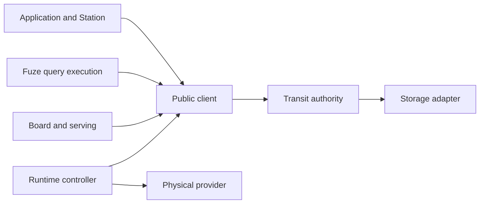

# System model and authority boundaries

Transit separates durable execution authority from the code and infrastructure
that perform work. This account explains that separation and its consequences.
It consolidates the earlier scope, architecture and terminology records; the
[architecture reference](../reference/architecture.md) owns supported interfaces
and the [glossary](../reference/glossary.md) defines names.

## Model and assumptions

A logical process has a durable identity, an ordered mailbox and committed
control state. A worker computes proposals outside the authority. The authority
validates those proposals against current grants, ownership and retained history.
Storage supplies the conditional durability on which acceptance depends.

The trusted boundary includes authority validation, credential handling and the
selected storage/runtime adapters. Application computation is trusted for its
domain meaning: valid protocol bytes do not establish a correct business result.
An authenticated worker is not necessarily an honest or deterministic program.

Arrows denote dependency or access direction, not equivalence of authority.
The node composes core with storage; deterministic core does not import a
provider, application handler or query engine. The
[component directory](../reference/components.md) identifies the concrete owners.

## Why these boundaries matter

| Separation | Reasoning | Failure if collapsed |
| --- | --- | --- |
| PID and worker | Replacing an executor need not replace accepted work | A restart could create a second logical history |
| Permission and ownership | A current owner can lose permission; a reader need not own execution | An old activation or retained handle could bypass revocation |
| History and provider state | Placement reports where work can run, while accepted history determines what may run | An old snapshot could revive a retired identity |
| Kernel and application | Generic validation can enforce commit legality without understanding arbitrary values | Handler correctness could be falsely attributed to protocol validation |
| Query execution and authority | Authorized source reads can support computation without granting mutation authority | A query engine could become an alternate storage or permission path |

These are architectural arguments, not a proof that every implementation path
enforces them. Each claim requires evidence at the boundary where it can fail.

## Alternatives and tradeoffs

Running application code inside the authority would combine computation with
commit validation and expand the authority's dependency and failure surface.
Keeping them separate requires explicit proposal, ownership and recovery APIs.
Similarly, direct backend access could avoid a public read hop but would bypass
the shared checks on authorization, lifetime and source identity. Transit accepts
those interface costs to retain one execution authority.

This choice does not establish throughput or latency superiority. The current
[storage model](storage-runtime.md) still has a serialization boundary, and
[performance evidence](../reference/performance.md) must be evaluated separately.

## Evidence and limits

The [core package](../../../packages/zig/transit-core/README.md),
[public client](../../../packages/zig/transit-client/README.md) and
[invariant inventory](../../../tests/verification/invariants.json) connect the model
to implementation and executable checks. The
[authority and outbox evidence](../../../tests/README.md#authority-effects-and-outbox-evidence)
records tested forbidden outcomes. Reproduction uses the commands and profiles
in that ledger; this consolidation adds no new runtime proof.

The model establishes no global message order, cross-process transaction,
Byzantine tolerance or automatic recovery from rolled-back storage. The
[execution account](execution-model.md) develops the commit argument, and the
[historical architecture](../../history/ARCHITECTURE.md) preserves earlier proposals
and decomposition decisions with their original limits.
