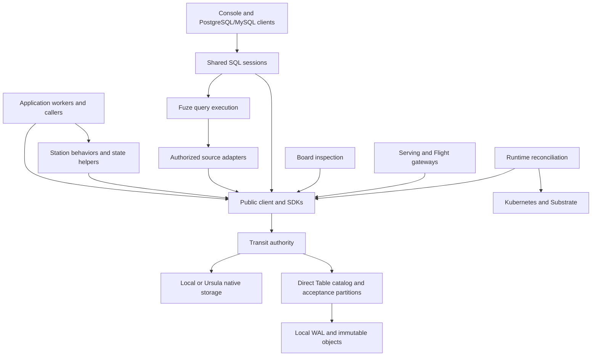

# Architecture and scope

Transit combines stored application data, queries and durable execution under
shared authorization and publication rules. Tables provide typed records and
schema evolution; KV resources retain explicitly encoded values; Documents
provide structured edits and collaborative text. Queries bind those data
definitions to explicit source versions. The [data model](data-model.md) explains
the user-facing lifecycle and its current declarative interfaces.

Durable processes, ordered input and versioned resources support that lifecycle.
Workers propose changes; the authority validates and commits them to durable
history. A worker's memory, a provider's pod and a UI cache are never substitutes
for accepted data or execution progress.

This reference is shared by application authors, Transit contributors and agents.
Start with [the quickstart](../guides/quickstart.md) for an executable local system
and [interface selection](../guides/choose-interface.md) for supported profiles.
The local application server runs on Linux x86_64. The quickstart assumes an
installed local bundle with `transit` on `PATH`; its linked source installation
guide covers building that bundle. Release downloads are not available.

## Data intent and execution responsibility

The user-facing units are data objects, computations and policies. Their
identities and definitions are separate from the processes that carry out their
operations. A Table schema can remain stable while rows change; a query binds a
specific schema and source basis; replacing a worker preserves accepted work.

Inspection connects that intent to evidence: published definitions, original
operation outcomes, completed results and recorded progress. Acceptance alone
does not establish completion, and a completed result does not establish that it
includes newer input. The [system model](../internals/system-model.md#declarations-and-observations)
explains those distinctions and their implementation owners.

Today these operations have separate owners. The Table catalog supplies its
named lifecycle, KV and Documents have resource/service APIs, and typed query
owners supply captured and maintained execution. A common declarative catalog
and automatic scheduling across these owners are not implemented. SQL, SDKs
and Board expose their documented portions of the lifecycle.

## Responsibilities

| Layer | Responsibility | Boundary |
| --- | --- | --- |
| Protocol and core | Identity, ordering, current grants, fencing, lifecycle and atomic commit decisions | No application handlers, provider types or query execution |
| Client | Canonical requests, signatures, bounded reads, private proposals and exact retry | Application code still validates its domain rules |
| Direct Table owner | Names, immutable definitions, row acceptance and retained data cuts | Reuses current native authorization; direct rows do not pass through actor turns |
| Station | Behaviors, durable calls, names, supervision and Document services | Builds above the client; no alternate execution authority |
| Fuze | Typed finite plans, source adapters, bounded execution and Arrow output | No raw storage credentials or kernel authority; no DataFusion/Acero runtime |
| Shared SQL service | Independent logical sessions, account coordination and durable operation recovery for console and database clients | Temporary connection/session state is separate from accepted operation history |
| Connectors | Authorized external attempts and durable capture | Replay reads outcomes; it does not redispatch |
| Serving and Flight | Protocol adaptation, scoped admission and bounded disclosure | A socket, cursor or ticket is not permission |
| Board | Evidence projections and separately configured query/application workspaces | Inspection does not decode arbitrary application payloads |
| Storage and runtime | Persistence and physical process placement | Provider state cannot revive a retired PID or grant ownership |

Transit supplies data and execution infrastructure for downstream applications.
Trading policy, reasoning loops, goals and delegation belong to applications.
LLM and tool access belong behind connector effect boundaries. Transit does not
select a venue, strategy, latency target or monetary representation for you.

## Workloads guide the architecture

Interactive inspection, shared Documents, capture/materialization, historical
research, enrichment, workflow coordination and external execution have different
latency, freshness and recovery needs. The [workload model](workloads.md) records
those requirements and their [multilanguage examples](../guides/workload-examples.md).
Durable accepted data does not require every reader to be a recoverable job.

The shared SQL service gives each console SELECT a fresh result and source
snapshot. Closing the logical session releases active reads; a lease handles
abnormal disconnection. Explicit captured jobs survive session loss. Fuze runs
in the SQL service over retained direct Table cuts and supported native resource
snapshots; low-level Query SDK callers can also execute Fuze in their own process.
[Query execution](queries.md#interactive-sessions) defines that
distinction and the cancellation/cleanup contract.

The local direct Table owner has a separate acceptance partition per Table.
Point data can remain in retained WAL records; bulk writes publish immutable
`.tseg` objects before acceptance. Queries retain the original interpretation
and data frontier, including accepted unflushed rows. Native resources use their
own immutable page/block roots. Bounded result reads check current access before
disclosure. Native physical collection follows explicit roots, storage epochs
and read-lifetime fences. Direct Table physical collection and automatic point
flushing are not exposed; quota pressure does not authorize expiry. See
[storage](storage.md).

To eliminate the write amplification of nesting row records inside copy-on-write
B-tree pages over HTTP streams and funneling bulk data through `128 KiB` actor
turns, the [storage and query architecture](../internals/storage-runtime.md#four-tier-storage-architecture-tseg-segments-and-multi-writer-occ)
separates the **Control & Policy Plane** (`policy_epoch`, catalog identities,
fenced leases), the **Direct Data Plane** (a four-tier memory hierarchy over
pluggable `TransitLog` write-ahead/activation logs and `TransitObjectStore`
immutable `.tseg` hybrid segments, `.tdel` deletion vectors and versioned
Manifests), and the **Process & Effect Plane** (`Station` actors and connectors).
Resident work remains bounded independently of retained data, with separate
execution and control capacity. The [performance reference](performance.md)
records measured improvements, regressions and remaining limits.

## Source of truth

A successful [turn](processes.md) commits state, input progress and outputs
together. Materialized indexes and caches are derived from accepted history.
Validated checkpoints may become essential recovery evidence after a prefix is
trimmed; they are not disposable caches. The configured [storage backend](storage.md)
supplies conditional durability; it does not choose Transit identities or grants.

Execution ownership and permissions are separate. Current authorization applies
to writes, reads and replay. A process association names accessible state but
does not grant access or transfer resource lifetime. See [security](security.md),
[state](state.md) and [retention](retention.md).

## Compatibility is explicit

The [versioning policy](versioning.md) requires one current v1 definition per
Transit-owned protocol before 1.0. Breaking changes use hard cutovers that remove
superseded implementations and update consumers together. Matching version labels
alone do not establish compatibility between builds.

Native v1 uses bounded pages and immutable state roots, allowing retained
collections to grow beyond resident caches. There is no automatic history
conversion across incompatible definitions. Wire formats, service bindings,
SDK ABIs, application revisions and ownership generations retain their own
compatibility checks.

Transit supports local application installation, Station SDKs,
finite HTTP/gRPC effects, structured Documents, finite KV/Table/Document queries,
Table notifications and snapshot refresh, and finite Table Flight SQL.
Cross-resource transactions, general continuous SQL, interactive outbound RPC
resumption, federated identity and general live disaster recovery remain outside
those interfaces.

Kubernetes with Agent Substrate is the reference runtime. Trusted local and
Compose deployments do not provide the same isolation. Restore from an old
backup is not an ordinary worker restart. See [deployment](deployment.md).

## Find an implementation owner

Use the [interface map](interfaces.md) to connect usage, contracts and internals,
the [component directory](components.md) for package interfaces and the
[contributor guide](../guides/contributing.md) for builds and validation. Wire
specifications stay in [contracts](../../../contracts); each package owns its
configuration, APIs and bounds. Public documentation owns the explanation of
current behavior, including limitations and tradeoffs, for every audience.

For deeper mechanisms, design rationale and evidence, see
[Internals](../internals/README.md). Architecture explanations follow its
[scientific standard](../internals/standard.md): claims identify their assumptions,
implementation owners, evidence and limits. Historical proposals keep their
recorded status and do not expand the interfaces described here.
