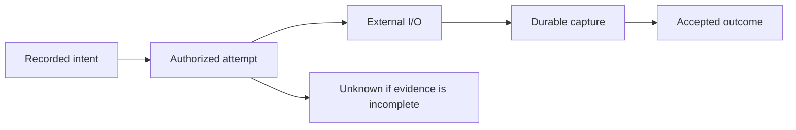

# Effects, HTTP and gRPC connectors

Use a connector when application work must perform external I/O. The application
records intent; a trusted worker obtains authorization for one attempt, performs
the I/O and captures its observations. Recovery reads those records. Replay must
not dial, send, resolve secrets or repeat the effect.

## Intent, attempt and outcome

An intent binds destination, operation, request content, credential references,
capture policy and finite budgets. An attempt adds dispatch identity and its
authorization. A remote outcome is established only by the evidence the connector
can record; admission of intent is not completion of the external operation.

After authorization, an attempt is potentially in flight even if its worker is
paused before sending. Losing a worker, timing out, revoking its grant or closing
the local attempt cannot prove remote rollback. A retry that could execute new
external work needs explicit connector policy and new authorization. Native exact
retry of an already prepared protocol operation is a different mechanism.

Native inspection retains the original authorization grant revision, last
observation input/revision and closure provenance. It distinguishes an accepted
result, exhausted observation budget, explicit abandonment, reached deadline and
cancellation of an unattempted intent. Deadline evidence includes the authority's
trusted clock lower bound. These facts survive exact retry, policy changes and
restart; current rights still govern disclosure. An accepted opaque result
completes the native observation boundary, without interpreting business success.
Board displays this evidence and its shared diagnostic beside the recorded phase.

HTTP and gRPC outcomes also expose an owned diagnostic through every SDK. It
includes the resource-local exchange identity, native effect/attempt and exact
protocol status. A complete HTTP 409/500 or non-OK gRPC response remains an
observed response; it does not establish rollback or make a retry safe. A gRPC
UNKNOWN status differs from an exchange whose remote outcome remains unknown.
Not-dispatched exchanges have no authorized attempt. Rejected calls retain their
admission reason separately from the outcome of earlier work. The rejection
records the original input position and payload commitment, failing field,
validation rule, original cause when one exists, and expected/supplied numbers,
text or digests. Policy, parent state, deadline and attempt-budget failures use
the values observed at the rejecting check. Bounded strings explicitly mark
truncation; withheld and unrecorded values remain distinct. Another caller's
parent and a missing parent produce the same unavailable result. Credential
contents are never included. See the [admission record](../../../contracts/CONNECTOR_ADMISSION_V1.md).

Follow-up policy failures distinguish missing policy, retry-key count/kind/byte
limits, redirect status/Location/scope and the first changed frozen policy field.
gRPC checks separate method, stream shape, descriptor digest, credential reference
and request provenance. Private routing, credential/header payloads and redirect targets are
withheld in policy comparisons; their field paths still identify the failed
check. Correcting a policy does not change an already delivered rejection.

Reply diagnostics mark absent capture causes as unrecorded; retained capture
and native effect inspection supply their own evidence under current rights.
Allocation, storage and trust-file read failures propagate without committing
an admission rejection. An input rejection neither settles previous work nor
authorizes a fresh send.

An accepted HTTP/gRPC call can fail validation during preparation before creating
an effect intent. Its saved route then reports `not_dispatched`. The original
capture diagnostic identifies the failed field, rule, cause and permitted
comparison values; it remains available after restart and exchange retirement.
A changed worker configuration cannot replace an already admitted failure.
Examples include the actual body-size limit, a later invalid header/target piece,
and the credential-reference index that fails policy. Credential contents and
private binding paths remain withheld. Inspection creates no new attempt.

If admission rejects a call, no route or capture exists for it. An `accept`
activation reports the missing admitted call and preserves the correlated
rejection; it does not replace that rejection with a capture lookup failure.

## Capture and publication

HTTP and gRPC reuse the [Exchange contract](../../../contracts/STATION_EXCHANGE_V1.md)
and bounded immutable publication. Requests, captured bodies/messages, observations
and terminal manifests retain stable identity and coverage. Final publication
names bytes already durably staged; an unverified prefix is not a complete body
or result. Control records survive payload disposition as required for recovery.

Record credentials as typed references, not resolved values. Captures preserve
original permitted bytes and mark secret omissions. Decoding and re-encoding a
message is not byte-exact capture. Current read rights govern transcripts and
referenced payloads; knowing their identifiers never grants access.

## Supported transports

| Connector | Implemented profile | Important limits |
| --- | --- | --- |
| HTTP | Finite request/response construction, TLS, strict framing and durable capture | Explicit destination/redirect/retry policy and byte/time budgets; no unbounded live capture promise |
| gRPC | Unary, server-streaming, client-streaming and bidirectional shapes over one frozen finite outgoing batch | Batch and half-close fixed before dispatch; responses cannot authorize later sends; identity compression only |
| Outbound Flight | Recorded selected Flight operations and typed captured Arrow interpretation over the RPC connector | Separate from an inbound Flight SQL gateway; selected types/methods only |

The finite gRPC batch may receive responses concurrently with sending, but it is
not an interactive conversation API. Recovery does not resend a sent prefix or
silently reconnect. Reflection, arbitrary dynamic schemas, compressed messages,
automatic remote-stream resumption and generic inbound application gRPC hosting
are outside that profile.

Transport libraries own HTTP/TLS/HTTP2 framing. Connector policy owns effect
authority, capture, retries and reconciliation. A higher-level service integration
may add domain idempotency/status semantics, but cannot weaken that boundary.
Socket credit and successful writes are not durable remote acknowledgements.

## Unknown outcomes and closure

Declare reconciliation duration, attempt/concurrency and retained-work budgets
before dispatch. Recovery can use captured terminal evidence or an explicitly
authorized remote status/idempotency protocol. A status lookup or remote
cancellation is itself external work; it cannot be hidden in replay.

When evidence remains incomplete, preserve unknown rather than calling it a
safe failure. Once reconciliation closes, late outcomes cannot reopen or overwrite
the closed result. Independent investigation needs new authority. Payload cleanup
cannot recycle an attempt identity or make an old response newly eligible.

Unlimited history retention does not authorize unlimited live calls or retries.
Capacity refusal is explicit. Bound buffers, capture work and each streaming
direction separately while preserving control progress.

## Build an integration

Start with the [HTTP example](../../../examples/station-http/README.md) or
[gRPC example](../../../examples/station-grpc/README.md). Use their owning
[HTTP package](../../../packages/zig/transit-station-http/README.md),
[RPC package](../../../packages/zig/transit-station-grpc/README.md) and
[outbound Flight package](../../../packages/zig/transit-station-flight/README.md)
for configuration and peer compatibility. Wire formats and budgets stay in
[HTTP v1](../../../contracts/STATION_HTTP_V1.md) and
[gRPC v1](../../../contracts/STATION_GRPC_V1.md).

Board can show attempt, timing, coverage and terminal metadata. It does not decode
arbitrary application messages. Logs and traces are diagnostic observations,
not substitute outcome receipts. See [security](security.md) and
[observability](observability.md).

## Table transaction outboxes

Applications can commit an ordinary Table intent alongside Table state and a
Table checkpoint in one [Table transaction](sql/transactions.md). The
[checkpoint/outbox example](../../../examples/table-outbox/README.md) shows that
boundary. A committed intent is eligible for application-controlled delivery;
it does not execute a connector. Dispatch still requires the effect owner's
current policy and a recorded attempt. Replay and aborted private work cannot
authorize dispatch. A missing remote response remains unknown under the connector's
reconciliation policy; local commit never establishes remote success or safe retry.
Native Stream/Queue settlements and Station turn migration are not participants
in this Table profile.
