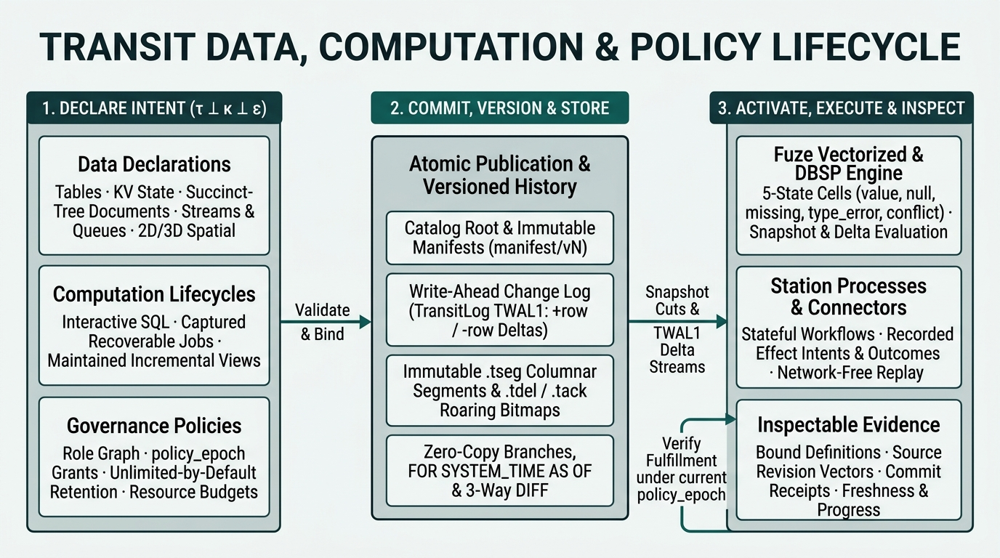

# Data, computation and policies

Transit organizes application data around explicit definitions, versioned
snapshots, derived computations and operations whose outcomes can be inspected.
Start with what the application needs to store and compute, then choose the
interfaces that implement that lifecycle. Durable execution, write-ahead change
streams and connectors supply the ordering, activation, publication and recovery
mechanisms underneath it.

The [local quickstart](../guides/quickstart.md) demonstrates this model with a
Table you create, query and evolve through the console.

[From data to decisions](collaborative-decisions.md) develops the proposed
application experience through stories about enriched resources, shared evidence,
branching within a realm and controlled publication by humans and agents. Its
availability table distinguishes that direction from the operations below.
The [observation and feedback loop](collaborative-decisions.md#the-observation-and-feedback-loop)
explains the product target: useful evidence before a decision and inspectable
consequences afterward, so applications can revise their understanding.

This page connects existing data owners and their contracts. The shared model
below is a way to reason about them; Transit does not yet expose every data kind
and computation through one declarative catalog or automatic scheduler. See the
[system model](../internals/system-model.md) for the formal state-space and
plane-separation analysis.

## Choose a data representation

| Representation | Meaning | Definition and access |
| --- | --- | --- |
| [Table](tables.md) | Typed records with declared columns, nullability, defaults and optional primary keys | A configured direct catalog owns names and immutable definitions; each Table has its own acceptance partition. Use SQL or typed direct callers. |
| [Key-value object](state.md) | Keys and typed values with an application-selected logical value type | Typed direct callers declare named objects, publish atomic batches, read retained versions and compose mutations in native transactions. |
| [Document](documents.md) | Structured maps, lists and collaborative text with accepted revisions and explicit conflicts | Document services and callers own initialization, edits and reads; queries select an accepted projection |
| [Stream](streams.md#stream-payloads-and-consumer-progress) | Schema-bound partitioned event history with retention and optional key compaction policy | SQL declares and inspects definitions. Typed callers also append, read finite retained ranges and explicitly manage consumer progress; workload SQL verbs remain unavailable. |
| [Queue](streams.md#queue-payloads-and-leased-work) | Schema-bound work with ordering, lease, retry and DLQ policy | SQL declares and inspects definitions. Typed callers also enqueue, wait for work, recover original claims and settle exact leases. Native transactions compose ACK, enqueue and explicit DLQ transfer with Table/KV state and Stream progress. Automatic DLQ scheduling and workload SQL verbs remain unfinished. |

Choose the representation for the meaning of the data. A Document field can be
missing or conflicted; an ordinary Table cell is a typed value or SQL NULL; a
foreign or semi-structured field can fail conversion without aborting an entire
scan. The shared query model preserves all five cell states—`value`, `null`,
`missing`, `type_error` and `conflict`—rather than choosing an arbitrary
successful value. [Data types](sql/types.md) and the [Document model](documents.md)
define these distinctions, and the
[query-engine account](../internals/query-engine.md#logical-types-and-physical-codecs-and-collation-semantics)
explains how logical types, physical codecs (such as `FSST`, `COMP-3` and
`EBCDIC`) and collations (`COLLATE`) remain orthogonal.

A data object's scoped identity, its human name, its immutable definition
revision/digest and the process performing a computation are separate.
Table and column identities survive renaming; dropping and recreating a name
produces a different object. A saved operation or retained reader keeps its
original binding. Define application data at the granularity it needs; a row
does not require its own worker or durable process.

See [Tables](tables.md), [KV resources](state.md) and [Documents](documents.md)
for their exact mutation, ownership and lifetime rules.

## Describe definitions, data and dependencies separately

A schema describes how to interpret rows. A query definition describes a
computation and its sources. Published data is the accepted value or revision
that an operation produced. Keeping these distinct makes questions such as
“which schema did this result use?” answerable after later changes.

Dependencies connect that meaning: a query binds source identities and schemas;
a prepared mutation binds its original Table and metadata; a maintained result
records its source revision vector. The direct Table path preserves accepted
read cuts across rename and DROP. The direct owner separately registers exact
definition dependencies and enforces DROP RESTRICT for those registrations;
retained cuts do not register dependencies implicitly. Direct KV and named Documents can be sources or exact dependents. KV binds a
published partition; Document can bind its allocated interpretation before name
publication. Registration uses object metadata ownership separately from data
access. Owners remove edges explicitly after retirement or abandoned-publication
recovery. The typed named-query publication plan freezes the exact bundle and
source registrations before dispatch, then checks their current membership before
returning a native publication command. Registration and publication are separate
acceptances; uncertain publication retains its protection until the original work
is resolved. Logical definition retirement and explicit edge removal are separate
operations, and neither deletes retained results.
The separate catalog metadata helpers inspect explicitly registered dependencies
and do not discover every external reader.

A complete declaration should make its data kind, interpretation, dependencies,
permissions and requested execution lifetime clear. How it becomes usable is
specific to its owner. Compiling an offline definition validates it without
creating data, starting a worker or granting access.

## Choose a computation lifetime

| Lifetime | What the caller asks for | What survives and what to inspect |
| --- | --- | --- |
| [Interactive](queries.md#interactive-sessions) | Execute a finite query against fresh source snapshots | A logical session and bounded cursor; inspect complete rows and source evidence, then close it |
| [Captured](queries.md#recovery-and-display) | Execute a frozen query with recoverable progress and retained results | The original accepted request, input basis, progress and verified result; inspect its recorded outcome after disconnect or worker loss |
| [Maintained](queries.md#relational-boundary) | Publish successive complete results as source history advances | The definition, recorded source vectors, completed revisions and deltas; inspect the last complete result and any stopped or pending successor |

Supported operators and callers differ by lifetime. The console executes finite
interactive queries and has explicit captured query operations. Typed Zig owners
also support captured and maintained relational queries. Maintained activation
and wakeups require an authenticated host; there is no automatic SQL materialized
view service. Each recorded source basis is currently recomputed with the finite
relational executor. The [query reference](queries.md) owns these profiles and
their budgets.

Reading a query definition starts no work. Named relational publication,
authorization and activation are separate operations. Changes to a name cannot
relabel an already accepted query. [Named definitions](applications.md#contracts-and-commands)
retain that attribution.

## Govern access and lifetime

Policies answer who can use an object, what work may run, and how long data and
history remain available. They have distinct owners:

- **Authorization:** database, schema and Table privileges govern catalog data;
  native resource rights and execution ownership have their own checks. A name,
  cached schema or old snapshot does not preserve a revoked permission.
- **Retention:** accepted history is retained without expiry by default. An
  explicit supported policy can permit expiry; disk pressure cannot consent to
  deletion on the application's behalf.
- **Execution budgets:** reads, compute, staging and result delivery have bounded
  work and memory. A valid definition can still require a larger allowed budget
  or an unsupported operator.

Use [security](security.md), [role and schema administration](sql/authorization.md)
and [retention and capacity](retention.md) for configuration and exact controls.
SQL query sessions do not apply the authorization compiler's administrative plans.
Cross-owner policy and catalog operations do not form one atomic transaction.

## Inspect whether a declaration is being fulfilled

Compare the requested definition with the evidence its owner exposes. A useful
observation identifies the object and definition revision, the data basis, the
operation or query identity, and the meaning of its outcome.

| Question | Current evidence or interface | How to interpret it |
| --- | --- | --- |
| Is my Table, KV or Document published with the intended shape? | [Console `SHOW TABLES` and `DESCRIBE`](sql/show.md), typed catalog lookup, or named-resource operation inspection | Table and direct KV evidence describe catalog and partition acceptance. Named Document publication verifies the original native allocation and initialization marker. Current data access and lifetime remain independent checks. |
| Which computation definition produced this result? | `NamedRelational.capturedDefinition` or `maintainedDefinition` on a retained result/revision reader | Resolves the original immutable named definition through the actual result snapshot, even after another definition is published. Inspection starts no execution and does not certify unread output or advance a maintained checkpoint. |
| Will my DDL intent pass admission checks? | Direct catalog `preview` | Checks current rights, exact expectations, name/object conflicts, registered DROP dependencies and schema work without admission or mutation. Row constraints and final publication still require execution; preview is not a reservation. |
| Did my write or schema change apply? | Direct operation `inspect`, [console statement result](../../../apps/transit-cli/docs/console.md), or `DirectTableIntent.operation` | Admission, execution and committed/rejected/cancelled outcomes are distinct. The original saved identity survives lost replies. Point and bulk data use the direct owner independently of actor turns. |
| What does this object depend on, what depends on it, and which policies govern it? | Catalog `dependents`, `dependencies` and `policyReferences` | `dependents` and `dependencies` expose the object-level dependency graph filtered by caller inspection rights; `policyReferences` reports authorization domains, capacity limits and retention while redacting internal authorization object IDs when the caller lacks `SELECT` (`read`) privilege |
| Which data did this query read? | The query's [bound schema and source snapshots](queries.md#relational-boundary); complete result coverage | Independently captured resources need not represent one global or causal snapshot |
| Is a completed computation up to date? | Typed result reader `freshness` and its [actual source vector](queries.md#relational-boundary) | Compares retained cuts with current logical row-change positions. Definition drift, stale data and observation errors remain distinct; independent Tables have independent observations. Named result/revision inspection binds to its original definition. |
| Can this caller still inspect or use the result? | [Current authorization](security.md) at metadata and result disclosure | A retained result or permission checked at admission does not authorize later disclosure |

These observations are available through their owning interfaces; a single
catalog-wide declaration health view is not provided. [Board](../guides/inspect-board.md)
presents its configured inspection/query/application views. The
[interface map](interfaces.md) locates the relevant APIs and contracts.

If a result is delivered in pages, wait for successful completion before
installing it as a complete replacement. A maintained consumer similarly applies
a complete revision or delta and saves its position together. Partial delivery
cannot establish a complete relation or justify skipping missing history.

## Understand change and history

Table schema evolution validates existing rows before publishing a successor.
Readers keep their original schema and cut until their read lifetime ends.
Complete Table snapshot-and-tail capture preserves transaction boundaries,
including updates, deletes and schema changes. Coalesced watch notifications
instead tell a viewer to refresh; they do not contain every intervening change.
See [Table change capture](tables.md#snapshot-and-change-capture) and
[reactive views](reactive.md).

A retained data revision, a schema revision, a source progress position and a
storage checkpoint answer different questions. Current resource snapshots and
history do not expose general historical SQL, writable branches or arbitrary
cross-resource transactions. The [historical-read reference](sql/as-of.md) and
[query consistency model](queries.md#relational-boundary) specify those limits.

The direct Table owner also supports [named immutable Table branches](tables.md#immutable-table-branches).
Each branch retains one explicitly selected definition/data cut, including
unflushed rows, while its parent advances. This does not establish a whole-catalog
snapshot or branch write, merge or restore support.

## Declarations and current interfaces

The product direction is to describe data, computation and policies together,
then inspect their lifecycle through consistent public operations. The current
interfaces provide different portions of that experience:

| Declaration | Available today | Remaining public lifecycle |
| --- | --- | --- |
| [Tables and schemas](tables.md) | Direct CREATE/ALTER/RENAME/DROP, read-only preview, frozen DML intents, atomic point/bulk acceptance, retained reads and supported physical codecs through configured SQL and typed callers; explicit exact-definition dependency registration and DROP RESTRICT; namespace lifecycle with RESTRICT over live/pending Tables; automatic bounded local point flushing | Automatic tiering; text relational joins/grouping and broader transaction sessions |
| [KV](state.md) | Typed direct declaration, atomic batches, point reads, retained pins, original-operation recovery, rename and DROP; scoped policy and dependency restrictions; native mixed transaction participation | Executable console SQL publication and query syntax |
| [Documents](documents.md) | Typed named-resource admission, original caller allocation, actual writer initialization, publication, rename, logical DROP and inspection; exact dependency registration and DROP RESTRICT; offline SQL definition compilation | Executable console SQL publication and automatic dependency reconciliation |
| [Named captured/maintained relations](queries.md#relational-boundary) | Immutable definitions, saved exact source registrations, separate authorization and explicit activation through typed Zig owners; definition retirement, original result/revision attribution and actual source-vector freshness | Atomic cross-owner publication/reconciliation; SQL view/subscription adapters and automatic service-managed scheduling |
| [Connections, connector sources and sinks](connectors.md) | Recorded connector operations and explicit application source bindings | Executable SQL declarations and shared dependency administration |
| [Permissions](security.md) and [retention](retention.md) | Native authorization, selected SQL administration plans, `policyReferences` inspection with read-privilege redaction, and explicit supported retention policies | One declaration/reconciliation surface covering all data kinds and computations |

The [SQL capability inventory](sql/grammar-surface.md) identifies executable,
offline and grammar-only statements. The lifecycle gaps above describe product
direction, not additional accepted syntax. Custom workers and
[connectors](connectors.md) remain extension points for application behavior;
external dispatch always requires its own authorized recorded operation.
