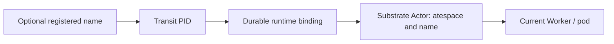

# Deployment and runtime boundary

Engineering background and historical design. Use [Deployment and recovery](../reference/deployment.md)
for the current public explanation shared by users, developers and agents.
Consult this record for rationale and proposals; it does not extend a qualified profile.

Start with the [local quickstart](../guides/quickstart.md) for a single-user
installation, [launchers](../../launchers/README.md) for development topologies, or
the [reference runbook](../../deploy/reference/README.md) for Kubernetes/Substrate.
This page explains what physical recovery can and cannot authorize.

Status: Kubernetes with Agent Substrate is the selected reference architecture
and recommended execution target. The bounded M1 runtime is implemented; broader
portability remains planned. Use the [reference runbook](../../deploy/reference/README.md)
for setup, the [controller](../../apps/transit-runtime-controller/README.md) for
operation, and the [test guide](../../tests/README.md) for proved recovery/isolation.

## Development path

[Launchers](../../launchers/README.md) expose native local, Docker Compose, and
reference task groups. Local and Compose run persistent development systems
through the same public protocol, with disk storage, separate inspection and
maintenance credentials, and a real example caller. Native process management
and container lifecycle do not substitute for Substrate runtime bindings.
These trusted development profiles use direct recorded ownership; the reference
adds provider reconciliation and sandbox execution. Reference `up` installs the
complete persistent application, including its in-cluster controller; recovery
and isolation proofs use separate installations.

The implemented [M6 launcher milestone](roadmap/M6.md) separates candidate
builds, service updates and same-PID workload upgrades. Each installation selects
identified artifacts and retains its durable state. Application stop/start is
separate from destroying the reference cluster.

[Service instrumentation](OBSERVABILITY.md) uses the same event meanings
across these profiles, with executable-owned configuration and bounded sinks.
Service, launcher and provider diagnostics identify their own instances; telemetry
availability never determines Transit ownership or changes retention authority.

## Transit CLI, applications and planned publication

[M25](roadmap/M25.md) extends the neighborhood with public application installation,
attachment and compatible worker replacement. Its first consumer is a separately
compiled Zig application over a language-neutral declaration/bootstrap contract.
The manager owns physical processes and recoverable provisioning; native grants
and ownership remain execution authority. Application revisions are separate
from the pinned neighborhood artifacts, data epochs and interface publication.
The existing migration ledger remains application-owned. The
[version-2 local profile](../../apps/transit-cli/docs/applications.md) now qualifies
two installed applications, separate caller keys, compatible replacement and
exact recovery across lost replies and process/store interruption. Real ENOSPC
preserves accepted work. The fixed M24 source/requester remains the version-1
default; neither profile permits an implicit pinned-neighborhood upgrade.

[Transit CLI M24](roadmap/M24.md) formalizes `transit server` as a foreground
supervisor/gateway for a functioning locally placed Transit service neighborhood.
The implemented [local Table profile](../../apps/transit-cli/docs/server.md) composes
disk Ursula with S3 cold storage, authority, maintenance, delivery, separate query
workers and a credential-free native gateway. Focused proofs exercise interrupted
initialization, independent console queries, fresh ownership after process loss,
restart exhaustion, joined shutdown, gateway pressure and real disk exhaustion.
Observed provider rollback refuses recovery. Native OS process management remains
separate from Station supervision and durable PID ownership; any missing local
runtime reconciliation contract must be qualified before automatic recovery is
claimed. Existing launchers retain their independent development entry points.
The implemented [console](../../apps/transit-cli/docs/console.md) connects through
signed, currently authorized operations, with explicit endpoint/trust selection
and opt-in exact recovery files. Its qualification is recorded separately from
the server lifecycle work; a local recovery file never becomes authority.

[Publication M29](roadmap/M29.md) formalizes tag-triggered GitHub release artifacts
and installation via Nix flakes/derivations, verified archives and a shell
installer, Homebrew, Docker/OCI images and Helm packages. Its artifact manifest
must identify required external services, supported platforms and compatibility.
Installing or upgrading a package does not initialize authority or authorize a
worker. Durable data and credentials remain outside immutable artifacts; each
channel needs its own installed-consumer and upgrade evidence. Local operation
and published packages do not replace Kubernetes/Substrate as the reference or
close [M30](roadmap/M30.md)'s cluster and disaster-recovery gates.

## Reference architecture

The checked-in [Transit Helm chart](../../charts/transit/README.md) packages the
current service topology. The reference proof consumes it with explicit values
and separate credentials; it no longer defines those deployments in Python.
Bootstrap, lifecycle limits, optional services, and chart operation live in its
README. Both the persistent launcher and isolated proofs consume it; provider
infrastructure setup is shared, while fault injection remains in the test harness.

Kubernetes manages the infrastructure that hosts Transit, persistent Ursula, and
Agent Substrate. Substrate supplies sandbox execution and worker lifecycle.
The `transit-runtime-substrate` adapter translates Transit's committed lifecycle
intent into those operations and records observations back into the protocol.
Process execution authority stays in the durable history.

The initial mapping hosts one Transit PID per Substrate Actor across worker
replacements. The [adapter](../../packages/zig/transit-runtime-substrate/README.md)
owns provider naming, templates, snapshot restrictions, and identity validation.
PID, Actor incarnation, worker/pod, and activation generation remain distinct.

| Boundary | Responsibility |
| --- | --- |
| Transit | PID lifecycle, ordered mailbox, committed state/progress, ownership generations, and effect authority |
| Runtime adapter | Durable PID-to-provider bindings; reconciliation of lifecycle intents, provider operations, and observations |
| Agent Substrate | Sandbox placement, worker assignment, activation, suspension, and snapshot lifecycle |
| Kubernetes | Infrastructure capacity, pods, and supporting cluster resources |

Transit uses Substrate's placement and sandbox lifecycle machinery. Its own
controller determines which logical processes need execution and reconciles
their bindings; it need not duplicate Substrate's worker scheduler. See the
[runtime contract](../../contracts/RUNTIME_SUBSTRATE_V1.md) for the implemented
provider reconciliation profile.

The initial reference topology should include:

- Persistent Ursula and a private protocol admission/commit boundary.
- Zig kernel services and runtime reconcilers with narrowly scoped credentials.
- Substrate worker pools and templates hosting Transit process execution.
- Connector workers with distinct effect and secret capabilities.
- Rebuildable inspection views and failure/lag metrics.

Kernel/control services and Ursula need not themselves be sandboxed as
application processes. [Board](BOARD.md) is an optional inspection service
whose deployment controls private viewer access. It uses its own authenticated,
read-only Transit identity; Board itself has no viewer keys or sessions.
It hosts the embedded frontend and API together and needs no Ursula, Substrate,
or Kubernetes credentials. M2 qualifies this separately from worker isolation.

## Bootstrap and disaster recovery

The deployment must supply trusted identity roots and a fixed bootstrap location
for the realm's durable control catalog. Idempotent initialization records realm
genesis, initial grants, process/stream allocation, and control-resource mappings.
An ordinary restart recovers those records before serving applications; it must
not interpret an unreachable store as an empty installation or mint new PIDs
for unresolved spawn requests. Application registries are downstream of this
bootstrap, not a dependency required to discover it.

System authorities need an explicit lifecycle outside application suspension
and retention defaults. Recover policy revisions, ownership generations,
retirement facts, and pending maintenance from validated durable state; never
reset them from an old worker image or an empty cache. Protect bootstrap/control
records with separate administrative grants and retention rules described in
[SECURITY.md](SECURITY.md) and [RETENTION.md](RETENTION.md).

Restoring an old backup is different from replacing a worker against current
storage. The backup may predate revocation, process expiry, or an externally
completed effect. M1 does not support automatic live restore from rolled-back
history. M30 must prove an explicit procedure that fences the old deployment,
establishes a new recovery generation/trust state, and reconciles external work
before activation. A clone used for inspection is read-only; a new live import
needs explicit identity and effect lineage. Neither may redispatch old attempts
or revive retired identities just because the backup contains them.

## Runtime bindings

The proposed mapping is:

The registry answers which logical process a name denotes. The runtime binding
answers where that process is hosted. Substrate resolves the current physical
worker. Message admission continues to address the PID when placement changes.

Binding responsibilities below are provider-neutral; the implemented encoding
is defined in the [v2 runtime contract](../../contracts/TRANSIT_V2.md#runtime-bindings-and-activation):

| Field | Purpose |
| --- | --- |
| PID | Fully scoped logical process identity |
| Binding identity and revision | Identify the hosting association and reject stale updates |
| Provider kind and runtime instance | Distinguish Substrate or another adapter and the specific installation/cluster |
| Provider resource reference | Identify the resource in its provider scope, including incarnation/UID where available so name reuse cannot adopt an unrelated resource |
| Workload version | Identify immutable image/template and code/schema versions compatible with process history |

Desired association and validated provider observations are recorded separately,
with operation IDs and revisions connecting them. Provider-specific fields live
in adapter contracts; the core protocol handles opaque references. A resource
name alone is insufficient when a provider allows deletion and recreation. If
there is no immutable resource ID, the adapter must prove equivalent incarnation
tracking and reconciliation or reject the ambiguous resource.

Begin with **one Transit process per Substrate Actor**, retaining that Actor
across multiple activations. A new ownership generation does not require a new
Substrate Actor. Worker replacement, suspension, migration, or provider resource
replacement preserves the PID; logical termination retires it. Binding revision,
provider incarnation, and activation generation are separate dimensions. An
active provider resource or matching binding never grants commit authority.

Later, one sandbox may host multiple Transit processes if each retains its own
PID, mailbox, and ownership. Those processes would share a failure, suspension,
snapshot, and isolation boundary. Multiplexing therefore requires explicit
lifecycle and isolation policy; independent process identities do not promise
independent sandbox isolation.

## Why AX is excluded

AX introduces a task store and controller work queue backed by Redis, as described
in its [design](https://github.com/google/ax/blob/main/DESIGN.md). Transit owns
those execution semantics through the kernel protocol and durable streams.
Adopting AX would introduce another source of task authority to reconcile, so
it is excluded from the architecture.

Substrate and Kubernetes may keep their own infrastructure and sandbox state.
That operational state is legitimate within their boundary; it must not become
the authority for Transit message acceptance, completed turns, or effect eligibility.

## Reconciliation and recovery

Runtime reconcilers consume committed lifecycle intent and mailbox readiness.
They may derive ready queues or indexes for efficient scheduling, but recovery
must rebuild them from durable history. A lost notification must not strand an
inactive process with accepted work. Specify the stream-to-activation bridge;
do not assume Substrate automatically watches Ursula.

The initial activation path must establish these observable boundaries:

1. Admit the message durably to a live PID's mailbox.
2. Reconcile its backlog and lifecycle policy into recorded activation intent
   and a runtime binding. Notifications accelerate this step; backlog scans
   recover lost wakeups.
3. Create or resume the provider resource through a recorded operation, then
   reconcile its observed resource identity and binding revision.
4. Validate current ownership, lifetime eligibility, and the durable recovery
   basis before allowing the worker to consume the mailbox and commit under
   its activation reference.

All providers, including Substrate's automatic wake/resume path, obey the
application's [process/mailbox lifetime contract](RETENTION.md). Reject requested
suspension outside the validated resumption bound. A late wakeup for an expired
PID cannot authorize execution, even if the provider successfully restores its
sandbox. Runtime cleanup follows the terminal record as a separate operation;
provider activity does not renew the lifetime.

Provider create/resume/suspend/destroy calls are external effects. Use stable
operation identities and recorded intents/results. Where an API lacks an
idempotency key, query and reconcile existing resources before retrying. A
controller crash after creation but before recording the result must recover
or adopt the intended resource without producing duplicate authorized executors.
There is no assumed transaction spanning Ursula and a provider API.

Worker loss triggers recorded recovery and a fenced replacement activation of
the same PID. Binding replacement or migration must reconcile pending provider
operations and invalidate stale authority before work can commit at the new
location. Suspending or stopping a sandbox alone proves neither fencing nor
logical process termination.

A compatible workload upgrade also preserves the PID. Transit records the old
and new workload identity after fencing and reconciling suspension; the adapter
switches the existing Substrate Actor to a new immutable template, then a fresh
worker obtains a new activation. The current contract preserves opaque state
without conversion. The deployer declares compatibility; neither a healthy pod
nor protocol validation proves it. See the
[upgrade contract](../../contracts/RUNTIME_SUBSTRATE_V1.md#same-pid-workload-changes).

Treat sandbox snapshots as execution caches tied to PID, binding revision, code
version, history position, and activation reference. Restored code may run with
old memory and credentials before a resume handshake completes. The trusted
commit and dispatch authorization boundaries must reject that stale authority
regardless of workload cooperation. Revalidate against current history and rebuild stale
state; restored files cannot roll back newer records or redispatch a completed
effect. Reconcile in-flight effects under their recovery policy.

## Isolation

Authentication and protocol permissions follow [SECURITY.md](SECURITY.md).
Authenticate service-to-service traffic and bind worker identity to the granted
PID/activation. Kubernetes service accounts/RBAC and Substrate identity are
provider mechanisms, not permission to perform Transit operations. Keep runtime
control, storage administration, effect dispatch, and application credentials
separate; restored credentials must pass current ownership and policy checks.

Substrate currently documents authentication without authorization/RBAC. Its
control credentials therefore belong only to trusted controllers/operators,
with network and credential boundaries preventing workload access. This is an
M1 integration gate, not a feature to assume from atespace naming. See
[upstream authentication](https://github.com/agent-substrate/substrate/blob/main/docs/authentication.md).

Application workers may reach only the protocol surfaces and capabilities they
need. They must not reach raw Ursula write/admin APIs, runtime control APIs, or
arbitrary external services. Connector workers receive separately scoped egress
and secret access. Runtime observations become validated records before they
change process execution state.

Substrate documents an egress policy path; validate it against the selected
revision and sandbox mode rather than assuming all isolation requirements are
already satisfied. See [egress traffic](https://github.com/agent-substrate/substrate/blob/main/docs/egress-traffic.md).
The [caller execution boundary](CLIENT.md) keeps application computation outside
the authority. Network isolation does not establish deterministic native-code
execution or honest computation; the [proof guide](../../tests/README.md) states
what the reference workload actually demonstrates.

Use a fixed reviewed workload image in M1. Pin code, configuration, and schema
identity in activation grants. Untrusted native plugins or multiple differently
privileged processes in one sandbox require a separately proved isolation
boundary; shared Zig address space cannot provide it.

## First milestone and portability

Kubernetes deployment and worker-failure recovery belong in M1. Pin and exercise
the Substrate baseline as part of the minimal reference slice, with reproducible
cluster setup and prerequisites. Upstream is in early development and marks
parts of its design as aspirational; record observed behavior and integration
gaps alongside tests. See [upstream status](https://github.com/agent-substrate/substrate#status-and-compatibility).

Kernel envelopes use logical identities and protocol versions. Kubernetes
resource names, cloud credentials, sandbox snapshots, and provider APIs remain
inside adapters. Every deployment architecture needs an explicit runtime binding
and the same conformance contract: scoped resource identity, reconciled lifecycle
operations, activation ownership, effect isolation, durable observations, and
recovery from history. Provider state may help locate a worker; it cannot replace
Transit's authority for whether work was accepted or completed.

Sandbox snapshot support is an optional optimization. Another provider can
cold-start workers and reconstruct state from sufficient history or a durable
protocol checkpoint plus retained tail, preserving the same PID/mailbox lifetime
semantics. Required protocol checkpoints are independent of provider memory
snapshots. Keep a lightweight local adapter for development and conformance with
explicit isolation limitations; reference cluster conformance remains required.

Separate worker/pod recovery from loss of storage disks, hosts, or a region.
The first reference deployment proves its documented failure boundary. Broader
availability, backups, and multi-cloud operations need their own evidence;
portability does not imply those deployments already exist.
