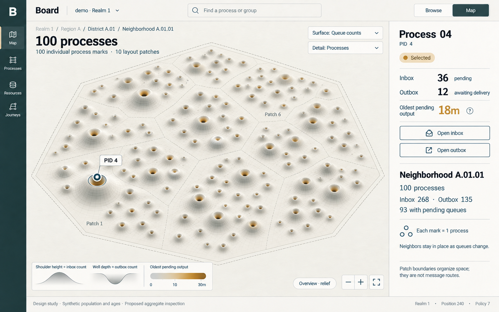
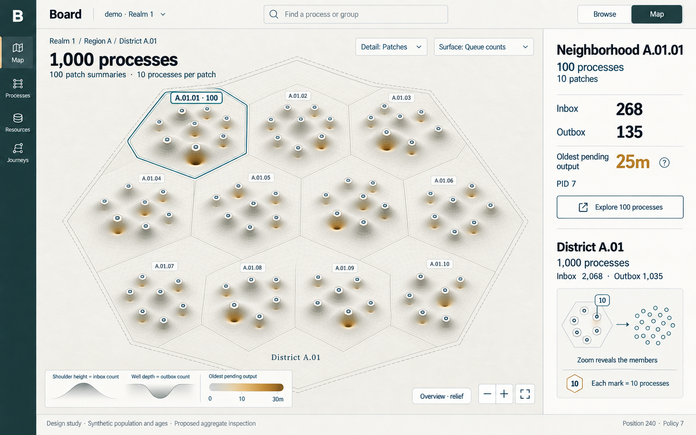
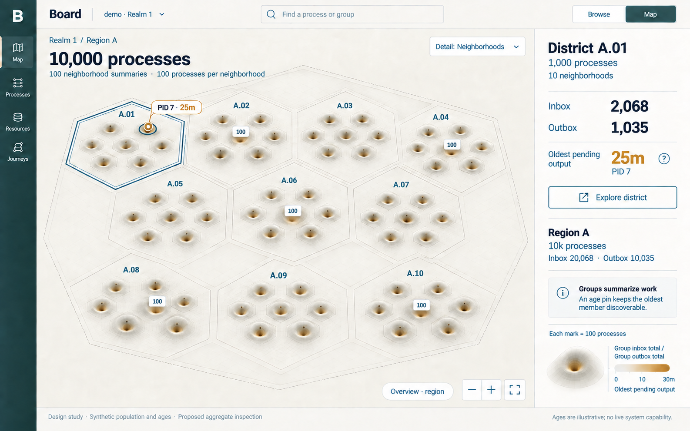
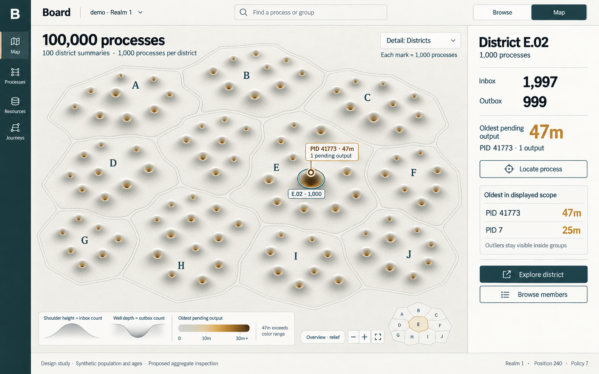

# D3 — Board fabric at 100 to 100,000 processes

Previous: [D2 — Inbox, outbox and age](D2.md) · [Review index](README.md) · Next: [D4 — Million-to-billion scale](D4.md)

Status: **Reviewed**. Implementation: **Not implemented**.
The scale visuals received positive feedback; grouping and aggregation remain open.

## Question

How should neighboring processes be grouped and represented when a fabric
grows from 100 to 1,000, 10,000 or 100,000 processes?

## Proposal

Build on [D2's selected queue-count fabric](D2.md#figure-7-queue-counts-with-age-on-the-well-walls):
inboxes lift a shoulder, outboxes press a narrower well into it, and age colors
the inner walls.

Give processes stable homes inside meaningful groups, then replace individual
marks with group summaries as they become too small to read. Keep roughly the
same visual complexity across scales. Preserve unusual individual processes
through a bounded set of labeled pins and a sortable list.

## Visual studies

### Figure 10: One hundred: keep the individual fabric

At this scale, individual shoulders and wells remain useful. Most labels can
stay hidden until hover, keyboard focus or selection. Light seams organize
neighbors without turning the map into a wall of cards.

Process 04 keeps Inbox 36, Outbox 12 and oldest pending age 18m from the earlier
study. Its neighborhood contains 100 synthetic processes, with Inbox 268 and
Outbox 135. Ninety-three have at least one pending inbox or outbox item; the
other seven remain discoverable as flat anchors. Empty queues do not establish
worker idleness or health.

**Review:** this is about the upper density at which we should test individual
landforms at this viewport size. It is a starting point for usability testing,
not a fixed threshold. The generated drawing approximates the population;
it does not contain an audited one-to-one rendering of the fixture.

### Figure 11: One thousand: summarize small patches

The overview now uses about 100 summary marks, each representing a patch of
10 processes in this deliberately regular fixture. Ten patches form a
neighborhood. The selected neighborhood still has Inbox 268 and Outbox 135;
the enclosing district has Inbox 2,068 and Outbox 1,035.

A summary has a polygon outline, a member count and a clear detail label.
A process keeps its circular identity marker. Selecting a group opens its
summary; **Explore** zooms into its members. It must never masquerade as a
single PID with a large queue.

**Review:** the original material survives aggregation. The marker shapes and
member counts need to be stronger than they are in this raster. A shipping
view should say **group inbox total** and **group outbox total** in the legend,
including when compact labels omit the word group.

### Figure 12: Ten thousand: neighborhoods become the landforms

Each mark now summarizes a neighborhood of 100 processes. The view contains
100 neighborhood summaries arranged inside 10 districts. There is no need to
draw ten thousand tiny process meshes.

The selected district contains 1,000 processes, Inbox 2,068 and Outbox 1,035.
A separate pin identifies PID 7's oldest pending output at 25m. The pin refers
to a member within the selected group; it is not an additional queue or a
second landform.

**Review:** district seams start to supply useful landmarks. Searching for a
PID should take the user through those landmarks while keeping its inspector
available, rather than asking them to visually hunt through the entire realm.

### Figure 13: One hundred thousand: regions and individual outliers

The realm overview uses 100 district summaries, each covering 1,000 processes
in this fixture, arranged in ten regions. Regions A–J are layout groups inside
**one realm**, not additional security realms or provider namespaces.

PID 41773 has no pending inbox items and just one pending output, aged 47m.
Its district has Inbox 1,997 and Outbox 999. That one output could disappear in
a count total or mean age. A labeled pin and the **Oldest in displayed scope**
list retain a direct route to it.

The 47m value exceeds the illustration's 30m color range and is explicitly
labeled. Color saturation is not a cap on age, an incident threshold or expiry.
At this distance the pin anchors to the containing district. Locating the PID
reveals its actual process anchor as the group opens.

**Review:** the map answers where work is concentrated; the ranked list answers
which individual item warrants inspection. Both are needed at this scale.
Pins are bounded and ranked, not a guarantee that every unusual PID is labeled.

## Design details

### What the same number of marks means

| Population in scope | Primary mark | Processes per mark in this fixture | Visible organization |
| --- | --- | --- | --- |
| 100 | Process | 1 | 10 layout patches |
| 1,000 | Patch summary | 10 | 10 neighborhoods |
| 10,000 | Neighborhood summary | 100 | 10 districts |
| 100,000 | District summary | 1,000 | 10 regions |

The counts are illustrative, not rules that every real group must contain
exactly ten children. The pictures deliberately keep approximately 100 primary
marks. A production level of detail depends on projected size, label collisions,
device capability and viewport, not just the total population.

Patch, neighborhood, district and region are **presentation vocabulary**.
They add no Transit process, Station behavior, ownership scope or grant.

### Which processes should be neighbors?

Use a stable structural layout as the initial candidate. Show the grouping
basis in the UI and preserve it when switching between Map and Browse.

| Grouping basis | Why it helps | Evidence and limitation |
| --- | --- | --- |
| Recorded Station supervision | Related children stay close to the structure that manages them | Use authorized, versioned child records with PID/resource/key/revision provenance; do not infer an undisclosed parent |
| Explicit layout collection | An operator can organize a useful workload view | Proposed versioned configuration with visible provenance, not a new mutation route in inspection-only Board |
| Registry scope | Useful alternate view of a service's names | An alias can change and one PID can have multiple names; deduplicate by PID and expose the chosen grouping rule |
| Stable identity cells | Every process needs a home, including unnamed or unclassified ones | Deterministic layout within the disclosed scope; adjacency conveys no causal relationship |
| Recorded message relationships | Useful to inspect who sent work to whom | A separate, bounded overlay around a selection, with both endpoints authorized; traffic does not continuously rearrange homes |

M9 supplies [framework lenses](../../../../packages/zig/transit-board-api/README.md)
for authorized Station declarations. It does not supply a complete, global
supervision tree or a new bulk group endpoint. Unknown versions, unavailable
entry reads, ambiguous parentage and non-Station processes retain a useful
generic view.

For the structural view, assign each visible PID one primary home. Follow a
recorded parent only when the authorized evidence establishes it unambiguously.
Treat cycles or conflicting claims as unresolved structure, not as permission
to invent a hierarchy. Put a PID with no established parent in the generic
layout; multiple registry aliases become references, not duplicate queue counts.

Within a large semantic group, split space into stable layout cells. Keep the
semantic group boundary visible around those cells, rather than claiming every
cell is a supervisor. A large group can span several cells and a small group
need not be padded to an artificial minimum.

Avoid continuously packing by current backlog or recomputing a moving
relationship graph. Queue changes should deform the existing fabric. Keep
empty processes as anchors, reserve room for additions, and make membership
changes explicit. Stable slots belong to a versioned layout; an explicit
re-layout can improve a fragmented map while preserving PID-based links and
the selected inspector. Revoked data must still be cleared immediately.

The images use a synthetic identity partition to make the four scales easy to
compare. Their evenly sized groups are not claimed to be Station supervision
or operator-declared business units.

### Aggregate the facts, then draw the fabric

For a disclosed set of unique member PIDs at a compatible observation:

- **Inbox total:** sum the pending inbox counts.
- **Outbox total:** sum the disclosed still-pending source output records,
  counting each output identity once.
- **Members with pending queues:** count PIDs with either count greater than
  zero. This is distinct from process population and lifecycle.
- **Oldest pending output:** take the maximum qualified age and preserve its
  source PID/output reference. Include an age distribution and evidence coverage
  in the group inspector; never average away an old item.

Do not add parent and child totals together. Every primary visible summary
covers a disjoint set of members. Pins and aliases point into those sets and
contribute no extra counts. One message can legitimately appear as a source
pending output and as a destination inbox admission before source resolution;
Inbox and Outbox remain separate measures, not a deduplicated global work total.

Draw the shoulder from the inbox total and the well from the outbox total.
Keep depth relative to the shoulder, as in D2's Figure 7. Use a disclosed compressed
scale, such as log1p, when totals span large ranges; show exact numbers in the
inspector and a count-to-height legend. Do not sum already transformed heights.

Hold a scale fixed for comparable marks at the same level and scope. Changing
the aggregation level explicitly changes the legend; a parent peak's height
is not directly comparable to a child peak under a different scale. Do not
silently rescale while panning or as new responses arrive. The screenshots
illustrate form and hierarchy rather than a calibrated height transfer function.

Age tint can show the oldest qualified member, but the inspector must reveal
how concentrated that age is. District E.02's dark well does not mean all 999
pending outputs are 47m old. Unknown timestamps make an unqualified maximum
unavailable. Empty, unknown, partial and stale remain distinct, following the
[fabric age rules](D2.md#age-requires-a-new-evidence-contract).

### Zoom and find without losing the place

Scroll zoom stays anchored to the pointer. Clicking selects; an explicit
Explore action or continued zoom opens the selected group. Reveal children
inside the parent's footprint before removing its summary, with a short
transition that never presents parent and child totals as additive.

Use different enter/exit thresholds so small zoom movements do not repeatedly
toggle the detail level. Keep one primary aggregation level per overview for
easy comparison; a selected inset can expose detail without silently mixing
group sizes. Both upward and downward relief fade near reading distance,
ending in the same flat Inbox/Outbox inspector explored in D2's Figure 9.

A PID search must work without loading every process into the browser. A
proposed authorized lookup returns its group path and member location.
Breadcrumbs, Back, a small locator and a shareable PID/layout route preserve
orientation. A moving alias does not change the identity in that route.

A proposed **Oldest in displayed scope** view fetches a bounded ranked set
under the same filters and disclosed coverage as the fabric. Show only a few
pins when labels fit, retain the complete returned list in Browse, and allow
paging or narrowing the query. This is not a sample presented as a global top
list. If the query only covers loaded cells, say so.

Keyboard users can navigate the group tree and member table, open the same
inspector and follow the same breadcrumbs. Reduced motion and a flat mode keep
every action available without interpreting depth or using a pointer.

## Review outcome

The reviewer liked the scale visualizations and recognized the increasingly
organic, cellular appearance at 100,000 processes. They requested an extension
to 1 million, 10 million, 100 million and 1 billion processes, plus more space
and less duplicated UI. [D4](D4.md) explores those changes.

No specific grouping basis or aggregation contract was selected. D2's Figure 7
remains the visual baseline. D4 proposes replacing the persistent inspector,
mini-map and repeated statistics in these compositions with a full-width map
and contextual inspection; the earlier images remain here as review history.

## Open questions

- Which grouping basis should be the default: recorded structure, explicit
  collections or stable identity cells?
- At what projected size should a group replace its members, especially for
  uneven populations and narrow screens?
- Which outliers should remain pinned, and how should a user discover the rest?

## Evidence and limits

These pictures explore future inspection, not current capacity. M9 is now
[complete within its bounded profile](../../roadmap/M9.md). The current protocol
still sets [max_processes to 64](../../../../packages/zig/transit-protocol/src/root.zig);
all four populations below exceed that working catalog bound. M9's completion
does not establish aggregate discovery, output timestamps or a 100,000-process
runtime. The canvas, aggregates, layout and age support remain proposals.

### Scaling the read path as well as the picture

The current [inspection contract](../../../../contracts/INSPECTION_V1.md) returns
bounded 16-slot pages and expires continuation cuts on authority changes.
Fetching every process, outbox and Station record into a browser would not be
an acceptable route to these views.

A future public-client inspection profile needs bounded group summaries and
member lookup, with explicit disclosure and consistency contracts. Candidate
summary fields include group identity, parent and layout version, unique member
count, queue totals, age coverage/extrema, observation basis and completeness.
This is design intent, not a proposed wire schema silently added to v1.

Aggregate only currently authorized evidence, including both endpoints of an
outbox record and separate resource grants for Station entries. Filter before
aggregation. Do not derive hidden membership from footprints, cell density,
denominators, exception pins or totals. Do not display silhouettes for denied
groups. Any synthetic empty slots are fixed layout capacity independent of
hidden entities, never placeholders revealing their existence.

Keep server scan work, returned summaries, concurrent requests, client memory,
cache size and refresh work bounded. Derived summary caches need versioning,
current authorization and explicit stale/partial handling. They cannot access
raw storage through Board, become a second authority, pin history implicitly or
evade the public read contract. Multi-source observations retain separate bases;
these studies do not assume a global snapshot.

The frontend would request cells intersecting the viewport plus a small margin,
cancel abandoned reads, reuse shared geometry, and limit label/picking work.
No particular renderer or new dependency is selected here. A thousand-fold
larger population must not automatically produce a thousand-fold larger browser
response or scene. Actual CPU, memory, interaction latency and fairness require
measurement; generated images provide no performance evidence.

### Synthetic fixture and next proof

[Scale fixture](scale-fixture.json) records the deterministic population rule,
the original eight processes, the old-output outlier and calculated summaries.
The four populations are prefixes of the same synthetic PID range. Layout cells
contain consecutive PID ranges: 10 per patch, 100 per neighborhood, 1,000 per
district and 10,000 per region. Region A is PIDs 1–10,000; E.02 is 41,001–42,000.
Real layouts need not use these capacities or ranges.

The fixture specifies queue counts and each process's oldest age; it is not a
valid execution transcript and does not specify all individual output ages.
It cannot establish a full age histogram. All numeric inspector summaries come
from the fixture. The raster illustrations approximate glyph counts and
geometry; the stated populations are scenarios, not counts proved by the images.
They are independent compositions, not frames from one working camera.

The next design prototype should test finding a named PID, recognizing a group
versus a process, finding the single old output in E.02, and returning to the
same place after a refresh. Include uneven groups, high churn, idle populations,
unknown ages, partial coverage, denial, narrow screens and keyboard-only use.
Measure the costs of summary generation and rendering separately.

This remains design work. Rebased onto M9 completion commit `fa501b8`, it
preserves the completed M2/M7/M9 evidence and runtime bounds. Scope a new numbered
milestone under the [sequencing rule](../../roadmap/README.md#maintaining-the-sequence)
before adding aggregate reads, scale capacity, durable timestamps or the canvas.

## Supporting material

- [Synthetic fixture and calculated summaries](scale-fixture.json).
- [Exact prompts and refinements](scale-prompts.json), using the
  built-in image tool and D2's Figure 7 as the material reference.
- [Figures 10–13 and earlier review images](images), saved without
  raster post-processing.

Previous: [D2 — Inbox, outbox and age](D2.md) · [Review index](README.md) · Next: [D4 — Million-to-billion scale](D4.md)
