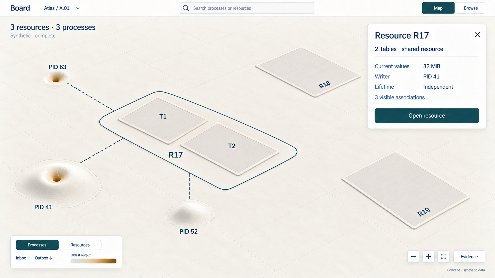
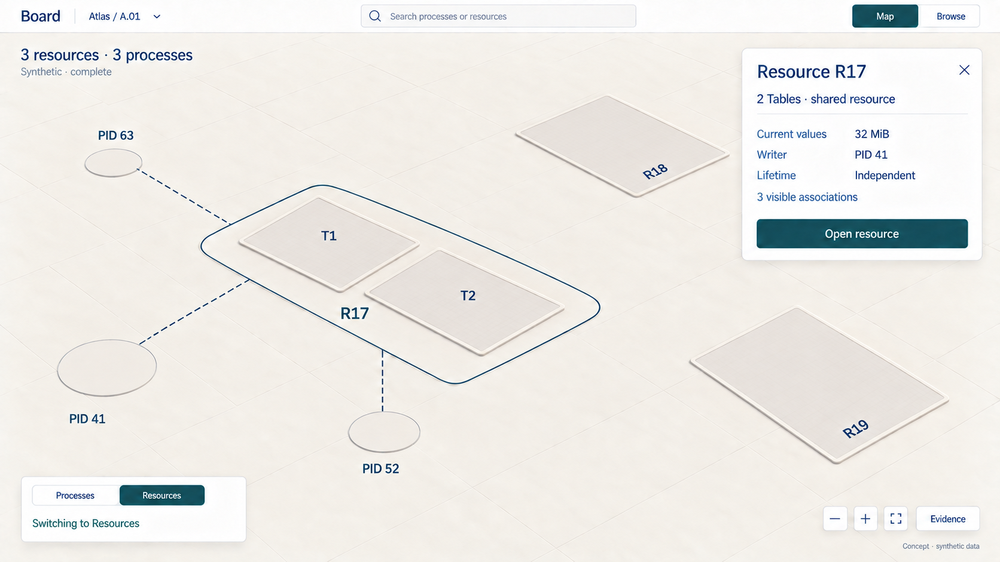
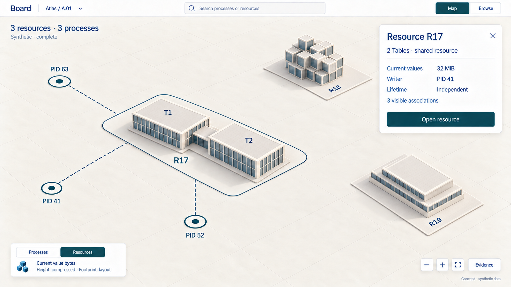
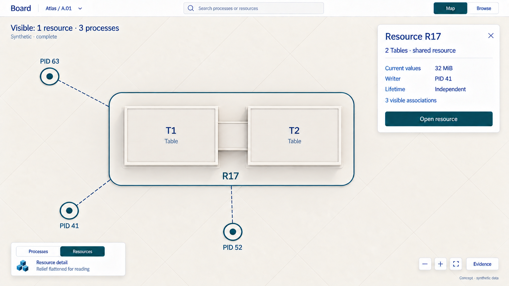

# D6 — Canvas emphasis and zoom

Previous: [D5 — Resources as a cityscape](D5.md) · [Review index](README.md) · Next: [D7 — Resource portals and data workspaces](D7.md)

Status: **Accepted in part**. Implementation: **Not implemented**.
Four generated frames use one synthetic scene. They illustrate a transition;
they are not an animation, exact camera registration or renderer proof.

## Question

Does the process fabric become the resource cityscape through continual zoom,
or does the canvas have an explicit state? How can a viewer change emphasis
without losing their place, selected identity or understanding of the metrics?

## Proposal

Use **Processes** and **Resources** as two explicit emphases of the same map.
Keep continual semantic zoom within each. The emphasis answers **what am I
looking at?** Zoom answers **how much detail can I see?** Neither operation
turns a process into a resource.

Put the two choices in the existing combined legend. Switching emphasis keeps
the camera, scope, stable horizontal anchors and selection. Process relief
recedes to its circular anchors; resource buildings rise from their own plots.
Only the active emphasis uses quantitative relief. The other contributes quiet
identity markers around the selection, with bounded association context.

| Control | What changes | What stays |
| --- | --- | --- |
| Map / Browse | Spatial canvas or conventional inspection pages | Selected identity, scope, applicable filters and evidence context |
| Processes / Resources | Active geometry, metric legend and primary population | Camera, place, selected identity and separate process/resource identities |
| Scroll or zoom buttons | Magnification, grouping level, labels and relief flattening | Chosen emphasis and selected identity; observed facts do not change because of zoom |
| Select an object | One temporary inspector and bounded context | Emphasis and camera until an explicit navigation action |

Selecting a resource from the process map can therefore inspect it immediately.
It does not unexpectedly switch the whole map. Resources remains one click
away. Near reading distance, both emphases flatten into readable details.
Opening the full resource or process page is an explicit move to Browse.

The [D5 mapping reference](D5.md#visual-mapping-reference) owns the meaning of
shoulders, wells, walls, plots, architecture, height, accents and paths.

[D7](D7.md) follows the feedback on Figures 1 and 4 with an Auto emphasis
candidate and a resource doorway. The explicit switch described here remains
the baseline and a way to pin either population; those extensions are proposals.

## Visual studies

Read Figures 1–3 as a storyboard at one intended camera position. Figure 4
then changes the zoom. All four retain selected resource **R17**, its **32 MiB**
of current values, writer **PID 41**, independent lifetime and three disclosed
associations. T1 and T2 share R17; they are not two additional resources.

### Figure 1: Processes in front, resources as landmarks

PID 41 has both queues, PID 52 has only an inbox, and PID 63 only an outbox.
Amber belongs to oldest-output age on the inner well walls. R17's Table wings
and the R18/R19 sites remain flat landmarks. The selected card is for R17,
so it shows resource facts even though the map emphasizes processes.

**Review:** selection and emphasis can be independent without another sidebar.
The flat resource sites must still read as selectable identities, not empty
lots awaiting creation. Their flatness is a presentation choice, not zero bytes.

### Figure 2: A neutral handoff, not a new mode

The old relief has receded. Both sets of anchors remain identifiable before
resource buildings appear. The legend says **Switching to Resources** and
temporarily presents no height scale. This brief handoff is not a third user
mode and does not represent queues draining or data being deleted.

**Review:** the unchanged card is the continuity cue. A production transition
must keep exact data readable and avoid offering an intermediate geometry as
a measurement. Reduced motion skips directly to the next endpoint.

### Figure 3: Resources in front, processes as context

R17 rises on its existing site. R18 uses a modular KV form and R19 a proposed
Document form. Their height measure is now **current value bytes**; the inbox,
outbox and age legend has gone. The three PIDs retain distinct circular anchors
and their association paths to R17.

**Review:** this feels like changing what the same place reveals. Buildings
stand on neutral ground; no process mound becomes a building foundation.
The three associations still add no resource copies or bytes.

### Figure 4: Zoom within Resources reveals flat detail

Now the camera moves closer. T1 and T2 become legible plates within one shared
resource boundary. The canvas remains in Resources and Map. R18 and R19 lie
outside this viewport; the population label changes to **Visible: 1 resource ·
3 processes**. They have not vanished from the scene's scope.

The legend explicitly says relief is flattened for reading. R17 still has
32 MiB. Its plates expose identity and declared structure, not application
rows or a Document editor. **Open resource** leads to conventional inspection.

**Review:** this supplies the continual zoom the atlas needs without making
resource discovery depend on first navigating through a particular process.
The raster approximates the closer framing; a renderer must preserve world
anchors and compensate the camera as relief flattens.

## Design details

### Compare the transition models

| Model | Benefit | Cost or limitation |
| --- | --- | --- |
| Zoom alone changes processes into resources | Few visible controls; a cinematic descent | Hides the resource overview behind a zoom level, confuses distinct identities, and makes shared/unassociated resources hard to place |
| Explicit switch with fixed-detail maps | Clear units and intentional context changes | Does not solve clutter or provide a path from summaries to readable details |
| Explicit emphasis plus semantic zoom, recommended | Both populations can be explored at every scale; zoom progressively reveals each | Needs one small two-state control, stable layout and a clearly relabeled metric |

The same two axes work beyond this small scene:

| Distance | Processes emphasis | Resources emphasis |
| --- | --- | --- |
| Region or district | Disjoint group summaries as broad fabric landforms | Disjoint resource groups as aggregate architectural masses |
| Neighborhood | Individual inbox shoulders and outbox wells | Individual resource buildings on stable plots |
| Reading distance | Flat process details with exact queues and evidence | Flat resource metadata and declared logical structures |

At a billion processes there is still no implied resource count. Process and
resource hierarchies have their own membership, summaries and cardinality.
Shared layout regions provide orientation, not a one-to-one correspondence
between groups. During a switch, retire each source summary into its own
anchor and reveal the target summary at its own anchor. Do not morph a process
group into a supposedly equivalent resource group.

A selected identity remains selected even when aggregated or offscreen. Show
its authorized ancestor/context marker and provide an explicit locate action;
do not invent a new copy in the current viewport. Context markers are excluded
from primary population totals. Association changes do not move resource homes.

### What a switch preserves

Treat emphasis as one field of the canvas state, separate from camera, layout
version, scope, selected public identity, filters and observation bases. Retain
the camera and compatible layout throughout a switch. Keep the selected card
and its evidence basis while currently authorized; later observations are
ordinary labeled refreshes, not a side effect of the visual animation.

Common filters carry across. A process lifecycle filter cannot silently become
a resource filter. Retain filters for each emphasis and show a compact active
filter indicator; selecting it exposes their details in the existing control.
If a selection is outside the active filter, identify that context explicitly
rather than changing the selection or including it in filtered totals.

Browser Back should restore emphasis along with selection and viewport. Future
shareable routes need validated, bounded state and must reauthorize identities.
They contain no credentials, values or serialized scene; remembering a camera
does not introduce an offline cache. Reuse the existing
[navigation intent](INTERACTIONS.md#one-workspace-two-views).

### Keep the handoff honest

1. Request the target emphasis through bounded, authorized public reads. Keep
   the existing view readable while loading. A changed request invalidates
   superseded results; a late response cannot switch the user back.
2. Establish a coherent target presentation with its own coverage, freshness,
   membership and source revisions. Partial coverage must say partial. A failed
   request stays unavailable; it does not produce a flat zero-valued landscape.
3. Once ready, recede the source relief to its own anchors, then reveal the
   target relief. A short, interruptible transition is a prototype candidate.
   Suspend geometry-based metric picking during the handoff; stable identity
   selection and the exact card remain available. Relabel the scale with its
   endpoint so only one layer carries quantitative height at a time.
4. Honor reduced motion with an immediate endpoint change, keep keyboard focus
   on the emphasis control, and announce completion accessibly. If the target
   becomes unavailable during the handoff, return to the last still-authorized
   endpoint with a visible failure state. Never wait for an animation to finish
   before removing known-denied data, associations or summary contributions.

The neutral frame is presentation-only. It is not an observation, a zero sample
or a point in a history timeline. A process stays a process, a resource stays
a resource, and their facts are never interpolated into one another. Process
and resource reads may have different observation bases; a shared camera does
not establish a cross-entity snapshot.

### Keep the interface spacious

Reuse the header's Map/Browse control, the combined lower-left legend, corner
camera controls and one temporary inspector. Do not add a second toolbar for
this choice. Inactive context gets labels only where useful for orientation or
selection. Show association paths for a bounded selected neighborhood, with
their returned coverage disclosed. A future reverse lookup needs a public
read surface; the browser must not enumerate all processes to discover links.

At detail distance, replace the height legend with the explicit flattened
state. The selected card supplies exact values once. Numeric context, keyboard
navigation, focus indicators and Browse remain usable without perspective,
color or motion. The imagery does not settle contrast, hit areas or occlusion;
those require a working prototype.

## Review outcome

The reviewer requested documented mappings and a visual comparison of continual
zoom with a canvas state. D5 now contains the consolidated mapping reference;
this review proposes the combined approach.

The reviewer then specifically endorsed **Figure 1's subtle process fabric and
resource landmarks** and **Figure 4's overhead view for focused data inspection**.
Carry those visual directions forward. They asked whether processes read as
finer-grained hierarchy and whether a building could become a portal into a
query workspace. [D7](D7.md) explores those questions.

The explicit emphasis policy, Figure 2's neutral handoff, exact motion and the
new data-workspace behavior are not selected by that feedback.

## Open questions

- Does changing emphasis at the same camera preserve orientation clearly enough?
- Should inactive context include a few nearby identities by default, or only
  the selected object's disclosed neighborhood?
- Does the neutral handoff help explain the change, or would an immediate switch
  with stable anchors be easier to understand?

## Evidence and limits

These are synthetic design frames. Their fixture holds constant process facts,
resource facts and associations; it describes intended state invariants, not
pixel coordinates, render timings or executable read cuts. Generated footprints
and label positions approximate continuity. Resource heights, inset depth and
architectural detail are not calibrated measurements.

The [D5 fixture](d5-fixture.json) supplies R17–R19; D6 adds three
synthetic process queue summaries. The first three frames share the intended
camera; only the fourth changes it. R17's two Tables and framework state sum
to the same 32 MiB in every frame. No real source-commit age or byte-summary
API is implied. Document structure remains proposed.

Current [Board bounds](../../../../apps/transit-board/README.md#bounds-and-observations),
[state-resource constraints](../../../../contracts/STATE_V1.md#bounds-and-storage)
and the public read boundary still apply. An association does not grant access
to either endpoint. A resource metadata read does not authorize typed descriptor
or value reads. Board remains inspection-only and does not decode application
values to fabricate these structures or metrics.

A prototype should qualify round-trip camera/selection stability, shared and
unassociated resources, empty/unavailable target layers, partial evidence,
revocation during loading, rapid switching, unequal group hierarchies, selection
outside the filter, Back navigation and reduced-motion/keyboard operation.
Choose renderer and transition timing there. Scope implementation through a new
numbered [roadmap milestone](../../roadmap/README.md#maintaining-the-sequence);
this review extends no completed capacity or inspection contract.

## Supporting material

- [Four PNG studies](images), with `d6-` filenames.
- [Exact built-in image prompts](d6-prompts.json); final files are
  copied unchanged from the generated outputs, without raster post-processing.
- [Synthetic scene and transition fixture](d6-fixture.json).
- [Resource and fabric mapping reference](D5.md#visual-mapping-reference).
- [D2 semantic descent](D2.md#figure-9-both-sides-flatten-into-an-inspector).

Previous: [D5 — Resources as a cityscape](D5.md) · [Review index](README.md) · Next: [D7 — Resource portals and data workspaces](D7.md)
