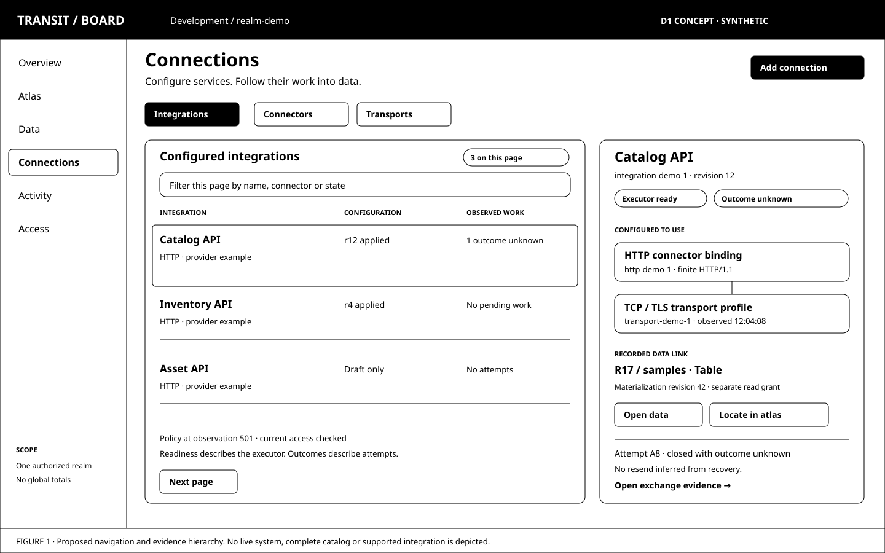
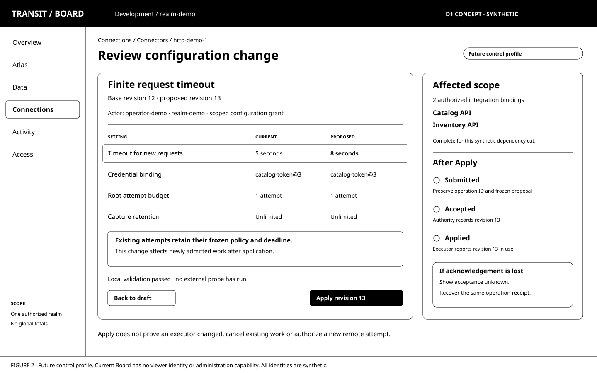
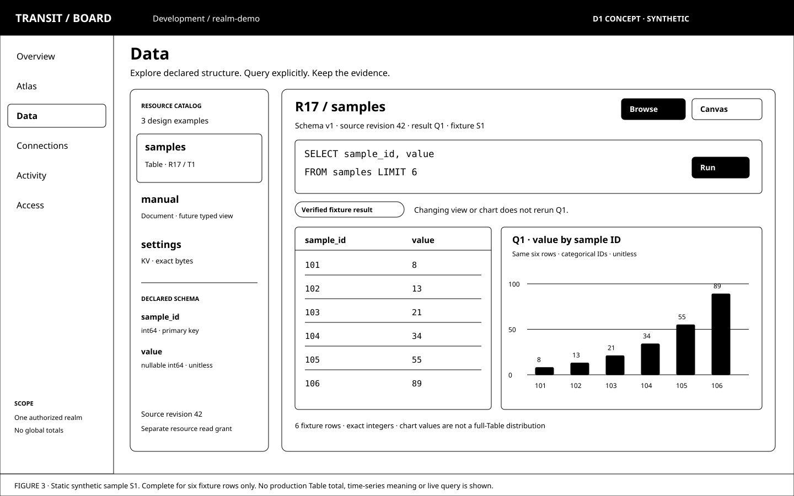

# D1 — One Board for operations and data

[Review index](README.md) · Next: [D2 — Visualizing the declarative system](D2.md)

Status: **Reviewed**. Implementation: **Proposed, not implemented**.
M2 inspection and M13's bounded atlas/Table query workspace are existing
baselines. M15's first finite HTTP connector is in progress; its Board and
deployment qualification remains open. Nothing in this review establishes a
new control API, authentication profile, connector, data type or scale claim.

## Question

How should Board become the main place to configure and operate Transit and
work with its data, while preserving the clarity of the atlas and the exact
boundaries between transport state, durable work and external outcomes?

## Proposal

Make Board one product with three connected activities: **understand the system,
operate its connections, and explore its data**. Give Data and Connections equal
prominence. Keep the atlas as a spatial view of that same system, with deliberate
entry into a resource and a conventional Browse route to every essential task.

Use the established [transport / connector / integration vocabulary](../../CONNECTORS.md#transport-connector-and-integration).
Transport settings describe carriage. Connectors own external operation semantics.
Integrations add provider-specific knowledge. Configured instances of these
capabilities have revisions, dependencies and observed state; a library name or
open socket is not a durable configuration identity.

Carry forward [board-atlas D2's selected queue-count fabric](../board-atlas/D2.md#figure-7-queue-counts-with-age-on-the-well-walls),
[D5's resource landmarks](../board-atlas/D5.md),
[D6's subtle fabric and overhead detail](../board-atlas/D6.md), and
[D7's resource doorway and shared workspace](../board-atlas/D7.md).
[D9](../board-atlas/D9.md) establishes the implemented subset: explicit emphasis,
intentional entry, one SQL draft/result, and no query on view changes.
Auto emphasis, large-scale aggregation and D8 forecasts retain their open status.

The long-range [capability inventory](CAPABILITIES.md) tests this model against
HTTP/2, HTTP/3, SSE, WebSocket, file/object protocols, TCP/UDP/QUIC, databases,
identity and mail. It is a design coverage inventory, not a delivery commitment
or a list of features to display as installed.

## Visual studies

These three SVGs are static, editable wireframes. All names, identifiers,
measurements, states and permissions are synthetic. They study navigation and
information hierarchy; detailed styling and interaction still need review.
Following review feedback, their palette has been reduced to black and white;
the original layouts and synthetic facts are retained. D2 owns the substantive
hierarchy and declarative-model refinement.

### Figure 1: Connections in the same Board as the atlas and data

**Observation:** an operator starts with the configured service they recognize,
then follows its dependencies. Transports and Connectors have their own first-class
inventories, filters and detail pages. The detail pane connects configuration,
recorded work and data without turning them into one ownership tree.

The selected HTTP example uses a fictional provider integration. HTTP itself has
an implementation; this integration, its managed configuration and these screens
do not. Visible-page counts do not describe a whole realm. Readiness, pending
work and unknown remote outcomes have separate labels.

### Figure 2: Review a change before following its operation

**Observation:** configuration is a revisioned change with a reviewable diff,
affected scope and durable operation identity. An accepted revision and an
executor using it are separate facts. The proposed timeout affects newly
admitted work; existing frozen attempts keep their original policy and deadline.

The figure depicts a future attributable control profile. Its operator identity,
impact analysis and Apply action are not available in today's shared inspection
profile. The declared effect of a setting comes from its owner, not a generic
Board guess about how every protocol handles reconfiguration.

### Figure 3: Data is a destination, not a small inspector panel

**Observation:** Data is reachable directly and through an atlas resource doorway.
Browsing, querying and visualizing share selection and result provenance. The
chart is a representation of Q1, not a new background query. Other resource kinds
retain their own reading model. The Document row is a future design example,
not an enabled capability in the current product.

The fixture is six `(sample_id, value)` rows: `(101, 8)`, `(102, 13)`,
`(103, 21)`, `(104, 34)`, `(105, 55)`, `(106, 89)`. The draft projects those
columns with a limit of six. Displayed row order is fixture order, not an SQL
ordering guarantee. The chart uses sample ID as a categorical label and value
as an explicitly unitless measure; it implies no event-time series or business
meaning. Completeness is for fixture S1 only, not a production Table total.

## Product structure

### One shell, several ways in

| Destination | Primary task | Connection to the rest of Board |
| --- | --- | --- |
| Overview | Find work needing attention and recent changes within the authorized scope | Open the exact process, attempt, configuration revision or resource behind a condition |
| Atlas | Understand processes, resources and their disclosed relationships spatially | Enter the same detail pages and data workspace as Browse |
| Data | Discover Tables, Documents and KV; inspect structure, query and visualize | Follow writer, source revision, capture or lineage evidence when supplied |
| Connections | Configure and operate Integrations, Connectors and Transports | Inspect dependencies, attempts, sessions and related data |
| Activity | Follow durable operations, exchanges, queries and configuration changes | Filter by recorded identity and outcome; diagnostic telemetry stays distinguishable |
| Access | Inspect permitted principal/grant information and, in a future control profile, manage scoped access and credential bindings | Separate viewer identity, Transit authority and remote credentials |

Overview is the proposed default entry; users can deep-link to any authorized
destination. The environment label is deployment context, not a new authority
scope. The realm is explicit. Switching installations clears protected state and
rechecks access; this design does not invent a cross-realm catalog or global cut.

The header holds scope, bounded search and the current access profile. Search
must declare which authorized catalog or loaded page it covers. It cannot load
every PID or resource into the browser, search hidden payloads, or leak undisclosed
names through suggestions. A URL contains stable identity and safe view settings,
never SQL literals, credentials, transcript bodies or captured data.

Use a contextual pane for quick inspection and a full page for sustained work.
Configuration forms and data grids need room. Breadcrumbs and Back preserve
selection, camera and safe view state subject to renewed authorization. Narrow
screens collapse navigation and offer Browse; keyboard access, visible focus,
textual status and reduced motion must cover every essential path.
On Canvas, allow the shell navigation to collapse so the atlas keeps D4's
full-width workspace, one header and one combined legend. The shell supplies
orientation without adding permanent panels around the map.

### How the atlas grows

Keep process fabric and resource landmarks as its base. Add selected, typed
relationships to connections when their public evidence exists: **configured to
use**, **executed by**, **captured as**, or **materialized into**. An integration
does not become another resource building, and visual proximity establishes no
lineage. Do not put every socket, attempt or packet into the realm skyline.

Connection dependencies belong in a bounded local diagram on selection. Large
cohorts need authorized server summaries with units, time basis and coverage
before they become quantitative geometry. Unavailable or unauthorized population
counts remain unavailable. Preserve the atlas's one active quantitative relief
scale; chart values and connection health never silently replace its metric.

## Objects and capabilities

### Types, configurations and live observations

| Object | Meaning in this proposal | Example |
| --- | --- | --- |
| Capability definition | Versioned installed implementation and supported operation/profile metadata | HTTP connector with a finite HTTP/1.1 profile |
| Transport profile | Reusable carriage configuration; several dependent bindings may reference it | TCP/TLS endpoint policy, later HTTP/2 session limits or QUIC settings |
| Connector binding | Realm-scoped configuration selecting connector version, endpoint scope, transport, credential references and operation policy | HTTP binding to a provisioned service |
| Integration binding | Provider-specific configuration over a connector binding, with declared schemas, auth conventions and pagination/rate policy | A fictional Catalog API over HTTP |
| Session / connection observation | A particular executor's current connection incarnation and diagnostics | Negotiated protocol, peer, stream pressure, last observation |
| Exchange / attempt | Recorded external work and its capture/reconciliation evidence | One authorized HTTP send, with a linked followup if policy permits |
| Data resource / logical entity | Transit backing resource plus declared Table, Document or KV identity | Two logical Tables in one backing resource |
| Administrative operation | Proposed future durable change identity and accepted/applied evidence | Apply configuration revision 13 subject to base revision 12 |

These are product concepts, not new wire definitions or packages. Use the
[glossary](../../GLOSSARY.md) for existing terms. A configured HTTP endpoint needs
no provider integration. One transport profile can serve multiple bindings;
one connector binding can serve multiple integration bindings. A provider that
uses several protocols has explicit constituent bindings; it does not collapse
their independent attempts into a new durability contract.

An Integration page may link to a deployment or worker PID, but integration
identity is distinct from PID, activation and runtime binding. Restarting a
worker does not create a new logical integration. Renaming a connection cannot
redirect previously accepted work. Logical Tables sharing a backing resource
keep that resource's permission, lifetime and transaction boundaries visible.

### Capability dimensions, not a single supported badge

Each definition or binding needs separate answers for:

- **Availability:** design candidate, installed implementation, configured profile,
  and enabled operation. Show a design catalog only when deliberately requested.
- **Authority:** what the current caller may inspect, read, query or change.
  An advertised capability is not a permission grant.
- **Operation shape:** finite request, transfer, one-way subscription, bidirectional
  exchange, database operation or identity trust relationship; ingress and egress
  are explicit capabilities.
- **Evidence:** connection observations, durable admission/progress, capture
  coverage, known outcome or closed unknown, with their distinct sources.
- **Limits:** operation/scan/result budgets, active sessions, buffers, capture,
  retry/settlement and retention policy. Unsupported fields have explicit reasons.

Versioned descriptors can supply field names, types, constraints, sensitivity,
dependencies, declared actions and documentation. They do not supply executable
browser plugins, arbitrary URL fetchers or permission. Protocol-specific views
are reviewed built-in UI components over generated, runtime-validated contracts.
Unknown versions retain a bounded metadata fallback and cannot gain an Apply or
Retry action. A second implemented family must justify shared abstractions before
a general extension framework is built.

## Configuration and operation

### Establish a binding

Start from the user's task: connect a service, configure an HTTP endpoint, or add
a reusable transport profile. The common path chooses a connector or integration,
then creates or selects its dependencies. Keep advanced transport settings
reachable without requiring every HTTP user to assemble a TCP stack manually.

1. Choose an installed, qualified profile and intended direction/operations.
2. Select the realm and exact endpoint, database, bucket, path or service scope.
3. Reference an authorized credential binding/version and trust policy. Secret
   resolution belongs to the executor; Board does not reveal or store the value.
4. Set operation limits, capture policy and explicit retry/reconciliation rules.
   Retention starts unlimited; finite expiry is a separate opt-in decision.
5. Review dependencies, permitted actions and the effective configuration. Explain
   unsupported fields and which settings require a restart or new session.
6. Validate locally or against an authorized schema. A live **Test connection**
   is a separate, bounded external operation with recorded intent and outcome.
7. Apply an explicit revisioned change, then follow its accepted and applied state.

Creation, grants, binding installation and worker activation can be separate
operations. Show partial progress and recover the same identities after failure;
a wizard cannot manufacture a transaction across them. A successful probe proves
only its named check at its observation time, not future availability or all
operations. Even a remote read or authentication exchange may have effects.

### Review, apply and reconcile changes

The future control service owns durable configuration and operation records
through Transit/Station. Board consumes its public interface. Board's local
draft and diagnostics are never the authority, and the browser cannot edit a
worker configuration file, Kubernetes object or Ursula record directly.
The exact control-service placement and versioned contract remain an entry gate.

A change identifies the actor, realm, target ID, expected configuration revision,
canonical proposal, operation ID, current grant/policy basis and allowed action.
The review shows a secret-free diff and known affected bindings. Impact analysis
declares coverage; a partial dependency read cannot claim a complete blast radius.
If safe application requires undisclosed dependencies, the authoritative service
must evaluate them without disclosing them or reject the change.

Keep **draft → validated → submitted → accepted → applied** distinct. Validation
can become stale. Concurrent edits produce a revision conflict requiring a fresh
review. A lost submission acknowledgement yields **acceptance unknown**; receipt
reconciliation or an exact retry preserves the frozen operation. It must not
generate a new operation because the user reopened the page or clicked twice.
Durable operation discovery needs its own authorized recovery contract before
administration can survive browser loss safely.

Accepted configuration may still be waiting for an executor, denied by current
policy, or blocked on a provider. Display desired and observed revisions with
their separate times. Rollback is another conditional change; it does not undo
completed remote effects. A shared-profile edit previews dependents and declares
how new sessions and already accepted work are treated. In-flight attempts keep
their recorded endpoint, credentials, policy and deadline unless a separately
qualified contract explicitly permits a transition.

### Actions must name what they do

| Proposed action | Required meaning and visible limit |
| --- | --- |
| Pause admission | Stop accepting specified new work; preserve accepted backlog and identify any settlement still eligible |
| Drain | Stop new admission and observe identified accepted work settling under existing budgets; expose unresolved work and timeout |
| Resume admission | Recheck current policy and lifecycle; never revive a retired PID or expired binding |
| Reconnect / replace worker | New physical incarnation under the owning lifecycle contract; no implicit resend, replay or ownership |
| Retry receipt | Resubmit the exact uncertain Transit operation; no new external attempt |
| Retry external operation | New linked, authorized attempt under the connector's explicit idempotency policy and remaining budget |
| Reconcile outcome | Authorized connector-specific investigation; cannot rewrite a closed attempt or reset its window |
| Request cancellation | Record a request and its outcome; local closure or a closed socket does not establish remote cancellation |
| Rotate credential binding | Apply a new authorized version with an explicit effect on future work; keep values out of Board and retained captures |
| Retire binding / clean capture | Separate stopping eligibility, dependency-safe retirement and physical cleanup; preserve required control evidence |

Only show enabled actions backed by an implemented contract and current
permission. Disabled actions can explain a non-sensitive reason. Do not infer
safe retries from a method name, healthy socket or worker restart. Inspecting a
transcript, replaying captured results and rendering a preview never dispatch.

### Attributable administration

Today's Board admits everyone who can reach its private deployment boundary
into one shared inspection scope; its optional query identity is separate but
also shared. Neither identifies an individual administrator. Preserve that
profile and introduce administration only with a separately qualified access
boundary: authenticated human or service principal, current action/resource
grant, CSRF/origin protection where applicable, and durable actor attribution.

Do not widen the existing read principal or interpret M13 query permission as
configuration authority. A trusted ingress identity needs an authenticated
binding to the control service, not a browser-supplied username/header. The
human-to-Transit principal mapping, delegation limits, sessions/revocation and
bootstrap/recovery path are open contracts under [Security](../../SECURITY.md).
OIDC and SAML are candidate federation mechanisms, not automatic Transit grants.
External-service credentials are a third, independent identity relationship.

Service agents and CLIs use the same bounded public operations, machine-readable
reasons and evidence as the UI. They cannot acquire broader power through a
generic Board proxy. Before control rollout, prove spoofed identity, stale policy,
conflicting edits, lost receipts, cross-scope references and credential redaction.

## A first-class data experience

### Discover and enter

Data has its own catalog and full workspace. Filter by declared kind, name,
backing resource and supported read/query capability. Show exact identity,
schema/decoder version, observed revision, coverage, lifecycle and writer;
association alone grants no visibility. Counts must say whether they count
physical keys, logical rows, bytes or a returned page.

Enter from Data, an atlas landmark, a process association, or a recorded capture
link. Each path selects the same resource and representation. Entry reads bounded
authorized metadata. Loading values or running a query is explicit; a useful
empty workspace offers the supported lookup, browse or query action. Missing
schemas and unsupported resource kinds receive honest generic inspection.

| Kind | Explore / Browse | Query / Canvas / visualization direction |
| --- | --- | --- |
| Table | Declared typed schema, bounded rows, primary-key inspection and exact source revision | Qualified SQL and visual plan over the same Fuze semantics; result grid and explicitly configured charts |
| Document | Declared structure/path tree and accepted-state metadata; bounded text/path views only through a qualified typed read surface | Typed path projections, explicit missing/null/type-error/conflict states; outline and text views; no speculative CRDT state |
| KV | Paged exact keys, byte-safe lookup and explicit value reads; prefix grouping only when declared | Raw bytes by default; typed projection only through an authorized versioned decoder; no guessing JSON or application semantics |

Documents deserve their own workspace, including structured state and plain
text; they are not forced into a flat table. Keys deserve exact byte identity,
including non-UTF-8 data. Tables retain typed nulls, binary values and full-width
integers. Charts must preserve exact tooltips even if an approximate screen
coordinate is needed; reject misleading numeric encodings. Units, time zones and
business labels come from explicit declarations or user choices, not heuristics.

M17 currently scopes Document metadata in Board and keeps application values out
of interpretation. Rich Document previews here therefore require a separately
authorized typed data surface, using M18's handoff where applicable. Board must
not install a business decoder or treat opaque storage as a document editor.

### One query and result, several representations

Keep **Browse / Canvas** as coordinated representations. The workspace holds
one identified draft and result for the initial slice; tabs and saved work can
come later. Query text, structured operations and a future visual worksheet must
compile through shared qualified Fuze semantics. If Canvas cannot edit an SQL
construct losslessly, show it as a read-only plan/text node; never silently
drop a clause or execute a simplified version.

**Run** explicitly submits work under the query capability. A result records
query/request ID, exact sources and revisions, schema/decoder/projection versions,
parameters, completion verification and coverage. Editing the draft marks the
old result as belonging to its prior execution. View changes, chart changes,
resource entry and Back do not submit, refresh or cancel durable work.

Support typed rows, summary cards and suitable charts over that identified
result. A local filter or aggregate labels itself **loaded page only**. A complete
distribution or total requires a qualified query over the stated source/result
basis; it cannot be inferred from the visible page. New server computation is an
explicit run. Show sampled, limited, incomplete, failed, expired and unavailable
results distinctly, and distinguish verified complete result from full source
coverage. A successful `LIMIT` query is not a whole-Table scan result.

Bound every source page, path expansion, chart point set, result buffer, plan,
scan and active query. Large catalogs and retained results must exceed browser
memory safely; virtualization alone does not bound a backend scan. Show declared
ordering and cursor expiry. No automatic pagination that silently collects a
whole resource or glues together different cuts.

Recheck current access for metadata, source reads and result retrieval. Denial or
expiry clears protected state across Browse, Canvas, chart, selection and pending
references. On authority failure hide protected data and preserve only the
permitted recovery identity; do not fall back to a sensitive offline cache.
Changing browser view or disconnecting is not remote cancellation. Saved queries,
shared dashboards, exports and history need explicit storage, authorization,
redaction and retention contracts; none is silently introduced by this review.

### External data and system evidence

A PostgreSQL table, MongoDB collection, Redis key or S3 object is external until
an explicit connector operation captures or materializes data through a declared
mapping. Give external objects separate identities from Transit Tables,
Documents and KV. A connector's database credential never becomes a Board read
grant; no data grid becomes an unrestricted external SQL console.

Future source/sink bindings should show source position, capture, destination
revision, mapping version and publication progress where recorded. Only recorded
links establish lineage. A common clock or matching row value does not. Capture,
materialization and remote acknowledgement have distinct progress; gaps,
duplicates, schema drift and resnapshot needs remain visible.

[Query language](../../QUERY_LANGUAGE.md#later-naming-non-data-components-as-queryable-relations)
also proposes querying system inspection through relational syntax. Keep that
future source class distinct from snapshot data: transport observations and
attempt lists retain their own cuts, freshness and coverage. The proposed
CONNECTION/SOURCE/SINK syntax is not an implemented backend for these forms.
Opening or querying retained data must never silently contact an external source.

## Architecture and implementation path

Keep Board a Zig API with its embedded strict TypeScript/Vite+ frontend.
Versioned public types own schemas and generated clients; validate at runtime.
Core remains generic, Station owns framework/control behaviors, Fuze owns query
semantics, and connectors own effects. Board uses public clients and reviewed
projections, with no raw storage/provider APIs or application handlers.

The implementation sequence below is a proposed dependency order, not a new
milestone sequence or an expansion of completed work:

| Stage | Existing handoff | Additional gate before delivery |
| --- | --- | --- |
| Establish the product shell | M2 inspection and M13 atlas/Table workspace | New Board implementation milestone for navigation changes; preserve deep links, access limits and existing browser proofs |
| Explain the first connector | M15 HTTP metadata/capture and M16 gRPC evidence | Source-backed exchange/attempt views and finite streaming evidence; do not claim all HTTP versions or administration |
| Administer a finite HTTP binding | Generic public authority, current finite HTTP policy, this review | New numbered control milestone: attributable access, configuration owner/contracts, secret references, exact recovery and apply reconciliation |
| Broaden the data workspace | M17 Documents, M18 unified state queries; M13 Table regression baseline | Typed authorized data surfaces, declared visualization coverage and bounded rendering; separate scope for saved work or editing |
| Add protocol/provider families | M16's second connector and M22's bounded Flight gateway | Each chosen family gets contracts, a real owner, independent-peer/recovery proofs and its own numbered roadmap scope |

Use HTTP to prove the whole path before generalizing forms. Then test the design
against a streaming family and a data/identity family that stress different
semantics. This is a suggested design exercise; it does not reorder gRPC,
Documents, unified queries, Flight or cluster work. When implementation is
selected, insert its own numbered milestone and renumber upcoming references
under the [sequencing rule](../../roadmap/README.md#maintaining-the-sequence).

Required review scenarios include: configuring a finite HTTP binding; changing
a shared transport with partial dependency visibility; recovering a lost Apply
receipt; inspecting an unknown attempt without resending; resuming a subscription
with an expired upstream cursor; navigating atlas → Table → chart without reruns;
reading opaque KV and conflicting Document fields; and revoking access while
data or configuration is open. Keyboard-only and reduced-motion paths must
exercise the same scenarios. These are planned checks, not executed evidence.

## Review outcome

The reviewer called D1 a useful start and requested substantial refinement:
black-and-white wireframes, two levels of administration with access in a
behind-the-scenes operations section, and a UI designed over the SQL grammar
to visualize Transit's declarative nature. They also requested that this last
principle be reflected in `AGENTS.md`.

[D2](D2.md) owns that refinement. D1's flat navigation and form-first model are
retained here as the earlier proposal, not selected product behavior. Its
authority/evidence boundaries and capability inventory remain inputs to D2.
No protocol implementation order or board-atlas outcome changes.

## Open questions

- Does Overview make the best default, with Atlas and Data direct peers, or
  should one of those workspaces be the primary entry?
- Does Connections with three explicit inventories make the established tiers
  clear enough, including direct connector use without an integration?
- Which attributable control-service and principal-mapping boundary should own
  the first HTTP configuration change, and how will bootstrap recovery work?
- Which two or three real operator tasks should anchor the next detailed review:
  initial HTTP setup, unknown-outcome investigation, or revisioned reconfiguration?
- Should the first richer data review prioritize Table charts, KV browsing, or
  the Document structure/text experience once its typed read contract exists?
- What should be shareable later: a draft, view configuration, retained result
  reference or exported data? Each has different permission and lifetime needs.

## Evidence and limits

The starting implementation is recorded by [board-atlas D9](../board-atlas/D9.md),
the [Board app](../../../../apps/transit-board/README.md),
[frontend](../../../../apps/transit-board-web/README.md), and
[API package](../../../../packages/zig/transit-board-api/README.md).
[M15](../../roadmap/M15.md) and the
[HTTP worker](../../../../apps/transit-station-http-worker/README.md) establish the
current finite connector progress and its remaining qualification. A configured
numeric endpoint and immutable credential registry do not imply online management.

This review draws its boundaries from [Board](../../BOARD.md),
[Security](../../SECURITY.md), [service v2](../../../../contracts/SERVICE_V2.md),
[Connectors](../../CONNECTORS.md), [gRPC](../../GRPC.md), [State](../../STATE.md),
[Tables](../../TABLES.md), [Documents](../../DOCUMENTS.md), [Fuze](../../FUZE.md),
[Retention](../../RETENTION.md), and [Observability](../../OBSERVABILITY.md).
M2/M13 remain the executable baseline; M17/M18 remain planned for Document and
unified-query semantics. Foundational documents can describe broader intent;
the owning contracts, component guides and roadmap specify implemented limits.

No live credentials, private data, network exchanges or user study informed the
figures. They establish no production scale, live metric, complete dependency
graph, cross-resource snapshot, distributed transaction, exactly-once remote
effect or automatic safe retry. No new application code or wire declarations
are included. Qualification must follow [Conformance](../../CONFORMANCE.md) and
the [testing strategy](../../TESTING.md), preserving M1 and M10's proved gates.

## Supporting material

- [Capability inventory and primary protocol references](CAPABILITIES.md).
- Editable SVG sources: [Figure 1](images/d1-01-console.svg),
  [Figure 2](images/d1-02-change.svg), [Figure 3](images/d1-03-data.svg).
  They were authored directly as vectors; no image-generation prompts apply.
- [Board atlas review sequence](../board-atlas/README.md), especially D5–D7 and D9.
- [Shared review template](../TEMPLATE.md).

[Review index](README.md) · Next: [D2 — Visualizing the declarative system](D2.md)
