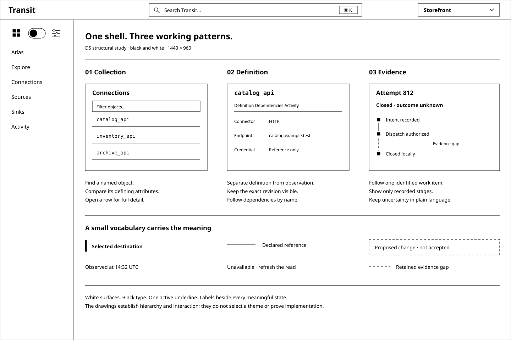
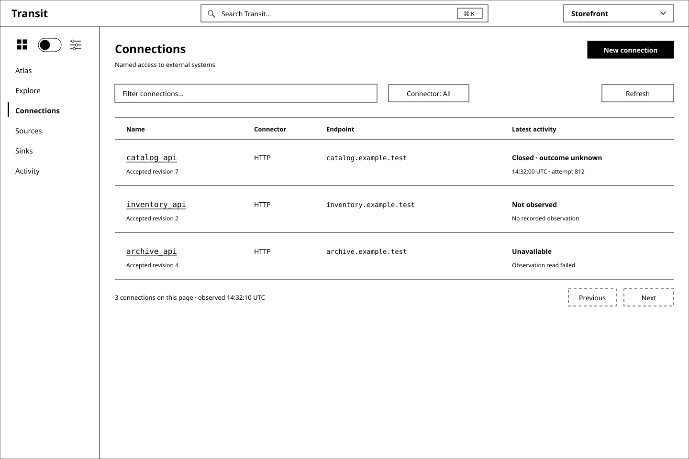
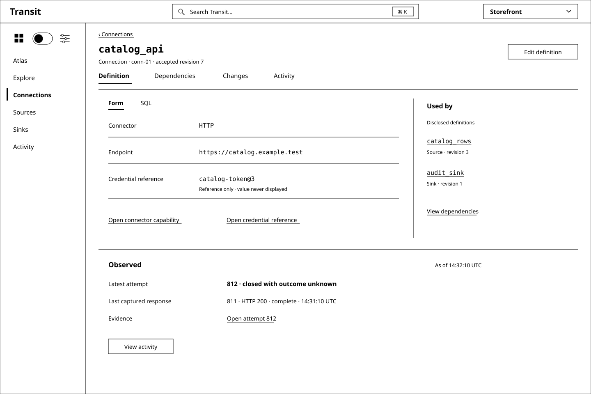
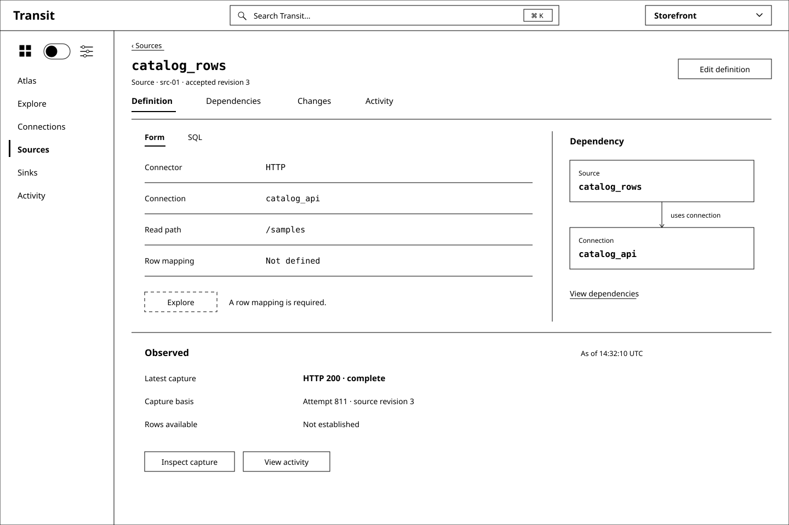
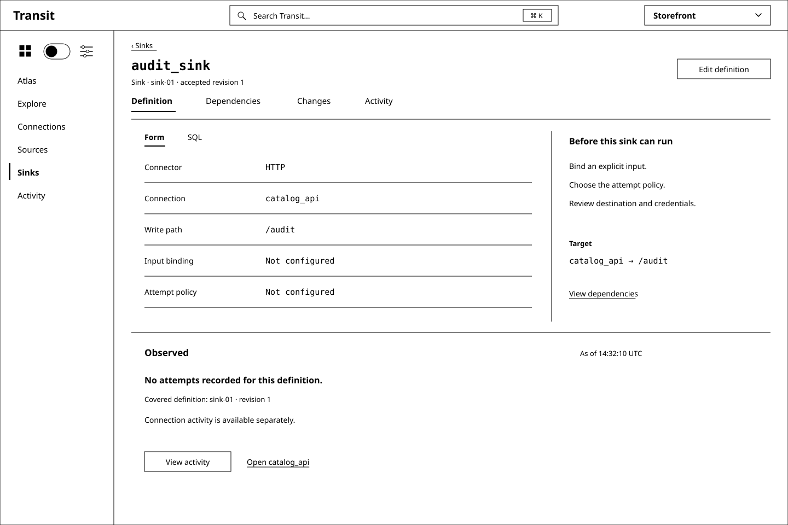
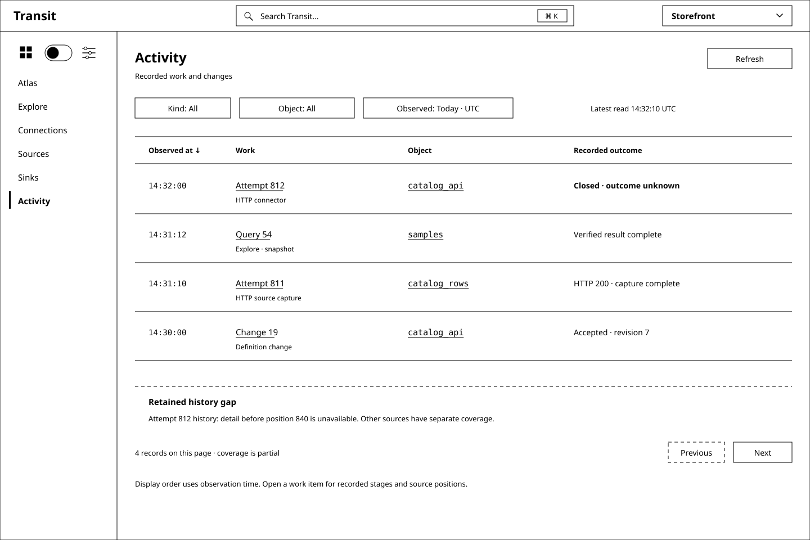
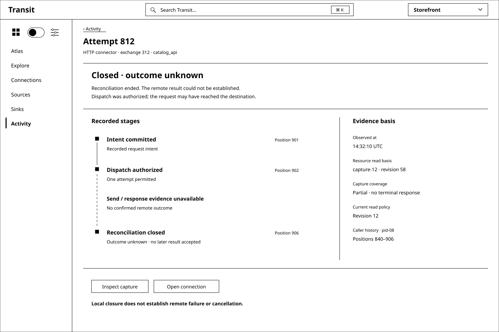
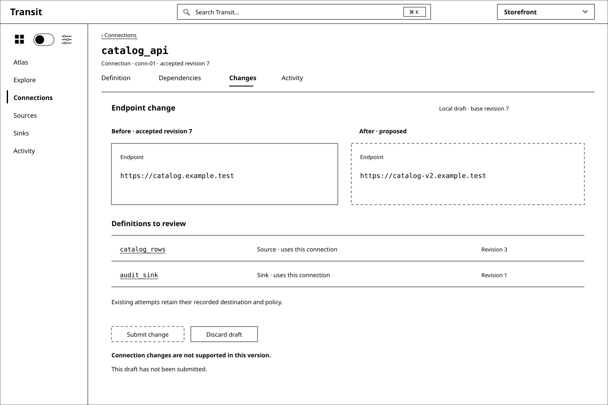

# D5 — Connections, Sources, Sinks and Activity

Previous: [D4 — Explore: a SQL-first workspace](D4.md) · [Review index](README.md) · Next: [D6 — Operations](D6.md)

Status: **Accepted in part**. Implementation: **Proposed, not implemented**.
The reviewer asked to formalize the black-and-white structure and explore the
four remaining Workspace destinations. This review carries forward D4's shell;
it does not settle D4's open search, timing or Live execution contracts.

## Question

Can one quiet visual structure explain how external access is defined, what
reads or writes through it, and what actually happened, without making these
four sections look like unrelated dashboards?

## Proposal

Use **collections → object detail → recorded evidence** as the common path.
Connections, Sources and Sinks are named declarations with the same detail
anatomy. Activity is their shared evidence destination, also reachable directly
from Workspace. Keep the compact Transit header, centered search, right-hand
realm selector and existing area toggle.

| Destination | Primary question | Main content |
| --- | --- | --- |
| Connections | How is an external system reached? | Named endpoint, connector/profile and credential references; source/sink dependents |
| Sources | What external data can be read through a connection? | Read target, capture basis and explicit row-mapping/query capability |
| Sinks | Where can externally directed work go? | Write target, input-binding readiness and attempt-policy dependencies |
| Activity | What work or change was recorded, and what outcome is known? | Bounded records, exact work identity, recorded stages and evidence gaps |

A named connection is reusable configuration, not a socket or a health check.
A source is distinct from a Table and from a generic Fuze source adapter. A sink
definition is distinct from a particular attempt. Activity records what its
sources establish; it is neither a complete event archive nor service logs.

The [structure guide](STRUCTURE.md) formalizes geometry, typography, tables,
selection, line meaning, local views and responsive intent for subsequent
reviews. Black and white is now an explicit review vocabulary. Labels and
geometry must communicate the UX before a visual theme is considered.

## Visual studies

All eight figures are synthetic, editable SVGs at 1440 × 960. They show a
future design, not screenshots of available administration. The fixture uses
the Storefront realm and D2's `catalog_api`, `catalog_rows` and `audit_sink`.
Definition revisions, display IDs, actor labels, links and observations are
illustrative. Captions identify contract gaps outside the product frame.

### Figure 1: A shared structural vocabulary

The shell stays constant; the task changes inside it. A collection uses rows,
detail uses a definition, and an activity item uses a recorded sequence. Solid
versus dashed geometry has a local label. Large cards and summary counters are
unnecessary to establish hierarchy.

### Figure 2: Connections begins with a useful collection

The first column is the entry point; family and endpoint help distinguish
objects. The last column describes the latest qualified work observation, not overall
connection health. Filtering is local to Connections; global Search Transit
keeps D4's broader discovery behavior. The page count is explicitly local.
**New connection** starts a local definition draft in the proposed interface.
It does not open a socket, resolve a secret or probe an endpoint.

Sources and Sinks reuse this collection shape with kind-specific columns:
source/connection/read target/row mapping/latest capture, and
sink/connection/write target/input binding/latest attempt. Their details follow.

### Figure 3: A connection explains reuse

Definition is the default, with Form selected and SQL available. Connector and
credential links lead to their owning Operations details. The credential value
is never rendered; even the reference requires a future authorized disclosure
contract. Current Board HTTP metadata deliberately omits these references.
The dependents are two specifically disclosed objects, not an inferred total.

**Edit definition** starts a draft against revision 7. The accepted definition
and observed attempt/response evidence remain unchanged by that local edit. **View activity**
opens Activity with the exact connection filter. Neither action tests connectivity.

### Figure 4: A source explains the read boundary

The source points to `catalog_api`; the arrow means **uses connection**. It is
not a dataflow animation. The last capture can be complete while no typed row
relation is available: the example has no row mapping. **Explore** is therefore
unavailable with a local reason. No row preview is decoded from captured HTTP
bytes, and no source-to-Table arrow is invented.

A future queryable source would enter Explore with its explicit identity,
schema, retained capture basis and qualified adapter capabilities. Selecting a
source must not make D4's Live mode fetch fresh external data. Captured reads
and new connector attempts require separate admission contracts.

### Figure 5: A sink explains what is still needed

The sink's connection and target are defined; its input and attempt policy are
not. This is a useful incomplete definition, with no Send, Start or Retry action.
The missing input is not supplied by whichever Table or worksheet was most
recently open. Its Activity view can show an authorized empty result without
claiming that the external destination has never received anything.

The reference grammar names a sink target but has no input-query binding or
execution lifecycle. The empty spaces here are deliberate design obligations,
not optional fields that a generic form may quietly default. The connection's
separate attempts do not automatically become this sink's history.

### Figure 6: Activity is a work ledger with bounded coverage

Each row identifies a work/change item and its latest recorded disposition.
Filter by kind, object or observation interval, then open a row for its stages.
Object links go to definitions; work links go to evidence. An explicit refresh
reads a fresh page without dispatching work. New observations do not move the
focused row until the user accepts them.

The time column is **Observed at**, in a stated timezone. Sorting across sources
is a display order, not global causal order. Query completion, captured HTTP
status and accepted configuration are different outcome types. A retained gap
cannot be collapsed into “no activity”; incomplete coverage stays visible.
Operational logs and transport counters remain in Operations / Diagnostics.

### Figure 7: An unknown remote outcome stays understandable

Lead with **Closed · outcome unknown**. The stages establish that dispatch was
authorized and local reconciliation ended. They do not establish whether the
remote operation occurred. The gap interrupts the sequence; there is no checked
“sent” step, success color or generic Retry button. **Inspect capture** is a
read of retained evidence under current permission, never a network replay.
The example is linked to its connection only; no source/sink relationship is
inferred from a matching path.

### Figure 8: A draft has a different shape from accepted state

The accepted value and proposed value occupy a labeled Before/After comparison.
The proposed side has a dashed enclosure. Revision 7 remains the base; the
dependency list describes definitions to review, not an atomic cascade. This
figure shows the current support limit at the action: submitting a connection
change is unavailable. Editing never auto-applies, even if Explore has Live on.
**Discard draft** only discards the local draft after the normal unsaved-change
interaction; it cannot undo an accepted operation.

## Contract map

| Surface | Existing foundation | Contract still needed before enabling it |
| --- | --- | --- |
| Connection/source/sink collections | Grammar-only `SHOW` / `DESCRIBE`; authorized public inspection patterns | Versioned declaration catalog, bounded discovery/filtering, exact IDs/revisions and current disclosure checks |
| Definition Form / SQL | Reference `CREATE CONNECTION`, `CREATE SOURCE`, `CREATE SINK` | Typed option schemas, identity/name resolution, lossless representation rules and public operation lowering |
| Dependencies | SOURCE/SINK reference a CONNECTION | Resolved versioned edges, inverse-dependency discovery, per-endpoint disclosure and bounded paging |
| Changes | D2's conditional change proposal | Revision preconditions, accepted receipt recovery, conflicts and dependency impact; ALTER/apply semantics are absent |
| Source Explore | M12/M13 finite Table query path; captured HTTP metadata | Capture-to-row decoder, explicit schema and read basis, query adapter and separate fresh-fetch admission |
| Sink work | M15 attempt/dispatch/capture/closure foundation | Explicit input binding, event identity, destination/secret scope and retry/reconciliation policy lowering |
| Activity list | M2 journeys/history and M15/M16 evidence projections | Bounded federated record envelope, disclosed object links, source-local cursors, retention gaps and display ordering |
| Activity detail | Recorded work identity, positions and current-authorized reads | Joined projections that preserve individual source bases and omitted evidence; no fabricated global snapshot |

The three SQL declarations in [D2's fixture](d2-fixture.json) remain the exact
reference text for the studies. No option names, syntax or production SQL are
added. Current production rejects those DDL statements. A formatter may display
their reference form, but **Save** cannot be implemented as another CREATE or
as DROP/CREATE. Invalid or unrepresentable text must be preserved, following D2.

Activity has no invented `SELECT * FROM activity` or `connector.attempts` command.
Definition, query and connector records retain their own semantic owners. A
future derived index does not become a new authority or extend retained history.
Work items need stable identity even when a name changes; same-identity receipt
recovery is distinct from starting another external attempt.

## Empty, unavailable and changing views

| Situation | Presentation and behavior |
| --- | --- |
| Authorized collection is empty | “No connections in this view”; offer a local draft only if that UI capability exists |
| Filter has no matches | “No matches” with Clear filters; retain the qualified page/coverage basis |
| No activity in covered range | Say which range and objects were covered; never infer no external work |
| Required read fails or permission is unknown | Hide the affected protected contents, show Unavailable and an explicit read retry |
| Known denial or realm change | Clear protected values, names, dependent counts and late responses; no existence leak |
| Retained history or capture is missing | Show an explicit gap and the available boundary; never refetch externally to fill it |
| A dependency cannot be disclosed | Omit its name/count/edge; a generic unresolved reference appears only if the source contract permits that fact |
| Accepted revision changes while editing | Preserve draft and old base; require a new comparison, with no silent rebase or resubmit |
| Submitted change has an uncertain receipt | Preserve exact operation identity and frozen proposal; do not label it rejected or offer a new operation as Retry |

A separately authorized definition can remain visible when only its observation
read fails, as with `archive_api`; failure never preserves the failed pane's
protected evidence. These states inherit current-policy reads, bounded pages and no hidden mutations
from Board. Selection, filtering and switching local views are presentation/read
operations. Probing a connection, fetching a source, writing a sink or reconciling
an attempt are separate explicit operations requiring their own qualified surface.

## Review outcome

The reviewer requested a formal black-and-white structure and concrete studies
of Connections, Sources, Sinks and Activity. After reviewing the proposal, they
endorsed the direction and requested rebase and merge of
[PR #4](https://github.com/rupurt/rey/pull/4), completed on 2026-09-27.
[D6](D6.md) carries the monochrome collection/detail/evidence structure into
Operations. The optional peek panel, representation preference and Activity
default below were not individually settled. D4's selected Figure 1 direction
and remaining questions are preserved. Review acceptance does not establish
implemented administrative behavior.

## Open questions

- Does collection → full detail provide enough speed, or should repeated triage
  later gain an optional peek panel without another permanent navigation rail?
- Should Definition open in Form for these declarations, as illustrated, or
  remember each person's last Form/SQL choice? Explore remains SQL-first.
- Is a mixed Activity ledger useful by default, or should it initially filter
  to connector work while keeping queries and definition changes discoverable?

## Evidence and limits

This is documentation and vector design based on `55f104f`. The
[synthetic fixture](d5-fixture.json) identifies each observation and its limits.
The drawings make no availability, latency, scale or external-success claim.
They do not implement responsive behavior, keyboard access or administration.
The structural guide's breakpoints and target sizes require a later interactive
prototype and accessibility qualification.

[M2](../../roadmap/M2.md) inspection and [M13](../../roadmap/M13.md) explicit
Table queries retain their qualified boundaries. [M15](../../roadmap/M15.md)
and [M16](../../roadmap/M16.md) supply locally qualified finite connector evidence,
not these named declaration catalogs or administrative controls. M17/M18 data
work does not supply an external-source decoder; [M22](../../roadmap/M22.md)
does not supply connector DDL. Further implementation needs its own milestone
under the [linear sequencing rule](../../roadmap/README.md#maintaining-the-sequence).

Validation for this review is recorded in the pull request. Static SVG rendering
and repository checks establish document quality and baseline regression evidence,
not execution of the proposed interactions or the synthetic observations.

## Supporting material

- [Monochrome structure guide](STRUCTURE.md) and [synthetic fixture](d5-fixture.json).
- SVG sources: [structure](images/d5-01-structure.svg),
  [Connections](images/d5-02-connections.svg), [connection detail](images/d5-03-connection.svg),
  [source detail](images/d5-04-source.svg), [sink detail](images/d5-05-sink.svg),
  [Activity](images/d5-06-activity.svg), [attempt detail](images/d5-07-attempt.svg),
  [change review](images/d5-08-change.svg). These are authored vectors, not generated raster images.
- [D2 grammar audit](D2.md#what-the-sql-grammar-actually-supports),
  [query language](../../QUERY_LANGUAGE.md#connection-source-and-sink-naming-the-ddl-for-external-data)
  and [grammar contract](../../../../contracts/sql/README.md).
- [Connector lifecycle](../../CONNECTORS.md#bounded-reconciliation-contract),
  [Board observation rules](../../BOARD.md#consistency-freshness-and-retention)
  and [current Board behavior](../../../../apps/transit-board/README.md).

Previous: [D4 — Explore: a SQL-first workspace](D4.md) · [Review index](README.md) · Next: [D6 — Operations](D6.md)
