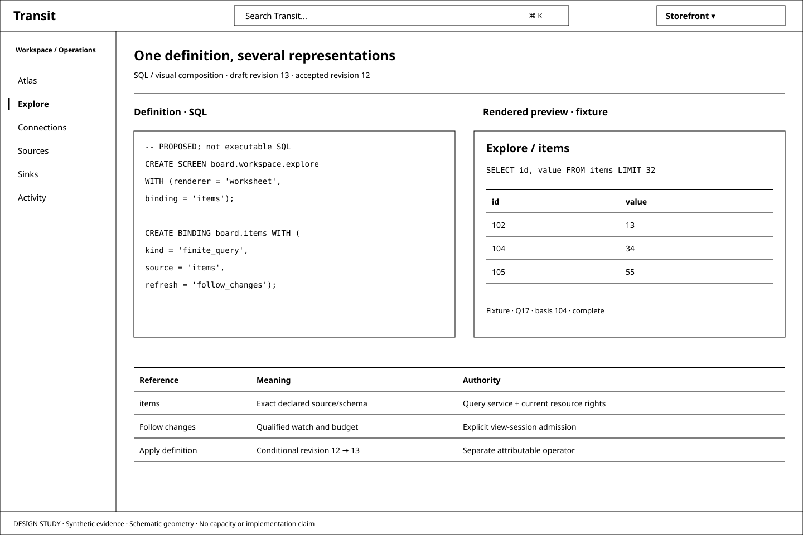
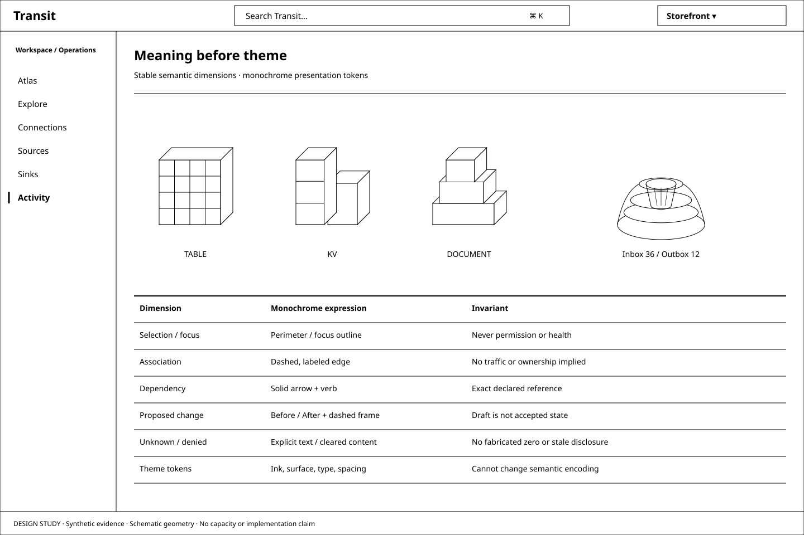
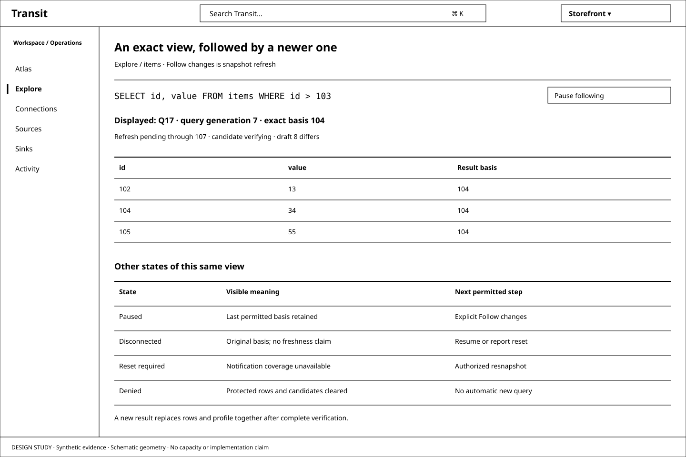
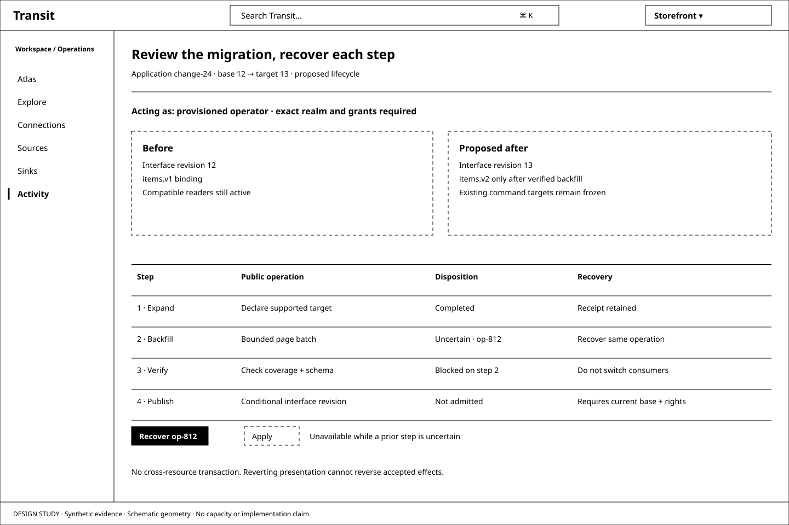

# D1 — A reactive interface grammar

[Review index](README.md) · [Next: D2](D2.md)

Status: **In review**. Implementation: **Proposed, not implemented**.
M19 has a qualified HTTP profile; M20's Table/SSE/WebSocket profile has native
TLS and generated-description evidence, with browser/placement qualification
still pending. Full M20 qualification, M21 and M22 remain prerequisites. This review schedules new
implementation in [M23](../../roadmap/M23.md), not in those earlier milestones.

## Question

Can the Board we have explored be expressed as a series of SQL declarations,
rendered through one monochrome visual grammar, and become the first example of
a repeatable way to build reactive applications on Transit?

## Proposal

Yes, as a target with new contracts to implement. Define the application as a
versioned graph of screens, bindings and actions. SQL and visual editing share
one typed definition and validator. Renderers interpret this graph through
allowlisted components; themes vary presentation tokens. Existing TABLE, KV,
DOCUMENT, CONNECTION, SOURCE and SINK declarations keep their own semantics.
SECRET means a reference to external credential material, never a visible value.

Use Console's compact Transit shell and Workspace/Operations navigation. Keep
Atlas and Explore as coordinated representations of the same selected identity,
query and evidence. Use the [monochrome Atlas redraws](../board-atlas/D10.md) to
finalize geometry before adding a theme. A representation change never submits
work. Refresh follows M21's exact snapshots over M20, with M19 admission and
M22's separately qualified Arrow interoperability where applicable.

The proposed [reactive application model](../../REACTIVE_APPLICATIONS.md) owns
the architectural boundary. These studies show what an author and operator
would see when using it.

## Visual studies

All four figures are black-and-white vector wireframes at 1440 × 960, with
synthetic definitions, observations and operation identities. They are review
plates, not working controls or screenshots.

### Figure 1: One definition, several representations

The split is an explicit authoring preview. Published Board screens keep one
active representation and the Console working space. A selected binding shows
its source, capability, schema and refresh policy. The source SQL is a proposed
declaration; a displayed result names a separate actual query/result basis.
Editing the definition changes a draft. Preview uses fixtures or an explicitly
admitted read scope; it does not execute the SQL or publish the interface.

### Figure 2: Semantic dimensions survive theming

Table slabs, KV modules and Document terraces identify structure. Process
shoulders and wells retain separate inbox/outbox quantities. Selection uses a
perimeter and label; it never means permission or health. A theme may change
fonts, density, surface and ink tokens, but cannot change the data-to-geometry
mapping or hide a denial. Labels remain necessary even if a later theme adds hue.

### Figure 3: A reactive view explains what it is showing

Follow changes refreshes an already admitted query generation. Rows and profile
switch together only after complete verification. A new draft keeps the earlier
result tied to its original query. The comparison strip describes alternatives,
not simultaneous states. A missing notification boundary requires explicit
resnapshot; known denial clears protected rows. Heartbeats do not establish
freshness. D4's execution/readiness and source-age labels require their own
evidence; unavailable timing stays unavailable.

### Figure 4: A migration is a reviewable change with recoverable progress

The author sees the exact base revision, acting principal, required capabilities,
affected bindings and unsupported steps before Apply becomes possible. Each
durable step keeps its own receipt. A lost acknowledgement offers recovery of
that step; it does not turn Apply into a fresh attempt. Publishing the interface
does not pretend that several resource mutations committed atomically.

## Map the domain grammar to visual grammar

| Domain construct | Collection/detail | Spatial form | Binding and evidence |
| --- | --- | --- | --- |
| TABLE | Schema, typed rows and explicit query | Regular slabs; logical tables may share a backing plot | Declared schema, exact resource/result basis; no implied general schema evolution |
| KV | Paged keys and explicit reads | Modular compartments | Declared decoder for typed queries; opaque values stay opaque in inspection |
| DOCUMENT | Accepted structure/text and declared projection | Nested terraces, then bounded outline | Accepted change basis, schema, conflicts and lifetime |
| SOURCE | Definition, input, decoder and capture dependencies | Named input port with directed dependency | Captured input/source adapter; a declaration does not start remote reads |
| SINK | Definition, destination and attempt policy | Named output port with directed dependency | Recorded intent, authorization and uncertain outcome; publication does not dispatch |
| CONNECTION | Endpoint/profile, trust and secret references | Reusable connector node | Definition revision separate from connection/attempt observation |
| SECRET | Binding/version and disclosed consumers | Labeled reference terminal | Metadata only; possession, use and management rights remain distinct |
| Service / watch | Published operation and follow policy | Inbound boundary and subscribed view | M19/M20 typed owners; no current executable service/watch DDL |
| Interface / screen / binding / action | Proposed composition and publication | Shell, page, renderer and named controls | New M23 grammar and lifecycle; presentation grants no authority |

The [SQL support map](../../REACTIVE_APPLICATIONS.md#sql-and-support-levels)
distinguishes executable reads, reference-only declarations and missing syntax.
The [candidate Board program](board.proposed.sql) covers the proposed shell,
Workspace and Operations destinations. It deliberately cannot be pasted into
today's query shell. A SQL program describes composition and references to
handlers/assets; SQL does not replace renderer code or application computation.

## Theme dimensions and fixed meanings

| Dimension | Monochrome baseline | May a theme change it? |
| --- | --- | --- |
| Surface and ink | White surfaces, black text/rules; inverted primary action | Yes, with contrast and non-color cues preserved |
| Typography and spacing | Console's 8 px unit, 14–16 px body, 12–13 px metadata | Yes, within readable/responsive bounds |
| Shape by resource kind | Table slabs, KV modules, Document terraces plus type text | Styling only; semantic identity stays stable |
| Quantitative relief | Inbox shoulder, outbox well; separate resource-byte datum | No; changing a measure is an explicit labeled view choice |
| Selection and focus | Strong perimeter, active underline, named selection | Style may vary; keyboard focus and selection stay distinct from status |
| Association / dependency | Labeled dashed association; solid directed dependency | No silent reassignment; neither implies traffic or a grant |
| Draft / history / projection | Before/After; dated observations; dashed conditional envelope | Labels and provenance remain mandatory |
| Unknown / partial / denied | Explicit text; gaps; cleared protected content on denial | Cannot be themed away or replaced with zero |

Age tint in the old Atlas becomes labeled well-wall marks and exact ages.
Age-unavailable remains explicit until durable timestamp evidence exists.
D4 Console's pale-grey provisional result surface remains its narrow proposed
exception; this review does not make grey a generic operational state.

Presentation tokens carry visual choices; semantic encodings carry facts. Store
the active metric and its scale with view state, independently of theme. Density
must not change counts, truncate errors or remove required evidence. No theme
can turn an unqualified source into a live one.

## The application author's path

1. **A — Declare.** Define resources, schemas, domain operations and explicit
   grants. Generate skeletons and fixtures from versioned public contracts.
2. **B — Bind.** Publish service operations and qualified watches. Name source,
   query, budget and lifetime requirements; discover unsupported combinations.
3. **C — Compose.** Declare routes, screens, forms, queries and actions. Preview
   monochrome components, then switch SQL/Form/Canvas without losing meaning.
4. **D — Evolve.** Plan a versioned migration, review its impact, explicitly
   apply, recover receipts, and observe which revision is actually serving.

This is the proposed Rails-like experience: conventions, generators, one local
development loop, reproducible definitions and migrations. The first reuse proof
is a small non-trading application using the same primitives as Board. Commands
and generators are future deliverables, not placeholder tasks added by this review.

Live editor execution from Console D4 is a separate, visible, scoped opt-in
session in M23. Only qualified complete read queries may be scheduled, with
draft/query/source/budget identities. Administrative definitions always use the
explicit change-review path. Continuous Stream mode remains unavailable until
its separate operator and recovery contracts are qualified.

## Review outcome

The user requested a new `board-grammar` design item and M23 implementation
milestone, selected a monochrome reactive UI direction with themeable dimensions,
and selected vector redraws of **all** Atlas D1–D8 figures. Those are the recorded
inputs. The declaration names, composition model, migration UX and detailed
selections above are proposals awaiting review. Earlier accepted and open Atlas
and Console outcomes remain intact.

## Open questions

- Should interface composition use the proposed `INTERFACE` / `SCREEN` /
  `BINDING` / `ACTION` nouns, or a nested declaration with fewer global names?
- Which Atlas choices should ship first: explicit emphasis or Auto, and which
  shared-venue layout? The redraws preserve alternatives for that decision.
- Which attributable operator admission profile should the first administrative
  Board use? M19's provisioned callers do not decide human sign-in.
- Which data migrations can the first profile execute, and which should return
  an explicit unsupported plan? Presentation publication has a smaller boundary.

## Evidence and limits

The [M23 inventory](../../roadmap/M23.md#design-to-implementation-inventory)
maps every exploration to implementation work or a named contract gate. D10's
34 SVGs are complete redraw coverage, not evidence that those populations,
metrics, motion, controls or SQL are implemented. D9 remains the implemented
Atlas baseline. M2's read-only inspection and M13's separate explicit query
authority remain unchanged by these documents.

Executed review checks: `nix develop -c just check`, the repository documentation
link check, one-to-one 34-figure mapping, reproducible generation and XML/monochrome
checks for all 38 SVGs. All plates were rendered and visually inspected; browser
checks cover text bounds/collisions and the comparison gallery at 320 px.
These are document/asset checks. Runtime migration, SQL round-trip,
authorization, reactive lifecycle and accessibility qualification remain M23 work.

## Supporting material

- [Synthetic fixture](d1-fixture.json), [candidate declarations](board.proposed.sql),
  and [SVG sources](images).
- [Reactive applications](../../REACTIVE_APPLICATIONS.md), [query language](../../QUERY_LANGUAGE.md),
  [reactive interfaces](../../REACTIVE.md), [serving](../../SERVING.md).
- [Console structure](../board-console/STRUCTURE.md), [Console D4](../board-console/D4.md),
  [Console D6](../board-console/D6.md), [Atlas D10](../board-atlas/D10.md).

[Review index](README.md) · [Next: D2](D2.md)
