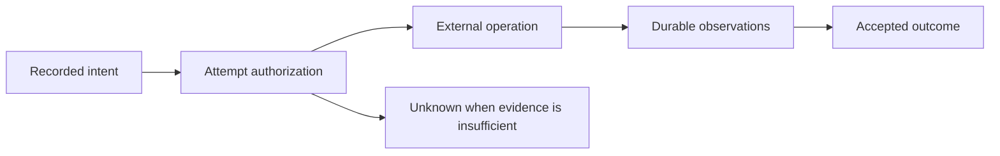

# External effects and uncertain outcomes

This account explains why durable execution cannot manufacture certainty about
an external system. It consolidates connector and finite RPC reasoning. The
[connector reference](../reference/connectors.md) owns supported transport shapes,
policies and API limits.

## Model

An intent describes requested external work, including destination, credential
references, capture policy and finite budgets. An authorized attempt permits
dispatch under recorded scope. The remote system acts outside the Transit commit
boundary. A capture records observations, and the owning protocol decides which
outcome those observations establish.

An authorized attempt is potentially in flight even if its worker paused before
the send. The model assumes only the external guarantees explicitly available
through the connector's policy, such as a particular remote idempotency or status
contract. Transit admission alone supplies no such guarantee.

## The uncertainty window

Consider a remote operation that succeeds immediately before its connection or
worker fails. The local observer cannot distinguish that execution from some
failures before remote acceptance using the missing response alone. Retrying
could repeat an effect; declaring failure could contradict what occurred.
The correct local state is unknown until adequate evidence or an authorized
reconciliation policy resolves it.

Revocation and fencing prevent new unauthorized decisions at their defined
boundaries. They cannot retract a remote action already in flight. Likewise,
closing reconciliation can reject late outcomes without proving remote
cancellation. A closed unknown outcome must not reopen merely because old bytes
arrive later.

## Capture and replay

Bounded immutable publication stores request/response pieces and terminal
coverage. A prefix or a decoded-and-reencoded message is not necessarily complete,
byte-exact evidence. Preserve permitted bytes, identify omissions and retain the
control identity needed after payload cleanup.

Secrets remain typed references in durable intents and resolve only within an
authorized executor. Transcript reads still require current permission.
Replay consumes recorded evidence; remote status checks, cancellation attempts
and new sends are effects requiring their own authorization. Hiding them inside
replay would make replay observably change the world.

## Tradeoffs, evidence and limits

Automatic retry is useful only where the connector's explicit remote semantics
justify it. Preserving unknown costs callers additional reconciliation logic but
avoids claiming a safe retry or rollback without evidence. The finite gRPC profile
freezes its outgoing batch and half-close before dispatch; concurrent responses
cannot authorize later sends or arbitrary conversation resumption.

The [Exchange](../../contracts/STATION_EXCHANGE_V1.md),
[HTTP](../../contracts/STATION_HTTP_V1.md) and [gRPC](../../contracts/STATION_GRPC_V1.md)
contracts define identity, coverage and finite budgets. The
[HTTP evidence](../../tests/README.md#m15-connector-work-in-progress) and
[finite RPC evidence](../../tests/README.md#m16-finite-connector-qualification)
record interruption, capture and replay schedules with reproducible commands.
Their names and recorded limitations matter; planned checks do not count as passes.

These arguments establish no universal exactly-once external effect, instantaneous
revocation or automatic remote-stream recovery. Further rationale and earlier
proposals remain in the [connector](../history/CONNECTORS.md) and
[gRPC](../history/GRPC.md) records.
