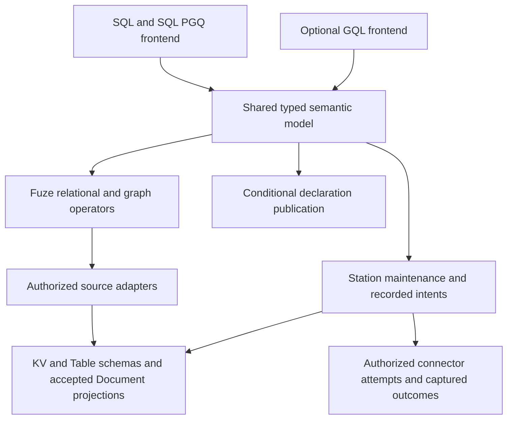

# Query planning, snapshots and results

This account combines SQL, Fuze and Arrow reasoning around one question: what
makes a query result attributable and complete? The [SQL](../reference/sql.md),
[query](../reference/queries.md), [Arrow](../reference/arrow.md) and
[Flight](../reference/flight.md) references own supported syntax, types and interfaces.

## Model and dependencies

SQL lowers to a typed finite plan. A declared source fixes identity, schema or
decoder and supported access. A source adapter obtains authorized data at an
explicit basis; Fuze performs bounded computation outside kernel authority.
Arrow represents batches and interchange. None of those representations supplies
permission, persistence, a global snapshot or an execution guarantee by itself.

KV requires an explicit decoder; Table requires its declared schema; Document
queries use accepted projections. Missing, null, conflict, type error and ordinary
value remain distinct. Replacing any of them with an empty successful answer would
change the source's meaning.

## Native execution lifetimes

| Profile | Recovery evidence | Completion and cleanup |
| --- | --- | --- |
| Interactive session | Fresh leased source snapshot and bounded client execution | Complete/failed/cancelled result framing; release or lease expiry; reconnection starts new work |
| Durable captured query | Frozen query identity, captured basis, recorded progress and immutable result publication | Verified complete manifest and ordered segment coverage; recovery follows the original identity |

Durability of application state does not require every read computation to become
a durable job. Interactive execution avoids recorded upload/progress/result turns
and gives up resumption of that computation after client loss. Captured queries
pay for durable bookkeeping in exchange for their specified result recovery.
These are distinct contracts, not interchangeable optimization settings.

## Frozen file interpretation

The local CSV/JSONL implementation adds an ephemeral host-capture profile. This
section describes the mechanism at `073b6f9b` (2026-09-30), with contracts and
correctness evidence linked below. Its question is whether bounded discovery can
produce a stable interpretation without retaining the input in memory. It does
not describe durable file-job acceptance or a distributed snapshot.

Let B contain ordered content lengths/hashes, decoder options, discovery evidence
and a recursive schema. The host owns immutable seekable captures and current
access/cancellation callbacks; Fuze owns pure framing, discovery and execution.
The CLI writes private, unlinked disk captures under separate encoded/expanded
quotas. The source reference is the captured bytes, not the original pathname.
The argument assumes the host honors immutable handles and reports current
authority correctly; hashing cannot establish that a host is honest.

Discovery retains a bounded type tree and coverage counters. Explicit schemas
avoid inference; sampled schemas describe only their bounded prefix; full
discovery deliberately reads all selected content. Unresolved or heterogeneous
observations retain text/JSON according to the format contract. The binding
fingerprint commits B before typed rows are exposed. Execution checks every row
under that same schema and rejects late unknown fields or incompatible values
according to the selected policy. No emitted schema widens.

Each scan retains an 8 KiB input chunk, one at-most-64-KiB record and bounded
schema/header metadata. Each returned row owns its arena; the caller must release
rows instead of accumulating the result. Arrow adds a fixed 4 MiB workspace and
at-most-64-KiB output segment, containing at most eight rows. Thus engine resident
work is bounded by metadata, one record/row and output buffers rather than total
input length. Disk spooling still scales with captured bytes and remains quota
limited. This is a structural bound, not an RSS measurement; host allocators,
kernel caches and I/O machinery require separate measurement.

Source checks occur before reads and buffered disclosure, independently of
content hashes. Actual length/hash verification at EOF is the completion gate.
A malicious or changed source may therefore expose an incorrect provisional
prefix before detection; consumers cannot treat that prefix as a complete result.
Saved bindings require already acquired matching handles and fresh access checks.
They do not reopen a pathname, dispatch effects or authorize recovery.

Converting only projected fields would reduce work, but would suppress errors in
unselected input. Early success after LIMIT would similarly hide a malformed
tail or changed source. The selected contract validates full rows through EOF;
projection changes output without changing that obligation. Typed batches and
metadata reuse can reduce overhead only while preserving these checks. Their
performance is an experimental question owned by the
[measurement reference](../reference/performance.md), not a consequence of the
memory argument.

The [type](../../contracts/FUZE_TYPES_V1.md) and
[source](../../contracts/FUZE_SOURCE_V1.md) contracts define the exact model;
[FileSource](../../packages/zig/transit-fuze/src/FileSource.zig) and
[FileQuery](../../packages/zig/transit-fuze/src/FileQuery.zig) implement it.
Reproduce the independent numeric/framing/schema/ownership checks with the
pinned-toolchain commands in the
[proof ledger](../../tests/README.md#fuze-bounded-file-sources), which records
results and scope. These schedules cover source replacement, denial/cancellation, allocation
failure and failed-prefix completion; they do not prove every parser input or
durable crash recovery. Broader native/Flight/Table admission remains separately
specified in the [capability matrix](../reference/sql/types.md#surface-capability-matrix).

## Correctness of a displayed result

Each page must belong to the same declared result and source basis. A transport
write or decoded first batch establishes neither completeness nor permission to
disclose later batches. Ordered coverage and the owning completion checks must
succeed before a consumer presents a complete answer. Current authorization still
applies to rereads of immutable bytes.

For interactive reads, a lease bounds snapshot ownership and cleanup after client
loss. A retained cache entry cannot extend the lease or retain permission. For
captured delivery, receiver-issued segment credit bounds active transport work;
retained result cardinality remains a different quantity.

An index access path must preserve the original predicate's meaning. A primary-key
seek may reduce visited rows, while predicate evaluation still determines matches.
The current [Table access paths](../reference/tables.md) do not establish generic
columnar storage merely because output is Arrow.

## Relational correctness and data movement

This section analyzes finite relational correctness and the additional
obligations for maintained and distributed execution. The original single-source
analysis uses revision `2c1a9d2d`; the implemented finite extension is scoped by
the [current query boundary](../reference/queries.md#relational-boundary).

The local [relational contract](../../contracts/RELATIONAL_V1.md) now implements
plan/basis validation, shared SQL lowering and bounded execution for a finite int64
profile. It uses stable Table row IDs rather than assuming primary keys identify
every row: general Tables also allow duplicate rows without a declared key.
Its [independent oracle](../../tests/relational.py) materializes small relations
and compares the overlapping subset with SQLite; separate prefix arithmetic
fixes the ordered-overflow counterexample below. The
[intake evidence](../../tests/README.md#relational-contract-and-oracle-intake)
distinguishes local checks, private-disk group growth and native interactive
source capture from the still-missing maintained publication and distributed
recovery mechanisms. Agreement on small finite relations alone does not
establish bounded execution over growing retained data.

The finite physical model uses ordered nested loops and an external AVL group
map. For L selected left rows, R right rows and G groups, the join can read
O(LR) right rows; group operations use O(log G) record reads/writes with fixed
record buffers and an index path bounded by the height possible for uint64
cardinality. Explicit work and disk quotas stop expensive executions. This
choice preserves canonical pair/error order directly and avoids a resident hash
table proportional to R or G. A partitioned hash join may reduce repeated reads,
but must restore canonical contributors before checked SUM; no such optimizer
is enabled here. Private spill is unlinked and cannot recover a captured job.
The heap accounting and bounded working buffers describe query-owned memory,
not process RSS or the transport client's separate allocations.

For resumable operator state, the question is how to advance a cursor without
modifying the previous accepted group map. The implemented
[immutable index](../../packages/zig/transit-fuze/src/RelationalIndex.zig) copies
the search path and rotated nodes, then assigns the new root only after every
candidate save succeeds. Under the host's fresh monotone-ID and immutable-read
contract, failure cannot alter the old root's reachable records. Work is
O(log G) new records per update; retaining all versions increases durable bytes
with updates, while the resident path remains bounded. This trades write/storage
amplification for a small atomic root publication. An in-place map would need a
separate undo/WAL protocol to preserve that property; no comparative performance
claim is made for either design.

The [operator checkpoint](../../packages/zig/transit-fuze/src/RelationalCheckpoint.zig)
binds this root to the exact source vector, join and output cursors, counters and
failure witness. Query-side Publication staging reconstructs candidate bytes from
the previous accepted state with the same reserved IDs. This establishes a useful
local invariant: incomplete staging cannot advance the accepted root.
The [captured owner](../../packages/zig/transit-query/src/RelationalCapture.zig)
commits the checkpoint reference together with consumed input and output
coverage. Admission retains the exact request as well as data cuts: retaining
only a result's sources would leave restart dependent on a mutable or retired
request publication. Current-revision guards prevent a policy read from racing
the turn that accepts a checkpoint. They do not turn the separately acquired
source cuts into a cross-resource transaction.

Each candidate is reconstructed from the previous checkpoint and receives the
same reserved record IDs. Consequently a restart during staging can validate and
continue existing bytes before exposing any new output. A completed manifest
binds the accepted job, source vector, checkpoint and ordered output digest
chain. The public reader verifies that coverage and checks all source rights,
including sources that contributed no rows. Compared with retaining a mutable
cursor alone, this design incurs additional immutable records and native turns;
it makes the acceptance boundary independently inspectable.

Closure and collection have separate authority requirements. Releasing a pin
uses recorded identities and needs no read of its protected bytes. Collection
walks contiguous private publication IDs and removes a bounded number of chunks
per turn, keeping permanent descriptors and failure evidence. A host that insists
on opening every foreign dependency before any handler can still starve closure
after revocation; the host must provide a fresh proposal using only its own
resource. The [checkpoint evidence](../../tests/README.md#immutable-group-checkpoints-and-bounded-publication-staging)
and [captured lifecycle evidence](../../tests/README.md#captured-relational-owner-and-results)
separate deterministic/reference-store schedules from native fault execution.
Neither immutable storage nor byte round trips alone establish worker
reassignment or distributed authority.

The relevant question is whether changing data placement could change a query's
meaning. In a conceptual multi-source model, let Q denote a typed logical query
and B a vector of exact source revisions. An attributable result would need to
identify both Q and B. Independently sampled source snapshots establish a vector
of observations; they do not establish a common instant or a cross-resource
transaction. A snapshot alone also says nothing about future input completeness.

There are two different movements. An **exchange** routes records by the key
needed by an operator, for example from source partitions to join-key partitions.
A **rebalance** changes which worker handles a logical partition. Either can
change arrival order, batch boundaries and retry schedules. Existing durable
PIDs and source identities separate logical work from a worker; they do not
specify relational equivalence across those physical changes.

### Counterexamples that constrain an extension

| Situation | Consequence for a declarative guarantee |
| --- | --- |
| Two left and three right rows share a matching value | A bag join has six row pairs; deduplication by projected value would change the answer |
| No right row has arrived yet | A left-join unmatched row needs evidence that the right input is complete at the stated basis |
| One source changes between two snapshot acquisitions | A reproducible vector can still describe a combination that never existed at one instant |
| A retry contributes one row twice | Counts and sums change even if transport eventually delivers every packet |
| A materialized source grant is revoked | A derived result's storage reference cannot replace current source disclosure authority |

Checked arithmetic adds an existing, concrete constraint. Fuze's int64 sum folds
in source order and fails on an overflowing prefix. For `[MAX_I64, 1, -1]`, the
second addition fails; `[MAX_I64, -1, 1]` succeeds. Summing the final mathematical
total with a wider accumulator or combining arbitrary partial sums changes that
observable failure behavior. Thus a relational specification has to include
order and errors as well as successful row values. The current implementation
is [UnifiedStream.step](../../packages/zig/transit-fuze/src/UnifiedStream.zig);
the [rewrite proof scope](../../contracts/sql/README.md#lean-scope) explicitly
excludes general reassociation of checked sums.

A maintained relation introduces another observation boundary. If a source
update removes one value and inserts another, publishing only half the update
exposes a result for a source state that was never committed. Operator state,
consumed input coverage and published output therefore need a shared visibility
decision. The existing native one-resource turn and immutable publication provide
building blocks; they do not already define this multi-source maintenance ledger.
Similarly, coalesced Table invalidations cannot reconstruct every intermediate
row change. Finite refresh and complete change maintenance have different
observable histories.

### Resource costs and limits of the argument

Hash placement can colocate equal keys, but it cannot remove join fanout: L left
rows and R right rows for one key can produce L × R pairs. More workers also do
not make an order-sensitive hot group freely reducible. Resident memory must be
bounded separately from retained operator state, output and recovery evidence.
Spill, backpressure or explicit quota failure preserve the possibility of an
exact answer; silently evicting live join state changes its meaning. Default
unlimited [retention](../reference/retention.md) supplies no implicit state TTL.

These are deductions and small counterexamples, not runtime proofs or measured
performance claims. They assume exact source identities and declared relational
semantics; they establish neither a distributed snapshot nor liveness under
partition. Reproduction of the arithmetic counterexample follows the checked
fold above; independent page/order/failure fixtures are needed before any new
operator or rewrite can claim equivalence. Existing
[verification limits](../reference/verification.md) still apply.

## Tradeoffs and evidence

Materializing an entire result simplifies presentation but makes memory scale
with answer size. Bounded batch verification and paging require explicit identity,
completion and ownership handling. Sharing typed plans avoids separate SQL and
SDK execution semantics, while parser acceptance alone cannot establish that a
statement has an executable owner.

The [Fuze package](../../packages/zig/transit-fuze/README.md),
[interactive contract](../../contracts/INTERACTIVE_QUERY_V1.md),
[compatibility matrix](../../packages/zig/transit-query/docs/compatibility.md) and
[query evidence](../../tests/README.md#m18-qualification) connect these claims
to implementation, commands and source-specific limits. The
[SQL proof program](../../contracts/sql/README.md) states the assumptions of its
selected rewrite results; it does not prove the whole engine. Performance claims
must use the [measurement record](../reference/performance.md).

General continuous SQL, arbitrary joins/sorting and cross-resource transactions
are not implied. Historical details remain in the [Fuze](../history/FUZE.md),
[query-language](../history/QUERY_LANGUAGE.md), [Arrow](../history/ARROW.md) and
[flow-control](../history/FLOW_CONTROL.md) records.

## Standards and multiple data models

The following is design analysis, researched on 2026-09-29 against source
`113588b6`, rather than an account of implemented graph or continuous execution.
It asks which language boundaries let relational, document and graph computations
share Transit without adding a storage primitive for every notation. The
[SQL reference](../reference/sql.md) remains the authority for executable syntax.
No conformance, performance or recovery result is established by this analysis.

### Standards provide several targets

SQL/PGQ and GQL already have published editions. The relevant distinction is
between standardized query semantics and the additional lifecycle needed to
maintain a computation and dispatch external effects.

| Reference | Role in the design | Limit of the reference |
| --- | --- | --- |
| [ISO/IEC 9075-2:2023, SQL/Foundation](https://www.iso.org/standard/76584.html) | Relational expressions, types and query composition; SQL/JSON for relational access to structured values | Selecting features does not establish SQL Core or whole-standard conformance |
| [ISO/IEC 9075-16:2023, SQL/PGQ](https://www.iso.org/standard/79473.html) | Property graph mappings and graph pattern queries within SQL | Does not establish Transit snapshot, mutation or continuous-maintenance guarantees |
| [ISO/IEC 39075:2024, GQL](https://www.iso.org/standard/76120.html) | A graph language with its own types, queries and data-management semantics | A second language frontend needs its own conformance evidence |
| [ISO/IEC 9075-9:2023, SQL/MED](https://www.iso.org/standard/84804.html) | Foreign-data integration and separation of logical tables from external access | Provider options and Transit's capture/replay rules need their own contracts |
| [PGQL 1.5](https://pgql-lang.org/spec/1.5/) and [openCypher resources](https://opencypher.org/resources/) | Named dialect specifications, grammar and test inputs for comparison | Neither dialect is interchangeable with SQL/PGQ or GQL |
| [Streaming SQL expert-group report](https://arxiv.org/abs/2311.03476) | Primary account of attempts to reconcile streaming models | Describes work through summer 2023, not a published universal streaming contract |

The ISO catalog pages also list 2026 corrigenda for the four cited standards and
successor committee drafts. Pin the edition and reviewed corrections when
qualifying a feature; a draft is not a replacement standard. This review used
public catalog records and implementation/specification documentation, not a
clause-by-clause audit of the full normative texts.

SQL/Foundation supplies much of a declarative computation: expressions, joins,
grouping, common table expressions and recursion describe derived relations.
Analytic windows and row pattern recognition are useful feature targets, but
neither alone defines an unbounded event-time computation. Durable activation,
snapshot-to-change handoff, progress frontiers, retractions, finality and external
outcomes require additional semantics. The standards reviewed here do not supply
a complete portable contract for that combination. This is a scoped finding,
not a claim that no other streaming standardization work exists.

The proposed primary surface is SQL with selected SQL/PGQ features. GQL is the
secondary graph-language target. Cypher and PGQL are useful comparison and import
targets only when a named subset can be lowered without changing its meaning.
For example, [Cypher's GQL conformance account](https://neo4j.com/docs/cypher-manual/current/appendix/gql-conformance/)
explicitly distinguishes shared, unsupported and additional features. Familiar
`MATCH` syntax alone cannot settle path multiplicity or update semantics.

### Separate shape, access and execution

The proposed model separates five independent facts:

| Fact | Examples | Owner |
| --- | --- | --- |
| Durable state | Resource identity, revision, accepted head, current grants | Native state and Station |
| Logical shape | Relation, accepted structured document, property graph | Typed declarations and Fuze operators |
| Access binding | Local state, captured input, foreign object manifest | Authorized source/connector adapter |
| Evaluation | Finite snapshot, maintained result, observed change stream | Query and maintenance lifecycle |
| Effects and traits | Source reads, local writes, external attempts; determinism, boundedness, change mode | Shared compiler plus runtime admission |

A graph definition is a catalog object with identity and dependencies. It need
not be a new native storage kind. A materialized view is a query plus maintained
state and progress. A subscription observes results. A connection describes
external access; source and sink bindings describe input and output roles.
These distinctions prevent catalog names from becoming new execution authorities.

This diagram is a proposed decomposition. The existing shared finite plan is its
starting point, not an implemented graph/dataflow intermediate representation.
SQL, visual editing, CLI and SDKs must produce the same typed objects. Query
nodes, declaration commands and effect activation remain distinct variants;
parsing a definition cannot start a job or an external attempt.

### What the existing resources buy

KV supplies general keyed state and explicit codecs. Tables supply typed rows
and keys over that state. Documents supply structured identity, causal edits,
accepted revisions and conflict semantics. They are already different framework
contracts over the native resource boundary, not three unrelated storage engines.

| Computation | Proposed representation | Additional semantics needed |
| --- | --- | --- |
| Relational dataflow | Table or explicitly decoded KV relation | Richer row schemas, joins and maintained-query progress |
| Document analysis | Relation projected from an accepted Document basis | Explicit path expansion, stable row identity and conflict handling |
| Property graph | Vertex and edge relations plus a graph mapping | Element identity, endpoint mappings, labels, paths and graph operators |
| Time-series analysis | Relation with declared event-time column and change contract | Timestamp/interval rules, windows, watermarks and late-data policy |
| Image/audio/video processing | Metadata relation referencing immutable captured/publication bytes | Media types, bounded decoding, provenance and recorded model/tool outcomes |
| Vector search | Typed vector values/projections and derived index | Dimension, metric, exact/approximate result contract and index basis |

SQL/JSON is useful for relationalizing JSON values; see the
[PostgreSQL SQL/JSON implementation reference](https://www.postgresql.org/docs/17/functions-json.html).
A Transit Document is not merely a JSON blob: it also carries causal identity
and explicit conflicts. A JSON projection must define missing-path, explicit
null, type-error and conflict treatment. Preserve the native five-state result;
an explicitly requested SQL-value conversion may reject unresolved states or
apply a declared policy, never silently select a conflict winner. Such conversion
is a future typed operator, not a second permissive decoder for old data.

The same principle applies to graph properties and vector inputs. Binary data
can be referenced through bounded immutable publication; placing a URI in a row
does not retain the object or authorize fetching it. Embeddings and remote model
responses require recorded provenance and outcomes. A model name or a seed does
not establish replay determinism.

The design judgment is to add no native Graph, Stream, Vector or Media resource
kind initially. Add logical types, catalog definitions and specialized indexes
when required. Reconsider a native primitive only for a demonstrated authority,
atomicity, lifetime or storage obligation that cannot be met above the existing
boundary. KV can encode a graph, but that fact alone proves neither adequate
traversal performance nor correct graph updates.

### Graphs require identities and a consistency policy

A directed property multigraph can be modeled as `G = (V, E, src, dst, labels,
properties)`. Vertex identity includes its graph mapping, element-table identity
and declared key. Edges have their own identities: two edges with identical
endpoints can be distinct. Labels and typed properties are independent of those
identities. Reusing a SQL alias must not silently change durable identity.

A graph mapping over separately captured resources has a basis vector
`B = (b_vertices, b_edges, ...)`. That vector describes observations; it does not
establish one transactionally consistent cut. Capturing vertices before an update
and edges after it can expose a missing endpoint even when the writer's intended
graph was valid. The first proposed profile uses finite reads over an explicit
validated basis. It rejects duplicate/null identities and invalid endpoint
mappings under its declared constraints. It must not silently omit invalid edges.

A coherent publication can instead stage immutable vertex/edge partitions and
publish one validated graph manifest through an existing atomic head. This is a
possible Station composition requiring its own contract and recovery evidence.
It is not supplied by two ordinary Table handles today. Multi-resource graph
updates, cascading deletes and general GQL transactions remain separate work;
do not split a promised atomic graph mutation into unrelated turns.

Fixed-length patterns can often lower to relational joins. Variable-length paths
also need graph-aware operations and explicit walk/trail/simple-path, zero-length,
direction, multiplicity and shortest-path tie rules. Preserve these in the typed
model rather than flattening every pattern immediately into joins. Recursion
and cyclic graphs can yield huge or infinite answers. Bound active traversal,
spill, steps and output; reject or report incomplete execution when a budget
ends. A hidden depth cap cannot turn a prefix into a complete result.

### External is an access qualifier

`CREATE EXTERNAL TABLE` is a useful user-facing idea, but its spelling does not
establish SQL-standard conformance. Prefer the SQL/MED foreign-table vocabulary
as the canonical target. [PostgreSQL's CREATE FOREIGN TABLE reference](https://www.postgresql.org/docs/17/sql-createforeigntable.html)
identifies its SQL/MED alignment and its extensions. S3 bucket, file format and
capture options remain typed Transit/connector options.

A foreign table is a relation with an external read binding. It does not imply
ingestion, a continuous watcher, writable remote storage or external transactions.
Use a source binding for captured ingestion and a sink binding for recorded
output. An S3 table source is unrelated to Ursula's use of S3 as cold storage;
query adapters never receive backend authority.

For a replayable computation, freeze a paged manifest and its exact object
versions/content commitments, schema, format and capture identity. Retain captured
bytes, or establish an explicit retrievability contract; version names alone do
not guarantee future availability. Directory listings and changing object
prefixes do not define a snapshot. Filesystem sources likewise need a declared
root and captured content basis. An ETag alone is not a universal content digest.
Missing or changed bytes fail explicitly. Credentials remain references and
every disclosure rechecks current policy.

### Function coloring is an effect and trait system

The useful interpretation of coloring is checked semantic information. A single
`pure` versus `impure` bit cannot express all relevant restrictions:

| Dimension | Proposed facts | Consequence |
| --- | --- | --- |
| Effects | Read declared source, write local state, capture external observation, dispatch external intent | Determines required runtime owners and authority |
| Determinism | Pure, stable at captured basis, volatile unless recorded | Determines replay and reuse eligibility |
| Failure | Total or fallible with specified error behavior | Constrains predicate movement and evaluation order |
| Change behavior | Append, keyed upsert, general retractable changes | Determines legal maintenance and sink strategies |
| Work | Finite/unbounded input; resident, spill and total-work budgets | Determines admission and bounded execution |

Effects propagate through expression and dependency composition. Determinism,
monotonicity and change behavior need operator-specific transfer rules; they
cannot be inferred from the word `SELECT` or from an append-only source alone.
Grouping over inserts, for example, changes an existing aggregate result.

A trusted function descriptor and implementation determine these facts. A user
annotation cannot bless arbitrary network code as pure. Pure Fuze operators get
no connector handles. `EXPLAIN` may display required effects and budgets, but
must not resolve secrets, acquire query snapshots or dispatch work. Optimizers
must preserve error behavior as well as successful values; determinism alone
does not permit reordering checked arithmetic or fallible projections.

### Continuous computation needs more than grammar

The useful logical model is a relation changing over recorded progress:
`R[B] = Q(S1[b1], ..., Sn[bn])`. Maintenance consumes source changes and publishes
changes to `R`, preserving equality with finite evaluation at each declared
completed basis. This is an intended invariant, not a current guarantee.
[Flink's dynamic-table explanation](https://flink.apache.org/2017/03/30/continuous-queries-on-dynamic-tables/)
provides the related relational model; [Beam's model](https://beam.apache.org/documentation/basics/)
separates event time, watermarks and triggers. Neither supplies Transit authority.

For multiple inputs, progress is generally a vector/frontier, not a wall-clock
timestamp or a single resource revision. A complete contract must specify keys,
insert/update/delete multiplicity, snapshot-to-change coverage, resumable backfill,
checkpoints, retained history, late events, corrections and terminal conditions.
Finite input, bounded resident state and bounded total work are distinct facts.
Stateful joins and recursion need paged durable state or explicit refusal when
their profile cannot execute within its budget. Unlimited retention remains the
default; a watermark is not permission to delete accepted history.

External effects must consume a deliberate trigger contract, not arbitrary
intermediate rows. A changed aggregate can retract yesterday's answer; it cannot
retract yesterday's HTTP request. Atomically bind input progress to stable intent
identity, then use connector authorization and captured outcomes. Replay reads
the outcome. A correction, retry or compensation is a separately authorized
operation. No relational equivalence establishes external exactly-once delivery.

### Evolution and falsifiable checks

Keep standard syntax, named dialect syntax and Transit extensions identifiable
in a feature ledger, while lowering them into shared semantic operators. A ledger
needs the standard edition/correction and clause or verified feature identifier,
parse status, typed lowering, finite/maintained execution, transport exposure,
known deviations and independent fixtures. Parser agreement is evidence for one
column only. PostgreSQL is a useful oracle for its overlapping dialect, not the
normative definition of SQL/PGQ or all SQL semantics.

Current differences already matter: lowercase unquoted identifier folding,
PostgreSQL-style bytea literals, nonstandard scalar names, five-state cells,
checked int64 sums, and an integer-revision fragment spelled
`FOR SYSTEM_TIME AS OF`. Reserve SQL system-time forms for their standard meaning;
the familiar shorter AS OF can still introduce an explicitly typed Transit
snapshot or branch selector. The [schema-history model](state-model.md#schema-history-and-branches)
extends revision selection to include definitions, not only journal positions.
The existing fragment remains documented as such until a deliberate cutover;
this analysis does not change accepted syntax.

Separate language frontend evolution from canonical plans and stored execution
semantics, but do not promise that every new standard maps to the existing model.
Change that model when necessary. Follow the single-current-v1
[hard-cutover policy](../reference/versioning.md): replace incompatible definitions,
migrate consumers together, reject foreign/missing definition identifiers, and
preserve accepted work for matching-build reconciliation or explicit conversion.
Do not automatically recompile accepted jobs under new semantics. Multiple source
languages are possible; multiple historical meanings of one saved plan are not.

The central claims can be challenged with small independent models: compare
fixed-edge graph patterns with relational joins; test parallel edges, self-loops,
missing endpoints and ties; compare incrementally maintained bags with full
recomputation at every basis; replace an external object between pages; and
revoke a grant after a returned prefix. Check error and incomplete outcomes as
well as rows. Larger-than-cache traversal and recovery experiments are needed
before concluding that the resource composition performs adequately.

These are proposed evaluation methods. No graph, foreign-table, SQL/JSON or
continuous-query experiment was executed for this analysis. Reproduction begins
with the cited source revision, its pinned toolchain, the existing
[grammar corpus and proof commands](../../contracts/sql/README.md), and the
[executed evidence ledger](../../tests/README.md). Those existing finite-query
proofs do not validate the proposed extensions. Remaining uncertainties include
exact standard feature dependencies, coherent graph publication cost, document
conversion ergonomics and the recoverable state required by each graph operator.

## Historical schemas and query binding

This is a proposed extension to the analysis above, with the same research date
and Transit source basis. A historical query should select an immutable logical
snapshot before resolving table/column names and compiling expressions. The
snapshot binds data and its catalog: schema, constraints, views, Document/KV
decoders and graph mappings. The [state model](state-model.md#schema-history-and-branches)
owns branch publication, storage, authority and merge reasoning.

Three operations must remain distinguishable:

| Question | Proposed binding |
| --- | --- |
| What did this database mean at that revision? | Data and definitions from the same snapshot |
| What does that old data look like under another schema? | Historical data plus an explicit validated projection to the selected schema |
| Which rows were valid at a system/application time? | The specified temporal-table semantics, separate from snapshot/branch selection |

Use a typed selector for immutable snapshot identity, branch head or tag; keep
resource journal revision selection separately scoped to its resource/definition.
Branch names and tags are resolved before compilation and their concrete basis
appears in the result. One statement captures the required namespace heads once;
reading a view must not re-resolve its branch independently for every dependency.
A session default may choose a branch, but accepted work freezes the branch ID,
generation, snapshot and definition instead of consulting mutable session state
after reconnect. Cross-branch joins are explicit multi-basis queries and do not
establish a global transaction.

An old snapshot with column `name` continues to expose `name` after a later
snapshot renames it `display_name`. Historical views retain their old definitions.
Historical DESCRIBE/SHOW expose that catalog, and a prepared plan is bound to its
exact schema/basis. A schema-only inspection needs current metadata rights; row
disclosure additionally requires the relevant current data/history access. Names
and saved plans cannot retain revoked permission.

Projection through a newer schema is explicit, typed and pure. Match stable
column IDs or reviewed mappings, not similar names; validate conversions; retain
missing as distinct from NULL; and require an explicit policy for defaults and
Document conflicts. The conversion does not rewrite historical data or mutate
the source. This is useful for stable client result schemas without making a
historical query silently mean something different after today's DDL changes.

Schema publication revalidates dependent views, graph mappings and stored query
definitions by stable IDs. It records any new binding/definition revisions in
the same catalog candidate, with source text retained as provenance and displayed
SQL matching that catalog. It cannot silently rewrite an already accepted job or
recompile its text under new names. A dependency that cannot be rebound is an
explicit publication conflict or inactive definition under a declared policy.

Definition, data and result diffs are separate typed operations. A schema diff
must identify stable object/column IDs, old/new names and types, constraints and
dependency changes; a data diff must identify both input schemas and its alignment
policy. A query-result diff includes both source bases and query definitions.
Missing columns, deleted rows and null values are distinct. Cross-schema union,
comparison and aggregation require an explicit compatible result type.

Timestamp-to-snapshot convenience also needs a contract. A future selector must
name the branch/history, select the last accepted publication at or before the
requested authority time under a defined tie/order rule, and return the resolved
ID. Client timestamps, event-time columns and user-supplied commit dates are not
substitutes. No wall-clock ordering across independent authorities is implied.
Until this is defined, reject that selector instead of treating timestamps as
integer revisions. Unavailable retained history is an error, never a nearby basis.

Reproducibility is scoped to compatible query semantics and available inputs.
Historical application schemas can coexist as typed data within the current
schema-descriptor language. Incompatible Transit wire/ABI/stored definitions still
require the matching build or an explicit conversion. A snapshot must not cause
automatic fallback loading, execute an obsolete decoder or fetch historical code
with ambient authority. Tests need rename, drop/recreate, changed views, defaults,
type conversion failures, moved branch heads and current revocation. These are
proposed cases, not additions to the executed finite-query evidence.
