# Serving, reactive views and Board

This account explains how network and visual interfaces preserve the underlying
execution model. It consolidates serving, reactive and Board reasoning. Usage
belongs to the [serving](../reference/serving.md), [reactive](../reference/reactive.md),
[application](../reference/applications.md) and [Board](../guides/inspect-board.md) references.

## Model and trust boundary

A gateway adapts an inbound protocol to public Transit operations. A service has
durable identity and policy; a socket is a temporary attachment. A durable command
has an admission identity and an application outcome. A status read is a bounded
observation. These objects have different lifetimes and evidence requirements.

Caller authentication and current native/service/source authorization remain
separate from TLS, Host/Origin checks and the gateway's own credentials. A stronger
gateway credential cannot substitute for a caller's missing access. Board's
private deployment boundary admits viewers to a shared configured scope, while
its upstream identity still needs a read-only grant; it is not a per-viewer
authentication system.

## Admission and observation

A connection can fail after a command was admitted. The HTTP response therefore
cannot be the sole recovery identity. Preserve the original command and reconcile
its recorded outcome. Socket deadlines stop observation work but do not undo
accepted commands. Once a streaming response has begun, failure is interruption,
not a second success/error object appended as if the stream were complete.

Bounded concurrency, chunks and joined cancellation protect ownership when a
peer stalls. Protected disclosure must recheck current policy, including on later
pages or attachments. Transport liveness establishes neither durable application
progress nor a complete answer.

## Database sockets and durable Table writes

The database adapter asks a narrower question: how can an autocommit PostgreSQL
or MySQL execution retain its accepted write when the client supplies no stable
Transit operation identity? This section describes the implementation introduced
after source `24a91402` and the native v1 definition named by the
[SQL gateway contract](../../contracts/SQL_GATEWAY_V1.md). It assumes one current
native authority, its qualified durable storage, honest gateway/Catalog code and
an explicitly provisioned account. Protocol validation does not prove honest
computation. Interactive transactions and automatic cross-build history migration
are excluded.

The actors are a transient database session, an account worker, a fenced
coordinator and a Catalog worker. The account has a paged private ledger and a
dedicated sequenced Table principal. Before dispatch, it freezes the operation's
bound Table intent and then the exact signed native step. Native receipt,
processed input and attributed Table terminal outcome are distinct observations.
The [ledger](../../packages/zig/transit-sql-gateway/docs/ledger.md) defines the
records and transition bounds; [AccountRuntime](../../packages/zig/transit-sql-gateway/src/AccountRuntime.zig)
owns progress outside socket tasks.

```mermaid
flowchart LR
    Socket[Authenticated SQL execution] --> Reserve[Reserve durable operation]
    Reserve --> Intent[Persist bound Table intent]
    Intent --> Saved[Persist exact signed step]
    Saved --> Send[Submit or reconcile identical step]
    Send --> Evidence[Observe original Table outcome]
    Evidence --> Rights[Recheck current disclosure rights]
    Rights --> Reply[CommandComplete or OK]
```

Three invariants explain the ordering. First, a native dispatch has an earlier
durable saved step, so losing a transport reply does not require inventing a new
sequence or reconstructing SQL. Second, only one eligible native generation can
advance an account; a local process or provider restart cannot establish that
eligibility. Third, a wire completion requires the original Table terminal
evidence and current permission to disclose it. Losing permission can therefore
hide a committed result without undoing the commit. The implementation would
violate these claims if it dispatched before saving, replaced an unresolved
signed request, or disclosed cached counts without authorization.

The protocol cycle has a separate admission boundary. PostgreSQL buffers one
write execution through a valid Sync and rejects a second execution or write
Flush before dispatch. Read suspension retains the same cut until completion,
Close, error or Sync. MySQL admits one complete supported command with autocommit
status. Neither path accepts transaction syntax as a harmless no-op. Preparing
freezes descriptors and object/schema identity; executing acquires a fresh read
cut or bound write intent. Pure current-metadata retries cannot reopen a partly
disclosed result or repeat a mutation.

This design chooses explicit durable quotas and one serialized principal over
per-socket write lanes. Retained history grows on disk; bounded indexes select
active work without scanning all terminal operations. The tradeoff is native
publication/read amplification and serialization within one account. A local
recovery file per connection would be simpler but would not provide discovery
after the connection disappears or fenced sequence ownership. Replaying SQL on
reconnect would hide ambiguity by creating new work.

The [retained experiment](../../tests/verification/results/sql-wire-2026-10-14.json)
measures that cost with eight resident pages, 8 MiB hot storage and an 8 MiB cold
cache. It separates framed-row encoding from verified connection startup,
preparation, read/write completion and native/provider request windows. Native
read samples start a fresh helper and compile; wire samples retain connections
and preparations. Request windows include concurrent account maintenance, so
they do not attribute every request to the foreground query. A single 40 KiB row
outlives its 270-second SQL wait and reaches its original terminal outcome after
965 seconds. This establishes eventual completion in that schedule and exposes
the cost of the chosen durable path. It supplies neither a latency bound nor an
isolated estimate of storage or coordinator cost. Further attribution requires
controlled changes to those components, with the same authority and durability
checks preserved.

The [proof ledger](../../tests/README.md#database-wire-gateway) and its linked
native recovery tests separate executable observations from these design
arguments. It records the pinned toolchain and reproduction commands for native
recovery, independent wire contracts and actual clients; deployment commands are
in the [example](../../examples/sql-wire/README.md). Selected fault
schedules establish their asserted outcomes, not exhaustive correctness or a
throughput guarantee. Progress additionally requires available native storage,
current permissions, an eligible worker, finite admitted work and sufficient
quota. Socket timeout or successful shutdown alone establishes none of those
conditions and cannot promise rollback.

## Configured local SQL admission

The local placement asks a second question: how can configuration disable a
database socket without discarding work accepted through it? The implementation
introduced on 2026-10-17 composes the existing native authorization, Catalog and
account-ledger owners. Its scope is the trusted local Linux placement and one
current contract definition. It assumes durable local checkpoints and the native
storage/ownership conditions above; remote exposure and cross-build migration
are excluded. The [local SQL guide](../../apps/transit-cli/docs/sql.md) owns usage.

The model separates desired listeners, retained enrollment and native authority.
Enrollment fixes an account's identities, catalog binding, credentials and finite
setup journal. Configuration chooses which enrolled accounts admit new sessions.
The native ledger determines accepted work and the current generation allowed to
advance it. None of these three states substitutes for another.

[SqlJournal](../../apps/transit-cli/server/SqlJournal.zig) checkpoints an exact
signed setup request before submission and its receipt before advancing. A shared
installation reservation excludes competing root-sequence writers while its
outcome is unknown. A negative retry resolves the exact native receipt before
releasing that reservation. Preparing a request must succeed before publishing
it into retained state; a partially initialized request is not recovery evidence.
Account creation publishes a private directory atomically, so a resumed setup
finds the same keys and identities. An operator separately publishes the logical
role, credential binding and data grants through public authorization commands.
Completed setup receipts prevent restart from restoring a revoked credential or
grant. These orderings would be falsified by a second allocation after lost
receipt, reuse of an unresolved sequence, or a restored data privilege on restart.

[Sql](../../apps/transit-cli/server/Sql.zig) separates ledger initialization,
fresh fenced activation and socket admission. Disabled listeners do not load
PEMs. Removed accounts with unsettled operations retain a worker; settled removed
accounts retain their control profile without a resident worker. Historical
accounts are scanned individually, while an explicit bound limits simultaneous
active/recovering accounts. Idle workers back off their native polling; this
reduces competition with current authorization reads without increasing native
admission limits. Progress still requires available storage, current worker
rights and eventual scheduling. Backoff supplies no latency guarantee.

This design chooses retained enrollment over deleting accounts on configuration
removal, and explicit authorization over reconciling desired grants on every
start. The costs are additional private recovery records, visible enrollment
steps and operator intervention after revocation. Local TLS trust has its own
checkpoint and lifecycle; replacing or expiring a certificate changes admission,
not the identity or outcome of a recorded operation.

The executable schedules are [public client onboarding](../../tests/server_sql.py)
and [interrupted enrollment](../../tests/server_sql_faults.py), run through
`just test::server-sql`, `just test::server-sql-package` and
`just test::server-sql-faults` in the pinned Nix shell. They check selected
disconnect, restart, revocation and trust failures on disk-backed Ursula. The
[proof ledger](../../tests/README.md) distinguishes executed results from this
reasoning. These schedules do not cover every interruption point, sustained
maximum-account load or arbitrary filesystem/storage corruption.

## Reactive consistency

The implemented reactive profile combines int64 Table notifications with exact
finite snapshot refresh. It does not supply every intermediate revision or
continuous SQL. The snapshot/watch handoff must bind compatible source evidence;
reading latest state and subscribing later leaves a change window.

A refresh generation fixes its submitted plan/schema/source. Each refresh obtains
its own finite query identity and verifies complete ordered results before
replacing displayed rows and summaries together. While it runs, a bounded pending
invalidation can record further dirty progress. A late response cannot replace a
newer generation, and insufficient retained coverage requires reset or interruption.

This makes freshness explicit rather than equating the latest arriving packet
with truth. On denial, protected displayed and candidate state are cleared.
Temporary unavailability cannot be rendered as a successful empty result.

## Declarations and controls

SQL declarations, visual editors and generated modules use the same typed model
and owning validation. Parsing or editing a definition is not publication,
administration or external dispatch. Conditional activation applies a reviewed
definition; data migration has its own owner, ledger and acceptance boundary.
Installing compatible code, publishing an interface and activating a data epoch
are independent operations.

An alternate UI configuration database would create a second semantic authority.
Sharing contracts avoids that divergence but requires interfaces to display
definitions, proposed changes and observed state distinctly.

## Evidence and limits

The [serving contract](../../contracts/SERVING_V1.md),
[reactive contract](../../contracts/REACTIVE_V1.md) and
[application definition contract](../../contracts/APPLICATION_V1.md) define the
boundary. [Serving](../../tests/README.md#m19-qualification),
[reactive API](../../tests/README.md#m20-qualification) and
[refresh evidence](../../tests/README.md#m21-qualification) supply commands,
fault schedules and qualified source/deployment combinations.

The evidence does not establish arbitrary live queries, speculative execution
while editing or public per-user Board admission. Historical proposals remain in
the [serving](../history/SERVING.md), [reactive API](../history/REACTIVE_API.md),
[reactive interface](../history/REACTIVE.md),
[declarative application](../history/REACTIVE_APPLICATIONS.md) and
[Board](../history/BOARD.md) records. UI/UX review outcomes belong in
[Design](../design/README.md), where acceptance remains distinct from implementation.
