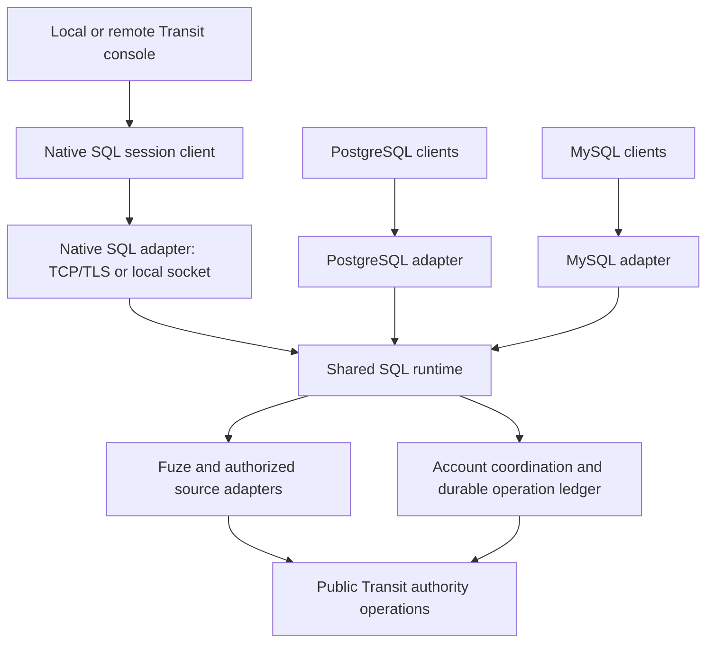

# Serving, reactive views and Board

This account explains how network and visual interfaces preserve the underlying
execution model. It consolidates serving, reactive and Board reasoning. Usage
belongs to the [serving](../reference/serving.md), [reactive](../reference/reactive.md),
[application](../reference/applications.md) and [Board](../guides/inspect-board.md) references.

## Model and trust boundary

A gateway adapts an inbound protocol to public Transit operations. A service has
durable identity and policy; a socket is a temporary attachment. A durable command
has an admission identity and an application outcome. A status read is a bounded
observation. These objects have different lifetimes and evidence requirements.

Caller authentication and current native/service/source authorization remain
separate from TLS, Host/Origin checks and the gateway's own credentials. A stronger
gateway credential cannot substitute for a caller's missing access. Board's
private deployment boundary admits viewers to a shared configured scope, while
its upstream identity still needs a read-only grant; it is not a per-viewer
authentication system.

## Admission and observation

A connection can fail after a command was admitted. The HTTP response therefore
cannot be the sole recovery identity. Preserve the original command and reconcile
its recorded outcome. Socket deadlines stop observation work but do not undo
accepted commands. Once a streaming response has begun, failure is interruption,
not a second success/error object appended as if the stream were complete.

Bounded concurrency, chunks and joined cancellation protect ownership when a
peer stalls. Protected disclosure must recheck current policy, including on later
pages or attachments. Transport liveness establishes neither durable application
progress nor a complete answer.

## Database sockets and durable Table writes

The database adapter asks a narrower question: how can an autocommit PostgreSQL
or MySQL execution retain its accepted write when the client supplies no stable
Transit operation identity? This section describes the implementation introduced
after source `24a91402` and the native v1 definition named by the
[SQL gateway contract](../../contracts/SQL_GATEWAY_V1.md). It assumes one current
native authority, its qualified durable storage, honest gateway/Catalog code and
an explicitly provisioned account. Protocol validation does not prove honest
computation. Interactive transactions and automatic cross-build history migration
are excluded.

The actors are a transient database session, an account worker, a fenced
coordinator and a Catalog worker. The account has a paged private ledger and a
dedicated sequenced Table principal. Before dispatch, it freezes the operation's
bound Table intent and then the exact signed native step. Native receipt,
processed input and attributed Table terminal outcome are distinct observations.
The [ledger](../../packages/zig/transit-sql-gateway/docs/ledger.md) defines the
records and transition bounds; [AccountRuntime](../../packages/zig/transit-sql-gateway/src/AccountRuntime.zig)
owns progress outside socket tasks.

```mermaid
flowchart LR
    Socket[Authenticated SQL execution] --> Reserve[Reserve durable operation]
    Reserve --> Intent[Persist bound Table intent]
    Intent --> Saved[Persist exact signed step]
    Saved --> Send[Submit or reconcile identical step]
    Send --> Evidence[Observe original Table outcome]
    Evidence --> Rights[Recheck current disclosure rights]
    Rights --> Reply[CommandComplete or OK]
```

Three invariants explain the ordering. First, a native dispatch has an earlier
durable saved step, so losing a transport reply does not require inventing a new
sequence or reconstructing SQL. Second, only one eligible native generation can
advance an account; a local process or provider restart cannot establish that
eligibility. Third, a wire completion requires the original Table terminal
evidence and current permission to disclose it. Losing permission can therefore
hide a committed result without undoing the commit. The implementation would
violate these claims if it dispatched before saving, replaced an unresolved
signed request, or disclosed cached counts without authorization.

The protocol cycle has a separate admission boundary. PostgreSQL buffers one
write execution through a valid Sync and rejects a second execution or write
Flush before dispatch. Read suspension retains the same cut until completion,
Close, error or Sync. MySQL admits one complete supported command with autocommit
status. Neither path accepts transaction syntax as a harmless no-op. Preparing
freezes descriptors and object/schema identity; executing acquires a fresh read
cut or bound write intent. Pure current-metadata retries cannot reopen a partly
disclosed result or repeat a mutation.

This design chooses explicit durable quotas and one serialized principal over
per-socket write lanes. Retained history grows on disk; bounded indexes select
active work without scanning all terminal operations. The tradeoff is native
publication/read amplification and serialization within one account. A local
recovery file per connection would be simpler but would not provide discovery
after the connection disappears or fenced sequence ownership. Replaying SQL on
reconnect would hide ambiguity by creating new work.

The [retained experiment](../../tests/verification/results/sql-wire-2026-10-14.json)
measures that cost with eight resident pages, 8 MiB hot storage and an 8 MiB cold
cache. It separates framed-row encoding from verified connection startup,
preparation, read/write completion and native/provider request windows. Native
read samples start a fresh helper and compile; wire samples retain connections
and preparations. Request windows include concurrent account maintenance, so
they do not attribute every request to the foreground query. A single 40 KiB row
outlives its 270-second SQL wait and reaches its original terminal outcome after
965 seconds. This establishes eventual completion in that schedule and exposes
the cost of the chosen durable path. It supplies neither a latency bound nor an
isolated estimate of storage or coordinator cost. Further attribution requires
controlled changes to those components, with the same authority and durability
checks preserved.

The [proof ledger](../../tests/README.md#database-wire-gateway) and its linked
native recovery tests separate executable observations from these design
arguments. It records the pinned toolchain and reproduction commands for native
recovery, independent wire contracts and actual clients; deployment commands are
in the [example](../../examples/sql-wire/README.md). Selected fault
schedules establish their asserted outcomes, not exhaustive correctness or a
throughput guarantee. Progress additionally requires available native storage,
current permissions, an eligible worker, finite admitted work and sufficient
quota. Socket timeout or successful shutdown alone establishes none of those
conditions and cannot promise rollback.

## Configured local SQL admission

The local placement asks a second question: how can configuration disable a
database socket without discarding work accepted through it? The implementation
introduced on 2026-10-17 composes the existing native authorization, Catalog and
account-ledger owners. Its scope is the trusted local Linux placement and one
current contract definition. It assumes durable local checkpoints and the native
storage/ownership conditions above; remote exposure and cross-build migration
are excluded. The [local SQL guide](../../apps/transit-cli/docs/sql.md) owns usage.

The model separates desired listeners, retained enrollment and native authority.
Enrollment fixes an account's identities, catalog binding, credentials and finite
setup journal. Configuration chooses which enrolled accounts admit new sessions.
The native ledger determines accepted work and the current generation allowed to
advance it. None of these three states substitutes for another.

[SqlJournal](../../apps/transit-cli/server/SqlJournal.zig) checkpoints an exact
signed setup request before submission and its receipt before advancing. A shared
installation reservation excludes competing root-sequence writers while its
outcome is unknown. A negative retry resolves the exact native receipt before
releasing that reservation. Preparing a request must succeed before publishing
it into retained state; a partially initialized request is not recovery evidence.
Account creation publishes a private directory atomically, so a resumed setup
finds the same keys and identities. An operator separately publishes the logical
role, credential binding and data grants through public authorization commands.
Completed setup receipts prevent restart from restoring a revoked credential or
grant. These orderings would be falsified by a second allocation after lost
receipt, reuse of an unresolved sequence, or a restored data privilege on restart.

[Sql](../../apps/transit-cli/server/Sql.zig) separates ledger initialization,
fresh fenced activation and socket admission. Disabled listeners do not load
PEMs. Removed accounts with unsettled operations retain a worker; settled removed
accounts retain their control profile without a resident worker. Historical
accounts are scanned individually, while an explicit bound limits simultaneous
active/recovering accounts. Failed setup attempts release their preparation
arena before reconstructing retained requests; an unavailable dependency does
not extend the lifetime of discarded setup allocations. Idle workers back off
their native polling; this reduces competition with current authorization reads without increasing native
admission limits. Progress still requires available storage, current worker
rights and eventual scheduling. Backoff supplies no latency guarantee.

This design chooses retained enrollment over deleting accounts on configuration
removal, and explicit authorization over reconciling desired grants on every
start. The costs are additional private recovery records, visible enrollment
steps and operator intervention after revocation. Local TLS trust has its own
checkpoint and lifecycle; replacing or expiring a certificate changes admission,
not the identity or outcome of a recorded operation.

The executable schedules are [public client onboarding](../../tests/server_sql.py)
and [interrupted enrollment](../../tests/server_sql_faults.py). They check selected
disconnect, restart, revocation and trust failures on disk-backed Ursula. The
[proof ledger](../../tests/README.md) supplies reproduction commands and
distinguishes executed results from this reasoning. These schedules do not cover every interruption point, sustained
maximum-account load or arbitrary filesystem/storage corruption.

## Shared SQL sessions: proposed ownership boundary

This section asks why a second local console cannot connect and what must change
to share SQL execution safely across native, PostgreSQL and MySQL clients. The
source inspection is at `547b3fdf74b9` on 2026-10-20. The shared session layer
below is a proposal, not an implemented interface or new qualification result.
The preceding database sections describe the existing machinery it would reuse.
The native SQL session API over HTTP/TLS is the selected design direction;
protocol details and executable qualification remain outstanding.

### Observed split and its consequence

[Console.localConfig](../../apps/transit-cli/Console.zig) reads the installation
record and selects `caller.seed`, `console-writes.json` and
`console-configuration.json`. `connection` holds an exclusive credential-file
lock for the lifetime of any console configured for writes, settings or durable
queries. An idle default console consequently excludes another default console,
even though interactive SELECT has its own leased snapshot and no durable query
job. The lock error retains the installation record's diagnostic location; the
actual credential lock is `caller.seed.console.lock`.

The lock protects two shared resources: native command sequence ownership and
exact recovery records. [TableClient.sign](../../packages/zig/transit-catalog/src/TableClient.zig)
reads the principal's current sequence and prepares its successor. Independent
callers cannot safely allocate that successor concurrently. Random recovery
filenames alone would separate files without coordinating that sequence. Removing
the lock would also permit overwriting uncertain work. This is a deduction from
the ownership rules, not a measured node concurrency limit.

The wire gateway already separates account recovery from connection lifetime.
However, [Host](../../apps/transit-sql-gateway/src/Host.zig) owns execution inside
the gateway application, while the console composes Query, Catalog and local
recovery independently. Importing common parsers does not establish a common
session owner. The proposed change makes the console another client of a
service-owned runtime and makes all three adapters use that same runtime.

### Actors, placement and authentication

The intended placement is one supervised SQL service hosting these adapters,
with exactly one active runtime owner for each enrolled account in that
deployment. It is not a separate microservice per adapter. Registry identity is
the enrolled account, not the listener, socket or claimed username. Native
generation fencing still prevents a replaced owner from dispatching. Another
deployment cannot obtain ownership merely by loading the same configuration.

The runtime owns authenticated sessions, selected roles and database/source
bindings, shared statement preparation, query execution and durable coordination.
Adapters own protocol framing, authentication exchanges and result codecs. A
protocol capability check may reject an unsupported type or statement before
admission; it cannot reinterpret the common operation. Fuze remains outside the
kernel. The runtime uses public clients and has no storage-provider access.

The missing client/server boundary is a network-accessible native SQL session
protocol. It is distinct from the kernel's signed native command protocol: it
authenticates an SQL account, opens a session, resolves authorized database/source
names and exchanges typed statements, results and operation identities. Both
local and remote console connections are requirements of the same proposal.
A remote console needs an endpoint, account, database and trust/credential
settings; it needs no installation directory, copied server seed, mount or tunnel.
Server-side admission and recovery must not depend on the client's filesystem.

The recommended remote transport is a bounded HTTP session API over verified
TLS, implemented by the SQL service's native adapter. A shared Zig client owns
framing, authentication exchange, typed result decoding and uncertainty reporting.
It must reject redirects that could move credentials, incompatible definitions
and an unexpected server instance during operation recovery. Authentication uses
the configured account's SCRAM verifier; the authenticated session carries current
account/role authority, not the server's private signing credential. The endpoint
and protocol capability exchange replace local resource-ID discovery.

For local use, an additional transport is a native Unix-domain socket in a
private user runtime directory. Socket permissions and verified OS peer identity
map the installation owner's UID to its explicitly provisioned local login
binding. The peer identity does not restore a revoked grant, select an arbitrary
claimed role, or authorize another user's installation. The binding is enrolled
once through the existing authorization owner. A live session still checks the
current account, credential and selected-role permissions.

The local socket path is selected by conventional configuration or a nonsecret
rendezvous record, not by reading `installation.json` or `caller.seed`. It must
distinguish local instances and validate directory ownership, socket replacement
and stale discovery. An explicitly selected connection never silently falls
back to another instance. Local and remote transports carry the same native SQL
contract and reach the same session registry; a socket path is not part of the
logical session identity. Explicit loopback trust remains a separate policy.
Remote exposure is configured, while implementation and qualification of remote
console support are required. PostgreSQL and MySQL listeners remain opt-in and
are unnecessary for either native connection. A local socket needs no TLS
certificate. These are proposed transport policies requiring executable
remote-authentication, peer-identity and discovery tests, not existing guarantees.

### HTTP API design and the Quack comparison

DuckDB's [Quack overview](https://duckdb.org/docs/current/quack/overview), read on
2026-10-20, describes its DuckDB 1.5.3 profile: client-initiated HTTP messages,
DuckDB-specific typed serialization, a short query request path and additional
fetches for larger results. Its client supports both direct remote queries and
remote catalog attachment. It also documents HTTP connection caching. These
features are a reference for transport design, not evidence for Transit recovery
or a commitment to Quack compatibility.

The [Quack reference](https://duckdb.org/docs/current/quack/reference#fetch-batching-server-side)
documents batching several data chunks into a fetch response. For Transit, the
corresponding design question is how much useful work one bounded network
exchange can perform without losing cancellation, result order or backpressure.
The following choices are Transit design deductions and require measurement:

- Treat a logical SQL session separately from an HTTP connection. A bounded
  connection pool can serve multiple requests without repeating the TLS handshake
  or resetting session settings. Neither a pooled socket nor a session handle
  supplies permission; each request binds the authenticated account and instance.
- Allow a simple execute request to carry SQL and typed parameters and return
  schema plus an initial bounded result batch, or an accepted operation handle.
  Separate prepare/bind operations remain available when useful. A short public
  request path must not skip internal durable write admission or claim a write
  finishes in one round trip.
- Fetch ordered batches under byte, row, time and retained-buffer bounds.
  Preserve a bounded retry window for an unacknowledged batch. Losing the fetch
  response must not skip rows, silently restart the query or change its source
  cut. A new logical session or service restart cannot resume an interactive read.
- Specify a public typed codec using Transit's existing logical definitions;
  preserve wide integers, decimals, nested values and distinct cell states for
  supported sources. HTTP does not imply JSON rows or conversion to wire-gateway
  scalar types. Physical storage pages and WAL records are not the public result
  format. Generate schemas and endpoint documentation from the owning types.
- Make HTTP intermediaries part of the protocol tests: sensitive responses are
  not cacheable, redirects cannot forward credentials, cancelled responses remain
  incomplete, and an intermediary retry cannot manufacture a new mutation.
  Stateful sessions bind to the owning service instance. Ordinary HTTP routing
  does not establish interchangeable replicas or distributed session ownership.

Quack's [security reference](https://duckdb.org/docs/current/quack/security)
describes a default shared-token check, replaceable authentication/authorization
hooks and TLS termination at a reverse proxy. Transit retains its own account,
current-grant and object-disclosure model and the proposed direct TLS endpoint.
The session service must preserve admission-token recovery and saved native
steps even when an HTTP response disappears. Neither a successful HTTP exchange
nor a freshly authenticated session establishes a durable SQL outcome.

This boundary can support future SDK, notebook, browser and Board consumers
without another execution authority. Browser admission would additionally need
an explicit origin/credential policy; HTTP availability alone does not establish
that support. Remote catalog attachment would need separately defined source
identity, permissions and consistency. Those consumers and federation remain
future scope; the initial native client and gateways exercise the shared boundary.
Compare cold and reused connections, request counts, first-batch and completion
latency, wire bytes and bounded resident memory before claiming an improvement.

### Distinct lifetimes

| Object | Owner and proposed lifetime | Consequence of connection loss |
| --- | --- | --- |
| Authentication exchange | Bounded adapter task | Discard transient secrets; no SQL authority inferred |
| SQL session | Service; bounded settings, prepared handles and active statements | Native HTTP connection loss does not close it; explicit close, lease expiry or database-wire disconnect does |
| Interactive read | Session; leased source cut, bounded compute and output | Native fetch loss permits only bounded same-cursor retry; session close releases pins/spill and leaves any prefix incomplete |
| Explicit captured query | Existing durable query owner | Recover its original job identity under its existing contract |
| Accepted mutation/control | Durable account operation plus its owning domain | Retain exact work and outcome independently of the session |
| Admission token | Account-scoped durable mapping to frozen request/operation | Retry or discover the same identity under current permission |

A session is not a durable PID or a newly granted principal. Sessions sharing an
account share its coordinator, but keep settings, preparations, reads and
cancellation separate. Session expiry is cleanup of temporary work; it is not
retention permission for accepted mutations. Successful admission, native input
processing, domain completion and client observation remain separate events.
Database-wire adapters associate their logical session with their socket. The
native HTTP adapter uses an authenticated session handle across bounded requests
and connections. Replacing a TCP connection with the same live session is not
durable query resumption. Expired sessions require fresh authentication and new
interactive work; accepted mutations retain their separate recovery identities.

### Admission before a reply can be trusted

Moving recovery to the server is insufficient if the caller loses the reply
which first identifies its operation. The native proposal supplies a random
request token before mutating admission. The account durably binds that token to
the request fingerprint, authenticated scope, selected role, frozen typed intent
and eventual operation identity. The lookup must be paged and quota-accounted.
The same token and request returns the original identity; conflicting reuse
rejects. A retry cannot recompile against a new schema and become different work.
Current permission is required again for retry and disclosure.

The service reports accepted execution only after complete intent publication
and durable admission. A reservation or partially uploaded intent is not that
receipt. Exact signed native steps are saved before dispatch, then native receipt,
processed-input evidence and domain outcome are reconciled in their existing
order. Account coordination, not a terminal process, allocates successor native
sequences. Settings reload and authorization controls preserve their own domain
journals and expected revisions; a shared operation registry indexes them without
claiming a transaction across those owners.

Ordinary PostgreSQL/MySQL executions have no stable client-supplied request token.
Their adapters allocate an internal identity and retain accepted work, but
resubmitting the same SQL is new work. Native reconnect also cannot identify a
particular interrupted command after losing all local correlation information
merely by comparing SQL text. Authorized paged operation discovery supplies the
recovery path; it must not choose one of several similar operations silently.
No mandatory client recovery file is needed to protect accepted work, but the
design does not promise automatic identification after complete client-state loss.

### Concurrency, bounds and invariants

Read execution runs in independently owned bounded tasks. Short ingress critical
sections and account write coordination do not hold a lock while a user edits
SQL, a socket stalls or a SELECT scans. One active Table operation per account is
the starting scheduler profile inherited from the ledger. This permits multiple
connected writers with durable bounded pending admission; it does not establish
parallel mutation execution within that account. Cross-account parallelism still
depends on catalog ownership, authority capacity and available storage.

Per-deployment and per-account limits cover authentication, sessions, active
reads, prepared handles, native requests, buffers and spill. Durable pending
admission reserves operation/content quotas before acceptance. A full lane
rejects new work explicitly without discarding old work. Cancellation, status,
recovery and shutdown have reserved bounded capacity so stalled output cannot
occupy every path needed for progress. Growing history is paged on disk; session
arrays cannot become total-operation-cardinality limits. Retention stays opt-in.

The proposal depends on the following falsifiable invariants:

- Two idle sessions under one account do not exclude one another. Reads never
  acquire a credential-wide terminal-lifetime lock.
- Every dispatched mutating native step has exact earlier durable recovery
  evidence, and at most one eligible owner allocates that account's sequence.
- Admission-token reuse cannot dispatch another operation or disclose another
  account's result. Missing or incompatible definitions reject before execution.
- Revocation prevents subsequent protected metadata, row and outcome disclosure,
  including prepared handles and buffered results. A session ID grants no rights.
- Disconnect, timeout and session reset do not roll back a published write.
  Cancelling an operation uses its owning domain's explicit cancellation rules.
- Saturated reads or disconnected clients cannot consume reserved recovery
  capacity. Progress remains conditional on storage, permissions and scheduling;
  no finite latency claim follows from bounded admission alone.

### Alternatives, evidence and remaining limits

Per-console credentials would require provisioning and retirement for ephemeral
terminals while leaving recovery discovery unresolved. File locks around each
write could permit concurrent local reads, but would still couple remote clients
to private files and fail to share wire-account recovery. Making the console a
PostgreSQL client would reuse socket sessions, but would require that listener and
restrict native types/commands to its current wire profile. A shared library
instantiated in separate uncoordinated processes would preserve the sequence
race. The service-owned runtime is the recommended tradeoff; its costs include
native protocol work, moving query compute into the service's memory budget and
making SQL service availability part of console availability.

Inspect the linked console, Host, TableClient and AccountRuntime owners at the
stated revision to reproduce the ownership analysis. The console guide's ordinary
connection command run in two terminals against one installation exposes the
current lock. The [existing console test](../../tests/console.py) also asserts
exclusion for an explicitly durable configuration; it is not evidence that
ordinary sessions must remain exclusive. Existing wire/installation fault
results are recorded in the [proof ledger](../../tests/README.md#database-wire-gateway).
They do not qualify the proposed native session transport.

The discriminating future experiments are simultaneous native/wire connections
under one account, a remote native client with no server files and both wire
listeners disabled, loss on both sides of durable admission, service restart after
dispatch, revocation during buffered output, slow-reader saturation and more
retained operations than resident cache entries. Record complete/unknown/rejected
outcomes, original identities, resident bytes and recovery progress separately.
Compare one connection with several under the same workload before claiming a
performance improvement. Moving code alone cannot eliminate the ledger's
publication cost. Full transactions, broad wire type compatibility, automatic
distributed SQL service placement, Board/Flight migration and resumable
interactive reads remain outside this proposal.

## Reactive consistency

The implemented reactive profile combines int64 Table notifications with exact
finite snapshot refresh. It does not supply every intermediate revision or
continuous SQL. The snapshot/watch handoff must bind compatible source evidence;
reading latest state and subscribing later leaves a change window.

A refresh generation fixes its submitted plan/schema/source. Each refresh obtains
its own finite query identity and verifies complete ordered results before
replacing displayed rows and summaries together. While it runs, a bounded pending
invalidation can record further dirty progress. A late response cannot replace a
newer generation, and insufficient retained coverage requires reset or interruption.

This makes freshness explicit rather than equating the latest arriving packet
with truth. On denial, protected displayed and candidate state are cleared.
Temporary unavailability cannot be rendered as a successful empty result.

## Declarations and controls

SQL declarations, visual editors and generated modules use the same typed model
and owning validation. Parsing or editing a definition is not publication,
administration or external dispatch. Conditional activation applies a reviewed
definition; data migration has its own owner, ledger and acceptance boundary.
Installing compatible code, publishing an interface and activating a data epoch
are independent operations.

An alternate UI configuration database would create a second semantic authority.
Sharing contracts avoids that divergence but requires interfaces to display
definitions, proposed changes and observed state distinctly.

## Evidence and limits

The [serving contract](../../contracts/SERVING_V1.md),
[reactive contract](../../contracts/REACTIVE_V1.md) and
[application definition contract](../../contracts/APPLICATION_V1.md) define the
boundary. [Serving](../../tests/README.md#m19-qualification),
[reactive API](../../tests/README.md#m20-qualification) and
[refresh evidence](../../tests/README.md#m21-qualification) supply commands,
fault schedules and qualified source/deployment combinations.

The evidence does not establish arbitrary live queries, speculative execution
while editing or public per-user Board admission. Historical proposals remain in
the [serving](../history/SERVING.md), [reactive API](../history/REACTIVE_API.md),
[reactive interface](../history/REACTIVE.md),
[declarative application](../history/REACTIVE_APPLICATIONS.md) and
[Board](../history/BOARD.md) records. UI/UX review outcomes belong in
[Design](../design/README.md), where acceptance remains distinct from implementation.
