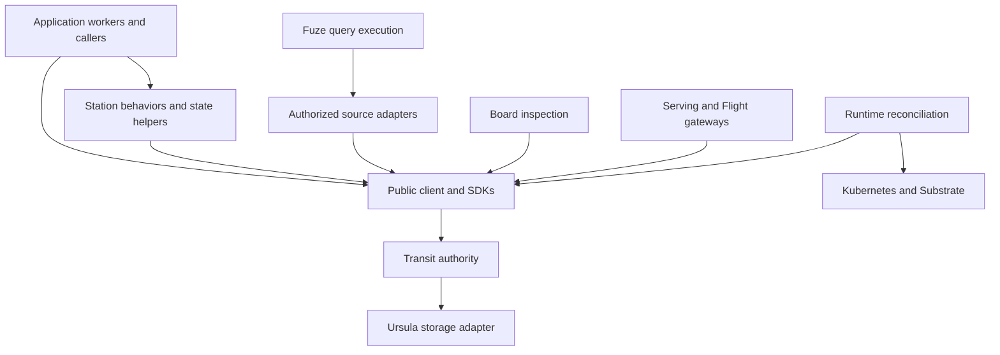

# Architecture and scope

Transit gives applications durable process identities, ordered mailboxes and
versioned state. Workers propose changes; the authority validates and commits
them to durable history. A worker's memory, a provider's pod and a UI cache are
never substitutes for that history.

This reference is shared by application authors, Transit contributors and agents.
Start with [the quickstart](../guides/quickstart.md) for an executable local system
and [interface selection](../guides/choose-interface.md) for supported profiles.
The local application server runs on Linux x86_64. The quickstart assumes an
installed local bundle with `transit` on `PATH`; its linked source installation
guide covers building that bundle. Release downloads are not available.

## Responsibilities

| Layer | Responsibility | Boundary |
| --- | --- | --- |
| Protocol and core | Identity, ordering, current grants, fencing, lifecycle and atomic commit decisions | No application handlers, provider types or query execution |
| Client | Canonical requests, signatures, bounded reads, private proposals and exact retry | Application code still validates its domain rules |
| Station | Behaviors, durable calls, names, supervision, typed Tables and Documents | Builds above the client; no alternate execution authority |
| Fuze | Typed finite plans, source adapters, bounded execution and Arrow output | No raw storage credentials or kernel authority; no DataFusion/Acero runtime |
| Connectors | Authorized external attempts and durable capture | Replay reads outcomes; it does not redispatch |
| Serving and Flight | Protocol adaptation, scoped admission and bounded disclosure | A socket, cursor or ticket is not permission |
| Board | Evidence projections and separately configured query/application workspaces | Inspection does not decode arbitrary application payloads |
| Storage and runtime | Persistence and physical process placement | Provider state cannot revive a retired PID or grant ownership |

Rey is the intended downstream trading application, not the runtime's name.
Trading policy, reasoning loops, goals and delegation belong to applications.
LLM and tool access belong behind connector effect boundaries. Transit does not
select a venue, strategy, latency target or monetary representation for you.

## Workloads guide the architecture

Interactive inspection, shared Documents, capture/materialization, historical
research, enrichment, workflow coordination and external execution have different
latency, freshness and recovery needs. The [workload model](workloads.md) records
those requirements and their [multilanguage examples](../guides/workload-examples.md).
Durable accepted data does not require every reader to be a recoverable job.

The shared SQL service gives each console SELECT a fresh result and source
snapshot. Closing the logical session releases active reads; a lease handles
abnormal disconnection. Explicit captured jobs survive session loss. Fuze runs
in the SQL service over generic leased native snapshots; low-level Query SDK
callers can also execute Fuze in their own process.
[Query execution](queries.md#interactive-sessions) defines that
distinction and the cancellation/cleanup contract.

Authorized snapshots, generic immutable block publication and independently
owned native request engines provide the shared storage boundary. Table records
use those blocks, and bounded result batches check current access before disclosure.
Physical collection follows explicit roots, storage epochs and read-lifetime
fences; quota pressure does not authorize expiry. See [storage](storage.md).

Remaining priorities include larger statement ingress, read structures suited to
each resource kind, and workload-specific indexing and statistics. Resident work
must remain bounded independently of retained data, with separate execution and
control capacity. The [performance reference](performance.md) records measured
improvements, regressions and remaining limits.

## Source of truth

A successful [turn](processes.md) commits state, input progress and outputs
together. Materialized indexes and caches are derived from accepted history.
Validated checkpoints may become essential recovery evidence after a prefix is
trimmed; they are not disposable caches. [Ursula](storage.md) supplies conditional
durability through the backend; it does not choose Transit identities or grants.

Execution ownership and permissions are separate. Current authorization applies
to writes, reads and replay. A process association names accessible state but
does not grant access or transfer resource lifetime. See [security](security.md),
[state](state.md) and [retention](retention.md).

## Compatibility is explicit

The [versioning policy](versioning.md) requires one current v1 definition per
Transit-owned protocol before 1.0. Breaking changes use hard cutovers that remove
superseded implementations and update consumers together. Matching version labels
alone do not establish compatibility between builds.

Native v1 uses bounded pages and immutable state roots, allowing retained
collections to grow beyond resident caches. There is no automatic history
conversion across incompatible definitions. Wire formats, service bindings,
SDK ABIs, application revisions and ownership generations retain their own
compatibility checks.

Transit supports local application installation, Station SDKs,
finite HTTP/gRPC effects, structured Documents, finite KV/Table/Document queries,
Table notifications and snapshot refresh, and finite Table Flight SQL.
Cross-resource transactions, general continuous SQL, interactive outbound RPC
resumption, federated identity and general live disaster recovery remain outside
those interfaces.

Kubernetes with Agent Substrate is the reference runtime. Trusted local and
Compose deployments do not provide the same isolation. Restore from an old
backup is not an ordinary worker restart. See [deployment](deployment.md).

## Find an implementation owner

Use the [component directory](components.md) for package interfaces and the
[contributor guide](../guides/contributing.md) for builds and validation. Wire
specifications stay in [contracts](../../contracts); each package owns its
configuration, APIs and bounds. Public documentation owns the explanation of
current behavior, including limitations and tradeoffs, for every audience.

For deeper mechanisms, design rationale and evidence, see
[Internals](../internals/README.md). Architecture explanations follow its
[scientific standard](../internals/standard.md): claims identify their assumptions,
implementation owners, evidence and limits. Historical proposals keep their
recorded status and do not expand the interfaces described here.
