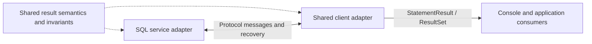

# 4. SQL statement results and client consumption

[Roadmap](README.md) · **Status:** Completed

Let a caller execute a statement and inspect one authoritative command outcome
or consume one logical typed result set, independently of storage pages, execution
vectors and transport batches. SELECT, SHOW, DESCRIBE and EXPLAIN share the result
lifecycle. A console displays a bounded view of that relation with explicit
coverage; applications can stream it without collecting the entire result.

**The primary deliverable is a formal, transport-independent result model and its
shared client implementation.** Console and other consumers operate on statement
outcomes and logical rows. Communication framing, fetch ordinals, acknowledgement,
retry, raw decoding and settlement polling belong below that interface. Faster
batching and a single rendered table support this goal; they do not complete the
milestone without that abstraction.

## Delivered integration boundary

PR #190 supplies concrete shared interfaces for milestone 3 integration; the
completion branch finishes the database adapters and qualification. The boundary is
`transit-sql-results` for logical schemas, row/column batches, observation evidence
and terminal progress; `transit-sql-client.Executor` owns submission/settlement and
returns the common result reader. Ordinary consumers do not operate native fetch
or status state machines. Service read variants fill independently bounded SQL
batches while retaining their owning source cuts and current disclosure checks.

Native result carriage uses binary columns and supplies schema/observation once,
with immutable commitments thereafter. It reuses Fuze's plain TCP1 representation
and compatible Arrow value buffers. This is a shared-definition hard cutover;
matching services, clients, generated resources and fresh compatible fixtures
must move together. It does not reinterpret earlier retained installations.
Prepared metadata and parameters remain in bounded JSON control messages.

Milestone 3 should preserve the `Read` ownership/disclosure boundary and supply
its source evidence through `Observation`, without exposing storage page sizes to
consumers or replacing independent cuts with an atomic-snapshot claim. Changes to
source buffers must keep borrowed values alive until copying/encoding completes.
SQL binary frames are transient representations and acquire no storage authority.

The [installed/fault qualification](../history/qualification/sql.md#transport-independent-statement-results--2026-10-27)
and [paired seeded measurements](../history/qualification/performance.md#statement-result-batching-and-consumption--2026-10-27)
record executed outcomes and limits. The
[combined qualification](../history/qualification/sql.md#combined-qualification)
passes all ordinary and Chromium checks, with a separate local full check after
the documentation-only rebase. The retained installed ALTER operation from an earlier failed run
remains an unresolved original attempt, not a passing outcome. Both performance
arms include the same early milestone 3 storage cutover. Compression remains an
experiment; the implemented native result profile admits identity encoding only.

## Prerequisites and scope

Follow the [live storage and SQL cutover](03-live-storage-and-sql-cutover.md),
consuming the catalog/snapshot and reader ownership contracts from
[data lifecycle](01-declarative-data-lifecycle.md) and
[storage/query performance](02-storage-and-query-performance.md). Contract work
and bounded batching improvements can proceed alongside that cutover; they do
not require every provider or codec to finish. Existing cutover obligations for
safe bounded reads remain with their owner.

The approved [early integration handoff](03-live-storage-and-sql-cutover.md#early-integration-pr-and-statement-result-handoff)
separates that dependency from completion of the entire storage milestone. Start
implementation from the merged early PR, which qualifies installed direct SQL,
automatic point flushing, lazy schema projection over mixed WAL/segment data and
single-executable startup through ordinary `transit server` / `transit console`.
Automatic archive/collection, further reader performance work, storage inspection
and final storage qualification remain with the storage owner. Coordinate shared
reader lifetime/inspection changes and any replacement of the current definition
across both branches; do not introduce parallel compatibility definitions.

The [SQL session contract](../../contracts/SQL_SESSION_V1.md),
[query semantics](../handbook/reference/queries.md),
[shared SQL service](../../packages/zig/transit-sql/README.md) and
[shared SQL client](../../packages/zig/transit-sql-client/README.md) are the
starting owners. Coordinate with the existing acceptance/compatibility work
([#111](https://github.com/spoke-sh/transit/issues/111),
[#112](https://github.com/spoke-sh/transit/issues/112)), catalog snapshots
([#125](https://github.com/spoke-sh/transit/issues/125)), encoded reader lifetimes
([#128](https://github.com/spoke-sh/transit/issues/128)) and read amplification
([#76](https://github.com/spoke-sh/transit/issues/76)).

The earlier review at source `94335c2a` identified the gap described by the local
`result_set.txt` discussion, with two delivered improvements preserved:
[Console](../../apps/transit-cli/Console.zig) suppresses an empty terminal table
after earlier rows, and the shared client already supplies `Pending` settlement.
At that revision the console owned fetch iteration and rendered transport
batches in slices;
[Session.Read](../../packages/zig/transit-sql-service/src/Session.zig) emitted one row
for several read variants, while
[ReadBatch](../../packages/zig/transit-sql/src/ReadBatch.zig) inherited the Table
batch limit. The transcript is diagnosis, not a current contract or measurement.
Its SHA-256 is
`b8ab0e6bf526a8c545129759ef027057d79aceda7879ddb0595f4cab895c5f2c`;
the full transcript was reread for this plan at the user's supplied location,
`/home/alex/workspace/rupurt/rey/result_set.txt`, and its hash matches. The plan
preserves its separation of execution chunks, server cursors, logical client
results and presentation. Historical counts and architectural proposals in that
transcript are not assumed to be current measurements or implemented snapshot
contracts. This plan is self-contained and does not require that local file.

Coordinate the [transaction contract](05-transactions-and-atomic-composition.md)
before freezing statement outcomes. A statement may complete within an open
transaction while its changes and counts remain provisional until commit.
Define transaction/basis attribution and cursor lifetime hooks here; milestone 5
implements transaction sessions and proves their commit/rollback interactions.
This does not make executable transactions a prerequisite for the autocommit
result-reader delivery.

## Implementation plan

The original plan was prepared on 2026-10-27 against `5962c10d2`, the merge of
[PR #188](https://github.com/spoke-sh/transit/pull/188). Implementation began after
user review that day. The checked gates below record delivery against that plan;
its API sketches retain their planning context. Current interfaces and limits
belong to the linked contracts, public references and package guides, with
executed evidence in qualification history.

### Executable outcomes

| Caller action | Outcome to deliver |
| --- | --- |
| Execute a command | One typed, currently authorized completion with its original operation identity where applicable, command kind, outcome and owner-defined counts; no invented row schema |
| Execute SELECT, SHOW, DESCRIBE or EXPLAIN | One logical schema and result identity, typed rows across any number of bounded batches, and checked terminal evidence |
| Stream a large result | Memory bounded by configured buffers and execution budgets, independently of total consumed rows; no whole-result collection for formatting |
| Stop reading or reach a display limit | Deterministic local cleanup and bounded remote closure; explicit partial coverage unless terminal evidence has already established completion |
| Lose a fetch reply | Retry only the same result/batch within its surviving session and budget, without duplicate delivery or a new SELECT |
| Lose a mutation reply | Observe the original token/operation and return its authorized outcome or explicit uncertainty; never resubmit SQL as new work |
| Lose rights, the session or the service | Stop disclosure and preserve the distinction between a received prefix, completed computation and unknown durable outcome |

Completion of a result establishes coverage of that statement's result, including
its SQL LIMIT. It does not establish coverage of an entire source Table, freshness
beyond its declared basis, or a future transaction commit. A consumer-imposed
display limit is a separate fact.

### Formal result model and abstraction boundary

The result model is a semantic contract that exists independently of HTTP, Unix
sockets, JSON, PostgreSQL/MySQL frames, cursor acknowledgements and storage pages.
Define it first in a proposed `contracts/SQL_RESULTS_V1.md`; the existing session
and gateway contracts specify how their communications realize it. Publish its
current supported concepts in the query/SQL reference and its reasoning in the
existing service-interfaces/query-engine Internals owners when implemented.

Use a proposed `transit-sql-results` library for the shared value types, invariants
and deterministic transitions, with its own manifest, module and checks. Its
inputs are logical schemas/cells, domain identities, observation evidence and
semantic events. It may depend on the existing logical-type and domain-contract
owners, but not on SQL wire messages, HTTP clients, sockets, clocks, renderers or
the service runtime. SQL protocol/service/client packages depend on that library;
the model must not acquire a reverse dependency on their communications.



The abstract model distinguishes:

- **Statement execution:** an attempt can be rejected, settle to a statement
  result, or remain unresolved with original correlation. Acceptance and
  observation uncertainty are not themselves successful statement results.
- **Statement result:** a command completion or a row-returning result set.
  Owner-defined command outcomes/counts remain separate from result row counts.
- **Result set:** one identity, logical schema, observation description and
  finite sequence of typed row occurrences, with a terminal outcome. It is a
  logical relation with SQL multiplicity; the consumption sequence does not add
  an ordering guarantee beyond the query's semantics.
- **Consumption:** a bounded reader over that sequence, with independent received,
  delivered and displayed progress. Streaming and materialized/windowed views
  realize the same result; neither wire boundaries nor display windows define it.

Specify a state tuple conceptually as
`(identity, schema, observation, received, delivered, outcome, consumption, released)`.
`received` and `delivered` are checked counters/progress, not resident copies of
all rows. A finite verifier may keep a small oracle sequence for correspondence.
`outcome` is open, complete with terminal evidence, failed or cancelled.
`consumption` separately records reading, exhausted or stopped (with its reason);
stopping before terminal leaves coverage incomplete. `released` is a separate
resource-lifetime fact: closing an already complete result preserves its
completion evidence; closing an open one
does not create completion. Original-operation uncertainty belongs to execution
observation, not a fabricated result-set terminal success.

| Semantic event | Model rule |
| --- | --- |
| Open result | Establish one schema/observation and an open outcome, even for zero returned rows |
| Accept logical rows | Check schema/types and original result attribution, advance unique received progress; preserve duplicates that belong to the SQL result |
| Deliver rows | Advance a prefix of received progress within caller bounds, once per row occurrence |
| Complete | Require verified terminal evidence and `terminal_rows == received`; prohibit subsequent new rows |
| Fail/cancel | Preserve the visible prefix and explicit incomplete outcome; prohibit a later success manufactured from transport EOF |
| Stop consumption | Record the caller's limit/closure without inferring source exhaustion; retain already verified completion separately if available |
| Release resources | Idempotently end ownership; neither erase historical completion facts nor grant renewed access |

The core invariants are immutable schema/result attribution, type-correct rows,
at-most-once consumer delivery of each received occurrence, monotone progress,
`0 <= delivered <= received`, full delivery on successful exhaustion,
terminal-count agreement, truthful incomplete prefixes, and resource release
independent of completion. Commands preserve their original accepted identity
and owner counts across settlement. A successful empty
result has schema and verified zero-row completion; EOF, failure and early close
do not satisfy that predicate.

Define a projection from communication traces to these semantic events. A
wire repeat is an internal recovery step, not another logical row. A terminal
empty batch contributes completion only. Splitting or joining physical batches,
changing packet boundaries and inserting permissible retry/lease steps cannot
change the projected rows, command outcome or completion evidence. Test this
**communication independence** directly with multiple admissible transports and
chunkings of the same logical result, including an in-memory scripted source.

That equivalence assumes the same logical disclosure and owner outcomes.
Revocation, cancellation, lease expiry or work-budget exhaustion can legitimately
change the delivered prefix; a model must not erase those observable failures or
claim that batching freezes authorization. Current-authority checks and source
correctness remain environmental obligations of each concrete adapter.

Make the model executable through an independent semantic oracle and generated
transition/communication schedules, compared with the real Zig state owner.
Include negative controls for duplicate emission, early completion, schema/basis
substitution and completing on close/EOF. Exercise split/join/retry projections
and fail on unknown transitions or mismatched outcomes. Keep pure model/owner
units beside the library and cross-component correspondence in the existing SQL
session test domain; register their actual checks with the task inventory.

Here, formalization means explicit types, state transitions, invariants and the
mapping from communication behavior to those semantics. A TLA+ model checker is
not a substitute for that domain abstraction. Broader temporal model checking and
refinement proofs remain candidates for
[milestone 17](17-formal-semantics-and-correspondence.md), after these contracts
settle; they are not a new prerequisite for this delivery. The correspondence
checks above establish their tested schedules, not a proof of arbitrary network
histories, allocator correctness, authorization services or storage behavior.
Installed fault and memory tests cover those separate obligations.

The intended ordinary consumer shape is the following **API sketch**, not
executable syntax or a second protocol:

```text
outcome = sql.execute(statement, parameters, options)
release outcome when finished

command completion -> render its typed outcome and counts
row result         -> read schema once; iterate typed rows; inspect completion
unresolved outcome -> report the original operation and observation uncertainty
failure            -> report the typed failure and any incomplete prefix
```

A consumer may choose a streaming row reader, bounded decoded chunks or a bounded
materialized window. A client chunk is an efficiency/ownership unit, never a
wire message; consumers need no wire batch ordinal or EOF-sentinel handling.
Ordinary statement consumption must not import native SQL `Action`/`Response`, decode hex/JSON cells,
manage cursor IDs, issue `fetch`/`close_result`, run `Pending` polls or repair a
session. Shared execution, reader and cancellation APIs own those mechanics.
Explicit low-level controls can remain available for specialist callers without
being required for Console. Semantic failure, incompleteness, cancellation and
uncertainty remain visible because they affect what the caller may conclude.

**Architectural acceptance gate:** compile and exercise a consumer that depends
only on the public client/result API. Run the same consumer against different
physical batch sizes, an empty terminal frame and a dropped/repeated fetch reply;
it must produce the same logical output and verified outcome where the owner
outcome is unchanged. A Console implementation that still interprets raw SQL
response tags or fetch state does not satisfy this milestone, even if it renders
one table and runs faster.

### Reviewed starting point

The following observations are from source inspection at the revision above;
they are not fresh benchmark or test results.

| Owner | Existing behavior to preserve | Work required |
| --- | --- | --- |
| [SQL protocol](../../packages/zig/transit-sql-protocol/src/root.zig) | Separate `completion`, `operation` and `batch` replies; nullable prepared schema; full logical types; cursor ordinals and source bases | Define their shared statement/result lifecycle, typed durable command completion, terminal row counts and metadata observation evidence |
| [Session.Read](../../packages/zig/transit-sql-service/src/Session.zig) and [ReadBatch](../../packages/zig/transit-sql/src/ReadBatch.zig) | Seven variants: single Table, relational, probe, settings, inspection, source and captured; explicit owner lifetimes | Relational/settings/inspection/probe paths emit at most one row per pull; shared batch capacity is inherited from the direct Table batch |
| [Registry](../../packages/zig/transit-sql-service/src/Registry.zig) | One cursor and one repeatable unacknowledged batch per native session; exact next-or-repeat ordinal handling; finite lease | Pulls one engine batch per native reply; encoding checks payload overflow after pulling; completion is a Boolean without an authoritative total-row field |
| [SQL client](../../packages/zig/transit-sql-client/README.md) | Owned parsed responses, exact definition/instance checks, no transport replay, existing `Pending` observation | Add reusable typed submission/settlement and result consumption; callers currently manage each response and fetch |
| [Console](../../apps/transit-cli/Console.zig) and [Results](../../apps/transit-cli/Results.zig) | Exact logical decoding, streaming JSON, explicit partial-result errors, empty-terminal suppression | Console owns fetch/decode/count/close; text rendering starts a new table for slices of up to eight rows |
| [PostgreSQL](../../packages/zig/transit-postgres/src/Session.zig) and [MySQL](../../packages/zig/transit-mysql/src/Session.zig) | Shared SQL execution and post-materialization validation; PostgreSQL portals; MySQL found-rows mapping | Consume the evolved shared outcomes and batches without changing upstream wire semantics or supported scalar profiles |
| [Pin recovery](https://github.com/spoke-sh/transit/blob/fbbaeae12/packages/zig/transit-sql/src/ReadPins.zig) | Journaled acquisition/release and current-authority recovery of durable Table pins | Preserve cleanup through reader exhaustion, faults, expiry and service replacement; session lease expiry alone does not expire a durable Table pin |

Current native limits are 32 rows, 1 MiB of canonical logical cell payload per
batch and a 4 MiB message. `ReadBatch` currently inherits the smaller direct Table
row bound. The SQL session has a default 16 MiB resident budget; interactive
execution separately limits output to 10,000 rows and 16 MiB of result bytes.
These limits belong to different layers. This milestone decouples their
implementation and makes exhaustion explicit; raising constants alone is not
its performance deliverable.

### Representation and performance refinement

The result model must admit both row and columnar consumption. Row iteration is
an ergonomic view, not a requirement to materialize every columnar input as
row objects. Add a bounded batch view with explicit owner/borrower lifetimes;
reuse Fuze column/value buffers where their type, state and lifetime contracts
permit it. Prove identical semantic observations through row and column consumers
and quantify any materialization needed by each adapter.

Keep logical type, physical value encoding and transport compression independent.
The initial native adapter's canonical-cell hex/JSON carriage has measurable
expansion and decoding allocations; bounded batching alone does not resolve those
costs. Inventory and measure encode/decode passes, copied bytes, allocations,
resident high-water marks, framing and repeated schema/observation overhead.
Evaluate binary batch carriage and schema-once framing against this baseline.
Compression/decompression belongs to the representation adapter, with explicit
encoded and decoded bounds and measured CPU/latency tradeoffs. Do not introduce
a second permanent legacy result protocol or double compression.

The native result cutover must replace hex/JSON cell carriage before completion.
Small control metadata can remain JSON; result payloads must be bounded binary
columns, with schema and observation supplied on the initial batch and immutable
commitments thereafter. Exact repetition of that initial batch repeats its
description. Reuse Fuze's validated column codecs and Arrow-compatible value
buffers where supported; preserve all five states and rich types. Binary frames
need explicit current-definition, lengths, alignment, row counts and terminal
evidence. Reject malformed or foreign frames before exposing their values. The
old hex representation is a frozen measurement baseline, never a runtime fallback.
Measure representation costs independently from service execution, and qualify
any compression with encoded/decoded bounds and round-trip negative controls.

Arrow integration uses the same logical result lifecycle and preserves all five
cell states and exact types. Distinguish local borrowed/C Data buffers, IPC batches
and Flight transport. Existing rich logical IPC segment limits and the narrower
Flight profile remain explicit; neither is a limit on the semantic batch model.
A readable Arrow end marker cannot replace verified Transit completion evidence.

### Scope and concurrent ownership

| Area | Milestone 4 responsibility | Boundary |
| --- | --- | --- |
| Shared result model | Transport-independent types, state transitions, invariants and implementation correspondence | Wire protocols realize this model; storage and authority establish its inputs |
| SQL service and native protocol | Statement/result contracts, bounded batches, cursor accounting, current disclosure checks | Query/storage owners still establish data cuts, logical values and execution outcomes |
| Shared SQL client | Submission, settlement, typed result reader, finite retry/cleanup budgets | The service continues accepted-work execution and recovery independently of callers |
| Console and current database adapters | Adopt the common lifecycle and preserve their public value/transport profiles | No general console redesign, new database protocol, multi-statement execution or new logical type support in PostgreSQL/MySQL |
| Milestone 3 P5/P6 | Agree owned-row lifetimes and metadata observation inputs; adapt new inspection readers to the shared batch interface | Automatic maintenance, WAL cleanup, storage caches/recovery reuse, new storage views and their authorization stay in milestone 3 |
| Milestone 5 | Specify statement attribution and cursor lifetime extension points | No BEGIN/COMMIT/ROLLBACK, provisional writes, savepoints or new atomic-snapshot claims here |
| Milestone 6 | Supply a documented Zig client lifecycle and ownership contract suitable for language APIs | New language-native SQL APIs and broad SDK expansion remain there; migrate every existing affected consumer here |
| Other query consumers | Audit shared definition/resources and any real dependencies during cutover | Board and Flight are not assumed to use native SQL sessions; do not replace their independent query contracts solely to share a renderer |

Use one owner for SQL result lifecycle edits in `Session`, `ReadBatch`, `Registry`,
SQL protocol/client and console. Coordinate direct-reader changes with the
storage owner before changing its API. Storage inspection additions should supply
rows and observation evidence to this interface, without implementing a second
fetch lifecycle. Rebase on merged storage changes at the contract and integration
gates, then rerun affected lifetime/authorization proofs.

Designate one shared-definition replacement for the coordinated incompatible
cutover. If the storage branch has already changed the definition, reconcile the
combined contracts and regenerate all dependent resources together. Neither
branch may retain an alternate accepted definition or silently reset old data.

### Decisions to carry into contract review

The recommendations below make implementation concrete. P0 freezes their exact
public types and failure mappings in the contract owners before dependent runtime
work; this roadmap is not a duplicate wire specification.

**Statement outcomes and count semantics.** Introduce shared typed concepts for
`StatementResult`, `CommandCompletion`, `ResultSet` and `ResultCompletion`; these
are proposed names. Separate completed commands and opened row results from
pending accepted work, pre-admission rejection and unresolved observation. A
shared submission helper may wait for the usual synchronous experience, but it
must retain explicit pending/unknown results when its budget ends.

| Statement family | Completion/count rule |
| --- | --- |
| INSERT, UPDATE, DELETE | Project matched/changed from the original owner's terminal evidence, including no-op updates; do not count affected storage records or received rows |
| Table/schema CREATE, ALTER, DROP and conditional assertions | Preserve authoritative applied/unchanged/rejected/cancelled distinctions and existing zero row counts; object/definition/position evidence comes from the catalog owner |
| Session SET/RESET and supported probe commands | Report their actual command kind and session-scoped outcome; do not imply durable data acceptance or invent an operation ID |
| Configuration reload | Preserve the original owner identity and applying/applied/pending-restart/rejected/partial semantics; do not normalize partial or pending-restart to a generic successful data mutation |
| SELECT and metadata relations | Terminal count is the number of logical result rows, not source rows scanned; zero is established only by verified completion |
| Explicit captured execution | Keep computation settlement separate from opening/consuming retained rows; use the same reader when the caller explicitly opens the captured result |

Inventory every existing statement tag, including empty statements, before
freezing the union. Recover command kind from the retained typed intent/binding,
not reparsed SQL or the renderer. If existing retained evidence lacks a required
field, add it to the owning current-v1 record and migrate its fixtures. Counts
whose meaning is not supplied by an owner remain explicitly inapplicable or
unavailable; zero must not mean unknown. PostgreSQL UPDATE remains matched-count
based; MySQL preserves its negotiated found-rows behavior.

**Identity, provenance and completion.** Bind the result to its instance/session,
opaque cursor identity, one logical schema and original observation description.
Reuse the current cursor identity unless a demonstrated contract need requires
another identifier. Verify schema, row arity/types, ordinal and basis consistency
before exposing a batch. The terminal outcome binds the same result and reports
the cumulative logical row count with checked arithmetic. A repeated batch does
not increment it. The client compares terminal count against the uniquely
received row count; it records delivered/displayed counts separately.

Data results preserve the exact Table/source cut or ordered independent-source
vector, including stable definition identities. Metadata requires its own typed
observation description: catalog definitions/revisions, settings generation and
session overrides, or service/probe context as supported by the actual owner.
DESCRIBE observes metadata; EXPLAIN describes a prepared plan without executing
its data query. Paged catalog observations that lack a single atomic cut must say
so. Carry bounded owner evidence or its verified commitment; do not accumulate an
unbounded observation list, manufacture a global revision, or hash a page and
claim it is a retained snapshot. Current authorization remains independent of
all these observations.

**Fetch transitions.** Preserve implicit acknowledgement by requesting the next
ordinal and exact repetition of the last returned batch. An initial response is
batch zero. The service retains at most one replayable batch; the client emits
its rows once. Final data may carry completion. If an iterator cannot determine
exhaustion without another pull, an empty terminal batch is valid evidence.
Neither form starts another logical result.

| Event | Required transition |
| --- | --- |
| Request last ordinal | Validate current rights, repeat identical result data/evidence; no iterator advance or double count |
| Request successor | Acknowledge prior batch, advance within budgets, retain one new batch |
| Request skipped/older ordinal or wrong cursor | Reject without rebinding or opening a new source |
| Receive terminal outcome | Validate count/schema/basis, preserve completion facts and release execution resources; final batch remains repeatable until cursor close/expiry |
| Fail, cancel or lose session before terminal | Preserve incomplete-prefix status; no successful terminal synthesis |
| Close reader early | Release local buffers, attempt bounded remote close, retain explicit incomplete coverage |

Serialize concurrent fetches through the existing borrower discipline. A failed
or lost initial execute reply does not authorize repeating SELECT. A lost fetch
reply can repeat the exact requested ordinal on the same surviving session within
a finite request budget. Session replacement may observe a durable operation,
but cannot resume an ordinary interactive result. Captured results reopen only
through their existing explicit operation API and start a new consumption.

**Independent memory and work budgets.** Start with the existing native envelope
ceilings: 32 rows, 1 MiB canonical cell bytes and 4 MiB serialized message bytes.
Give SQL batching its own limits rather than aliasing a Table or Arrow constant.
Allow smaller effective budgets, and account for schema, basis, binary column
framing, cell metadata and decoded allocations under their owning bounds.
Keep query work/result quotas distinct from transport and display limits.

Use a bounded batch builder across all seven `Read` variants. Copy/encode a row
before a subsequent pull can invalidate its scratch memory. Preserve the
single-Table owned batch path where safe. A source batch may be consumed through
a retained row index; do not duplicate an entire result to bridge page sizes.
If the next row exceeds the remaining batch budget, retain only bounded pending
source state and return the current batch. A row that cannot fit an empty allowed
batch fails explicitly before that row is disclosed; it is never skipped or
split into an invalid logical row. Source work/deadline exhaustion is a failure,
not a successful empty page. Avoid speculative unbounded lookahead.

Account for builder cells, retained source output, replay bytes, serialization
and client decoding simultaneously, including failure/OOM paths. The memory gate
uses a deliberately small resident budget and streams more total bytes than that
budget within explicit execution/output quotas; do not simply raise the quotas
until a test passes.

Revalidate current account, credential, role, object and source authority after
buffering and immediately before each bounded disclosure. Apply this to schema,
replays, data, empty terminal responses, command counts and diagnostics. Clear
protected retained state on denial. Reducing fetch or provider calls cannot remove
these checks or carry an authorization decision across later disclosures.

**Client ownership and settlement.** Keep `Client.call` as the bounded transport
primitive behind the ordinary result API. Add a typed reader in
`transit-sql-client`, with proposed operations `nextRow`/`nextChunk`, `completion`
and `close`, plus explicit ownership initialization and `deinit`.
A decoded row/chunk borrows reader-owned memory until the next advance or
close. A caller retaining values uses an explicit owned-copy API charged to its
allocator/budget. Validate schema once, check subsequent identity/schema evidence,
and decode full-width/nested/five-state values without JSON-number narrowing.

The reader owns cursor sequencing, exact-batch recovery, response disposal and
cleanup on success/failure. Exhaustion returns verified completion; early close
and errors cannot masquerade as exhaustion. Completion facts remain inspectable
after resource closure. Offer bounded materialization/window helpers that report
why they stopped. No helper implicitly drains a large result merely to discover
its count. Lease maintenance uses explicit bounded work on the existing session;
long-running consumers can renew through the client without silently reopening
an expired read. Keep caller cancellation and concurrent control transports joined
before freeing their state.

Evolve `Pending` rather than create another recovery state machine. Preserve the
original token/account/instance and existing finite discovery/settlement budgets
(currently up to 270 seconds from submission after acceptance, with a one-second
interrupt settlement budget). Polling/retries do not reset deadlines. Stopping a
wait, closing a result and requesting owner cancellation are distinct actions.
If cancellation races with terminal success, report the observed owner outcome;
if it cannot be observed, return uncertainty with the original correlation.
Cancellation unsupported by an owner does not become rejection or rollback.

For transaction integration, document where a future transaction identity,
provisional outcome and transaction-owned cursor lifetime would attach. Emit only
currently supported attribution; do not add executable transaction states or
claim a transaction commit based on a statement's completion. Milestone 5 owns
any further current-v1 extension necessary to activate those hooks.

**Console behavior.** Use the shared reader and settlement helper. Render one
schema/header and one logical table with fixed column widths chosen from schema
plus a bounded initial sample; continue streaming rows without restarting the
table at wire boundaries. Bound the sample by both rows and bytes, cap cell display
width and visibly mark clipped text. Preserve exact values in lossless JSON.
No full-result scan is permitted solely to compute display widths.

Preserve streaming JSON as schema, rows and an explicit terminal record. Use
lossless integer/count representations and all five cell states. Failure,
interruption and display cutoff must remain distinguishable from a complete
zero-row result. Report displayed rows separately from the server-verified count
when a complete batch was received but only part was displayed. A display cap
stops further fetching and closes the cursor; it does not drain the query to
manufacture completion. Keep machine stdout parseable and diagnostics separate.

## Delivery sequence

Implement in the following dependency order. Each package should have scoped,
logical commits with its meaningful tests. The gates are review points, not an
instruction to publish a partially migrated protocol. Work may be reviewed as a
branch diff before its coordinated current-v1 cutover is ready to merge.

| Package | Depends on | Reviewable deliverable and exit gate |
| --- | --- | --- |
| P0 — Formal semantics, contracts and baseline | Merged early storage handoff | Transport-independent result specification, statement/consumer inventory, outcome/reader contracts, count/observation mapping and baseline workload |
| P1 — Shared model and outcomes | P0 | Standalone semantic library, invariant/correspondence checks, protocol projection, schema/basis validation and independent fixtures |
| P2 — Bounded service batching | P1 | All seven read variants fill independent row/byte budgets with safe ownership, post-buffer authorization and recoverable pin cleanup |
| P3 — Shared client consumption | P1, then P2 integration | Typed submission/settlement and reader with bounded retries, deterministic cleanup and explicit incomplete/unknown outcomes |
| P4 — Console and adapter migration | P2, P3 | Installed console presents one logical result; PostgreSQL/MySQL preserve their existing profiles through the same service semantics |
| P5 — Coordinated cutover | P1–P4 | One current definition, regenerated contracts/resources/fixtures and updated existing consumers/public documentation |
| P6 — End-to-end qualification and closure | P5 | Independent value/count/basis oracles, fault/security/bounds evidence and measured batching improvements at one committed revision |

### P0 — Freeze the semantic model, contracts and baseline

- [x] Inventory all `Prepared` variants, native actions, durable operation owners,
  callers and generated consumers. Record which operations return rows, commands,
  durable pending work or no statement result; include captured `result` access.
- [x] Define the transport-independent semantic contract, abstract transitions,
  invariants and communication projection before choosing message layouts. Specify
  the dependency boundary and ordinary consumer API sketch. Review its transaction
  extension points without implementing transactions.
- [x] Put the realization of those semantics in
  [SQL_SESSION_V1](../../contracts/SQL_SESSION_V1.md) and shared Zig types. Specify
  the PostgreSQL/MySQL mappings in
  [SQL_GATEWAY_V1](../../contracts/SQL_GATEWAY_V1.md). List any required retained
  record changes and the resources affected by the shared definition.
- [x] Resolve metadata observation evidence against `SessionSettings`,
  `SessionInspection` and their catalog/configuration owners. Agree the M3 P6
  extension seam and the M5 attribution/cursor hooks without adding those features.
- [x] Freeze independent fixtures for empty/multi-batch results, owner count
  semantics, retries, malformed evidence and uncertainty before changing consumers.
- [x] Capture the current native/console/database-adapter workload with pinned
  builds, cold/warm settings, data/schema shapes and actual limits. Record fetches,
  source/authority calls, transferred bytes, first-row/terminal latency and peak
  resident memory. Keep baseline results in qualification evidence, not this plan.

**Gate:** the result model can be explained and exercised without a transport or
cursor, and every existing statement family and consumer has an exact mapping.
Review the semantic/protocol boundary, memory accounting, retry transitions and
experiment before committing dependent API decisions. No performance improvement is claimed
from source inspection alone.

### P1 — Implement the shared model, outcomes and result transitions

Owners: proposed `transit-sql-results`, `transit-sql-protocol` types/codec/schema,
`transit-sql` preparation,
`SessionOperations`, `Terminal`, `Registry` and retained records where necessary.

- [x] Implement the transport-independent value/transition library with direct
  dependencies and package checks. Keep native SQL messages and I/O outside it.
- [x] Implement the independent semantic oracle and communication projection
  checks against the actual transition owner, including generated schedules and
  negative controls. Register executable checks with the owning task inventory.
- [x] Project typed command outcomes from current authorized owner evidence and
  retain the command kind through delayed settlement, restart and token lookup.
- [x] Separate result description, batch transport and terminal completion in the
  shared types. Require correct result identity/schema/basis and cumulative count;
  validate overflow, row arity, illegal field combinations and premature terminal.
- [x] Preserve exact next-or-repeat acknowledgement, final-batch repetition and
  single-borrower serialization. Make terminal/resource-close transitions explicit
  so repeatability does not retain the executing reader or reopen a snapshot.
- [x] Add independent contract fixtures and deterministic transition tests for
  duplicate/lost/out-of-order requests, initial/final empty results, cancellation,
  count mismatch and incomplete outcomes. Keep format fixtures independent of
  production encoders when they serve as an oracle.

**Gate:** semantic invariants and concrete transition correspondence pass; command
status cannot be confused with rows, duplicate delivery cannot inflate counts,
and missing terminal evidence cannot pass as completion. An
incompatible shape is not exposed under the old shared definition; implement
its coordinated replacement with P5 before any affected slice is merged.

### P2 — Fill safe bounded service batches

Owners: `ReadBatch`, `Session.Read`, `Registry`, `SessionSettings`,
`SessionInspection`, `SourceSession`, `CapturedOperations` and `ReadPins`.

- [x] Introduce the independent SQL batch builder and limits. Consume multiple
  source pulls when budgets permit; retain explicit ownership across scratch resets
  and source batch boundaries. Return terminal with the final data when known.
- [x] Split on row and byte limits without dropping the row that did not fit.
  Enforce complete message and resident limits, including encoded expansion.
  Release partial allocations on all error paths.
- [x] Make metadata and relational paths use the same builder as single-Table,
  source and captured reads. Preserve source-specific execution work budgets and
  diagnostics; adapters cannot convert a work-limit failure into exhaustion.
- [x] Validate authority after buffering in every native and wire disclosure path,
  including repeats and final counts. Test mutation of credentials/roles/object
  policy between acquisition and serialization.
- [x] Close executing reads/pins on terminal, failure, explicit close and expiry.
  Retain existing cleanup records on unavailable/denied release; prove later
  authorized recovery without treating a session lease as durable-pin expiry.

**Gate:** independent values survive overwritten iterator scratch memory; a native
response can fill beyond one storage page without increasing the storage page
bound; resident usage plateaus; revocation after buffering discloses no protected
batch. Both data-bearing and empty terminal forms are valid.

### P3 — Add the shared typed client

Owners: `transit-sql-client` public exports, new reader/submission modules as
needed, `Client` and existing `Pending`.

- [x] Publish explicit ownership, allocator, borrower, deadline and error contracts.
  Expose schema and observation evidence once, typed row/chunk iteration, terminal
  evidence and finite cleanup. Preserve a low-level call API for explicit controls.
- [x] Own decode validation and unique row accounting in the reader. Exercise
  nested/variable-width/five-state values, maximum-width integers/decimals,
  malformed peers, allocation failure and use across successive batches.
- [x] Retry only the retained fetch ordinal within the surviving session and
  original budget. Never replay execute, replace a lost result with a new SELECT,
  or combine an old prefix with a reopened captured result.
- [x] Move reusable submission/settlement decisions out of Console while retaining
  `Pending` identity checks, deadlines and separately authenticated observation.
  Return typed command completion or explicit original-operation uncertainty.
- [x] Add bounded copying/materialization and early-close support; ensure failure,
  client teardown and lost cleanup leave deterministic local ownership and bounded
  service cleanup/recovery. Specify slow-consumer lease renewal and expiry.

**Gate:** a small client using only the public semantic API can submit, consume
and stop without inspecting raw response tags or implementing a fetch/status loop.
The same consumer works with different physical chunking and a scripted source.
Fault injection proves exactly one SQL submission and no duplicated rows after a
fetch reply is lost.

### P4 — Migrate the console and database adapters

Owners: CLI `Console`/`Results`, SQL gateway composition,
`transit-postgres` and `transit-mysql`.

- [x] Replace console fetch/decode/status loops with shared semantic client calls;
  remove raw SQL response/cursor handling from presentation. Keep
  editor cancellation, timing, diagnostics and control transport behavior intact.
- [x] Implement one-table streaming rendering with bounded sampling and explicit
  truncation. Preserve JSON value fidelity and truthful terminal coverage/counts.
  Exercise empty results and byte/row cutoffs between and within transport batches.
- [x] Migrate PostgreSQL command tags and portal suspension/resumption without
  acknowledging undisclosed buffered rows. Preserve each Execute row limit and
  current validation after materialization/resumption.
- [x] Migrate MySQL OK/result termination and found-rows mapping. Keep scalar
  rejections, text/binary formats, finite frame budgets and disconnect cleanup.
- [x] Audit all repository consumers of changed definitions/messages, including
  fixtures and installed tests. Route semantic changes through shared types;
  keep adapters for unaffected query APIs small and explicit.

**Gate:** ordinary `transit server` / `transit console` exercises the feature from
the copied executable; consumer-boundary checks reject new raw protocol handling
in its result presentation path. Independent PostgreSQL/MySQL clients observe
correct values/counts and completion with no console-specific protocol or new recovery
promise for those wire clients.

### P5 — Finish the current-v1 cutover and documentation

This is an integration obligation spanning P1–P4, not a deferred compatibility
layer. Compatible internal refactors can land independently; changed public or
stored semantics, their current definition and affected consumers ship together.

- [x] Replace the shared definition, regenerate SQL session schemas and binding
  resources, refresh independent signed fixtures and remove superseded paths.
  Preserve missing/foreign definition and retained-format rejection before work.
- [x] Run the existing schema/contract generators from their owners, including
  `just contract::sql-session-generate`, and the other generators identified by
  the definition dependency inventory. Do not hand-edit derived schemas.
- [x] Reconcile with the latest M3 definition and reader/inspection changes,
  resolving both source and semantic conflicts. Prove no fallback decoding,
  silent data reset, fresh dispatch of retained work or manufactured completion.
- [x] Update current behavior in the SQL session/gateway contracts, query/SQL
  references, client/service READMEs and CLI console guide. Add supported budgets,
  ownership examples, incomplete-result handling and exact recovery limits.
  Update consolidated Internals reasoning where it changes, following its standard.
- [x] Register meaningful checks with existing domain owners/tasks and preserve
  generated coverage/invariant inventories. Keep `tests/README.md` navigational;
  execution records belong in qualification history with raw evidence links.

**Gate:** a clean build and generated-resource checks use one coherent definition.
Existing consumers either speak that definition or reject before execution;
public usage does not require reading this roadmap.

## Completion evidence

### Required proof matrix

Use independently constructed expected values, owner outcomes and source cuts;
do not compare only two paths through the same encoder. Extend the existing test
owners rather than introducing a parallel test hierarchy.

| Obligation | Required cases and assertions | Test owner |
| --- | --- | --- |
| Semantic model | Independent transition oracle, generated schedules and negative controls; split/join/retry/empty-terminal communication invariance | Semantic-library units and SQL session correspondence checks |
| Consumer abstraction | Same renderer/client against varied chunking and scripted/real transports; no raw SQL protocol imports or fetch/status loops in result presentation | Public client consumer check; installed Console |
| Commands | DML matched versus changed, no-op, conditional DDL, schema commands, session settings, reload partial/pending-restart, rejection/cancellation and original kind after recovery | SQL package units; [session boundaries](../../tests/interfaces/sql_sessions/boundaries.py); [gateway lifecycle](../../tests/interfaces/sql_wire/lifecycle.py) |
| Result cardinality | Zero, one, multiple batches; exact row/byte boundary and one over; SQL LIMIT including zero; final-data and empty-terminal forms for SELECT and metadata | SQL/client units; [native sessions](../../tests/interfaces/sql_sessions/native.py); installed console |
| Types and ownership | Nested/variable-width values overwritten by the next pull, exact wide numeric values, binary and five-state cells; early deallocation/OOM | Codec/client/SQL units; [session resources](../../tests/interfaces/sql_sessions/resources.py); [wire values](../../tests/interfaces/sql_wire/values.py) within supported types |
| Provenance | Mixed WAL/segment Table cuts, definition change/rename/DROP, repeated aliases, independent-source vector, settings/catalog observation and non-executing EXPLAIN | Session resources; [installed direct Tables](../../tests/interfaces/installation/server_direct_tables.py); relational caller checks |
| Sequencing | Duplicate and concurrent fetch, dropped reply before/after advance, wrong ordinal/cursor, altered schema/basis/count, duplicate terminal | Deterministic client/registry units; [session faults](../../tests/interfaces/sql_sessions/faults.py) and controlled malformed peer |
| Current authority | Revoke after buffering, on repeat/schema/empty/terminal counts; credential/role/account change; protected errors and cleanup | [Session security](../../tests/interfaces/sql_sessions/security.py); [wire authority](../../tests/interfaces/sql_wire/authority.py) |
| Lifetime | Exhaustion, early close, abandoned response, slow consumer, lease expiry, reset, service death and failed pin release followed by recovery | Session faults/resources; installed SQL lifetime and direct-fault checks |
| Uncertain writes | Lose admission/terminal reply, recover by original token, cancel before/after accepted completion, observation denial/timeout, service replacement | `Pending` units; session boundaries/faults; installed SQL faults |
| Resident bounds | Many batches beyond a deliberately small memory budget, nested decoding, pending row at byte boundary, oversized row, bounded display/sample and backpressure | Instrumented allocators and session resources; performance console workload |
| Presentation | One table/header, complete empty result, JSON exact values/counts, partial prefix, display limit, Ctrl-C, broken output stream and nonzero failure status | [CLI console checks](../../tests/interfaces/cli/console.py); [editor peer](../../tests/interfaces/sql_sessions/editor_peer.py); installed console |
| Database adapters | PostgreSQL simple/extended queries and portal row limits; MySQL text/prepared results and found-rows; EOF/failure never reported as success | [Independent wire clients](../../tests/interfaces/sql_wire/clients.py), lifecycle/faults and package units |
| Compatibility | Missing/foreign definitions, absent required evidence, incompatible saved resources, coordinated generated fixtures | [Session contracts](../../tests/interfaces/sql_sessions/contracts.py), shared contract/binding checks and installed restart cases |

Every incomplete case asserts absence of a successful terminal marker, preservation
of any observed prefix and release/recoverability of temporary resources. Every
uncertain-write case counts submissions and verifies the original operation; a
matching final value alone cannot prove absence of duplicate work.

### Performance experiment and acceptance

Extend [session measurements](../../tests/interfaces/sql_sessions/measurements.py)
and [console latency](../../tests/performance/console/console_latency.py) with a
small fixed workload: SHOW/DESCRIBE, narrow and variable-width Table SELECT,
relational output, configured source/captured results and a deliberately slow
consumer. Include multiple storage pages, more than one SQL batch and row/byte
boundary cases. Compare baseline and candidate with identical data, limits,
compiler/optimization, maintenance/cache state and output destination.

Report native fetch count, source/provider and authority calls, canonical/wire
bytes, allocator high-water marks/RSS, time to first row, terminal time and repeat
samples. Separate formatting from service/query/storage time. Attribute any M3
storage improvements separately from the SQL batching change. Do not reduce calls
by suppressing authorization or count a skipped proof as a passing measurement.

For a fixed-width result whose rows fit the byte budget and whose source reports
exhaustion, the expected number of logical batches is `ceil(rows / row_budget)`
(or one terminal response for zero rows), including the execute response. Permit
one additional empty terminal batch only when exhaustion genuinely requires another
pull. Retries are counted separately. Large cells are byte-bound instead; record
that reason. Include a deliberately one-row-limited control to show the measurement
can detect amplification. The key improvement is removal of accidental one-row or
one-storage-page network responses, with resident memory bounded independently of
total result size. Do not invent a latency target before collecting the baseline;
report first-row latency and any regressions alongside throughput improvements.

### Validation and completion gate

Use the pinned `nix develop` environment and owning Just recipes. During
implementation run focused package tests plus `just test::sql-wire-contracts`,
`just contract::sql-session-check`, `just test::sql-sessions` and
`just test::sql-wire-gateway` as their owners change. Qualify the installed path
with `just test::server-single-executable`, `just test::server-direct-tables`,
`just test::server-sql-local`, `just test::server-sql-lifetimes` and relevant fault
recipes. The CLI task and existing relational/source/captured checks cover their
consumer changes; use the task inventory to avoid counting overlapping runs as
independent evidence.

Before pushing implementation, commit the reviewed changes and run affected
`just ci clean --lane NAME` checks against that HEAD, as required by the repository
workflow. Expect core, interfaces and experience at minimum; definition/binding or
direct-query changes add their affected lanes. The full ordinary clean inventory
is the final integration gate at one committed revision, with browser qualification
when required by changed surfaces. Report unavailable dependencies, failures and
unrun profiles explicitly rather than treating focused passes as whole-system
qualification. Run documentation links, whitespace and generated-resource checks
with the corresponding changes.

- [x] The formal transport-independent result model, semantic contract/library
  and executable correspondence checks are delivered; communication independence
  and the ordinary consumer abstraction gate pass.
- [x] Every existing SQL statement family has typed, owner-attributed results and
  documented count/observation semantics.
- [x] All seven read variants satisfy batching, ownership, current-authority and
  cleanup gates, including byte-bound and incomplete cases.
- [x] Shared client owns consumption and settlement; Console and existing adapters
  no longer implement competing lifecycle semantics.
- [x] Installed native console and database clients pass independent correctness,
  recovery and bounded-memory proofs at the final revision.
- [x] Performance evidence demonstrates the selected amplification reduction and
  records latency/memory tradeoffs under matched controls.
- [x] One current definition, generated consumers and public documentation agree;
  remaining M3/M5/M6 work has not been silently added to completion claims.
- [x] Record executed commands, revision, environment, raw evidence and limitations
  in [qualification history](../history/qualification/README.md), then mark this
  milestone and its roadmap index row **Completed** together.

### Risks and review checkpoints

The highest-risk changes are scratch-buffer ownership during batch assembly,
metadata attribution without a common snapshot, typed outcomes across durable
recovery, and a shared-definition cutover concurrent with storage work. Resolve
these through P0's contract review and P2/P3 fault gates before polishing output.
Batching can increase time to first row even while reducing fetch count; retain
explicit row/byte/work budgets and measure that tradeoff.

Review checkpoints are: (1) P0 semantic model, contracts and baseline, (2) P1–P3
service/client lifecycle with independent fault evidence, (3) P4 installed caller
behavior, and (4) P5–P6 complete cutover and qualification. They permit useful review during
implementation without claiming the milestone is complete early. New provider
qualification, automatic storage maintenance, transactions, general continuous
queries and new language SDKs do not enter this milestone through those reviews.

[Client-foundation work](07-client-foundation-and-language-apis.md) composes the
completed result reader and settlement contract into language-native direct
clients and mixed Station applications. It does not define another result
lifecycle or defer this milestone's existing-consumer obligations.
