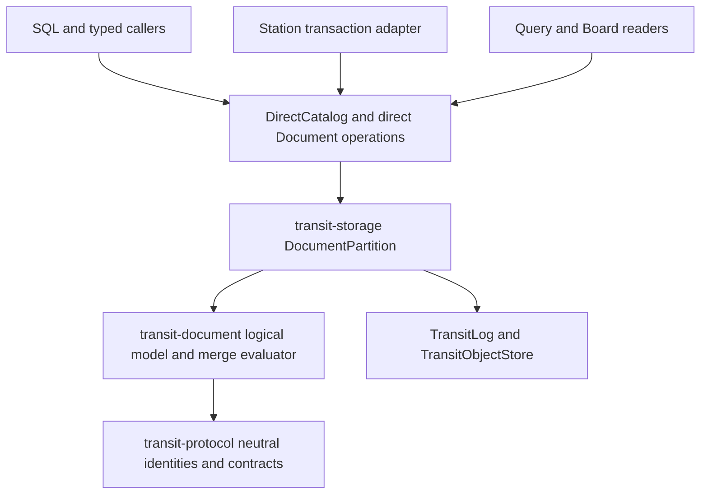

# 7. Logical document storage, `.tseg` trees and Station decoupling

[Roadmap](README.md) · [Foundation #125](https://github.com/spoke-sh/transit/issues/125) · [Native State #126](https://github.com/spoke-sh/transit/issues/126) · [Layouts & Codecs #128](https://github.com/spoke-sh/transit/issues/128) · [Performance #76](https://github.com/spoke-sh/transit/issues/76) · **Status:** In Progress — D0–D3 components and D4 authority/storage-graph foundations delivered; integrated storage, direct lifecycle, transactions and consumer cutover remain in the [implementation plan](#implementation-plan-for-remaining-work)

Decouple `Document` (`DOCUMENT`) completely from the `Station` durable actor
runtime ([`transit-station-document`](../../packages/zig/transit-station-document/README.md),
[`STATION_DOCUMENT_V1.md`](../../contracts/STATION_DOCUMENT_V1.md) and
[`STATION_INDEX_V1.md`](../../contracts/STATION_INDEX_V1.md)), replace the
96-byte JSON/CRDT KV-turn format with a **logical algebraic Document model
($\tau \perp \kappa \perp \epsilon$)** in the Direct Data Plane, and implement
**`DocumentPartition`** in `transit-storage` over `TransitLog` (`TWAL1`) and
immutable `.tseg` segments using succinct tree topology bitvectors, adaptive
columnar path shredding, raw-frame coverage commitments and pluggable
revision/merge profiles.

## Prerequisites and architectural rationale

Follow the [declarative data lifecycle](01-declarative-data-lifecycle.md),
[local storage hierarchy](02-storage-and-query-performance.md),
[live storage/SQL cutover](03-live-storage-and-sql-cutover.md),
[statement results](04-statement-results-and-consumption.md),
[transactions](05-transactions-and-atomic-composition.md) and
[declarative streams, queues and durable runtime](06-streams-queues-and-durable-runtime.md).
Start from the [data model](../handbook/reference/data-model.md),
[Document reference](../handbook/reference/documents.md),
[state model](../handbook/internals/state-model.md),
[storage runtime](../handbook/internals/storage-runtime.md) and
[query engine](../handbook/internals/query-engine.md).

The initial architectural review of [`STATION_DOCUMENT_V1.md`](../../contracts/STATION_DOCUMENT_V1.md)
and [`transit-station-document`](../../packages/zig/transit-station-document/README.md)
alongside the [Milestone 6 SQL database cutover](06-streams-queues-and-durable-runtime.md#sql-database-runtime-cutover--2026-10-28)
identified three structural mismatches between the installed `Document`
implementation and Transit's storage and query architecture. The descriptions
below preserve that diagnosis; the [current source audit](#delivered-basis-and-remaining-obligations)
accounts for the components delivered since then:

1. **`Document` remained coupled to `Station` actor turns and `STATE_V1` 256-byte KV limits:**
   The direct Table path and `transit-sql` are independent of `Station` actors.
   `StreamPartition` and `QueuePartition` now have direct owners and callers;
   the common mixed decision and transactional Station replacement remain
   [Milestone 6](06-streams-queues-and-durable-runtime.md) work.
   `Document` remains a `Station` service
   (`transit-station-document`) layered over [`STATION_PUBLICATION_V1.md`](../../contracts/STATION_PUBLICATION_V1.md),
   4 KiB 8-ary `SIX1` B-tree nodes ([`STATION_INDEX_V1.md`](../../contracts/STATION_INDEX_V1.md))
   and [`STATE_V1.md`](../../contracts/STATE_V1.md) actor turns (capped at four
   256-byte KV mutations per turn). Naming a Document in `DirectCatalog`
   required a three-turn `Station` `NamedResource` handshake (`reserve` $\to$
   `service init` $\to$ `verify empty head`), and remote edits required `STN1`
   actor calls (`SDQ1`/`SDT1`/`SDO1`) with single-active-job serialization.
2. **A fixed JSON-like CRDT wire format with 96-byte string ceilings instead of a logical Document model:**
   `SDC1` hardcodes a JSON-like register/list tree where inline strings and
   binary scalars are capped at **96 bytes**, map field names are unnormalized
   1–64 byte UTF-8 strings, a change contains at most 8 operations, and growing
   editable text is decomposed into **one `u32` Unicode scalar per CRDT
   element** (requiring thousands of B-tree entries and bounded 32-step
   continuation pages to read a single paragraph).
3. **Isolation from Transit's $\tau \perp \kappa \perp \epsilon$ storage and vectorized query engine:**
   Because `Document` state lived in `SIX1` KV blobs rather than `.tseg`
   segments, Document paths and text could not use physical column codecs
   (`.dictionary`, `.fsst`, `COMP-3`, `ZONED`, `EBCDIC`), declared collations
   (`utf8_binary`, `ascii_ci`, `ebcdic_cp037`, `icu:<locale>`), 16-byte
   collation-prefixed Umbra/German strings ([Milestone 14](14-vectorized-strings-and-search.md)),
   collation-aware zone-map pruning, vectorized `Fuze` scans or single-round-trip
   [Milestone 5](05-transactions-and-atomic-composition.md) database commits.

This milestone brings `DOCUMENT` into the Direct Data Plane alongside `TABLE`,
`KV`, `STREAM` and `QUEUE` before [Milestone 9](09-client-foundation-and-language-apis.md)
extracts the shared Station-free client foundation and before
[Milestone 16](16-document-profiles-and-gateway-exchange-lifecycle.md) builds
the multi-format Document Type Library (`JSON`, `XML`, `HTTP`, `FTP`, `EDI`) and
gateway exchange capture over it.

## Logical Document model ($\tau \perp \kappa \perp \epsilon$)

| Dimension | Logical & physical contract in `DocumentPartition` |
| --- | --- |
| **Logical type ($\tau$)** | A rooted, ordered, attributed tree + envelope (and optional multi-part **Container Graph** `Container -> Parts -> Trees/Tables/Spans`) of typed nodes (`map`/`element`, `attribute`/`header`, `list`/`sequence`, `scalar`, `span`, `part_ref`) with five-state cell semantics (`value`, `null`, `missing`, `type_error`, `conflict`) and exact `(part_id, byte_start, byte_end)` raw-frame provenance |
| **Collation & segmentation ($\kappa$)** | Declared per-document and per-path collations (`utf8_binary`, `ascii_ci`, `ebcdic_cp037`, `icu:<locale>`) and deterministic linear, structural and spatial/layout span segmenters governing key lookup, path comparison, range pruning and sequence slicing |
| **Physical layout & codecs ($\epsilon$)** | `.tseg` succinct tree topology bitvectors ($2N$-bit Balanced Parentheses `BP` / `LOUDS`), Dremel/ClickHouse-style shredded subcolumns, `.dictionary` and `.fsst` compression, mainframe/numeric/fixed-point codecs (`COMP-3`, `ZONED`, `NTP` 64-bit fixed-point), `.tdel` Roaring bitmaps and verified raw-frame/part slices |
| **Revision & merge policy** | Uniform revision lineage header `(DocumentId, RevisionId, ParentRevisionIds, MergeEpoch, DefinitionId, LineageKind, CoverageDigest)` supporting `immutable_lineage` (including incremental container/trailer appends such as `PDF` `%%EOF` or `MIME` attachments), 3-way structural merges and the `causal_crdt` observed-remove register/sequence merge profile |

## Delivery sequence

This is the full milestone target, not a list of installed capabilities.
The completion packages below sequence implementation against the current source.

1. **Sever `Document` from `Station` (`transit-document` / `DocumentPartition` $\perp$ `Station`) and unify catalog lifecycle.**
   Remove `Station`, `STATION_PUBLICATION_V1` and the three-turn `NamedResource`
   actor initialization ceremony from the `DOCUMENT` catalog and storage path.
   Introduce `DocumentPartition` in `transit-storage` sharing `TransitLog`
   (`TWAL1`), `TransitObjectStore` (`.tseg` / `.tdel`), `DirectClientToken`
   idempotency (`(AccountId, ClientToken) -> OperationId, CommitLSN, OutcomeReceipt`),
   `ReadCache` snapshot leases and `policy_epoch` fencing with `TablePartition`,
   `StreamPartition` and `QueuePartition`:
   - `CREATE DOCUMENT`, `ALTER DOCUMENT`, `RENAME DOCUMENT` and `DROP DOCUMENT`
     execute directly through `DirectCatalog` and `DocumentPartition` with zero
     `Station` actor turns.
   - Single-partition Document admissions and updates commit in **one round-trip**
     to the partition's `TransitLog` (`TWAL1`).
   - Enforce package-level build gates rejecting transitive `Station` imports in
     `transit-document`, `transit-storage`, `transit-catalog`,
     `transit-query-direct` and `transit-sql`.

2. **Define the logical Document algebra, revision header and pluggable merge profiles.**
   Replace `SDC1`/`SDS2`/`SDR1` with a neutral logical Document contract in
   `transit-protocol` that removes the 96-byte scalar string/binary ceiling,
   64-byte field-name limit and 8-operation per-change cap (enforcing explicit
   deployment and request byte/node quotas instead of format-tag limits):
   - Every committed Document revision binds `(DocumentId, RevisionId,
     ParentRevisionIds, MergeEpoch, DefinitionId, LineageKind, RawFrameCommitment)`.
   - Separate **logical tree storage** from **merge policy** via explicit
     profiles declared on the `DOCUMENT` object:
     - **`versioned` / `immutable_lineage` profile:** Append-only revisions,
       whole-document or path-patch updates under optimistic concurrency
       guards, and three-way structural tree merges for application records,
       versioned specifications and captured protocol documents.
     - **`causal_crdt` profile:** Preserves Transit's deterministic
       observed-remove multi-value register semantics (concurrent unseen
       assignments retained as explicit `conflict` alternatives with their
       operation dots `(counter: u64, replica: u64)`, resolved only by an
       assignment naming the observed dots), parent-removal detachment rules,
       descending-dot sequence ordering, and opted-in finite merge-window
       checkpoint compaction—executed directly by `DocumentPartition` over
       `.tseg` trees without `Station` actors.
     - **Span-based collaborative text (`rope` / `piece_table`):** Replace
       per-Unicode-scalar `u32` B-tree elements with UTF-8/scalar span blocks
       over `.fsst`-compressed `.tseg` pages, supporting arbitrary-length text
       inserts/deletes with stable anchor dots `(counter, replica, byte_offset)`
       and $O(\log B)$ block traversal.

3. **Implement `.tseg` succinct tree topology and zero-copy span storage in `DocumentPartition`.**
   Replace pointer-chasing 4 KiB `SIX1` B-tree nodes with 64-byte cache-line-aligned
   `.tseg` structural column groups:
   - **Succinct Tree Topology ($2N$-bit Balanced Parentheses `BP` or `LOUDS`):**
     Encode document tree hierarchy as a compact bitvector paired with two-level
     `@popCount` rank/select lookup blocks so `parent(v)`, `first_child(v)`,
     `next_sibling(v)`, `subtree_size(v)`, `depth(v)` and Lowest Common Ancestor
     (`LCA(u, v)` / `WITHIN(inner, outer)`) execute in $O(1)$ register
     instructions without pointer chasing.
   - **Parallel Node Attribute & Span Streams:** Store node tags (`map`,
     `element`, `attribute`, `list`, `scalar`, `span`, `conflict`,
     `type_error`), dictionary-coded field/tag symbol IDs, causal operation
     dots (when `causal_crdt` is active), and `(page_id, byte_start, byte_end)`
     span coordinates as bitpacked `.tseg` streams.
   - **Verified Raw-Frame & Multi-Part Container Storage:** Retain immutable
     staged raw byte/text frames and multi-part container directories (such as
     `MIME` multipart bodies, `OPC`/`ZIP` package parts for `DOCX`/`XLSX`/`ODF`,
     and `PDF` `xref`/stream objects, verified by SHA-256 chunk coverage
     commitments and bounded by explicit decompression quotas) in `.tseg` blob
     pages so slices borrow directly from swizzled LeanStore/Umbra RAM/NVMe
     buffer slabs.

4. **Implement adaptive columnar path shredding (Dremel / ClickHouse style) into `.tseg` subcolumns.**
   Bridge semi-structured Document flexibility with columnar analytical scan
   speed:
   - Shred declared schema paths and frequently occurring paths into native
     typed `.tseg` subcolumns (with definition/repetition levels or sparse
     presence bitmasks), while storing unshredded or high-entropy paths in the
     succinct residual tree column.
   - Equip every shredded subcolumn with five-state cell tags (`value`, `null`,
     `missing`, `type_error`, `conflict`), declared collations ($\kappa$),
     collation-aware Zone Maps (`min`, `max`, `null_count`, `missing_count`,
     `conflict_count`) and composable codecs (`.dictionary`, `.fsst`,
     bitpacking, `COMP-3`, `ZONED`, `EBCDIC`).
   - Push SQL and path predicates (`doc.field = 'x'`, `doc.amount > 100`,
     `doc.field IS CONFLICT`, `doc.field IS MISSING`) directly into `.tseg`
     zone maps and subcolumn vectors in `Fuze`, deferring residual tree
     reconstruction via late materialization until a document passes all filters.

5. **Integrate `DocumentPartition` into [Milestone 5](05-transactions-and-atomic-composition.md) transactions, SQL and `Fuze` execution.**
   Connect `DocumentPartition` to the shared database transaction and query
   surfaces:
   - **Transaction participation:** Implement [Milestone 5's](05-transactions-and-atomic-composition.md)
     Participant Category 1 (`TABLE`/`KV`/`DOCUMENT` state mutations and
     conflict guards) for `DocumentPartition` so interactive and programmatic
     transactions atomically combine Table DML, Document revisions/patches,
     `STREAM` `PRODUCE INTO` and `_lease_epoch`-guarded `QUEUE` `ACK`s.
   - **Declarative SQL and typed-caller operations:** Expose `CREATE DOCUMENT`,
     `ALTER DOCUMENT`, `DROP DOCUMENT`, document admission/mutation/merge,
     bounded path/sequence reads and relational `SELECT` projections over
     Document collections through `transit-sql` and typed callers using shared
     [Milestone 4 `ResultSet`s](04-statement-results-and-consumption.md).
   - Preserve five-state cell propagation (`missing`, `null`, `type_error`,
     `conflict`, `value`) across SQL projections, joins and aggregations without
     picking an arbitrary conflict winner or converting `missing` to `null`.

6. **Execute the current-v1 hard cutover across `Station`, SDKs, examples and Board.**
   Apply the [v1 hard-cutover policy](../handbook/reference/versioning.md):
   - Replace `STATION_DOCUMENT_V1` (`SDC1`/`SDS2`/`SDR1`/`SDQ1`/`SDT1`/`SDO1`)
     and `SIX1` document storage with the new `transit-document` /
     `DocumentPartition` v1 contract; reject old stored formats and saved
     requests before execution without fallback decoders.
   - Re-architect `Station` behaviors that hold document state to read and
     mutate declared database `DOCUMENT` objects inside their
     [Milestone 6](06-streams-queues-and-durable-runtime.md) transactional turns.
   - Migrate all ten public SDKs, `examples/station-document` and Board's
     read-only Document inspector together, and update
     [`documents.md`](../handbook/reference/documents.md) and
     [`state-model.md`](../handbook/internals/state-model.md).

## Implementation plan for remaining work

**Plan basis:** fetched `origin/main` at
`0e2fba447`, 2026-10-31. This is the current implementation sequence;
the [initial plan](#implementation-plan-for-initial-document-decoupling) below
retains its original scope and source attribution. This plan incorporates merged
work only, including the recent Stream/Queue, gateway, shared-client, string,
application-migration and browser-runtime changes. Uncommitted work in other
checkouts is not an implemented prerequisite.

**Outcome:** an application declares a Document object, applies causal or
versioned changes, reads exact accepted revisions and relational projections,
and recovers its original outcome after disconnect or restart without a Document
worker. A Station behavior uses that same data owner inside a transaction that
also settles its input and records outputs. M7 remains **In Progress** until
both journeys, the physical storage path and the affected consumer cutover pass.

### Delivered basis and remaining obligations

The [2026-10-30 component evidence](../history/qualification/storage.md#direct-document-protocol-succinct-algebra-tseg-shredding-and-documentpartition--2026-10-30)
records D0–D3 and the authority/graph portion of D4. Preserve those results and
their source revisions. The source audit below narrows what they establish:
component availability does not establish an integrated logical Document engine
or an installed direct service. No runtime proofs were rerun to create this plan.

| Boundary at the plan basis | Existing implementation | Work still required |
| --- | --- | --- |
| Installed Document lifecycle | [Public Documents](../handbook/reference/documents.md), `transit-station-document`, `DirectResource` and `NamedResource` still use native resource allocation and Station initialization/publication | Replace that lifecycle and every affected caller together; preserve state/input/reply atomicity |
| Neutral contracts (D0) | [`DOCUMENT_V1`](../../contracts/DOCUMENT_V1.md), `DocumentDeclaration`, `DocumentOperation`, `DocumentRead` and reflected fixtures | Specify canonical logical mutation/state encodings, collection versus logical-document identity, exact merge ancestry, staged payloads, bounded path/collection reads and transaction bindings |
| Deterministic algebra (D1) | [`SuccinctTree`, `SpanText` and `VersionedMerge`](../../packages/zig/transit-document/README.md) have component oracles; the existing `Model`/`codec` still implement the old bounded change profile | Integrate one canonical evaluator with persisted causal/tree/span state; remove old payload caps in that evaluator. Resident span arrays, recursive trees and zero-allocation navigation alone do not prove paged growth or constant-time navigation |
| Physical layout (D2) | [`DocumentShredder.shredBatch`](../../packages/zig/transit-storage/src/DocumentShredder.zig) builds owned in-memory subcolumns, bitmaps, zone maps and residual topologies; `DocumentIndex` stages old causal records | Persist/reopen those structures through the shared segment writer/reader, bind all structural and codec descriptors, and execute queries against actual accepted segments |
| Durable owner (D3) | [`DocumentPartition`](../../packages/zig/transit-storage/src/DocumentPartition.zig) records mutation receipts, revision directories, pins, checkpoints and WAL recovery | `applyMutation` accepts supplied `payload_bytes`, `state_bytes` and conflict counts; it does not invoke the algebra/shredder. Make the database derive and validate the accepted state. `readNextRevision` loads a whole state object; enforce byte/work budgets through paged payload reads |
| Idempotency and bounded recovery | Same-operation recovery exists in the partition; replica sequence checks reject an already-used sequence under another operation; replay iterates retained records | Define duplicate causal-change identity independently of client tokens, recover its original revision, and bound activation/replay units and scratch growth |
| Catalog/authority (partial D4) | [`DocumentAuthority`](../../packages/zig/transit-catalog/src/DocumentAuthority.zig) supplies masks/bindings; `DirectStorageGraph` walks Document roots | Add the actual Document domain/profile/registrar, typed lifecycle and payload operations, signed node dispatch, original-token recovery and installed disclosure checks. The configured profile still has the six database/schema/Table/Stream/Queue/KV domains |
| Transaction/SQL/consumer cutover (D5) | `DirectTransaction`, `TransactionDirectory` and `TransactionDecisionLog` still enforce `requireLocalTable`; shared SQL result and client infrastructure exists | Supply the Document participant, direct query adapter and SQL lowering, then migrate Station/ABI/SDK/Board/examples under one current-v1 definition |

The D0–D5 labels remain attributable delivery slices. C0–C8 below are completion
packages, including integration gaps in D0–D3; they do not erase the earlier
component work or declare D4 complete.

### Milestone context and dependency handoffs

| Owner | Consume now | Dependency or boundary for M7 |
| --- | --- | --- |
| [M1–M3: lifecycle and local storage](03-live-storage-and-sql-cutover.md) | Stable object/definition identities, direct catalog names/dependencies, `LocalWal`/`LocalSegmentStore`, publication guards, retained graphs and local installation | Preserve original named-Document lifecycle/recovery coverage while replacing its mechanism. M3 remains independently In Progress; M7 does not close its other storage or latency gates |
| [M4: statement results](04-statement-results-and-consumption.md) | Implemented command/`ResultSet` distinction, bounded consumption and terminal observation | Use `transit-sql-results` and `transit-sql-client`; no Document-specific SQL result or recovery protocol |
| [M5: transactions](05-transactions-and-atomic-composition.md#selected-delivery-profile-and-exclusions) | Completed local serializable Table profile, common cuts, durable preparations/decisions, private workspaces and savepoints | Its completion excludes direct Document and log settlements. C5 supplies Document obligations to the same decision owner |
| [M6: streams, queues and runtime](06-streams-queues-and-durable-runtime.md#work-packages-and-dependencies) | Shared bitmap/graph foundations; signed Stream and Queue callers, durable scheduling/maintenance and direct KV storage foundation | R5 still owes executable mixed state/append/settlement decisions; R7/R8 own transactional Station and effect/delivery migration. Agree participant interfaces early; do not wait for all of M6 before building C0–C4 |
| [M8: gateway](08-gateway-architecture-and-protocol-ingress.md#remaining-implementation-plan--2026-10-29) | Event-driven SQL recovery, typed local dispatch and node-cohosted SQL execution | Route Document work through that host. Coarse remote placement, complete sans-I/O separation and broader Flight/Serving exposure remain M8 gates; no new Document polling service |
| [M9: shared clients](09-client-foundation-and-language-apis.md) | [`transit-data-client.Catalog`](../../packages/zig/transit-data-client/README.md) and its explicit owned-operation/outcome boundary | Add the direct Document facet there. M7 migrates existing affected consumers; M9/M20 own broader API ergonomics and new coverage |
| [M10: historical interpretation](10-standards-and-catalogs.md#delivered-implementation-evidence--2026-10-30) and [M11: indexes](11-indexing-and-access-paths.md) | Exact-definition/dependency contracts and collation helpers | Retain Document interpretation with every cut. Historical-catalog helpers are not a durable `AS OF` service. M11 owns secondary path/search indexes; M7 owns base tree/subcolumn access and pruning |
| [M12: dataflows](12-sql-and-dataflows.md#delivered-implementation-evidence--2026-10-30) | Finite five-state oracles, source-cut and common-decision requirements | Supply stable Document revision/change evidence and retained finite readers; automatic maintained Document queries and source activation remain M12 work |
| [M13: resource/performance](13-data-structures-and-performance.md), [M14: strings](14-vectorized-strings-and-search.md#delivered-implementation-evidence--2026-10-30), [M15: compilation](15-data-centric-compilation-and-specialization.md) | Allocation accounting, `GermanString`/`StringArena`, collation-prefix helpers and compressed predicate implementations | Integrate the existing helpers where their declared profiles apply. Measure the persistent Document path; helper tests do not prove zero-copy storage, a metered service or compiled Document queries |
| [M16: profiles and exchanges](16-document-profiles-and-gateway-exchange-lifecycle.md) | Required raw-part, lineage and provenance extension points | M7 owns generic tree/envelope/part references and verified raw slices. M16 owns JSON/XML/EDI/protocol/office parsers, unpacking/validation profiles and gateway/connector exchange capture; do not move `STATION_EXCHANGE_V1` into this cutover |
| [M19: branches](19-branches-merges-and-restore.md), [M26: policy](26-control-and-policy-plane.md), [M27: published resources](27-published-resources-and-investigations.md) | Interpretation/lineage commitments and current disclosure boundaries | Begin on branch one with current native grants. Local versioned Document merge is not catalog branch merge; retained revisions are not investigation pins. Recent browser publication, identity and application-migration work must retain its existing Table/native-resource gates until Document adapters are qualified |

The critical path is **C0 → C1 → C2 → C3 → C4 → C6 → C7 → C8**.
C5 can develop after C0/C3 against M6 R5's participant seam; C7 additionally
requires C5 and M6 R7's state/input/output decision. This breaks the apparent
M6/M7 cycle: M6 can qualify Table/KV turns first, M7 supplies its participant
without requiring a finished Station adapter, then both qualify Document turns.
Neither a Table-only transaction nor two recoverable commits opens that gate.

**Independent delivery scope:** keep M6 R5/R7 and the dependent public/Station
cutover gates open. The first storage increment enforces cumulative retained-read
budgets, exact receipt/target binding, explicit owner signing keys and bounded
replay with per-record scratch reuse. Its current API and limits are in the
[partition guide](../../packages/zig/transit-storage/docs/document-partitions.md).
It supplies parts of C0/C3 without completing either: canonical evaluation,
persisted tree/shredder integration, within-revision paging and the remaining
C1–C8 obligations below still require their own implementation and evidence.

### Selected delivery profile and decisions

Use one local catalog, branch one, disk-backed WAL/object storage and fenced
partition owners. Preserve the existing declaration's partition model:
a catalog `DOCUMENT` object has an immutable interpretation and partition
allocation; a logical `DocumentId` identifies a tree within that object.
A singleton application uses one logical document. C0 must make routing and
collection scan coverage explicit, including empty partitions; a single-document
revision is not an atomic collection cut. Begin installed qualification with
one partition, then exercise multiple partitions in the same local decision
domain before advertising that profile.

Keep object identity, logical DocumentId, definition revision, accepted revision,
merge epoch, causal dots, account/client token, operation ID, WAL position,
transaction decision and policy/owner epoch separate. Names resolve into frozen
identities. Changes, complete replacement values and merge requests use the same
authoritative evaluator and validation; arbitrary supplied state bytes are not
an accepted logical mutation.

Both `causal_crdt` and `versioned` remain milestone requirements. Implement
causal integration first to preserve the installed semantics, then qualified
three-way merges. Treat `immutable_lineage` as a lineage requirement to resolve
in C0, not a third currently accepted profile tag. Retain observed-remove
conflicts, detached descendants, deleted anchors and explicit resolution.
Define byte/scalar coordinates for spans; do not silently add grapheme
normalization or locale behavior.

Initial supported collations remain the direct contract's `utf8_binary`,
`ascii_ci` and `ebcdic_cp037`. Use shared canonical comparison/prefix logic and
bind its descriptor in stored artifacts. Per-path overrides need explicit
definition semantics and fixtures. Unsupported ICU/version/codec combinations
must refuse; M10/M14 helper availability does not make them admitted storage
profiles. Keep logical type, ordering semantics and physical codec orthogonal.

Collection size, total revision history and text length must not determine
resident memory. C0 publishes numeric page, request, node/depth, staging, active
candidate, read-pin, response and recovery budgets; C2/C3 enforce them before
allocation/disclosure. Large logical values stream through bounded pages.
A format width or per-segment row cap is not a substitute for a paged directory.
Retain unlimited history by default, with separate explicit merge-window,
logical-retention and physical-cleanup decisions.

### Remaining work packages and gates

| Package | Reviewable outcome | Depends on | Exit evidence |
| --- | --- | --- | --- |
| C0 | Complete contracts, capability and migration inventory | Current source audit; M5/M6 participant agreement | Canonical fixtures, operation/state transitions, budgets and exact removal map |
| C1 | One database-owned logical evaluator for causal and versioned changes | C0; reuse D1 | Independent semantic equivalence, adversarial edits and refusal without partial state |
| C2 | Persisted tree/span/subcolumn representation | C0/C1; reuse D2 and M14 helpers | Shared segment round trips, page-boundary traversal, bounded construction and pruning equivalence |
| C3 | Integrated partition acceptance, reads, recovery and maintenance | C1/C2; reuse D3 | Real disk faults, original outcomes, paged reads/recovery and retained-graph collection |
| C4 | Direct catalog lifecycle, current authority and typed node/client operations | C0/C3 | Signed create/edit/read/recover journey without a Document worker or courier |
| C5 | Document common-cut/workspace/transaction participant | C0/C3 and M6 R5's generalized owner | Atomic Table + Document + Queue ACK + Stream append through faults and revocation |
| C6 | SQL declarations, Fuze projections and shared results | C4; C5 for transactional statements | Actual compiler/service/console outcomes and five-state query equivalence |
| C7 | Station and all existing consumer migration | C4–C6 and M6 R7/R8 where affected | Installed ABI/SDK/Board/example/replacement paths preserve prior guarantees |
| C8 | Measured qualification and one current-v1 cutover | All preceding gates | Common-revision caller/fault/resource evidence, removals and public documentation |

#### C0 — Finish contracts and the migration inventory

Extend the existing [Document](../../contracts/DOCUMENT_V1.md),
[data lifecycle](../../contracts/DATA_LIFECYCLE_V1.md),
[direct operations](../../contracts/DIRECT_TABLE_V1.md),
[transaction bindings](../../contracts/DATA_LIFECYCLE_V1.md#transaction-bindings-and-evidence),
[storage](../../contracts/TRANSIT_STORAGE_V1.md) and
[SQL result](../../contracts/SQL_RESULTS_V1.md) owners before dependent adapters.
Do not invent another definition namespace or transaction coordinator.

Specify canonical mutation bytes and state descriptors, typed path addressing
(including separator/escaping ambiguity), root/ordered-child/attribute semantics,
logical deletion, revision-parent sets and raw-frame/part coverage. A
`raw_span` coordinate alone is not proof that bytes exist or match their source.
Pin schema, merge profile, collation and interpretation in every retained root,
intent and result. Define the generic part directory's identity, reference,
cycle/depth and byte limits; format-specific unpacking remains M16.

Define distinct recovery keys for an operation retry and an identical causal
change submitted under another operation. Both recover the original accepted
revision under current rights; changed content at either identity rejects.
Specify missing dependencies, stale replica/merge epochs and exact resync
evidence. Reject missing/foreign definitions before allocation or execution.

Define direct lifecycle, patch/replace/merge, original-operation inspection,
path/sequence/collection reads, accepted-tail reads, checkpoint/resync and close
operations. Bind cursor authentication to principal, target, cut, request,
coverage and live pin, using host-owned private key material; replace the
component's default read secret before installed exposure. Define incomplete
progress, per-page versus total budgets, early close, pin lease recovery and
unavailable history explicitly.

Agree Document preparation, common-cut selection, savepoint and publication
guards with M6 R5 before changing persisted transaction unions. Include absent
paths, collection scans and conflict alternatives in the serializable read
basis; initial whole-partition conflict guards are acceptable if stated.
Decide supported ALTER fields; profile/routing/collation changes cannot
reinterpret accepted revisions. Record grammar, lowering, execution and transport
support separately in the capability inventory.

Inventory every legacy root/change/reference/wait, route, exported API, worker,
installation marker and test owner with its replacement and atomicity obligation.
Include unnamed Documents, checkpoint jobs, accepted tails, resync, recorded
remote reply routes and source/result references. This review is the first
implementation gate, not a request to expose the private components publicly.

#### C1 — Connect canonical changes to the logical evaluator

Evolve `transit-document` behind explicit bounded reader/builder interfaces.
Keep storage, policy I/O, clocks and publication outside deterministic evaluation.
Unify the old map/register/list semantics with span text and versioned trees;
do not leave the old eight-operation/96-byte codec as the real execution path
behind larger declaration limits.

Compute resulting roots, conflict counts, causal frontiers, lineage and required
dependencies from verified accepted inputs. Define safe patch/merge behavior
against a stale base and explicit expected-head guards. A conflicting candidate
must not overwrite newer accepted state or silently pick a conflict winner.
Cover node-kind conflicts, subtree delete/edit races, sequence identity and
ordering, duplicate dots, partial-span deletion and multibyte boundaries.
Application-created values have no raw-byte provenance unless explicitly bound.

Use independent accepted-set and tree oracles, including the existing
24-permutation cases. Add changes exceeding the old name/scalar/operation caps,
nested and structural conflicts, invalid UTF-8/span offsets and exhausted
budgets. Check refusal leaves roots, replica frontiers and outcomes unchanged.
Keep resident helper trees as test oracles where useful; production mutation
must use the bounded persistent interfaces.

#### C2 — Persist succinct trees, spans and adaptive subcolumns

Extend the shared `.tseg` writer/reader and definition-bound metadata for
topology blocks, node tags, field symbols, ordered attributes/children, scalar
payloads, causal evidence, span pieces and generic raw-part slices. Reuse
`TreeStore` for paged directories, not as the replacement for every text scalar.
Store residual values and causal evidence as well as topology: a BP bitvector
alone cannot reconstruct a Document or its conflicts.

Connect `DocumentShredder` to durable segment groups. Preserve declared and
frequent-path selection, sparse/definition/repetition information, exact path
identities, all five cell states, raw provenance and residual reconstruction.
Adaptation changes physical placement only. Reuse dictionary/FSST and supported
numeric codecs through the existing physical owner, with `GermanString` as an
execution representation rather than a persisted process pointer.

Implement page-aware navigation and span seeks with explicit work accounting.
Measure the existing BP implementation before selecting extra rank/select,
excess or range-minimum indexes: `parent`/`lca` contain scans, so zero allocations
and two-level rank/select do not prove the delivery overview's O(1) target.
Likewise, a resident piece array is not an O(log B) disk rope. Document achieved
bounds and remaining targets in the implementation owner; do not declare those
criteria satisfied through naming.

Bind page checksums, alignment/padding, variable-sized payload handles and borrow
lifetimes to the shared buffer owner. No internal SIMD padding assumption may
escape to arbitrary caller slices. Freeze immutable pages before publication.
Validate subtree/text iteration across page boundaries with one-page caches,
deep/wide trees, high-entropy paths and 1 KiB–10 MiB values. Differentially
reconstruct against unshredded evaluation after disk reopen, codec changes,
deletion-vector application and compaction.

#### C3 — Integrate acceptance, bounded recovery, retention and reads

Make `DocumentPartition` consume a verified C1/C2 candidate built against its
exact accepted basis, rather than trusting caller-supplied result bytes/counts.
Privately stage complete referenced objects and directories; publish the root,
revision, deduplication evidence and original receipt together under the current
publication guard. For a single-partition edit, retain one conditional data-WAL
acceptance append. Count catalog/token, staging and physical durability I/O
separately; that target does not mean one total fsync or network request.

Implement bounded mutation/checkpoint workspaces and resumable replay with
scratch reset per page/unit. Resolve duplicate causal identity through retained
receipts, including after archive/trim and when another token carries the same
change. Missing/corrupt state or evidence refuses recovery; no empty reset.
Checkpoint validation must retain causal/deletion/frontier evidence and cannot
accept an arbitrary supplied checkpoint blob.

Replace whole-state revision delivery with byte/step-bounded path, sequence,
raw-slice and revision pages. Retain one exact cut; distinguish progress-only
pages, genuine emptiness, terminal coverage and failed prefixes. Large values
need a continuation without exceeding the response budget. Ownership must survive
the next scratch reset, cache eviction and repeated fetch. Recheck rights after
buffering and before metadata, rows and terminal evidence.

Extend the existing graph for all new page types, raw parts, unfinished candidates,
transaction workspaces, read pins and original receipts. Unknown or incomplete
reachability blocks deletion. Separate finite merge-window floors/resync from
logical revision expiry and physical reclamation; live pins and unresolved work
remain protected. Integrate bounded local maintenance with Table/Stream/Queue
scheduling and reserved control capacity. Physical rewrites must not advance
logical revisions or invalidate original-operation inspection.

Exercise process death and injected storage failures before/after object
publication, acceptance, receipt delivery, checkpoint replacement, trim and
collection. Use histories exceeding resident caches, cold reopen and fixed
memory/work budgets. Preserve the distinction between SIGKILL evidence and
host power-loss guarantees.

#### C4 — Complete catalog, authority, node and typed callers

Implement `DirectDocument` lifecycle and payload composition alongside the
existing direct owners. Reuse catalog operation/token/name/dependency directories
and frozen intents; remove the Document arm's PID/native-allocation requirement.
Creation reserves the original object/partitions, accepts exact genesis
definitions, registers current native permissions and publishes only after
verification. Recover each interrupted phase with the same operation identity.

Add the Document authorization domain to public profiles, service configuration,
bootstrap/registrar, grants, generated contracts and strict caller decoders.
Use `DocumentAuthority` masks with current CONNECT/USAGE/CREATE, ownership and
replica checks; its standalone binding helper is not installed authorization.
Test revocation during staging, before acceptance, after buffering and during
receipt inspection. Cached grants, a PID or a replica ID cannot authorize work.

Expose signed typed lifecycle/edit/read/inspect/checkpoint/close operations and
their owned response validation through the native node and
`transit-data-client`/public Zig SDK. Preserve request uncertainty and original
saved bytes through current token recovery and event-driven SQL settlement.
Integrate typed local dispatch through M8's existing host; do not add per-document
workers, an HTTP orchestration cascade or a periodic recovery poll.

Verify rename, DROP RESTRICT, retirement, DROP/name reuse, altered definitions,
lost genesis/publication replies and late reads against original identities.
Implement and test this replacement on the cutover branch while C5–C7 finish;
do not ship a second selectable Document engine or a temporary Station-backed
direct route.

#### C5 — Supply the Document transaction participant

Extend M5/M6's common owner, not just the participant enum. Add paged Document
cut acquisition, retained definitions, private mutation/read-your-writes state,
read/conflict guards, durable preparation, savepoint rollback, original decision
lookup, decision-aware reads and bounded finalization/cleanup. Include logical
document creation/deletion and absent-path/collection predicates; distinguish
logical mutation from flush or compaction.

Prepare Document roots without publishing them. Under ordered publication guards,
validate current policy, expected definitions and all participant bases, then
join the original commit/abort decision. Reopen and readers must consult that
decision before exposing any successor even when participant finalization is
interrupted. No handler rerun, automatic fresh SQL submission or independent
Document append may resolve an uncertain mixed commit.

First qualify Table + Document composition, then add M6's exact Queue lease ACK
or Stream offset settlement and outbound Stream/Queue append. Fence lease
expiry/reassignment against the common decision. A successful Document merge
does not waive the input fence. One authoritative multi-partition decision can
require several preparation/finalization writes; preserve that distinction from
C3's single-partition fast path.

Required schedules include rollback/savepoints, provisional query results,
write/write and absent-path conflicts, revocation on every participant,
crash at each preparation/decision/finalization point, expired leases and lost
COMMIT replies. Fresh readers observe all or none; accepted decisions and pins
survive replacement and collection. Unsupported participant combinations keep
typed refusals until their owning gates pass.

#### C6 — Lower SQL and Query through the direct owner

Define and implement the selected CREATE/ALTER/RENAME/DROP Document syntax
through shared typed lifecycle operations. Existing declaration compilation is
offline. Update the reference grammar, capability ledger and positive/negative
compiler corpus with the executable subset; specify mutation/merge syntax before
claiming it, retaining typed operations as the first mutation interface.

Add an authorized Document source to `transit-query-direct` and Fuze. Bind
collection enumeration, document/revision identity, interpretation, collation
and projection in the source basis. Use C5's common cut for transactional
multi-object reads; ordinary independent cuts remain an attributed vector.
Replace the existing captured/native Document source adapter without importing
Station back into the direct packages.

Execute declared-path projections and predicates from persisted subcolumns,
with residual reconstruction after selection. Prove zone-map and compressed
predicate soundness under all admitted collations, five-state predicates,
structural conflicts, schema evolution and `.tdel` visibility. Preserve ordered
error/conflict behavior through joins/aggregates; a pruning optimization cannot
silently remove an error that the reference execution would report.

Use M4's existing command counts, `ResultSet`, result reader and terminal
observation. Exercise empty and multi-batch results, large strings, early close,
cancelled prefixes, pin release, scratch ownership and current authorization
after buffering. Recheck prepared reads at their defined execution boundary,
including the recently fixed fresh-frontier behavior; do not reuse a stale cut
unless the caller explicitly selected a retained/transaction basis.

Co-hosted SQL/console and supported native callers form the first installed
proof. PostgreSQL/MySQL and Flight representations must preserve five-state
meaning through their declared mapping or explicit refusal; generic transport
availability cannot imply lossless Document support.

#### C7 — Migrate Station and existing consumers

Once C5 and M6 R7 are qualified, make Document behaviors callers of declared
database objects. Atomically commit Document state, the exact input settlement,
journal and recorded reply/output intents. Preserve original destinations,
correlations, activation/lease fences, retirement, cancellation uncertainty and
recovery without handler execution. Connector dispatch remains subject to its
recorded effect protocol; a Document commit never dispatches an external effect.

| Consumer family | Required replacement and proof |
| --- | --- |
| Station service/worker and named resources | Replace Document storage/publication jobs and three-turn initialization with direct lifecycle/transaction adapters; prove worker absence for direct operations and replacement for behaviors |
| Shared ABI/host and public Zig + ten non-Zig SDKs | Migrate `DocumentCodec`, saved operations/references, writer/remote actions, reads and errors through shared Zig semantics; install real consumers with full-width identities and values exceeding old caps |
| Captured/maintained Query and SQL sources | Preserve exact accepted source/result attribution, retention, current access and five-state behavior; do not promote M12's unfinished activation work |
| Board API/browser | Read public authorized metadata/cuts only; preserve value-free inspection, terminal coverage and revocation. Update reflected schemas/validators and actual browser tests |
| Examples, application installation and launchers | Migrate `examples/station-document`, bootstrap manifests, configuration, local/Compose/reference paths and replacement checks. Audit recent application schema-migration bindings; format compatibility and application revision are separate |
| Browser publication/Serving consumers | Audit explicit native-reader/Document source bindings introduced by recent browser work. Preserve existing supported Table paths and strict capability checks; broader direct Document publication needs its own owner-qualified adapter |

Remove superseded Document routes/actions, codecs (including successful `SDS1`
fallback reads), `SDW1` waits, stored heads, worker packaging and Document-only
`SIX1`/Station Publication use. Keep unrelated Station/Exchange users until
their respective owners replace them. A source import search is a removal check,
not proof that accepted-call semantics survived.

#### C8 — Qualify the cutover, measure and promote behavior

Coordinate every incompatible protocol, stored layout and ABI change under the
single current-v1 policy. Replace the shared definition, regenerate reflected
schemas, signing fixtures, ABI/host/browser resources and binding artifacts,
and align manifests/internal pins with `VERSION`. Reject old persisted definitions,
saved requests, roots, cursors and installations before execution/disclosure.
No v2, fallback decoder, silent default, implicit conversion or automatic reset.
Resolve or preserve uncertain accepted work with its matching build; define
the stopped-installation cutover procedure before testing upgrade refusal.

Freeze workload/resource targets before optimizing. Compare the baseline
Station journey and the direct replacement on the same hardware/durability
profile. Measure end-to-end create/edit/read/merge/query/restart distributions,
acceptance appends, staging/catalog requests, bytes written, allocation counts,
peak RSS, page visits and background maintenance debt. Report one-partition and
mixed-transaction costs separately. Use small documents through 10 MiB text,
deep/wide trees, sparse/high-entropy paths, conflict-heavy edits, cold/warm reads
and growing revision/replica populations beyond caches. Include concurrent
Table/Stream/Queue work and control progress. Do not adopt another milestone's
10–100× ambition as a measured Document result.

### Acceptance and verification matrix

All rows below are required future evidence at the implementation revision.
Earlier component passes remain evidence only for their recorded boundaries.

| Gate | Required observation | Owning verification |
| --- | --- | --- |
| Package/runtime independence | No transitive Station dependency in direct Document/storage/catalog/query/SQL/client packages; real lifecycle with Document worker and courier absent | Package checks, signed native/SQL installed journey |
| Logical correctness | Causal accepted-set convergence, explicit structural conflicts, duplicate identity recovery, detached/deleted anchors, safe stale-base updates and budget refusal | Independent semantic fixtures, seeded schedules and C1 oracle |
| Persisted representation | BP/spans/parts and shredded/residual reads agree across codecs, collations, deletions and compaction; bounded page construction/navigation | C2 segment round trips, differential query tests and counting allocator |
| Original operations and lifecycle | Lost replies at reservation/genesis/publication/mutation/checkpoint/close; conflicting token/content; rename/DROP/name reuse cannot retarget work | Catalog/node caller schedules with restart |
| Current authority | Denied metadata/data/mutation/checkpoint, replica impersonation, stale owner/policy epochs and revocation after buffering, including empty/terminal results | Independent signed callers and native policy tests |
| Reads/results | Exact revision/collection basis, progress-only pages, multi-page values, scratch reuse, early close, cancelled/failed prefixes and no silent query restart | Shared Query/SQL client/service tests |
| Mixed decisions and Station | Table + Document + exact Queue ACK + Stream append commit together; crash/abort/expiry/revocation/lost reply never reveals partial state | Disk transaction faults plus real behavior/SDK replacement |
| Recovery/retention/collection | Reopen from accepted WAL/checkpoints, missing/corrupt format refusal, merge-floor resync, pinned old reads and unresolved work retained through collection | Local disk fault/kill schedules and graph traversal |
| Resources/performance | Retained growth exceeds fixed resident budgets; warmed hot loops allocate no heap where claimed; maintenance/control progress remains bounded | Allocation/growth harness and matched installed workload reports |
| Consumer/cutover completeness | Existing ABI/SDK/Board/examples preserve outcomes; incompatible old artifacts fail before use; no legacy successful decoder remains | Installed consumer, browser, launcher and definition/signing suites |

Start with owning package checks for `transit-protocol`, `transit-document`,
`transit-storage`, `transit-catalog` and affected Fuze/query/client code.
Extend the existing `just test::direct-named-resources`,
`just test::direct-table-service`, `just test::document`,
`just test::document-remote`, `just test::document-local`,
`just test::unified-query` and `just test::sql-transactions` tasks rather than
leaving worker-only tests as proof of the new database path. Move direct-storage
test ownership to its domain and register new real checks in the
[test inventory](../../tests/runner/suite.json).

Run `bindings::document-*`, Board `document-test`/`document-browser` and the
real `examples::document-compose`/`examples::document-reference` deployment
proofs for changed consumers. Before pushing implementation, run affected
`just ci clean --lane NAME` checks from committed HEAD: `core`,
`storage-query`, `interfaces-sql`, `interfaces-relational`, `installation-ui`,
`browser`, `launchers` and all affected `sdks-*` lanes; add
`interfaces-connectors` and `formal` when their owners change. Full clean
integration remains the release gate, not an inference from selected lanes.

Record commands, source/definition, backend, budgets, raw evidence, failures and
omissions in the owning qualification ledger. Promote delivered semantics and
numeric limits to the Document/state/SQL/caller references, package guides and
contracts, and source-attributed mechanisms to state/storage/query Internals.
Update the data model, glossary/component map, examples and generated capability
descriptions with the cutover. Keep delivery sequencing here.

Close M7 and its index row together only when C0–C8 and the
[completion evidence](#completion-evidence) agree. M6's remaining work, M16
profiles and later distributed/history extensions retain their own status.
Documentation validation for this plan establishes no new runtime capability.

### First implementation changes

1. Land C0's canonical mutation/read/transaction decisions and exact consumer
   inventory, retaining the D0–D4 component evidence and explicit service gate.
2. Deliver one internal C1–C3 vertical path: a causal edit larger than the old
   limits is evaluated, written as real tree/span segments, accepted once,
   reopened and read in bounded pages with original-outcome recovery.
3. Generalize the participant seam with M6 R5 while completing C4's lifecycle
   and installed test harness; then qualify Table + Document before adding
   lease settlement and outbound log participants.
4. Complete C6/C7 on the cutover branch, run C8 at one committed revision, remove
   the superseded public path and publish the supported direct lifecycle.

## Implementation plan for initial Document decoupling

This earlier plan records the initial extraction and its original gates.
Use the [current completion sequence](#remaining-work-packages-and-gates) for new
implementation; its source audit accounts for subsequent D0–D4 components.

**Plan basis:** `origin/main` at `1116604e90f79f1d9c879b4262f62993da4990f1`,
2026-10-28. **Delivery status:** Core and private storage foundation implemented;
the database acceptance and public cutover gates below remain planned.

### Initial implementation scope

The first slice extracts the unchanged canonical change model, codec and merge
evaluator into [`transit-document`](../../packages/zig/transit-document/README.md),
with an owner-supplied immutable-index interface and no Station dependency.
The existing service composes this evaluator with its current Station index,
publication and caller boundaries.

[`DocumentIndex`](../../packages/zig/transit-storage/docs/document-index.md)
adds bounded `.tseg` causal-record staging, paged directories, immutable roots
and scoped candidate workspaces in `transit-storage`. This is a portion of P1
and P2: it preserves current logical/change bounds and stages private roots.
It does not implement the new logical algebra, succinct topology,
`DocumentPartition`, direct catalog initialization, WAL acceptance, retention
walking or public consumer cutover. The shared definition and installed wire
formats do not change in this slice.

The public cutover remains gated on the M5/M6 state/input/output transaction
decision. Keeping the installed callers on their current authority while the
foundation is established avoids introducing another public acceptance model.
The component guide links executable checks; full milestone acceptance requires
the schedules and gates below.

### Intended initial public outcome

The first outcome is a declared Document whose initialization, accepted edits,
revision reads and recovery belong to the database. A caller can create it,
apply a causal change, resolve a lost reply using the original operation, and
read the accepted revision after restart without a Document worker, Station
call, courier or native KV turn. This starts delivery step 1, with the minimum
logical/storage contracts from steps 2–3 and the consumer cutover from step 6.
It does not complete this milestone's analytical or transaction outcomes.

### Source audit and prerequisites

| Boundary at the plan basis | Existing owner and consequence |
| --- | --- |
| Logical changes and reads | [`Model.zig`](https://github.com/spoke-sh/transit/blob/1116604e90f79f1d9c879b4262f62993da4990f1/packages/zig/transit-station-document/src/Model.zig) obtains bounded names/scalars from `Station.ImmutableIndex`; [`Document.zig`](https://github.com/spoke-sh/transit/blob/1116604e90f79f1d9c879b4262f62993da4990f1/packages/zig/transit-station-document/src/Document.zig) performs merge and traversal over that index. Moving the package alone would preserve the storage coupling and old limits. |
| Durable acceptance | [`Service.zig`](../../packages/zig/transit-station-document/src/Service.zig), `Checkpoint`, `Remote` and `Caller` use Station Publication, private turns, one active job and recorded reply routes. Candidate construction is separate from final accepted head publication. |
| Catalog lifecycle | [`DirectResource`](../../packages/zig/transit-catalog/src/DirectResource.zig) requires a writer PID and native allocation. [`NamedResource`](../../packages/zig/transit-station-app/src/NamedResource.zig) reserves the interpretation, creates the Document service and verifies its empty head across three commits. Catalog's absence of Station imports does not eliminate this runtime dependency. |
| Public reads and consumers | [`Client`](../../packages/zig/transit-station-document/src/Client.zig) opens native resource cuts; Query, Board and [`DocumentCodec`](../../packages/zig/transit-station-bindings/src/DocumentCodec.zig) depend on that implementation. The ABI codec also repeats the 96-byte binary limit. |
| Reusable database owners | `DirectCatalog`, `DirectClientToken`, `DirectIntent`, `DatabaseRuntime`, `ReadCache`, `TablePartition`, `TreeStore`, `TransitLog` and `TransitObjectStore` exist. The [SQL cutover](06-streams-queues-and-durable-runtime.md#sql-database-runtime-cutover--2026-10-28) qualifies their specific Table path, not a generic Document path. |
| Transactions and runtime composition | The [M5 delivery profile](05-transactions-and-atomic-composition.md#selected-delivery-profile-and-exclusions) excludes native Document participation. Storage transaction directories, decisions and private Table workspaces do not establish an installed Document transaction. Stream/Queue participants and transactional Station turns remain M6 work. |

P0–P3 below can begin against the existing local WAL/object and catalog owners;
they do not require Streams, Queues, the complete M5 coordinator, M8 clients or
M16 format profiles. Coordinate shared definition, token and retention changes
with M5. P5's public replacement has a separate atomicity gate: an existing
Station operation that commits Document state with input progress and outputs
must acquire a qualified common transaction before its old implementation is
removed. Two recoverable commits do not preserve that guarantee. Until that gate
is met, land only independently useful internal components and tests, or retain
the dependent switch on the implementation branch; do not expose two public
Document engines or a compatibility mode.

### First delivery profile

- Use one existing catalog, branch one, one fenced local owner and one logical
  Document per catalog object/partition. Reuse scoped `DataLifecycle.Object`
  and immutable definition identities. Names, Document revisions, causal dots,
  client tokens, operation IDs, WAL positions and writer/policy epochs remain
  distinct. A Document definition does not require an application PID or a
  per-Document native resource allocation; catalog authority can retain its
  existing native lifetime binding.
- Implement the existing map/list/text **causal CRDT semantics** first:
  observed-remove conflicts, immutable object identities, detached descendants,
  descending-dot sibling order, deleted anchors, replica frontiers and exact
  duplicate acceptance. Convergence applies to the same accepted change set.
  The neutral model separates logical types, collations and physical encodings;
  unsupported profiles receive a typed refusal. Versioned/immutable-lineage
  merges, container graphs and new format parsers remain later work.
- Replace fixed inline payloads with length-delimited values and bounded staged
  references. Publish explicit request bytes, operation/node counts, depth,
  conflicts, staging, active work and response budgets; do not inherit the
  96-byte/64-byte/eight-operation wire ceilings or substitute larger arrays.
  Preserve Unicode-scalar text semantics initially. Span-block text storage,
  grapheme behavior and normalization are separate contracts.
- Establish a bounded `.tseg` residual-tree representation before public
  replacement. Keep causal evidence and revision/operation directories paged;
  `TreeStore` may index those directories but must not become a renamed `SIX1`
  payload engine. Adaptive shredding, collation-aware path pruning and optimized
  succinct navigation remain later M7 outcomes. Select the initial topology in
  P0/P2 using the [candidate evidence](#candidate-structures-and-selection-evidence);
  rank/select alone does not prove all advertised navigation operations are
  constant time.
- Deliver shared typed lifecycle/edit/read operations and SQL lowering for the
  selected Document CREATE/ALTER/RENAME/DROP subset. Existing SQL declaration
  compilation is offline; executable forms and supported ALTER properties must
  be specified and tested before advertising them. Preserve existing accepted
  Query projections through the shared reader. New relational collection scans,
  path-predicate pushdown and multi-object composition remain later steps.

### Ownership and dependency direction

Proposed ownership follows the existing database boundary:

`transit-document` owns deterministic validation, merge evaluation and bounded
logical traversal against explicit reader/builder interfaces. It imports no
Station, provider, catalog or storage implementation. `transit-storage` owns
physical trees, staging, WAL acceptance, retained roots and recovery, and uses
that evaluator. Catalog owns names, policy checks, operation routing and
inspection. Client/SQL packages call the same operations. Station composes above
them; it cannot supply a second acceptance or permission authority. Board uses
only authorized public metadata/read operations and does not decode application
values or inspect raw objects.

### Work packages and exit gates

| Package | Deliverable | Depends on | Exit gate |
| --- | --- | --- | --- |
| P0 | Neutral Document, lifecycle, authority and cutover contracts | Existing M1/M2 contracts; M6 database boundary | Reviewable operation/state transitions, identities, byte layouts, quotas and consumer inventory |
| P1 | Station-free `transit-document` evaluator and fixtures | P0 | Independent semantic equivalence and dependency checks |
| P2 | `DocumentPartition`, residual `.tseg` trees and recovery | P0–P1 | Atomic acceptance and disk reopen under bounded memory |
| P3 | Direct catalog lifecycle, policy, token binding and reads | P0–P2 | Real signed callers create/edit/read/recover without actors |
| P4 | SQL/query/client and inspection integration | P3 | Shared outcomes, exact revision coverage and current-policy disclosure |
| P5 | Consumer migration, current-v1 replacement and qualification | P1–P4; qualified transaction participants where atomic turns require them | One supported Document implementation and complete affected caller/recovery evidence |

#### P0 — Fix contracts and the migration inventory

Create the proposed `contracts/DOCUMENT_V1.md` and neutral public types in
`transit-protocol`. Define canonical changes, accepted references, revision
lineage, merge profile, definition identity and raw-span commitments when present;
do not manufacture raw-frame provenance for values constructed by an application.
Specify full-width identity handling and exact errors for dependency missing,
identity conflict, stale epoch, unsupported profile, quota, denial, unavailable
history and corruption. A missing dependency does not create a pending queue.

Extend the owning [data lifecycle](../../contracts/DATA_LIFECYCLE_V1.md),
[direct operations](../../contracts/DIRECT_TABLE_V1.md),
[storage](../../contracts/TRANSIT_STORAGE_V1.md) and
[authorization](../../contracts/AUTHORIZATION_V1.md) contracts. Specify:

1. Stable Document/object and partition allocation, immutable definitions,
   initial empty revision acceptance, exact dependency edges, rename, logical
   DROP, retirement and retention. Keep namespace removal, data unavailability,
   history-floor advancement and physical deletion distinct.
2. Authenticated direct edit authority, including the principal/role allowed to
   use a replica and the retained authority of delegated work. A payload replica
   or former writer PID is not permission. Define current checks at admission,
   commit, retry inspection and every read disclosure.
3. Frozen Document intents as a typed `DirectIntent` variant and bindings in
   the existing account/client-token owner. Specify token fingerprint conflicts
   separately from duplicate causal changes, which return the original revision
   even when presented under a different operation. Catalog token settlement
   must reference the partition's receipt rather than invent another commit.
4. One conditional partition acceptance for a single-Document update, binding
   root, logical revision, causal/deduplication indexes and original outcome.
   Object staging and catalog admission may precede it. One data-WAL append is
   not a claim that a complete statement needs one HTTP request or one total I/O.
5. Exact retained read cuts, cursor ownership, progress-only pages, terminal
   coverage, current policy, history availability and deterministic close.
   Lease/pin allocation is bounded and recovery-owned; a reference is not a pin.
6. Category-1 transaction preparation/guards and common-decision visibility for
   the later M5 integration. Define the required atomicity for every existing
   public turn action before choosing its replacement. No new coordinator or
   independent Document-specific transaction protocol.

Audit all imports, public exports, stored records, generated schemas, ABI/host
actions, SDK methods, examples, deployment templates and proof tasks. Record an
explicit replacement for each under P5. This includes unnamed Documents,
writer-side jobs, checkpoints, accepted-tail reads, resynchronization, remote
call recovery and Board's value-free register metadata. Existing `SDS1` fallback
reading and `SDW1` saved waits are part of the removal inventory alongside the
formats already listed in delivery step 6. Keep old-format negative fixtures
for rejection, not successful decoding.

**First review:** settle this contract and atomicity inventory before changing
durable formats or wiring a new endpoint. The current public reference continues
to describe the implemented Station service until the cutover lands.

#### P1 — Extract deterministic Document semantics

Add a real `packages/zig/transit-document` package with its own manifest, public
module, README and checks. Move the semantic responsibilities of `Model`,
`codec`, `Document` and checkpoint evaluation behind neutral bounded interfaces;
leave clocks, authorization I/O, publication jobs and durable outcomes with their
owners. Use explicit `scratch` and `output` lifetimes for variable-sized values,
with reusable arenas/buffers and owned output across page advancement.

Port the existing 24-permutation merge scenarios and independent fixtures to
the neutral contract. Check conflict resolution, missing versus null, type
errors, Unicode/full-width values, same-dot/different-content rejection,
missing predecessors, nested deletion/edit races and deleted sequence anchors.
Add cases exceeding the old payload/operation limits within declared budgets,
and atomic refusal immediately above each budget. No rejected candidate may
advance a replica frontier or expose a prefix. Reuse one merge implementation
across storage and language bindings; SDKs do not implement the algorithm.

Add transitive Station-import rejection for the new package and storage, and
preserve the existing gates in Catalog, direct Query and SQL. A mechanical
extraction may be reviewed separately, but passing this gate alone does not
establish runtime decoupling.

#### P2 — Implement the direct durable owner

Add `DocumentPartition` in `transit-storage`, reusing `TransitLog`, object-store
interfaces, epoch fencing and bounded immutable indexes. Share generic storage
primitives through package interfaces; do not wrap Document edits as Table DML
or import Station's Publication/ImmutableIndex. Extend the shared `.tseg`
format/reader owner for residual tree pages rather than writing a second segment
codec. Bind pages to the exact logical definition, document and revision basis.

Build candidates privately, streaming payload/tree pages and retaining causal
records, frontiers, tombstones and change digests. The final fenced WAL record
publishes the whole accepted root and receipt. Small changes may reside in WAL;
large values use verified durable object references. Bound resident dirty state,
staging bytes and active candidates independently of total history. A serialized
local partition is sufficient; removing the actor must not imply concurrent
writers or unlimited active work.

Implement replay, duplicate/outcome lookup, bounded accepted revision reads,
flush/checkpoint progress and retained-root enumeration together. Register
Document roots, staged work and pins with the existing storage graph/collector
before enabling collection. Unknown or incomplete reachability refuses deletion.
Unlimited retention remains the default; finite merge windows require a complete
checkpoint, epoch/floor advancement and retained replica/deletion evidence.
Physical maintenance never changes a logical revision or supplies a new grant.

Use real `LocalWal`/`LocalSegmentStore` directories for crash/reopen tests, with
one-page/disabled caches and data larger than the resident budget. Inject failure
before object durability, before/after the conditional append, after acceptance
but before reply, and during checkpoint publication. Reopen must recover the
same root/outcome or refuse corrupt/incompatible evidence, never an empty reset.

#### P3 — Replace Document catalog initialization and direct access

Replace only the Document arm of `DirectResource`/`DirectCatalog` and the
Document initialization checks in `NamedResource`/node policy. Named native KV
keeps its existing lifecycle. Reserve an object and partition in the catalog,
accept its empty Document definition in the partition, then settle the original
catalog operation from that evidence. Recover interruption between each phase;
never expose a name whose exact initialized definition cannot be verified.
No supplied resource or PID may silently adopt an unrelated Document.

Expose signed direct lifecycle, mutation, inspect, path/sequence, accepted-tail,
checkpoint and resynchronization operations through the owning public client.
Resolve names once into saved identities. Rename preserves object identity;
DROP/recreate cannot retarget an old edit, read or token. Enforce exact dependency
registration and DROP RESTRICT without granting data access. Define supported
ALTER fields and reject changes that would reinterpret accepted causal history.

Extend token pending discovery, quotas and recovery to Document intents; reuse
`DatabaseRuntime` where SQL submits them. Preserve unknown outcomes and original
acceptance after cancellation races or reply loss. Read operations bind exact
Document revisions and recheck current authority after buffering, including
empty/progress/terminal pages and metadata. Reuse the read-cache mechanism only
after its pin/lease contract can represent Document cuts; do not treat a Table
pin or an independent source vector as a common snapshot.

#### P4 — Wire SQL, Query and observable outcomes

Lower the selected SQL declaration subset through the same typed operations and
existing statement-result machinery. Update the grammar/capability inventory
with executable, offline and unsupported forms separately. SQL text heuristics
must not classify outcomes. Shared typed edits and revision reads are sufficient
for the initial mutation surface; broader SQL Document DML syntax needs its own
contract and is not invented by this plan.

Replace Query's Document source adapter with the new authorized reader, keeping
accepted-only projections, five-state values and exact source attribution.
Keep the direct packages Station-free even where captured Query composition
still lives above them. Board receives definition, accepted revision, pending
operation, merge floor/epoch and bounded value-free metadata through public
operations. A live worker, staged tree or partially read sequence is not a
completed Document outcome. Update the browser schema/validators with the API.

#### P5 — Migrate consumers and perform one public cutover

Move all existing Document consumers with the replacement: shared Zig/ABI/host
bindings; the public Zig SDK and ten non-Zig targets; named-resource and Query
adapters; `examples/station-document`; Board API/browser; local, Compose and
reference deployment wiring; build/package/task inventories. Replace the
Document worker's storage role with database composition. Retain Station
application behavior only as a caller above the database.

For writer-side APIs and remote operations whose state/input/reply previously
shared a turn, require the qualified M5 Document participant and M6 settlement/
outbox composition before switching them. Preserve original accepted identities
and recorded destinations. A direct client response can report its retained
receipt; it cannot substitute for an atomic durable Station reply. This gate
does not delay the P0–P4 component work or complete M5/M6 by implication.

Replace the shared current-v1 definition and regenerate wire/schema, signing,
ABI/host and Board artifacts together. Remove the superseded Document package,
worker, successful old-format decoders, public routes/actions and configuration.
Remove Document's use of `SIX1` and Station Publication; their unrelated Station
consumers remain with M6 until separately replaced. Do not delete shared storage
mechanisms solely because Documents no longer use them.

Reject old Document roots, references, changes, waits, saved intents and
installations before execution or disclosure. Preserve original histories and
uncertain work for resolution with the matching build; supply no implicit
conversion, defaulted definition, fallback decoder or reset. Keep package
versions/internal pins aligned with `VERSION` and run `python3 -B tasks/version.py`
after manifest changes.

Promote implemented semantics and numeric bounds to the Document/state/caller
references, affected package guides and contracts; update the data model,
glossary and component directory. Revise state/storage/query Internals with
source-attributed mechanisms and evidence. Keep this plan and remaining milestone
work in the roadmap. Mark the milestone `In Progress` when implementation lands;
do not mark it complete after decoupling alone.

### Verification and closure of the initial slice

These are required new checks or extensions to existing suites, not passing
results. Use [test ownership](../../tests/README.md) and the scoped instructions
when implementing them.

| Gate | Required observation |
| --- | --- |
| Dependency and runtime independence | Transitive build checks plus a real signed caller/SQL schedule with Document worker and courier absent; zero Station sends/turns or native Document allocations during create/edit/read/recovery |
| Lifecycle and identity | Lost replies at reserve/initial acceptance/settlement, same-token races, conflicting fingerprints, duplicate causal changes under distinct tokens, rename/DROP/name reuse, exact dependency refusal and new empty-object initialization |
| Authorization and fencing | Denied create/edit/read/inspect, forged replica binding, replaced writer/policy epochs, revocation during staging and after read buffering, restored permission revealing the original receipt, retained reads after logical DROP under their declared lifetime |
| Merge and limits | Independent accepted-set oracle across all 24 permutations, detached descendants, explicit conflicts, stale replicas, checkpoint floors and recycled counters; values/changes beyond old limits and typed refusal without partial acceptance |
| Durable publication and recovery | Disk process death and I/O faults around staging, acceptance, receipt delivery and checkpoints; exact root/receipt recovery, corrupt/missing dependency refusal and incompatible-definition rejection |
| Read completeness and ownership | Empty results, progress-only pages, deleted spans, multiple pages, early close, cancelled/failed prefixes, scratch reuse and cache eviction; no cross-revision splicing or accidental EOF |
| Growth and retention | Histories, objects and pending operations larger than caches; bounded replay/page work and admitted memory; warmed allocation counters for selected hot loops; no quota-driven expiry or collection from incomplete graphs |
| Existing atomic consumers | Document mutation, input settlement and reply/outbox share the common decision through crash/conflict/lost reply; unavailable participants block that consumer's cutover |
| Performance accounting | One acceptance append for a single-partition edit; report control/token/staging requests separately, plus end-to-end latency, allocations/RSS, bytes written and restart work against the source baseline |

Start with owning package checks and independent contract fixtures. Extend the
existing `just test::direct-named-resources`, `just test::document`,
`just test::document-remote`, `just test::document-local` and
`just test::unified-query` scenarios to the replacement, preserving their
authority/recovery assertions. Migrate `bindings::document-*`, Board's
`document-test`/`document-browser`, and `examples::document-compose`/
`examples::document-reference` with their actual consumers. Reorganize Document
test ownership from runtime to storage/catalog where appropriate; update tasks
and the suite inventory rather than leaving an old worker-based proof as the
only evidence for a direct database path.

Run affected clean CI lanes from committed implementation HEAD, including
contracts/core, growth, interfaces, bindings, Board/browser and launchers where
the cutover changes them; run explicit Compose/reference placement proofs
separately. Select actual lane names from the suite inventory. Record commands,
source definition, backend, budgets, failures and omissions in the owning proof
ledger with raw evidence. Documentation checks establish no runtime guarantee.

After this slice, M7 still owes versioned/three-way merges, span-block text,
qualified succinct navigation, adaptive shredded subcolumns and pruning, broader
Document SQL/relational execution and the full Table/Document/Stream/Queue
transaction proof. Preserve those completion criteria and M5/M6 dependencies.

## Candidate structures and selection evidence

| Work and candidate | Evidence required before selection |
| --- | --- |
| Succinct tree encoding in `.tseg` ($2N$-bit Balanced Parentheses `BP` vs. `LOUDS` vs. level-indexed flat tape) | Navigation latency (`parent`, `first_child`, `next_sibling`, `LCA`, path lookup) in CPU cycles, bits per node overhead, SIMD construction speed on 1 KiB–10 MiB documents, and equivalence with reference tree oracle |
| Adaptive columnar path shredding (declared + thresholded subcolumns vs. residual succinct tree) | Scan throughput, zone-map pruning selectivity, `.tseg` flush/compaction amplification under sparse/evolving keys, and exact 5-state (`missing`, `null`, `conflict`, `type_error`, `value`) fidelity against unshredded evaluation |
| Span-based collaborative text (`piece_table` / `rope` over `.fsst` `.tseg` blocks) | Edit acceptance and sequence read latency on 100 B–10 MiB texts, concurrent insert/delete convergence across 24+ delivery permutations, and memory bound independence from total document length |

## Completion evidence

Require executable proof through real SQL and typed callers in the
[proof ledger](../history/qualification/README.md):

- **Station independence and single-round-trip latency:** Verify that
  `transit-document`, `transit-storage`, `transit-catalog` and `transit-sql`
  execute `CREATE DOCUMENT`, Document mutations/merges, path reads and `SELECT`
  queries with zero compile-time imports or runtime calls to `Station`,
  committing single-partition Document writes in one `TransitLog` (`TWAL1`)
  append with exact `DirectClientToken` duplicate idempotency and lost-reply
  recovery.
- **Causal CRDT and versioned merge equivalence:** Pass the full 24-permutation
  concurrent delivery suite, duplicate suppression, nested parent-delete vs.
  child-edit detachment, observed-remove multi-value `conflict` preservation and
  resolution, sequence/text ordering, opted-in finite merge-window epoch
  advancement, stale-replica rejection and crash/restart recovery over
  `DocumentPartition` (`TWAL1` + `.tseg`)—plus strings and collaborative texts
  spanning 1 KiB to 10 MiB (verifying removal of the 96-byte scalar limit).
- **Shredded `.tseg` subcolumn and succinct-tree query equivalence:** Prove
  differential equivalence between shredded subcolumn execution (with zone-map
  pruning, `.dictionary`/`.fsst` codecs and `utf8_binary` / `ascii_ci` /
  `ebcdic_cp037` collations) and unshredded succinct-tree traversal across all
  five cell states (`value`, `null`, `missing`, `type_error`, `conflict`),
  snapshots and `.tdel` deletions.
- **Multi-object transactional composition:** Prove that a single
  [Milestone 5](05-transactions-and-atomic-composition.md) transaction atomically
  mutates a `TABLE` and a `DOCUMENT`, `ACK`s a leased `QUEUE` message and
  `PRODUCE`s to a `STREAM`, rolling back all participants on conflict or crash
  before the common decision and recovering the committed outcome on lost reply.

## Later owners and execution gates

- [Gateway architecture, sans-I/O wire protocols and direct-plane ingress](08-gateway-architecture-and-protocol-ingress.md),
  [shared client foundation](09-client-foundation-and-language-apis.md) and
  [SDK coverage](20-service-and-sdk-coverage.md) expose idiomatic Station-free
  `Document` APIs and direct-plane ingress across target languages over this
  package boundary.
- [Standards and historical catalogs](10-standards-and-catalogs.md) and
  [indexing](11-indexing-and-access-paths.md) extend `AS OF` snapshot binding
  and secondary path/structural indexes over `DocumentPartition`.
- [First-class strings and vectorized search](14-vectorized-strings-and-search.md)
  and [Document type library and gateway exchange lifecycle](16-document-profiles-and-gateway-exchange-lifecycle.md)
  build 16-byte Umbra/German strings, `comptime` perfect hashing, vectorized
  Block-Max BM25 / structural `NEAR` search, the multi-format Document Type
  Library (`JSON`, `XML`, `HTTP`, `FTP`, `EDI`) and unified gateway/connector
  exchange capture on top of `DocumentPartition`.
