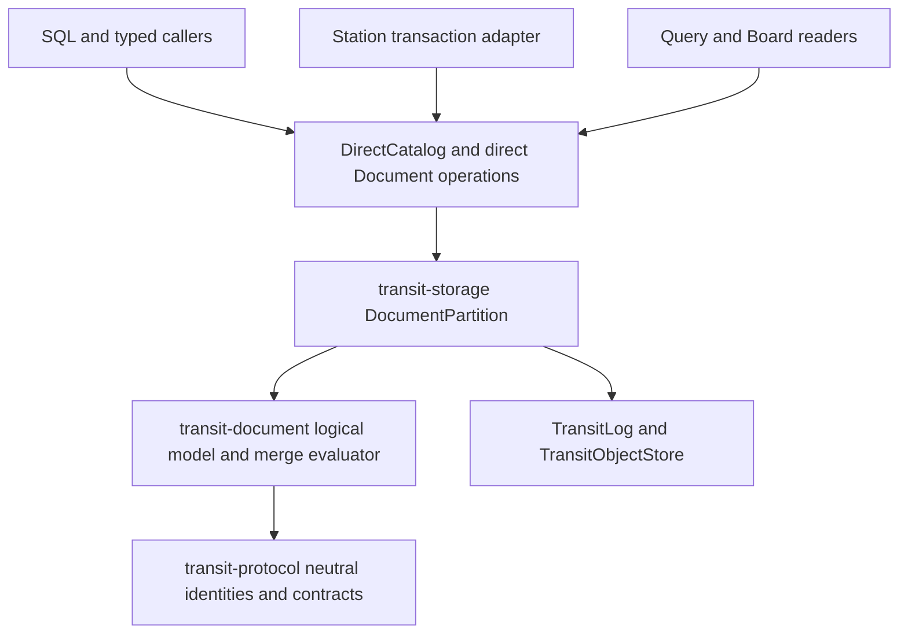

# 7. Logical document storage, `.tseg` trees and Station decoupling

[Roadmap](README.md) · [Foundation #125](https://github.com/spoke-sh/transit/issues/125) · [Native State #126](https://github.com/spoke-sh/transit/issues/126) · [Layouts & Codecs #128](https://github.com/spoke-sh/transit/issues/128) · [Performance #76](https://github.com/spoke-sh/transit/issues/76) · **Status:** In Progress — D0–D4 direct Document protocol, algebra, `.tseg` shredding, `DocumentPartition`, and catalog/storage-graph foundations delivered; D5 transaction/SQL/consumer cutover pending M5/M6 turn gate

Decouple `Document` (`DOCUMENT`) completely from the `Station` durable actor
runtime ([`transit-station-document`](../../packages/zig/transit-station-document/README.md),
[`STATION_DOCUMENT_V1.md`](../../contracts/STATION_DOCUMENT_V1.md) and
[`STATION_INDEX_V1.md`](../../contracts/STATION_INDEX_V1.md)), replace the
96-byte JSON/CRDT KV-turn format with a **logical algebraic Document model
($\tau \perp \kappa \perp \epsilon$)** in the Direct Data Plane, and implement
**`DocumentPartition`** in `transit-storage` over `TransitLog` (`TWAL1`) and
immutable `.tseg` segments using succinct tree topology bitvectors, adaptive
columnar path shredding, raw-frame coverage commitments and pluggable
revision/merge profiles.

## Prerequisites and architectural rationale

Follow the [declarative data lifecycle](01-declarative-data-lifecycle.md),
[local storage hierarchy](02-storage-and-query-performance.md),
[live storage/SQL cutover](03-live-storage-and-sql-cutover.md),
[statement results](04-statement-results-and-consumption.md),
[transactions](05-transactions-and-atomic-composition.md) and
[declarative streams, queues and durable runtime](06-streams-queues-and-durable-runtime.md).
Start from the [data model](../handbook/reference/data-model.md),
[Document reference](../handbook/reference/documents.md),
[state model](../handbook/internals/state-model.md),
[storage runtime](../handbook/internals/storage-runtime.md) and
[query engine](../handbook/internals/query-engine.md).

An architectural review of [`STATION_DOCUMENT_V1.md`](../../contracts/STATION_DOCUMENT_V1.md)
and [`transit-station-document`](../../packages/zig/transit-station-document/README.md)
alongside the [Milestone 6 SQL database cutover](06-streams-queues-and-durable-runtime.md#sql-database-runtime-cutover--2026-10-28)
identifies three structural mismatches between the existing `Document`
implementation and Transit's storage and query architecture:

1. **`Document` remained coupled to `Station` actor turns and `STATE_V1` 256-byte KV limits:**
   The direct Table path and `transit-sql` are independent of `Station` actors.
   `StreamPartition`, `QueuePartition` and the transactional Station replacement
   remain planned in [Milestone 6](06-streams-queues-and-durable-runtime.md).
   `Document` remains a `Station` service
   (`transit-station-document`) layered over [`STATION_PUBLICATION_V1.md`](../../contracts/STATION_PUBLICATION_V1.md),
   4 KiB 8-ary `SIX1` B-tree nodes ([`STATION_INDEX_V1.md`](../../contracts/STATION_INDEX_V1.md))
   and [`STATE_V1.md`](../../contracts/STATE_V1.md) actor turns (capped at four
   256-byte KV mutations per turn). Naming a Document in `DirectCatalog`
   required a three-turn `Station` `NamedResource` handshake (`reserve` $\to$
   `service init` $\to$ `verify empty head`), and remote edits required `STN1`
   actor calls (`SDQ1`/`SDT1`/`SDO1`) with single-active-job serialization.
2. **A fixed JSON-like CRDT wire format with 96-byte string ceilings instead of a logical Document model:**
   `SDC1` hardcodes a JSON-like register/list tree where inline strings and
   binary scalars are capped at **96 bytes**, map field names are unnormalized
   1–64 byte UTF-8 strings, a change contains at most 8 operations, and growing
   editable text is decomposed into **one `u32` Unicode scalar per CRDT
   element** (requiring thousands of B-tree entries and bounded 32-step
   continuation pages to read a single paragraph).
3. **Isolation from Transit's $\tau \perp \kappa \perp \epsilon$ storage and vectorized query engine:**
   Because `Document` state lived in `SIX1` KV blobs rather than `.tseg`
   segments, Document paths and text could not use physical column codecs
   (`.dictionary`, `.fsst`, `COMP-3`, `ZONED`, `EBCDIC`), declared collations
   (`utf8_binary`, `ascii_ci`, `ebcdic_cp037`, `icu:<locale>`), 16-byte
   collation-prefixed Umbra/German strings ([Milestone 14](14-vectorized-strings-and-search.md)),
   collation-aware zone-map pruning, vectorized `Fuze` scans or single-round-trip
   [Milestone 5](05-transactions-and-atomic-composition.md) database commits.

This milestone brings `DOCUMENT` into the Direct Data Plane alongside `TABLE`,
`KV`, `STREAM` and `QUEUE` before [Milestone 9](09-client-foundation-and-language-apis.md)
extracts the shared Station-free client foundation and before
[Milestone 16](16-document-profiles-and-gateway-exchange-lifecycle.md) builds
the multi-format Document Type Library (`JSON`, `XML`, `HTTP`, `FTP`, `EDI`) and
gateway exchange capture over it.

## Logical Document model ($\tau \perp \kappa \perp \epsilon$)

| Dimension | Logical & physical contract in `DocumentPartition` |
| --- | --- |
| **Logical type ($\tau$)** | A rooted, ordered, attributed tree + envelope (and optional multi-part **Container Graph** `Container -> Parts -> Trees/Tables/Spans`) of typed nodes (`map`/`element`, `attribute`/`header`, `list`/`sequence`, `scalar`, `span`, `part_ref`) with five-state cell semantics (`value`, `null`, `missing`, `type_error`, `conflict`) and exact `(part_id, byte_start, byte_end)` raw-frame provenance |
| **Collation & segmentation ($\kappa$)** | Declared per-document and per-path collations (`utf8_binary`, `ascii_ci`, `ebcdic_cp037`, `icu:<locale>`) and deterministic linear, structural and spatial/layout span segmenters governing key lookup, path comparison, range pruning and sequence slicing |
| **Physical layout & codecs ($\epsilon$)** | `.tseg` succinct tree topology bitvectors ($2N$-bit Balanced Parentheses `BP` / `LOUDS`), Dremel/ClickHouse-style shredded subcolumns, `.dictionary` and `.fsst` compression, mainframe/numeric/fixed-point codecs (`COMP-3`, `ZONED`, `NTP` 64-bit fixed-point), `.tdel` Roaring bitmaps and verified raw-frame/part slices |
| **Revision & merge policy** | Uniform revision lineage header `(DocumentId, RevisionId, ParentRevisionIds, MergeEpoch, DefinitionId, LineageKind, CoverageDigest)` supporting `immutable_lineage` (including incremental container/trailer appends such as `PDF` `%%EOF` or `MIME` attachments), 3-way structural merges and the `causal_crdt` observed-remove register/sequence merge profile |

## Delivery sequence

1. **Sever `Document` from `Station` (`transit-document` / `DocumentPartition` $\perp$ `Station`) and unify catalog lifecycle.**
   Remove `Station`, `STATION_PUBLICATION_V1` and the three-turn `NamedResource`
   actor initialization ceremony from the `DOCUMENT` catalog and storage path.
   Introduce `DocumentPartition` in `transit-storage` sharing `TransitLog`
   (`TWAL1`), `TransitObjectStore` (`.tseg` / `.tdel`), `DirectClientToken`
   idempotency (`(AccountId, ClientToken) -> OperationId, CommitLSN, OutcomeReceipt`),
   `ReadCache` snapshot leases and `policy_epoch` fencing with `TablePartition`,
   `StreamPartition` and `QueuePartition`:
   - `CREATE DOCUMENT`, `ALTER DOCUMENT`, `RENAME DOCUMENT` and `DROP DOCUMENT`
     execute directly through `DirectCatalog` and `DocumentPartition` with zero
     `Station` actor turns.
   - Single-partition Document admissions and updates commit in **one round-trip**
     to the partition's `TransitLog` (`TWAL1`).
   - Enforce package-level build gates rejecting transitive `Station` imports in
     `transit-document`, `transit-storage`, `transit-catalog`,
     `transit-query-direct` and `transit-sql`.

2. **Define the logical Document algebra, revision header and pluggable merge profiles.**
   Replace `SDC1`/`SDS2`/`SDR1` with a neutral logical Document contract in
   `transit-protocol` that removes the 96-byte scalar string/binary ceiling,
   64-byte field-name limit and 8-operation per-change cap (enforcing explicit
   deployment and request byte/node quotas instead of format-tag limits):
   - Every committed Document revision binds `(DocumentId, RevisionId,
     ParentRevisionIds, MergeEpoch, DefinitionId, LineageKind, RawFrameCommitment)`.
   - Separate **logical tree storage** from **merge policy** via explicit
     profiles declared on the `DOCUMENT` object:
     - **`versioned` / `immutable_lineage` profile:** Append-only revisions,
       whole-document or path-patch updates under optimistic concurrency
       guards, and three-way structural tree merges for application records,
       versioned specifications and captured protocol documents.
     - **`causal_crdt` profile:** Preserves Transit's deterministic
       observed-remove multi-value register semantics (concurrent unseen
       assignments retained as explicit `conflict` alternatives with their
       operation dots `(counter: u64, replica: u64)`, resolved only by an
       assignment naming the observed dots), parent-removal detachment rules,
       descending-dot sequence ordering, and opted-in finite merge-window
       checkpoint compaction—executed directly by `DocumentPartition` over
       `.tseg` trees without `Station` actors.
     - **Span-based collaborative text (`rope` / `piece_table`):** Replace
       per-Unicode-scalar `u32` B-tree elements with UTF-8/scalar span blocks
       over `.fsst`-compressed `.tseg` pages, supporting arbitrary-length text
       inserts/deletes with stable anchor dots `(counter, replica, byte_offset)`
       and $O(\log B)$ block traversal.

3. **Implement `.tseg` succinct tree topology and zero-copy span storage in `DocumentPartition`.**
   Replace pointer-chasing 4 KiB `SIX1` B-tree nodes with 64-byte cache-line-aligned
   `.tseg` structural column groups:
   - **Succinct Tree Topology ($2N$-bit Balanced Parentheses `BP` or `LOUDS`):**
     Encode document tree hierarchy as a compact bitvector paired with two-level
     `@popCount` rank/select lookup blocks so `parent(v)`, `first_child(v)`,
     `next_sibling(v)`, `subtree_size(v)`, `depth(v)` and Lowest Common Ancestor
     (`LCA(u, v)` / `WITHIN(inner, outer)`) execute in $O(1)$ register
     instructions without pointer chasing.
   - **Parallel Node Attribute & Span Streams:** Store node tags (`map`,
     `element`, `attribute`, `list`, `scalar`, `span`, `conflict`,
     `type_error`), dictionary-coded field/tag symbol IDs, causal operation
     dots (when `causal_crdt` is active), and `(page_id, byte_start, byte_end)`
     span coordinates as bitpacked `.tseg` streams.
   - **Verified Raw-Frame & Multi-Part Container Storage:** Retain immutable
     staged raw byte/text frames and multi-part container directories (such as
     `MIME` multipart bodies, `OPC`/`ZIP` package parts for `DOCX`/`XLSX`/`ODF`,
     and `PDF` `xref`/stream objects, verified by SHA-256 chunk coverage
     commitments and bounded by explicit decompression quotas) in `.tseg` blob
     pages so slices borrow directly from swizzled LeanStore/Umbra RAM/NVMe
     buffer slabs.

4. **Implement adaptive columnar path shredding (Dremel / ClickHouse style) into `.tseg` subcolumns.**
   Bridge semi-structured Document flexibility with columnar analytical scan
   speed:
   - Shred declared schema paths and frequently occurring paths into native
     typed `.tseg` subcolumns (with definition/repetition levels or sparse
     presence bitmasks), while storing unshredded or high-entropy paths in the
     succinct residual tree column.
   - Equip every shredded subcolumn with five-state cell tags (`value`, `null`,
     `missing`, `type_error`, `conflict`), declared collations ($\kappa$),
     collation-aware Zone Maps (`min`, `max`, `null_count`, `missing_count`,
     `conflict_count`) and composable codecs (`.dictionary`, `.fsst`,
     bitpacking, `COMP-3`, `ZONED`, `EBCDIC`).
   - Push SQL and path predicates (`doc.field = 'x'`, `doc.amount > 100`,
     `doc.field IS CONFLICT`, `doc.field IS MISSING`) directly into `.tseg`
     zone maps and subcolumn vectors in `Fuze`, deferring residual tree
     reconstruction via late materialization until a document passes all filters.

5. **Integrate `DocumentPartition` into [Milestone 5](05-transactions-and-atomic-composition.md) transactions, SQL and `Fuze` execution.**
   Connect `DocumentPartition` to the shared database transaction and query
   surfaces:
   - **Transaction participation:** Implement [Milestone 5's](05-transactions-and-atomic-composition.md)
     Participant Category 1 (`TABLE`/`KV`/`DOCUMENT` state mutations and
     conflict guards) for `DocumentPartition` so interactive and programmatic
     transactions atomically combine Table DML, Document revisions/patches,
     `STREAM` `PRODUCE INTO` and `_lease_epoch`-guarded `QUEUE` `ACK`s.
   - **Declarative SQL and typed-caller operations:** Expose `CREATE DOCUMENT`,
     `ALTER DOCUMENT`, `DROP DOCUMENT`, document admission/mutation/merge,
     bounded path/sequence reads and relational `SELECT` projections over
     Document collections through `transit-sql` and typed callers using shared
     [Milestone 4 `ResultSet`s](04-statement-results-and-consumption.md).
   - Preserve five-state cell propagation (`missing`, `null`, `type_error`,
     `conflict`, `value`) across SQL projections, joins and aggregations without
     picking an arbitrary conflict winner or converting `missing` to `null`.

6. **Execute the current-v1 hard cutover across `Station`, SDKs, examples and Board.**
   Apply the [v1 hard-cutover policy](../handbook/reference/versioning.md):
   - Replace `STATION_DOCUMENT_V1` (`SDC1`/`SDS2`/`SDR1`/`SDQ1`/`SDT1`/`SDO1`)
     and `SIX1` document storage with the new `transit-document` /
     `DocumentPartition` v1 contract; reject old stored formats and saved
     requests before execution without fallback decoders.
   - Re-architect `Station` behaviors that hold document state to read and
     mutate declared database `DOCUMENT` objects inside their
     [Milestone 6](06-streams-queues-and-durable-runtime.md) transactional turns.
   - Migrate all ten public SDKs, `examples/station-document` and Board's
     read-only Document inspector together, and update
     [`documents.md`](../handbook/reference/documents.md) and
     [`state-model.md`](../handbook/internals/state-model.md).

## Implementation plan for remaining work

**Source baseline:** `origin/main` at `796e7fe86`, 2026-10-30. The
[initial decoupling slice](#implementation-plan-for-initial-document-decoupling)
extracted the Station-free `transit-document` evaluator and added private `.tseg`
causal-record staging in `DocumentIndex`. Meanwhile,
[Milestone 6](06-streams-queues-and-durable-runtime.md#work-packages-and-dependencies)
has delivered the shared Roaring-bitmap foundation (`transit-bitmap`,
`BitmapDirectory`, `.tdel`), `PublicationGuard` fencing, immutable partition
declarations and genesis records (`LogDeclaration`, `LogInitialization`),
pinned tail slabs (`LogTail`), partition WAL records and operation receipts
(`LogPartitionRecord`, `LogEvidence`), finite authenticated read pins (`LogRead`),
WAL archives and recovery checkpoints (`LogHistory`, `LogRecovery`,
`LogStorageRoots`), typed direct catalog declarations and native policy domains
(`DirectLog`, `LogAuthority`, `LocalCatalogRunner`), and `DirectStorageGraph` /
`DataStore.trimUnit` reachability walking.

This plan sequences the remaining Milestone 7 deliverables on top of that
Milestone 6 foundation while preserving the public cutover gate until
[Milestone 5](05-transactions-and-atomic-composition.md) and
[Milestone 6](06-streams-queues-and-durable-runtime.md) multi-kind transaction
and Station turn participants are in place.

### Delivered basis and remaining obligations

| Area | Delivered basis at `796e7fe86` | Remaining obligation |
| --- | --- | --- |
| Neutral Document contracts | [`STATION_DOCUMENT_V1.md`](../../contracts/STATION_DOCUMENT_V1.md) and [`DataLifecycle`](../../packages/zig/transit-protocol/src/DataLifecycle.zig) | Define [`DOCUMENT_V1.md`](../../contracts/DOCUMENT_V1.md) and neutral `DocumentDeclaration`, `DocumentOperation` and `DocumentRead` bindings in `transit-protocol`: revision lineage headers, merge profiles (`causal_crdt`, `versioned`), declared collations and shredded path schemas, explicit operation budgets (replacing 96B/64B/8-op format caps), original operation/change receipts and authenticated read cursors |
| Logical algebra, merge profiles and text | [`transit-document`](../../packages/zig/transit-document/README.md) evaluates `SDC1` causal CRDT map/list/codepoint-text over `Document(Index)` | Add $2N$-bit Balanced Parentheses (`BP`) succinct tree topology (`SuccinctTree`), UTF-8/scalar span-block collaborative text (`SpanText` replacing per-scalar `u32` elements), and 5-state (`value`, `null`, `missing`, `type_error`, `conflict`) `versioned` three-way structural merges (`VersionedMerge`) with optional `(part_id, byte_start, byte_end)` raw-frame provenance |
| `.tseg` trees and adaptive path shredding | [`DocumentIndex`](../../packages/zig/transit-storage/docs/document-index.md) stages 128B/256B causal records in `.tseg`; [`transit-bitmap`](../../packages/zig/transit-bitmap/src/root.zig) and `BitmapDirectory` back `.tdel` | Add `DocumentShredder` in `transit-storage` to shred declared and frequent paths into typed 5-state `.tseg` subcolumns with presence bitmaps, declared collations ($\kappa$) and collation-aware zone maps (`min`, `max`, `null_count`, `missing_count`, `conflict_count`), while storing unshredded nodes in `.tseg` succinct `BP` residual tree streams |
| `DocumentPartition`, recovery and GC | M6's `PublicationGuard`, `LogHistory`, `TreeStore`, `DirectStorageGraph` and `DataStore.trimUnit` | Implement `DocumentDeclaration` (`DDECL001`), `DocumentInitialization` (`DINIT001` `.genesis`), `DocumentEvidence` (`DEVID001`), `DocumentRead` (`DREAD001`), `DocumentRecovery` (`DCHECK01`), `DocumentPartitionRecord` (`DOCPART1`), `DocumentStorageRoots` and `DocumentPartition` (single-append WAL acceptance, duplicate token and causal-change recovery, retained revision read pins, finite merge-window checkpoints, WAL archiving/trimming) and wire into `DirectStorageGraph` and `DataStore.trimUnit` |
| Direct catalog and authorization | `DirectCatalog` and `LocalCatalogRunner` support `Table`, `Stream` and `Queue` lifecycles; `DirectResource` still uses 3-turn `NamedResource` for `Document` | Add `document_domain` and `DocumentAuthority` action masks (`inspect`, `read`, `edit`, `checkpoint`, `administer`), implement `DirectDocument`, `DirectDocumentProtocol` and `DirectDocumentClient`, and replace the `DirectResource.Spec.document` / `NamedResource` actor ceremony |
| Transactions, SQL/Fuze and hard cutover | `DirectTransaction` (Table-only), `DatabaseRuntime`, `ReadCache` and `transit-station-document` | Implement `DocumentTransaction` (Category 1 participant) with M6 R5, wire SQL DDL/DML and Fuze subcolumn pushdown / 5-state projections, migrate Station Document behaviors to M6 transactional turns, and execute the v1 hard cutover across ABI, 10 SDKs, Board and `examples/station-document` |

### Remaining work packages and gates

| Package | Outcome | Start gate | Exit evidence |
| --- | --- | --- | --- |
| D0 (Delivered) | Neutral `DOCUMENT_V1` declaration, lineage, operation and read contracts | `796e7fe86` baseline | `DocumentDeclaration`, `DocumentOperation` and `DocumentRead` in `transit-protocol`, reflected `data-lifecycle-v1.schema.json`, fixtures and refusal tests |
| D1 (Delivered) | Logical Document algebra: succinct `BP` trees, span text and 5-state 3-way structural merges | D0 | `SuccinctTree`, `SpanText` and `VersionedMerge` in `transit-document` with reference-oracle equivalence, 24-permutation convergence and zero-allocation navigation checks |
| D2 (Delivered) | Fenced Document declarations, genesis initialization and adaptive `.tseg` subcolumn shredding | D0–D1 and M6 bitmap/storage foundation | `DocumentDeclaration` (`DDECL001`), `DocumentInitialization` (`DINIT001`) and `DocumentShredder` with 5-state subcolumn zone maps and differential tree/subcolumn equivalence |
| D3 (Delivered) | `DocumentPartition` WAL acceptance, retained revision reads, checkpoints and GC graph walk | D1–D2 | `DocumentPartition`, `DocumentEvidence`, `DocumentRead`, `DocumentRecovery` and `DocumentStorageRoots` wired into `DirectStorageGraph` and `DataStore.trimUnit`, verified across disk reopen, trim and collection |
| D4 (In Progress — authority & graph delivered) | Direct catalog lifecycle (`DirectDocument`), `DocumentAuthority` and node dispatch | D2–D3 | `DocumentAuthority` and `DirectStorageGraph` delivered; signed node dispatch awaits the D5 transaction/consumer cutover gate |
| D5 | Category-1 `DocumentTransaction` participant, SQL/Fuze lowering and current-v1 consumer cutover | D3–D4 and M6 R5/R7 transaction/turn readiness | Multi-object Table/Document/Stream/Queue transactions, Fuze subcolumn pushdown, removal of `transit-station-document` / `SIX1` Document storage, and migrated ABI/SDK/Board/example suites |

## Implementation plan for initial Document decoupling

**Plan basis:** `origin/main` at `1116604e90f79f1d9c879b4262f62993da4990f1`,
2026-10-28. **Delivery status:** Core and private storage foundation implemented;
the database acceptance and public cutover gates below remain planned.

### Initial implementation scope

The first slice extracts the unchanged canonical change model, codec and merge
evaluator into [`transit-document`](../../packages/zig/transit-document/README.md),
with an owner-supplied immutable-index interface and no Station dependency.
The existing service composes this evaluator with its current Station index,
publication and caller boundaries.

[`DocumentIndex`](../../packages/zig/transit-storage/docs/document-index.md)
adds bounded `.tseg` causal-record staging, paged directories, immutable roots
and scoped candidate workspaces in `transit-storage`. This is a portion of P1
and P2: it preserves current logical/change bounds and stages private roots.
It does not implement the new logical algebra, succinct topology,
`DocumentPartition`, direct catalog initialization, WAL acceptance, retention
walking or public consumer cutover. The shared definition and installed wire
formats do not change in this slice.

The public cutover remains gated on the M5/M6 state/input/output transaction
decision. Keeping the installed callers on their current authority while the
foundation is established avoids introducing another public acceptance model.
The component guide links executable checks; full milestone acceptance requires
the schedules and gates below.

### Intended initial public outcome

The first outcome is a declared Document whose initialization, accepted edits,
revision reads and recovery belong to the database. A caller can create it,
apply a causal change, resolve a lost reply using the original operation, and
read the accepted revision after restart without a Document worker, Station
call, courier or native KV turn. This starts delivery step 1, with the minimum
logical/storage contracts from steps 2–3 and the consumer cutover from step 6.
It does not complete this milestone's analytical or transaction outcomes.

### Source audit and prerequisites

| Boundary at the plan basis | Existing owner and consequence |
| --- | --- |
| Logical changes and reads | [`Model.zig`](https://github.com/spoke-sh/transit/blob/1116604e90f79f1d9c879b4262f62993da4990f1/packages/zig/transit-station-document/src/Model.zig) obtains bounded names/scalars from `Station.ImmutableIndex`; [`Document.zig`](https://github.com/spoke-sh/transit/blob/1116604e90f79f1d9c879b4262f62993da4990f1/packages/zig/transit-station-document/src/Document.zig) performs merge and traversal over that index. Moving the package alone would preserve the storage coupling and old limits. |
| Durable acceptance | [`Service.zig`](../../packages/zig/transit-station-document/src/Service.zig), `Checkpoint`, `Remote` and `Caller` use Station Publication, private turns, one active job and recorded reply routes. Candidate construction is separate from final accepted head publication. |
| Catalog lifecycle | [`DirectResource`](../../packages/zig/transit-catalog/src/DirectResource.zig) requires a writer PID and native allocation. [`NamedResource`](../../packages/zig/transit-station-app/src/NamedResource.zig) reserves the interpretation, creates the Document service and verifies its empty head across three commits. Catalog's absence of Station imports does not eliminate this runtime dependency. |
| Public reads and consumers | [`Client`](../../packages/zig/transit-station-document/src/Client.zig) opens native resource cuts; Query, Board and [`DocumentCodec`](../../packages/zig/transit-station-bindings/src/DocumentCodec.zig) depend on that implementation. The ABI codec also repeats the 96-byte binary limit. |
| Reusable database owners | `DirectCatalog`, `DirectClientToken`, `DirectIntent`, `DatabaseRuntime`, `ReadCache`, `TablePartition`, `TreeStore`, `TransitLog` and `TransitObjectStore` exist. The [SQL cutover](06-streams-queues-and-durable-runtime.md#sql-database-runtime-cutover--2026-10-28) qualifies their specific Table path, not a generic Document path. |
| Transactions and runtime composition | The [M5 delivery profile](05-transactions-and-atomic-composition.md#selected-delivery-profile-and-exclusions) excludes native Document participation. Storage transaction directories, decisions and private Table workspaces do not establish an installed Document transaction. Stream/Queue participants and transactional Station turns remain M6 work. |

P0–P3 below can begin against the existing local WAL/object and catalog owners;
they do not require Streams, Queues, the complete M5 coordinator, M8 clients or
M15 format profiles. Coordinate shared definition, token and retention changes
with M5. P5's public replacement has a separate atomicity gate: an existing
Station operation that commits Document state with input progress and outputs
must acquire a qualified common transaction before its old implementation is
removed. Two recoverable commits do not preserve that guarantee. Until that gate
is met, land only independently useful internal components and tests, or retain
the dependent switch on the implementation branch; do not expose two public
Document engines or a compatibility mode.

### First delivery profile

- Use one existing catalog, branch one, one fenced local owner and one logical
  Document per catalog object/partition. Reuse scoped `DataLifecycle.Object`
  and immutable definition identities. Names, Document revisions, causal dots,
  client tokens, operation IDs, WAL positions and writer/policy epochs remain
  distinct. A Document definition does not require an application PID or a
  per-Document native resource allocation; catalog authority can retain its
  existing native lifetime binding.
- Implement the existing map/list/text **causal CRDT semantics** first:
  observed-remove conflicts, immutable object identities, detached descendants,
  descending-dot sibling order, deleted anchors, replica frontiers and exact
  duplicate acceptance. Convergence applies to the same accepted change set.
  The neutral model separates logical types, collations and physical encodings;
  unsupported profiles receive a typed refusal. Versioned/immutable-lineage
  merges, container graphs and new format parsers remain later work.
- Replace fixed inline payloads with length-delimited values and bounded staged
  references. Publish explicit request bytes, operation/node counts, depth,
  conflicts, staging, active work and response budgets; do not inherit the
  96-byte/64-byte/eight-operation wire ceilings or substitute larger arrays.
  Preserve Unicode-scalar text semantics initially. Span-block text storage,
  grapheme behavior and normalization are separate contracts.
- Establish a bounded `.tseg` residual-tree representation before public
  replacement. Keep causal evidence and revision/operation directories paged;
  `TreeStore` may index those directories but must not become a renamed `SIX1`
  payload engine. Adaptive shredding, collation-aware path pruning and optimized
  succinct navigation remain later M7 outcomes. Select the initial topology in
  P0/P2 using the [candidate evidence](#candidate-structures-and-selection-evidence);
  rank/select alone does not prove all advertised navigation operations are
  constant time.
- Deliver shared typed lifecycle/edit/read operations and SQL lowering for the
  selected Document CREATE/ALTER/RENAME/DROP subset. Existing SQL declaration
  compilation is offline; executable forms and supported ALTER properties must
  be specified and tested before advertising them. Preserve existing accepted
  Query projections through the shared reader. New relational collection scans,
  path-predicate pushdown and multi-object composition remain later steps.

### Ownership and dependency direction

Proposed ownership follows the existing database boundary:

`transit-document` owns deterministic validation, merge evaluation and bounded
logical traversal against explicit reader/builder interfaces. It imports no
Station, provider, catalog or storage implementation. `transit-storage` owns
physical trees, staging, WAL acceptance, retained roots and recovery, and uses
that evaluator. Catalog owns names, policy checks, operation routing and
inspection. Client/SQL packages call the same operations. Station composes above
them; it cannot supply a second acceptance or permission authority. Board uses
only authorized public metadata/read operations and does not decode application
values or inspect raw objects.

### Work packages and exit gates

| Package | Deliverable | Depends on | Exit gate |
| --- | --- | --- | --- |
| P0 | Neutral Document, lifecycle, authority and cutover contracts | Existing M1/M2 contracts; M6 database boundary | Reviewable operation/state transitions, identities, byte layouts, quotas and consumer inventory |
| P1 | Station-free `transit-document` evaluator and fixtures | P0 | Independent semantic equivalence and dependency checks |
| P2 | `DocumentPartition`, residual `.tseg` trees and recovery | P0–P1 | Atomic acceptance and disk reopen under bounded memory |
| P3 | Direct catalog lifecycle, policy, token binding and reads | P0–P2 | Real signed callers create/edit/read/recover without actors |
| P4 | SQL/query/client and inspection integration | P3 | Shared outcomes, exact revision coverage and current-policy disclosure |
| P5 | Consumer migration, current-v1 replacement and qualification | P1–P4; qualified transaction participants where atomic turns require them | One supported Document implementation and complete affected caller/recovery evidence |

#### P0 — Fix contracts and the migration inventory

Create the proposed `contracts/DOCUMENT_V1.md` and neutral public types in
`transit-protocol`. Define canonical changes, accepted references, revision
lineage, merge profile, definition identity and raw-span commitments when present;
do not manufacture raw-frame provenance for values constructed by an application.
Specify full-width identity handling and exact errors for dependency missing,
identity conflict, stale epoch, unsupported profile, quota, denial, unavailable
history and corruption. A missing dependency does not create a pending queue.

Extend the owning [data lifecycle](../../contracts/DATA_LIFECYCLE_V1.md),
[direct operations](../../contracts/DIRECT_TABLE_V1.md),
[storage](../../contracts/TRANSIT_STORAGE_V1.md) and
[authorization](../../contracts/AUTHORIZATION_V1.md) contracts. Specify:

1. Stable Document/object and partition allocation, immutable definitions,
   initial empty revision acceptance, exact dependency edges, rename, logical
   DROP, retirement and retention. Keep namespace removal, data unavailability,
   history-floor advancement and physical deletion distinct.
2. Authenticated direct edit authority, including the principal/role allowed to
   use a replica and the retained authority of delegated work. A payload replica
   or former writer PID is not permission. Define current checks at admission,
   commit, retry inspection and every read disclosure.
3. Frozen Document intents as a typed `DirectIntent` variant and bindings in
   the existing account/client-token owner. Specify token fingerprint conflicts
   separately from duplicate causal changes, which return the original revision
   even when presented under a different operation. Catalog token settlement
   must reference the partition's receipt rather than invent another commit.
4. One conditional partition acceptance for a single-Document update, binding
   root, logical revision, causal/deduplication indexes and original outcome.
   Object staging and catalog admission may precede it. One data-WAL append is
   not a claim that a complete statement needs one HTTP request or one total I/O.
5. Exact retained read cuts, cursor ownership, progress-only pages, terminal
   coverage, current policy, history availability and deterministic close.
   Lease/pin allocation is bounded and recovery-owned; a reference is not a pin.
6. Category-1 transaction preparation/guards and common-decision visibility for
   the later M5 integration. Define the required atomicity for every existing
   public turn action before choosing its replacement. No new coordinator or
   independent Document-specific transaction protocol.

Audit all imports, public exports, stored records, generated schemas, ABI/host
actions, SDK methods, examples, deployment templates and proof tasks. Record an
explicit replacement for each under P5. This includes unnamed Documents,
writer-side jobs, checkpoints, accepted-tail reads, resynchronization, remote
call recovery and Board's value-free register metadata. Existing `SDS1` fallback
reading and `SDW1` saved waits are part of the removal inventory alongside the
formats already listed in delivery step 6. Keep old-format negative fixtures
for rejection, not successful decoding.

**First review:** settle this contract and atomicity inventory before changing
durable formats or wiring a new endpoint. The current public reference continues
to describe the implemented Station service until the cutover lands.

#### P1 — Extract deterministic Document semantics

Add a real `packages/zig/transit-document` package with its own manifest, public
module, README and checks. Move the semantic responsibilities of `Model`,
`codec`, `Document` and checkpoint evaluation behind neutral bounded interfaces;
leave clocks, authorization I/O, publication jobs and durable outcomes with their
owners. Use explicit `scratch` and `output` lifetimes for variable-sized values,
with reusable arenas/buffers and owned output across page advancement.

Port the existing 24-permutation merge scenarios and independent fixtures to
the neutral contract. Check conflict resolution, missing versus null, type
errors, Unicode/full-width values, same-dot/different-content rejection,
missing predecessors, nested deletion/edit races and deleted sequence anchors.
Add cases exceeding the old payload/operation limits within declared budgets,
and atomic refusal immediately above each budget. No rejected candidate may
advance a replica frontier or expose a prefix. Reuse one merge implementation
across storage and language bindings; SDKs do not implement the algorithm.

Add transitive Station-import rejection for the new package and storage, and
preserve the existing gates in Catalog, direct Query and SQL. A mechanical
extraction may be reviewed separately, but passing this gate alone does not
establish runtime decoupling.

#### P2 — Implement the direct durable owner

Add `DocumentPartition` in `transit-storage`, reusing `TransitLog`, object-store
interfaces, epoch fencing and bounded immutable indexes. Share generic storage
primitives through package interfaces; do not wrap Document edits as Table DML
or import Station's Publication/ImmutableIndex. Extend the shared `.tseg`
format/reader owner for residual tree pages rather than writing a second segment
codec. Bind pages to the exact logical definition, document and revision basis.

Build candidates privately, streaming payload/tree pages and retaining causal
records, frontiers, tombstones and change digests. The final fenced WAL record
publishes the whole accepted root and receipt. Small changes may reside in WAL;
large values use verified durable object references. Bound resident dirty state,
staging bytes and active candidates independently of total history. A serialized
local partition is sufficient; removing the actor must not imply concurrent
writers or unlimited active work.

Implement replay, duplicate/outcome lookup, bounded accepted revision reads,
flush/checkpoint progress and retained-root enumeration together. Register
Document roots, staged work and pins with the existing storage graph/collector
before enabling collection. Unknown or incomplete reachability refuses deletion.
Unlimited retention remains the default; finite merge windows require a complete
checkpoint, epoch/floor advancement and retained replica/deletion evidence.
Physical maintenance never changes a logical revision or supplies a new grant.

Use real `LocalWal`/`LocalSegmentStore` directories for crash/reopen tests, with
one-page/disabled caches and data larger than the resident budget. Inject failure
before object durability, before/after the conditional append, after acceptance
but before reply, and during checkpoint publication. Reopen must recover the
same root/outcome or refuse corrupt/incompatible evidence, never an empty reset.

#### P3 — Replace Document catalog initialization and direct access

Replace only the Document arm of `DirectResource`/`DirectCatalog` and the
Document initialization checks in `NamedResource`/node policy. Named native KV
keeps its existing lifecycle. Reserve an object and partition in the catalog,
accept its empty Document definition in the partition, then settle the original
catalog operation from that evidence. Recover interruption between each phase;
never expose a name whose exact initialized definition cannot be verified.
No supplied resource or PID may silently adopt an unrelated Document.

Expose signed direct lifecycle, mutation, inspect, path/sequence, accepted-tail,
checkpoint and resynchronization operations through the owning public client.
Resolve names once into saved identities. Rename preserves object identity;
DROP/recreate cannot retarget an old edit, read or token. Enforce exact dependency
registration and DROP RESTRICT without granting data access. Define supported
ALTER fields and reject changes that would reinterpret accepted causal history.

Extend token pending discovery, quotas and recovery to Document intents; reuse
`DatabaseRuntime` where SQL submits them. Preserve unknown outcomes and original
acceptance after cancellation races or reply loss. Read operations bind exact
Document revisions and recheck current authority after buffering, including
empty/progress/terminal pages and metadata. Reuse the read-cache mechanism only
after its pin/lease contract can represent Document cuts; do not treat a Table
pin or an independent source vector as a common snapshot.

#### P4 — Wire SQL, Query and observable outcomes

Lower the selected SQL declaration subset through the same typed operations and
existing statement-result machinery. Update the grammar/capability inventory
with executable, offline and unsupported forms separately. SQL text heuristics
must not classify outcomes. Shared typed edits and revision reads are sufficient
for the initial mutation surface; broader SQL Document DML syntax needs its own
contract and is not invented by this plan.

Replace Query's Document source adapter with the new authorized reader, keeping
accepted-only projections, five-state values and exact source attribution.
Keep the direct packages Station-free even where captured Query composition
still lives above them. Board receives definition, accepted revision, pending
operation, merge floor/epoch and bounded value-free metadata through public
operations. A live worker, staged tree or partially read sequence is not a
completed Document outcome. Update the browser schema/validators with the API.

#### P5 — Migrate consumers and perform one public cutover

Move all existing Document consumers with the replacement: shared Zig/ABI/host
bindings; the public Zig SDK and ten non-Zig targets; named-resource and Query
adapters; `examples/station-document`; Board API/browser; local, Compose and
reference deployment wiring; build/package/task inventories. Replace the
Document worker's storage role with database composition. Retain Station
application behavior only as a caller above the database.

For writer-side APIs and remote operations whose state/input/reply previously
shared a turn, require the qualified M5 Document participant and M6 settlement/
outbox composition before switching them. Preserve original accepted identities
and recorded destinations. A direct client response can report its retained
receipt; it cannot substitute for an atomic durable Station reply. This gate
does not delay the P0–P4 component work or complete M5/M6 by implication.

Replace the shared current-v1 definition and regenerate wire/schema, signing,
ABI/host and Board artifacts together. Remove the superseded Document package,
worker, successful old-format decoders, public routes/actions and configuration.
Remove Document's use of `SIX1` and Station Publication; their unrelated Station
consumers remain with M6 until separately replaced. Do not delete shared storage
mechanisms solely because Documents no longer use them.

Reject old Document roots, references, changes, waits, saved intents and
installations before execution or disclosure. Preserve original histories and
uncertain work for resolution with the matching build; supply no implicit
conversion, defaulted definition, fallback decoder or reset. Keep package
versions/internal pins aligned with `VERSION` and run `python3 -B tasks/version.py`
after manifest changes.

Promote implemented semantics and numeric bounds to the Document/state/caller
references, affected package guides and contracts; update the data model,
glossary and component directory. Revise state/storage/query Internals with
source-attributed mechanisms and evidence. Keep this plan and remaining milestone
work in the roadmap. Mark the milestone `In Progress` when implementation lands;
do not mark it complete after decoupling alone.

### Verification and closure of the initial slice

These are required new checks or extensions to existing suites, not passing
results. Use [test ownership](../../tests/README.md) and the scoped instructions
when implementing them.

| Gate | Required observation |
| --- | --- |
| Dependency and runtime independence | Transitive build checks plus a real signed caller/SQL schedule with Document worker and courier absent; zero Station sends/turns or native Document allocations during create/edit/read/recovery |
| Lifecycle and identity | Lost replies at reserve/initial acceptance/settlement, same-token races, conflicting fingerprints, duplicate causal changes under distinct tokens, rename/DROP/name reuse, exact dependency refusal and new empty-object initialization |
| Authorization and fencing | Denied create/edit/read/inspect, forged replica binding, replaced writer/policy epochs, revocation during staging and after read buffering, restored permission revealing the original receipt, retained reads after logical DROP under their declared lifetime |
| Merge and limits | Independent accepted-set oracle across all 24 permutations, detached descendants, explicit conflicts, stale replicas, checkpoint floors and recycled counters; values/changes beyond old limits and typed refusal without partial acceptance |
| Durable publication and recovery | Disk process death and I/O faults around staging, acceptance, receipt delivery and checkpoints; exact root/receipt recovery, corrupt/missing dependency refusal and incompatible-definition rejection |
| Read completeness and ownership | Empty results, progress-only pages, deleted spans, multiple pages, early close, cancelled/failed prefixes, scratch reuse and cache eviction; no cross-revision splicing or accidental EOF |
| Growth and retention | Histories, objects and pending operations larger than caches; bounded replay/page work and admitted memory; warmed allocation counters for selected hot loops; no quota-driven expiry or collection from incomplete graphs |
| Existing atomic consumers | Document mutation, input settlement and reply/outbox share the common decision through crash/conflict/lost reply; unavailable participants block that consumer's cutover |
| Performance accounting | One acceptance append for a single-partition edit; report control/token/staging requests separately, plus end-to-end latency, allocations/RSS, bytes written and restart work against the source baseline |

Start with owning package checks and independent contract fixtures. Extend the
existing `just test::direct-named-resources`, `just test::document`,
`just test::document-remote`, `just test::document-local` and
`just test::unified-query` scenarios to the replacement, preserving their
authority/recovery assertions. Migrate `bindings::document-*`, Board's
`document-test`/`document-browser`, and `examples::document-compose`/
`examples::document-reference` with their actual consumers. Reorganize Document
test ownership from runtime to storage/catalog where appropriate; update tasks
and the suite inventory rather than leaving an old worker-based proof as the
only evidence for a direct database path.

Run affected clean CI lanes from committed implementation HEAD, including
contracts/core, growth, interfaces, bindings, Board/browser and launchers where
the cutover changes them; run explicit Compose/reference placement proofs
separately. Select actual lane names from the suite inventory. Record commands,
source definition, backend, budgets, failures and omissions in the owning proof
ledger with raw evidence. Documentation checks establish no runtime guarantee.

After this slice, M7 still owes versioned/three-way merges, span-block text,
qualified succinct navigation, adaptive shredded subcolumns and pruning, broader
Document SQL/relational execution and the full Table/Document/Stream/Queue
transaction proof. Preserve those completion criteria and M5/M6 dependencies.

## Candidate structures and selection evidence

| Work and candidate | Evidence required before selection |
| --- | --- |
| Succinct tree encoding in `.tseg` ($2N$-bit Balanced Parentheses `BP` vs. `LOUDS` vs. level-indexed flat tape) | Navigation latency (`parent`, `first_child`, `next_sibling`, `LCA`, path lookup) in CPU cycles, bits per node overhead, SIMD construction speed on 1 KiB–10 MiB documents, and equivalence with reference tree oracle |
| Adaptive columnar path shredding (declared + thresholded subcolumns vs. residual succinct tree) | Scan throughput, zone-map pruning selectivity, `.tseg` flush/compaction amplification under sparse/evolving keys, and exact 5-state (`missing`, `null`, `conflict`, `type_error`, `value`) fidelity against unshredded evaluation |
| Span-based collaborative text (`piece_table` / `rope` over `.fsst` `.tseg` blocks) | Edit acceptance and sequence read latency on 100 B–10 MiB texts, concurrent insert/delete convergence across 24+ delivery permutations, and memory bound independence from total document length |

## Completion evidence

Require executable proof through real SQL and typed callers in the
[proof ledger](../history/qualification/README.md):

- **Station independence and single-round-trip latency:** Verify that
  `transit-document`, `transit-storage`, `transit-catalog` and `transit-sql`
  execute `CREATE DOCUMENT`, Document mutations/merges, path reads and `SELECT`
  queries with zero compile-time imports or runtime calls to `Station`,
  committing single-partition Document writes in one `TransitLog` (`TWAL1`)
  append with exact `DirectClientToken` duplicate idempotency and lost-reply
  recovery.
- **Causal CRDT and versioned merge equivalence:** Pass the full 24-permutation
  concurrent delivery suite, duplicate suppression, nested parent-delete vs.
  child-edit detachment, observed-remove multi-value `conflict` preservation and
  resolution, sequence/text ordering, opted-in finite merge-window epoch
  advancement, stale-replica rejection and crash/restart recovery over
  `DocumentPartition` (`TWAL1` + `.tseg`)—plus strings and collaborative texts
  spanning 1 KiB to 10 MiB (verifying removal of the 96-byte scalar limit).
- **Shredded `.tseg` subcolumn and succinct-tree query equivalence:** Prove
  differential equivalence between shredded subcolumn execution (with zone-map
  pruning, `.dictionary`/`.fsst` codecs and `utf8_binary` / `ascii_ci` /
  `ebcdic_cp037` collations) and unshredded succinct-tree traversal across all
  five cell states (`value`, `null`, `missing`, `type_error`, `conflict`),
  snapshots and `.tdel` deletions.
- **Multi-object transactional composition:** Prove that a single
  [Milestone 5](05-transactions-and-atomic-composition.md) transaction atomically
  mutates a `TABLE` and a `DOCUMENT`, `ACK`s a leased `QUEUE` message and
  `PRODUCE`s to a `STREAM`, rolling back all participants on conflict or crash
  before the common decision and recovering the committed outcome on lost reply.

## Later owners and execution gates

- [Gateway architecture, sans-I/O wire protocols and direct-plane ingress](08-gateway-architecture-and-protocol-ingress.md),
  [shared client foundation](09-client-foundation-and-language-apis.md) and
  [SDK coverage](20-service-and-sdk-coverage.md) expose idiomatic Station-free
  `Document` APIs and direct-plane ingress across target languages over this
  package boundary.
- [Standards and historical catalogs](10-standards-and-catalogs.md) and
  [indexing](11-indexing-and-access-paths.md) extend `AS OF` snapshot binding
  and secondary path/structural indexes over `DocumentPartition`.
- [First-class strings and vectorized search](14-vectorized-strings-and-search.md)
  and [Document type library and gateway exchange lifecycle](16-document-profiles-and-gateway-exchange-lifecycle.md)
  build 16-byte Umbra/German strings, `comptime` perfect hashing, vectorized
  Block-Max BM25 / structural `NEAR` search, the multi-format Document Type
  Library (`JSON`, `XML`, `HTTP`, `FTP`, `EDI`) and unified gateway/connector
  exchange capture on top of `DocumentPartition`.
