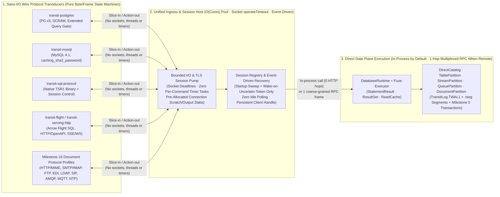

# 8. Gateway architecture, sans-I/O wire protocols and direct-plane ingress

[Roadmap](README.md) · [Cutover #110](https://github.com/spoke-sh/transit/issues/110) · [Maintenance & Packaging #122](https://github.com/spoke-sh/transit/issues/122) · [Foundation #125](https://github.com/spoke-sh/transit/issues/125) · [Performance #76](https://github.com/spoke-sh/transit/issues/76) · [Allocation Guidance #194](https://github.com/spoke-sh/transit/issues/194) · **Status:** Planned ([implementation plan](#implementation-plan--2026-10-28))

Formalize Transit's gateway and service-ingress architecture as a thin,
event-driven, sans-I/O protocol boundary over the Direct Data Plane
(`DirectCatalog`, `TablePartition`, `StreamPartition`, `QueuePartition`,
`DocumentPartition`, `DatabaseRuntime`, and `Fuze`) rather than a multi-hop
custom networking and loopback RPC stack. Collapse the out-of-process `/table/v1`
HTTP/1.1 JSON request cascade, eliminate continuous background recovery polling
(`runAccount` and `recoverSessions`), remove self-inflicted 4-slot `HttpCapacity`
and `ControlCapacity` starvation, replace per-header and per-command
`std.Io.Select` timer-task pairs with socket-level deadlines, bound worker
threads to CPU cores, and split monolithic multi-restart gateway test scripts
into fast sans-I/O protocol state-machine suites and focused integration targets.

## Prerequisites and architectural rationale

Follow the [declarative data lifecycle](01-declarative-data-lifecycle.md),
[local storage hierarchy](02-storage-and-query-performance.md),
[live storage/SQL cutover](03-live-storage-and-sql-cutover.md),
[statement results](04-statement-results-and-consumption.md),
[transactions](05-transactions-and-atomic-composition.md),
[declarative streams, queues and durable runtime](06-streams-queues-and-durable-runtime.md)
and [logical document storage and Station decoupling](07-document-storage-and-station-decoupling.md).
Start from the [SQL reference](../handbook/reference/sql.md),
[serving reference](../handbook/reference/serving.md),
[Flight reference](../handbook/reference/flight.md),
[reactive reference](../handbook/reference/reactive.md),
[service interfaces internals](../handbook/internals/service-interfaces.md),
[SQL gateway contract](../../contracts/SQL_GATEWAY_V1.md),
[SQL session contract](../../contracts/SQL_SESSION_V1.md) and
[serving contract](../../contracts/SERVING_V1.md).

An architectural and performance audit of [`transit-sql-gateway`](../../apps/transit-sql-gateway/README.md),
[`Gateway.zig`](../../apps/transit-cli/server/Gateway.zig),
[`NativeServer.zig`](../../apps/transit-node/NativeServer.zig),
[`DatabaseRuntime.zig`](../../packages/zig/transit-sql/src/DatabaseRuntime.zig),
[`Registry.zig`](../../packages/zig/transit-sql-service/src/Registry.zig),
[`transit-http-server`](../../packages/zig/transit-http-server/src/root.zig),
[`transit-tls-server`](../../packages/zig/transit-tls-server/src/root.zig) and
[`transit-io`](../../packages/zig/transit-io/src/root.zig) at `42067b5a1`
identifies why gateway qualification is slow and flaky: even after decoupling
SQL from `Station` actors in [Milestone 6 Step 1](06-streams-queues-and-durable-runtime.md#sql-database-runtime-cutover--2026-10-28),
**the gateway operates as an external distributed client orchestrating multi-step
storage transactions over a 4-slot loopback HTTP/1.1 JSON server, layered on top
of a bespoke networking, timer-task and thread-barrier stack.**

### Grounded baseline in real relative terms

Measured observations in [service-interfaces internals](../handbook/internals/service-interfaces.md#bounds-alternatives-and-evidence),
the [SQL qualification ledger](../history/qualification/sql.md#database-owned-sql-runtime--2026-10-28)
and the [performance ledger](../history/qualification/performance.md#persistent-console-statement-latency--2026-10-28)
quantify the gap between in-process Direct Data Plane operations and the current
gateway path:

| Dimension | In-Process Direct Data Plane (`TablePartition` / `DirectCatalog`) | Current Gateway Path (`transit-sql-gateway` $\to$ `/table/v1` HTTP/1.1) | Relative Overhead Today | Milestone 8 Target |
| --- | --- | --- | --- | --- |
| **Internal RPC hops per 1-row SQL write** | `0` (direct `DirectCatalog` + `TablePartition` call & `TWAL1` append) | **7–10 sequential foreground HTTP POSTs** (`fence` $\to$ `lookup` $\to$ `validate` $\to$ `stage` $\to$ `bind` $\to$ `operation` $\to$ `commit_saved` $\to$ `update`) + **58 total upstream POSTs** including overlapping background polling ([`performance.md`](../history/qualification/performance.md)) | **~10×–58× request amplification** | **`0` loopback HTTP RPCs** in co-hosted `transit server` / `transit-node`; **`1` coarse-grained RPC** in remote gateway mode |
| **Internal HTTP requests per 1-row native `SELECT`** | `0` | **183–191 internal HTTP requests** (`1.55–1.64 s` elapsed) including background session/account recovery polling ([`service-interfaces.md`](../handbook/internals/service-interfaces.md)) | **~185 HTTP RPCs per query** | **`0` loopback HTTP RPCs** (in-process) / **`1` request** (remote gateway) with **`0` idle polling requests** |
| **1-row point lookup latency (p50 on 4-row local table)** | `< 0.5 ms` | **`532 – 655 ms`** on wire ([`sql.md`](../history/qualification/sql.md)); **`81 ms`** warm unproxied TLS console; **`1,882 – 2,899 ms`** refreshed `SELECT` after write ([`performance.md`](../history/qualification/performance.md)) | **~160× – 5,000× slower** | **`< 1 – 5 ms` p50** over local wire (PostgreSQL, MySQL, `TSR1`) |
| **1-row DML write latency (p50 on 4-row local table)** | `< 1 ms` | **`1,019 – 1,679 ms`** in wire benchmark ([`sql.md`](../history/qualification/sql.md)); **`1,573 – 1,676 ms`** `INSERT` (`105 ms` stage, `551 ms` token bind, `833 ms` commit), **`3,165 ms`** `UPDATE`, **`2,026 ms`** `DELETE` ([`performance.md`](../history/qualification/performance.md)) | **> 1,500× slower** | **`< 2 – 10 ms` p50** durable local WAL commit over wire |
| **~10-statement native recovery script ([`sql_gateway_native.py`](../../tests/interfaces/sql/sql_gateway_native.py))** | `< 100 ms` | **`1,488 – 1,505` `/table/v1` HTTP requests** in **`31.4 – 32.1 s`**; seeding 67 rows hits **10 s node deadlines** and fails after **`626.06 s` / `> 300 s` timeout** ([`performance.md`](../history/qualification/performance.md)) | **> 300× slower & flaky** | **`< 2 s`** deterministic completion with zero `HttpCapacity` or deadline retries |
| **Upstream slot capacity vs. background polling load** | Direct memory/latch access | [`NativeServer.zig`](../../apps/transit-node/NativeServer.zig) admits only **4 data + 2 control + 4 wait** HTTP requests (`Gateway.zig` has **6 + 4** upstream slots), contended continuously by `runAccount` (`2–100 ms`), `recoverSessions` (`100 ms`), `expireSessions` (`100 ms`) and `courier` (`10 ms`) | **Self-inflicted `503 HttpCapacity` / `ControlCapacity` retry storms** | **Event-driven recovery (`0` idle ticks)** + direct in-process execution or multiplexed non-blocking dispatch |
| **OS threads & timer tasks per gateway process** | Bounded core pool | **184 to > 600 pre-warmed barrier threads** per gateway start (`16 + 4*accounts + 8*conns + native_listeners*96 + 16` in [`main.zig`](../../apps/transit-sql-gateway/src/main.zig)) + **2 `std.Io.Select` tasks spawned & cancelled** per HTTP header, request, handshake and SQL command | **~10×–30× thread & scheduler amplification** | **`O(CPU cores)` worker pool** + socket `io.operateTimeout` deadlines (zero racing timer tasks) |
| **Wire gateway verification ([`gateway.py`](../../tests/interfaces/sql_wire/gateway.py))** | Milliseconds for pure state machines | **`271 s` (~4.5 min)** monolithic 12-phase script with 4+ gateway restarts, cold CLI subprocesses per control call, and 65,536-iteration PBKDF2 on every test connection | **Slow feedback & CI timeout risk** | **`< 50 ms`** in-memory sans-I/O protocol tests + **`< 15 s`** focused wire-driver integration suites |

### Four structural defects to resolve

1. **Boundary inversion between the SQL gateway and `transit-node` (`/table/v1` HTTP/1.1 choreography):**
   [`transit-sql-gateway`](../../apps/transit-sql-gateway/src/main.zig) runs the
   SQL parser, [`DatabaseRuntime`](../../packages/zig/transit-sql/src/DatabaseRuntime.zig)
   and `Fuze` query engine in a separate OS process that communicates with
   `transit-node` over loopback HTTP/1.1 JSON (`/table/v1`, `/v1/query`,
   `/v1/command`). In [`DatabaseRuntime.admitWithWake`](../../packages/zig/transit-sql/src/DatabaseRuntime.zig),
   [`submit`](../../packages/zig/transit-sql/src/DatabaseRuntime.zig) and
   [`execute`](../../packages/zig/transit-sql/src/DatabaseRuntime.zig), a single
   SQL write performs 7 to 10 sequential synchronous HTTP POSTs (`fence` $\to$
   `lookup` $\to$ schema/grant `validate` $\to$ `Statement.Write.stage` $\to$
   `DirectClientToken.bind` $\to$ `operation` re-read $\to$ `commit_saved` $\to$
   `DirectClientToken.update`), while simultaneously waking `runAccount` to
   issue overlapping `/table/v1` POSTs.
2. **Self-inflicted `HttpCapacity` and `ControlCapacity` starvation from continuous background polling:**
   [`NativeServer.serve`](../../apps/transit-node/NativeServer.zig) hard-limits
   `transit-node` to **4 concurrent data requests, 2 control requests, and 4 wait
   requests** (returning `HTTP 503 {"err":"HttpCapacity"}` or `ControlCapacity`
   immediately when full), and [`Gateway.zig`](../../apps/transit-cli/server/Gateway.zig)
   maintains only **6 data/control + 4 wait** upstream client slots. Meanwhile,
   `transit-sql-gateway` runs:
   - `runAccount` polling [`DatabaseRuntime.tick`](../../packages/zig/transit-sql/src/DatabaseRuntime.zig)
     every **2 ms to 100 ms** per account (calling `fence()`,
     `SessionOperations.list()`, `commit_saved`, and sweeping **64 `ReadCache`
     pin slots** over `/table/v1`),
   - `recoverSessions` polling [`Registry.recover`](../../packages/zig/transit-sql-service/src/Registry.zig)
     every **100 ms** (constructing and destroying a fresh `wire.Client` and TCP
     connection on every 100 ms tick even when zero external operations exist),
   - `expireSessions` every **100 ms**, alongside up to 20 foreground gateway
     lanes and `Server.zig`'s `courier` (`10 ms`), `maintenance` (`1000 ms`),
     `requester`, `source` and `board` probes.
   Whenever background polling ticks collide with foreground statement admission
   or test control calls (`grant`/`revoke`), `transit-node`'s 4+2 slots saturate,
   triggering 20 ms–50 ms retry spirals, `AuthorityTimeout` failures and 300 s
   test timeouts.
3. **Custom networking, timer-task and thread-barrier machinery entangled with protocol logic:**
   - [`transit-io`](../../packages/zig/transit-io/src/root.zig) pre-spawns and
     barrier-synchronizes `worker_count = 16 + 4*accounts + 8*wire_connections + native_listeners*(48 + 48) + 16`
     OS threads before `main.zig` accepts a single socket (**~184 OS threads** in
     the 8-connection test profile and **> 600 OS threads** at the default
     64-connection limit), repeating that full thread-pool startup and OpenSSL
     barrier teardown 4+ times during [`gateway.py`](../../tests/interfaces/sql_wire/gateway.py).
   - [`transit-http-server`](../../packages/zig/transit-http-server/src/root.zig)
     (`deadline`) and [`transit-sql-gateway`](../../apps/transit-sql-gateway/src/main.zig)
     (`runHandshake`, `runCommand`) implement deadlines by spawning **two
     concurrent `std.Io` tasks via `io.select`** (a sleeping timer task and the
     work task) and cancelling/joining the loser on *every HTTP header read,
     every HTTP request, every wire handshake and every SQL command*—even though
     [`transit-tls-server`](../../packages/zig/transit-tls-server/src/root.zig)
     already uses OS-level socket deadlines (`io.operateTimeout`).
4. **Preventing daemon proliferation across upcoming protocol and service milestones:**
   [Milestone 16](16-document-profiles-and-gateway-exchange-lifecycle.md) adds
   application-protocol grammars (`HTTP`/`MIME`, `FTP`, `SMTP`, `IMAP`, `POP3`,
   `LDAP`, `SIP`/`SDP`, `AMQP`, `MQTT`, `NTP`), and
   [Milestone 19](19-service-and-sdk-coverage.md) expands Arrow Flight SQL/ADBC,
   OpenAPI serving and SSE/WebSocket reactive interfaces. Without a formalized
   gateway architecture that separates **pure sans-I/O protocol transducers**
   from a **single shared, event-driven ingress host**, each new protocol risks
   becoming another standalone listener + TLS pump + polling recovery daemon.

## Implementation plan — 2026-10-28

This plan is based on committed `origin/main` at `42067b5a1` and coordinates
directly with the in-progress and upcoming milestones across Phases I–VI. Keep
the milestone header and [roadmap index](README.md) `Planned` until
implementation begins, then update both to `In Progress` together.

### Coordination with in-progress and upcoming milestones

| Milestone & current status | Relationship to Milestone 8 | Required coordination and boundary |
| --- | --- | --- |
| **[M3: Live storage/SQL cutover](03-live-storage-and-sql-cutover.md)** (`In Progress`) | M3 D2 delivered the single `transit` binary with internal roles, and M3 P5/P8 track the remaining SQL control-path cost and the 67-row `INSERT` recovery timeout (`626.06 s` in [`performance.md`](../history/qualification/performance.md)) | M8 P1–P2 resolve the root cause of M3's SQL gateway timeout (58 HTTP POSTs per `INSERT` + background polling against 4 node slots) by making recovery event-driven and co-hosting SQL execution with `LocalTableHost` / `DirectCatalog` inside `transit server` / `transit-node` |
| **[M4: SQL statement results](04-statement-results-and-consumption.md)** (`Completed`) | M4 established `transit-sql-results`, `Executor`, bounded `ResultSet` batches and verified terminal counts | M8 preserves M4's logical result lifecycle intact; sans-I/O protocol transducers (`transit-postgres`, `transit-mysql`, `TSR1`, `transit-flight`) consume `Executor` / `ResultSet` batches without re-buffering full results or retaining pointers into reset `scratch` memory |
| **[M5: Transactions and atomic composition](05-transactions-and-atomic-composition.md)** (`In Progress`: P0–P4 in progress; P5–P9 planned) | M5 P1–P4 implement `DirectCatalog` transaction begin admission, paged common cuts, private statement workspaces and savepoints; **M5 P5–P6** wire SQL session controls (`BEGIN`/`COMMIT`/`ROLLBACK`/`SAVEPOINT`) and PostgreSQL/MySQL/native adapters | M8 ensures M5 P5–P6 session transaction state binds directly to `DatabaseRuntime` and `DirectCatalog` workspaces in-process (or via 1 server-side session RPC) instead of multiplying `/table/v1` round-trips for every transaction statement and savepoint |
| **[M6: Declarative streams, queues and durable runtime](06-streams-queues-and-durable-runtime.md)** (`In Progress`: Step 1 `DatabaseRuntime` merged) | M6 Step 1 replaced `Station` `AccountRuntime`/`Ledger` with `DirectClientToken`, `DatabaseRuntime` and `ReadCache`, and M6 Steps 2–5 add `STREAM`, `QUEUE` and transactional `Station` turns | M8 P1–P2 complete the physical transport decoupling that M6 Step 1 started logically: moving `DatabaseRuntime` off the chatty `/table/v1` polling loop, and exposing `PRODUCE INTO`, `CONSUME ... FROM`, `ENQUEUE INTO`, `CLAIM ... FROM`, `ACK` and `NACK` through the unified gateway |
| **[M7: Logical document storage and Station decoupling](07-document-storage-and-station-decoupling.md)** (`Planned` / initial foundation in progress) | M7 replaces `STATION_DOCUMENT_V1`/`SIX1` actor turns with `DocumentPartition` over `TWAL1` and `.tseg` succinct trees | M8 routes SQL and typed-caller `DOCUMENT` operations through the same direct-plane gateway boundary as `TABLE`, `STREAM` and `QUEUE`, with zero `Station` actor turns or `/table/v1` polling |
| **[M9: Shared client foundation and language-native APIs](09-client-foundation-and-language-apis.md)** (`Planned`) | M9 extracts reusable data packages and unifies bounded client/host infrastructure before SDK expansion | M8 precedes M9 so shared language clients target a single-hop, event-driven gateway boundary where statement submission, transaction control and recovery settlement are server-driven rather than orchestrated via client-side upload/poll queues |
| **[M13: Data structures, query optimization and runtime performance](13-data-structures-and-performance.md)** (`In Progress`, including [#194](https://github.com/spoke-sh/transit/issues/194)) | M13 enforces zero steady-state heap allocations after warmup, `scratch`/`output` arena discipline, `MeteredAllocator` accounting and `comptime` perfect hashing | M8 P3–P4 apply #194's pre-allocated connection slabs and `scratch`/`output` batch arenas to gateway connection handlers and use `comptime` perfect hashing for wire-protocol command, header and session-setting dispatch |
| **[M16: Document type library, protocol grammars and gateway exchange lifecycle](16-document-profiles-and-gateway-exchange-lifecycle.md)** (`Planned`) | M16 defines Document Profiles for `HTTP`/`MIME`, `FTP`, `SMTP`, `IMAP`, `POP3`, `LDAP`, `SIP`, `AMQP`, `MQTT`, `NTP`, `EDI`, `PDF`, `DOCX`, `XLSX`, `ODF` and cuts `STATION_EXCHANGE_V1` over to `DocumentPartition` | **Hard architectural gate (D5):** M8 establishes the single shared ingress/connector host and sans-I/O transducer contract so M16 implements those 10+ protocols strictly as pure byte/tree transducers (`bytes <-> DocumentPartition`), never as 10 separate network daemons |
| **[M19: Service and SDK coverage](19-service-and-sdk-coverage.md)** (`In Progress`) | M19 extends console assistance, Go/multi-language SDKs, Arrow Flight/ADBC, HTTP serving (`SERVING_V1`) and reactive SSE/WebSocket APIs (`REACTIVE_V1`) | M8 unifies the listener, TLS, deadline and admission substrate across `transit-sql-gateway`, `transit-flight-gateway`, `transit-serving` and `Gateway.zig` so M19 adapters share one non-starving transport foundation |
| **[M20: Formal semantics and correspondence](20-formal-semantics-and-correspondence.md)** (`In Progress`) | M20 verifies TLA+ and Lean 4 models with Zig implementation replay bridges | M8 P4's pure sans-I/O wire-protocol state machines (`Connection.zig`, PG extended-query cycle gate, MySQL sequence framing, session recovery/cancellation) can be driven deterministically by finite state-machine replay checks without sockets or sleeps |
| **[M21–M24: Distributed providers, replication and clustered execution](24-clustered-execution.md)** (`Planned`) | M21–M24 introduce remote cloud storage, replicated partitions and storage-disaggregated compute placement | M8 P2 defines the clean internal `DatabaseService` boundary: in-process call when co-hosted locally, and a single coarse-grained, lease-fenced binary RPC per statement/transaction when a gateway routes to a remote partition owner in M24 |
| **[M28: Board reimplementation](28-board-reimplementation.md)** (`In Progress`) & **[M34: Releases](34-releases.md)** (`In Progress`) | M28 delivers the installed catalog and session workbook UI over public SQL/catalog APIs; M34 packages verified multi-arch release artifacts | M8 eliminates `HttpCapacity` contention between Board's catalog/workbook reads and background SQL recovery, and preserves M3/M34's single-executable `transit` composition alongside standalone role entry points |

### Accepted architectural decisions

1. **D1 — Co-host `DatabaseRuntime` with the Direct Data Plane in `transit-node` / `transit server` by default; forbid multi-round-trip client-side `/table/v1` SQL choreography.**
   A wire gateway's responsibility is **transport framing, TLS, authentication,
   session state and wire-codec translation**, not client-side orchestration of
   8 sequential `/table/v1` storage RPCs per statement.
   - Define a clean Zig execution interface (`DatabaseHost` / `SqlExecutionService`)
     owned by `transit-sql` and `transit-sql-service`.
   - In `transit server` and co-hosted deployments, SQL/Flight/Serving listeners
     bind directly to in-process `DirectCatalog`, `TablePartition`,
     `StreamPartition`, `QueuePartition` and `DocumentPartition` owners (**0
     loopback HTTP requests per statement**).
   - When `transit-sql-gateway` is deployed as a standalone process talking to a
     remote `transit-node`, it forwards **one coarse-grained statement or
     transaction control operation** to `transit-node`'s server-side
     `DatabaseRuntime`, which executes token admission, staging, commit and
     settlement locally against `DirectCatalog` and `TablePartition` in a single
     network round-trip.

2. **D2 — Make operation and session recovery strictly event-driven; eliminate periodic `runAccount` (`2–100 ms`) and `recoverSessions` (`100 ms`) polling.**
   Foreground [`DatabaseRuntime.submit`](../../packages/zig/transit-sql/src/DatabaseRuntime.zig)
   already executes `commit_saved` and token settlement synchronously on the
   happy path. Continuous background polling when no operations are uncertain
   wastes upstream capacity and causes `HttpCapacity` 503 collisions:
   - Run catalog/session recovery **once on startup or account activation**, and
     thereafter wake the recovery worker **only when a foreground statement
     actually fails or times out after binding a `DirectClientToken`** (or when
     an explicit recovery-check operation arrives).
   - Replace the 64-slot `ReadCache` HTTP sweep inside `DatabaseRuntime.tick`
     with lazy expiry on slot reuse or an in-memory deadline heap.
   - Reuse a persistent client/host handle in [`Registry`](../../packages/zig/transit-sql-service/src/Registry.zig)
     instead of calling `wire.Client.init` / `deinit` every 100 ms in
     `recoverSessions`.

3. **D3 — Enforce a pure sans-I/O boundary for all wire-protocol packages.**
   Wire-protocol packages ([`transit-postgres`](../../packages/zig/transit-postgres/README.md),
   [`transit-mysql`](../../packages/zig/transit-mysql/README.md),
   [`transit-sql-protocol`](../../packages/zig/transit-sql-protocol/README.md),
   [`transit-flight`](../../packages/zig/transit-flight/README.md) and
   [`transit-serving-http`](../../packages/zig/transit-serving-http/README.md))
   must be pure, deterministic byte/frame state machines (`InputSlice ->
   ProtocolEvent / OutputSlice`) with **zero imports of `transit-io`, sockets,
   TLS, wall-clock timers or OS threads**.
   - [`Connection.zig`](../../apps/transit-sql-gateway/src/Connection.zig)
     already demonstrates the value of a protocol state machine; complete that
     separation so handshake, SCRAM/SHA2 authentication challenges, extended-query
     `Parse`/`Bind`/`Describe`/`Execute`/`Sync` cycles, parameter decoding,
     `ResultSet` row encoding and error/cancellation transitions can be driven
     purely in memory by unit tests and fuzzers at millions of frames per second.

4. **D4 — Replace per-header/per-command `std.Io.Select` timer tasks and connection-multiplied thread pools with socket `operateTimeout` deadlines and core-bounded worker slabs.**
   - Remove the two-task `io.select` timeout wrapper in
     [`transit-http-server`](../../packages/zig/transit-http-server/src/root.zig)
     (`deadline`) and [`transit-sql-gateway`](../../apps/transit-sql-gateway/src/main.zig)
     (`runHandshake`, `runCommand`). Enforce handshake, header and idle-read
     deadlines through OS/socket read-write timeouts (`io.operateTimeout`, already
     used in [`transit-tls-server`](../../packages/zig/transit-tls-server/src/root.zig)),
     and enforce statement execution budgets via cooperative cancellation flags
     and [Milestone 13's](13-data-structures-and-performance.md) per-`Batch`
     morsel tick/deadline checks in `Fuze` and `DatabaseRuntime`.
   - Size [`transit-io`](../../packages/zig/transit-io/src/root.zig) worker
     thread pools to a bounded multiple of CPU cores (`O(CPU cores)`) plus active
     listeners rather than `8 * max_connections + 96 * native_listeners` (which
     currently pre-spawns 184 to > 600 OS threads on every gateway start).
   - Replace the 4-data / 2-control request slot ceiling in
     [`NativeServer.zig`](../../apps/transit-node/NativeServer.zig) and 6+4 slot
     ceiling in [`Gateway.zig`](../../apps/transit-cli/server/Gateway.zig) with
     fair per-lane admission queues and dedicated control/recovery priority so
     internal health/control operations never fail with `503 HttpCapacity` behind
     data scans.

5. **D5 — Enforce the [Milestone 16](16-document-profiles-and-gateway-exchange-lifecycle.md) boundary: protocol grammars are sans-I/O `DocumentPartition` profiles on the shared ingress host, never standalone network daemons.**
   When [Milestone 16](16-document-profiles-and-gateway-exchange-lifecycle.md)
   delivers protocol profiles (`HTTP`/`MIME`, `FTP`, `SMTP`, `IMAP`, `POP3`,
   `LDAP`, `SIP`, `AMQP`, `MQTT`, `NTP`), those packages must implement the D3
   sans-I/O transducer interface (`bytes <-> DocumentPartition`) and plug into
   this milestone's unified ingress/connector host rather than introducing new
   listener binaries, TLS pumps or polling loops.

### Work packages and delivery sequence

| Slice | Reviewable outcome | Dependencies | Tracking owner |
| --- | --- | --- | --- |
| **P0** | Frozen request/latency/thread baseline, sans-I/O transducer contract, and `DatabaseHost` interface definition | Decisions D1–D5 | #110, #122, #76 |
| **P1** | Event-driven recovery in `DatabaseRuntime` and `Registry` (eliminate idle `runAccount` 2–100 ms and `recoverSessions` 100 ms polling & ephemeral `wire.Client` churn) | P0 | #110, #122, #76 |
| **P2** | Direct-plane co-hosting in `transit-node` / `transit server` and single-hop server-side SQL execution for standalone `transit-sql-gateway` | P0, P1 | #110, #122, #125, #76 |
| **P3** | Transport, deadline and thread-pool overhaul (`io.operateTimeout` replacing `std.Io.Select` timer tasks, core-bounded `transit-io` pools, and fair control/data lane admission) | P0 | #122, #76, #194 |
| **P4** | Sans-I/O wire-protocol state machines (`transit-postgres`, `transit-mysql`, `TSR1`, `transit-flight`, `transit-serving-http`) with pre-allocated connection slabs and `comptime` perfect-hashed dispatch | P0, P3 | #76, #194 |
| **P5** | Layered gateway verification: in-memory sans-I/O protocol test suite, split wire-driver targets (`gateway.py` decomposition), and configurable non-benchmark PBKDF2 cost | P1–P4 | #110, #124, #76 |
| **P6** | Installed common-revision qualification, before/after latency/RPC/thread evidence in the proof ledger, and public handbook promotion | P1–P5 | #110, #122, #123, #124, #76 |

#### P0 — Freeze baseline metrics, sans-I/O protocol boundary and `DatabaseHost` contract
- Record the exact pre-cutover baseline counters from `just test::console-latency-tls 5 --instrument`,
  [`sql_gateway_native.py`](../../tests/interfaces/sql/sql_gateway_native.py) and
  [`gateway.py`](../../tests/interfaces/sql_wire/gateway.py): upstream HTTP POST
  count per statement (`58` per 1-row `INSERT`, `183–191` per 1-row native
  `SELECT`), background tick frequency, OS thread count at startup (`~184` in
  test profile, `> 600` at default limits), `std.Io.Select` task creations per
  statement, and p50/p95 statement latencies.
- Define the neutral `DatabaseHost` execution interface in `transit-sql` so
  [`transit-sql-service.Registry`](../../packages/zig/transit-sql-service/src/Registry.zig)
  and [`Session`](../../packages/zig/transit-sql-service/src/Session.zig) are
  agnostic to whether `DatabaseRuntime` runs in-process against `LocalTableHost` /
  `DirectCatalog` or across a single-hop remote RPC boundary.

#### P1 — Replace background polling loops with event-driven recovery
- Refactor [`DatabaseRuntime`](../../packages/zig/transit-sql/src/DatabaseRuntime.zig)
   and [`main.zig:runAccount`](../../apps/transit-sql-gateway/src/main.zig):
  - Perform one initial recovery sweep per account on startup/activation to
    settle any `DirectClientToken` records left `pending` by a prior crash.
  - Park `runAccount` on an event condition variable (`0` network requests while
    idle). Wake `runAccount` **only** when a foreground statement fails or is
    cancelled after `DirectClientToken.bind` and before `DirectClientToken.update`
    completes.
  - Evict expired [`ReadCache`](../../packages/zig/transit-sql/src/ReadCache.zig)
    pins lazily on read/acquire or via an in-memory min-heap of expiry
    timestamps instead of sweeping all 64 slots over HTTP every 2–100 ms.
- Refactor [`Registry.recover`](../../packages/zig/transit-sql-service/src/Registry.zig)
  and [`main.zig:recoverSessions`](../../apps/transit-sql-gateway/src/main.zig):
  - Reuse a persistent host/client handle rather than constructing and
    destroying `wire.Client` every 100 ms.
  - Trigger external-session catalog inspection only on startup, on explicit
    session-recovery lookup, or when an in-flight session operation is marked
    uncertain.
- **Exit gate for P1:** Idle gateway traffic to `transit-node` drops to **0
  requests/sec** after startup settlement; a 1-row native `SELECT` drops from
  **183–191 internal HTTP requests** to only the foreground read path; all
  lost-reply and crash-recovery proofs in [`sql_gateway_native.py`](../../tests/interfaces/sql/sql_gateway_native.py)
  and [`faults.py`](../../tests/interfaces/sql_wire/faults.py) continue to pass.

#### P2 — Co-host SQL execution with the Direct Data Plane and collapse `/table/v1` round-trips
- Move `DatabaseRuntime` execution into the `transit-node` / `LocalTableHost`
  process (and co-host the SQL listeners inside `transit server` / `transit-node`
  by default) so `fence`, `DirectClientToken.bind`, `Statement.validate`,
  `Statement.Write.stage`, `TablePartition.commit_saved` and
  `DirectClientToken.update` execute as direct in-process calls against resident
  `DirectCatalog` and `TablePartition` owners (**0 loopback HTTP/1.1 JSON
  serialization or socket round-trips**).
- For deployments that run `transit-sql-gateway` as a separate OS process
  (including standalone fault-injection tests and future
  [Milestone 24](24-clustered-execution.md) disaggregated gateways), expose a
  single server-side statement/transaction execution endpoint on `transit-node`
  so the gateway sends **1 request per SQL statement** (carrying the statement,
  parameters, `ClientToken`, session settings and activation fence) and streams
  back `TSR1` result batches, rather than orchestrating 7–10 `/table/v1` HTTP
  calls from the gateway client.
- Coordinate with [Milestone 5 P5–P6](05-transactions-and-atomic-composition.md)
  so interactive `BEGIN`, `COMMIT`, `ROLLBACK` and `SAVEPOINT` commands execute
  against the same server-side `DatabaseRuntime` and `DirectCatalog` transaction
  workspace in a single hop.
- **Exit gate for P2:** A 1-row `INSERT` drops from **58 upstream HTTP POSTs and
  `1,573–1,676 ms`** to **0 internal HTTP POSTs (in-process) / 1 RPC (standalone
  gateway) and `< 2–10 ms` p50**; a 1-row `SELECT` drops from **`532–655 ms`** on
  wire to **`< 1–5 ms` p50**; the 67-row `INSERT` and full
  [`sql_gateway_native.py`](../../tests/interfaces/sql/sql_gateway_native.py)
  recovery schedule complete in **`< 2 s`** (down from `31–32 s` / `626 s`
  timeout).

#### P3 — Overhaul transport deadlines, thread pools and lane admission
- Replace the two-task `io.select` timer future in
  [`transit-http-server/src/root.zig:deadline`](../../packages/zig/transit-http-server/src/root.zig)
  and [`apps/transit-sql-gateway/src/main.zig`](../../apps/transit-sql-gateway/src/main.zig)
  (`runHandshake`, `runCommand`) with socket-level `io.operateTimeout` deadlines
  for network reads/writes and cooperative deadline checks at `DatabaseRuntime` /
  `Fuze` batch boundaries.
- Replace the connection-multiplied thread formula in
  [`apps/transit-sql-gateway/src/main.zig`](../../apps/transit-sql-gateway/src/main.zig)
  (`16 + 4*accounts + 8*connections + native_listeners*96 + 16`) with a bounded
  worker pool sized to `max(16, 2 * cpu_count) + listener_count + active_connections`.
- Eliminate artificial `HttpCapacity` / `ControlCapacity` self-starvation in
  [`NativeServer.zig`](../../apps/transit-node/NativeServer.zig) and
  [`Gateway.zig`](../../apps/transit-cli/server/Gateway.zig) by separating
  control/health admission from data-scan concurrency and using bounded wait
  queues before returning HTTP `503`.
- **Exit gate for P3:** Gateway OS thread count at startup drops from **184–600+
  threads to $\le 32$–$64$ threads**; zero `std.Io.Select` timer tasks are
  spawned during steady-state HTTP header reads or SQL command execution;
  concurrent foreground queries and control operations (`grant`/`revoke`/health)
  complete without spurious `503 HttpCapacity` / `ControlCapacity` failures.

#### P4 — Pure sans-I/O wire-protocol state machines and zero-allocation connection slabs
- Audit and enforce the sans-I/O boundary across
  [`transit-postgres`](../../packages/zig/transit-postgres/README.md),
  [`transit-mysql`](../../packages/zig/transit-mysql/README.md),
  [`transit-sql-protocol`](../../packages/zig/transit-sql-protocol/README.md),
  [`transit-flight`](../../packages/zig/transit-flight/README.md),
  [`transit-serving-http`](../../packages/zig/transit-serving-http/README.md) and
  [`Connection.zig`](../../apps/transit-sql-gateway/src/Connection.zig):
  - Wire-protocol packages accept borrowed input byte slices and write into
    caller-supplied `scratch`/`output` buffers without performing socket I/O,
    sleeping or spawning threads.
  - Pre-allocate per-connection `scratch` (reset per command/batch with
    `.retain_capacity`) and `output` slabs at connection slot initialization,
    aligning with [Milestone 13 / #194](13-data-structures-and-performance.md#implementation-plan-for-issue-194)
    so steady-state wire framing, parameter binding and `ResultSet` batch
    encoding perform **zero OS/heap allocations after warmup**.
  - Apply `comptime` perfect hashing for SQL wire command tags, startup/session
    parameters (`search_path`, `client_encoding`, `application_name`,
    `transaction_isolation`, `autocommit`, `sql_mode`) and HTTP headers.
- **Exit gate for P4:** Counting-allocator tests prove **zero heap allocations
  after warmup** across steady-state PostgreSQL simple/extended queries, MySQL
  text/prepared queries and native `TSR1` fetches; compile-time build checks
  reject any import of `transit-io` or socket APIs inside wire-protocol codec
  packages.

#### P5 — Layered verification architecture and `gateway.py` decomposition
- Build a three-tier verification pyramid for gateway and wire protocols:
  1. **Tier 1 — In-memory sans-I/O protocol & session state-machine tests (`< 50 ms`):**
     Drive [`Connection.zig`](../../apps/transit-sql-gateway/src/Connection.zig),
     `transit-postgres`, `transit-mysql` and `TSR1` directly in memory against a
     deterministic mock/in-process `DatabaseHost`, covering startup negotiation,
     SCRAM/SHA2 auth failure/success, extended-query error gates (`Parse` $\to$
     `Bind` $\to$ `Execute` $\to$ `Sync` recovery), 5-state cell refusal, cursor
     exhaustion and mid-stream revocation without sockets, TLS or subprocesses.
  2. **Tier 2 — Focused, parallelizable live wire-driver integration targets (`< 15 s` each):**
     Split the monolithic 12-phase [`gateway.py`](../../tests/interfaces/sql_wire/gateway.py)
     into independent test targets (`sql-wire-clients` for `psycopg` /
     `mysql.connector` / `TSR1` correctness,Settings & Roles; `sql-wire-faults`
     for crash/restart, lost-reply, certificate rotation and revocation
     schedules; and `sql-wire-benchmarks` for `measure` / `costs` latency
     scorecards).
  3. **Tier 3 — Fast non-benchmark test authentication profile:**
     Keep the 65,536-iteration PBKDF2-HMAC-SHA256 default in production and in
     the dedicated authentication security proof, while allowing functional
     fault/driver fixtures to configure the minimum contract-permitted PBKDF2
     iteration count (`4,096`) or reuse pooled sessions instead of burning
     millions of PBKDF2 iterations across dozens of sequential reconnects.
- **Exit gate for P5:** Every wire correctness, fault and security check from
  [`gateway.py`](../../tests/interfaces/sql_wire/gateway.py) and
  [`sql_gateway_native.py`](../../tests/interfaces/sql/sql_gateway_native.py) is
  preserved with stronger sans-I/O coverage, while end-to-end wire integration
  wall-clock time drops from **`~271 s` to `< 30 s` total** with zero flaky
  retry loops.

#### P6 — Common-revision qualification and handbook promotion
- Execute clean-lane qualification (`just ci clean --lane interfaces` and
  `just test::console-latency-tls 5 --instrument`) at one committed revision.
- Publish the before-and-after latency, internal request count, thread count and
  allocation measurements in [qualification history](../history/qualification/sql.md)
  and [performance history](../history/qualification/performance.md), and update
  [`service-interfaces.md`](../handbook/internals/service-interfaces.md) and
  [`apps/transit-sql-gateway/README.md`](../../apps/transit-sql-gateway/README.md).

## Completion evidence

Require executable proof through real PostgreSQL (`psycopg`), MySQL
(`mysql.connector`), native TLS (`TSR1`) and CLI console callers in the
[proof ledger](../history/qualification/README.md):

- **Zero idle polling and collapse of internal RPC amplification:** Verify via
  instrumented provider/server counters that an idle gateway issues **0
  background HTTP requests** after startup recovery, and that a 1-row SQL write
  and 1-row SQL read execute with **0 loopback `/table/v1` HTTP requests** in
  co-hosted mode (and **1 server-side RPC** in standalone gateway mode, down from
  58 and 183–191 HTTP requests respectively).
- **Order-of-magnitude latency reduction and 67-row recovery pass:** Demonstrate
  p50 1-row read latency of **`< 1–5 ms`** (down from `532–655 ms`) and p50
  1-row write latency of **`< 2–10 ms`** (down from `1,019–3,165 ms`) over local
  TLS/wire connections, and pass the complete [`sql_gateway_native.py`](../../tests/interfaces/sql/sql_gateway_native.py)
  schedule (including the 67-row `INSERT` and crash/lost-reply recovery gates) in
  **`< 2 s`** (down from `31–32 s` / `> 300 s` timeout).
- **Zero steady-state heap allocation and bounded thread/task footprint:**
  Verify via `transit-memory` counting-allocator probes that steady-state
  PostgreSQL, MySQL and `TSR1` statement execution performs **zero heap
  allocations after warmup** inside the wire-protocol and connection slabs,
  spawns **zero per-command `std.Io.Select` timer tasks**, and starts with a
  core-bounded thread pool ($\le 64$ threads in the test profile).
- **Full fault, revocation and recovery equivalence:** Pass all credential
  revocation (including mid-cursor revocation after batch buffering), activation
  fencing, certificate rotation, malformed frame, extended-query error gate,
  duplicate `ClientToken` idempotency, and lost-commit-reply crash schedules
  across PostgreSQL, MySQL and native `TSR1` sessions.

## Later owners and execution gates

- [Shared client foundation and language-native APIs](09-client-foundation-and-language-apis.md)
  and [service and SDK coverage](19-service-and-sdk-coverage.md) build language
  SDKs, Arrow Flight/ADBC, HTTP/OpenAPI serving and SSE/WebSocket reactive
  consumers over this single-hop, event-driven gateway substrate.
- [Data structures, query optimization and runtime performance](13-data-structures-and-performance.md),
  [first-class strings and search](14-vectorized-strings-and-search.md) and
  [data-centric compilation](15-data-centric-compilation-and-specialization.md)
  extend the end-to-end wire latency and throughput scorecard across analytical
  and HTAP workloads.
- [Document type library, protocol grammars and gateway exchange lifecycle](16-document-profiles-and-gateway-exchange-lifecycle.md)
  plugs its sans-I/O protocol profiles (`HTTP`/`MIME`, `FTP`, `SMTP`/`IMAP`/`POP3`,
  `LDAP`, `SIP`, `AMQP`, `MQTT`, `NTP`, `EDI`) directly into this unified
  gateway and connector host over `DocumentPartition`.
- [Clustered execution and storage-disaggregated placement](24-clustered-execution.md)
  extends the `DatabaseHost` RPC boundary to route statements across remote
  partition lease owners with fenced epoch handoff.
