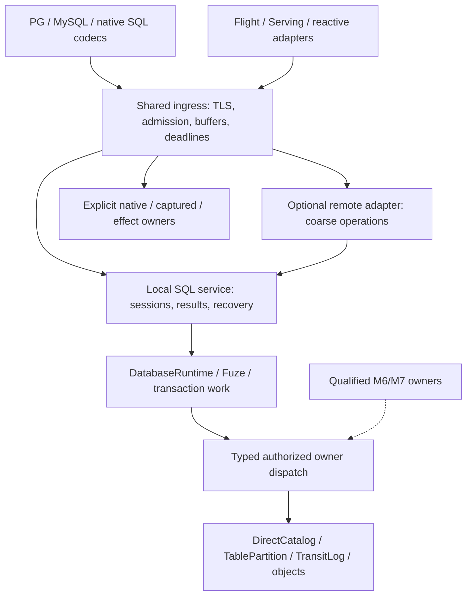

# 8. Gateway architecture, sans-I/O wire protocols and direct-plane ingress

[Roadmap](README.md) · [Write lifecycle and I/O #211](https://github.com/spoke-sh/transit/issues/211) · [Cutover #110](https://github.com/spoke-sh/transit/issues/110) · [Maintenance & Packaging #122](https://github.com/spoke-sh/transit/issues/122) · [Foundation #125](https://github.com/spoke-sh/transit/issues/125) · [Performance #76](https://github.com/spoke-sh/transit/issues/76) · [Allocation Guidance #194](https://github.com/spoke-sh/transit/issues/194) · **Status:** In Progress ([remaining implementation plan](#remaining-implementation-plan--2026-10-29))

Let callers query declared data, submit mutations and compose supported
transactions through one bounded execution service. They must be able to inspect
the original accepted operation, consume a complete result and recover after
connection or process loss under current authorization. The installed SQL path
should execute beside the database owners, without loopback storage RPCs or idle
recovery polling. Protocol adapters share ingress machinery while retaining their
own authentication, result and effect contracts.

Use the **10–100× interactive write improvement target in #211** to prioritize
this work. Measure verified completion through the actual persistent console;
removing HTTP requests, reducing threads or returning an earlier acknowledgement
does not by itself establish the target. Gateway placement, recovery scheduling
and physical publication are separate, coordinated optimization boundaries.

## Prerequisites and architectural rationale

Build on [data identities](01-declarative-data-lifecycle.md),
[local storage](02-storage-and-query-performance.md),
[live storage/SQL integration](03-live-storage-and-sql-cutover.md),
[statement results](04-statement-results-and-consumption.md) and the completed
local Table profile in [transactions](05-transactions-and-atomic-composition.md).
The database-runtime slice of [M6](06-streams-queues-and-durable-runtime.md) is
implemented, alongside its first Stream/Queue contract, bitmap and finite-model
foundations. Its public Stream/Queue owners and transactional Station work, and
the public Document cutover in [M7](07-document-storage-and-station-decoupling.md), remain
dependencies for those particular adapters, not prerequisites for optimizing
existing Table SQL.

Current semantics remain with [SQL sessions](../handbook/reference/sql-sessions.md),
[Table transactions](../handbook/reference/sql/transactions.md),
[callers](../handbook/reference/callers.md), [security](../handbook/reference/security.md),
[Documents](../handbook/reference/documents.md), [Flight](../handbook/reference/flight.md),
[Serving](../handbook/reference/serving.md) and [reactive APIs](../handbook/reference/reactive.md).
Start contract changes in [SQL_SESSION_V1](../../contracts/SQL_SESSION_V1.md),
[SQL_RESULTS_V1](../../contracts/SQL_RESULTS_V1.md),
[SQL_GATEWAY_V1](../../contracts/SQL_GATEWAY_V1.md),
[DIRECT_TABLE_V1](../../contracts/DIRECT_TABLE_V1.md) and
[SERVICE_V1](../../contracts/SERVICE_V1.md). Flight and Serving retain their
[Flight](../../contracts/FLIGHT_V1.md), [Serving](../../contracts/SERVING_V1.md)
and [reactive](../../contracts/REACTIVE_V1.md) contracts.

### Grounded baseline in real relative terms

These are **recorded experiments at their cited revisions**, not measurements
rerun for this plan or a combined benchmark of current HEAD. The
[performance ledger](../history/qualification/performance.md#shared-content-directory-barrier--2026-10-29)
and [SQL ledger](../history/qualification/sql.md#database-owned-sql-runtime--2026-10-28)
retain source, fixture, raw evidence and limits.

| Evidence | Recorded result | Consequence for this plan |
| --- | --- | --- |
| Earlier instrumented TLS INSERT | 1,573 ms; 58 upstream POSTs in its window, including overlapping background work; 105 ms staging, 551 ms token binding, 833 ms direct commit | Separate foreground dependencies, overlapping recovery and publication costs. Neither the 58 requests nor nested timers form an additive serial path. |
| Earlier native SELECT/recovery experiments | 183–191 internal requests for a one-row SELECT; earlier 67-row and bootstrap attempts failed | Preserve historical failures and their original uncertain operations. Do not describe these figures as the current baseline. |
| PR #233 matched default installed console | Control/candidate INSERT p50 279 → 260 ms; warm SELECT 104 → 99 ms; SELECT after INSERT 383 → 382 ms; UPDATE/DELETE mixed | Both bootstraps and all 47 statements passed without residency/deadline overrides. Five mutation samples on a shared host establish neither tails nor 10×. |
| PR #233 separate matched TLS component fixture | INSERT 1,668 → 1,519 ms; warm SELECT 78 → 77 ms | Keep this fixture separate from installed-server results. Its residency/request budgets differ. |
| PR #233 unchanged native recovery schedule | 67-row atomic INSERT and full schedule pass in 29.64 s, with 1,329 Table requests and zero Station sends/turns | This pass does not explain earlier failures, settle their retained operations or prove a complete interfaces-lane pass. |
| Physical publication contribution | Payload/checksum names share a directory barrier: five sync calls per new object instead of six | Preserve the qualified barrier change. Cross-object batching, reconstructible coordination state and a combined token/commit envelope remain #211 work. |

The former sub-millisecond in-process estimates and 160×–5,000× comparisons
were not matched controls for these installed workloads. Establish a direct-owner
control with the same data, authorization and durability before publishing such
ratios. Keep device synchronization, application sync calls, logical WAL appends
and gateway RPC counts distinct.

### Pre-implementation source audit and recent work

Source audit at `b8aab78fbdd8595429e9e9d68ea63cee1792715e`, including
[PR #232](https://github.com/spoke-sh/transit/pull/232) Table transactions,
[PR #233](https://github.com/spoke-sh/transit/pull/233) publication work and
[PR #234](https://github.com/spoke-sh/transit/pull/234) Document foundations:

| Boundary | Implemented owner | Remaining work |
| --- | --- | --- |
| SQL admission and execution | [`DatabaseRuntime`](../../packages/zig/transit-sql/src/DatabaseRuntime.zig), `DirectClientToken`, `DirectCatalog`, `TablePartition`; transitive Station exclusion in `transit-sql` | Runtime and query execution still run in the SQL gateway through HTTP-backed direct clients. Logical database decoupling is complete for this path; physical co-hosting is not. |
| DML completion/accounting | Foreground `submit`/`execute` return the original verified Table terminal; `advance` settles the Catalog pending token | Foreground paths unconditionally notify recovery. Removing the timer without covering settlement would leak pending capacity. |
| Transactions | `TransactionWork`, `SessionTransaction`, Catalog common cuts/private workspaces/decisions, native/console/PG/MySQL controls | Preserve the delivered serializable local multi-Table profile, savepoints, provisional counts, explicit reattachment and post-decision cleanup. These controls are no longer future syntax. |
| Recovery | [`main.zig`](../../apps/transit-sql-gateway/src/main.zig) runs `runAccount` with 2–100 ms backoff, `recoverSessions` every 100 ms and `expireSessions` every 100 ms | Park settled owners; use reliable notifications, bounded retries and actual lease deadlines. |
| Read pins | [`ReadCache`](../../packages/zig/transit-sql/src/ReadCache.zig) retains bounded exact cuts; startup/dirty cleanup stops after successful route sweeps | Wire dirty/failed acquisition/release to reliable scheduling. There is no current wall-clock cache expiry to replace with a timer heap. |
| External SQL operations | [`Registry.recover`](../../packages/zig/transit-sql-service/src/Registry.zig) scans Catalog and creates a fresh `wire.Client`; captured/configuration operations retain separate owners | Persistent bounded recovery clients, complete paged discovery and explicit notifications; preserve original signed requests. |
| Local owner | [`LocalTableHost`](../../apps/transit-node/LocalTableHost.zig) retains resident owners, locks and recovery state; [`LocalTableService`](../../apps/transit-node/LocalTableService.zig) validates policy and returns serialized responses | Extract typed authorized dispatch. Calling this JSON-producing method in-process alone leaves unnecessary serialization and ownership coupling. |
| Direct caller seam | [`DirectTableClient`](../../packages/zig/transit-catalog/src/DirectTableClient.zig) holds wire clients and returns parsed responses; `Session` owns concrete wire clients | Introduce typed request/response dispatch below SQL and a coarse SQL service boundary above it. Moving a listener alone is insufficient. |
| Protocols | `transit-sql-protocol` is pure; PG/MySQL have frame decoders and host-supplied session engines | Complete incremental transport/event separation. Application [`Connection.zig`](../../packages/zig/transit-sql-host/src/Connection.zig) is a TLS/socket wrapper, not a pure state machine. |
| Memory/I/O | Admitted worker/result/frame/TLS reserves and cleanup barriers exist; `boundedHandle` and HTTP `deadline` still race work against timers | Reuse reserves and joined ownership. Core-bounded workers require runnable I/O scheduling, not a smaller constant. |
| Flight/Serving | Flight uses durable Query/Station requesters; `transit-serving-http` owns effectful signed HTTP/SSE/WebSocket hosting | Split codecs from hosting and qualify shared ingress. Co-location does not make their durable owners direct database owners. |

### Document decoupling and caller gate

**Document callers have not been decoupled. Neither has installed Document
acceptance.** PR #234 delivered deterministic semantics and private candidate
storage; it did not deliver `DocumentPartition` or its public route.

[`transit-document`](../../packages/zig/transit-document/README.md) owns the
unchanged change codec and merge evaluator over an owner-supplied immutable
index. [`DocumentIndex`](../../packages/zig/transit-storage/docs/document-index.md)
stages private `.tseg` candidates with bounded directories. It supplies no WAL
acceptance, original-operation receipt, accepted-head recovery, retained-root
collection or database authorization. The eight-operation/96-byte scalar profile
is unchanged. A sealed candidate root is not an accepted Document revision.

| Remaining coupling | Current source | Required owner before cutover |
| --- | --- | --- |
| Accepted head, writer jobs, checkpoints, remote replies | [`transit-station-document`](../../packages/zig/transit-station-document/README.md): `Service`, `Checkpoint`, `Remote`, `Caller`, `Client` | M7 direct durable owner, receipts/revisions and recovery; M6/M7 common-decision participation for state/input/reply actions |
| Named initialization | [`DirectResource`](../../packages/zig/transit-catalog/src/DirectResource.zig), [`NamedResource`](../../packages/zig/transit-station-app/src/NamedResource.zig) | M7 replaces Document writer/native-allocation initialization and publication checks; native KV keeps its separate lifecycle |
| Query projections | [`transit-query`](../../packages/zig/transit-query/src/root.zig) imports `transit_station_document` | M7 accepted-revision reader with current authorization, exact cuts and five-state projections |
| Shared bindings/host actions | [`DocumentCodec`](../../packages/zig/transit-station-bindings/src/DocumentCodec.zig), [`DocumentBridge`](../../packages/zig/transit-station-bindings/src/DocumentBridge.zig), ABI/host schemas | M7 neutral direct contract; M9 reusable client infrastructure without another merge/recovery implementation |
| Public SDKs | [`sdks/zig`](../../sdks/zig/README.md) exports `transit_station_document`; ten non-Zig Document APIs use the Station boundary | Coordinated binding and language API migration; importing the neutral evaluator is not a caller cutover |
| Inspection/deployment | [`Board Document adapter`](../../packages/zig/transit-board-api/src/Document.zig), [`station-document` example](../../examples/station-document/README.md), workers, launchers and placement proofs | Public read-only metadata, real direct callers and a worker/courier-free create/edit/read/recover proof |

M7 owns its existing P0–P5 contract/storage/catalog/consumer sequence. M8 owns
host integration once that boundary qualifies. M9 must not make completion of
every language package a circular prerequisite for defining the M7 direct
contract: the minimal shared Zig caller/ABI seam belongs with that cutover;
broader client consolidation can follow.

Table P0–P6 work below can proceed now. Do not advertise direct `DOCUMENT`,
`STREAM` or `QUEUE` ingress, invent runnable SQL, or route private candidates
around Station acceptance while their owners remain incomplete. Existing
Document callers retain their contract until one coordinated current-v1
replacement. The full M8 data-kind handoff stays open until its required owner
gates pass; a Table-only qualification must be named as such.

## Implementation plan — 2026-10-28

**Plan basis:** the audited committed HEAD above and the current #211 issue,
read on 2026-10-28. Historical evidence dates/revisions are preserved as recorded.
Implementation has started with foreground settlement and event-driven recovery.
The baseline inventory above records the pre-implementation state; the current
[runtime owner](../../packages/zig/transit-sql/docs/runtime.md) describes delivered
behavior. The milestone remains `In Progress` while the placement, protocol and
qualification gates below remain open.

The first [recovery qualification](../history/qualification/sql.md#event-driven-sql-recovery--2026-10-29)
passes the clean interfaces lane. Its [matched console comparison](../history/qualification/performance.md#event-driven-sql-recovery--2026-10-29)
observes zero post-statement idle upstream calls but higher INSERT, unchanged
UPDATE and DELETE latency from foreground settlement. Fresh reads improve and
warm reads are approximately unchanged. This evidence does not close P2–P6 or
the #211 latency targets; preserve the regressions when evaluating subsequent
co-hosting and commit-envelope work.

The selected SQL placement now embeds shared listener/session hosting in the installed
node and adds typed signed Table/native dispatch through its existing owners.
The standalone gateway retains HTTP-backed fine-grained clients until P2c.
Configuration settings/reload retain the installation gateway owner: native
policy reads are local, but the configuration handoff in P2a remains open. This
slice therefore closes the selected database loopback path, not every P2 gate.
Protocol purity, worker sizing/deadlines, coarse remote placement and full
milestone qualification remain separate work. See the current
[SQL placement](../handbook/reference/sql.md) and
[host ownership account](../handbook/internals/service-interfaces.md#placement-sessions-and-adapters).
The [partial placement qualification](../history/qualification/sql.md#typed-local-sql-dispatch-and-installed-co-hosting--2026-10-29)
records completed installation/TLS checks and the unresolved recovery timeouts.
Matched performance measurements and full qualification remain open.

### Remaining implementation plan — 2026-10-29

**Review basis:** committed `main` at
`3ee0d0b4dfe76d7fa275f6379cd7af8ffc8dad80`, after
[recovery PR #235](https://github.com/spoke-sh/transit/pull/235),
[co-hosting PR #239](https://github.com/spoke-sh/transit/pull/239) and
[cache/startup PR #243](https://github.com/spoke-sh/transit/pull/243).
This section updates delivery order; the P0–P6 contracts and completion gates
below remain binding. It proposes implementation work and records no new
benchmark or runtime qualification.

The immediate outcome is a persistent console that reads declared Tables,
commits small mutations and reads their new state within the
[performance objectives](#performance-objectives-and-experiment-design), with
the same complete results, exact counts and original-operation recovery.
Prioritize this installed path before coarse remote placement. M6/M7 adapters
remain independent dependencies for full milestone closure.

| Work | Delivered at the review basis | Remaining gate |
| --- | --- | --- |
| P1 recovery | Foreground pending settlement, bounded execution claims, complete discovery, generation-based wakeups and lease-driven session expiry; the recorded recovery revision passes all 22 interfaces tasks and observes zero settled-idle upstream requests | Preserve these properties through subsequent placement, cache and scheduler changes; the earlier pass does not qualify this HEAD |
| P2a/P2b local execution | `transit-sql-host` runs inside the installed node; typed signed Table/native calls share existing owners and policy checks | Configuration handoff, full local/HTTP equivalence and installed recovery qualification remain open |
| #211 W4/W7 cache work | Live refresh retains hot caches; foreground paths reuse request/token state; snapshot metadata is cached; pin-slot discovery is batched; the node warms Catalog residents | Freeze a new matched baseline and exercise invalidation, restart and retained-reader cases together |
| P2c remote execution | Standalone placement reuses the listener host | It still orchestrates fine-grained HTTP clients; coarse service delegation and server-owned handles remain work |
| P3/P4 resources and protocols | Bounded reserves and some pure codec modules exist | Command/header timer-task races, connection-dependent worker counts, full protocol separation and Flight/Serving integration remain work |
| P5/P6 qualification | Focused installation/TLS/allocation results are recorded | The latest co-hosting record has incomplete experience/interfaces lanes, including the original 67-row INSERT timeout; no complete matched performance qualification closes M8 |

Use the [recovery evidence](../history/qualification/sql.md#event-driven-sql-recovery--2026-10-29)
and [co-hosting evidence](../history/qualification/sql.md#typed-local-sql-dispatch-and-installed-co-hosting--2026-10-29)
for their exact revisions and limits. PR #243 reports foreground DML at
108–133 ms and warm SELECT at 95–108 ms in its console run. Those observations
are separate from the following user-supplied diagnostic transcript:

| Persistent console operation | Elapsed | `submit` | `fetch` |
| --- | ---: | ---: | ---: |
| First empty `SELECT * FROM items` | 261 ms | 247 ms | 13 ms |
| Repeated empty SELECT, two observations | 104 / 108 ms | 95 / 96 ms | 9 / 12 ms |
| INSERT one row | 276 ms | 275 ms | 0 ms |
| SELECT immediately after INSERT | 248 ms | 233 ms | 15 ms |
| Repeated one-row SELECT | 121 ms | 108 ms | 13 ms |

The transcript has no pinned binary, build mode, host-load or sample-distribution
evidence. It motivates the investigation; it establishes neither a regression
against PR #243 nor a median. `submit` includes server preparation and execution;
the displayed zero client `prepare`/`compile` times do not mean server parsing,
planning or authorization is free. Attribute the empty-result baseline before
choosing a transport, cryptography, cache or storage optimization.

#### First delivery: reproduce and attribute the installed path (P0/P5)

Extend the existing
[`console_latency.py`](../../tests/performance/console/console_latency.py) and
[`statements.py`](../../tests/performance/console/statements.py) workload rather
than creating a second benchmark. Freeze current ReleaseSafe control binaries
before implementation; retain hashes, definition, compiler, configuration,
CPU/quota, filesystem and host-load observations. Use isolated owned installations
with the same initial data, maintenance and durability settings in both arms.
Do not use or reset the user's installation.

Reproduce empty and one-row SELECT, first SELECT after startup/restart, unchanged
warm SELECT and read-after-INSERT/UPDATE/DELETE. Keep changed/no-op/zero-match
counts, the unchanged 67-row INSERT, multi-batch results, open retained readers
and explicit Table transactions in the correctness matrix. Time connection and
authentication setup separately from established-session commands.

Trace the actual path from
[`Executor`](../../packages/zig/transit-sql-client/src/Executor.zig) through
[`Session`](../../packages/zig/transit-sql-service/src/Session.zig),
[`DatabaseRuntime`](../../packages/zig/transit-sql/src/DatabaseRuntime.zig),
[`ReadCache`](../../packages/zig/transit-sql/src/ReadCache.zig) and
[`LocalEndpoint`](../../packages/zig/transit-client/src/LocalEndpoint.zig) to
the node owners. Add bounded opt-in timings/counts only where existing evidence
cannot separate queue/lock wait, credential and policy validation, signing,
parse/bind, cut acquisition/reuse, execution, result construction and delivery.
For writes also separate intent publication, token admission, Table commit and
pending settlement. Count typed local calls independently of HTTP calls; zero
loopback RPCs does not establish zero orchestration cost. Keep nested spans and
concurrent recovery distinct, report dropped trace events, and exclude payloads
and credentials.

**Review artifact:** raw uninstrumented samples and separate diagnostic traces,
a current call/durability dependency graph, and a ranked cost table with measured
and unexplained time. Use five repeats for iteration. Each optimization's
performance gate requires at least three alternating control/candidate pairs
with 50 samples per steady-state case per arm. Report distributions and sample counts; treat
cold/restart cases separately and make no p99 claim from these sample sizes.
Freeze resource and blocked-peer budgets before the scheduler comparison.

#### Second delivery: reduce repeated read and fresh-cut work (P2/#211 W7)

Use the first delivery's attribution to select the largest measured installed
read cost. Audit `Session.begin/current/prepare/read`, Registry disclosure,
`ReadCache`, direct caller preparation and `LocalTableHost` lock scopes. Identify
which observations are already scoped to the current command and which must
remain fresh. Reuse immutable definitions and exact snapshot metadata only
with explicit invalidation keys; account for object/definition, source frontier,
credential/policy and activation changes at their owning boundaries.

Keep current authorization at execution and every disclosure, including buffered,
repeated, empty and terminal results. Do not make a cached allow decision a new
authority or silently skip local signatures. If profiling justifies a different
local authenticated context, specify its issuer, scope, lifetime, fencing and
revocation equivalence in the owning contract before implementation. Do not hold
a broad Catalog/native lock during Fuze execution or output.

Reduce redundant inspection, cloning and scratch allocation where measured;
reuse the admitted slabs and preserve caller-owned result lifetimes. For a
mutation followed by SELECT, acquire the correct new cut while an earlier open
reader retains its old cut. Keep durable pin acquisition/closure recovery,
failed-release wakeups and transaction-private cuts intact. A stronger pin-lifetime
change requires its own contract and fault proof.

**Exit:** matched evidence toward warm SELECT p50 ≤20 ms and post-mutation SELECT
p50 ≤50 ms, with the tighter 10/20 ms objectives reported separately. Cover
revocation/credential rotation after buffering, rename/DROP/recreation, mutation
between prepare and execute, lost pin replies, retained readers, repeated batches,
restart and bounded allocations. If the measured bottleneck is elsewhere, report
the result and move that owner earlier; do not claim cache work closed the target.

#### Third delivery: reduce serial durable write work (#211 W5/W6)

The bounded publication slice is implemented: native and direct index-page groups
of up to eight objects share their two directory barriers, using `3n + 2`
object-publication sync calls instead of `5n`, and commits `9cfe38b9c`,
`00fca46d4`, and `4d0a98b6b` batch per-group allocation inventory persistence
(`DiskWal.appendFrames` + single `head.json` directory barrier), coalesce
candidate B-tree page staging across trees (`TreeStore.Batch`), and trim
duplicate per-statement validation and token lookups. The
[qualification account](../history/qualification/storage.md#bounded-immutable-publication-groups--2026-10-30)
records finite models, disk failures, retries and process-death schedules, and
the [updated console and native gateway results](../history/qualification/performance.md#batched-allocation-inventory-cross-tree-index-staging-and-sql-validation-trimming--2026-10-30)
record passing `test-sql-gateway` execution (104.20 s, 1,041 Table requests) and
five-cycle persistent console medians (warm `SELECT` 36–40 ms, `INSERT` 175 ms,
changed `UPDATE` 221 ms, unchanged `UPDATE` 174 ms, `DELETE` 194 ms). Reconstructible bookkeeping
(W5b), the account-wide token/commit envelope (W6), and the third delivery's
end-to-end latency/recovery exit remain open.

Start from the measured INSERT dependency graph and the current
[`DIRECT_TABLE_V1`](../../contracts/DIRECT_TABLE_V1.md) contract. Catalogue every
required durable artifact and barrier across intent staging, account token
admission, `commit_saved` and pending settlement. Link each ordering requirement
to its safety/recovery obligation and identify reconstructible bookkeeping.
Placement alone does not combine these decisions.

Review the account-wide token/commit envelope before coding it: choose the
authoritative decision owner; preserve `(AccountId, ClientToken)` uniqueness
across Tables, frozen intent, quotas, policy/activation fences, exact counts,
cancellation races and M5 transaction semantics. Explain recovery at each boundary
when either the request or reply is lost. If an atomic envelope needs broader
storage/transaction work, keep that dependency explicit and first deliver a
measured independent publication reduction. Never move accepted-work authority
into an in-memory queue or acknowledge before the required durable decision.

Deliver barrier sharing/bounded publication batches separately from any stored
semantic cutover. Each removal needs the physical publication model, intended
negative control and real disk fault/reopen schedules. Preserve single-writer
progress without waiting for a batch to fill, bounded recovery/maintenance debt,
retained roots and original-operation inspection. Apply the current-v1 cutover
and migrate fixtures/consumers together if stored meaning changes.

**Exit:** qualify INSERT p50 ≤190 ms first, then ≤19 ms, using verified console
completion and independent readback. Report UPDATE/DELETE variants separately,
including unchanged and zero-match results. Prove duplicate-token convergence,
cross-Table token conflict, lost bind/commit/settlement replies, pending-capacity
release, revocation and restart. Report file/directory syncs and publication bytes
separately from logical appends and device I/O. Keep unmet latency goals open.

#### Fourth delivery: replace timer races and qualify worker scheduling (P3)

Use the existing
[`transit-sql-host`](../../packages/zig/transit-sql-host/src/root.zig),
[`transit-http-server`](../../packages/zig/transit-http-server/src/root.zig),
[`transit-tls-server`](../../packages/zig/transit-tls-server/README.md) and
[`transit-io`](../../packages/zig/transit-io/README.md) owners. Audit nested local
client deadlines as well as listener/header/command timers; co-hosting can retain
task races even after HTTP is removed.

Implement absolute socket deadlines with `io.operateTimeout` and bounded
cooperative interruption for CPU/owner work. Retain a defined timeout path for
admission, locks and storage waits; a socket timeout cannot replace those.
Separate deadline conversion from the readiness-driven scheduler change so each
has its own cancellation and progress proof. Demonstrate parked slow/idle peers
and bounded blocking-storage work before reducing workers to effective CPU
capacity. Preserve reserved control/recovery admission, fair queues and joined
buffer/TLS cleanup through shutdown. Follow the full P3 exit matrix below.

**Exit:** no per-header/per-command timer-task races in the qualified paths,
workers independent of configured connection count, and measured control/data/
recovery progress with more blocked peers than workers. Compare CPU, resident
memory, task records, allocations and latency with frozen budgets. A lower thread
count alone does not establish a console speedup. Move this delivery before the
read/write changes if attribution identifies scheduling as their dominant cost.

#### Remaining placement, protocol and qualification deliveries (P2/P4–P6)

Finish P2's configuration handoff with the existing configuration owner and
reload/generation contract, then P2c's coarse remote adapter. Reuse shared SQL
results, transactions and original-operation recovery; define delegation and
prepared-handle/disclosure lifetimes before replacing the standalone path.
These are required M8 outcomes but need not delay optimization of local Table
statements. Keep transport attempt counts separate from durable completion.

Deliver P4 pure protocol modules and connection-slab ownership with their real
client/fuzz/allocation checks. Qualify Flight/Serving hosting separately and keep
direct Document/Stream/Queue routes gated on M6/M7. Supply P5 tests in every
delivery; preserve each existing fault assertion when splitting slow suites.

At each implementation PR, run owning package checks and the affected registered
SQL/installation tests listed in P6. Before qualification, freeze a committed
revision and run the complete affected clean lanes, including `interfaces` and
`experience` for the installed host changes, plus storage/core/bindings checks
when those owners change. Retain the original 67-row operation schedule, startup
defaults and failure budgets. Investigate retained failed fixtures through their
original identities; a passing fresh run does not resolve their outcomes.

**Final review artifact:** common-revision correctness/recovery reports, matched
console distributions, resource and maintenance measurements, local/remote
capability matrix, and explicit pass/fail/open status for each P0–P6 obligation
and each absolute latency goal. Record executed evidence in the owning ledgers
and promote changed semantics to public owners. Close only the qualified slice;
full M8 stays open while required adapter or performance gates remain unmet.

### Performance objectives and experiment design

Use #211's actual-console targets as the primary scorecard. They are engineering
objectives with unchanged durability and authorization, not established SLOs.

| Workload | Target and attribution |
| --- | --- |
| Small sequential INSERT | First p50 ≤190 ms, then ≤19 ms. These correspond to approximately 10×/100× against #211's historical 1,912 ms TLS baseline, not today's 260 ms installed sample. |
| Small warm SELECT | p50 ≤10–20 ms through the persistent console; separate connection setup/authentication. |
| Small SELECT after mutation | p50 ≤20–50 ms with a fresh authorized cut and exact readback. Warm reuse cannot stand in for this case. |
| UPDATE/DELETE | Separate point, changed/no-op, zero-match and bounded multi-row/all-row baselines, exact matched/changed counts and retained-reader checks. |
| TRUNCATE | Model proposed semantics under #211; no runnable benchmark/support claim until its execution contract lands. |
| Installed local orchestration | Zero loopback database RPCs for the selected co-hosted SQL path; zero recovery upstream calls when obligations are settled. |
| Remote SQL | One coarse submission per statement/transaction command; separately bounded preparation, fetch, cancellation, reattachment and recovery exchanges. |
| Resources | No per-header/per-command racing timer tasks; core-bounded runnable workers; zero warmed backing allocations in qualified codec/connection paths; bounded queues and recovery debt. |

Report two comparisons: progress toward the historical absolute targets, and
speedup against a newly frozen matched control at the implementation base.
For example, 260 → 19 ms would be about 14× against that installed sample, not
100×. Rerun both arms before publishing a ratio. Preserve the previous local-wire
ambitions of 1–5 ms reads and 2–10 ms writes as stretch goals requiring measured
synchronization floors and further publication work. Co-hosting alone cannot
promise them.

Use [`console_latency.py`](../../tests/performance/console/console_latency.py)
and the persistent statement workload, with exact values, typed completion,
authoritative counts and independent final readback. Run default installed
`transit server` separately from the TLS component fixture. Alternate frozen
control/candidate binaries; record toolchain, optimization, definition,
binary/driver hashes, host load, CPU quota, filesystem/device, residency and
budgets. Five-sample runs are iteration probes; obtain sufficient samples for
tail claims. Keep uninstrumented timing separate from diagnostics.

Attribute each operation across queue/lock wait, validation, freeze/staging,
token admission, data/transaction decision, pending settlement, pin acquisition,
execution and delivery. Count foreground/background requests, retries,
serialization bytes/CPU, file/directory syncs, WAL/inventory/object bytes,
allocations, resident memory and maintenance/recovery backlog. Bound telemetry
and expose omitted events. Do not sum overlapping spans or infer device writes
from application call counts.

### Coordination with in-progress and upcoming milestones

| Owner | Required coordination |
| --- | --- |
| M3 / M4 / completed local M5 | Preserve bootstrap, logical results and Table transactions while changing placement. Source-bound and captured operations remain explicit adapters. |
| M6 / M7 | Gate new data-kind routes on direct owner contracts and transaction participation. Document extraction and reserved Stream/Queue categories do not establish runtime support. |
| #211 W5a | Bounded native/direct page groups now share directory barriers (`3n + 2` object-publication sync calls). Finite models and disk faults qualify the scoped mechanism; the installed latency/recovery exit remains open. |
| #211 W5b/W6 | Make coordination/index/outcome state reconstructible where justified; define an account-wide token/commit envelope. Co-hosting preserves today's separate decisions until that contract lands. |
| #211 W7 / M13 | Reduce fresh-cut cost and allocations after attribution. Preserve exact open-result cuts and bound deferred maintenance. |
| M9 / M20 | Reuse coarse execution and typed transport for language/service consumers; do not duplicate settlement, decoding or result protocols. |
| M16 | Pure protocol/Document transformations use shared ingress; durable capture uses separately qualified Document/effect owners. A codec neither accesses storage nor dispatches effects. |
| M21 / #211 IO-1–IO-6 | Compose framing, buffer, recovery, database and publication obligations; replay failures against production owners. Evaluate io_uring, direct I/O, mmap and partition affinity after attribution/safety gates. |
| M25 / packaging and Board | Preserve remote placement, the combined `transit` distribution and standalone roles. Board remains a public-client read-only inspector. |

### Accepted architectural decisions

**D1 — One database execution owner, two placement adapters.** Put parsing,
authorization, token admission, Fuze execution, transaction work, retained
cursors and settlement beside `DirectCatalog`/`TablePartition` by default.
A remote gateway forwards coarse operations to that service; it does not
orchestrate `/table/v1` or run a second account recovery loop. One request need
not be one durable decision or physical sync.

**D2 — Recovery follows explicit obligations.** Startup/activation discovers
pending work through complete bounded scans. Foreground success settles its
bookkeeping or transfers an obligation. Uncertain binds, accepted commands,
transaction publication/cleanup, external operations and dirty pins all have
wake/retry paths. Settled owners park. Lease expiry uses actual deadlines;
cached pins acquire no new TTL.

**D3 — Codecs are pure; hosts own effects.** Byte/frame transducers consume
borrowed input and host-supplied completion/authentication events, producing
bounded protocol events/output slices. They own no sockets, TLS, clocks, threads
or storage. Move effectful Flight/Serving code behind host interfaces before
applying a pure-module import gate. Reuse PG/MySQL engines and TSR1 results.

**D4 — Admission and I/O scheduling have independent bounds.** Worker count
scales with available CPU/quota and a fixed service allowance; connection count
bounds buffers/state. Park blocked sockets without consuming every runnable
worker. Reserve control/recovery progress through downstream queues and owner
locks. Overload may still produce a typed refusal; boundedness is not a promise
that capacity errors can never occur.

**D5 — Shared hosting does not merge authorities.** Database, native process,
Serving, reactive, captured Query and connector operations retain their owners.
Optional adapters share listener/TLS/admission machinery. The kernel does not
import SQL execution or application handlers; Fuze/storage remain independent
of Station. M16 codecs transform bytes/Document values; only the authorized host
submits those values or external intents.

### Work packages and delivery sequence

Preserve P0–P6 identifiers for #211 coordination. The
[remaining implementation plan](#remaining-implementation-plan--2026-10-29)
sets the current order: refresh P0 evidence, optimize the measured installed
read/write costs with #211, complete P3, then close remaining P2/P4/P5/P6 gates.
P1 and the delivered P2a/P2b slices are regression obligations, not work to
repeat. Attribution can move P3 earlier. Add each slice's tests when it lands;
P5 reorganizes and completes coverage. Shrinking workers still waits for the
nonblocking progress proof; publication changes retain their independent gates.

| Slice | Reviewable outcome | Entry gate |
| --- | --- | --- |
| P0 | Attributed baseline and typed-host, coarse-service and event contracts | Existing M4/M5 contracts and #211 cost/identity model |
| P1 | Foreground settlement and event-driven account/external/pin recovery | P0 ownership/scheduler contract |
| P2a | Typed local dispatch shares authority/locking with direct HTTP callers | P0; local/HTTP equivalence/disclosure proof |
| P2b | Installed co-hosted SQL service/listeners, no database loopback calls | P1/P2a; bootstrap/activation/shutdown proof |
| P2c | Standalone gateway forwards coarse operations to the same service | P2b lifecycle and current-v1 transport contract |
| P3 | Deadline-aware I/O, fair admission and core-bounded runnable workers | P0; cancellation/blocked-peer progress proof |
| P4 | Pure protocol modules and shared Flight/Serving host integration | P2/P3; adapter authority/capability inventory |
| P5 | Layered deterministic, installed and placement checks | Focused tests supplied by preceding slices |
| P6 | Common-revision correctness, recovery and performance evidence | Selected gates; explicit outstanding M6/M7 handoffs |

#### P0 — Freeze baseline metrics, sans-I/O protocol boundary and `DatabaseHost` contract

1. Freeze a current control and run default-console, TLS-console and native
   recovery workloads. Preserve the 67-row statement, caches, deadlines and
   durability. Capture thread/task/queue/request counters; extend existing
   bounded probes only where attribution is missing. The initial P0 supported
   P1; its refresh now selects the next installed-path optimization.
2. Define typed direct dispatch below SQL. Input is the current direct request
   and validated context; output has explicit owned/borrowed lifetimes and typed
   error/attempt evidence. HTTP encoding wraps the dispatcher. Local calls retain
   caller, role, credential epoch, scope, activation/transaction fences and
   post-buffer disclosure checks. A local pointer is not authorization.
3. Define the proposed `DatabaseHost` interface in existing SQL package boundaries:
   session authentication/context, prepare/release, parameterized submission,
   bounded fetch/repeat/close, cancellation, lookup/status/resume and transaction
   attachment/controls. Reuse M4 descriptors/completion and M5 identities. Keep
   SQL coordination in `transit-sql`, session policy in `transit-sql-service`
   and provider composition above both. These names describe proposed interfaces.
4. Specify coarse remote mapping with existing SQL session messages and binary
   results where possible. Simple submission carries statement, dialect,
   parameters, account/token/fingerprint, settings basis, transaction context and
   deadline; prepared execution names a server handle. Preparation and result
   fetches remain separate exchanges. The server owns cursors and accepted work.
5. Specify authenticated remote delegation: original principal/role, credential
   revision, destination, session and activation, with current policy at the
   owner. Reuse proofs where they fit; otherwise define the exact scoped contract.
   Never replace caller authority with a gateway superuser or claimed account.
   Define disclosure checks at both the service response and frontend output
   boundaries. A delayed/repeated frontend buffer cannot reuse an old allow
   decision; any additional bounded authorization exchange must be explicit in
   the contract and RPC scorecard.
6. Define input-needed/consumed, output-ready/drained, TLS-upgrade, authentication,
   database request/completion, cancellation and closure events. Bind them to
   connection/attempt generations and buffer leases. Fragmentation/coalescing
   and output backpressure must not redispatch a command.

**Exit:** reviewed identity/ownership/authority table, executable local/remote
contract fixtures and matched baseline. Extend finite models with scheduler wake
generations and request/buffer ownership; record composition assumptions at
framing → host → database → publication boundaries. Selected trace replay is
not universal refinement. Conditional progress assumes fair service, eventual
storage/transport availability and sufficient continuing authority; it does not
establish a wall-clock bound. Model crash and process replacement separately
from orderly cancellation, and bind selected negative controls to real receipts,
rows, counts and buffer-lifetime oracles.

#### P1 — Replace background polling loops with event-driven recovery

Start in `DatabaseRuntime`, `TransactionWork`, `ReadCache`, `Registry`,
`CapturedOperations`/`CapturedRecovery`, `ConfigurationOperations` and gateway
`runAccount`/`recoverSessions`/`expireSessions`.

1. Give each foreground admitted operation a bounded execution claim shared with
   recovery. Resolve an existing terminal before execution. After ordinary DML
   success, settle the Catalog pending index from that original authorized
   outcome in the foreground. If settlement is uncertain/blocked, preserve the
   verified data outcome and transfer settlement work; never turn a commit into
   failure or require new SQL. DDL/transaction commands retain bounded progress.
   The claim is temporary scheduling ownership, never a new durable authority:
   replacement recovers the original operation even when its prior task never
   releases the claim. Concurrent same-token callers converge on one binding;
   conflicting fingerprints still reject.
2. Track obligations independently of terminal replies: uncertain token binding,
   accepted execution, pending accounting, transaction participant publication
   and pin cleanup, external dispatch/reconciliation, read-pin acquisition/release.
   A decision can be visible before cleanup finishes. An idle open transaction
   must not be automatically committed/aborted or repeatedly executed.
3. Perform complete paged discovery at startup/activation. An empty page, failed
   page or nonmatching operation kind is not exhausted coverage. Bound work per
   turn and retain cursors. Drain eligible work fairly; retain unavailable/denied
   obligations and original identities.
4. Replace idle timers with an event owner using a monotonic wake generation.
   Capture the generation before scanning; park only if unchanged and all scans/
   obligations are complete. Queue saturation sets a scan-needed obligation;
   it cannot drop accepted work. Restart rediscovers durable pending records
   independently of in-memory notifications.
5. Notify from every producer: uncertain bind replies, cancellation/resume, dirty
   pins, captured/configuration submissions and transaction cleanup. Explicit
   resume schedules work; status stays observation-only. Co-hosted dispatch
   notifies directly. Remote submissions wake server recovery before relinquishing
   ownership, including loss of the response after acceptance.
6. Retry unresolved obligations with bounded backoff/deadlines and per-account
   fairness. Denied work resumes after restored permission; stale activation
   generations stop. Preserve foreground credential denial when recovery loses
   readiness. Scan failures never certify an empty backlog.
7. Reuse persistent per-account external-recovery clients or typed local handles,
   with bounded scratch and cancellation ownership. Do not concurrently share a
   mutable transport. Discover all external operations across every page.
8. Preserve startup/dirty-route pin sweeps and active borrows; wire failures to
   wakeups without inventing pin expiry. Replace 100 ms session sweeping with
   the earliest actual native-session lease deadline, waking on lease changes.
   Session expiry releases temporary state, not durable transactions.

**Exit:** zero recovery upstream calls after settled startup with no obligations;
settled writes do not trigger redundant execution. Force notifications before,
during and after scan-to-park; lost bind/commit/settlement replies; later-page
backlog; dirty pins; revoke/restore; replacement; saturation and shutdown.
Verify original receipts/counts and pending-capacity release. Deliberate pending
retries and live reactive authority checks are separate from idle SQL polling.

#### P2 — Co-host SQL execution with the Direct Data Plane and collapse `/table/v1` round-trips

**P2a: typed authorized dispatch.** Refactor `LocalTableService` so response
serialization is outside common execution/disclosure. Retain `LocalTableHost`'s
Catalog access, Table stripes, resident invalidation, recovery and control/data
memory reservations. Implement local dispatch behind the shared direct-client
interface; migrate SQL preparation, reads, transactions and recovery without a
second validation path. Include native identity/policy and local configuration
operations needed by SQL; leaving them on loopback only partially collapses it.

Define lock order explicitly. Do not hold a broad Catalog/native lock while
running a whole Fuze scan, waiting on socket output or recursively reacquiring
that lock. Retained cuts and bounded borrows carry read lifetime; later disclosure
reacquires current authority. Local/HTTP adapters must refuse the same invalid
or denied request, including revocation after materialization. Fault-inject both
sides before making local dispatch the default.

**P2b: installed co-hosting.** Extract reusable SQL service/listener composition
from the gateway executable into manifested library modules. Wire it above the
node's core/local owner; the kernel imports neither SQL nor handlers. Isolate
optional captured/native source integration from direct database dependencies.
`transit server` remains lifecycle manager; its node role owns SQL execution and
default listeners. Sharing one executable is not shared address-space execution.

Update [`Server.zig`](../../apps/transit-cli/server/Server.zig),
[`Sql.zig`](../../apps/transit-cli/server/Sql.zig), node configuration, builds and
install/replace handling together. Recover one account activation and pending
work/pins, then expose readiness/listeners. Preserve private Unix peer/TLS,
credential/spill/session bounds, endpoints, configuration reload and recovery
for disabled accounts. Avoid two supervisors activating the same account.
Shutdown stops admissions and joins tasks without abandoning accepted decisions.

**P2c: remote gateway.** Keep standalone ingress as a placement of the same
modules. Map PG/MySQL prepared names/portals to server-owned handles; reuse the
native SQL client/result reader where suitable. The remote service owns
transaction context, admission and recovery. Disconnect yields incomplete reads
or uncertain commands with original recovery material; never silently restart
SELECT or resubmit SQL. Do not replicate Registry, ReadCache or DatabaseRuntime
at both ends.

**Exit:** installed Table statements, controls and disclosure make zero loopback
database/authority HTTP calls. Remote execution uses one coarse submission plus
counted preparation/fetch/control/disclosure exchanges. Run matching local/remote values,
counts, snapshots, revocation, duplicate tokens, rename/DROP, savepoints and
lost-reply histories. Retain default bootstrap and unchanged 67-row atomic INSERT.

Placement does not combine token admission, Table commit and pending settlement.
Coordinate #211 W6 with M5's domain/decision semantics: account-wide token
uniqueness across Tables, frozen intent, quotas, authority and counts survive
any combined envelope. P2 can land first. Then remeasure publication and fresh-cut
cost to select W5b/W6/W7 work toward ≤19 ms.

#### P3 — Overhaul transport deadlines, thread pools and lane admission

1. Audit pinned `transit-io.Threaded`, nested blocking calls and listener/TLS/
   database dependencies. Prototype bounded readiness-driven sockets with
   host-owned continuations and a separate bounded blocking-storage/crypto
   facility where required. Select using pinned-platform support and measurements.
   io_uring remains an independent #211 experiment, not an assumed speedup.
2. Before reducing workers, prove progress with more idle/slow sockets than
   workers, blocked storage, queued authentication, cancellation and control
   traffic. Account for CPU affinity/quota, stacks, records, TLS and queued bytes.
   A formula adding active connections is not core-bounded.
3. Replace HTTP `deadline` and gateway `boundedHandle` timer-task races with
   absolute read/write deadlines through `io.operateTimeout`, reusing TLS handling.
   Partial input/output and TLS retries cannot reset the overall deadline.
   CPU/query work checks cancellation at bounded morsel/owner transitions;
   mutex/admission/upstream waits also need bounded interruption. Socket deadlines
   do not stop arbitrary computation.
4. Add bounded account/data/authentication/control/recovery queues with explicit
   byte/slot budgets and fair scheduling. Reserve progress through NativeServer,
   owner dispatch and remaining proxies. Queue-full refusal never means earlier
   accepted work was rejected. Control priority cannot indefinitely starve data.
5. Join completions before reusing generations or buffers. Preserve partial-send
   evidence and OpenSSL cleanup on each distinct worker before freeing its
   reserve. Test allocation and task-record exhaustion during cancellation and
   shutdown, retaining explicit scratch/output lifetime.

**Exit:** no warmed header/command timer-task races; worker count tracks effective
cores rather than connection limits. Show bounded control latency and data/recovery
progress under blocked peers. Freeze numeric queue/tail budgets from P0 before
acceptance and report saturation refusals. A ≤64-thread claim needs a declared
CPU/deployment profile.

#### P4 — Pure sans-I/O wire-protocol state machines and zero-allocation connection slabs

1. Preserve PG `Cycle`/`Session.Engine`, MySQL sequence/prepared-type state and
   TSR1 encoding. Move transport-driving helpers into the host where needed.
   Pure modules expose bounded incremental decode/encode and session events,
   including partial/coalesced frames and partially drained output. Credentials,
   randomness and time are explicit host inputs; parsing grants no authority.
2. Preserve PG write dispatch only after valid Sync, failed-cycle draining and
   original-cut suspension; MySQL capability/continuation refusal before
   allocation; and actual M5 transaction outcomes. Test malformed lengths,
   connection-generation reuse, cancellation, no-op counts and terminal frames.
3. Reuse admitted connection/frame/result/recovery slabs. Specify slices retained
   through execution, fetch repeat and socket drain; reset scratch after borrows
   end. Exhaustion before dispatch refuses; failure after dispatch retains original
   uncertainty. Seal the backing allocator for warmed codec/connection tests;
   report TLS, database/provider and OS allocations separately.
4. Use switches for numeric protocol tags. Evaluate `comptime` perfect hashing
   for closed textual headers/settings with exact comparison and benchmarks;
   hashes cannot establish equality or authorization.
5. Separate Flight protobuf/Arrow framing from Query/ticket/service access and
   Serving HTTP/reactive codecs from signed dispatch/stream tasks. Share ingress
   while preserving Flight's finite read-only capabilities, ticket authorization
   and completion; Serving identity, signed commands, challenges, leases,
   SSE/WS authority/heartbeats and uncertainty. Required live checks are not
   eliminated as idle polling.
6. Gate direct SQL execution for Flight on an explicit ticket/query lifetime and
   recovery contract. Its durable requester cannot become an ephemeral cursor
   without a current-v1 cutover. Serving application commands remain Process &
   Effect Plane work; direct data methods use their owning contracts.

**Exit:** transitive gates exclude I/O/TLS/clock/thread/storage imports from the
extracted pure modules; tests/fuzz inputs drive actual engines. Real Flight/ADBC
and Serving/reactive callers pass after migration. Do not claim their existing
whole packages were pure or implicitly expand supported operations.

#### P5 — Layered verification architecture and `gateway.py` decomposition

The [wire test directory](../../tests/interfaces/sql_wire/README.md) already has
client/authority/lifecycle/fault/measurement modules and `gateway.py` slices
including `sessions-basic`, `faults`, `transactions` and `console-statements`.
Build on them. Register executable tasks/nesting in
[`suite.json`](../../tests/runner/suite.json) and obligations in
[`invariants.json`](../../tests/verification/invariants.json).

| Layer | Coverage and execution boundary |
| --- | --- |
| Pure protocol/component | Incremental frames, independent bytes, SCRAM/SHA2, PG error gates, MySQL sequences/types, counts/completion, scratch lifetime and allocation refusal; no sockets/sleeps |
| Scheduler/composition models | Lost wake, incomplete discovery, foreground/recovery claims, cleanup, buffer generations/cancellation and fairness; complete finite runs, negative controls and selected production replay |
| Local disk owner/service | Typed/local versus HTTP equivalence, signed authority, original bind/commit/settlement faults, exact cuts/savepoints, publication/cleanup and process reopen |
| Installed independent callers | Native TLS/Unix/console, psycopg, mysql.connector; Flight/ADBC and Serving/reactive as migrated; bootstrap, disconnect/restart and mid-buffer revocation |
| Performance/placement | Frozen paired workloads, idle/foreground counts, blocked-peer fairness and sustained maintenance separately from correctness; Compose/reference needs its own infrastructure/evidence |

Map every existing assertion/fault phase to its replacement before deleting or
moving tests. Preserve TLS/certificate rotation, credential/role revocation,
activation, capacity, exact retries, incomplete prefixes, empty/multi-batch/
repeated results, transaction reattachment and shutdown. Reuse built binaries;
isolate installations/ports and never share mutable authority across test targets.

Separate transition tests from expensive password derivation. Preserve the
65,536-iteration default and dedicated authentication/security proof; functional
fixtures may explicitly select the already permitted 4,096 iterations. Both
benchmark arms use identical authentication settings. Do not count full SCRAM
derivation inside a <50 ms pure-frame objective or weaken security for timing.

Earlier <15 s focused targets, <30 s combined wire suite and <2 s full native
recovery ambitions need measured time budgets. The full native fault schedule
waits for deadlines and restarts. Separate required waits/build/setup from active
recovery; retain the unchanged full schedule and report its wall time. Use <2 s
as a separately measured active-work objective without shortening fault waits
or claiming it as a full-schedule result.

#### P6 — Common-revision qualification and handbook promotion

Current focused entry points include `just test::sql-wire-contracts`,
`just test::sql-gateway`, `just test::sql-sessions`, `just test::sql-transactions`,
`just test::sql-wire-gateway`, `just test::sql-wire-tls`, owning package checks
and relevant #211 model/disk schedules. Use pinned `nix develop` and registered
task-specific shells. New split-task names become instructions only after their
registration and implementation.

At committed implementation HEAD, select affected clean lanes from the suite
inventory, including `just ci clean --lane interfaces` and dependent contract/core,
storage/growth, bindings, Board and launcher checks where changed. Run placement
separately. A focused pass, skipped check or another revision's evidence cannot
stand in for this gate.

Repeat default `just test::console-latency --statements --repeat 5`, matching
`just test::console-latency-tls 5` and separate
`just test::console-latency-tls 5 --instrument` controls; use longer distribution
runs where needed. Include sequential/concurrent callers on one and independent
Tables, fresh/warm reads, original 67-row INSERT, large results/slow consumers
and sustained flush/maintenance/recovery. Measure backlog and control latency.
A lone writer cannot wait for another writer to fill a durability batch.

Publish outcomes, omissions and remaining targets in SQL/performance/storage
[qualification ledgers](../history/qualification/README.md), with raw evidence
and source. Promote implemented placement/lifecycle/limits to service-interfaces
and storage Internals, SQL/session/transaction/security/caller references,
affected node/gateway/CLI/package guides and configuration. Publish the actual
local/remote capability matrix. M7 Document documentation changes with its
qualified acceptance/caller cutover.

## Compatibility and rollout gates

Internal factoring preserving bytes/stored meaning needs no invented version.
Every incompatible authentication, configuration, session, wire, ABI or stored
semantic change follows the current-v1 hard cutover: replace the shared definition,
regenerate schemas/signing/ABI fixtures, migrate consumers/installations together
and reject missing/foreign definitions before execution. Align package versions
and internal pins; run `python3 -B tasks/version.py` after manifest changes.

Local/remote modes are placements of the same current contract, not legacy
profiles. Preserve pending operations and retained data without reset or
reinterpretation; match old artifacts with their original build for resolution.
Remove superseded gateway-only execution/recovery after qualification. Retain
direct HTTP APIs used by public typed callers even when SQL no longer needs them.

## Completion evidence

M8 closure requires evidence for each selected capability:

- **Execution/authority:** zero co-hosted database loopback calls, coarse remote
  submission, exact operations/current rights/fences and M4/M5 semantics; default
  bootstrap and unchanged native recovery pass.
- **Recovery:** zero settled-idle SQL traffic; execution, accounting, external
  requests, transaction cleanup and pins survive wake/park, restart, denial and
  lost replies. No in-memory queue replaces durable pending history.
- **Protocol/resources:** pure codecs, bounded buffers through I/O/cancellation,
  scoped warmed-allocation evidence and core-bounded workers with control progress.
- **Service/Document handoffs:** Flight/Serving hosting preserves supported
  lifetimes/authority. Direct Documents require M7 owner, caller/ABI/SDK, Query,
  Board and deployment migration, with worker/courier-free recovery. Stream/Queue
  routes require M6 equivalents. Keep these open if only the Table slice ships.
- **Performance:** report ≤190 ms and ≤19 ms INSERT goals separately as achieved
  or open, with matched console ratios and independent readback. Include refreshed
  reads, UPDATE/DELETE, resources/control latency and bounded maintenance debt.
  Unmet #211 publication targets retain explicit ownership; component completion
  cannot close 10×/100× qualification.
- **Publication:** one committed revision has required checks and public semantics;
  milestone/index status agree. Documentation checks establish no runtime guarantee.

## Later owners and execution gates

[Shared clients](09-client-foundation-and-language-apis.md) and
[service/SDK coverage](20-service-and-sdk-coverage.md) consume qualified boundaries.
[M13](13-data-structures-and-performance.md),
[strings/search](14-vectorized-strings-and-search.md) and
[compilation](15-data-centric-compilation-and-specialization.md) extend workload
scorecards. [Document profiles/exchange lifecycle](16-document-profiles-and-gateway-exchange-lifecycle.md)
add pure grammars and qualified capture over the Document owner.
[Clustered execution](25-clustered-execution.md) extends placement/lease handoff
with its own failure evidence. Sharing the gateway host confers neither broader
support nor performance guarantees.
