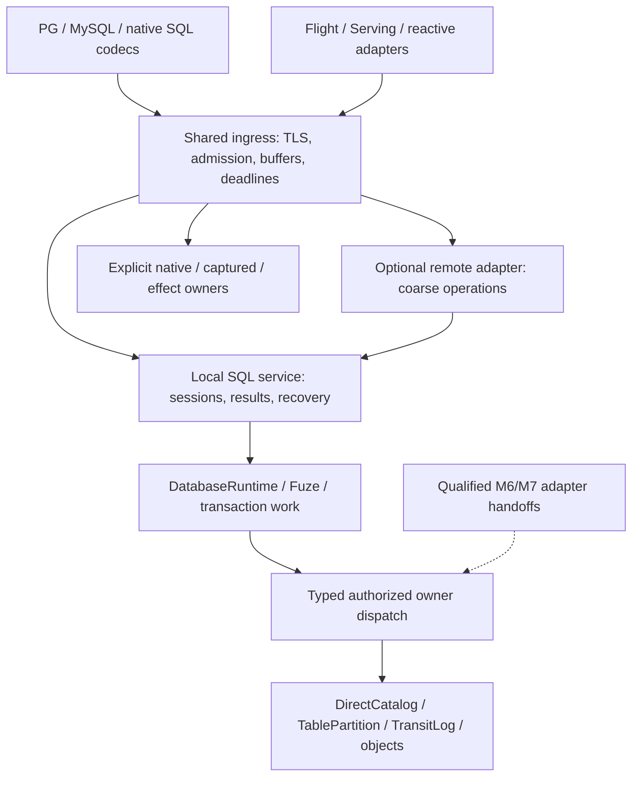

# 8. Gateway architecture, sans-I/O wire protocols and direct-plane ingress

[Roadmap](README.md) · [Write lifecycle and I/O #211](https://github.com/spoke-sh/transit/issues/211) · [Cutover #110](https://github.com/spoke-sh/transit/issues/110) · [Maintenance & Packaging #122](https://github.com/spoke-sh/transit/issues/122) · [Foundation #125](https://github.com/spoke-sh/transit/issues/125) · [Performance #76](https://github.com/spoke-sh/transit/issues/76) · [Allocation Guidance #194](https://github.com/spoke-sh/transit/issues/194) · **Status:** In Progress ([remaining implementation plan](#implementation-plan--2026-11-01))

Let callers query declared data, submit mutations and compose supported
transactions through one bounded execution service. They must be able to inspect
the original accepted operation, consume a complete result and recover after
connection or process loss under current authorization. The installed SQL path
should execute beside the database owners, without loopback storage RPCs or idle
recovery polling. Protocol adapters share ingress machinery while retaining their
own authentication, result and effect contracts.

Use the **10–100× interactive write improvement target in #211** to prioritize
this work. Measure verified completion through the actual persistent console;
removing HTTP requests, reducing threads or returning an earlier acknowledgement
does not by itself establish the target. Gateway placement, recovery scheduling
and physical publication are separate, coordinated optimization boundaries.

## Prerequisites and architectural rationale

Build on [data identities](01-declarative-data-lifecycle.md),
[local storage](02-storage-and-query-performance.md),
[live storage/SQL integration](03-live-storage-and-sql-cutover.md),
[statement results](04-statement-results-and-consumption.md) and the completed
local Table profile in [transactions](05-transactions-and-atomic-composition.md).
[M6](06-streams-queues-and-durable-runtime.md) now supplies database-owned SQL,
named direct KV, typed Stream/Queue operations and maintenance, native mixed
transactions and Stream/Queue declaration SQL. Workload SQL, mixed transaction
SQL, automatic DLQ transfer and transactional Station composition remain open.
The public Document cutover in [M7](07-document-storage-and-station-decoupling.md)
is still an incoming gate. These dependencies apply to their particular adapters;
they do not block improvements to existing Table SQL. The
[current audit](#current-implementation-and-evidence) distinguishes storage
foundations from installed caller support.

Current semantics remain with [SQL sessions](../handbook/reference/sql-sessions.md),
[Table transactions](../handbook/reference/sql/transactions.md),
[callers](../handbook/reference/callers.md), [security](../handbook/reference/security.md),
[Documents](../handbook/reference/documents.md), [Flight](../handbook/reference/flight.md),
[Serving](../handbook/reference/serving.md) and [reactive APIs](../handbook/reference/reactive.md).
Start contract changes in [SQL_SESSION_V1](../../contracts/SQL_SESSION_V1.md),
[SQL_RESULTS_V1](../../contracts/SQL_RESULTS_V1.md),
[SQL_GATEWAY_V1](../../contracts/SQL_GATEWAY_V1.md),
[DIRECT_TABLE_V1](../../contracts/DIRECT_TABLE_V1.md) and
[SERVICE_V1](../../contracts/SERVICE_V1.md). Flight and Serving retain their
[Flight](../../contracts/FLIGHT_V1.md), [Serving](../../contracts/SERVING_V1.md)
and [reactive](../../contracts/REACTIVE_V1.md) contracts. The co-hosted browser
listener retains its separate [browser contract](../../contracts/BROWSER_V1.md).

### Grounded baseline in real relative terms

These are **recorded experiments at their cited revisions**, not measurements
rerun for this plan or a combined benchmark of current HEAD. The
[performance ledger](../history/qualification/performance.md#shared-content-directory-barrier--2026-10-29)
and [SQL ledger](../history/qualification/sql.md#database-owned-sql-runtime--2026-10-28)
retain source, fixture, raw evidence and limits.

| Evidence | Recorded result | Consequence for this plan |
| --- | --- | --- |
| Earlier instrumented TLS INSERT | 1,573 ms; 58 upstream POSTs in its window, including overlapping background work; 105 ms staging, 551 ms token binding, 833 ms direct commit | Separate foreground dependencies, overlapping recovery and publication costs. Neither the 58 requests nor nested timers form an additive serial path. |
| Earlier native SELECT/recovery experiments | 183–191 internal requests for a one-row SELECT; earlier 67-row and bootstrap attempts failed | Preserve historical failures and their original uncertain operations. Do not describe these figures as the current baseline. |
| PR #233 matched default installed console | Control/candidate INSERT p50 279 → 260 ms; warm SELECT 104 → 99 ms; SELECT after INSERT 383 → 382 ms; UPDATE/DELETE mixed | Both bootstraps and all 47 statements passed without residency/deadline overrides. Five mutation samples on a shared host establish neither tails nor 10×. |
| PR #233 separate matched TLS component fixture | INSERT 1,668 → 1,519 ms; warm SELECT 78 → 77 ms | Keep this fixture separate from installed-server results. Its residency/request budgets differ. |
| PR #233 unchanged native recovery schedule | 67-row atomic INSERT and full schedule pass in 29.64 s, with 1,329 Table requests and zero Station sends/turns | This pass does not explain earlier failures, settle their retained operations or prove a complete interfaces-lane pass. |
| Physical publication contribution | Payload/checksum names share a directory barrier: five sync calls per new object instead of six | Preserve the qualified barrier change. Cross-object batching, reconstructible coordination state and a combined token/commit envelope remain #211 work. |

The former sub-millisecond in-process estimates and 160×–5,000× comparisons
were not matched controls for these installed workloads. Establish a direct-owner
control with the same data, authorization and durability before publishing such
ratios. Keep device synchronization, application sync calls, logical WAL appends
and gateway RPC counts distinct.

### Pre-implementation source audit and recent work

Source audit at `b8aab78fbdd8595429e9e9d68ea63cee1792715e`, including
[PR #232](https://github.com/spoke-sh/transit/pull/232) Table transactions,
[PR #233](https://github.com/spoke-sh/transit/pull/233) publication work and
[PR #234](https://github.com/spoke-sh/transit/pull/234) Document foundations:

| Boundary | Implemented owner | Remaining work |
| --- | --- | --- |
| SQL admission and execution | [`DatabaseRuntime`](../../packages/zig/transit-sql/src/DatabaseRuntime.zig), `DirectClientToken`, `DirectCatalog`, `TablePartition`; transitive Station exclusion in `transit-sql` | Runtime and query execution still run in the SQL gateway through HTTP-backed direct clients. Logical database decoupling is complete for this path; physical co-hosting is not. |
| DML completion/accounting | Foreground `submit`/`execute` return the original verified Table terminal; `advance` settles the Catalog pending token | Foreground paths unconditionally notify recovery. Removing the timer without covering settlement would leak pending capacity. |
| Transactions | `TransactionWork`, `SessionTransaction`, Catalog common cuts/private workspaces/decisions, native/console/PG/MySQL controls | Preserve the delivered serializable local multi-Table profile, savepoints, provisional counts, explicit reattachment and post-decision cleanup. These controls are no longer future syntax. |
| Recovery | [`main.zig`](../../apps/transit-sql-gateway/src/main.zig) runs `runAccount` with 2–100 ms backoff, `recoverSessions` every 100 ms and `expireSessions` every 100 ms | Park settled owners; use reliable notifications, bounded retries and actual lease deadlines. |
| Read pins | [`ReadCache`](../../packages/zig/transit-sql/src/ReadCache.zig) retains bounded exact cuts; startup/dirty cleanup stops after successful route sweeps | Wire dirty/failed acquisition/release to reliable scheduling. There is no current wall-clock cache expiry to replace with a timer heap. |
| External SQL operations | [`Registry.recover`](../../packages/zig/transit-sql-service/src/Registry.zig) scans Catalog and creates a fresh `wire.Client`; captured/configuration operations retain separate owners | Persistent bounded recovery clients, complete paged discovery and explicit notifications; preserve original signed requests. |
| Local owner | [`LocalTableHost`](../../apps/transit-node/LocalTableHost.zig) retains resident owners, locks and recovery state; [`LocalTableService`](../../apps/transit-node/LocalTableService.zig) validates policy and returns serialized responses | Extract typed authorized dispatch. Calling this JSON-producing method in-process alone leaves unnecessary serialization and ownership coupling. |
| Direct caller seam | [`DirectTableClient`](../../packages/zig/transit-catalog/src/DirectTableClient.zig) holds wire clients and returns parsed responses; `Session` owns concrete wire clients | Introduce typed request/response dispatch below SQL and a coarse SQL service boundary above it. Moving a listener alone is insufficient. |
| Protocols | `transit-sql-protocol` is pure; PG/MySQL have frame decoders and host-supplied session engines | Complete incremental transport/event separation. Application [`Connection.zig`](../../packages/zig/transit-sql-host/src/Connection.zig) is a TLS/socket wrapper, not a pure state machine. |
| Memory/I/O | Admitted worker/result/frame/TLS reserves and cleanup barriers exist; `boundedHandle` and HTTP `deadline` still race work against timers | Reuse reserves and joined ownership. Core-bounded workers require runnable I/O scheduling, not a smaller constant. |
| Flight/Serving | Flight uses durable Query/Station requesters; `transit-serving-http` owns effectful signed HTTP/SSE/WebSocket hosting | Split codecs from hosting and qualify shared ingress. Co-location does not make their durable owners direct database owners. |

### Document decoupling and caller gate

This inventory records the October 28 source audit, before M7 D0–D4 landed.
The [current inventory](#current-implementation-and-evidence) supersedes its
implementation status while preserving the public caller cutover gate.

**Document callers have not been decoupled. Neither has installed Document
acceptance.** PR #234 delivered deterministic semantics and private candidate
storage; it did not deliver `DocumentPartition` or its public route.

[`transit-document`](../../packages/zig/transit-document/README.md) owns the
unchanged change codec and merge evaluator over an owner-supplied immutable
index. [`DocumentIndex`](../../packages/zig/transit-storage/docs/document-index.md)
stages private `.tseg` candidates with bounded directories. It supplies no WAL
acceptance, original-operation receipt, accepted-head recovery, retained-root
collection or database authorization. The eight-operation/96-byte scalar profile
is unchanged. A sealed candidate root is not an accepted Document revision.

| Remaining coupling | Current source | Required owner before cutover |
| --- | --- | --- |
| Accepted head, writer jobs, checkpoints, remote replies | [`transit-station-document`](../../packages/zig/transit-station-document/README.md): `Service`, `Checkpoint`, `Remote`, `Caller`, `Client` | M7 direct durable owner, receipts/revisions and recovery; M6/M7 common-decision participation for state/input/reply actions |
| Named initialization | [`DirectResource`](../../packages/zig/transit-catalog/src/DirectResource.zig), [`NamedResource`](../../packages/zig/transit-station-app/src/NamedResource.zig) | M7 replaces Document writer/native-allocation initialization and publication checks; native KV keeps its separate lifecycle |
| Query projections | [`transit-query`](../../packages/zig/transit-query/src/root.zig) imports `transit_station_document` | M7 accepted-revision reader with current authorization, exact cuts and five-state projections |
| Shared bindings/host actions | [`DocumentCodec`](../../packages/zig/transit-station-bindings/src/DocumentCodec.zig), [`DocumentBridge`](../../packages/zig/transit-station-bindings/src/DocumentBridge.zig), ABI/host schemas | M7 neutral direct contract; M9 reusable client infrastructure without another merge/recovery implementation |
| Public SDKs | [`sdks/zig`](../../sdks/zig/README.md) exports `transit_station_document`; ten non-Zig Document APIs use the Station boundary | Coordinated binding and language API migration; importing the neutral evaluator is not a caller cutover |
| Inspection/deployment | [`Board Document adapter`](../../packages/zig/transit-board-api/src/Document.zig), [`station-document` example](../../examples/station-document/README.md), workers, launchers and placement proofs | Public read-only metadata, real direct callers and a worker/courier-free create/edit/read/recover proof |

M7 owns its existing P0–P5 contract/storage/catalog/consumer sequence. M8 owns
host integration once that boundary qualifies. M9 must not make completion of
every language package a circular prerequisite for defining the M7 direct
contract: the minimal shared Zig caller/ABI seam belongs with that cutover;
broader client consolidation can follow.

Table P0–P6 work below can proceed now. Do not advertise direct `DOCUMENT`,
`STREAM` or `QUEUE` ingress, invent runnable SQL, or route private candidates
around Station acceptance while their owners remain incomplete. Existing
Document callers retain their contract until one coordinated current-v1
replacement. The full M8 data-kind handoff stays open until its required owner
gates pass; a Table-only qualification must be named as such.

## Implementation plan — 2026-10-28

**Plan basis:** the audited committed HEAD above and the current #211 issue,
read on 2026-10-28. Historical evidence dates/revisions are preserved as recorded.
Implementation has started with foreground settlement and event-driven recovery.
The baseline inventory above records the pre-implementation state; the current
[runtime owner](../../packages/zig/transit-sql/docs/runtime.md) describes delivered
behavior. The milestone remains `In Progress` while the placement, protocol and
qualification gates below remain open.

The first [recovery qualification](../history/qualification/sql.md#event-driven-sql-recovery--2026-10-29)
passes the clean interfaces lane. Its [matched console comparison](../history/qualification/performance.md#event-driven-sql-recovery--2026-10-29)
observes zero post-statement idle upstream calls but higher INSERT, unchanged
UPDATE and DELETE latency from foreground settlement. Fresh reads improve and
warm reads are approximately unchanged. This evidence does not close P2–P6 or
the #211 latency targets; preserve the regressions when evaluating subsequent
co-hosting and commit-envelope work.

The selected SQL placement now embeds shared listener/session hosting in the installed
node and adds typed signed Table/native dispatch through its existing owners.
The standalone gateway retains HTTP-backed fine-grained clients until P2c.
Configuration settings/reload retain the installation gateway owner: native
policy reads are local, but the configuration handoff in P2a remains open. This
slice therefore closes the selected database loopback path, not every P2 gate.
Protocol purity, worker sizing/deadlines, coarse remote placement and full
milestone qualification remain separate work. See the current
[SQL placement](../handbook/reference/sql.md) and
[host ownership account](../handbook/internals/service-interfaces.md#placement-sessions-and-adapters).
The [partial placement qualification](../history/qualification/sql.md#typed-local-sql-dispatch-and-installed-co-hosting--2026-10-29)
records completed installation/TLS checks and the unresolved recovery timeouts.
Matched performance measurements and full qualification remain open.

### Remaining implementation plan — 2026-10-29

The [October 29 plan at the review baseline](https://github.com/spoke-sh/transit/blob/0e2fba44727ca858bd1e8e4a775b62fbcf1a665d/docs/roadmap/08-gateway-architecture-and-protocol-ingress.md#remaining-implementation-plan--2026-10-29)
prioritized installed-console attribution, fresh reads and durable publication.
It retained the earlier co-hosting failures and an unpinned user diagnostic
transcript, neither of which establishes current performance. The plan below
supersedes its implementation inventory and delivery order. P0–P6 identities,
performance objectives and failure/recovery obligations remain binding.

### Implementation plan — 2026-10-31

**Source basis:** fetched `origin/main` at
`0e2fba44727ca858bd1e8e4a775b62fbcf1a665d`, reviewed in a new worktree.
This is an implementation plan, not a new runtime or benchmark qualification.
Milestone 8 remains **In Progress**. The [November 1 plan](#implementation-plan--2026-11-01)
supersedes the [October 31 inventory and delivery order](https://github.com/spoke-sh/transit/blob/c8d060cb2dfcf3bc531ef2e41fcdf7d4f172c2d5/docs/roadmap/08-gateway-architecture-and-protocol-ingress.md#implementation-plan--2026-10-31).
The implementation records below and the startup subplan retain their original
source/evidence scope.

#### Wire foundation implementation — 2026-10-31

Commits `2bed40609` and `a9054f549` deliver the neutral dependency and incremental
framing portion of steps 1 and 3 below. This is an implementation slice,
not completion of P0/P4 or the milestone:

- `transit-sql-protocol.Wire` owns shared limits, scalar/byte codecs, read-batch
  types and an allocation-free framing continuation. PostgreSQL/MySQL manifests
  depend on this neutral package; build-time transitive import checks reject
  execution, storage, Station and transport dependencies.
- Synchronous SQL session engines, transport reads and their existing tests
  move to `transit-sql-host`. The service aliases the same neutral types;
  accepted identities, wire bytes, current-v1 definition and SQL semantics do
  not change.
- PostgreSQL/MySQL command input emits input/capacity/complete-frame events.
  Headers validate before body capacity or reads. Complete input remains
  borrowed through command execution and joined cancellation, then is erased.
  The host reuses bounded high-water capacity within the existing session
  reserve; truncated or malformed input cannot become another command.
- The [protocol package](../../packages/zig/transit-sql-protocol/README.md),
  [SQL host](../../packages/zig/transit-sql-host/README.md) and
  [database protocol reference](../handbook/reference/database-protocols.md)
  describe the current boundary and its lifetimes. M4's source links follow
  the relocated owners without changing its recorded outcome.

The implementation is rebased onto `origin/main` at `ae96f4af4`, including
M6's bounded Queue claim waits (PR #292) and installed startup attribution
(PR #293). Queue waits now reuse the qualified direct wait/claim owner; they do
not complete mixed transaction participants, Queue SQL or Station replacement.
The startup workload and its separate recovery gates remain in step 1 below.

At this foundation revision, execution engines still called their host
synchronously. The subsequent session slice below addresses that boundary.

#### Resumable command-session implementation — 2026-10-31

The next slice starts from `origin/main` at `644d0a09e`, including merged PR #295
and the Station listener-recovery fix in PR #294. PostgreSQL/MySQL authenticated
command engines now live in their pure protocol packages. They emit one neutral
host request or immutable output slice at a time; partial drains, connection
generations and monotonically increasing event tokens fence cancellation,
duplicate and late completions. Reads close before dependent metadata or bound
values are released. Prepared portals retain their original read cut.

The shared host driver preserves existing installed execution and authenticates
resumed disclosure through the owning service. Guards cover metadata, buffered
rows, empty results and terminal output. A paused mutation reply observes its
original accepted completion rather than revalidating or executing the statement
again. Reusable encoding buffers and PostgreSQL portal arenas support warmed
allocation checks in the pure event tests. Public ownership and lifetimes live
in the [protocol](../../packages/zig/transit-sql-protocol/README.md),
[PostgreSQL](../../packages/zig/transit-postgres/README.md),
[MySQL](../../packages/zig/transit-mysql/README.md) and
[host](../../packages/zig/transit-sql-host/README.md) guides.

This completes the authenticated command-event portion of step 3, not P4 or the
milestone. The installed driver still uses blocking workers and command timer
races. Authentication/TLS orchestration, socket deadlines, CPU-scaled scheduling
and its progress proofs remain open. So do coarse remote SQL, configuration
handoff, Flight/Serving integration, owner-qualified M6/M7 routes and paired
latency acceptance. No direct data-kind capability or broader wire profile is
added. Component event/allocation tests do not establish installed performance
or complete the separate lifecycle and recovery gates.

### Connection startup continuations — 2026-11-01

PostgreSQL/MySQL connection startup now joins the delivered command engines at
the sans-I/O boundary. `Wire.Startup` carries token-fenced input/output, TLS,
credential selection, verification, cancellation and final admission requests.
`StartupSession` owns bounded protocol state; the shared host owns credential
files, cryptography, TLS and native admission. It reserves command resources
before acknowledging admission and emitting a successful login. The old
host-only startup readers are removed. The current boundary and lifetimes are in
the [gateway contract](../../contracts/SQL_GATEWAY_V1.md#in-process-connection-and-command-continuations)
and [host guide](../../packages/zig/transit-sql-host/README.md).

This closes the PG/MySQL authentication-state portion of change 3 below. It
does not close P4: native HTTP and Flight/Serving composition remain. Worker
sizing, `authenticationDeadline`/`connectionDeadline`/`boundedHandle`, socket and
non-socket deadline propagation, coarse remote SQL and owner-qualified M6/M7
routes retain their separate gates. No new wire capability, authority or durable
definition is introduced. Codec allocation checks do not establish installed
latency or host/TLS allocation guarantees. The
[startup qualification](../history/qualification/sql.md#connection-startup-continuations--2026-11-01)
records the executed checks and their source basis.

### Implementation plan — 2026-11-01

**Source basis:** fetched `origin/main` at
`c8d060cb2dfcf3bc531ef2e41fcdf7d4f172c2d5`. This plan uses merged source,
public contracts and recorded qualification; it establishes no new runtime or
performance result. Keep M8 **In Progress**. Preserve the P0–P6 acceptance
identifiers, startup S0–S6 gates and earlier failure records. This section
supersedes the October 31 implementation inventory and next-change order.

Integration with `origin/main` at `f49a3da65` preserves the later M9 bounded
admission/direct-KV recovery increment and the browser/branch definition cutover.
M9's [current plan](09-client-foundation-and-language-apis.md#remaining-implementation-plan--2026-11-01)
and [increment](09-client-foundation-and-language-apis.md#implemented-context-and-kv-recovery-increment--2026-11-01)
own that progress and its remaining qualification. The new asset-pipeline M19
renumbers the later handoffs below; it adds no M8 protocol capability. The
source inventory and historical results retain their original basis.

**Deliverable:** an installed caller submits a statement against declared data,
receives its authoritative command outcome or one complete bounded result, and
can inspect the original accepted work after disconnection or replacement.
Local execution shares the database owners. A standalone frontend delegates to
that same service. Protocol state and buffered output remain bounded while
slow peers, storage waits and authentication do not occupy every runnable worker.

#### Current implementation and evidence

| Boundary at the source basis | Delivered work to preserve | Remaining work |
| --- | --- | --- |
| SQL execution and recovery | [`DatabaseRuntime`](../../packages/zig/transit-sql/src/DatabaseRuntime.zig), `ReadCache` and Registry own original tokens, foreground settlement, paged discovery, dirty pins and event-driven recovery. Settled accounts park; native session expiry follows actual leases. | Requalify P1 when scheduling changes, including typed pending work for Table, log declarations, transactions and external operations. The 2–100 ms retry range applies to unresolved obligations, not settled-idle polling. |
| Local placement | [`transit-sql-host`](../../packages/zig/transit-sql-host/README.md) runs inside the installed node; signed `LocalEndpoint` dispatch shares native/Table authority, admission and owner locks. | Finish configuration-owner handoff, complete local/HTTP equivalence and qualify activation/replacement/shutdown together. Preserve explicit local failure without HTTP fallback. |
| Protocol continuations | PRs #295/#299 deliver neutral `Wire` types, transitive import gates, incremental frames and pure authenticated PG/MySQL command sessions. `WireSessionDriver` handles one request/output event at a time, generation-fenced completions, partial drains and disclosure guards. TSR1 remains pure. | Authentication/TLS orchestration still lives in the blocking host. Reuse these continuations; do not repeat the service-dependency extraction or invent another result protocol. Full connection scheduling and installed allocation/performance remain open. |
| Deadlines and workers | [`root.zig`](../../packages/zig/transit-sql-host/src/root.zig) still has `authenticationDeadline`, `connectionDeadline` and `boundedHandle`; [`transit-http-server`](../../packages/zig/transit-http-server/src/root.zig) and the signed client retain timer-task races. Host worker count grows with accounts, connections and listener slots. | Absolute socket deadlines plus bounded non-socket cancellation; resumable authentication and readiness-driven I/O before reducing runnable workers. Account for every co-hosted pool. |
| Startup and publication | PR #302 adds conditional enrolled-worker rotation, unchanged derived-file reuse, eight-page private publication buffering and bounded overlapping file barriers. Earlier write/read optimizations remain in place. | Preserve readiness/recovery gates. Finish aged-history, interrupted-bootstrap and unclean-restart evidence; select further work from current attribution. Neither startup improvement nor command continuations close #211's statement latency targets. |
| Standalone placement | [`transit-sql-gateway`](../../apps/transit-sql-gateway/README.md) still composes SQL execution with fine-grained HTTP-backed direct clients. | P2c: server-owned Registry/runtime/read cache/results/recovery; frontend-only bounded protocol and authentication attachment. |
| M6 direct owners and SQL | Merged M6 work through PR #303 includes named direct KV, bounded Queue waits, native Table/KV/Stream/Queue composition, explicit paired Queue transfers, and CREATE/ALTER/RENAME/DROP plus SHOW/DESCRIBE for Streams/Queues. | Preserve these actual consumers now. Workload verbs, finite retained `STREAM_SLICE`, mixed transaction SQL, automatic DLQ scheduling and Station replacement remain M6 work. SQL BEGIN retains its selected Table profile. |
| M7 Document | PR #300 adds bounded recovery steps, cumulative retained-read budgets, explicit read signing keys and exact receipt/target checks to `DocumentPartition`. | The partition still accepts supplied state/conflict counts and reads one whole revision within budget. Canonical evaluation, persisted shredding, public direct lifecycle, participant and caller migration remain open; no direct Document ingress is established. |
| M9 clients | Context Catalog/SQL leases, frozen pre-submit SQL attempts, `LocalRecoveryStore` and `SqlRecovery` now exist alongside shared `Executor`/`ResultSet`. | Consume their ownership/persistence seams. Principal coordination, ordinary Catalog settlement, managed result/transaction handles, data ABI/host and installed language qualification remain M9 work. |
| Other installed consumers | Browser ingress is co-hosted under `BROWSER_V1`. M19 adds typed immutable single-Table branches and paged SQL recovery across excluded branch work. | Preserve browser admission/disclosure and branch-owned pins. Branch records are not SQL jobs; skipping one must not hide later SQL work. Writable/general branch SQL is not an M8 capability. |

Evidence remains scoped to its recorded source and workload:

- [The October 30 console experiment](../history/qualification/performance.md#pipelined-batch-writes-cached-client-token-progress-deduplicated-operationbinding-claims-and-same-turn-sql-coordination--2026-10-30)
  at `5c4081e95` records p50 29 ms for 50 warm reads, 925 ms for five INSERTs
  and 599 ms for five read-after-INSERT samples under shared-host load. It is
  not a matched comparison or a measurement of this plan's HEAD. Its native
  recovery pass does not resolve the earlier co-hosting timeout/installation.
- [Startup publication probes](../history/qualification/performance.md#installed-startup-publication-reduction--2026-10-31)
  record all 60 launches and roughly threefold median readiness improvements.
  Candidate fresh medians are 21.707 s headless / 22.836 s with embedded UI;
  retained medians are 3.208 / 2.666 s. First verified results, failed-attempt
  time and host load are recorded separately. These are frozen-binary probes,
  not current-HEAD tails or the final 5 s / 1 s startup acceptance.
- [Native mixed/transfer recovery](../history/qualification/transactions.md#installed-recovery-and-bounded-evaluation)
  records same-binary installed Table/KV, mixed state/input/output and Queue
  transfer schedules. [Declaration SQL](../history/qualification/sql.md#stream-and-queue-declaration-sql--2026-10-31)
  covers native, console, PG and MySQL callers, paged metadata, original tokens
  and buffered revocation. Neither establishes workload SQL or complete clean lanes.
- [Document partition ownership](../../packages/zig/transit-storage/docs/document-partitions.md)
  states the component boundaries and tests; bounded replay is not public
  Document acceptance or zero-allocation qualification.
- [M9's local recovery evidence](../history/qualification/sdk.md#local-sql-recovery-and-context-leases--2026-10-31)
  covers local files and loopback clients, not installed language process loss.
  [Branch evidence](../history/qualification/catalog.md#immutable-single-table-branches--2026-10-31)
  retains its failed/incomplete integration attempts.

The startup ledger still records unsuccessful clean installation/UI attempts;
the declaration ledger records a workspace run, not a clean co-built lane.
PR #304 repairs a typed-pending transaction replay consumer; that correction
alone does not certify all of `main`. Refresh the integrated baseline before
attributing a failure to the next M8 change. Keep original failed installations
and accepted identities; a fresh passing fixture does not settle them.

#### Milestone dependencies and handoffs

| Owner | Available input and M8 obligation | Gate or work retained by that owner |
| --- | --- | --- |
| [M1–M3](03-live-storage-and-sql-cutover.md) | Stable identities, local WAL/object publication, direct lifecycle and installation. Share their authority and retained roots. | M3 remains In Progress. Gateway placement does not complete all installed data lifecycles or storage qualification. |
| [M4](04-statement-results-and-consumption.md), [M5](05-transactions-and-atomic-composition.md) | Completed result model and selected local serializable Table transactions: exact cuts, provisional counts, savepoints and original decisions. | Preserve these semantics through every adapter. M6 extends native participants; SQL and Document support must be qualified separately. |
| [M6](06-streams-queues-and-durable-runtime.md#r6-expose-sql-and-shared-caller-operations) | Existing log DDL/inspection and typed KV/Stream/Queue/mixed operations are current regression cases. Preserve typed pending pagination and owner notifications. | R6 workload SQL/finite Stream reader and R7/R8 Station/effect replacement are incoming gates. R9 and M8 jointly own account-token/publication and #211 latency work; neither milestone may defer it to the other. |
| [M7](07-document-storage-and-station-decoupling.md#remaining-work-packages-and-gates) | Consume C0 contracts and C3/C4 accepted-revision, authorization and direct caller boundaries when delivered. | C1/C2 integrate logical/physical storage; C5 supplies the participant, C6 SQL/Query, C7 consumer cutover and C8 qualification. Coordinate seams early without treating component roots as a service. |
| [M9](09-client-foundation-and-language-apis.md#remaining-implementation-plan--2026-11-01), [M21](21-service-and-sdk-coverage.md) | Reuse client context leases, bounded admission, original SQL/KV attempt persistence and logical result consumption. Publish remote authority, handles and buffer lifetimes before wiring clients. | M9 may continue context/ABI work while M8 develops remote hosting. M8 does not wait for every SDK, but each incompatible cutover migrates its affected consumers. Broader parity remains M21. |
| [M10](10-standards-and-catalogs.md), [M11](11-indexing-and-access-paths.md) | Carry exact definition/collation and metadata observations; preserve invalidation after ALTER, rename and DROP. | Historical catalog, constraint and index helpers do not enable unsupported wire types, `AS OF` or new execution profiles. |
| [M12](12-sql-and-dataflows.md) | Provide bounded execution/result/cancellation seams for qualified analytical plans and later activation. | M6 owns finite `STREAM_SLICE`; M12 owns maintained computations/CDC and durable dataflow activation. A parked wire connection is not a durable subscription. |
| [M13](13-data-structures-and-performance.md), [M14](14-vectorized-strings-and-search.md), [M15](15-data-centric-compilation-and-specialization.md) | Supply measured ingress allocations, scheduling/queue costs and cancellation/yield boundaries. | General buffer pools, resource metering, optimizer/search and AOT work stay there. M8 still owes its own worker, buffer and latency gates. |
| [M16](16-document-profiles-and-gateway-exchange-lifecycle.md) | Deliver pure byte/event seams and explicit owned/borrowed lifetimes for future Document profile codecs. | Multi-format parsers and gateway/connector exchange capture await their Document/effect contracts. Do not redirect `STATION_EXCHANGE_V1` or add profile parsers in M8. |
| [M20](20-branches-merges-and-restore.md#local-table-branch-increment), [M22](22-formal-semantics-and-correspondence.md), [M26](26-clustered-execution.md) | Preserve retained branch roots and non-SQL pending discovery; provide scheduler/ownership traces and explicit remote failure semantics. | Branch writes/merges, general formal correspondence, replication and distributed failover retain their own gates. One remote frontend is not a cluster protocol. |

Browser admission is an immediate regression boundary. Native SQL keeps rejecting
browser Origin/cookie/forwarded-identity admission; browser endpoints keep their
Host/Origin, provider, session and publication rules. Board inspection remains
read-only through public callers. Sharing ingress creates no new authority.

#### Delivery order and independently reviewable changes

The P0–P6 inventory below is the full acceptance scope. The numbered changes
here select the remaining implementation; each includes owning tests and public
documentation before the next dependent cutover.

| Change | Obligation and implementation owners | Dependencies | Reviewable exit |
| --- | --- | --- | --- |
| 1. Refresh baseline and freeze missing contracts | P0/P5; SQL protocol/service/host, existing performance drivers | Audited HEAD and delivered M4/M5/M6 profiles | Current capability/authority matrix, reproducible controls, deadline/borrow/cancellation fixtures and numeric resource budgets |
| 2. Close measured read/write and startup costs | P2a/P2b; `Session`, `ReadCache`, Catalog/storage, CLI startup; M6 R9 | Change 1 attribution; existing S0–S6 gates | Paired complete-outcome improvements with original receipts and disk recovery; separate PRs for read reuse, publication and stored-semantic cutovers |
| 3. Complete connection continuations | Remaining P4 core; PG/MySQL authentication states, native HTTP and `WireSessionDriver` host composition | Change 1; reuse delivered command events | Pure protocol authentication events, host-owned TLS/crypto, partial-handshake/cancellation and output-lifetime tests |
| 4a. Propagate absolute deadlines | P3; SQL host, HTTP server, signed client and TLS transport | Change 1; may start before change 3 finishes | No per-header/command timer races on converted paths; socket and non-socket cancellation both bounded |
| 4b. Schedule runnable work independently of connections | P3; `transit-io`, shared listeners and owner dispatch | Changes 3/4a and an executable progress prototype | Effective-CPU-scaled workers, bounded blocking lanes, joined cancellation and saturation progress before lowering defaults |
| 5. Finish local owner composition | P2a/P2b; node, `ConfigurationOperations`, CLI lifecycle | Change 1 authority/lifetime contract; preserve P1 | One activation/configuration owner, equivalent local/HTTP behavior, complete replacement/shutdown recovery |
| 6. Replace remote fine-grained orchestration | P2c; gateway, SQL service and shared client | Changes 1/5; delivered command events; M9 result/lease seam | Coarse server-owned execution and recovery with authenticated frontend attachment and counted exchanges |
| 7. Integrate Flight/Serving/browser hosting | P4 adapters; protocol modules and existing service hosts | Changes 3/4/5 plus each service's lifetime contract | Shared bounded ingress with real independent callers and unchanged supported authority/effect semantics |
| 8. Integrate qualified primitive capabilities | P2/P4; same SQL/typed owners | Existing M6 operations now; new operations gated individually by M6/M7 | Local/remote create/use/inspect/recover equivalence; explicit refusal for unqualified combinations |
| 9. Close common-revision qualification | P5/P6; task inventory, proof ledgers and public owners | Applicable exits above, including owner handoffs | Complete selected clean lanes, paired scorecards and reconciled P0–P6/S0–S6 acceptance |

**First implementation changes:** freeze the remaining authentication/deadline
contract and current controls in one review; implement connection authentication
continuations next; land absolute-deadline propagation with its nested-call
cancellation tests before the scheduler/default-worker change. Read/publication,
startup and local configuration work can proceed independently after attribution.
Remote authority/handle contract work can start immediately; its runtime cutover
uses the completed local owner seam. Do not wait for a finished Document service
to improve Table SQL, and do not close the full data-kind gate with Table evidence.

#### 1. Freeze contracts, controls and budgets

Extend existing `SQL_GATEWAY_V1`, `SQL_SESSION_V1` and `SQL_RESULTS_V1`,
`Wire.Session` and the host APIs only where the remaining boundary needs fields.
Do not implement a second logical result/transaction/recovery state machine.
Resolve these items before dependent adapters:

- **Connection events:** startup input, protocol negotiation, TLS upgrade,
  challenge/credential work, authenticated completion and close. Supply time,
  randomness and validated outcomes explicitly. Bind every pending event to a
  connection generation and sequence; one completion cannot authorize another
  connection. TLS stays in the host, and a failed upgrade never downgrades.
- **Deadlines and borrowers:** name the owner of each request slice, credential
  scratch, preparation, batch, output-drain lease and cancellation join. Define
  one absolute budget across queueing, partial input, TLS and nested dispatch,
  with independently bounded storage/compute work. A timeout records uncertainty
  where dispatch may have occurred; it never supplies nonacceptance evidence.
- **Coarse SQL service:** map session context, prepare/describe/release,
  direct/prepared execute, bounded fetch/repeat/close, cancellation/status/resume
  and transaction attachment/controls to the existing service. Server handles
  bind session and generation; accepted tokens bind the original scope/content.
- **Remote authority:** define a verified frontend-to-service binding for the
  original account/principal/role, credential revision, destination and service
  activation. Existing native SCRAM is destination-bound; forwarding a claimed
  account or translating a PG/MySQL login is not sufficient proof. Specify each
  protocol's exchange, final frontend disclosure checks and revocation behavior,
  counting additional exchanges separately from the single execute submission.
- **Admission:** freeze data/auth/control/recovery slot and byte budgets, bounded
  wait queues, effective-CPU worker sizing and cancellation/control latency
  thresholds. Reserve progress through downstream queues/locks, not just the
  first listener. Unlimited retained work never becomes a resident queue.

Use the existing [console workload](../../tests/performance/console/console_latency.py)
and [statement cases](../../tests/performance/console/statements.py) with matched
ReleaseSafe binaries, auth, durability and residency. Include cold-connection
setup separately from warm/empty SELECT, prepared reads after another writer,
read-after-write, changed/no-op/zero-match DML, the unchanged 67-row INSERT,
explicit transactions and Stream/Queue metadata. Exercise fresh and retained
startup headless and with the default UI; add aged history, interrupted bootstrap
and unclean recovery without weakening readiness.

Attribute queue/lock wait, authentication/policy, preparation, cut acquisition,
execution, framing/output, token binding, publication and pending settlement.
Count local dispatch, HTTP requests, application sync calls and physical device
I/O separately. Record source/definition, binary/driver hashes, toolchain,
CPU/quota, filesystem, load, maintenance and omissions. Keep payloads and secrets
out of diagnostics and avoid adding overlapping spans as serial time.

Five-repeat probes guide iteration. Performance acceptance needs at least three
alternating control/candidate pairs with 50 steady-state samples per statement
case per arm; this sample count does not establish p99. Freeze numeric regression,
queue and control-latency budgets before changing the scheduler. Keep startup's
separate campaign and the existing absolute statement targets below open until
their own measurements pass.

#### Follow-up performance delivery — 2026-11-01

**Status: In Progress within M8.** The plan's source
basis is merge `a000b8d18449fdee7901955d0c94417ceeab32eb` of
[PR #302](https://github.com/spoke-sh/transit/pull/302). The intended outcome is
that an application can start Transit, use its declared data through a console
or SDK, observe a complete result and recover original accepted work within
measured latency and resource budgets. This plan coordinates the existing M8
P0–P6 and startup S0–S6 obligations with
[M9's SDK performance sequence](09-client-foundation-and-language-apis.md#sdk-performance-implementation-sequence--2026-11-01);
it neither adds a milestone nor completes the broader gateway/client work.

The first implementation packet adds nested authorization/SQL startup attribution,
accelerates full executable SHA-256 verification and introduces the installed SDK
driver. The [source-attributed evidence](../history/qualification/performance.md#executable-hashing-and-installed-sdk-measurement--2026-11-01)
records exploratory restart reductions and the remaining failures. Fresh durable
publication, owner I/O/wait counters, complete debug attribution within telemetry
bounds, retained SQL work and the final sample schedule remain open. In particular,
the passing SDK lane does not resolve the Station/WAL recovery failure or qualify
the maintenance profile.

**Delivered and still unqualified.** PR #302 implements S1 worker rotation,
unchanged derived-file reuse from S2 and private-page/file-barrier batching from
S3a. The [frozen probes](../history/qualification/performance.md#installed-startup-publication-reduction--2026-10-31)
measured fresh readiness at 21.707 s headless / 22.836 s embedded UI and retained
restart at 3.208 s / 2.666 s. Fresh provisioning still consumed about 13 s;
retained worker activation fell to about 0.5 s. These are medians from five
fresh and ten restart samples per arm/profile, before integration with main,
not measurements of this merge. Do not reimplement S1 or attribute a whole-start
10× improvement to its worker phase. The targets in the
[startup plan](#installed-startup-reduction-plan--2026-10-31) and
[SQL scorecard](#performance-objectives-and-experiment-design) remain open.

**PR boundaries and dependencies.** Each row is a reviewable change or an
explicitly split series. Start the reliability/attribution work and M9 SDK
harness independently; serialize disk-heavy qualification and timed campaigns.
After the baseline, fresh provisioning and retained-start work can proceed
independently. Rebase and remeasure their combination before claiming cumulative
gains. Each implementation PR includes owner documentation, focused proofs and
a matched probe; the final campaign does not replace per-change validation.

| Delivery | Existing obligation / owner | Implementation and dependency | Exit evidence |
| --- | --- | --- | --- |
| Reliability reproductions and fixes | S0 / native local maintenance, installation and SQL lifecycle | Reproduce the retained failures below on the merged source; split fixes by the failing owner and preserve original work | Deterministic or controlled reproducer, explained failure, focused regression and passing affected clean lane; unchanged deadlines and recovery gates |
| Current baseline and missing attribution | S0, P0/P5 / `Startup`, `Installation`, `Sql`, backend and performance runners | Extend existing spans/counters and reporters; establish default/headless startup and persistent-console controls | Frozen artifacts, complete attempted-run denominator, phase/cost inventory, baseline report and predeclared regression budgets |
| Fresh provisioning publication | S3a, P2 / installation/SQL journals and native local publication | Use the baseline to select repeated checkpoints or remaining independent barriers; evaluate a bounded durable journal only if checkpoint replacement dominates | Fewer counted publications and lower full fresh-start time; request-before-dispatch and receipt-before-dependent-use preserved through crash/reply-loss proofs |
| Retained validation and SQL setup | S2 / `Config`, `Files`, `SqlEnrollment`, `Sql` | Separate artifact stripping/hash acceleration from retained SQL preparation into independently measured PRs | Full executable verification, fewer repeated reads/parses/writes, correct disabled-account recovery and lower restart/first-result time |
| Conditional bootstrap operation | S3b / native authorization contracts and shared core/client | Only if post-S3a serial operations still prevent the fresh target: first specify bounded identities, dependencies and outcome semantics, then implement the shared operation | Contract/rejection fixtures, exact crash recovery and measured operation/publication reduction; no installer-only authority |
| Startup dependency overlap | S4 / server cycle, Table activation, SQL, applications | After identifying durable dependencies and principal sequencing, overlap independent preparation/launch with separate clients, arenas and bounded slots; add owned readiness notifications | Shorter measured critical path; blocked/failed children, cancellation and lost notifications cannot produce premature readiness or lose pending work |
| Statement read and publication reductions | P2a/P2b, #211 W5b/W6/W7 / SQL service, direct catalog and Table owner | Separate fresh-read preparation/cache work from durable-write publication changes; coordinate account token/commit semantics with M6 R9 | Paired verified reads/writes against SQL targets, original token uniqueness, revocation and retained-cut proofs, bounded maintenance debt |
| Protocol continuations and scheduling | P4 core then P3 / wire engines, SQL host and `transit-io` | Follow the existing event-contract and resumable-engine sequence before reducing workers; socket deadline work can start separately | No per-command timer races, core-bounded workers and bounded control latency under blocked peers, with real protocol/failure/allocation proofs |
| History growth and integrated acceptance | S5/S6, P5/P6 / recovery owners and existing runners | Add aged/interrupted/unclean fixtures early; qualify the combined committed source after affected fixes and optimizations | Passing clean lanes, matched full-outcome scorecards, bounded recovery memory and executable regression gates for each claimed profile |

**First implementation packet: reliability and attribution.** Retain the failed
installations and original operation identities from the recorded qualification.
Investigate the maintenance timeout leading to owner recovery and
`AuthorityUnavailable`, the Station launcher connection refusal/closure, the
final read after explicit TLS replacement, and `ALTER TABLE` returning
`SqlOutcomeUnknown`. Correlate admission waits, publication and recovery with
listener/activation transitions. A later successful attempt does not explain
any of these failures. If a failure cannot be reproduced, record that limit
and keep its qualification gate open; instrumentation and independent SDK
baseline work can still land. Complete the interrupted core lane and the
unreached storage/UI tasks as part of their affected acceptance.

Extend the existing startup runner, persistent statement runner and bounded
owner telemetry rather than adding a competing launcher. The baseline packet
must contain:

- Separate fresh and retained runs for headless role binaries and the normal
  embedded Board/application profile. Record each launch attempt/backoff,
  readiness, first independently verified SQL result, CPU, peak RSS and settled
  idle activity. Configured PostgreSQL/MySQL/TLS are explicit additional profiles.
- Hash bytes/CPU; installation and SQL journal writes; native queries/mutations;
  authorization begin/advance/publish; Table DDL; SQL enrollment, retained-account
  validation, recovery and listener activation. Split queue/lock waits, file and
  directory sync calls, WAL appends and physical I/O. Count nested work without
  adding overlapping elapsed spans; unexplained time remains visible.
- Persistent-console first/empty/warm reads, fresh reads after another session
  commits, single-row and existing 67-row INSERT, changed/no-op/zero-match
  UPDATE/DELETE, retained readers and explicit transactions. Verify exact values,
  counts and completion before admitting a timing sample as successful.
- Source/definition, binary and driver hashes, pinned toolchain, build mode,
  machine/filesystem, services, data/history size, resource limits, maintenance,
  warmup/cache conditions and host load. Default info-level timing and debug
  attribution are separate experiments. Establish instrumentation overhead.

**Optimization decisions.** Prioritize the measured critical path, not the
number of functions changed. Fresh provisioning is the current leading candidate;
the merged-source measurement must confirm its share. S2 must measure hash and
retained SQL costs before selecting either. S3a chooses publication work before
S3b changes accepted semantics. Any journal/bootstrap/commit-envelope cutover
needs its owning contract first and follows the current-v1 replacement policy.
Do not combine it with a scheduler rewrite. Keep the measured 0.310-s initial
node restart low priority unless new attribution changes that decision.

Preserve current grants, fencing, complete results, mandatory durability barriers
and the original readiness gates. A lone writer must progress without a partner
to fill a batch. Shared storage changes must improve or remain within frozen
budgets for foreground statements, maintenance and recovery as well as startup.
Parallel launch cannot share mutable signing/client state or advance dependent
work before the required receipt is durable. SDK optimization remains with the
shared client and language owners; it does not justify another SQL/data protocol.

**Acceptance and regression delivery.** Treat the existing startup intermediate
p50 targets (15 s fresh / 3 s restart) as the first checkpoint, followed by final
p50 5 s / 1 s and empirical p95 10 s / 2 s. Track first verified result and freeze
its allowed readiness-to-result gap from the baseline; moving work after ready
cannot meet the goal. Keep small INSERT p50 190 ms and then 19 ms, warm SELECT
10–20 ms and fresh read-after-write 20–50 ms as separate SQL objectives. Report
both historical-target progress and ratios against a newly matched control;
those SQL targets do not define an SDK speedup.

Use the startup S6 sample schedule and the SQL schedule above for acceptance,
with M9's own SDK schedule. Include aged history beyond the configured cache/page
capacity at a fixed memory budget, pending work in disabled accounts, crashes
at changed publication boundaries, slow/blocked clients and current revocation.
Freeze concrete history sizes, recovery deadlines, resource/control budgets and
allowed regression tolerances in the baseline manifest before candidate testing;
do not choose them after seeing a result. Preserve failed/incomplete runs and
their denominators, report maxima and retries, and make no p99 claim from these
sample counts. No competing owned builds or heavy proof runs during measurements.

Run affected committed-source clean lanes (`core`, `storage-query`,
`installation-ui`, selected `interfaces-*` and `sdks-*`) using the current CI
selector and owner checks. Require all claimed lanes/profiles to pass on the
combined source before closing this follow-up. Put raw reports in ignored/CI
artifacts, executed results in qualification history and supported limits in the
server/performance/SDK owners. Add fast report/oracle/allocation controls to
ordinary CI and full timings on a controlled performance runner with periodic
and release qualification; a timing job that does not run leaves the gate open.
Budget changes require a new attributed comparison, not accepting the last run
as the new baseline. Full M8/M9 completion still requires their other placement,
service, API and data-kind obligations.

#### Installed startup reduction plan — 2026-10-31

**Status: In Progress.** Make declared data and configured services usable quickly
after `transit server`, while preserving installation identity, current grants,
accepted operations and complete recovery. The original audit covers source
`644d0a09ecd7c86cdbf50afa0977937e13b444c5`. The implemented first reduction uses
conditional built-in worker rotation, unchanged derived-file reuse, eight-page
private candidate buffers and bounded concurrent file barriers. The
[paired startup probes](../history/qualification/performance.md#installed-startup-publication-reduction--2026-10-31)
record roughly threefold median improvements, with the targets below still open.
The [server guide](../../apps/transit-cli/docs/server.md) owns current readiness
semantics, and the [installation contract](../../contracts/APPLICATION_INSTALLATION_V1.md)
and [native replacement contract](../../contracts/TRANSIT_V1.md#conditional-local-worker-replacement)
own recovery and activation requirements.

**Baseline and objectives.** The [October 31 measurement](../history/qualification/performance.md#installed-startup-phase-attribution--2026-10-31)
is one fresh headless installation and two retained restarts on a shared host,
before this source audit. It is evidence for prioritization, not a current-HEAD
median, tail estimate or clean-cache result.

| Observation | Fresh | Retained restart | Implementation priority |
| --- | ---: | ---: | --- |
| External readiness | 59.081 s | 8.550 / 7.898 s | Measure the complete existing gate and first verified SQL result |
| Provisioning | 35.036 s | <0.001 s | Reduce serial authorization/bootstrap publications |
| Worker activation/initialization | 7.738 s | 5.185 / 5.090 s | Replace repeated grants with conditional worker rotation |
| Initial Table readiness | 6.730 s | 0.009 / 0.010 s | Attribute initial DDL admission/publication, not just readiness polling |
| SQL setup | 6.519 s | 1.182 / 1.029 s | Separate first enrollment from retained activation and recovery |
| Installation validation/preparation | 1.389 s | 1.184 / 1.185 s | Measure hashing separately from record reads and durable writes |

The initial node restart took 0.310 s. Removing it cannot explain a large
improvement by itself. Even eliminating all recorded provisioning leaves about
24 seconds of the fresh path. No single phase optimization establishes the goal.

Proposed engineering milestones on a frozen reference host are **p50 ≤15 s fresh
and ≤3 s retained restart**, then **p50 ≤5 s fresh and ≤1 s retained restart**,
with final empirical **p95 ≤10 s / ≤2 s**, respectively. These are targets, not
SLOs or extrapolations from three samples. Qualify the normal UI/application-enabled
default separately from the existing headless control; a headless pass does not
qualify the default. Interrupted bootstrap, aged history and unclean recovery
have their own workload-sized budgets frozen in S0. Do not label a new installation
as a cold-device run. Compare complete outcomes at identical durability, build
mode, services, history size and resource settings.

**Reviewable implementation sequence.** S1 and S2 can proceed independently after
S0. S3 is the main fresh-start work; S4 follows its authority boundaries. Keep
contract and implementation reviews separate where persisted meaning changes.

| Step | Owning implementation | Change and exit evidence |
| --- | --- | --- |
| S0. Reliable baseline and detailed attribution | `Startup`, `Installation`, `Sql`, local backend and existing console performance runner | Current-source fresh/restart/default profiles; operation, journal and sync counts; failures retained; identify CPU, publication and wait costs before selecting barriers |
| S1. Conditional built-in worker replacement | `Server.worker`, `Installation.activate`, existing `rotate_worker` | Retained source/requester activation uses two conditional native mutations in total instead of seven grant/ownership mutations; no resource grants reissued; exact retry and revocation proofs |
| S2. Cheap validation and retained setup | `Config`, `Files`, `Process`, `SqlEnrollment`, `Sql` | Full executable identity verification is faster; unchanged derived files are not rewritten; retained enrollment is inspection/recovery plus required fenced activation |
| S3a. Reduce publication cost per setup operation | `Installation`, `SqlJournal`, `Local`, local WAL/page/allocation owners | Counted reduction in journal/page/file/directory barriers with the same accepted outcomes; crash tests at every changed publication boundary |
| S3b. Reduce serial bootstrap operations where still necessary | Native/authorization contracts and their shared core/client owners | A separately specified bounded operation can reduce measured bootstrap/authorization round trips and publications; no installer-only authority or implicit batch semantics |
| S4. Shorten the dependency path | `Server.cycle`, `Tables`, `Sql`, `Applications`, local host | Bounded overlap of independent work, event-driven readiness and optional in-process Table activation; all configured services still satisfy their original gates |
| S5. Bound recovery as history grows | Local WAL/page/allocation recovery and SQL account discovery | Recovery cost attributed by bytes/records/accounts, bounded resident memory, validated checkpoints and complete pending-work discovery |
| S6. Qualify and freeze regression budgets | Existing performance and installation/fault owners | Paired full-outcome scorecard, passing affected clean lanes, default-profile evidence and published limits |

The first implementation covers S1, the derived-file portion of S2 and the
per-candidate batching portion of S3a. S0 now exports nested debug work timings,
launch-to-first-verified-result, failed samples and readiness attempt counts.
The five paired fresh installations and ten restarts per arm/profile are
iteration evidence, not S6 acceptance. Full executable hashing remains intact;
accelerated hashing, stripped-artifact comparisons, operation-count reduction,
dependency overlap, aged-history budgets and the larger acceptance campaign
remain open. No bulk authorization command or earlier readiness gate is added.

**S0 — measure the operations inside the phases.** Extend the existing
[`startup.py`](../../tests/performance/console/startup.py) workload rather than
creating a second installation harness. Preserve `ready_ns` and separate readback;
also report launch-to-first-verified-result, every attempt/backoff, first-attempt
success and final outcome. Failures remain in the campaign denominator. Distinguish
core ready, local SQL ready, optional listener readiness and Board readiness.
Do not turn a transient health response into success or silently discard retries.

Add bounded nested attribution for executable hashing/bytes, each worker's
spawn/registration/activation, native capability reads and mutations,
authorization begin/advance/publish, installation checkpoint writes, initial Table
DDL stages, SQL administrator/account enrollment, recovery sweeps and listener
activation. Count file and directory syncs separately from WAL appends and device
I/O. Measure owner admission wait, CPU and elapsed I/O where available. Use fixed
operation/role labels; exclude credentials, payloads and unbounded account/path
labels. Keep detailed records at debug level or in bounded aggregate counters,
and compare their overhead against default info logging. Update the reporter's
parent/child accounting before adding nested spans; the current flat phase sum
must not double-count them. Retain explicit dropped/suppressed-event refusal.

Reproduce the `server-sql-lifetimes` worker `AuthorityTimeout`/connection-closure
and health-503 failures recorded in [PR #293](https://github.com/spoke-sh/transit/pull/293).
Later PostgreSQL readiness and Station fixture changes do not establish their
cause or resolution. Inspect original pending work and listener/storage recovery
with existing deadlines. A passing retry cannot erase a failed campaign. Land a
focused reliability fix if required before claiming performance acceptance.

**S1 — rotate workers instead of provisioning them again.** At the audited baseline,
[`Installation.activate`](../../apps/transit-cli/server/Installation.zig)
issued `grant`, two resource grants and `own` for source, and `grant`, one resource
grant and `own` for requester. Each `submit` reads capabilities, persists a frozen
request and then persists its receipt. Worker registration is also saved. Those
seven mutations alone cause fourteen pending/receipt checkpoint writes, before
registration and authority-observation checkpoints or backend publication costs.

Reuse the conditional `rotate_worker` path already used by
[`Applications`](../../apps/transit-cli/server/Applications.zig). First enrollment
still creates scoped principals and required grants once. Retained replacement
must bind each role's exact prior public key, PID, generation and permission mask;
it must preserve resource revocation, signed sequence, mailbox, state and outputs.
The baseline's single `registration` field is not a two-role activation journal:
design the retained per-role evidence before wiring this change. Resolve an old
pending rotation before launching a new generation. A stale key, revoked principal,
blocked/retired PID or missing receipt must not fall back to granting authority.
Apply the current-v1 cutover policy if the retained installation meaning changes.
Prove lost replies and crashes before/after rotation, current grant denial,
old-worker fencing and manager/child replacement. Measure the resulting worker
phase; seven-to-two commands is not itself a seven-to-two latency claim.

**S2 — remove repeated work that is not an authority decision.**
[`Config.identities`](../../apps/transit-cli/server/Config.zig) already hashes the
embedded executable once and derives role-bound identities from that digest.
Do not propose that existing optimization again. Measure hashing CPU and bytes;
evaluate stripped ReleaseSafe distribution artifacts and verified accelerated
SHA-256 while preserving runtime safety checks and a full content digest on every
start. Validate standalone role binaries and invocation-mode identity as before.
A filename, size/mtime cache or declared build ID cannot replace byte verification.
Each changed binary requires its own correctly provisioned benchmark fixture.

Audit derived launch/configuration/profile files in
[`Files`](../../apps/transit-cli/server/Files.zig),
[`Process`](../../apps/transit-cli/server/Process.zig) and
[`SqlEnrollment`](../../apps/transit-cli/server/SqlEnrollment.zig). Use the existing
`jsonIfChanged` only for reconstructible files whose bytes are unchanged; changed
files retain atomic publication and private permissions. Do not apply this rule
to frozen requests, receipts, rollback floors or accepted configuration checkpoints.
Split `Sql.prepare` attribution into retained-account validation, pending-work
discovery, proposals, activation and host start. Avoid duplicate parsing and
unchanged proposal/profile writes within one validated startup observation;
always preserve current authorization, account-generation fencing and recovery of
disabled accounts with accepted work. Benchmark hash and SQL changes separately.

**S3 — reduce durable work, then reduce the number of dependent decisions.**
The fresh path currently walks thirteen installation authorization steps, each
through the public begin/advance/publish lifecycle, plus native resource/process
setup. SQL administrator/enrollment and initial Table DDL add their own publications.
[`Files.write`](../../apps/transit-cli/server/Files.zig) performs atomic-file write,
file sync, replace and directory sync for each checkpoint. Attribute these costs
separately from native/page/allocation publication before changing storage.

S3a first reuses the existing qualified page/allocation batching and shared
directory-barrier techniques in the local backend where the measured path still
misses them. Evaluate a bounded installation journal over the existing durable-log
abstraction if repeated atomic-file publication dominates; define its binding,
replay, checkpoint and corruption behavior before replacing JSON journals. A frozen
request must be durable before dispatch, and its receipt durable before dependent
identities are used. Group independent writes only across proven safe boundaries;
do not delete these barriers or delay a lone writer until another fills a batch.
Coordinate initial Table DDL publication with #211 W5b/W6 instead of adding a
special default-Table storage path.

If the remaining serial command count prevents the fresh target, S3b defines a
bounded generic native/bootstrap or multi-action authorization operation in
[`TRANSIT_V1`](../../contracts/TRANSIT_V1.md) /
[`AUTHORIZATION_V1`](../../contracts/AUTHORIZATION_V1.md) before implementation.
Specify one original identity, expected policy basis, ordered dependencies and
created-ID bindings, atomicity/partial-result semantics, byte/work limits, current
authorization and exact crash/reply-loss recovery. Select one model explicitly.
The current client grant changeset has ordered partial outcomes and does **not**
provide atomic multi-action publication or general provisioning. Neither wrapping
it in one RPC nor retaining a local completion flag changes that fact. Use shared
core/client operations, regenerate affected consumers/fixtures and replace the
definition on an incompatible cutover. This is higher-risk contract work, not a
prerequisite for landing S1/S2 or an excuse to bypass native validation.

**S4 — overlap only independent work.** Model the dependencies from identity
validation and journal recovery through policy publication, Table activation,
worker activation, SQL account/host initialization and configured UI/listeners.
Preserve the single root-sequence coordinator and pending-operation fence across
installation, SQL and applications. Separate clients/arenas and bounded task slots
are required before concurrent preparation; sharing the current mutable wire
client or signing several requests from one observed sequence is invalid.
Overlap child launch, local preparation and independent owner work only where
their durable dependencies are satisfied. Use notifications/owned readiness
handshakes in place of repeated 100-ms health polls where supported, with bounded
fallback observation and unchanged terminal refusal semantics.

Evaluate attaching the Table owner to the already-running node after provisioning
through the shared typed lifecycle owner, with fingerprint/generation validation,
closed admission until recovery completes and exact retry. Its measured 0.310-s
restart cost makes this a later change. Preserve configured maintenance and SQL
control ownership. Moving workers or Board behind an earlier ready announcement
does not meet this plan. A future database-only profile has separate product and
M6/M7 contracts; it cannot stand in for accelerating the existing default profile.

**S5/S6 — scale and acceptance.** Add explicit fixtures for fresh creation,
graceful restart, interrupted bootstrap at each journal boundary, SIGKILL recovery,
nonempty/aged WAL and account history, and default Board/application startup.
Include configured PostgreSQL/MySQL/TLS listeners as separate profiles. Qualify
validated checkpoints and bounded paged account/history discovery; skipping
pending work, essential roots or physical integrity checks is not faster recovery.
Do not add a fixed retained-cardinality ceiling or enable expiry to meet a budget.

Use five-run probes while iterating. Final acceptance needs alternating frozen
control/candidate campaigns, at least three batches and at least fifty fresh and
fifty restart observations per arm for each claimed profile. Aggregate separate
bounded invocations; do not raise the existing per-invocation restart cap merely
to collect samples. Report empirical p50/p95, maxima, failures, retries, first
verified result, CPU/RSS, I/O/publication counts and per-phase contribution; do not
claim p99 from this sample size. Preserve source/binary/driver identity, build
mode, cache condition, filesystem/device, host load and background-maintenance
work. No competing agent-owned build or heavy proof runs during timing. Freeze
tail/regression budgets from these controls; the first verified result must
improve with readiness so deferred work cannot manufacture a win.

Each PR carries its owning component/fault tests and matched before/after probe.
Use existing lifecycle, server logging, single-executable, direct-Table/fault,
SQL lifetime/local/TLS and application recovery schedules as applicable. Changed
native/authorization or persisted contracts add generated-contract, rejection,
revocation and disk fault/model checks. Before pushing implementation, run the
affected committed-source `just ci clean --lane NAME` checks (at least the owning
installation lane, plus native/storage/SQL lanes when those owners change).
One failed lane remains failed. Only after qualified campaigns meet the budgets
should the startup regression gate and current measured limits be promoted into
the server/performance references and qualification history.

S1 is implemented by PR #302. Continue with **S0 attribution/reliability and the
remaining S2/S3 work**, using the
[follow-up delivery sequence](#follow-up-performance-delivery--2026-11-01).
Scheduler and topology changes follow evidence from those reductions.

#### 2. Close the measured installed read/write path

Preserve the already delivered immutable-publication optimizations. Select the
next read change from measured cost in `Session`, `Registry`, `ReadCache`, direct
preparation and `LocalTableHost`. A cached definition is not a cached current
frontier or permission. Reusing a prepared handle must observe later committed
writes while an already open cursor retains its exact old cut. Cover empty,
repeated and terminal batches, metadata-only EXPLAIN, rename/DROP/recreation,
credential/role revocation, pin-reply loss and transaction workspace invalidation.
Do not remove local signing or widen lock scope without an equivalent explicit
authority contract.

For writes, inventory remaining serial durable artifacts from frozen intent to
account token, partition outcome and pending settlement. Coordinate #211 W5b/W6
with M6 R9: choose the authoritative account-wide token/commit decision and
reconstruction procedure before changing persisted meaning. Preserve token
uniqueness across Tables, content conflicts, quotas, cancellation, current
policy/activation, exact counts and M5 decisions. One partition append is not
one append for the whole statement today. Any combined envelope needs its own
current-v1 cutover and migration/rejection fixtures.

Each barrier removal needs a publication-model negative control and actual disk
fault/reopen proof at that boundary. A lone writer must progress without waiting
for another writer to fill a batch. Measure publication bytes, file/directory
syncs and maintenance debt separately. Keep the ≤190 ms then ≤19 ms INSERT
objectives and warm/fresh read objectives open until paired complete-outcome
measurements pass; do not reinterpret the loaded October 30 run as a speedup.

#### 3. Complete connection continuations and preserve pure command engines

The neutral types, import gates and authenticated command engines have landed.
Extend their event discipline to the remaining startup/authentication lifecycle
in [`transit-postgres`](../../packages/zig/transit-postgres/README.md),
[`transit-mysql`](../../packages/zig/transit-mysql/README.md) and
[`transit-sql-protocol`](../../packages/zig/transit-sql-protocol/README.md).
Keep `WireSessionDriver` as the host adapter; no codec may invoke a host callback
or import transport, storage, timers or tasks.

Represent upgrade negotiation, challenge/response progress, credential lookup,
cryptographic verification and authentication completion as bounded events and
host-supplied results. Existing pure crypto helpers may remain pure; expensive
work executes under admitted host capacity. Supply randomness/time as values.
Keep credential buffers separate from reusable public frame/output buffers and
erase them after the final borrower joins. TLS context/handshake I/O stays with
the host. Native HTTP framing and authentication must obey the same ownership
and deadline rules without pretending its logical sessions are socket-bound.

Drive fragmented/coalesced handshakes, short output, refusal, timeouts, wrong
generation and duplicate/late completions without sockets or sleeps. Verify
failed TLS upgrades cannot enter plaintext admission, exact MySQL capability
agreement survives upgrade, PG SCRAM completes only once, and native SCRAM keeps
its destination binding. Test disconnect between credential verification and
session publication. Installed TLS/certificate/credential tests separately prove
the effectful composition; pure event tests cannot establish it.

Preserve PG deferred writes until valid Sync, failed-cycle draining and suspended
portal cuts; preserve MySQL sequence/capability/parameter-type state and
`CLIENT_FOUND_ROWS`; retain TSR1 commitments, ordinal retries and completion.
Keep the shared 32-row wire batch budget separate from smaller source read
pages and from native result byte budgets. Seal warmed backing allocators for actual encode/decode/event
cycles, including refused admission and reset/reuse, rather than only testing
reserve construction. Wider type or protocol coverage remains a separate gate.

#### 4. Replace timer races, then bound runnable workers

Audit [`transit-client`](../../packages/zig/transit-client/src/root.zig)'s nested
request deadlines as well as `boundedHandle`, HTTP header/handler deadlines and
TLS read/write paths. Include the host's 5 ms authentication-progress loop and
its separate timer task. Use `io.operateTimeout` for absolute socket deadlines;
partial reads/writes, TLS retries and queueing cannot restart the budget.
Compute, owner-lock, storage and upstream waits need bounded interruption or
explicit bounded work units. Do not remove a timer before its non-socket work
has a replacement cancellation path.

Build readiness-driven socket scheduling around step 3 continuations, with
separate bounded blocking-storage/crypto work where required by the pinned
runtime. Reuse `transit-io.Notification` registration/recheck/generation semantics
for eligible waits; notifications never establish acceptance. Choose the backend
from measured pinned-platform support, without making io_uring a prerequisite.
Account for all co-hosted pools and worker stacks, not only SQL's pool.

Make the scheduler change in two reviews: first prove a bounded host driver can
park input/output and outstanding owner work while retaining exact event tokens;
then change worker sizing and admission defaults. Derive runnable capacity from
effective CPU affinity/quota plus a documented fixed service allowance. Connection
limits size state/buffers, not runnable threads. Inventory nested synchronous
local calls and mutex ordering; a parked SQL task must not hold an owner lock
needed by its completion or control request. A separate bounded blocking lane
must not become one hidden thread per connection.

Freeze fair per-account data/auth/control/recovery admission in bytes and slots.
Reserve control progress through downstream queues and locks; give data and
recovery nonzero service under control load. Before reducing workers, demonstrate
more idle/slow connections than workers, blocked storage, handshake load,
request-record exhaustion, cancellation and shutdown. Join every borrower before
slot reuse and run OpenSSL cleanup on each worker before freeing its reserve.
Report CPU, memory, task records, queue tails and refusals alongside latency.

#### 5–6. Complete local ownership and coarse remote placement

Finish configuration integration at its existing
[`ConfigurationOperations`](../../packages/zig/transit-sql-service/src/ConfigurationOperations.zig)
owner. Add typed dispatch where the owner is in process; where the installation
supervisor must remain separate, use an explicit bounded owner command/read
handoff. Preserve original reload identity, expected generation, partial and
pending-restart outcomes. Never give the node a second installation configuration
authority or relabel an unavoidable supervisor exchange as a database loopback.
Qualify readiness, disabled-account recovery, fingerprint-fenced replacement,
listener/certificate changes and joined shutdown with the existing CLI lifecycle.

For remote placement, the database-side service owns Registry, DatabaseRuntime,
prepared metadata, result cursors, transaction context, pins and recovery. The
standalone gateway owns protocol/authentication attachment and bounded output
only. Map PG names/portals and MySQL statement IDs to generation-bound server
handles. A simple statement makes one coarse execute submission; prepare,
authentication, fetch/repeat, transaction attachment/control and disclosure
checks remain explicit exchanges. Do not equate that count with WAL commits.

Reuse native SQL carriage and shared result consumption where possible. Native
mutations retain their original SQL/token fingerprint even with prepared
metadata. PG/MySQL still lack a caller-carried durable token: allocate/retain
one attempt at the owning service and expose authorized operation inspection;
reconnect must never replay the SQL automatically. Missing initial responses,
server/edge replacement and uncertain commits resolve by original identity.
Interactive cursor loss is incomplete, not permission to splice a new SELECT;
captured reopening follows its own contract. Remove the superseded remote
fine-grained execution path in the same cutover while retaining public direct
HTTP APIs for actual direct callers.

**Exit:** local/HTTP dispatch equivalence and local/remote statement histories
agree on values, counts, cuts, definitions, denial and original outcomes. Check
revocation after server materialization and after frontend buffering, duplicate
and conflicting tokens, transaction savepoints/reattachment, lost commit and
settlement replies, startup, control saturation and the unchanged native recovery
schedule. No second recovery owner and no automatic local-to-remote fallback.

#### 7–8. Integrate service and data-kind adapters behind their owners

Extract Flight protobuf/Arrow framing from query/ticket/service effects, and
Serving HTTP/SSE/WebSocket framing from signed dispatch and attachment tasks.
Share admitted buffers, deadlines and runnable scheduling while retaining the
supported capability matrix. Flight remains finite and read-only with its
original requester, sequence, retained manifest and ticket lifetime until an
explicit owner-contract cutover qualifies direct SQL execution. No implicit
DoPut, transaction, broad type or ephemeral-cursor support follows from hosting.

Preserve browser `BROWSER_V1` one-use claims, original mutation recovery,
provider/JWKS freshness, secret commitments, session expiry/logout, source
publication identity and final bounded disclosure. Activation reconciliation
must not retry OAuth exchange. Keep current 500 ms reactive/browser checks and
trusted-time/lease checks unless their own contract gains an equivalent
notification mechanism. Zero settled-idle SQL requests is not zero traffic for
active watches or required lease maintenance. No socket closure cancels an
accepted Serving command or confers physical cleanup authority.

Gate each direct KV/Stream/Queue/Document adapter on its public signed operation,
authorization, exact receipt/cut, paging and recovery contract plus the actual
SQL lowering when SQL is exposed. Reuse M4 results and M6/M7 participants;
reading/closing a result must not ACK a Queue or commit a Stream offset.
The current regression set includes named KV, Queue waits, native mixed
transactions/paired transfers and Stream/Queue DDL/inspection. Exercise typed
pending discovery with interleaved Table, log, transaction and branch records,
including pages containing only work excluded from SQL recovery. Keep Table-only
SQL transaction selection unchanged until M6 supplies mixed SQL. Add workload
verbs and finite Stream results only when R6 qualifies them; no adapter-local
claim retry or automatic offset settlement is permitted.
Require independent caller, after-buffer revocation, lost-reply and restart
proofs. For the Document/Station handoff, include the shared ABI/SDK, Query,
Board and deployment migration and worker/courier-free direct lifecycle.
Unsupported combinations reject explicitly; there is no actor fallback that
pretends to satisfy the new direct profile.

#### 9. Qualify, publish and decide completion

Build on the [existing layered wire tests](../../tests/interfaces/sql_wire/README.md)
and [registered suite](../../tests/runner/suite.json). Map every existing fault
assertion to its retained/replacement test before decomposing `gateway.py`.
Add event/buffer and scheduler models with negative controls and selected actual
owner replay; a model pass does not prove socket scheduling or disk durability.
Keep SCRAM defaults and full security checks; timing fixtures may only use
already permitted explicit settings identically in both arms.

| Gate | Required evidence |
| --- | --- |
| Semantic regression | Owning package checks; `just test::sql-wire-contracts`, `sql-gateway`, `sql-sessions`, `sql-log-declarations`, `sql-transactions`, `sql-wire-gateway`, `sql-wire-tls` and `sql-result-allocations` via the existing `test::` namespace; independent native/PG/MySQL callers, empty/multi-batch/repeated/incomplete results and exact transaction outcomes |
| Installed composition | Existing `test::server-sql`, `server-sql-local`, `server-sql-lifetimes`, `server-direct-tables`, `server-direct-faults` and `declarative-browser`; unchanged defaults, recovery schedules and original operation identities |
| Existing direct data owners | `just test::direct-kv`, `direct-state-transaction`, `direct-mixed-transaction`, `direct-queue-transfer` and `direct-log-token` in the `test::` namespace; Queue waits and typed pending pagination, including non-SQL branch entries. These native checks do not qualify mixed SQL or direct Documents. |
| Adapter migration | Registered Flight/ADBC, Serving/reactive/browser and affected direct SDK/ABI tests; actual clients, explicit unsupported capabilities and disclosure revocation |
| Storage/authority changes | Relevant contract/core/storage/retained-graph and model/disk fault checks, including original token and pin recovery; logical publication and physical durability evidence reported separately |
| Resource/performance | Paired uninstrumented console runs plus separate bounded traces; zero settled-idle SQL calls, zero local database loopback calls, counted coarse remote exchanges, warmed allocation boundary, core-bounded workers and fair progress under saturation; sustained maintenance debt measured |
| Common revision | Select complete affected clean lanes from the current suite, including `just ci clean --lane interfaces-sql` and `--lane installation-ui`; add core/storage/bindings/browser lanes when affected. Run deployment placement separately. Record skipped/incomplete cases and source/binary identity. |

Run these through pinned `nix develop` and the registered task-specific shells.
Fully qualified local changes can ship before remote/service/data-kind gates,
but cannot close M8. Promote implemented behavior and limits into SQL/session,
security, caller, Flight/Serving/browser references; host/node/CLI guides and
service/storage Internals as each slice lands. Record executed evidence in the
existing qualification ledgers, with raw artifacts and explicit omissions.

The final review must reconcile every P0–P6 obligation, each required M6/M7
handoff and each performance objective below. Preserve earlier failures and
unresolved accepted work; fresh successful fixtures do not settle them. Mark the
milestone and index Completed only when their required gates actually pass.

### Performance objectives and experiment design

Use #211's actual-console targets as the primary scorecard. They are engineering
objectives with unchanged durability and authorization, not established SLOs.

| Workload | Target and attribution |
| --- | --- |
| Small sequential INSERT | First p50 ≤190 ms, then ≤19 ms. These correspond to approximately 10×/100× against #211's historical 1,912 ms TLS baseline. The earlier 260 ms installed sample is a different fixture/revision. |
| Small warm SELECT | p50 ≤10–20 ms through the persistent console; separate connection setup/authentication. |
| Small SELECT after mutation | p50 ≤20–50 ms with a fresh authorized cut and exact readback. Warm reuse cannot stand in for this case. |
| UPDATE/DELETE | Separate point, changed/no-op, zero-match and bounded multi-row/all-row baselines, exact matched/changed counts and retained-reader checks. |
| TRUNCATE | Model proposed semantics under #211; no runnable benchmark/support claim until its execution contract lands. |
| Installed local orchestration | Zero loopback database RPCs for the selected co-hosted SQL path; zero recovery upstream calls when obligations are settled. |
| Remote SQL | One coarse submission per statement/transaction command; separately bounded preparation, fetch, cancellation, reattachment and recovery exchanges. |
| Resources | No per-header/per-command racing timer tasks; core-bounded runnable workers; zero warmed backing allocations in qualified codec/connection paths; bounded queues and recovery debt. |

Report two comparisons: progress toward the historical absolute targets, and
speedup against a newly frozen matched control at the implementation base.
For example, 260 → 19 ms would be about 14× against that installed sample, not
100×. Rerun both arms before publishing a ratio. Preserve the previous local-wire
ambitions of 1–5 ms reads and 2–10 ms writes as stretch goals requiring measured
synchronization floors and further publication work. Co-hosting alone cannot
promise them.

Use [`console_latency.py`](../../tests/performance/console/console_latency.py)
and the persistent statement workload, with exact values, typed completion,
authoritative counts and independent final readback. Run default installed
`transit server` separately from the TLS component fixture. Alternate frozen
control/candidate binaries; record toolchain, optimization, definition,
binary/driver hashes, host load, CPU quota, filesystem/device, residency and
budgets. Five-sample runs are iteration probes; obtain sufficient samples for
tail claims. Keep uninstrumented timing separate from diagnostics.

Attribute each operation across queue/lock wait, validation, freeze/staging,
token admission, data/transaction decision, pending settlement, pin acquisition,
execution and delivery. Count foreground/background requests, retries,
serialization bytes/CPU, file/directory syncs, WAL/inventory/object bytes,
allocations, resident memory and maintenance/recovery backlog. Bound telemetry
and expose omitted events. Do not sum overlapping spans or infer device writes
from application call counts.

### Coordination with in-progress and upcoming milestones

| Owner | Required coordination |
| --- | --- |
| M3 / M4 / completed local M5 | Preserve bootstrap, logical results and Table transactions while changing placement. Source-bound and captured operations remain explicit adapters. |
| M6 / M7 | Preserve named direct KV, typed Stream/Queue owners, native mixed decisions and log declaration SQL. Gate workload/mixed SQL, automatic DLQ scheduling, Station composition and the public Document cutover individually. DocumentPartition foundations do not establish the installed caller cutover. |
| #211 W5a | Bounded native/direct page groups share directory barriers; later single-chunk sidecar elision, allocation batching and pipelining also landed. Keep each recorded sync count scoped to its revision/object profile; installed latency closure remains open. |
| #211 W5b/W6 | Make coordination/index/outcome state reconstructible where justified; define an account-wide token/commit envelope. Co-hosting preserves today's separate decisions until that contract lands. |
| #211 W7 / M13 | Reduce fresh-cut cost and allocations after attribution. Preserve exact open-result cuts and bound deferred maintenance. |
| M9 / M21 | Reuse coarse execution and typed transport for language/service consumers; do not duplicate settlement, decoding or result protocols. |
| M16 | Pure protocol/Document transformations use shared ingress; durable capture uses separately qualified Document/effect owners. A codec neither accesses storage nor dispatches effects. |
| M22 / #211 IO-1–IO-6 | Compose framing, buffer, recovery, database and publication obligations; replay failures against production owners. Evaluate io_uring, direct I/O, mmap and partition affinity after attribution/safety gates. |
| M26 / packaging and Board | Preserve remote placement, the combined `transit` distribution and standalone roles. Board remains a public-client read-only inspector. |

### Accepted architectural decisions

**D1 — One database execution owner, two placement adapters.** Put parsing,
authorization, token admission, Fuze execution, transaction work, retained
cursors and settlement beside `DirectCatalog`/`TablePartition` by default.
A remote gateway forwards coarse operations to that service; it does not
orchestrate `/table/v1` or run a second account recovery loop. One request need
not be one durable decision or physical sync.

**D2 — Recovery follows explicit obligations.** Startup/activation discovers
pending work through complete bounded scans. Foreground success settles its
bookkeeping or transfers an obligation. Uncertain binds, accepted commands,
transaction publication/cleanup, external operations and dirty pins all have
wake/retry paths. Settled owners park. Lease expiry uses actual deadlines;
cached pins acquire no new TTL.

**D3 — Codecs are pure; hosts own effects.** Byte/frame transducers consume
borrowed input and host-supplied completion/authentication events, producing
bounded protocol events/output slices. They own no sockets, TLS, clocks, threads
or storage. Move effectful Flight/Serving code behind host interfaces before
applying a pure-module import gate. Reuse PG/MySQL engines and TSR1 results.

**D4 — Admission and I/O scheduling have independent bounds.** Worker count
scales with available CPU/quota and a fixed service allowance; connection count
bounds buffers/state. Park blocked sockets without consuming every runnable
worker. Reserve control/recovery progress through downstream queues and owner
locks. Overload may still produce a typed refusal; boundedness is not a promise
that capacity errors can never occur.

**D5 — Shared hosting does not merge authorities.** Database, native process,
Serving, reactive, captured Query and connector operations retain their owners.
Optional adapters share listener/TLS/admission machinery. The kernel does not
import SQL execution or application handlers; Fuze/storage remain independent
of Station. M16 codecs transform bytes/Document values; only the authorized host
submits those values or external intents.

### Work packages and delivery sequence

Preserve P0–P6 identifiers for #211 coordination. The
[implementation plan](#implementation-plan--2026-11-01)
sets the current order: refresh P0 evidence and remaining contracts, complete
connection authentication/deadlines, then prove and enable P3 scheduling.
Measured installed costs and local configuration work proceed independently;
remote placement and service/data-kind adapters consume their named owner gates.
P1, delivered P2a/P2b slices and P4 authenticated command continuations are
regression obligations, not work to repeat. Add each slice's tests when it lands;
P5 reorganizes and completes coverage. Shrinking workers still waits for the
nonblocking progress proof; publication changes retain their independent gates.

| Slice | Reviewable outcome | Entry gate |
| --- | --- | --- |
| P0 | Attributed baseline and typed-host, coarse-service and event contracts | Existing M4/M5 contracts and #211 cost/identity model |
| P1 | Foreground settlement and event-driven account/external/pin recovery | P0 ownership/scheduler contract |
| P2a | Typed local dispatch shares authority/locking with direct HTTP callers | P0; local/HTTP equivalence/disclosure proof |
| P2b | Installed co-hosted SQL service/listeners, no database loopback calls | P1/P2a; bootstrap/activation/shutdown proof |
| P2c | Standalone gateway forwards coarse operations to the same service | P2b lifecycle and current-v1 transport contract |
| P3 | Deadline-aware I/O, fair admission and core-bounded runnable workers | P0; cancellation/blocked-peer progress proof |
| P4 | Pure protocol modules and shared Flight/Serving host integration | Core events follow P0 and enable P3; host integration follows P2/P3 and each adapter contract |
| P5 | Layered deterministic, installed and placement checks | Focused tests supplied by preceding slices |
| P6 | Common-revision correctness, recovery and performance evidence | Selected gates; explicit outstanding M6/M7 handoffs |

#### P0 — Freeze baseline metrics, sans-I/O protocol boundary and `DatabaseHost` contract

1. Freeze a current control and run default-console, TLS-console and native
   recovery workloads. Preserve the 67-row statement, caches, deadlines and
   durability. Capture thread/task/queue/request counters; extend existing
   bounded probes only where attribution is missing. The initial P0 supported
   P1; its refresh now selects the next installed-path optimization.
2. Define typed direct dispatch below SQL. Input is the current direct request
   and validated context; output has explicit owned/borrowed lifetimes and typed
   error/attempt evidence. HTTP encoding wraps the dispatcher. Local calls retain
   caller, role, credential epoch, scope, activation/transaction fences and
   post-buffer disclosure checks. A local pointer is not authorization.
3. Define the proposed `DatabaseHost` interface in existing SQL package boundaries:
   session authentication/context, prepare/release, parameterized submission,
   bounded fetch/repeat/close, cancellation, lookup/status/resume and transaction
   attachment/controls. Reuse M4 descriptors/completion and M5 identities. Keep
   SQL coordination in `transit-sql`, session policy in `transit-sql-service`
   and provider composition above both. These names describe proposed interfaces.
4. Specify coarse remote mapping with existing SQL session messages and binary
   results where possible. Simple submission carries statement, dialect,
   parameters, account/token/fingerprint, settings basis, transaction context and
   deadline; prepared execution names a server handle. Preparation and result
   fetches remain separate exchanges. The server owns cursors and accepted work.
5. Specify authenticated remote delegation: original principal/role, credential
   revision, destination, session and activation, with current policy at the
   owner. Reuse proofs where they fit; otherwise define the exact scoped contract.
   Never replace caller authority with a gateway superuser or claimed account.
   Define disclosure checks at both the service response and frontend output
   boundaries. A delayed/repeated frontend buffer cannot reuse an old allow
   decision; any additional bounded authorization exchange must be explicit in
   the contract and RPC scorecard.
6. Define input-needed/consumed, output-ready/drained, TLS-upgrade, authentication,
   database request/completion, cancellation and closure events. Bind them to
   connection/attempt generations and buffer leases. Fragmentation/coalescing
   and output backpressure must not redispatch a command.

**Exit:** reviewed identity/ownership/authority table, executable local/remote
contract fixtures and matched baseline. Extend finite models with scheduler wake
generations and request/buffer ownership; record composition assumptions at
framing → host → database → publication boundaries. Selected trace replay is
not universal refinement. Conditional progress assumes fair service, eventual
storage/transport availability and sufficient continuing authority; it does not
establish a wall-clock bound. Model crash and process replacement separately
from orderly cancellation, and bind selected negative controls to real receipts,
rows, counts and buffer-lifetime oracles.

#### P1 — Replace background polling loops with event-driven recovery

Start in `DatabaseRuntime`, `TransactionWork`, `ReadCache`, `Registry`,
`CapturedOperations`/`CapturedRecovery`, `ConfigurationOperations` and the SQL host
`runAccount`/`recoverSessions`/`expireSessions`. P1 is delivered; retain the
following obligations as regression gates.

1. Give each foreground admitted operation a bounded execution claim shared with
   recovery. Resolve an existing terminal before execution. After ordinary DML
   success, settle the Catalog pending index from that original authorized
   outcome in the foreground. If settlement is uncertain/blocked, preserve the
   verified data outcome and transfer settlement work; never turn a commit into
   failure or require new SQL. DDL/transaction commands retain bounded progress.
   The claim is temporary scheduling ownership, never a new durable authority:
   replacement recovers the original operation even when its prior task never
   releases the claim. Concurrent same-token callers converge on one binding;
   conflicting fingerprints still reject.
2. Track obligations independently of terminal replies: uncertain token binding,
   accepted execution, pending accounting, transaction participant publication
   and pin cleanup, external dispatch/reconciliation, read-pin acquisition/release.
   A decision can be visible before cleanup finishes. An idle open transaction
   must not be automatically committed/aborted or repeatedly executed.
3. Perform complete paged discovery at startup/activation. An empty page, failed
   page or nonmatching operation kind is not exhausted coverage. Bound work per
   turn and retain cursors. Drain eligible work fairly; retain unavailable/denied
   obligations and original identities.
4. Replace idle timers with an event owner using a monotonic wake generation.
   Capture the generation before scanning; park only if unchanged and all scans/
   obligations are complete. Queue saturation sets a scan-needed obligation;
   it cannot drop accepted work. Restart rediscovers durable pending records
   independently of in-memory notifications.
5. Notify from every producer: uncertain bind replies, cancellation/resume, dirty
   pins, captured/configuration submissions and transaction cleanup. Explicit
   resume schedules work; status stays observation-only. Co-hosted dispatch
   notifies directly. Remote submissions wake server recovery before relinquishing
   ownership, including loss of the response after acceptance.
6. Retry unresolved obligations with bounded backoff/deadlines and per-account
   fairness. Denied work resumes after restored permission; stale activation
   generations stop. Preserve foreground credential denial when recovery loses
   readiness. Scan failures never certify an empty backlog.
7. Reuse persistent per-account external-recovery clients or typed local handles,
   with bounded scratch and cancellation ownership. Do not concurrently share a
   mutable transport. Discover all external operations across every page.
8. Preserve startup/dirty-route pin sweeps and active borrows; wire failures to
   wakeups without inventing pin expiry. Replace 100 ms session sweeping with
   the earliest actual native-session lease deadline, waking on lease changes.
   Session expiry releases temporary state, not durable transactions.

**Exit:** zero recovery upstream calls after settled startup with no obligations;
settled writes do not trigger redundant execution. Force notifications before,
during and after scan-to-park; lost bind/commit/settlement replies; later-page
backlog; dirty pins; revoke/restore; replacement; saturation and shutdown.
Verify original receipts/counts and pending-capacity release. Deliberate pending
retries and live reactive authority checks are separate from idle SQL polling.

#### P2 — Co-host SQL execution with the Direct Data Plane and collapse `/table/v1` round-trips

**P2a: typed authorized dispatch.** Refactor `LocalTableService` so response
serialization is outside common execution/disclosure. Retain `LocalTableHost`'s
Catalog access, Table stripes, resident invalidation, recovery and control/data
memory reservations. Implement local dispatch behind the shared direct-client
interface; migrate SQL preparation, reads, transactions and recovery without a
second validation path. Include native identity/policy and local configuration
operations needed by SQL; leaving them on loopback only partially collapses it.

Define lock order explicitly. Do not hold a broad Catalog/native lock while
running a whole Fuze scan, waiting on socket output or recursively reacquiring
that lock. Retained cuts and bounded borrows carry read lifetime; later disclosure
reacquires current authority. Local/HTTP adapters must refuse the same invalid
or denied request, including revocation after materialization. Fault-inject both
sides before making local dispatch the default.

**P2b: installed co-hosting.** Extract reusable SQL service/listener composition
from the gateway executable into manifested library modules. Wire it above the
node's core/local owner; the kernel imports neither SQL nor handlers. Isolate
optional captured/native source integration from direct database dependencies.
`transit server` remains lifecycle manager; its node role owns SQL execution and
default listeners. Sharing one executable is not shared address-space execution.

Update [`Server.zig`](../../apps/transit-cli/server/Server.zig),
[`Sql.zig`](../../apps/transit-cli/server/Sql.zig), node configuration, builds and
install/replace handling together. Recover one account activation and pending
work/pins, then expose readiness/listeners. Preserve private Unix peer/TLS,
credential/spill/session bounds, endpoints, configuration reload and recovery
for disabled accounts. Avoid two supervisors activating the same account.
Shutdown stops admissions and joins tasks without abandoning accepted decisions.

**P2c: remote gateway.** Keep standalone ingress as a placement of the same
modules. Map PG/MySQL prepared names/portals to server-owned handles; reuse the
native SQL client/result reader where suitable. The remote service owns
transaction context, admission and recovery. Disconnect yields incomplete reads
or uncertain commands with original recovery material; never silently restart
SELECT or resubmit SQL. Do not replicate Registry, ReadCache or DatabaseRuntime
at both ends.

**Exit:** installed Table statements, controls and disclosure make zero loopback
database/authority HTTP calls. Remote execution uses one coarse submission plus
counted preparation/fetch/control/disclosure exchanges. Run matching local/remote values,
counts, snapshots, revocation, duplicate tokens, rename/DROP, savepoints and
lost-reply histories. Retain default bootstrap and unchanged 67-row atomic INSERT.

Placement does not combine token admission, Table commit and pending settlement.
Coordinate #211 W6 with M5's domain/decision semantics: account-wide token
uniqueness across Tables, frozen intent, quotas, authority and counts survive
any combined envelope. P2 can land first. Then remeasure publication and fresh-cut
cost to select W5b/W6/W7 work toward ≤19 ms.

#### P3 — Overhaul transport deadlines, thread pools and lane admission

1. Audit pinned `transit-io.Threaded`, nested blocking calls and listener/TLS/
   database dependencies. Prototype bounded readiness-driven sockets with
   host-owned continuations and a separate bounded blocking-storage/crypto
   facility where required. Select using pinned-platform support and measurements.
   io_uring remains an independent #211 experiment, not an assumed speedup.
2. Before reducing workers, prove progress with more idle/slow sockets than
   workers, blocked storage, queued authentication, cancellation and control
   traffic. Account for CPU affinity/quota, stacks, records, TLS and queued bytes.
   A formula adding active connections is not core-bounded.
3. Replace HTTP `deadline` and gateway `boundedHandle` timer-task races with
   absolute read/write deadlines through `io.operateTimeout`, reusing TLS handling.
   Partial input/output and TLS retries cannot reset the overall deadline.
   CPU/query work checks cancellation at bounded morsel/owner transitions;
   mutex/admission/upstream waits also need bounded interruption. Socket deadlines
   do not stop arbitrary computation.
4. Add bounded account/data/authentication/control/recovery queues with explicit
   byte/slot budgets and fair scheduling. Reserve progress through NativeServer,
   owner dispatch and remaining proxies. Queue-full refusal never means earlier
   accepted work was rejected. Control priority cannot indefinitely starve data.
5. Join completions before reusing generations or buffers. Preserve partial-send
   evidence and OpenSSL cleanup on each distinct worker before freeing its
   reserve. Test allocation and task-record exhaustion during cancellation and
   shutdown, retaining explicit scratch/output lifetime.

**Exit:** no warmed header/command timer-task races; worker count tracks effective
cores rather than connection limits. Show bounded control latency and data/recovery
progress under blocked peers. Freeze numeric queue/tail budgets from P0 before
acceptance and report saturation refusals. A ≤64-thread claim needs a declared
CPU/deployment profile.

#### P4 — Pure sans-I/O wire-protocol state machines and zero-allocation connection slabs

1. Preserve PG `Cycle`/`Session`, MySQL sequence/prepared-type state and
   TSR1 encoding. Authenticated command events and neutral dependencies are
   delivered; complete startup/authentication continuations in step 3 above.
   Pure modules expose bounded incremental decode/encode and session events,
   including partial/coalesced frames and partially drained output. Credentials,
   randomness and time are explicit host inputs; parsing grants no authority.
2. Preserve PG write dispatch only after valid Sync, failed-cycle draining and
   original-cut suspension; MySQL capability/continuation refusal before
   allocation; and actual M5 transaction outcomes. Test malformed lengths,
   connection-generation reuse, cancellation, no-op counts and terminal frames.
3. Reuse admitted connection/frame/result/recovery slabs. Specify slices retained
   through execution, fetch repeat and socket drain; reset scratch after borrows
   end. Exhaustion before dispatch refuses; failure after dispatch retains original
   uncertainty. Seal the backing allocator for warmed codec/connection tests;
   report TLS, database/provider and OS allocations separately.
4. Use switches for numeric protocol tags. Evaluate `comptime` perfect hashing
   for closed textual headers/settings with exact comparison and benchmarks;
   hashes cannot establish equality or authorization.
5. Separate Flight protobuf/Arrow framing from Query/ticket/service access and
   Serving HTTP/reactive codecs from signed dispatch/stream tasks. Share ingress
   while preserving Flight's finite read-only capabilities, ticket authorization
   and completion; Serving identity, signed commands, challenges, leases,
   SSE/WS authority/heartbeats and uncertainty. Required live checks are not
   eliminated as idle polling.
6. Gate direct SQL execution for Flight on an explicit ticket/query lifetime and
   recovery contract. Its durable requester cannot become an ephemeral cursor
   without a current-v1 cutover. Serving application commands remain Process &
   Effect Plane work; direct data methods use their owning contracts.

**Exit:** transitive gates exclude I/O/TLS/clock/thread/storage imports from the
extracted pure modules; tests/fuzz inputs drive actual engines. Real Flight/ADBC
and Serving/reactive callers pass after migration. Do not claim their existing
whole packages were pure or implicitly expand supported operations.

#### P5 — Layered verification architecture and `gateway.py` decomposition

The [wire test directory](../../tests/interfaces/sql_wire/README.md) already has
client/authority/lifecycle/fault/measurement modules and `gateway.py` slices
including `sessions-basic`, `faults`, `transactions` and `console-statements`.
Build on them. Register executable tasks/nesting in
[`suite.json`](../../tests/runner/suite.json) and obligations in
[`invariants.json`](../../tests/verification/invariants.json).

| Layer | Coverage and execution boundary |
| --- | --- |
| Pure protocol/component | Incremental frames, independent bytes, SCRAM/SHA2, PG error gates, MySQL sequences/types, counts/completion, scratch lifetime and allocation refusal; no sockets/sleeps |
| Scheduler/composition models | Lost wake, incomplete discovery, foreground/recovery claims, cleanup, buffer generations/cancellation and fairness; complete finite runs, negative controls and selected production replay |
| Local disk owner/service | Typed/local versus HTTP equivalence, signed authority, original bind/commit/settlement faults, exact cuts/savepoints, publication/cleanup and process reopen |
| Installed independent callers | Native TLS/Unix/console, psycopg, mysql.connector; Flight/ADBC and Serving/reactive as migrated; bootstrap, disconnect/restart and mid-buffer revocation |
| Performance/placement | Frozen paired workloads, idle/foreground counts, blocked-peer fairness and sustained maintenance separately from correctness; Compose/reference needs its own infrastructure/evidence |

Map every existing assertion/fault phase to its replacement before deleting or
moving tests. Preserve TLS/certificate rotation, credential/role revocation,
activation, capacity, exact retries, incomplete prefixes, empty/multi-batch/
repeated results, transaction reattachment and shutdown. Reuse built binaries;
isolate installations/ports and never share mutable authority across test targets.

Separate transition tests from expensive password derivation. Preserve the
65,536-iteration default and dedicated authentication/security proof; functional
fixtures may explicitly select the already permitted 4,096 iterations. Both
benchmark arms use identical authentication settings. Do not count full SCRAM
derivation inside a <50 ms pure-frame objective or weaken security for timing.

Earlier <15 s focused targets, <30 s combined wire suite and <2 s full native
recovery ambitions need measured time budgets. The full native fault schedule
waits for deadlines and restarts. Separate required waits/build/setup from active
recovery; retain the unchanged full schedule and report its wall time. Use <2 s
as a separately measured active-work objective without shortening fault waits
or claiming it as a full-schedule result.

#### P6 — Common-revision qualification and handbook promotion

Current focused entry points include `just test::sql-wire-contracts`,
`just test::sql-gateway`, `just test::sql-sessions`, `just test::sql-log-declarations`,
`just test::sql-transactions`,
`just test::sql-wire-gateway`, `just test::sql-wire-tls`, owning package checks
and relevant #211 model/disk schedules. Use pinned `nix develop` and registered
task-specific shells. New split-task names become instructions only after their
registration and implementation.

At committed implementation HEAD, select affected clean lanes from the suite
inventory, including `just ci clean --lane interfaces-sql` and dependent contract/core,
storage/growth, bindings, Board and launcher checks where changed. Run placement
separately. A focused pass, skipped check or another revision's evidence cannot
stand in for this gate.

Repeat default `just test::console-latency --statements --repeat 5`, matching
`just test::console-latency-tls 5` and separate
`just test::console-latency-tls 5 --instrument` controls; use longer distribution
runs where needed. Include sequential/concurrent callers on one and independent
Tables, fresh/warm reads, original 67-row INSERT, large results/slow consumers
and sustained flush/maintenance/recovery. Measure backlog and control latency.
A lone writer cannot wait for another writer to fill a durability batch.

Publish outcomes, omissions and remaining targets in SQL/performance/storage
[qualification ledgers](../history/qualification/README.md), with raw evidence
and source. Promote implemented placement/lifecycle/limits to service-interfaces
and storage Internals, SQL/session/transaction/security/caller references,
affected node/gateway/CLI/package guides and configuration. Publish the actual
local/remote capability matrix. M7 Document documentation changes with its
qualified acceptance/caller cutover.

## Compatibility and rollout gates

Internal factoring preserving bytes/stored meaning needs no invented version.
Every incompatible authentication, configuration, session, wire, ABI or stored
semantic change follows the current-v1 hard cutover: replace the shared definition,
regenerate schemas/signing/ABI fixtures, migrate consumers/installations together
and reject missing/foreign definitions before execution. Align package versions
and internal pins; run `python3 -B tasks/version.py` after manifest changes.

Local/remote modes are placements of the same current contract, not legacy
profiles. Preserve pending operations and retained data without reset or
reinterpretation; match old artifacts with their original build for resolution.
Remove superseded gateway-only execution/recovery after qualification. Retain
direct HTTP APIs used by public typed callers even when SQL no longer needs them.

## Completion evidence

M8 closure requires evidence for each selected capability:

- **Execution/authority:** zero co-hosted database loopback calls, coarse remote
  submission, exact operations/current rights/fences and M4/M5 semantics; default
  bootstrap and unchanged native recovery pass.
- **Recovery:** zero settled-idle SQL traffic; execution, accounting, external
  requests, transaction cleanup and pins survive wake/park, restart, denial and
  lost replies. No in-memory queue replaces durable pending history.
- **Protocol/resources:** pure codecs, bounded buffers through I/O/cancellation,
  scoped warmed-allocation evidence and core-bounded workers with control progress.
- **Service/Document handoffs:** Flight/Serving hosting preserves supported
  lifetimes/authority. Direct Documents require M7 owner, caller/ABI/SDK, Query,
  Board and deployment migration, with worker/courier-free recovery. Stream/Queue
  routes require M6 equivalents. Keep these open if only the Table slice ships.
- **Performance:** report ≤190 ms and ≤19 ms INSERT goals separately as achieved
  or open, with matched console ratios and independent readback. Include refreshed
  reads, UPDATE/DELETE, resources/control latency and bounded maintenance debt.
  Unmet #211 publication targets retain explicit ownership; component completion
  cannot close 10×/100× qualification.
- **Publication:** one committed revision has required checks and public semantics;
  milestone/index status agree. Documentation checks establish no runtime guarantee.

## Later owners and execution gates

[Shared clients](09-client-foundation-and-language-apis.md) and
[service/SDK coverage](21-service-and-sdk-coverage.md) consume qualified boundaries.
[M13](13-data-structures-and-performance.md),
[strings/search](14-vectorized-strings-and-search.md) and
[compilation](15-data-centric-compilation-and-specialization.md) extend workload
scorecards. [Document profiles/exchange lifecycle](16-document-profiles-and-gateway-exchange-lifecycle.md)
add pure grammars and qualified capture over the Document owner.
[Clustered execution](26-clustered-execution.md) extends placement/lease handoff
with its own failure evidence. Sharing the gateway host confers neither broader
support nor performance guarantees.
