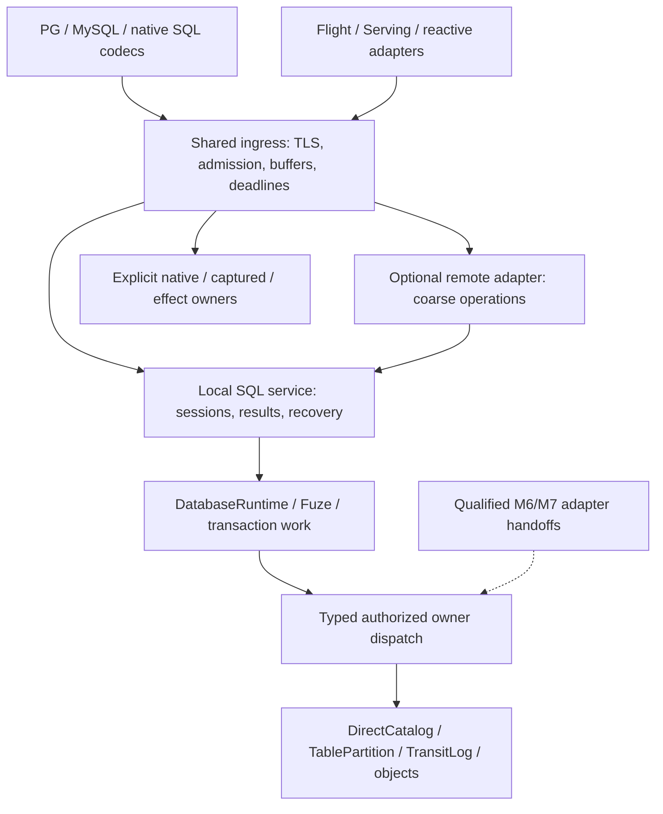

# 8. Gateway architecture, sans-I/O wire protocols and direct-plane ingress

[Roadmap](README.md) · [Write lifecycle and I/O #211](https://github.com/spoke-sh/transit/issues/211) · [Cutover #110](https://github.com/spoke-sh/transit/issues/110) · [Maintenance & Packaging #122](https://github.com/spoke-sh/transit/issues/122) · [Foundation #125](https://github.com/spoke-sh/transit/issues/125) · [Performance #76](https://github.com/spoke-sh/transit/issues/76) · [Allocation Guidance #194](https://github.com/spoke-sh/transit/issues/194) · **Status:** In Progress ([remaining implementation plan, 2026-11-05](#implementation-plan--2026-11-05))

Let callers query declared data, submit mutations and compose supported
transactions through one bounded execution service. They must be able to inspect
the original accepted operation, consume a complete result and recover after
connection or process loss under current authorization. The installed SQL path
should execute beside the database owners, without loopback storage RPCs or idle
recovery polling. Protocol adapters share ingress machinery while retaining their
own authentication, result and effect contracts.

Use the **10–100× interactive write improvement target in #211** to prioritize
this work. Measure verified completion through the actual persistent console;
removing HTTP requests, reducing threads or returning an earlier acknowledgement
does not by itself establish the target. Gateway placement, recovery scheduling
and physical publication are separate, coordinated optimization boundaries.

## Prerequisites and architectural rationale

The [nightly container performance tracker #378](https://github.com/spoke-sh/transit/issues/378)
connects this milestone's ingress/scheduler work to the
[local-to-distributed scorecard](13-data-structures-and-performance.md#nightly-container-scorecard-and-distributed-handoffs).
Measure current connection-driven worker sizing, admission waits and complete
statement costs before replacing the host driver. Runnable capacity must follow
effective CPU budgets; parked connection state has a separate bound. Preserve
control/recovery capacity under pressure. Qualify the existing coarse remote
statement plan before adding an independently placed protocol-edge campaign;
local console pipes do not measure remote SQL latency. Build profiles compose the
same owners and cannot introduce a second token, recovery or permission authority.

Build on [data identities](01-declarative-data-lifecycle.md),
[local storage](02-storage-and-query-performance.md),
[live storage/SQL integration](03-live-storage-and-sql-cutover.md),
[statement results](04-statement-results-and-consumption.md) and the completed
local Table profile in [transactions](05-transactions-and-atomic-composition.md).
[M6](06-streams-queues-and-durable-runtime.md) now supplies database-owned SQL,
named direct KV, typed Stream/Queue operations and maintenance, native mixed
transactions, automatic DLQ transfer and declaration/workload SQL, including
grouped consumption and offset settlement. SQL waits, acquisition predicates,
finite `STREAM_SLICE`, mixed transaction SQL and transactional Station remain open.
The public Document cutover in [M7](07-document-storage-and-station-decoupling.md)
is still an incoming gate. These dependencies apply to their particular adapters;
they do not block improvements to existing Table SQL. The
[current audit](#current-implementation-and-evidence) distinguishes storage
foundations from installed caller support.

Current semantics remain with [SQL sessions](../handbook/reference/sql-sessions.md),
[Table transactions](../handbook/reference/sql/transactions.md),
[callers](../handbook/reference/callers.md), [security](../handbook/reference/security.md),
[Documents](../handbook/reference/documents.md), [Flight](../handbook/reference/flight.md),
[Serving](../handbook/reference/serving.md) and [reactive APIs](../handbook/reference/reactive.md).
Start contract changes in [SQL_SESSION_V1](../../contracts/SQL_SESSION_V1.md),
[SQL_RESULTS_V1](../../contracts/SQL_RESULTS_V1.md),
[SQL_GATEWAY_V1](../../contracts/SQL_GATEWAY_V1.md),
[DIRECT_TABLE_V1](../../contracts/DIRECT_TABLE_V1.md) and
[SERVICE_V1](../../contracts/SERVICE_V1.md). Flight and Serving retain their
[Flight](../../contracts/FLIGHT_V1.md), [Serving](../../contracts/SERVING_V1.md)
and [reactive](../../contracts/REACTIVE_V1.md) contracts. The co-hosted browser
listener retains its separate [browser contract](../../contracts/BROWSER_V1.md).

### Grounded baseline in real relative terms

These are **recorded experiments at their cited revisions**, not measurements
rerun for this plan or a combined benchmark of current HEAD. The
[performance ledger](../history/qualification/performance.md#shared-content-directory-barrier--2026-10-29)
and [SQL ledger](../history/qualification/sql.md#database-owned-sql-runtime--2026-10-28)
retain source, fixture, raw evidence and limits.

| Evidence | Recorded result | Consequence for this plan |
| --- | --- | --- |
| Earlier instrumented TLS INSERT | 1,573 ms; 58 upstream POSTs in its window, including overlapping background work; 105 ms staging, 551 ms token binding, 833 ms direct commit | Separate foreground dependencies, overlapping recovery and publication costs. Neither the 58 requests nor nested timers form an additive serial path. |
| Earlier native SELECT/recovery experiments | 183–191 internal requests for a one-row SELECT; earlier 67-row and bootstrap attempts failed | Preserve historical failures and their original uncertain operations. Do not describe these figures as the current baseline. |
| PR #233 matched default installed console | Control/candidate INSERT p50 279 → 260 ms; warm SELECT 104 → 99 ms; SELECT after INSERT 383 → 382 ms; UPDATE/DELETE mixed | Both bootstraps and all 47 statements passed without residency/deadline overrides. Five mutation samples on a shared host establish neither tails nor 10×. |
| PR #233 separate matched TLS component fixture | INSERT 1,668 → 1,519 ms; warm SELECT 78 → 77 ms | Keep this fixture separate from installed-server results. Its residency/request budgets differ. |
| PR #233 unchanged native recovery schedule | 67-row atomic INSERT and full schedule pass in 29.64 s, with 1,329 Table requests and zero Station sends/turns | This pass does not explain earlier failures, settle their retained operations or prove a complete interfaces-lane pass. |
| Physical publication contribution | Payload/checksum names share a directory barrier: five sync calls per new object instead of six | Preserve the qualified barrier change. Cross-object batching, reconstructible coordination state and a combined token/commit envelope remain #211 work. |

The former sub-millisecond in-process estimates and 160×–5,000× comparisons
were not matched controls for these installed workloads. Establish a direct-owner
control with the same data, authorization and durability before publishing such
ratios. Keep device synchronization, application sync calls, logical WAL appends
and gateway RPC counts distinct.

### Pre-implementation source audit and recent work

Source audit at `b8aab78fbdd8595429e9e9d68ea63cee1792715e`, including
[PR #232](https://github.com/spoke-sh/transit/pull/232) Table transactions,
[PR #233](https://github.com/spoke-sh/transit/pull/233) publication work and
[PR #234](https://github.com/spoke-sh/transit/pull/234) Document foundations:

| Boundary | Implemented owner | Remaining work |
| --- | --- | --- |
| SQL admission and execution | [`DatabaseRuntime`](../../packages/zig/transit-sql/src/DatabaseRuntime.zig), `DirectClientToken`, `DirectCatalog`, `TablePartition`; transitive Station exclusion in `transit-sql` | Runtime and query execution still run in the SQL gateway through HTTP-backed direct clients. Logical database decoupling is complete for this path; physical co-hosting is not. |
| DML completion/accounting | Foreground `submit`/`execute` return the original verified Table terminal; `advance` settles the Catalog pending token | Foreground paths unconditionally notify recovery. Removing the timer without covering settlement would leak pending capacity. |
| Transactions | `TransactionWork`, `SessionTransaction`, Catalog common cuts/private workspaces/decisions, native/console/PG/MySQL controls | Preserve the delivered serializable local multi-Table profile, savepoints, provisional counts, explicit reattachment and post-decision cleanup. These controls are no longer future syntax. |
| Recovery | [`main.zig`](../../apps/transit-sql-gateway/src/main.zig) runs `runAccount` with 2–100 ms backoff, `recoverSessions` every 100 ms and `expireSessions` every 100 ms | Park settled owners; use reliable notifications, bounded retries and actual lease deadlines. |
| Read pins | [`ReadCache`](../../packages/zig/transit-sql/src/ReadCache.zig) retains bounded exact cuts; startup/dirty cleanup stops after successful route sweeps | Wire dirty/failed acquisition/release to reliable scheduling. There is no current wall-clock cache expiry to replace with a timer heap. |
| External SQL operations | [`Registry.recover`](../../packages/zig/transit-sql-service/src/Registry.zig) scans Catalog and creates a fresh `wire.Client`; captured/configuration operations retain separate owners | Persistent bounded recovery clients, complete paged discovery and explicit notifications; preserve original signed requests. |
| Local owner | [`LocalTableHost`](../../apps/transit-node/LocalTableHost.zig) retains resident owners, locks and recovery state; [`LocalTableService`](../../apps/transit-node/LocalTableService.zig) validates policy and returns serialized responses | Extract typed authorized dispatch. Calling this JSON-producing method in-process alone leaves unnecessary serialization and ownership coupling. |
| Direct caller seam | [`DirectTableClient`](../../packages/zig/transit-catalog/src/DirectTableClient.zig) holds wire clients and returns parsed responses; `Session` owns concrete wire clients | Introduce typed request/response dispatch below SQL and a coarse SQL service boundary above it. Moving a listener alone is insufficient. |
| Protocols | `transit-sql-protocol` is pure; PG/MySQL have frame decoders and host-supplied session engines | Complete incremental transport/event separation. Application [`Connection.zig`](../../packages/zig/transit-sql-host/src/Connection.zig) is a TLS/socket wrapper, not a pure state machine. |
| Memory/I/O | Admitted worker/result/frame/TLS reserves and cleanup barriers exist; `boundedHandle` and HTTP `deadline` still race work against timers | Reuse reserves and joined ownership. Core-bounded workers require runnable I/O scheduling, not a smaller constant. |
| Flight/Serving | Flight uses durable Query/Station requesters; `transit-serving-http` owns effectful signed HTTP/SSE/WebSocket hosting | Split codecs from hosting and qualify shared ingress. Co-location does not make their durable owners direct database owners. |

### Document decoupling and caller gate

This inventory records the October 28 source audit, before M7 D0–D4 landed.
The [current inventory](#current-implementation-and-evidence) supersedes its
implementation status while preserving the public caller cutover gate.

**Document callers have not been decoupled. Neither has installed Document
acceptance.** PR #234 delivered deterministic semantics and private candidate
storage; it did not deliver `DocumentPartition` or its public route.

[`transit-document`](../../packages/zig/transit-document/README.md) owns the
unchanged change codec and merge evaluator over an owner-supplied immutable
index. [`DocumentIndex`](../../packages/zig/transit-storage/docs/document-index.md)
stages private `.tseg` candidates with bounded directories. It supplies no WAL
acceptance, original-operation receipt, accepted-head recovery, retained-root
collection or database authorization. The eight-operation/96-byte scalar profile
is unchanged. A sealed candidate root is not an accepted Document revision.

| Remaining coupling | Current source | Required owner before cutover |
| --- | --- | --- |
| Accepted head, writer jobs, checkpoints, remote replies | [`transit-station-document`](../../packages/zig/transit-station-document/README.md): `Service`, `Checkpoint`, `Remote`, `Caller`, `Client` | M7 direct durable owner, receipts/revisions and recovery; M6/M7 common-decision participation for state/input/reply actions |
| Named initialization | [`DirectResource`](../../packages/zig/transit-catalog/src/DirectResource.zig), [`NamedResource`](../../packages/zig/transit-station-app/src/NamedResource.zig) | M7 replaces Document writer/native-allocation initialization and publication checks; native KV keeps its separate lifecycle |
| Query projections | [`transit-query`](../../packages/zig/transit-query/src/root.zig) imports `transit_station_document` | M7 accepted-revision reader with current authorization, exact cuts and five-state projections |
| Shared bindings/host actions | [`DocumentCodec`](../../packages/zig/transit-station-bindings/src/DocumentCodec.zig), [`DocumentBridge`](../../packages/zig/transit-station-bindings/src/DocumentBridge.zig), ABI/host schemas | M7 neutral direct contract; M9 reusable client infrastructure without another merge/recovery implementation |
| Public SDKs | [`sdks/zig`](../../sdks/zig/README.md) exports `transit_station_document`; ten non-Zig Document APIs use the Station boundary | Coordinated binding and language API migration; importing the neutral evaluator is not a caller cutover |
| Inspection/deployment | [`Board Document adapter`](../../packages/zig/transit-board-api/src/Document.zig), [`station-document` example](../../examples/station-document/README.md), workers, launchers and placement proofs | Public read-only metadata, real direct callers and a worker/courier-free create/edit/read/recover proof |

M7 owns its existing P0–P5 contract/storage/catalog/consumer sequence. M8 owns
host integration once that boundary qualifies. M9 must not make completion of
every language package a circular prerequisite for defining the M7 direct
contract: the minimal shared Zig caller/ABI seam belongs with that cutover;
broader client consolidation can follow.

Table P0–P6 work below can proceed now. Do not advertise direct `DOCUMENT`,
`STREAM` or `QUEUE` ingress, invent runnable SQL, or route private candidates
around Station acceptance while their owners remain incomplete. Existing
Document callers retain their contract until one coordinated current-v1
replacement. The full M8 data-kind handoff stays open until its required owner
gates pass; a Table-only qualification must be named as such.

## Implementation plan — 2026-10-28

**Plan basis:** the audited committed HEAD above and the current #211 issue,
read on 2026-10-28. Historical evidence dates/revisions are preserved as recorded.
Implementation has started with foreground settlement and event-driven recovery.
The baseline inventory above records the pre-implementation state; the current
[runtime owner](../../packages/zig/transit-sql/docs/runtime.md) describes delivered
behavior. The milestone remains `In Progress` while the placement, protocol and
qualification gates below remain open.

The first [recovery qualification](../history/qualification/sql.md#event-driven-sql-recovery--2026-10-29)
passes the clean interfaces lane. Its [matched console comparison](../history/qualification/performance.md#event-driven-sql-recovery--2026-10-29)
observes zero post-statement idle upstream calls but higher INSERT, unchanged
UPDATE and DELETE latency from foreground settlement. Fresh reads improve and
warm reads are approximately unchanged. This evidence does not close P2–P6 or
the #211 latency targets; preserve the regressions when evaluating subsequent
co-hosting and commit-envelope work.

The selected SQL placement now embeds shared listener/session hosting in the installed
node and adds typed signed Table/native dispatch through its existing owners.
The standalone gateway retains HTTP-backed fine-grained clients until P2c.
Configuration settings/reload retain the installation gateway owner: native
policy reads are local, but the configuration handoff in P2a remains open. This
slice therefore closes the selected database loopback path, not every P2 gate.
Protocol purity, worker sizing/deadlines, coarse remote placement and full
milestone qualification remain separate work. See the current
[SQL placement](../handbook/reference/sql.md) and
[host ownership account](../handbook/internals/service-interfaces.md#placement-sessions-and-adapters).
The [partial placement qualification](../history/qualification/sql.md#typed-local-sql-dispatch-and-installed-co-hosting--2026-10-29)
records completed installation/TLS checks and the unresolved recovery timeouts.
Matched performance measurements and full qualification remain open.

### Remaining implementation plan — 2026-10-29

The [October 29 plan at the review baseline](https://github.com/spoke-sh/transit/blob/0e2fba44727ca858bd1e8e4a775b62fbcf1a665d/docs/roadmap/08-gateway-architecture-and-protocol-ingress.md#remaining-implementation-plan--2026-10-29)
prioritized installed-console attribution, fresh reads and durable publication.
It retained the earlier co-hosting failures and an unpinned user diagnostic
transcript, neither of which establishes current performance. The plan below
supersedes its implementation inventory and delivery order. P0–P6 identities,
performance objectives and failure/recovery obligations remain binding.

### Implementation plan — 2026-10-31

**Source basis:** fetched `origin/main` at
`0e2fba44727ca858bd1e8e4a775b62fbcf1a665d`, reviewed in a new worktree.
This is an implementation plan, not a new runtime or benchmark qualification.
Milestone 8 remains **In Progress**. The [November 1 plan](#implementation-plan--2026-11-01)
supersedes the [October 31 inventory and delivery order](https://github.com/spoke-sh/transit/blob/c8d060cb2dfcf3bc531ef2e41fcdf7d4f172c2d5/docs/roadmap/08-gateway-architecture-and-protocol-ingress.md#implementation-plan--2026-10-31).
The implementation records below and the startup subplan retain their original
source/evidence scope.

#### Wire foundation implementation — 2026-10-31

Commits `2bed40609` and `a9054f549` deliver the neutral dependency and incremental
framing portion of steps 1 and 3 below. This is an implementation slice,
not completion of P0/P4 or the milestone:

- `transit-sql-protocol.Wire` owns shared limits, scalar/byte codecs, read-batch
  types and an allocation-free framing continuation. PostgreSQL/MySQL manifests
  depend on this neutral package; build-time transitive import checks reject
  execution, storage, Station and transport dependencies.
- Synchronous SQL session engines, transport reads and their existing tests
  move to `transit-sql-host`. The service aliases the same neutral types;
  accepted identities, wire bytes, current-v1 definition and SQL semantics do
  not change.
- PostgreSQL/MySQL command input emits input/capacity/complete-frame events.
  Headers validate before body capacity or reads. Complete input remains
  borrowed through command execution and joined cancellation, then is erased.
  The host reuses bounded high-water capacity within the existing session
  reserve; truncated or malformed input cannot become another command.
- The [protocol package](../../packages/zig/transit-sql-protocol/README.md),
  [SQL host](../../packages/zig/transit-sql-host/README.md) and
  [database protocol reference](../handbook/reference/database-protocols.md)
  describe the current boundary and its lifetimes. M4's source links follow
  the relocated owners without changing its recorded outcome.

The implementation is rebased onto `origin/main` at `ae96f4af4`, including
M6's bounded Queue claim waits (PR #292) and installed startup attribution
(PR #293). Queue waits now reuse the qualified direct wait/claim owner; they do
not complete mixed transaction participants, Queue SQL or Station replacement.
The startup workload and its separate recovery gates remain in step 1 below.

At this foundation revision, execution engines still called their host
synchronously. The subsequent session slice below addresses that boundary.

#### Resumable command-session implementation — 2026-10-31

The next slice starts from `origin/main` at `644d0a09e`, including merged PR #295
and the Station listener-recovery fix in PR #294. PostgreSQL/MySQL authenticated
command engines now live in their pure protocol packages. They emit one neutral
host request or immutable output slice at a time; partial drains, connection
generations and monotonically increasing event tokens fence cancellation,
duplicate and late completions. Reads close before dependent metadata or bound
values are released. Prepared portals retain their original read cut.

The shared host driver preserves existing installed execution and authenticates
resumed disclosure through the owning service. Guards cover metadata, buffered
rows, empty results and terminal output. A paused mutation reply observes its
original accepted completion rather than revalidating or executing the statement
again. Reusable encoding buffers and PostgreSQL portal arenas support warmed
allocation checks in the pure event tests. Public ownership and lifetimes live
in the [protocol](../../packages/zig/transit-sql-protocol/README.md),
[PostgreSQL](../../packages/zig/transit-postgres/README.md),
[MySQL](../../packages/zig/transit-mysql/README.md) and
[host](../../packages/zig/transit-sql-host/README.md) guides.

This completes the authenticated command-event portion of step 3, not P4 or the
milestone. The installed driver still uses blocking workers and command timer
races. Authentication/TLS orchestration, socket deadlines, CPU-scaled scheduling
and its progress proofs remain open. So do coarse remote SQL, configuration
handoff, Flight/Serving integration, owner-qualified M6/M7 routes and paired
latency acceptance. No direct data-kind capability or broader wire profile is
added. Component event/allocation tests do not establish installed performance
or complete the separate lifecycle and recovery gates.

### Connection startup continuations — 2026-11-01

PostgreSQL/MySQL connection startup now joins the delivered command engines at
the sans-I/O boundary. `Wire.Startup` carries token-fenced input/output, TLS,
credential selection, verification, cancellation and final admission requests.
`StartupSession` owns bounded protocol state; the shared host owns credential
files, cryptography, TLS and native admission. It reserves command resources
before acknowledging admission and emitting a successful login. The old
host-only startup readers are removed. The current boundary and lifetimes are in
the [gateway contract](../../contracts/SQL_GATEWAY_V1.md#in-process-connection-and-command-continuations)
and [host guide](../../packages/zig/transit-sql-host/README.md).

This closes the PG/MySQL authentication-state portion of change 3 below. It
does not close P4: native HTTP and Flight/Serving composition remain. Worker
sizing, `authenticationDeadline`/`connectionDeadline`/`boundedHandle`, socket and
non-socket deadline propagation, coarse remote SQL and owner-qualified M6/M7
routes retain their separate gates. No new wire capability, authority or durable
definition is introduced. Codec allocation checks do not establish installed
latency or host/TLS allocation guarantees. The
[startup qualification](../history/qualification/sql.md#connection-startup-continuations--2026-11-01)
records the executed checks and their source basis.

### Implementation plan — 2026-11-01

The [November 1 plan at its recorded source](https://github.com/spoke-sh/transit/blob/c4dd89c2224ab53fd9139f2f89c328e8ca0b3f25/docs/roadmap/08-gateway-architecture-and-protocol-ingress.md#implementation-plan--2026-11-01)
retains the prior inventory, delivery order and subsequent performance subplans.
The November 5 refresh below supersedes its next-change ordering. Earlier
experiments, incomplete checks and original-outcome obligations retain their
recorded scope; neither a later merge nor this plan resolves them.

### Implementation plan — 2026-11-05

**Source basis:** fetched `origin/main` at
`c4dd89c2224ab53fd9139f2f89c328e8ca0b3f25`, reviewed in a new worktree.
The shared definition in
[`Growth.zig`](../../packages/zig/transit-protocol/src/Growth.zig) is
`4a79430a0f740284cda72df8341f0af87a87a63a599d7a81c62a934778875e1a`.
This is a source-grounded implementation proposal, not executed runtime or
performance qualification. Unmerged work in other worktrees is not a delivered
prerequisite. Keep M8 **In Progress**, its P0–P6 acceptance identifiers, startup
S0–S6 gates and the existing #211 objectives.

**Deliverable:** an installed caller submits a statement against declared data,
receives its authoritative command outcome or one complete bounded result, and
can inspect the original accepted work after disconnection or replacement.
Local execution shares the database owners. A standalone frontend delegates to
that same service. Protocol state and buffered output remain bounded while slow
peers, storage waits and authentication leave runnable capacity for other callers,
control and recovery.

The immediate work is **deadline propagation and a resumable host driver**.
PG/MySQL startup and command continuations already exist. Current Table capture,
managed multi-row pages and output-statement batching also exist; do not repeat
them as new optimization work. Refresh measurements and remaining contracts first,
then qualify scheduling before changing the connection-based worker formula.
Local configuration composition and the remote authority contract can progress
independently. M6/M7 gate their own incoming capabilities, not existing Table SQL.

#### Current implementation and evidence

**First deadline slice after this audit:** the HTTP owner now sets absolute
socket deadlines for plain and native TLS headers without a header timer/work
pair. Buffered parsing checks the same deadline; body, output and joined
non-socket handler cancellation use the original request budget. PG/MySQL
authentication shares one timestamp across startup I/O and an event waiter,
replacing the five-millisecond polling loop. Output caps use exact timestamps.
The [SQL host ownership matrix](../../packages/zig/transit-sql-host/README.md)
records the affected borrows, authority and cancellation owners; the
[HTTP](../../contracts/HTTP_SERVING_V1.md) and
[wire](../../contracts/SQL_GATEWAY_V1.md) contracts retain their existing limits.
These are implementation changes within the current definition.

Package controls cover expired buffered input, stalled headers without timer
tasks, body/handler cancellation and joins, pipelined reuse, spurious event wakes,
expiry, cancellation and exact output caps. The independent native TLS schedule
adds fragmented-header expiry before ordinary authenticated session use. PR
validation records the executed integration and clean-checkout outcomes.
P3 remains open: command/handler cancellation tasks, signed-client propagation,
resumable host progress, fair queues and CPU-sized worker defaults still require
their remaining contracts and proofs. This slice does not close P0/P5 measurement
controls, local configuration handoff, remote authority, or M6/M7 incoming gates.

The public [runtime owner](../../packages/zig/transit-sql/docs/runtime.md),
[SQL host](../../packages/zig/transit-sql-host/README.md),
[wire contract](../../contracts/SQL_GATEWAY_V1.md) and
[Stream/Queue SQL profile](../handbook/reference/sql/streaming.md) define current
behavior. The following source inventory separates it from remaining delivery.

| Boundary at this source | Delivered work to preserve | Remaining M8 obligation |
| --- | --- | --- |
| SQL placement and authority | Installed SQL runs in the node; signed typed `LocalEndpoint` calls use the same native/Table owners, policy, locks and final disclosure fences as HTTP. The local dispatcher has four data, two control and four wait lanes. | Complete configuration-owner handoff and common-revision local/HTTP lifecycle evidence. Lane counts are current admission bounds, not the target runnable-worker formula. |
| SQL recovery | `DatabaseRuntime`, Registry and `ReadCache` retain original tokens/cuts, foreground settlement, complete paged discovery, wake generations and actual session leases. Settled owners park. | Preserve execution claims, scan-to-park correctness and separate execution/accounting/pin obligations under the new scheduler and every typed pending kind. |
| Connection protocols | #295/#299/#315 deliver pure `Wire`, PG/MySQL `Session` and `StartupSession`, partial input/output and generation-fenced host completions. Credential/TLS effects remain hosted. TSR1 is pure. | Drive those engines without a blocking task per connection; extend pure boundaries to the selected HTTP/Flight/Serving framing. No repeated startup extraction. |
| Socket deadlines | [`transit-tls-server.Transport`](../../packages/zig/transit-tls-server/src/root.zig) already uses `io.operateTimeout` for socket reads/writes, including partial TLS records. | Remove eligible outer `connectionDeadline`/`boundedHandle`, HTTP header/handler and signed-client timer races only after their non-socket cancellation responsibilities have replacements. Socket support alone does not make the host resumable. |
| Worker residency | [`transit-sql-host`](../../packages/zig/transit-sql-host/src/root.zig) sizes `Threaded` with account count, eight workers per wire slot and further native-listener reserves. [`transit-io`](../../packages/zig/transit-io/README.md) owns bounded task slabs and joined worker cleanup. | Effective-CPU-bounded runnable work across the entire installation, separately bounded parked state and blocking work, fair admission and measured progress before reducing defaults. |
| Fresh reads and finite managed work | #356 delivers explicit current Table capture and bounded multi-row `DFP1` pages/output statements. #361/#365 add Catalog-owned `CPR1` replacement progress and `SOR1` original staging/closure above `TXR1` candidates. | Remeasure complete results and successors with normal maintenance; preserve original cuts, staging ownership and collection. M12 owns remaining finite recovery/fairness and incremental execution. |
| Foreground contention | #362 bounds local lane acquisition; #381 releases a foreground wire claim after an accepted-operation conflict and waits for original recovery. #384 moves activation-reply-loss injection to the actual co-hosted boundary. | Carry the same cancellation/deadline through admission and recovery. Force conflicts before and after commit, revocation and activation loss without redispatching SQL or holding the claim needed by recovery. |
| M6 ingress | Declarations, PRODUCE/ENQUEUE, positional/grouped CONSUME, COMMIT OFFSET, CLAIM, ACK/NACK and renewal are executable through shared SQL owners. #367 adds exact group/progress descriptors. Native mixed transactions and automatic DLQ owners exist. | SQL WAIT, payload-aware Queue acquisition, finite `STREAM_SLICE`, mixed SQL and transactional Station remain M6 handoffs. Group assignment/read release stay native; wire row counts cannot fabricate authenticated progress. |
| M7 Documents | #319/#354 integrate causal maps, ordered trees, BP inspection and verified JSON/XML/MIME candidates; #370 adds retained partition membership and bounded head pages. | Protected staging, public direct lifecycle/discovery, transaction participation and the coordinated consumer cutover remain M7 gates. Component collection cuts are not installed direct Document ingress. |
| Types, catalogs and queries | #351 adds selected psql catalog inspection; #355/#377 extend/correct historical evidence; #374 admits scalar widths and exact decimals across native/PG/MySQL; #383 adds typed relational grouping, HAVING, ORDER BY/LIMIT and forward revision semantics. | Preserve exact schema/collation, empty/prepared/binary values, historical bindings and original revisions. These do not widen Flight's int64 profile or establish every SQL dialect/analytical combination. |
| Startup and storage publication | Earlier startup reductions remain; #384 publishes immutable files and recoverable installation assemblies without requiring `RENAME_NOREPLACE`. | Requalify startup/replacement under the new I/O owner, including interrupted assembly and retained history. Local injected syscall tests do not qualify EFS/Fargate or cross-client lock-loss behavior. |
| Other ingress placements | Standalone SQL still runs Registry/runtime with fine-grained HTTP direct clients. Flight retains durable Query/Station requesters; Serving/browser hosts retain signed native/effect owners. | P2c server-owned remote execution; shared Flight/Serving host integration and pure codecs with unchanged authority/capture lifetimes. |

Merged source does not certify a combined pass. Retain these evidence boundaries:

- [Startup continuation qualification](../history/qualification/sql.md#connection-startup-continuations--2026-11-01)
  records a complete clean SQL lane and separate failed/incomplete installation,
  workbench and browser attempts at its named revisions. Do not reopen delivered
  codecs or treat later fresh passes as explanations of those failures.
- [Scalar parity](../history/qualification/sql.md#scalar-parity-across-sql-interfaces--2026-11-04)
  records the copied ReleaseSafe server, all 23 installed smoke stages, independent
  driver matrix and unchanged latency gate at `1c2d29038…`, plus the bounded-error
  follow-up. It is not a complete clean-lane or current-HEAD qualification.
- [Owned original staging](../history/qualification/query.md#owned-original-staging-and-closure--2026-11-03)
  records scoped owner/installed checks. Combined process-death, growth, fairness
  and resource evidence remains with M12.
- The [older F0 scorecard](../history/qualification/performance.md#managed-staging-and-sdk-diagnostic-baselines--2026-11-02)
  predates current capture, page batching and later definitions. Its failed
  operations and timings remain historical controls, not this source's results.
- The [nightly container campaign](../../tests/performance/load/containers.md)
  and console latency gate are now implemented measurement infrastructure.
  Registration, a successful build or a promoted image alone is not an executed
  campaign. #378 tracks publication prerequisites and incomplete profiles.

#### Milestone dependencies and handoffs

| Owner | Available input and immediate M8 use | Incoming gate or later responsibility |
| --- | --- | --- |
| [M1–M3](03-live-storage-and-sql-cutover.md), [M4](04-statement-results-and-consumption.md), [M5](05-transactions-and-atomic-composition.md) | Stable definitions, local durability, logical `StatementOutcome`/`ResultSet`, common Table cuts, provisional counts/savepoints and original decisions | M3 remains In Progress; M4/M5 completion has their selected scope. Preserve bootstrap/recovery and Table transaction semantics through placement and scheduling. |
| [M6](06-streams-queues-and-durable-runtime.md#completion-plan-at-current-main--2026-11-03) | Current direct KV/log SQL, authenticated progress, native waits/mixed decisions/DLQ are regression inputs | WAIT needs resumable host capacity and its own shared pending/result contract. M6 supplies selection/settlement and Station semantics; M8 supplies scheduling. M6 R9 and M8 P2 jointly retain account-token/commit and #211 latency closure. |
| [M7](07-document-storage-and-station-decoupling.md#remaining-work-packages-and-gates) | Retained collection cuts define the future partition read basis; coordinate staging/borrow/cancellation interfaces now | C0 contracts, protected staging, C4 signed lifecycle/discovery, C5 participants, C6 SQL and C7/C8 consumer qualification gate direct Documents. A component root or independent partition vector grants neither acceptance nor an atomic cut. |
| [M9](09-client-foundation-and-language-apis.md#remaining-implementation-plan--2026-11-01), [M21](21-service-and-sdk-coverage.md) | Context leases, bounded admission, `LocalRecoveryStore`, frozen SQL/KV attempts and shared result readers | Define remote handles/authority together. Principal coordination, ordinary settlement, managed handles/data ABI and language breadth remain there; M8 migrates every existing consumer affected by its cutover without waiting for all SDK redesigns. |
| [M10](10-standards-and-catalogs.md), [M11](11-indexing-and-access-paths.md) | Historical catalogs/cuts, exact scalar/collation descriptors and current policy checks constrain all metadata and data output | Index-backed execution, online maintenance and narrower conflict tracking remain M11. Cached preparation cannot invent current coverage or remove existing conflict guards. |
| [M12](12-sql-and-dataflows.md#next-implementation-slice-owned-staging-and-finite-qualification) | Batched finite results and `TXR1`/`CPR1`/`SOR1` owned work; typed relational execution and independent inspection | Provide bounded execution/yield/cancel seams; M12 owns complete-history activation, incremental processing and finite recovery/fairness. A gateway connection is not a durable subscription or history cursor. |
| [M13](13-data-structures-and-performance.md#nightly-container-scorecard-and-distributed-handoffs), [M14](14-vectorized-strings-and-search.md), [M15](15-data-centric-compilation-and-specialization.md) | Existing scorecards and execution-owned predicate/buffer interfaces | M8 proves ingress allocations, queues and CPU-sized progress. General metering, storage/cache work, search and compilation stay with these owners; future meters cannot excuse an unbounded M8 queue. |
| [M16](16-document-profiles-and-gateway-exchange-lifecycle.md) | Offline JSON/XML/MIME codecs, construction, framing and commitments can consume pure byte/event interfaces | Profile expansion and gateway/connector capture require M7 acceptance and explicit effect contracts. Reuse pure libraries; do not migrate `STATION_EXCHANGE_V1` or dispatch effects in a codec. |
| [M20](20-branches-merges-and-restore.md), [M22](22-formal-semantics-and-correspondence.md), [M26](26-clustered-execution.md) | Immutable branches/forks and mixed pending directories must survive discovery; finite scheduler traces support correspondence | Branch mutation/merge, general refinement, replication/failover and distributed transaction behavior remain separate. A remote protocol frontend and three independent container authorities establish none of them. |
| [M30](30-board-reimplementation.md), [M45](45-releases.md) | Read-only public inspection, computation/retained-result views, installed artifacts and filesystem publication | Preserve Board/browser control progress and source-bound output; UI work and hosted filesystem qualification retain their owners. Keep build/package cost separate from runtime startup. |

Native SQL retains its rejection of browser Origin/cookie/forwarded identity.
Browser listeners retain Host/Origin, provider, session and publication checks.
Shared hosting supplies no new permission, settings or retention authority.

#### Delivery order and independently reviewable changes

The P0–P6 inventory remains the full acceptance scope. This order replaces the
older instructions to implement startup continuations, current capture and
single-row managed-page reductions. Each review includes its owner documentation,
negative controls and applicable gates; do not combine all host and protocol
changes into one cutover.

| Review | Scope and owners | Entry gate | Reviewable exit |
| --- | --- | --- | --- |
| 1. Refresh controls and freeze remaining contracts | P0/P5; SQL host/service/protocol, I/O and existing measurement drivers | This source audit, M4/M5 and current M6 profiles | Versioned authority/borrow/deadline/handle matrix; reproducible current-definition control and explicit numeric resource/progress budgets |
| 2. Propagate absolute deadlines | P3; TLS transport, HTTP server, signed client and SQL host | Review 1 cancellation matrix | Converted sockets use one active-operation deadline; non-socket work has bounded cancellation/join; eligible outer timer races removed without weakening timeouts |
| 3. Prove a resumable host driver | P3/P4; existing startup/command engines, `WireSessionDriver`, `transit-io` | Reviews 1–2; pinned backend capability audit | More idle/slow peers than workers, partial TLS/output and delayed owner completions progress with bounded state and no held-lock deadlock; default sizing unchanged until this passes |
| 4. Switch runnable sizing and fair admission | P3; all co-hosted pools and node lanes | Review 3 installed progress proof | Workers scale with effective CPU capacity, parked sessions are separately bounded, and control/data/recovery make measured progress under saturation |
| 5. Finish local configuration/lifecycle composition | P2a/P2b; node, CLI supervisor, `ConfigurationOperations` | Review 1 ownership contract; independent of review 4 | One settings/reload authority, typed local calls where possible, explicit bounded supervisor handoff, fingerprint-fenced activation and joined replacement/shutdown |
| 6. Replace standalone orchestration | P2c; SQL service, gateway and shared client | Remote contract from review 1 and review 5 lifecycle seam | Server owns runtime/Registry/cursors/recovery; frontend owns protocol state; one coarse execute plus explicitly counted auth/prepare/fetch/control/disclosure exchanges |
| 7. Integrate Flight/Serving framing and hosting | P4; neutral protocol modules and effectful service hosts | Reviews 2–5 and each service's authority/lifetime contract | Pure codec import gates, shared bounded ingress and independent clients preserve the selected ticket, capture, session and disclosure profiles |
| 8. Integrate each newly qualified data capability | P2/P4; existing SQL/typed owner adapters | Current M6 operations now; future M6/M7 operations only after their owner gates | Local/remote create/use/inspect/recover parity; WAIT parks; no implicit ACK/offset advance and no actor fallback for direct Documents |
| 9. Close publication/startup and common-revision gates | P0/P2/P5/P6; existing S0–S6 and F0/R1/M3/C4/D5/S6/E7/Q8 tracking | Attributed candidates and applicable exits above | Matched complete-outcome measurements, required clean lanes, reconciled original failures and explicit closure/open status for every acceptance obligation |

**First three implementation PRs:** remaining contracts/current-definition
controls, deadline/cancellation propagation, then the resumable-driver proof.
Change worker defaults only in the following review. Contract design for remote
authentication and local configuration can begin immediately; coarse transport
implementation consumes the agreed server owner. Measured read/write publication
and retained-history startup fixes can land separately after attribution. Heavy
proofs and timing campaigns run sequentially on a shared host.

#### 1. Freeze contracts, controls and budgets

Extend [SQL_GATEWAY_V1](../../contracts/SQL_GATEWAY_V1.md),
[SQL_SESSION_V1](../../contracts/SQL_SESSION_V1.md) and
[SQL_RESULTS_V1](../../contracts/SQL_RESULTS_V1.md) only where the remaining
boundary needs fields. Keep the existing typed result and transaction owners.
Resolve these decisions before dependent implementation:

- **Lifecycle and memory:** identify the owner of credential scratch, command
  input, prepared metadata, row batches, TLS buffers and partially drained output.
  Carry connection generation/event sequence through suspension; late completion
  cannot mutate a reused slot. Abort fences output, then cancellation joins every
  borrower before erasure, close or deallocation. Accepted work survives that close.
- **Deadline matrix:** distinguish idle connection wait, first-byte frame budget,
  authentication, active statement, control request and session lease. Preserve
  existing idle semantics; partial frames, TLS retries, queueing and output cannot
  renew an active deadline. Socket waits use the remaining absolute budget;
  owner locks, crypto, storage and query work require their own cancellable or
  bounded steps. A deadline after possible dispatch retains original uncertainty.
- **Scheduler/backend:** inventory the pinned Zig I/O/TLS capabilities and nested
  synchronous calls. Select a readiness/completion driver with bounded task and
  blocking-work lanes only after a real TLS/database progress prototype. Do not
  prescribe io_uring or assume a smaller `Threaded` pool makes blocking calls park.
- **Admission:** freeze per-account data/auth/control/recovery slots and queued
  bytes, parked connections, TLS/frame/output memory, blocking-work capacity and
  downstream lock order. Define effective CPU affinity/quota handling and numeric
  cancellation/control-latency thresholds from controls before changing defaults.
  Record every co-hosted pool; reserve progress beyond the listener itself.
- **Remote session authority:** bind original principal/role, account, credential
  revision, destination, session and activation. Native SCRAM is destination-bound;
  a PG/MySQL login cannot be forwarded as an asserted account. Specify the scoped
  frontend/service exchange and current checks at both output boundaries. No
  gateway superuser or retained buffer may stand in for caller authorization.
- **Coarse service handles:** map prepare/describe/release, direct/prepared execute,
  bounded fetch/repeat/close, status/resume/cancel and transaction attach/controls
  to the shared service. Handles bind generation; accepted tokens bind immutable
  content/scope. Freeze disconnect and expiry behavior without silently recapturing
  SELECT or replaying mutations. Count extra authorization exchanges explicitly.
- **Incoming waits:** M6 owns selection, accepted identity and authenticated
  coverage. Its future SQL WAIT adapter needs an explicit pending/result handoff
  and register/recheck/park behavior; current generic pending projection excludes
  workload intents. Reuse native notifications and `WorkloadRead`, not a timer
  loop, replacement claim or SQL-specific durable queue.

Freeze a ReleaseSafe control at the implementation base with matching runtime,
SDK/generated definitions, binary/driver hashes, toolchain, CPU/quota, filesystem,
cache, maintenance and durability. Preserve existing deadlines and admission.
Use persistent console, native SQL and independent PG/MySQL callers for empty,
0/1/32/33/65-row results, exact scalar/prepared metadata, warm/fresh reads,
changed/no-op/zero-match writes, the unchanged 67-row INSERT, Table transactions,
log workloads and original recovery. Separate cold authentication from statements.
Include historical/branch observations and finite managed successors as distinct
cases; no one read profile substitutes for another.

Attribute queue/lock wait, current authorization, preparation/cut acquisition,
execution, output, token admission, publication and pending settlement. Separate
foreground/recovery/observer traffic, logical appends, physical syncs, allocation
and resident/retained bytes. Missing counters remain unavailable, and overlapping
spans are not an additive cost breakdown. Instrumented diagnostics do not replace
matched uninstrumented timing.

Run the existing latency gate before selecting an optimization; it supplies the
checked-in regression budgets, not proof of the separate #211 absolute targets.
For performance acceptance retain at least three alternating pairs and 50 samples
per arm/case, every failed attempt and verified terminal values/counts. Startup
retains its separate fresh/restart schedule. Small probes guide iteration; neither
small empirical p99 nor a failed campaign with resampled wins establishes a tail
or capacity claim. Current-definition failures get their own original-identity
investigation, independently of historical failures kept with matching binaries.

#### Current-main performance implementation — 2026-11-01

**Historical plan/implementation record:** retain the source and evidence below.
The [November 5 inventory and delivery order](#implementation-plan--2026-11-05)
supersede its next-action instructions, including already delivered capture,
managed batching and startup-continuation work.

The first packet below landed in [PR #325](https://github.com/spoke-sh/transit/pull/325).
The [post-merge review plan](#post-merge-performance-delivery-plan--2026-11-01)
defines the next implementation sequence; the earlier source bases and outcomes
remain historical evidence, including the unresolved failures.

**Status: In Progress.** Initial source basis `f4abc3b18d9a621eb9fcb2f2c10ee72a48aa2ae1`
includes performance PR #313 and the connection, string, managed computation,
Document, profile-parser and spatial increments #314–#319. Track the installed
10–100× journey in [#211](https://github.com/spoke-sh/transit/issues/211), with
Table amplification in [#76](https://github.com/spoke-sh/transit/issues/76) and
SDK ownership in [M9](09-client-foundation-and-language-apis.md#sdk-performance-implementation-sequence--2026-11-01).
Earlier measurements retain their original source and definition; neither merged
components nor their combined correctness checks establish a current-main speedup.

The integration basis advances to `242499474` after #320–#323 land during
qualification. M6 now supplies installed Stream/Queue and Station-turn measurement
owners; reuse [log-runtime-baseline](../../tests/performance/storage/log_runtime.md)
and [station-turn-baseline](../../tests/performance/load/station_turn.md), including
their original-selection restart and deadline gates. Their recorded Queue cold
recovery failures remain open. M10 adds retained catalogs, schema projection,
column semantics and integrity work. Its shared-definition cutover requires new
matching runtime/native/SDK artifacts; never open the earlier private failures
with this build or transfer an old speed ratio to the replacement definition.

The first measurement delivery keeps its finite workload scope and requalifies
the integrated APIs. The next measurement packet adds:

- M6 sealed/cold reads, consumer-group settlement, key-affinity skew, delayed
  visibility, lease expiry and offered load through the existing owners; report
  accepted original work and recovery debt alongside successful latency.
- M10 named-catalog capture, metadata enumeration, retained reads, explicit schema
  projection and release as object/column/history counts grow. Separate metadata
  retention from data pins and include restart, current authorization and exact
  source/target definition evidence.
- M10 default/generated-column and composite-key/foreign-key write costs, plus
  collation-aware reads. Separate successful writes, unchanged writes and typed
  pre-admission refusals; preserve integrity and atomic commit gates.

The new Datalog/hardware milestones and on-demand specialization workflow remain
research plans. They do not add runnable performance profiles or establish a
speedup. Future specialization measurements must include search, verification,
compilation and activation cost before comparing steady execution.

The outcome is faster verified startup, statements and SDK results while direct
background computations, maintenance and connection pressure remain bounded.
Keep the existing startup and SQL targets below. New workloads acquire budgets
from matched baselines before optimization; they do not inherit the historical
1,912 ms INSERT denominator or invent a blanket SDK latency target.

| Order | Implementation packet | Exit and dependencies |
| --- | --- | --- |
| 1 | Refresh baseline and campaign integrity: freeze matching ReleaseSafe binaries, native packages, source/definition/driver identities and host/storage settings; retain every attempted sample and failed fixture. Run startup, persistent statements and SDKs with default maintenance, and separately label maintenance-disabled diagnostics. Recheck retained maintenance/TLS/SDK failures with unchanged deadlines. | Independently verified complete outcomes and joined cleanup; incomplete campaigns cannot produce accepted comparisons. A fresh pass does not explain an older uncertain operation. |
| 2 | Extend installed SDK consumers with deterministic UTF-8 values, short/long payloads, exact raw-byte digests and bounded results; include empty, selective and full text reads. Keep Python sync/async, Node and Zig on the same manifest. | Text/value/completion oracle, malformed report controls and installed package runs; no implicit result ordering or unsupported SQL. Attribute import/open, first row, full completion and process resources separately. |
| 3 | Add installed managed-computation measurements over ordinary Table inputs/outputs: initial activation, source mutation to verified successor, idle parking, foreground reads during refresh, and retained restart. Count typed owner attempts and sampled CPU/memory separately from exact commit evidence. | Verify source/output rows and completed revision, preserve original control/mutation identities on failure, and measure amplification as output size grows. Current finite recomputation is not incremental change processing. |
| 4 | Add real connection-pressure measurements: verified cold login and warm reads through PostgreSQL/MySQL, held idle and partial-login peers, admission refusal, process/thread residency and foreground/control response. | Freeze connection counts, deadlines and TLS/authentication profile; retain refusals and failures, join all peers. Distinguish a finite pressure experiment from sustainable offered-load throughput. |
| 5 | Profile and optimize the measured dominant cost in separate commits: SDK initialization/validation, managed output staging/batching or wake fanout, retained SQL setup, durable publication, then socket deadlines and runnable scheduling. | Paired before/after evidence with identical semantics; original-operation, revocation, buffer-lifetime and crash gates for the changed owner. Continuations are available; reducing a blocking pool without a progress proof remains prohibited. |
| 6 | Extend aged/unclean startup, account/computation cardinality and default-maintenance campaigns; qualify integration and freeze regression budgets. | At least three alternating matched pairs and 50 steady samples per arm/case for SDK budgets; startup retains its separate 50 fresh/50 restart per-arm/profile schedule. Report tails only with their sample counts, errors, CPU, memory and recovery debt. |

Packets 1–4 are the first reviewable measurement delivery. Reuse the existing
installation, console, SDK and SQL-wire owners; do not create a second launcher
or bypass ordinary SQL/caller authorization. Run disk-heavy checks and timings
sequentially. Report setup, observation polling and diagnostic overhead; service
readiness and first verified result remain separate. Extend bounded counters
rather than increasing telemetry volume or allowing missing spans to imply zero
work. Allocation/copy measurements that are unavailable remain explicit gaps.

M14 additionally owns plain/dictionary/FSST selectivity, collation and cardinality
controls through the real reader: CPU, page reads, streamed/materialized bytes,
warmed allocations and verified raw output. M7 owns causal edit/value-page/replay
amplification; M16 owns scalar JSON/XML parsing plus hash/grammar completion;
M17 owns filtered versus exact spatial predicate costs. These component baselines
remain separate from installed SDK scores until their public adapters exist.
No new Document API, incremental engine, spatial SQL or search support is implied.

Publish completed commands, source hashes, failures and sampling limits in the
[performance account](../history/qualification/performance.md). Run the affected
clean-source lanes at committed implementation HEAD before submission. Leave
#211 open until its durable-write and user-visible latency acceptance gates pass.

**First packet implemented:** the [integrated evidence](../history/qualification/performance.md#integrated-performance-measurement-packet--2026-11-01)
records source `a7d659b85` on integration base `242499474`: all four SDKs exercise
UTF-8 values; managed 3/16-row growth and wire connection pressure run; eager
Station validator sharing reduces installed Node import median 6.398 → 2.807 s
in 15 samples per arm. Strict MySQL verification also exposed and drove a local
certificate key-identifier fix. These are bounded measurements, not completion
of the 10–100× milestone or numeric budget qualification.

The packet retains an uninstrumented SELECT-after-DELETE cancellation and an
uncertain Python snapshot release under default maintenance, plus a clean
`interfaces-sql` failure waiting for captured Table recovery after replacement.
A traced fresh console pass and an isolated SDK pass do not resolve them.
Next implementation work follows this order:

1. Resolve original snapshot acquisition/release and console cancellation
   evidence under default maintenance, and the captured Table recovery timeout,
   adding phase-specific diagnostics and authoritative original-outcome checks
   before accepting full SDK scores.
2. Profile remaining Node import compilation and qualify generated SDK validators
   at package build time, preserving validation failures and diagnostics.
3. Attribute managed evaluation, per-row durable record staging, transaction
   statement preparation and publication separately; batch bounded output through
   the existing common transaction owner. Preserve complete revisions, revocation,
   crash/recovery and foreground progress. Review persisted work/page changes as
   a current-v1 cutover and qualify restart with matching original identities.
   Keep finite recomputation distinct from incremental processing. The owner is
   [`ManagedTable`](../../packages/zig/transit-query-direct/src/ManagedTable.zig).
4. Replace blocking deadline races before reducing reserved I/O workers. Extend
   startup across computation/history/account cardinality and unclean recovery;
   the measured 19-row computation takes 9.621 s to retained readiness versus
   about 0.9 s for the small baseline, without establishing a matched causal ratio.
5. Extend the existing M6 owners and add the M10 lifecycle/integrity profiles
   above. Separate clean/incremental native compile/link and package preparation
   costs from process readiness and first verified results, with explicit cache
   identities. Then collect matched sample counts before freezing budgets.

**Subsequent main review:** `0c64c4b03` ([PR #324](https://github.com/spoke-sh/transit/pull/324))
adds retained completed revision manifests and guarded immutable result pages
under definition `afac2bd84560136ca90c0683afdffb8f71d5f96568b05dd3de773ce3c5339b2a`.
The measured packet and selected checks remain on `a7d659b85`, definition `7c81…`;
its timings do not qualify this later cutover. Refresh matching artifacts before
measuring the new publication and recovery work. Extend the M12 profile with:

- Fixed-revision inspection/open, first row, complete consumption and early close,
  including authorization/root checks after buffering and at terminal disclosure.
- Encoded manifest/page bytes, read attempts, checksum/decode/copy/allocator work,
  and resident memory across revision count and output cardinality.
- Original revision reads after successors, mutable output edits, retirement and
  restart, with exact values/schema, revocation and incomplete-prefix controls.

SQL revision inspection returns metadata; historical rows currently use the
shared Zig reader. Saved result roots/pages retain indefinitely, reader close
releases local memory, and this profile has no result expiry/release/collection
operation. Measure retained storage growth without inventing cleanup semantics.
The [retained-revision contract at that source](https://github.com/spoke-sh/transit/blob/0c64c4b0362e9fe54daa66388745430e9050eee0/contracts/DATAFLOW_V1.md#retained-finite-revision-reads)
defines this separate workload.

#### Next performance implementation after milestones — 2026-11-02

**Historical plan/implementation record:** retain the source and evidence below.
The [November 5 inventory and delivery order](#implementation-plan--2026-11-05)
supersede its next-action instructions, including already delivered capture,
managed batching and startup-continuation work.

**Status: In Progress; implementation sequence approved.** The first F0 packet
implements bounded owner attribution and diagnostic controls. The initial audit
followed PR #330 at `095544060e2cdf99fa7088210610255cdc3ab024`; integration now
includes `origin/main` at `444cd1e85` (through PRs #342–#346). It retains the F0/R1/M3/C4/D5/S6/E7/Q8
work packages below, the existing numerical goals and issue
[#211](https://github.com/spoke-sh/transit/issues/211), coordinated with
[#76](https://github.com/spoke-sh/transit/issues/76). M8 remains In Progress.
Qualification remains source-attributed; an implementation or source audit alone
establishes no latency claim. The first
[F0 diagnostic scorecard and failure inventory](../history/qualification/performance.md#managed-staging-and-sdk-diagnostic-baselines--2026-11-02)
records owned-record/statement amplification and the failed managed/SDK profiles;
physical-I/O, allocation/workspace and retention-debt attribution remains open.

The next application outcome is a reliable complete read and a substantially
cheaper complete managed successor under ordinary maintenance, followed by lower
interactive write latency and faster recovery with retained history. Qualify the
fresh-read lifecycle first, then batch managed results and statements to remove
repeated durable work at the measured boundary. Preserve the original transaction,
complete revision, current permissions and cleanup ownership throughout.

##### What recent milestones change

| Merged change | Implemented boundary | Consequence for this plan |
| --- | --- | --- |
| [#330](https://github.com/spoke-sh/transit/pull/330), SDK initialization/recovery | Generated Node validators and renewal of definitively rejected expired view opens; source-specific import/metadata comparisons and selected clean checks | V2 is delivered. Preserve its checks and remeasure regenerated packages; prioritize full reads, writes and cleanup instead of repeating schema-compilation work. Default SDK acquisition conflicts and earlier console cancellation remain open. |
| [#328](https://github.com/spoke-sh/transit/pull/328), M12 owned staging | `TXR1` result pages/manifests belong to the original transaction; reservations precede bytes, readiness precedes commit, and authoritative abort cleanup permits payload collection | M3 must batch inside this ownership protocol. Measure reservation/readiness publications, workspace charges, collector work and retained/aborted inventory growth in addition to elapsed refresh time. Declaration/work-record closure and completed-result expiry remain separate M12 work. |
| [#329](https://github.com/spoke-sh/transit/pull/329), M14 encoded predicates | One encoded column traversal serves multiple atoms, with active-width dictionary scratch and shared FSST validation; projection still reads separately | Establish installed benefit across codecs, atom counts, selectivity and projection. The next candidate is shared page/literal ownership, not another implementation of the delivered traversal. |
| [#327](https://github.com/spoke-sh/transit/pull/327), M16 construction | Offline bounded JSON/XML writers and compound commitments, with caller-owned workspace and independent semantic/byte oracles | Add parse, construct, drain and commitment component measurements now. Installed Document publication, exchange migration, SIMD/AOT and other formats retain their milestone dependencies. |
| [#331](https://github.com/spoke-sh/transit/pull/331), qualification repairs | Corrected physical-rewrite refusal fixtures and rendered Board pagination checks; recorded clean core/storage/SQL and separate browser results | Investigate its reported intermittent Board `UnsupportedQuery` on `empty_metrics`. Retain the separately recorded M16 service-wait and M12 publication/observation failures; unrelated successful reruns do not explain them. |
| [#332](https://github.com/spoke-sh/transit/pull/332), Board observation ownership | Bounded scheduling, visibility/reconnect controls, original result correspondence and independent connection profiles | Add visible/hidden/reconnect and admission-pressure controls to interactive Board measurements. Keep its recorded managed restart/authorization failure separate from later successful schedules. |
| [#333](https://github.com/spoke-sh/transit/pull/333), M6 Queue recovery | Reuse of verified provider pages, bitmap buffers and eligibility prefixes; selected profile-4 recovery and separate integration evidence | Measure first original-operation lookup and retained-page recovery separately from readiness across all supported profiles, cache bounds and retained histories. Its earlier-definition profile-4 timings are not a current-definition or all-profile baseline. |
| [#334](https://github.com/spoke-sh/transit/pull/334), recovery qualification | Distinguishes storage-epoch fencing from authorization changes; preserves native SQL rejection diagnostics and original Board recovery identities | Requalify the original failure schedules before attributing old conflicts to current policy handling. Exact SDK capture semantics remain unchanged; diagnostics do not authorize resubmission. |
| [#335](https://github.com/spoke-sh/transit/pull/335), automatic local Board data | Default local read-only data binding, with a one-time Board restart when account enrollment completes; explicit workbench configuration overrides automatic binding | Measure first verified catalog/query result and binding activation separately from readiness. Include disabled/explicit-override and revoked-original-binding controls; earlier Board boot timings predate this default. |
| [#336](https://github.com/spoke-sh/transit/pull/336), SQL Queue NACK | Receipt-bound retry settlement and original-token recovery through the SQL service | Include NACK settlement and first original-outcome lookup in Queue measurements, preserving lease fencing, requested visibility and delayed FIFO behavior. Do not count recovery as a fresh settlement. |
| [#338](https://github.com/spoke-sh/transit/pull/338), Board storage and deferred features | Readable retained-storage evidence, split public clients/validators and deferred feature imports, with bundle guards | Measure cold bootstrap, first Catalog/Workbook result, deferred transfer/parse time and browser heap separately. The recorded bootstrap-byte reduction is not time-to-interactive or an SDK latency gain. |
| [#339](https://github.com/spoke-sh/transit/pull/339), [#340](https://github.com/spoke-sh/transit/pull/340), computation inspection | Shared persisted-record codecs and signed independent-reader metadata inspection, reused by SQL SHOW and Board Computations | Measure current/retained metadata observation separately from retained-row consumption and execution. Include independent-reader rights, after-buffer revocation and visible/hidden polling under active work. The F0 SHOW timings predate this owner; absence of pending work is not proof of source freshness. |
| [#341](https://github.com/spoke-sh/transit/pull/341), SQL Queue renewal results | Receipt-returning `EXTEND LEASE`, exact original renewal-result recovery and a shared-definition cutover | Measure settlement, original-handle recovery and verified terminal delivery separately from current lease liveness. Use fresh installations and matching regenerated SDKs; the `c3cbdfe9…` F0 diagnostics do not qualify this definition. |
| [#342](https://github.com/spoke-sh/transit/pull/342), [#345](https://github.com/spoke-sh/transit/pull/345), qualification ownership | Joined fault-proxy handlers, independent signing files, original retained-cut/flush recovery and independent-reader Board checks | Retain these assertions in affected checks. Measure original settlement and after-buffer authorization separately from steady reads; a later passing schedule does not explain a prior timeout or watch cancellation. |
| [#343](https://github.com/spoke-sh/transit/pull/343), [#346](https://github.com/spoke-sh/transit/pull/346), Document profile composition | Bounded offline candidate commitments and incremental MIME entity framing | Extend M16 component cases to candidate verification and chunked MIME framing, including caller workspace and exact source/coverage checks. These do not measure installed Document publication or gateway exchange. |
| [#344](https://github.com/spoke-sh/transit/pull/344), immutable Table branches | Paged discovery and explicit retiring/retired lifecycle, preserving creation receipts while closing reads and releasing retention | Measure discovery growth, retirement progress, restart and retention release separately from physical reclamation. Preserve current authorization and original identities; branch merge/restore remains outside this implemented boundary. |

PR #337 repairs release prerequisites without supplying a new performance baseline.
The F0 diagnostic matrix predates these integrations. Preserve its frozen sources
and failed requests; final integration checks do not renew its timing claims.

The current shared definition is
`efb0898e71235f3014fde2d4c964d133d7c86a26ea36975853e61671e46dcba8`.
The preceding integrated checks used `3981a6a9…`, `1a81487b…`, `28dd54cf…` and
`fa88766a…` and cannot qualify this cutover.
The first F0 diagnostics used `c3cbdfe9…`; the prior SDK performance campaign used
`afac2bd8…`. Keep each campaign's frozen binaries for original-outcome inspection;
never open those failed installations with this new
build. Previous 9.21× import and
7.39× first-metadata gains remain scoped to their recorded experiments. Earlier
19–27-second managed successors, roughly 590 ms INSERT and 739–741 installation
threads identify hypotheses, not a current-main score or a common denominator.

##### F0 refresh — Establish the comparison and expose amplification

Owners: existing [installed workload runner](../../tests/performance/load/installed.md),
[SDK driver](../../tests/performance/sdk/README.md), console/startup runners and
domain-owned telemetry. Deliver this as the first reviewable measurement PR.

1. Freeze one clean ReleaseSafe control at the reviewed main revision, with
   matching runtime, native libraries and installed SDKs. Record definition,
   executable/package/driver hashes, compiler/runtimes, CPU quota, filesystem,
   maintenance, durability, cache state and all admission/resource limits.
   Separate build/link/package time from process startup and first verified work.
2. Run diagnostic controls before long timing campaigns: the full console
   operation sequence, default-maintenance Zig/Python sync/Python async/Node
   cases, managed 3/16-row workloads, connection pressure and fresh/retained boot.
   Preserve failures, original identities and cleanup results. An expected
   exact-cut conflict is not a successful query sample.
3. Add bounded owner counters for managed evaluation, rows per page, record bytes,
   reservation/readiness publications, statement preparation/execution, checkpoint,
   common decision and cleanup. Separate physical object/log writes and syncs from
   HTTP attempts and observation traffic. Report unavailable counters explicitly;
   do not subtract overlapping spans to manufacture an exclusive cost breakdown.
4. Report live allocations, peak resident/workspace bytes, logical quota charges,
   retained bytes and reclaimable cleanup debt separately. Instrumentation stays
   outside deterministic transitions, excludes payloads/credentials and cannot
   block progress. Use instrumented runs for diagnosis and matched uninstrumented
   runs for elapsed-time comparisons.
5. Extend reporter controls for every new profile: reject missing cases, failed
   samples, changed admission outcomes, incomplete result/cleanup and mismatched
   conditions. Current reporters reject different definitions. Before comparing
   a persisted-format cutover, define an explicit reviewed migration-comparison
   manifest with each arm's real definition, separate fresh installations and
   the same public workload/oracle. Keep ordinary mismatch rejection; never
   rewrite identities or reuse retained state across incompatible arms.

**Exit:** a source-attributed scorecard and failure inventory that can select the
next change. A failed profile remains usable diagnostic evidence but supplies no
accepted latency budget. Independent component work can continue while a specific
installed lifecycle is being repaired.

##### R1/C4a — Give fresh SDK reads an explicit recoverable lifecycle

There is a concrete API distinction to resolve before optimizing the SDK matrix.
[`DirectCatalogRetention`](../../packages/zig/transit-catalog/src/DirectCatalogRetention.zig)
exposes exact acquisition: a lookup followed by an advanced frontier can legitimately
conflict. The native [`CaptureSelection`](../../packages/zig/transit-catalog/src/DirectTableProtocol.zig)
also defines current capture, but [DIRECT_TABLE_V1](../../contracts/DIRECT_TABLE_V1.md)
permits that mode only for delegated snapshot acquisition. Setting a flag in a
language adapter would not provide an authorized ordinary SDK implementation.

1. Preserve the existing exact-cut API and its conflict tests. Specify a separate
   explicit fresh retained-read journey in the shared catalog/client owner:
   interpretation, lower-bound frontier, saved capture identity, first accepted
   cut, complete result and original-handle release. Reuse delegated capture where
   its authority model applies; define and prove the direct-caller admission
   extension before exposing it through SDKs. A per-page `read_current` call does
   not replace a retained multi-batch result.
2. Persist the selected semantics before dispatch. Lost replies inspect/recover
   that owner and cut. No later lookup may replace an accepted pin, and a missing
   observation does not authorize a new operation. Metadata/rows after buffering
   still require current authorization. Release uncertainty preserves the original
   handle and remains distinct from successful row consumption.
3. Deliver the owner and neutral fixtures first, then generated bridge contracts
   and Zig/Python/Node surfaces together. Assess saved-intent/ABI changes under the
   current-v1 cutover policy; never default old persisted requests to new meaning.
   Keep lifecycle logic in Zig rather than separate language retry loops.
4. Inject maintenance between lookup/capture, acquisition/release reply loss,
   mutation after acceptance, restart, revoke, DROP/recreate, empty and multi-batch
   results, early close and cancellation. Verify stable accepted cuts, exact
   values, bounded memory and original cleanup. Retain exact-acquisition and
   fresh-read profiles as different operations in the report.
5. Investigate console cancellation, M12 post-restart observation failures and
   Board's empty-Table rejection by original operation, authorization basis and
   cancellation/deadline owner. Share a fix only after a controlled schedule
   establishes a common cause. Keep historical original-outcome obligations open
   independently of new-fixture success.

**Exit:** the ordinary fresh-read profile completes under default maintenance,
the exact API retains its semantics, and lost replies resolve without replacement
work. Latency comparisons use the same lifecycle in both arms; changing the read
contract is not itself a speedup. Expand to other language bindings when the
shared boundary changes, following M9's capability matrix.

##### M3 — Batch transaction-owned managed work

Source inspection confirms two linear costs still present after #328:
[`ManagedTable.evaluate`](../../packages/zig/transit-query-direct/src/ManagedTable.zig)
creates one guarded record per output row, and staging prepares/executes one
insert statement per row. The catalog's new
[`stageTransactionRecord`](../../packages/zig/transit-catalog/src/DirectCatalog.zig)
publishes a reservation and readiness around each newly created record.
[`DirectTransactionRecord`](../../packages/zig/transit-catalog/src/DirectTransactionRecord.zig)
also charges 32 KiB of metadata allowance per record. That is a logical quota
charge, not a measured physical write size. Measure all these costs before tuning.

Deliver the optimization in two implementation PRs, each with its own controls:

1. **M3a: bounded multi-row result pages.** Define page sequence, first ordinal,
   row count, previous/root links, schema/source commitments and terminal coverage.
   Select a byte budget after accounting for guarded/owned envelopes and wire
   encoding; row count is a second bound, not a replacement for bytes. Preserve
   empty results, rows spanning different page sizes, wide-row refusal and exact
   logical traversal. Keep one reservation/readiness pair per page through the
   existing `TXR1` owner. Update `ManagedRevision`, collector graph decoding,
   quota accounting and independent fixtures in the same current-v1 cutover.
2. **M3b: bounded transaction statement batches.** Reuse verified schema and
   preparation state within the original transaction, stage several output rows
   per DML statement and checkpoint exact batch sequence/ordinal progress.
   Retry the same frozen batch after uncertainty. Output replacement, checkpoint,
   retained revision manifest and completion still use one common decision;
   no independently visible partial output or per-batch commit is introduced.
   Bound work and yield between recovery units so foreground/control work advances.

For both PRs, preserve reservation-before-bytes, unfinished-reservation commit
refusal, frozen-owner refusal, no reconstruction of lost accepted bytes, current
source/output/control checks and collection only after authoritative abort cleanup.
Test reply loss and process death around reservation, object creation, readiness,
statement preparation/execution, common decision and cleanup. Include collector
mark/grace/sweep races, revoke/suspend/retire, constraint failure and overflow.
Keep the previous complete output readable when a successor fails.

Compare 3/16/64/256 output rows, short/wide values, empty successors and separately
1/10/100 retained revisions within declared public budgets. Oversized profiles
produce typed refusals and diagnostic results, not increased limits. Verify every
output value and original retained revision after replacement and output edits.
Measure complete successor time, foreground latency, publications/row, records,
statements, quota/resident/retained bytes and abort-to-reclaim work.

**Exit:** fewer records/statements/publications and lower complete successor time,
with no hidden cleanup debt or foreground/recovery regression. A 10× improvement
is a candidate goal for the larger fixed workloads, not a forecast. Do not promise
100× from batching: if evaluation or unavoidable synchronization dominates, report
the measured floor and hand the remaining work to M12/M13. WAL-driven incremental
execution remains M12 R2–R4, not part of this finite batching change.

##### C4b, D5 and S6 — The next measured reductions

| Review unit | Concrete implementation after attribution | Required exit |
| --- | --- | --- |
| C4b: small durable writes | Select one redundant intent/token/publication/settlement boundary in the current console path. Reuse the shared SQL executor and database transaction owner; extend the existing write-lifecycle/WAL/publication models before changing barriers or accepted-state layout. | Complete INSERT/UPDATE/DELETE outcomes and matched latency, physical sync/publication counts, original-token recovery after later writes, revocation, 67-row atomic write and unchanged durability. No batch-fill delay for a lone interactive writer. |
| D5a: absolute deadlines | Replace eligible socket timer races in `transit-sql-host` and `transit-http-server`; specify non-socket cancellation/join separately. Preserve remaining time across TLS, fragmented frames and slow output. | Real stalled-login/header/reader schedules, bounded cancellation and joined buffer/connection ownership, with equal admitted load and current authorization. |
| D5b: runnable pool sizing | After resumable progress is proved, size the combined host pools from usable CPU capacity and reserve control progress. Account separately for unavoidable blocking work and resident session/TLS/stack state. | Lower complete-installation threads/RSS/idle CPU with no starvation or foreground regression under partial clients and overload. Fewer configured workers alone is not acceptance. |
| S6: retained-history boot | Measure journal/catalog opening, transaction-record inventory, unfinished reservation/decision recovery, managed activation, artifact verification and pool startup. Remove only proven duplicate work; reuse validated recovery evidence through its owner. | Readiness and first verified retained output, graceful/unclean restart, interrupted provisioning and unavailable storage, with paged bounded memory and original work recovery. No earlier readiness declaration to defer work into the first request. |

Use a one-dimension-at-a-time startup grid before selected mixed cases: 1/4
accounts, 1/64/256 catalog objects, 0/1/4 managed computations and 1/10/100
revisions; include settled, uncertain and aborted-but-uncollected transactions.
Freeze feasible combinations and budgets in F0. Measure default Board-enabled
and headless profiles separately. Keep developer compile/link/frontend preparation
outside runtime boot metrics. Begin this measurement alongside M3 so later
inventory growth or reclamation changes cannot hide a startup regression.
After #333, include the first original Queue-operation lookup and retained-page
read in recovery profiles: readiness alone does not establish that their bounded
replay has completed. Preserve original identities and recovery-progress counts;
do not combine its older-definition observations with the current Table timings.

##### E7 — New measurement coverage

| Workload | New dimensions and oracle | Implementation owner / boundary |
| --- | --- | --- |
| Owned managed results | Active/pending/committed/aborted ownership, reservation/readiness counts, inventory cardinality, cleanup debt, collection work and retained-reader latency | Installed managed runner plus catalog/storage fault owners; reclamation excludes committed revisions and retained declaration/work records |
| Encoded strings | Plain/dictionary/FSST; 1/2/4/6 atoms; same/multiple columns; filter-only versus projecting the predicate column; cardinality, selectivity, long strings, five admitted collations; WAL-only/flushed/mixed/historical cuts | M14 independent string oracle and real direct/SQL readers; count range reads, checksum/decode work, copy/allocation bytes and total completion. Preserve malformed-suffix failures and lossless spelling. |
| JSON/XML construction and compound commitments | Parse versus construct/drain/hash, one-byte and practical output windows, nesting, long scalars, part count and external references; cold setup and warmed reuse | M16 pure package and independent Python/Expat oracle. Fixed workspace and exact bytes/commitments; no installed ingestion, external-part availability or SIMD claim. |
| Catalog/history and Stream/Queue | Object/column/history growth, retained selection/release, empty/terminal reads; hot/sealed/cold logs, key skew, waits, lease expiry/redelivery and original settlement | M10/M6 public owners and existing log-runtime/Station-turn runners; report actual supported caller surfaces separately from pending SQL/Station composition |
| Board and published watches | Polling/reconnect/freshness, empty tables, active watches, policy-progress delay, admission refusal, grant/revoke latency, idle CPU and foreground interference; first verified read after retained restart for independent and combined catalog/SQL profiles | Existing read-only Board and real HTTP/WebSocket fixtures. Preserve the failed combined-profile read at `bf1ad51fa` with its two-second request budget and the separate watch closure (`1011` / `Canceled`) before verified changed-row delivery. Readiness and console success do not establish watch delivery. Observer requests are counted separately; no pin, mutation or additional policy authority is added. |
| Original control operations | Declaration/provider publication, native admission/work time, deadline failures and original-outcome inspection under background observation; distinguish accepted mutation, response delivery and pending-quota settlement | The retained F0 browser-provisioning failure supplies an original request, not a successful latency sample. Use the real administrative/native owners; preserve its mutation and ordinary budgets. Do not replay as new work or infer rejection from transport timeout. |

After M14's baseline, choose plan-owned literal preparation and shared
filter/projection page ownership as separate measured candidates. Preserve eager
structural/semantic failure ordering, borrowed lifetimes, current disclosure
checks and the existing decoded-memory budget. Do not combine packed dictionary
formats, new search semantics, ANN or AOT into this optimization review.

##### Review sequence and acceptance

The recommended first three PRs are **F0 attribution and current-definition
controls**, **R1/C4a shared fresh-read lifecycle**, then **M3a owned multi-row result
pages**. Follow with M3b statement batches. M14/M16 component baselines and S6
history measurements can progress independently; serialize heavy builds, disk
proofs and timing campaigns on the shared host. C4b and D5 candidates follow their
measured cost and correctness gates, rather than a speculative implementation.

Within each PR, make logical commits for: owner contract/neutral fixtures when
needed; implementation and migrated consumers; deterministic fault/oracle checks;
matched measurement and owner documentation/evidence. Keep failing original runs
and unresolved identities. Update #211 when implementation changes its delivered
status; the first F0 packet does not close the subsequent optimization gates.

Retain the [existing numerical goals](#post-merge-performance-delivery-plan--2026-11-01):
small durable INSERT p50 at most 190 ms, then 19 ms; warm SELECT 10–20 ms;
fresh read-after-write 20–50 ms; server readiness p50 5 s fresh / 1 s retained,
with empirical p95 10 s / 2 s for the declared small profiles. History-bearing
startup, SDK operations and managed successors get explicit workload-specific
budgets after F0. Derive speedup from matched controls, not the historical goal
denominator, and never multiply import, query and storage gains together.

Before accepting a timing claim, freeze at least three alternating pairs and 50
successful samples per arm/case with every failed attempt retained; the complete
campaign must meet its declared outcome gate, not resample until it has 50 wins.
Startup uses the existing separate 50 fresh/50 restart schedule per arm/profile.
Report p50, empirical p95, maxima, errors/refusals, CPU, memory, warmed backing
allocations, I/O and recovery debt; these sample counts do not establish p99 or
sustained offered-load capacity. Keep instrumented attribution separate.

Run meaningful owner tests and original-outcome/fault controls first, then affected
clean-source lanes on committed code. Shared snapshot/ABI changes require generated
contracts and dependent SDK lanes; owned page/transaction changes require catalog,
storage/query, SQL and installed managed checks; deadline/pool changes require
native/TLS/gateway and browser/installation progress checks. Preserve the suite
selector's broader dependencies. Full integration/release qualification remains
separate from selected local checks. Keep executed checks and performance campaigns
with their exact source in the [qualification account](../history/qualification/performance.md).

#### Post-merge performance delivery plan — 2026-11-01

**Historical plan/implementation record:** retain the source and evidence below.
The [November 5 inventory and delivery order](#implementation-plan--2026-11-05)
supersede its next-action instructions, including already delivered capture,
managed batching and startup-continuation work.

**Plan status: In Progress.** The implementation sequence is approved; the first
tranche covers F0, R1a–c and V2. M8 remains In Progress. Source basis is
merged main `86df3afb5f7bce9aeb9714f3d657082f49c8e512`, containing PR #325 and
PR #324's retained managed revisions. This is the detailed next-delivery plan for
[#211](https://github.com/spoke-sh/transit/issues/211), coordinated with
[#76](https://github.com/spoke-sh/transit/issues/76),
[M9](09-client-foundation-and-language-apis.md#sdk-performance-implementation-sequence--2026-11-01)
and [M12](12-sql-and-dataflows.md#retained-completed-table-revisions--2026-11-01).
It refines the earlier performance packets without replacing M8 P0–P6, startup
S0–S6, or the other milestones' acceptance obligations. The tasks below are planned,
not executed qualification or a claim that the 10–100× goals have been achieved.

The application outcome is to start Transit, access declared data through the
console or an installed SDK, observe the complete authorized result or original
durable mutation outcome, and recover that work within measured resource and
latency budgets. The first qualification profile is pinned ReleaseSafe on Linux
x86_64 with native-local synchronous durability and automatic maintenance.
Other providers/platforms retain separate qualification requirements.

The [first implementation packet](../history/qualification/performance.md#sdk-validator-initialization-and-captured-read-recovery--2026-11-02)
delivers R1a's explicit expired-open recovery and V2's generated SDK validators:
50 samples per arm show 9.21× faster installed imports and 7.39× faster cold first
metadata, with separate source-attributed controls. Main `db0bb4a8f` (Board
observations, PR #326) is integrated. The recorded clean fast/contracts checks and
SDK scripting, SQL and installation/UI lanes pass at their attributed sources;
full CI and release qualification remain separate. E7 includes Board observation
costs and published-watch admission/progress measurements. F0's default
diagnostics retain acquisition conflicts;
R1b's original Python pin is now released with public outcome evidence, but the
initial failure cause remains open. R1c's earlier cancellation remains unexplained.
These partial deliveries do not complete R1, F0, Q8 or the program's latency goals.

##### Starting evidence and success criteria

The [last measurement packet](../history/qualification/performance.md#integrated-performance-measurement-packet--2026-11-01)
ran at `a7d659b85`, before the retained-revision cutover now on main. Its numbers
identify investigation priorities, not current-main scores. Rebuild matching
runtime/native/SDK artifacts for definition
`afac2bd84560136ca90c0683afdffb8f71d5f96568b05dd3de773ce3c5339b2a` before measuring
this source. Never open an old failed installation with an incompatible build.

| Recorded observation | What it establishes | Work it motivates |
| --- | --- | --- |
| Installed Node import 6.398 → 2.807 s; 15 samples per arm; median peak RSS down 16.5% | 2.28× module-import improvement from sharing eager validators | Remove remaining measured compilation cost while preserving validation |
| Managed successors for 17–19 rows take 19.033–27.484 s | Complete finite output is expensive even at small cardinality | Attribute and batch immutable result staging, statement preparation and publication |
| That fixture's foreground median rises from 34.4 to 143.3 ms during successors | Foreground reads are slower during the measured refreshes | Measure fairness, admission wait and foreground progress alongside completion |
| Small retained startup about 0.9 s; managed 19-row restart 9.621 s | Empty/small startup misses computation/history costs; this is not a matched causal ratio | Extend startup across retained objects, revisions and recovery work |
| 739–741 installation threads; wire capacity reserves 528 I/O workers | Large configured residency and blocking-concurrency costs | Replace deadline races and blocking waits before changing pool sizing |
| Isolated SDK campaign passes 224 operations; default maintenance fails | The oracle works in the isolated profile; normal-operation qualification remains open | Fix snapshot lifecycle and quantify each shared-client phase |
| Captured Table recovery times out; ordinary console SELECT is canceled | Merging the PR did not resolve these original outcomes | Explain and fix failures before accepting complete default-profile scores |

Retain the existing numerical objectives; do not assign every operation the same
historical denominator:

| User-visible boundary | Goal and acceptance basis |
| --- | --- |
| Server readiness, default and headless separately | p50 ≤5 s fresh / ≤1 s retained; empirical p95 ≤10 s / ≤2 s. Record first verified result separately. History-bearing profiles get explicit budgets in F0 rather than silently inheriting an empty-fixture target. |
| Small durable INSERT through persistent console | First p50 ≤190 ms, then ≤19 ms. The historical 1,912 ms observation supplies the goal's origin; a speedup claim requires a matched control or a justified reproducible historical fixture. |
| Warm SELECT / fresh SELECT after a mutation | p50 targets 10–20 ms / 20–50 ms, exact values and terminal coverage. |
| UPDATE, DELETE and future TRUNCATE | Separate point, unchanged/empty and bounded multi-row baselines. TRUNCATE needs its owning execution contract before a runnable benchmark or completion claim. |
| SDK imports and supported operations, managed revisions and connection pressure | Freeze operation-specific latency/resource budgets after F0. Report import, full operation and throughput gains independently; no blanket 100× SDK target. |
| Correctness and resource use | Original outcomes, current authorization, complete results, bounded resident work and joined cleanup remain mandatory. Errors, rejected load and recovery debt are part of every score. |

The 19 ms objective needs a measured durable-storage synchronization floor.
If the target is incompatible with the selected host/profile, report that result
and the required architectural tradeoff for review; do not weaken durability or
silently change the target. The traced 104 ms INSERT observation is not a matched
proof of achieving the 10× gate, and an incomplete campaign is not a score.

##### Delivery map and dependencies

Each row is a reviewable PR or the explicitly split series below. One shared
contract/owner change may affect multiple languages; avoid separate protocol or
recovery implementations in each SDK.

| Packet | Deliverable | Depends on | Exit evidence |
| --- | --- | --- | --- |
| F0 | Matching baseline, failure inventory and bounded phase attribution | This plan | Attributed artifacts, all attempts retained, predeclared campaign matrix and initial cost breakdown |
| R1a–c | Captured Table, snapshot and console reliability fixes | F0 diagnosis | Explained failures, controlled regressions, original-outcome evidence and passing affected default profiles |
| V2 | Build-time SDK validators | F0 import profile | Equivalent validation, matched installed import improvement and no first-result regression |
| M3a–c | Bounded managed result/statement batches | F0 and R1 for accepted installed comparisons; M12 retained-revision contract | Exact atomic revisions, crash/revocation proofs, lower completion/publication cost and foreground regression check |
| C4a–b | Shared SQL/SDK lifecycle and durable-write cost reduction | F0 and affected R1 fixes | Reduced attributed costs with the same public lifecycle, durable outcome and recovery obligations |
| D5a–b | Deadline handling, resumable connections and bounded pools | F0; existing protocol continuations | Progress under stalled peers, qualified cancellation/join and lower residency/CPU |
| S6a–b | Startup/restart with retained history | F0/R1; D5 where worker changes contribute | Startup distribution, first-result evidence and original recovery across the declared growth matrix |
| E7 | New workload measurements through existing owners | F0; each public capability's actual availability | Independent values/counts/coverage and source-attributed latency/resource/growth reports |
| Q8 | Combined baseline, regression budgets and completion assessment | Landed packets above | Matching integrated artifacts, required correctness lanes, complete paired campaigns and explicit achieved/open targets |

F0 starts first. R1 is the critical path to trustworthy default-profile results.
V2 can be developed independently once its import baseline exists. M3, C4 and D5
have separate owners and controls, but shared durability/contract changes must
be integrated and requalified in order. Run owned heavy builds, disk proofs and
timings sequentially. If a reliability reproducer proves that a focused D5 or C4
change is necessary, bring that change forward with its own regression evidence;
do not make a broad optimization a prerequisite without a demonstrated cause.

##### F0 — Freeze the baseline and locate the costs

Owners: existing [console](../../tests/performance/console/console_latency.py),
[SDK](../../tests/performance/sdk/README.md),
[installed workload](../../tests/performance/load/installed.md) runners and
[domain-owned telemetry](../handbook/reference/observability.md).

1. Build the current runtime, Zig consumer, native clients and installed packages
   once from a committed source. Record source/definition, driver and binary hashes,
   runtime/toolchain versions, host/CPU quota, filesystem/device, cache policy,
   ordinary limits, maintenance and durability. Freeze both comparison arms before
   timing; package installation and native compilation have separate durations.
2. Re-run the existing small startup, console, SDK, managed and connection profiles.
   Preserve failures and original private fixtures. Treat disabled-maintenance and
   instrumented runs as separate diagnostics. Successful read consumption alone
   does not establish snapshot release or joined client close.
3. Add bounded owner counters/timers for admission/lock wait, catalog lookup,
   snapshot acquisition, retained-state load, execution, row/byte encoding,
   immutable staging, statement preparation, commit/publication, response delivery,
   settlement and cleanup. Report file writes/syncs, logical WAL appends, physical
   bytes and transport attempts separately. Do not add overlapping spans as wall
   time or call every observed request a foreground commit.
4. Record startup phase entry/completion and nested work totals, including worker
   creation, recovery discovery and first-result setup. For clients, split module
   import, native-host/open, first row, verified terminal, release and close.
   Add warmed allocation/copy measurements at the owning boundary where feasible;
   unavailable counts remain unavailable, and RSS is not an allocation count.
5. Use stable bounded tags, existing correlation identities and explicit telemetry
   drops/suppression. Keep payloads/credentials out of reports and machine stdout
   intact. Prefer a bounded per-operation summary over increasing per-row logs;
   telemetry failure must not stall progress or establish an outcome.
6. Publish the proposed per-case budgets, sampling schedule and comparison controls
   before optimization. Separate finite pressure tests from independently offered
   load, and process-cold startup from a genuinely cold storage/cache experiment.

**Exit:** one reproducible baseline artifact set, one failure inventory, and a
cost breakdown sufficient to choose a concrete change. Failed cases stay open;
F0 completion is not default-profile qualification.

##### R1a–c — Explain and fix the original failure classes

Use the [SQL session contract](../../contracts/SQL_SESSION_V1.md),
[caller semantics](../handbook/reference/callers.md), `Registry`/`SourceSession`,
the shared Catalog snapshot owner and the Query requester/worker. Investigate
three cases separately until evidence establishes a shared cause:

| PR | Reproducer and investigation | Required result |
| --- | --- | --- |
| R1a: captured Table recovery | Original operation 63 remains `ready` after gateway replacement and the 270-second wait. Trace saved request, fixed source cut, source lane, requester exit, `AuthorityTimeout` and rejected `open_view`/`DeadlineExpired`. Distinguish an expired execution attempt from the accepted operation's durable outcome. | Recover or report the original operation according to its contract; eliminate lost-wake/worker-exit stalls once dependencies and authorization permit progress. Prove replacement, delayed replies, expiry, denial and cancellation with unchanged deadlines. |
| R1b: snapshot acquisition/release | Diagnose the earlier acquisition `Conflict` and the later Python `release_snapshot` uncertainty separately. Follow pin identity, maintenance epoch, publication/receipt loss, retained caller files and cleanup scheduling. | Lost acquisition/release replies settle through the original identity; changed cuts and unknown outcomes stay explicit. Reads retain their exact cut through maintenance; early close and process loss do not leak undiscoverable work. |
| R1c: console cancellation | Reproduce first SELECT after DELETE failing after 36 verified statements. Identify the owner and trigger of cancellation, including result lifetime, lease, maintenance and deadline state. The traced fresh pass is a control, not an explanation. | Controlled regression, authoritative DELETE outcome and exact subsequent SELECT; cancellation/timeout remains distinct from rejection and completion. |

Inspect retained failure artifacts using their matching source/definition. New
current-main reproductions are separate installations and cannot settle an old
operation. If the original outcome cannot be observed, retain that uncertainty
explicitly. Tests should inject the identified event ordering rather than rely
only on repeated timing runs. Split fixes by owner; combine only when a common
cause and regression schedule justify it.

**Exit:** documented causal explanation and meaningful negative control for each
fix, passing default-maintenance console and all supported SDK cases, and complete
`interfaces-sql` qualification including the previously unreached integrity,
history, log-declaration and transaction tasks. Preserve existing fault/revocation
checks. A new passing fixture alone does not close any retained uncertainty.

##### V2 — Remove remaining measured SDK import compilation

Owners: `sdks/ts/transit-client`, `sdks/ts/transit-station-sdk` and their package
build/generation tooling. The shared eager validator map from #325 remains the
control; do not repeat that optimization or defer work into the first call.

1. Profile installed imports and inventory all runtime validator compilations,
   including structured diagnostics. Confirm how much of import time and memory
   belongs to compilation versus module loading/native package preparation.
2. Generate validators at package build time from the canonical schemas with the
   pinned compiler/options. Package generated JavaScript deterministically, add
   regeneration/drift checks, and remove runtime compilation only where replaced.
   Preserve strict validation, full-width values, errors and public diagnostics.
3. Compare valid and invalid fixtures across both implementations, including nested
   values, missing/foreign definitions, integer boundaries and malformed replies.
   Test real installed packages and clean builds with no checkout-local dependency.
4. Alternate fresh-process controls/candidates. Measure import wall/CPU/peak RSS,
   package size/preparation, client open and first verified service result. Check
   warm calls as well, so costs are not merely moved to another boundary.

**Exit:** equivalent validation and a measured improvement with matching inputs.
If compilation is no longer dominant, keep the profile and select the next proven
cost rather than introducing a generator without an attributable benefit. Shared
native changes, if needed later, require the other affected language checks.

##### M3a–c — Batch managed output through the common transaction

Owners: [`ManagedTable`](../../packages/zig/transit-query-direct/src/ManagedTable.zig),
[`ManagedRevision`](../../packages/zig/transit-query-direct/src/ManagedRevision.zig),
`DirectRecord` and `DirectTransactionClient`. Preserve
[DATAFLOW_V1](../../contracts/DATAFLOW_V1.md) and the installed finite recomputation
profile; this work does not introduce incremental computation.

**M3a: representation and recovery contract.** Measure evaluation, guarded page
encoding/staging, repeated schema/lookup work, per-row statement staging/execution,
revision manifest publication and cleanup separately. Define byte/row-bounded
multi-row pages and statement batches with exact sequence, ordinal, row-count,
transaction and source-cut evidence. Model empty/final/partial batches and recovery
between stages before wiring the implementation. Changes to persisted work/page
meaning require a coordinated current-v1 definition cutover, generated fixtures
and rejection of incompatible artifacts, not fallback decoding.

**M3b: implementation.** Reuse bounded schema/preparation state within its valid
lifetime, encode several rows per immutable page and stage bounded DML batches.
Keep scratch reusable and retained/output allocations explicit. Yield between
bounded recovery units so foreground/control work can advance. Batches remain
private participants of one original transaction: output replacement, checkpoint,
retained revision root and completion still publish in one common decision.
Current authorization, lease fences and coverage checks remain at their owning
boundaries; a cache is not permission to disclose or publish.

**M3c: installed comparison and growth.** Start with the existing 3/16-row profiles,
then 64/256 rows within unchanged public budgets. Vary history separately from
output size. Verify every value, final count, immutable revision and first result
after restart. Inject failure after page staging, after statement preparation,
around the common decision and before cleanup; cover revoke/suspend/retire races,
lost replies, empty results and the final batch's deadline.

**Exit:** fewer measured staged records/statements/publications, lower full
successor latency, and bounded memory without regressing foreground latency or
recovery. A count reduction alone is insufficient. If evaluations dominate after
batching, hand the measured operator cost to M12/M13 instead of claiming that
finite recomputation has become incremental.

##### C4a–b — Reduce shared SQL/SDK and durable-write overhead

Owners: [shared data client](../../packages/zig/transit-data-client/README.md),
[SQL client](../../packages/zig/transit-sql-client/README.md), `DatabaseRuntime`,
Catalog token/transaction owners and local storage publication. Reuse implemented
context, result and recovery abstractions; ordinary language SQL adapters remain
an M9 capability dependency, not a benchmark-only substitute.
The [direct Table contract](../../contracts/DIRECT_TABLE_V1.md) owns the acceptance,
original-token, snapshot and common-transaction boundaries being optimized.

**C4a: shared lifecycle costs.** Compare the same public operation in Zig and
installed languages. Attribute metadata/pin work, durable caller-file writes,
host crossings, conversions/copies, result consumption and release. Reuse clients,
bounded buffers and immutable decoded state where existing lifetime/authority
rules allow it. Add counting-allocator and ownership checks to selected warmed
hot paths. Do not replace a durable snapshot query with an unpinned read to obtain
a better number, or compare that lifecycle directly with a warm console SELECT.

**C4b: durable write composition.** Measure single-client INSERT/UPDATE/DELETE
first, separating token binding, intent staging, Table acceptance, commit evidence
and settlement. Distinguish indispensable recovery records from reconstructible
coordination/index state. Preserve already-landed publication batching. Select
one reduction at a time: eliminate a redundant publication, batch independent
barriers under proven ordering, or compose token/commit evidence in the owning
database transaction. Do not add a lone-writer batch-fill delay.

Before changing synchronization or accepted-state layout, extend the relevant
write-lifecycle, object-publication, WAL and transaction models/correspondence
checks. Run real-I/O failure and process-death schedules around every changed
boundary, including lost commit replies, original-token replay after later writes,
revocation and the existing 67-row atomic write. Process SIGKILL is not proof of
host power-loss durability. Incompatible persisted meanings use the same current-v1
cutover rules as M3.

**Exit:** lower full console/SDK latency and measured publication/allocation work
with the same durable semantics; no hidden growth in cleanup or maintenance debt.
Stop a candidate that only improves bulk throughput while worsening the targeted
interactive operation. Evaluate direct I/O/io_uring or broader compilation work
only if the remaining profile and owning roadmap justify it.

##### D5a–b — Make waits resumable before reducing workers

Owners: `transit-sql-host`, `transit-http-server`, shared signed transport and
`transit-io`. Reuse the existing sans-I/O protocol continuations and frame reserves.

**D5a: deadline ownership.** Inventory timer-task races and authentication polling.
Use absolute socket deadlines supported by the pinned I/O layer; specify the
remaining non-socket/storage cancellation and completion ownership explicitly.
Handle partial headers/frames, TLS progress, transport close and cancel/complete
races without resetting budgets on each partial read. Join outstanding work
before reusing buffers, connection slots or credentials.

**D5b: scheduling and pool policy.** Move authentication and connection progress
onto readiness-driven resumable work, then make runnable pools proportional to
available CPU capacity with bounded admission and reserved control progress.
Account for all co-hosted pools and blocking fallback work, not just SQL wire
workers. Keep session, TLS, pending-I/O and stack reservations visible and bounded.
Changing the multiplier from eight to a smaller constant is not this design.

**Exit:** real PostgreSQL/MySQL and native clients pass fragmented input, stalled
TLS/login, slow readers/writers, capacity refusal, revoke/cancel and joined shutdown
schedules. Under identical admitted load, report thread count, CPU, RSS/PSS,
queueing and foreground/control latency. Prove progress at the proposed pool size
before making it the default. Maintain typed refusals separately from successful
latency and do not infer a capacity cause from authentication SQLSTATE.

##### S6a–b — Optimize the boot loop with realistic retained state

Owners: installed server startup/SQL enrollment, node activation and their existing
recovery owners. Preserve the readiness meaning and original installation identity.

**S6a: extend the workload.** Keep default and headless fresh/restart profiles.
Vary one dimension at a time: accounts, Tables/catalog entries, active computations,
retained revisions, output rows and settled versus pending recovery. Begin with
small bounded grids such as 1/4 accounts, 0/1/4 computations and 1/10/100 revisions;
declare the actual combinations and budgets in F0. Add interrupted provisioning,
unclean restart and unavailable-storage cases through existing fault owners.
Distinguish expected refusal/readiness withdrawal from a successful fast boot.

**S6b: measured changes.** Use phase and work counters to remove redundant reads,
decoding, derived-file rewrites and recovery scans only where validated durable
evidence makes them unnecessary. Retain paged discovery rather than fixed arrays
or complete in-memory history. Overlap independent startup work only after its
dependency, authorization and publication ordering is explicit. Measure D5's worker
initialization contribution separately from journal/activation changes.

**Exit:** readiness and first verified result improve on the matching profiles,
including retained computation output. Preserve full artifact verification,
disabled-account behavior, pending-work recovery and interrupted-bootstrap checks.
If required recovery dominates, expose that work and optimize its owner; do not
declare readiness early to move the latency into the first user request.

##### E7 — Measure new main capabilities without conflating lifecycles

This packet supplies controls for the other optimizations and extends existing
owners as their public operations become available. M12 measurements are needed
before accepting M3; the other profiles need not delay an independent V2 change.

| Capability / owner | Measurements and correctness controls |
| --- | --- |
| Retained revisions / M12 | Manifest publication, fixed-revision open, first row, complete consumption, early close; authorization/root checks after buffering and at empty/terminal disclosure; encoded bytes, read attempts, checksum/decode/copy/allocation work and resident/storage growth. Verify original values/schema after successors, output edits, retirement and restart. |
| Streams, queues and Station / M6 | Extend [log-runtime](../../tests/performance/storage/log_runtime.md) and [Station-turn](../../tests/performance/load/station_turn.md) owners: warm/sealed/cold reads, group settlement, key skew, delays, lease expiry, redelivery and offered load. Retain original accepted work and cold Queue recovery failures. Missing workload SQL/Station composition is a capability dependency. |
| Catalogs and column semantics / M10 | Named capture/enumeration, historical metadata and release, schema projection, defaults/generated columns, composite/foreign-key integrity and collations. Vary object/column/history counts; distinguish metadata retention from data pins and accepted writes from pre-admission refusals. |
| Board observations / M30, merged in #326 | Exact Table storage inspection through the catalog owner, including deployments without SQL; initial load, polling, stale/disconnected/reconnecting transitions, request/byte/CPU cost and interference with foreground SQL. Separate observation age from fetch latency; preserve current rights and binding checks, and prove inspection creates no query, retained pin or maintenance work. |
| Published HTTP/WebSocket watches / serving and reactive owners | Reuse the [real-listener fixture](../../tests/interfaces/http/declarative_browser.py) for a separate measured profile: active-watch count, native admission refusals, policy-progress observation delay, grant/revoke latency, idle work and foreground fairness. Preserve original policy-change identities and authorization after buffering; a retried observation cannot restart accepted work. The qualification fixture's capacity refusal motivates this profile but supplies no accepted performance score. |
| Encoded strings / M14 | Plain/dictionary/FSST controls through the real reader, with cardinality/selectivity/collation variation, verified raw values, page reads, materialized bytes and warmed allocations. Installed UTF-8 SDK coverage does not establish codec throughput. |
| Incoming Document/parser/spatial work / M7, M16, M17 | Keep component paging/replay, parse-and-verify and spatial costs with their owners. Add installed profiles only when public adapters execute those contracts; do not manufacture private substitutes. |
| Developer boot loop | Clean/incremental native compile/link, frontend build, package preparation and process startup separately, with exact cache identities. These do not contribute to a claimed runtime speedup. |

For current M12, SQL revision inspection returns metadata; historical rows use
the shared Zig reader. Saved roots/pages retain indefinitely and have no expiry,
release or collection operation. Reader close frees local memory only. Measure
retained storage growth; reclamation requires M12's separate lifetime contract.
Datalog, hardware specialization and AOT query research remain later dependencies;
future comparisons must include search, verification, compilation and activation.

##### Q8 — Qualification, sampling and regression gates

Every implementation PR includes its owner documentation, meaningful regression
and fault checks, a matched measurement where applicable, and an explicit list
of remaining failures. Keep contract/generated changes, implementation, consumer
migration and evidence in logical commits; never leave an incompatible cutover
split across mergeable partial PRs. Build from committed implementation HEAD.

| Change | Required validation selection, expanded for actual dependencies |
| --- | --- |
| R1 / shared lifecycle | Owning deterministic/fault regressions; `interfaces-sql`, `sdks-scripting`, `installation-ui`; `interfaces-relational` and `storage-query` where Query/Catalog owners change |
| V2 | Schema/diagnostic equivalence and generation checks; installed Node package tests and affected clean scripting/package checks |
| M3 / C4 durable publication | Relevant model/negative controls and real storage/recovery schedules; affected `formal`, `storage-query`, `interfaces-sql`, `installation-ui` and client lanes |
| D5 | Deadline/cancellation/allocation units and real wire pressure/fault schedules; affected `core`, `interfaces-sql`, `installation-ui` and other consumers of changed transport |
| S6 / E7 | Owning installation/recovery or workload checks, independent report/oracle controls and affected clean lanes |

Run `just ci clean --check fast` and affected `just ci clean --lane NAME` checks
from the pinned environment before pushing implementation/test infrastructure.
Use the repository's dependency selection; the table is not permission to omit
additional affected lanes. Full clean integration/release qualification is a
separate completion gate. A stopped lane leaves later tasks unreached, not passed.
Documentation-only changes need link/fence/whitespace and affected site checks.

For accepted final performance claims:

1. Freeze control/candidate workload, host/storage settings, completion semantics
   and drivers. Use at least three alternating matched pairs and at least 50
   steady samples per arm/case. Use independent fresh processes for import/cold
   startup; propose at least 50 imports per arm for its regression budget.
2. Keep startup's separate schedule of 50 fresh and 50 retained starts per arm
   for each default/headless profile. Declare additional growth/fault schedules
   separately. State every sample count; do not infer p99 or an SLO from sparse data.
3. Retain all warmups, failures, refusals, incomplete outcomes and cleanup results.
   Include CPU, resident memory, allocations/copies where available, physical work,
   foreground delay and maintenance/recovery debt. No retries or changed limits
   may erase failed attempts. External host activity remains an explicit confounder.
4. Separate diagnostics from uninstrumented timing. If a cutover changes the
   definition, each arm uses its own matching artifacts and fresh fixture. Extend
   comparison tooling only after the logical workload/outcome correspondence is
   explicit; never disable the existing mismatch rejection to obtain a ratio.
5. Add deterministic oracle, ownership and warmed-allocation checks to ordinary CI.
   Enforce noisy wall-clock budgets on a controlled performance runner. Record
   predeclared budgets before evaluating a candidate, and require a reasoned
   tradeoff when latency, memory, CPU or recovery costs move in different directions.
6. Rebuild and measure the combined merged source. Publish achieved versus open
   objectives, raw artifact references/hashes, exact check selections and original
   failure status. Update #211/#76 and M8/M9/M12; merged code or one microbenchmark
   cannot close their broader gates.

**Program completion:** the supported default workload matrix passes correctness
and recovery at one committed source; its measured startup/statement goals and
frozen SDK/resource budgets pass; comparisons justify each claimed improvement;
and no unbounded backlog, hidden cleanup obligation or authorization weakening
finances the gain. If a target remains unmet, select the next dominant measured
cost and keep that target open rather than closing the program after one tranche.

##### Recommended review and implementation order

Approve the scope and measurement policy first: native-local default maintenance,
the existing numeric targets, separate lifecycle scores, and model/fault gates for
publication changes. F0 will propose the new workload budgets and feasible sample
matrix from actual measurements; it does not invent performance guarantees now.

The first implementation tranche is F0, R1a–c and V2. Follow with M3a–c and its
retained-revision measurements, then measured C4 changes. D5 can be developed
independently once F0 identifies its waits; integrate it before qualifying its S6
startup contribution. E7 grows alongside the relevant owners. Q8 combines and
qualifies the landed changes. A reliability cause may reorder a focused fix, but
every optimization retains its own before/after control and recovery gates.

#### Follow-up performance delivery — 2026-11-01

**Historical plan/implementation record:** retain the source and evidence below.
The [November 5 inventory and delivery order](#implementation-plan--2026-11-05)
supersede its next-action instructions, including already delivered capture,
managed batching and startup-continuation work.

**Status: In Progress within M8.** The plan's source
basis is merge `a000b8d18449fdee7901955d0c94417ceeab32eb` of
[PR #302](https://github.com/spoke-sh/transit/pull/302). The intended outcome is
that an application can start Transit, use its declared data through a console
or SDK, observe a complete result and recover original accepted work within
measured latency and resource budgets. This plan coordinates the existing M8
P0–P6 and startup S0–S6 obligations with
[M9's SDK performance sequence](09-client-foundation-and-language-apis.md#sdk-performance-implementation-sequence--2026-11-01);
it neither adds a milestone nor completes the broader gateway/client work.

The first implementation packet adds nested authorization/SQL startup attribution,
accelerates full executable SHA-256 verification and introduces the installed SDK
driver. The [source-attributed evidence](../history/qualification/performance.md#executable-hashing-and-installed-sdk-measurement--2026-11-01)
records exploratory restart reductions and the remaining failures. Fresh durable
publication, owner I/O/wait counters, complete debug attribution within telemetry
bounds, retained SQL work and the final sample schedule remain open. In particular,
the passing SDK lane does not resolve the Station/WAL recovery failure or qualify
the maintenance profile.

**Delivered and still unqualified.** PR #302 implements S1 worker rotation,
unchanged derived-file reuse from S2 and private-page/file-barrier batching from
S3a. The [frozen probes](../history/qualification/performance.md#installed-startup-publication-reduction--2026-10-31)
measured fresh readiness at 21.707 s headless / 22.836 s embedded UI and retained
restart at 3.208 s / 2.666 s. Fresh provisioning still consumed about 13 s;
retained worker activation fell to about 0.5 s. These are medians from five
fresh and ten restart samples per arm/profile, before integration with main,
not measurements of this merge. Do not reimplement S1 or attribute a whole-start
10× improvement to its worker phase. The targets in the
[startup plan](#installed-startup-reduction-plan--2026-10-31) and
[SQL scorecard](#performance-objectives-and-experiment-design) remain open.

**PR boundaries and dependencies.** Each row is a reviewable change or an
explicitly split series. Start the reliability/attribution work and M9 SDK
harness independently; serialize disk-heavy qualification and timed campaigns.
After the baseline, fresh provisioning and retained-start work can proceed
independently. Rebase and remeasure their combination before claiming cumulative
gains. Each implementation PR includes owner documentation, focused proofs and
a matched probe; the final campaign does not replace per-change validation.

| Delivery | Existing obligation / owner | Implementation and dependency | Exit evidence |
| --- | --- | --- | --- |
| Reliability reproductions and fixes | S0 / native local maintenance, installation and SQL lifecycle | Reproduce the retained failures below on the merged source; split fixes by the failing owner and preserve original work | Deterministic or controlled reproducer, explained failure, focused regression and passing affected clean lane; unchanged deadlines and recovery gates |
| Current baseline and missing attribution | S0, P0/P5 / `Startup`, `Installation`, `Sql`, backend and performance runners | Extend existing spans/counters and reporters; establish default/headless startup and persistent-console controls | Frozen artifacts, complete attempted-run denominator, phase/cost inventory, baseline report and predeclared regression budgets |
| Fresh provisioning publication | S3a, P2 / installation/SQL journals and native local publication | Use the baseline to select repeated checkpoints or remaining independent barriers; evaluate a bounded durable journal only if checkpoint replacement dominates | Fewer counted publications and lower full fresh-start time; request-before-dispatch and receipt-before-dependent-use preserved through crash/reply-loss proofs |
| Retained validation and SQL setup | S2 / `Config`, `Files`, `SqlEnrollment`, `Sql` | Separate artifact stripping/hash acceleration from retained SQL preparation into independently measured PRs | Full executable verification, fewer repeated reads/parses/writes, correct disabled-account recovery and lower restart/first-result time |
| Conditional bootstrap operation | S3b / native authorization contracts and shared core/client | Only if post-S3a serial operations still prevent the fresh target: first specify bounded identities, dependencies and outcome semantics, then implement the shared operation | Contract/rejection fixtures, exact crash recovery and measured operation/publication reduction; no installer-only authority |
| Startup dependency overlap | S4 / server cycle, Table activation, SQL, applications | After identifying durable dependencies and principal sequencing, overlap independent preparation/launch with separate clients, arenas and bounded slots; add owned readiness notifications | Shorter measured critical path; blocked/failed children, cancellation and lost notifications cannot produce premature readiness or lose pending work |
| Statement read and publication reductions | P2a/P2b, #211 W5b/W6/W7 / SQL service, direct catalog and Table owner | Separate fresh-read preparation/cache work from durable-write publication changes; coordinate account token/commit semantics with M6 R9 | Paired verified reads/writes against SQL targets, original token uniqueness, revocation and retained-cut proofs, bounded maintenance debt |
| Protocol continuations and scheduling | P4 core then P3 / wire engines, SQL host and `transit-io` | Follow the existing event-contract and resumable-engine sequence before reducing workers; socket deadline work can start separately | No per-command timer races, core-bounded workers and bounded control latency under blocked peers, with real protocol/failure/allocation proofs |
| History growth and integrated acceptance | S5/S6, P5/P6 / recovery owners and existing runners | Add aged/interrupted/unclean fixtures early; qualify the combined committed source after affected fixes and optimizations | Passing clean lanes, matched full-outcome scorecards, bounded recovery memory and executable regression gates for each claimed profile |

**First implementation packet: reliability and attribution.** Retain the failed
installations and original operation identities from the recorded qualification.
Investigate the maintenance timeout leading to owner recovery and
`AuthorityUnavailable`, the Station launcher connection refusal/closure, the
final read after explicit TLS replacement, and `ALTER TABLE` returning
`SqlOutcomeUnknown`. Correlate admission waits, publication and recovery with
listener/activation transitions. A later successful attempt does not explain
any of these failures. If a failure cannot be reproduced, record that limit
and keep its qualification gate open; instrumentation and independent SDK
baseline work can still land. Complete the interrupted core lane and the
unreached storage/UI tasks as part of their affected acceptance.

Extend the existing startup runner, persistent statement runner and bounded
owner telemetry rather than adding a competing launcher. The baseline packet
must contain:

- Separate fresh and retained runs for headless role binaries and the normal
  embedded Board/application profile. Record each launch attempt/backoff,
  readiness, first independently verified SQL result, CPU, peak RSS and settled
  idle activity. Configured PostgreSQL/MySQL/TLS are explicit additional profiles.
- Hash bytes/CPU; installation and SQL journal writes; native queries/mutations;
  authorization begin/advance/publish; Table DDL; SQL enrollment, retained-account
  validation, recovery and listener activation. Split queue/lock waits, file and
  directory sync calls, WAL appends and physical I/O. Count nested work without
  adding overlapping elapsed spans; unexplained time remains visible.
- Persistent-console first/empty/warm reads, fresh reads after another session
  commits, single-row and existing 67-row INSERT, changed/no-op/zero-match
  UPDATE/DELETE, retained readers and explicit transactions. Verify exact values,
  counts and completion before admitting a timing sample as successful.
- Source/definition, binary and driver hashes, pinned toolchain, build mode,
  machine/filesystem, services, data/history size, resource limits, maintenance,
  warmup/cache conditions and host load. Default info-level timing and debug
  attribution are separate experiments. Establish instrumentation overhead.

**Optimization decisions.** Prioritize the measured critical path, not the
number of functions changed. Fresh provisioning is the current leading candidate;
the merged-source measurement must confirm its share. S2 must measure hash and
retained SQL costs before selecting either. S3a chooses publication work before
S3b changes accepted semantics. Any journal/bootstrap/commit-envelope cutover
needs its owning contract first and follows the current-v1 replacement policy.
Do not combine it with a scheduler rewrite. Keep the measured 0.310-s initial
node restart low priority unless new attribution changes that decision.

Preserve current grants, fencing, complete results, mandatory durability barriers
and the original readiness gates. A lone writer must progress without a partner
to fill a batch. Shared storage changes must improve or remain within frozen
budgets for foreground statements, maintenance and recovery as well as startup.
Parallel launch cannot share mutable signing/client state or advance dependent
work before the required receipt is durable. SDK optimization remains with the
shared client and language owners; it does not justify another SQL/data protocol.

**Acceptance and regression delivery.** Treat the existing startup intermediate
p50 targets (15 s fresh / 3 s restart) as the first checkpoint, followed by final
p50 5 s / 1 s and empirical p95 10 s / 2 s. Track first verified result and freeze
its allowed readiness-to-result gap from the baseline; moving work after ready
cannot meet the goal. Keep small INSERT p50 190 ms and then 19 ms, warm SELECT
10–20 ms and fresh read-after-write 20–50 ms as separate SQL objectives. Report
both historical-target progress and ratios against a newly matched control;
those SQL targets do not define an SDK speedup.

Use the startup S6 sample schedule and the SQL schedule above for acceptance,
with M9's own SDK schedule. Include aged history beyond the configured cache/page
capacity at a fixed memory budget, pending work in disabled accounts, crashes
at changed publication boundaries, slow/blocked clients and current revocation.
Freeze concrete history sizes, recovery deadlines, resource/control budgets and
allowed regression tolerances in the baseline manifest before candidate testing;
do not choose them after seeing a result. Preserve failed/incomplete runs and
their denominators, report maxima and retries, and make no p99 claim from these
sample counts. No competing owned builds or heavy proof runs during measurements.

Run affected committed-source clean lanes (`core`, `storage-query`,
`installation-ui`, selected `interfaces-*` and `sdks-*`) using the current CI
selector and owner checks. Require all claimed lanes/profiles to pass on the
combined source before closing this follow-up. Put raw reports in ignored/CI
artifacts, executed results in qualification history and supported limits in the
server/performance/SDK owners. Add fast report/oracle/allocation controls to
ordinary CI and full timings on a controlled performance runner with periodic
and release qualification; a timing job that does not run leaves the gate open.
Budget changes require a new attributed comparison, not accepting the last run
as the new baseline. Full M8/M9 completion still requires their other placement,
service, API and data-kind obligations.

#### Installed startup reduction plan — 2026-10-31

**Historical startup subplan:** preserve S0–S6 and the recorded measurements.
The [November 5 plan](#implementation-plan--2026-11-05) sets the current
implementation order; further startup reductions follow refreshed attribution
and can proceed independently of the host scheduling work.

**Status: In Progress.** Make declared data and configured services usable quickly
after `transit server`, while preserving installation identity, current grants,
accepted operations and complete recovery. The original audit covers source
`644d0a09ecd7c86cdbf50afa0977937e13b444c5`. The implemented first reduction uses
conditional built-in worker rotation, unchanged derived-file reuse, eight-page
private candidate buffers and bounded concurrent file barriers. The
[paired startup probes](../history/qualification/performance.md#installed-startup-publication-reduction--2026-10-31)
record roughly threefold median improvements, with the targets below still open.
The [server guide](../../apps/transit-cli/docs/server.md) owns current readiness
semantics, and the [installation contract](../../contracts/APPLICATION_INSTALLATION_V1.md)
and [native replacement contract](../../contracts/TRANSIT_V1.md#conditional-local-worker-replacement)
own recovery and activation requirements.

**Baseline and objectives.** The [October 31 measurement](../history/qualification/performance.md#installed-startup-phase-attribution--2026-10-31)
is one fresh headless installation and two retained restarts on a shared host,
before this source audit. It is evidence for prioritization, not a current-HEAD
median, tail estimate or clean-cache result.

| Observation | Fresh | Retained restart | Implementation priority |
| --- | ---: | ---: | --- |
| External readiness | 59.081 s | 8.550 / 7.898 s | Measure the complete existing gate and first verified SQL result |
| Provisioning | 35.036 s | <0.001 s | Reduce serial authorization/bootstrap publications |
| Worker activation/initialization | 7.738 s | 5.185 / 5.090 s | Replace repeated grants with conditional worker rotation |
| Initial Table readiness | 6.730 s | 0.009 / 0.010 s | Attribute initial DDL admission/publication, not just readiness polling |
| SQL setup | 6.519 s | 1.182 / 1.029 s | Separate first enrollment from retained activation and recovery |
| Installation validation/preparation | 1.389 s | 1.184 / 1.185 s | Measure hashing separately from record reads and durable writes |

The initial node restart took 0.310 s. Removing it cannot explain a large
improvement by itself. Even eliminating all recorded provisioning leaves about
24 seconds of the fresh path. No single phase optimization establishes the goal.

Proposed engineering milestones on a frozen reference host are **p50 ≤15 s fresh
and ≤3 s retained restart**, then **p50 ≤5 s fresh and ≤1 s retained restart**,
with final empirical **p95 ≤10 s / ≤2 s**, respectively. These are targets, not
SLOs or extrapolations from three samples. Qualify the normal UI/application-enabled
default separately from the existing headless control; a headless pass does not
qualify the default. Interrupted bootstrap, aged history and unclean recovery
have their own workload-sized budgets frozen in S0. Do not label a new installation
as a cold-device run. Compare complete outcomes at identical durability, build
mode, services, history size and resource settings.

**Reviewable implementation sequence.** S1 and S2 can proceed independently after
S0. S3 is the main fresh-start work; S4 follows its authority boundaries. Keep
contract and implementation reviews separate where persisted meaning changes.

| Step | Owning implementation | Change and exit evidence |
| --- | --- | --- |
| S0. Reliable baseline and detailed attribution | `Startup`, `Installation`, `Sql`, local backend and existing console performance runner | Current-source fresh/restart/default profiles; operation, journal and sync counts; failures retained; identify CPU, publication and wait costs before selecting barriers |
| S1. Conditional built-in worker replacement | `Server.worker`, `Installation.activate`, existing `rotate_worker` | Retained source/requester activation uses two conditional native mutations in total instead of seven grant/ownership mutations; no resource grants reissued; exact retry and revocation proofs |
| S2. Cheap validation and retained setup | `Config`, `Files`, `Process`, `SqlEnrollment`, `Sql` | Full executable identity verification is faster; unchanged derived files are not rewritten; retained enrollment is inspection/recovery plus required fenced activation |
| S3a. Reduce publication cost per setup operation | `Installation`, `SqlJournal`, `Local`, local WAL/page/allocation owners | Counted reduction in journal/page/file/directory barriers with the same accepted outcomes; crash tests at every changed publication boundary |
| S3b. Reduce serial bootstrap operations where still necessary | Native/authorization contracts and their shared core/client owners | A separately specified bounded operation can reduce measured bootstrap/authorization round trips and publications; no installer-only authority or implicit batch semantics |
| S4. Shorten the dependency path | `Server.cycle`, `Tables`, `Sql`, `Applications`, local host | Bounded overlap of independent work, event-driven readiness and optional in-process Table activation; all configured services still satisfy their original gates |
| S5. Bound recovery as history grows | Local WAL/page/allocation recovery and SQL account discovery | Recovery cost attributed by bytes/records/accounts, bounded resident memory, validated checkpoints and complete pending-work discovery |
| S6. Qualify and freeze regression budgets | Existing performance and installation/fault owners | Paired full-outcome scorecard, passing affected clean lanes, default-profile evidence and published limits |

The first implementation covers S1, the derived-file portion of S2 and the
per-candidate batching portion of S3a. S0 now exports nested debug work timings,
launch-to-first-verified-result, failed samples and readiness attempt counts.
The five paired fresh installations and ten restarts per arm/profile are
iteration evidence, not S6 acceptance. Full executable hashing remains intact;
accelerated hashing, stripped-artifact comparisons, operation-count reduction,
dependency overlap, aged-history budgets and the larger acceptance campaign
remain open. No bulk authorization command or earlier readiness gate is added.

**S0 — measure the operations inside the phases.** Extend the existing
[`startup.py`](../../tests/performance/console/startup.py) workload rather than
creating a second installation harness. Preserve `ready_ns` and separate readback;
also report launch-to-first-verified-result, every attempt/backoff, first-attempt
success and final outcome. Failures remain in the campaign denominator. Distinguish
core ready, local SQL ready, optional listener readiness and Board readiness.
Do not turn a transient health response into success or silently discard retries.

Add bounded nested attribution for executable hashing/bytes, each worker's
spawn/registration/activation, native capability reads and mutations,
authorization begin/advance/publish, installation checkpoint writes, initial Table
DDL stages, SQL administrator/account enrollment, recovery sweeps and listener
activation. Count file and directory syncs separately from WAL appends and device
I/O. Measure owner admission wait, CPU and elapsed I/O where available. Use fixed
operation/role labels; exclude credentials, payloads and unbounded account/path
labels. Keep detailed records at debug level or in bounded aggregate counters,
and compare their overhead against default info logging. Update the reporter's
parent/child accounting before adding nested spans; the current flat phase sum
must not double-count them. Retain explicit dropped/suppressed-event refusal.

Reproduce the `server-sql-lifetimes` worker `AuthorityTimeout`/connection-closure
and health-503 failures recorded in [PR #293](https://github.com/spoke-sh/transit/pull/293).
Later PostgreSQL readiness and Station fixture changes do not establish their
cause or resolution. Inspect original pending work and listener/storage recovery
with existing deadlines. A passing retry cannot erase a failed campaign. Land a
focused reliability fix if required before claiming performance acceptance.

**S1 — rotate workers instead of provisioning them again.** At the audited baseline,
[`Installation.activate`](../../apps/transit-cli/server/Installation.zig)
issued `grant`, two resource grants and `own` for source, and `grant`, one resource
grant and `own` for requester. Each `submit` reads capabilities, persists a frozen
request and then persists its receipt. Worker registration is also saved. Those
seven mutations alone cause fourteen pending/receipt checkpoint writes, before
registration and authority-observation checkpoints or backend publication costs.

Reuse the conditional `rotate_worker` path already used by
[`Applications`](../../apps/transit-cli/server/Applications.zig). First enrollment
still creates scoped principals and required grants once. Retained replacement
must bind each role's exact prior public key, PID, generation and permission mask;
it must preserve resource revocation, signed sequence, mailbox, state and outputs.
The baseline's single `registration` field is not a two-role activation journal:
design the retained per-role evidence before wiring this change. Resolve an old
pending rotation before launching a new generation. A stale key, revoked principal,
blocked/retired PID or missing receipt must not fall back to granting authority.
Apply the current-v1 cutover policy if the retained installation meaning changes.
Prove lost replies and crashes before/after rotation, current grant denial,
old-worker fencing and manager/child replacement. Measure the resulting worker
phase; seven-to-two commands is not itself a seven-to-two latency claim.

**S2 — remove repeated work that is not an authority decision.**
[`Config.identities`](../../apps/transit-cli/server/Config.zig) already hashes the
embedded executable once and derives role-bound identities from that digest.
Do not propose that existing optimization again. Measure hashing CPU and bytes;
evaluate stripped ReleaseSafe distribution artifacts and verified accelerated
SHA-256 while preserving runtime safety checks and a full content digest on every
start. Validate standalone role binaries and invocation-mode identity as before.
A filename, size/mtime cache or declared build ID cannot replace byte verification.
Each changed binary requires its own correctly provisioned benchmark fixture.

Audit derived launch/configuration/profile files in
[`Files`](../../apps/transit-cli/server/Files.zig),
[`Process`](../../apps/transit-cli/server/Process.zig) and
[`SqlEnrollment`](../../apps/transit-cli/server/SqlEnrollment.zig). Use the existing
`jsonIfChanged` only for reconstructible files whose bytes are unchanged; changed
files retain atomic publication and private permissions. Do not apply this rule
to frozen requests, receipts, rollback floors or accepted configuration checkpoints.
Split `Sql.prepare` attribution into retained-account validation, pending-work
discovery, proposals, activation and host start. Avoid duplicate parsing and
unchanged proposal/profile writes within one validated startup observation;
always preserve current authorization, account-generation fencing and recovery of
disabled accounts with accepted work. Benchmark hash and SQL changes separately.

**S3 — reduce durable work, then reduce the number of dependent decisions.**
The fresh path currently walks thirteen installation authorization steps, each
through the public begin/advance/publish lifecycle, plus native resource/process
setup. SQL administrator/enrollment and initial Table DDL add their own publications.
[`Files.write`](../../apps/transit-cli/server/Files.zig) performs atomic-file write,
file sync, replace and directory sync for each checkpoint. Attribute these costs
separately from native/page/allocation publication before changing storage.

S3a first reuses the existing qualified page/allocation batching and shared
directory-barrier techniques in the local backend where the measured path still
misses them. Evaluate a bounded installation journal over the existing durable-log
abstraction if repeated atomic-file publication dominates; define its binding,
replay, checkpoint and corruption behavior before replacing JSON journals. A frozen
request must be durable before dispatch, and its receipt durable before dependent
identities are used. Group independent writes only across proven safe boundaries;
do not delete these barriers or delay a lone writer until another fills a batch.
Coordinate initial Table DDL publication with #211 W5b/W6 instead of adding a
special default-Table storage path.

If the remaining serial command count prevents the fresh target, S3b defines a
bounded generic native/bootstrap or multi-action authorization operation in
[`TRANSIT_V1`](../../contracts/TRANSIT_V1.md) /
[`AUTHORIZATION_V1`](../../contracts/AUTHORIZATION_V1.md) before implementation.
Specify one original identity, expected policy basis, ordered dependencies and
created-ID bindings, atomicity/partial-result semantics, byte/work limits, current
authorization and exact crash/reply-loss recovery. Select one model explicitly.
The current client grant changeset has ordered partial outcomes and does **not**
provide atomic multi-action publication or general provisioning. Neither wrapping
it in one RPC nor retaining a local completion flag changes that fact. Use shared
core/client operations, regenerate affected consumers/fixtures and replace the
definition on an incompatible cutover. This is higher-risk contract work, not a
prerequisite for landing S1/S2 or an excuse to bypass native validation.

**S4 — overlap only independent work.** Model the dependencies from identity
validation and journal recovery through policy publication, Table activation,
worker activation, SQL account/host initialization and configured UI/listeners.
Preserve the single root-sequence coordinator and pending-operation fence across
installation, SQL and applications. Separate clients/arenas and bounded task slots
are required before concurrent preparation; sharing the current mutable wire
client or signing several requests from one observed sequence is invalid.
Overlap child launch, local preparation and independent owner work only where
their durable dependencies are satisfied. Use notifications/owned readiness
handshakes in place of repeated 100-ms health polls where supported, with bounded
fallback observation and unchanged terminal refusal semantics.

Evaluate attaching the Table owner to the already-running node after provisioning
through the shared typed lifecycle owner, with fingerprint/generation validation,
closed admission until recovery completes and exact retry. Its measured 0.310-s
restart cost makes this a later change. Preserve configured maintenance and SQL
control ownership. Moving workers or Board behind an earlier ready announcement
does not meet this plan. A future database-only profile has separate product and
M6/M7 contracts; it cannot stand in for accelerating the existing default profile.

**S5/S6 — scale and acceptance.** Add explicit fixtures for fresh creation,
graceful restart, interrupted bootstrap at each journal boundary, SIGKILL recovery,
nonempty/aged WAL and account history, and default Board/application startup.
Include configured PostgreSQL/MySQL/TLS listeners as separate profiles. Qualify
validated checkpoints and bounded paged account/history discovery; skipping
pending work, essential roots or physical integrity checks is not faster recovery.
Do not add a fixed retained-cardinality ceiling or enable expiry to meet a budget.

Use five-run probes while iterating. Final acceptance needs alternating frozen
control/candidate campaigns, at least three batches and at least fifty fresh and
fifty restart observations per arm for each claimed profile. Aggregate separate
bounded invocations; do not raise the existing per-invocation restart cap merely
to collect samples. Report empirical p50/p95, maxima, failures, retries, first
verified result, CPU/RSS, I/O/publication counts and per-phase contribution; do not
claim p99 from this sample size. Preserve source/binary/driver identity, build
mode, cache condition, filesystem/device, host load and background-maintenance
work. No competing agent-owned build or heavy proof runs during timing. Freeze
tail/regression budgets from these controls; the first verified result must
improve with readiness so deferred work cannot manufacture a win.

Each PR carries its owning component/fault tests and matched before/after probe.
Use existing lifecycle, server logging, single-executable, direct-Table/fault,
SQL lifetime/local/TLS and application recovery schedules as applicable. Changed
native/authorization or persisted contracts add generated-contract, rejection,
revocation and disk fault/model checks. Before pushing implementation, run the
affected committed-source `just ci clean --lane NAME` checks (at least the owning
installation lane, plus native/storage/SQL lanes when those owners change).
One failed lane remains failed. Only after qualified campaigns meet the budgets
should the startup regression gate and current measured limits be promoted into
the server/performance references and qualification history.

S1 is implemented by PR #302. Continue with **S0 attribution/reliability and the
remaining S2/S3 work**, using the
[follow-up delivery sequence](#follow-up-performance-delivery--2026-11-01).
Scheduler and topology changes follow evidence from those reductions.

#### 2. Close the measured installed read/write path

Current capture and managed page/statement batching are delivered. Reuse them
with `TXR1`/`CPR1`/`SOR1` ownership; measure the new path before selecting another
publication change. Keep M12's finite fault/fairness gates and M6's retained Queue
maintenance/result-setup investigations separate from #381's foreground-conflict
fix. A matching failure schedule is required to establish a shared cause.

Preserve the already delivered immutable-publication optimizations. Select the
next read change from measured cost in `Session`, `Registry`, `ReadCache`, direct
preparation and `LocalTableHost`. A cached definition is not a cached current
frontier or permission. Reusing a prepared handle must observe later committed
writes while an already open cursor retains its exact old cut. Cover empty,
repeated and terminal batches, metadata-only EXPLAIN, rename/DROP/recreation,
credential/role revocation, pin-reply loss and transaction workspace invalidation.
Do not remove local signing or widen lock scope without an equivalent explicit
authority contract.

For writes, inventory remaining serial durable artifacts from frozen intent to
account token, partition outcome and pending settlement. Coordinate #211 W5b/W6
with M6 R9: choose the authoritative account-wide token/commit decision and
reconstruction procedure before changing persisted meaning. Preserve token
uniqueness across Tables, content conflicts, quotas, cancellation, current
policy/activation, exact counts and M5 decisions. One partition append is not
one append for the whole statement today. Any combined envelope needs its own
current-v1 cutover and migration/rejection fixtures.

Each barrier removal needs a publication-model negative control and actual disk
fault/reopen proof at that boundary. A lone writer must progress without waiting
for another writer to fill a batch. Measure publication bytes, file/directory
syncs and maintenance debt separately. Keep the ≤190 ms then ≤19 ms INSERT
objectives and warm/fresh read objectives open until paired complete-outcome
measurements pass; do not reinterpret the loaded October 30 run as a speedup.

#### 3. Complete connection continuations and preserve pure command engines

**Startup and command engines are delivered; host scheduling remains open.**
Reuse `StartupSession`, `Session`, `Wire.Startup` and `Wire.Session` in
[`transit-postgres`](../../packages/zig/transit-postgres/README.md),
[`transit-mysql`](../../packages/zig/transit-mysql/README.md) and
[`transit-sql-protocol`](../../packages/zig/transit-sql-protocol/README.md).
Their transitive import gates already exclude transport, storage, timers and
execution. `WireSessionDriver` and the host own effects; an engine invokes no
host callback. Pure credential/crypto helpers do not authorize a session.

The next change replaces blocking host progress around these events. First drive
one complete startup, authenticated statement, partial output, cancellation and
close through the proposed scheduler with delayed host completions. Then cover
both wire protocols and native HTTP, preserving logical sessions independently of
HTTP sockets. Do not reduce the production pool after a codec-only prototype:
TLS, credential/native admission, owner waits, final authorization and cleanup
must all run through the bounded implementation.

Retain fragmented/coalesced handshake, failed TLS upgrade, exact MySQL capability,
PG SCRAM single-use and native destination-binding tests. Inject credential
rotation between challenge and admission, delayed completion after abort/slot
reuse, short drains and disconnect before session publication. Reserve command
state before login success. Erase credential buffers only after the last borrower
joins, independently of ordinary frame/output reuse. Failed output cannot retry a
prefix or append an error frame to a possibly transmitted response.

Preserve PG deferred writes until valid Sync, failed-cycle draining and suspended
portal cuts; MySQL sequence/capability/parameter-type state and `CLIENT_FOUND_ROWS`;
and TSR1 commitments, ordinal retries, Stream progress and verified completion.
After parking, reacquire current disclosure authority before buffered metadata,
rows or terminal counts leave the host. Re-observe a write's original outcome;
never execute it again to regain an output guard.

Keep the 32-row SQL wire batch, encoded byte budget, storage page and caller
window distinct. Cover the current scalar widths/decimals and 0/1/32/33/65-row
boundaries, prepared/empty metadata and strict unsupported-type refusal. Seal
backing allocators around actual warmed startup/command/reset/refusal/drain cycles;
measure TLS, execution, libc and OS allocations separately. Existing framing or
TLS-reserve checks do not establish installation-wide zero allocation.

#### 4. Replace timer races, then bound runnable workers

Audit [`transit-client`](../../packages/zig/transit-client/src/root.zig)'s nested
request deadlines as well as `boundedHandle`, HTTP header/handler deadlines and
TLS read/write paths. Reuse the existing `Transport` socket `operateTimeout`
implementation; the missing work is end-to-end propagation and outer-race removal.
Include the host's 5 ms authentication-progress loop and its separate timer task. Use `io.operateTimeout` for absolute socket deadlines;
partial reads/writes, TLS retries and queueing cannot restart the budget.
Compute, owner-lock, storage and upstream waits need bounded interruption or
explicit bounded work units. Do not remove a timer before its non-socket work
has a replacement cancellation path.

Build readiness-driven socket scheduling around step 3 continuations, with
separate bounded blocking-storage/crypto work where required by the pinned
runtime. Reuse `transit-io.Notification` registration/recheck/generation semantics
for eligible waits; notifications never establish acceptance. Choose the backend
from measured pinned-platform support, without making io_uring a prerequisite.
Account for all co-hosted pools and worker stacks, not only SQL's pool.

Make the scheduler change in two reviews: first prove a bounded host driver can
park input/output and outstanding owner work while retaining exact event tokens;
then change worker sizing and admission defaults. Derive runnable capacity from
effective CPU affinity/quota plus a documented fixed service allowance. Connection
limits size state/buffers, not runnable threads. Inventory nested synchronous
local calls and mutex ordering; a parked SQL task must not hold an owner lock
needed by its completion or control request. A separate bounded blocking lane
must not become one hidden thread per connection. Preserve the #362 bounded local
lane waits and #381 foreground-claim release: recovery must be able to run when
the foreground awaits an original accepted conflict. A parked task cannot retain
the data/control lane or execution claim required by its completion.

Freeze fair per-account data/auth/control/recovery admission in bytes and slots.
Reserve control progress through downstream queues and locks; give data and
recovery nonzero service under control load. Before reducing workers, demonstrate
more idle/slow connections than workers, blocked storage, handshake load,
request-record exhaustion, cancellation and shutdown. Join every borrower before
slot reuse and run OpenSSL cleanup on each worker before freeing its reserve.
Report CPU, memory, task records, queue tails and refusals alongside latency.

#### 5–6. Complete local ownership and coarse remote placement

Finish configuration integration at its existing
[`ConfigurationOperations`](../../packages/zig/transit-sql-service/src/ConfigurationOperations.zig)
owner. Add typed dispatch where the owner is in process; where the installation
supervisor must remain separate, use an explicit bounded owner command/read
handoff. Preserve original reload identity, expected generation, partial and
pending-restart outcomes. Never give the node a second installation configuration
authority or relabel an unavoidable supervisor exchange as a database loopback.
Qualify readiness, disabled-account recovery, fingerprint-fenced replacement,
listener/certificate changes and joined shutdown with the existing CLI lifecycle.

For remote placement, the database-side service owns Registry, DatabaseRuntime,
prepared metadata, result cursors, transaction context, pins and recovery. The
standalone gateway owns protocol/authentication attachment and bounded output
only. Map PG names/portals and MySQL statement IDs to generation-bound server
handles. A simple statement makes one coarse execute submission; prepare,
authentication, fetch/repeat, transaction attachment/control and disclosure
checks remain explicit exchanges. Do not equate that count with WAL commits.

Reuse native SQL carriage and shared result consumption where possible. Native
mutations retain their original SQL/token fingerprint even with prepared
metadata. PG/MySQL still lack a caller-carried durable token: allocate/retain
one attempt at the owning service and expose authorized operation inspection;
reconnect must never replay the SQL automatically. Missing initial responses,
server/edge replacement and uncertain commits resolve by original identity.
Interactive cursor loss is incomplete, not permission to splice a new SELECT;
captured reopening follows its own contract. Remove the superseded remote
fine-grained execution path in the same cutover while retaining public direct
HTTP APIs for actual direct callers.

**Exit:** local/HTTP dispatch equivalence and local/remote statement histories
agree on values, counts, cuts, definitions, denial and original outcomes. Check
revocation after server materialization and after frontend buffering, duplicate
and conflicting tokens, transaction savepoints/reattachment, lost commit and
settlement replies, startup, control saturation and the unchanged native recovery
schedule. No second recovery owner and no automatic local-to-remote fallback.

#### 7–8. Integrate service and data-kind adapters behind their owners

Extract Flight protobuf/Arrow framing from query/ticket/service effects, and
Serving HTTP/SSE/WebSocket framing from signed dispatch and attachment tasks.
Share admitted buffers, deadlines and runnable scheduling while retaining the
supported capability matrix. Flight remains finite and read-only with its
original requester, sequence, retained manifest and ticket lifetime until an
explicit owner-contract cutover qualifies direct SQL execution. No implicit
DoPut, transaction, broad type or ephemeral-cursor support follows from hosting.

Preserve browser `BROWSER_V1` one-use claims, original mutation recovery,
provider/JWKS freshness, secret commitments, session expiry/logout, source
publication identity and final bounded disclosure. Activation reconciliation
must not retry OAuth exchange. Keep current 500 ms reactive/browser checks and
trusted-time/lease checks unless their own contract gains an equivalent
notification mechanism. Zero settled-idle SQL requests is not zero traffic for
active watches or required lease maintenance. No socket closure cancels an
accepted Serving command or confers physical cleanup authority.

Gate each direct KV/Stream/Queue/Document adapter on its public signed operation,
authorization, exact receipt/cut, paging and recovery contract plus the actual
SQL lowering when SQL is exposed. Reuse M4 results and M6/M7 participants;
reading/closing a result must not ACK a Queue or commit a Stream offset.
The current regression set includes named KV, native Queue waits, mixed
transactions/paired transfers and automatic DLQ; SQL DDL/inspection,
PRODUCE/ENQUEUE, positional/grouped CONSUME, COMMIT OFFSET, CLAIM, ACK/NACK and
renewal. Preserve the exact group generation and authenticated coverage even when
LIMIT completes a SQL result before the retained native interval is exhausted.
Wire row counts/command tags cannot substitute for native progress descriptors.
Exercise typed pending discovery with interleaved Table, log, transaction and branch records,
including pages containing only work excluded from SQL recovery. Keep Table-only
SQL transaction selection unchanged until M6 supplies mixed SQL. Add remaining
SQL WAIT, acquisition predicates, mixed SQL and finite
`STREAM_SLICE` only when R6 qualifies them; no adapter-local claim retry or
automatic offset settlement is permitted.
Require independent caller, after-buffer revocation, lost-reply and restart
proofs. For the Document/Station handoff, include the shared ABI/SDK, Query,
Board and deployment migration and worker/courier-free direct lifecycle.
Unsupported combinations reject explicitly; there is no actor fallback that
pretends to satisfy the new direct profile.

#### 9. Qualify, publish and decide completion

Build on the [existing layered wire tests](../../tests/interfaces/sql_wire/README.md)
and [registered suite](../../tests/runner/suite.json). Map every existing fault
assertion to its retained/replacement test before decomposing `gateway.py`.
Add event/buffer and scheduler models with negative controls and selected actual
owner replay; a model pass does not prove socket scheduling or disk durability.
Keep SCRAM defaults and full security checks; timing fixtures may only use
already permitted explicit settings identically in both arms.

| Gate | Required evidence |
| --- | --- |
| Semantic regression | Owning package checks; `just test::sql-wire-contracts`, `sql-gateway`, `sql-sessions`, `sql-log-declarations`, `sql-transactions`, `sql-wire-gateway`, `sql-wire-types`, `sql-wire-tls` and `sql-result-allocations` via the existing `test::` namespace; independent native/PG/MySQL callers, empty/multi-batch/repeated/incomplete results and exact transaction outcomes |
| Installed composition | Run `just test console-latency-gate` in the pinned `ci-experience` shell, then `just test server-sql-types`; retain the [SQL validation loop](../../tasks/README.md#sql-interface-validation) for scalar/adapter changes. Existing `test::server-sql`, `server-sql-local`, `server-sql-lifetimes`, `server-direct-tables`, `server-direct-faults` and `declarative-browser`; unchanged defaults, recovery schedules and original operation identities |
| Existing direct data owners | `just test::direct-kv`, `direct-state-transaction`, `direct-mixed-transaction`, `direct-queue-transfer` and `direct-log-token` in the `test::` namespace; Queue waits and typed pending pagination, including non-SQL branch entries. These native checks do not qualify mixed SQL or direct Documents. Extend existing SQL session/log suites for original grouped results, offset settlement and renewal, including empty, partial-LIMIT and after-buffer revocation. |
| Adapter migration | Registered Flight/ADBC, Serving/reactive/browser and affected direct SDK/ABI tests; actual clients, explicit unsupported capabilities and disclosure revocation |
| Storage/authority changes | Relevant contract/core/storage/retained-graph and model/disk fault checks, including original token and pin recovery; logical publication and physical durability evidence reported separately |
| Resource/performance | Paired uninstrumented console runs plus separate bounded traces; zero settled-idle SQL calls, zero local database loopback calls, counted coarse remote exchanges, warmed allocation boundary, core-bounded workers and fair progress under saturation; sustained maintenance debt measured |
| Common revision | Select complete affected clean lanes from the current suite, including `just ci clean --lane interfaces-sql` and `--lane installation-ui`; add core/storage/bindings/browser lanes when affected. Run deployment placement separately. Record skipped/incomplete cases and source/binary identity. |

Run these through pinned `nix develop` and the registered task-specific shells.
Before opening/updating any implementation or documentation PR, run the separate
baseline gates from the repository root:

```sh
nix develop --command just check fast
nix develop .#docs --command just transit-docs::install
nix develop .#docs --command just transit-docs::check
```

Dependency installation is preparation, not a check. Public contract/ABI changes
also require `just check contracts` and affected caller/binding checks. Browser
changes require `just transit-board::check` and affected browser proofs. Before
pushing implementation/test changes, run the affected `just ci clean --lane NAME`
checks against committed HEAD; choose dependencies from the current suite rather
than relying on historical lane contents. A failed/incomplete required gate blocks
PR publication, not investigation. This planning-only edit needs no runtime suite
and establishes no runtime pass.

Fully qualified local changes can ship before remote/service/data-kind gates,
but cannot close M8. Promote implemented behavior and limits into SQL/session,
security, caller, Flight/Serving/browser references; host/node/CLI guides and
service/storage Internals as each slice lands. Record executed evidence in the
existing qualification ledgers, with raw artifacts and explicit omissions.

The final review must reconcile every P0–P6 obligation, each required M6/M7
handoff and each performance objective below. Preserve earlier failures and
unresolved accepted work; fresh successful fixtures do not settle them. Mark the
milestone and index Completed only when their required gates actually pass.

#### Measurement handoff and completion decisions

The [container campaign](../../tests/performance/load/containers.md) is an
additional scheduler-pressure control after owning correctness and latency gates.
Freeze the last successfully promoted image's digest, channel commit and release
checksums once; record the driver separately. Run one-node then three-node profiles
with the same aggregate budgets and no competing build/campaign. Never rebuild
the measured runtime from the driver checkout or silently substitute a candidate.
An explicitly labeled candidate investigation is separate from scheduled evidence.

Persistent console pipes include client overhead and do not measure TCP/TLS;
three client-routed independent authorities on one Docker host do not establish
replication, shared data or multi-host scaling. Report exact values/counts, complete
sample inventory, original uncertain writes, retained restart and joined cleanup.
PIDs/RSS snapshots do not prove allocations or physical syncs. #378/M13 own expanded
topologies and regression-budget review; M8 still owns ingress progress and latency.

Keep these decisions explicit at review boundaries:

| Decision or risk | Required resolution before proceeding |
| --- | --- |
| Pinned I/O backend cannot park a nested operation | Demonstrate a bounded offload/completion path or retain current sizing for that profile; do not claim core-bounded hosting from pure codec tests. |
| Reentrant local calls or recovery compete for the same lane/claim | Document lock and lane ownership, inject saturation plus post-acceptance conflict, and prove cancellation/recovery complete before switching the driver. |
| Remote credential translation or buffered disclosure is underspecified | Settle the authority contract and negative fixtures before enabling remote delegation. Additional current-policy exchanges stay visible in the one-submission scorecard. |
| Unqualified M6/M7 adapter is unavailable | Ship the qualified existing profile and keep the full handoff open. No actor fallback, invented SQL, implicit release/ACK or new retention TTL. |
| New definition or filesystem changes invalidate old controls | Freeze matching fresh control/candidate installations; keep old failed histories with their original binaries. Qualify EFS/Fargate separately through the deployment owner. |
| Latency improves by deferring settlement, readiness or cleanup | Reject the comparison unless terminal truth, first verified result and bounded recovery/maintenance debt meet the same workload contract. |

For each P0–P6/S0–S6 gate, record the implementation revision, public owner,
executed command/profile, artifact identity, result and remaining limitation.
Retain historical failures and record whether their original operations were
resolved, only their cause was explained, or neither. A milestone closure needs
the required service/data-kind handoffs and measured objectives as well as local
Table correctness. Broader deployment, SDK and release claims remain with their
owners. Do not replace an unmet numerical target with a source-level proxy.

### Performance objectives and experiment design

Use #211's actual-console targets as the primary scorecard. They are engineering
objectives with unchanged durability and authorization, not established SLOs.

| Workload | Target and attribution |
| --- | --- |
| Small sequential INSERT | First p50 ≤190 ms, then ≤19 ms. These correspond to approximately 10×/100× against #211's historical 1,912 ms TLS baseline. The earlier 260 ms installed sample is a different fixture/revision. |
| Small warm SELECT | p50 ≤10–20 ms through the persistent console; separate connection setup/authentication. |
| Small SELECT after mutation | p50 ≤20–50 ms with a fresh authorized cut and exact readback. Warm reuse cannot stand in for this case. |
| UPDATE/DELETE | Separate point, changed/no-op, zero-match and bounded multi-row/all-row baselines, exact matched/changed counts and retained-reader checks. |
| TRUNCATE | Model proposed semantics under #211; no runnable benchmark/support claim until its execution contract lands. |
| Installed local orchestration | Zero loopback database RPCs for the selected co-hosted SQL path; zero recovery upstream calls when obligations are settled. |
| Remote SQL | One coarse submission per statement/transaction command; separately bounded preparation, fetch, cancellation, reattachment and recovery exchanges. |
| Resources | No per-header/per-command racing timer tasks; core-bounded runnable workers; zero warmed backing allocations in qualified codec/connection paths; bounded queues and recovery debt. |

Report two comparisons: progress toward the historical absolute targets, and
speedup against a newly frozen matched control at the implementation base.
For example, 260 → 19 ms would be about 14× against that installed sample, not
100×. Rerun both arms before publishing a ratio. Preserve the previous local-wire
ambitions of 1–5 ms reads and 2–10 ms writes as stretch goals requiring measured
synchronization floors and further publication work. Co-hosting alone cannot
promise them.

Use [`console_latency.py`](../../tests/performance/console/console_latency.py)
and the persistent statement workload, with exact values, typed completion,
authoritative counts and independent final readback. Run default installed
`transit server` separately from the TLS component fixture. Alternate frozen
control/candidate binaries; record toolchain, optimization, definition,
binary/driver hashes, host load, CPU quota, filesystem/device, residency and
budgets. Five-sample runs are iteration probes; obtain sufficient samples for
tail claims. Keep uninstrumented timing separate from diagnostics.

Attribute each operation across queue/lock wait, validation, freeze/staging,
token admission, data/transaction decision, pending settlement, pin acquisition,
execution and delivery. Count foreground/background requests, retries,
serialization bytes/CPU, file/directory syncs, WAL/inventory/object bytes,
allocations, resident memory and maintenance/recovery backlog. Bound telemetry
and expose omitted events. Do not sum overlapping spans or infer device writes
from application call counts.

### Coordination with in-progress and upcoming milestones

| Owner | Required coordination |
| --- | --- |
| M3 / M4 / completed local M5 | Preserve bootstrap, logical results and Table transactions while changing placement. Source-bound and captured operations remain explicit adapters. |
| M6 / M7 | Preserve named direct KV, typed Stream/Queue owners, native mixed decisions/DLQ and executable declaration/workload SQL including groups/offsets. Gate remaining SQL waits/predicates/TVF/mixed transactions, Station composition and public Documents individually. Retained Document collection cuts do not establish the installed caller cutover. |
| #211 W5a | Bounded native/direct page groups share directory barriers; later single-chunk sidecar elision, allocation batching and pipelining also landed. Keep each recorded sync count scoped to its revision/object profile; installed latency closure remains open. |
| #211 W5b/W6 | Make coordination/index/outcome state reconstructible where justified; define an account-wide token/commit envelope. Co-hosting preserves today's separate decisions until that contract lands. |
| #211 W7 / M13 | Reduce fresh-cut cost and allocations after attribution. Preserve exact open-result cuts and bound deferred maintenance. |
| M9 / M21 | Reuse coarse execution and typed transport for language/service consumers; do not duplicate settlement, decoding or result protocols. |
| M16 | Pure protocol/Document transformations use shared ingress; durable capture uses separately qualified Document/effect owners. A codec neither accesses storage nor dispatches effects. |
| M22 / #211 IO-1–IO-6 | Compose framing, buffer, recovery, database and publication obligations; replay failures against production owners. Evaluate io_uring, direct I/O, mmap and partition affinity after attribution/safety gates. |
| M26 / packaging and Board | Preserve remote placement, the combined `transit` distribution and standalone roles. Board remains a public-client read-only inspector. |

### Accepted architectural decisions

**D1 — One database execution owner, two placement adapters.** Put parsing,
authorization, token admission, Fuze execution, transaction work, retained
cursors and settlement beside `DirectCatalog`/`TablePartition` by default.
A remote gateway forwards coarse operations to that service; it does not
orchestrate `/table/v1` or run a second account recovery loop. One request need
not be one durable decision or physical sync.

**D2 — Recovery follows explicit obligations.** Startup/activation discovers
pending work through complete bounded scans. Foreground success settles its
bookkeeping or transfers an obligation. Uncertain binds, accepted commands,
transaction publication/cleanup, external operations and dirty pins all have
wake/retry paths. Settled owners park. Lease expiry uses actual deadlines;
cached pins acquire no new TTL.

**D3 — Codecs are pure; hosts own effects.** Byte/frame transducers consume
borrowed input and host-supplied completion/authentication events, producing
bounded protocol events/output slices. They own no sockets, TLS, clocks, threads
or storage. Move effectful Flight/Serving code behind host interfaces before
applying a pure-module import gate. Reuse PG/MySQL engines and TSR1 results.

**D4 — Admission and I/O scheduling have independent bounds.** Worker count
scales with available CPU/quota and a fixed service allowance; connection count
bounds buffers/state. Park blocked sockets without consuming every runnable
worker. Reserve control/recovery progress through downstream queues and owner
locks. Overload may still produce a typed refusal; boundedness is not a promise
that capacity errors can never occur.

**D5 — Shared hosting does not merge authorities.** Database, native process,
Serving, reactive, captured Query and connector operations retain their owners.
Optional adapters share listener/TLS/admission machinery. The kernel does not
import SQL execution or application handlers; Fuze/storage remain independent
of Station. M16 codecs transform bytes/Document values; only the authorized host
submits those values or external intents.



### Work packages and delivery sequence

Preserve P0–P6 identifiers for #211 coordination. The
[implementation plan](#implementation-plan--2026-11-05)
sets the current order: refresh P0 evidence and remaining contracts, propagate
deadlines, then prove the resumable host and enable P3 scheduling.
Measured installed costs and local configuration work proceed independently;
remote placement and service/data-kind adapters consume their named owner gates.
P1, delivered P2a/P2b slices and P4 startup/command continuations are
regression obligations, not work to repeat. Add each slice's tests when it lands;
P5 reorganizes and completes coverage. Shrinking workers still waits for the
nonblocking progress proof; publication changes retain their independent gates.

| Slice | Reviewable outcome | Entry gate |
| --- | --- | --- |
| P0 | Attributed baseline and typed-host, coarse-service and event contracts | Existing M4/M5 contracts and #211 cost/identity model |
| P1 | Foreground settlement and event-driven account/external/pin recovery | P0 ownership/scheduler contract |
| P2a | Typed local dispatch shares authority/locking with direct HTTP callers | P0; local/HTTP equivalence/disclosure proof |
| P2b | Installed co-hosted SQL service/listeners, no database loopback calls | P1/P2a; bootstrap/activation/shutdown proof |
| P2c | Standalone gateway forwards coarse operations to the same service | P2b lifecycle and current-v1 transport contract |
| P3 | Deadline-aware I/O, fair admission and core-bounded runnable workers | P0; cancellation/blocked-peer progress proof |
| P4 | Pure protocol modules and shared Flight/Serving host integration | Core events follow P0 and enable P3; host integration follows P2/P3 and each adapter contract |
| P5 | Layered deterministic, installed and placement checks | Focused tests supplied by preceding slices |
| P6 | Common-revision correctness, recovery and performance evidence | Selected gates; explicit outstanding M6/M7 handoffs |

#### P0 — Freeze baseline metrics, sans-I/O protocol boundary and `DatabaseHost` contract

1. Freeze a current control and run default-console, TLS-console and native
   recovery workloads. Preserve the 67-row statement, caches, deadlines and
   durability. Capture thread/task/queue/request counters; extend existing
   bounded probes only where attribution is missing. The initial P0 supported
   P1; its refresh now selects the next installed-path optimization.
2. Define typed direct dispatch below SQL. Input is the current direct request
   and validated context; output has explicit owned/borrowed lifetimes and typed
   error/attempt evidence. HTTP encoding wraps the dispatcher. Local calls retain
   caller, role, credential epoch, scope, activation/transaction fences and
   post-buffer disclosure checks. A local pointer is not authorization.
3. Define the proposed `DatabaseHost` interface in existing SQL package boundaries:
   session authentication/context, prepare/release, parameterized submission,
   bounded fetch/repeat/close, cancellation, lookup/status/resume and transaction
   attachment/controls. Reuse M4 descriptors/completion and M5 identities. Keep
   SQL coordination in `transit-sql`, session policy in `transit-sql-service`
   and provider composition above both. These names describe proposed interfaces.
4. Specify coarse remote mapping with existing SQL session messages and binary
   results where possible. Simple submission carries statement, dialect,
   parameters, account/token/fingerprint, settings basis, transaction context and
   deadline; prepared execution names a server handle. Preparation and result
   fetches remain separate exchanges. The server owns cursors and accepted work.
5. Specify authenticated remote delegation: original principal/role, credential
   revision, destination, session and activation, with current policy at the
   owner. Reuse proofs where they fit; otherwise define the exact scoped contract.
   Never replace caller authority with a gateway superuser or claimed account.
   Define disclosure checks at both the service response and frontend output
   boundaries. A delayed/repeated frontend buffer cannot reuse an old allow
   decision; any additional bounded authorization exchange must be explicit in
   the contract and RPC scorecard.
6. Define input-needed/consumed, output-ready/drained, TLS-upgrade, authentication,
   database request/completion, cancellation and closure events. Bind them to
   connection/attempt generations and buffer leases. Fragmentation/coalescing
   and output backpressure must not redispatch a command.

**Exit:** reviewed identity/ownership/authority table, executable local/remote
contract fixtures and matched baseline. Extend finite models with scheduler wake
generations and request/buffer ownership; record composition assumptions at
framing → host → database → publication boundaries. Selected trace replay is
not universal refinement. Conditional progress assumes fair service, eventual
storage/transport availability and sufficient continuing authority; it does not
establish a wall-clock bound. Model crash and process replacement separately
from orderly cancellation, and bind selected negative controls to real receipts,
rows, counts and buffer-lifetime oracles.

#### P1 — Replace background polling loops with event-driven recovery

Start in `DatabaseRuntime`, `TransactionWork`, `ReadCache`, `Registry`,
`CapturedOperations`/`CapturedRecovery`, `ConfigurationOperations` and the SQL host
`runAccount`/`recoverSessions`/`expireSessions`. P1 is delivered; retain the
following obligations as regression gates.

1. Give each foreground admitted operation a bounded execution claim shared with
   recovery. Resolve an existing terminal before execution. After ordinary DML
   success, settle the Catalog pending index from that original authorized
   outcome in the foreground. If settlement is uncertain/blocked, preserve the
   verified data outcome and transfer settlement work; never turn a commit into
   failure or require new SQL. DDL/transaction commands retain bounded progress.
   The claim is temporary scheduling ownership, never a new durable authority:
   replacement recovers the original operation even when its prior task never
   releases the claim. Concurrent same-token callers converge on one binding;
   conflicting fingerprints still reject.
2. Track obligations independently of terminal replies: uncertain token binding,
   accepted execution, pending accounting, transaction participant publication
   and pin cleanup, external dispatch/reconciliation, read-pin acquisition/release.
   A decision can be visible before cleanup finishes. An idle open transaction
   must not be automatically committed/aborted or repeatedly executed.
3. Perform complete paged discovery at startup/activation. An empty page, failed
   page or nonmatching operation kind is not exhausted coverage. Bound work per
   turn and retain cursors. Drain eligible work fairly; retain unavailable/denied
   obligations and original identities.
4. Replace idle timers with an event owner using a monotonic wake generation.
   Capture the generation before scanning; park only if unchanged and all scans/
   obligations are complete. Queue saturation sets a scan-needed obligation;
   it cannot drop accepted work. Restart rediscovers durable pending records
   independently of in-memory notifications.
5. Notify from every producer: uncertain bind replies, cancellation/resume, dirty
   pins, captured/configuration submissions and transaction cleanup. Explicit
   resume schedules work; status stays observation-only. Co-hosted dispatch
   notifies directly. Remote submissions wake server recovery before relinquishing
   ownership, including loss of the response after acceptance.
6. Retry unresolved obligations with bounded backoff/deadlines and per-account
   fairness. Denied work resumes after restored permission; stale activation
   generations stop. Preserve foreground credential denial when recovery loses
   readiness. Scan failures never certify an empty backlog.
7. Reuse persistent per-account external-recovery clients or typed local handles,
   with bounded scratch and cancellation ownership. Do not concurrently share a
   mutable transport. Discover all external operations across every page.
8. Preserve startup/dirty-route pin sweeps and active borrows; wire failures to
   wakeups without inventing pin expiry. Replace 100 ms session sweeping with
   the earliest actual native-session lease deadline, waking on lease changes.
   Session expiry releases temporary state, not durable transactions.

**Exit:** zero recovery upstream calls after settled startup with no obligations;
settled writes do not trigger redundant execution. Force notifications before,
during and after scan-to-park; lost bind/commit/settlement replies; later-page
backlog; dirty pins; revoke/restore; replacement; saturation and shutdown.
Verify original receipts/counts and pending-capacity release. Deliberate pending
retries and live reactive authority checks are separate from idle SQL polling.

#### P2 — Co-host SQL execution with the Direct Data Plane and collapse `/table/v1` round-trips

**P2a: typed authorized dispatch.** Refactor `LocalTableService` so response
serialization is outside common execution/disclosure. Retain `LocalTableHost`'s
Catalog access, Table stripes, resident invalidation, recovery and control/data
memory reservations. Implement local dispatch behind the shared direct-client
interface; migrate SQL preparation, reads, transactions and recovery without a
second validation path. Include native identity/policy and local configuration
operations needed by SQL; leaving them on loopback only partially collapses it.

Define lock order explicitly. Do not hold a broad Catalog/native lock while
running a whole Fuze scan, waiting on socket output or recursively reacquiring
that lock. Retained cuts and bounded borrows carry read lifetime; later disclosure
reacquires current authority. Local/HTTP adapters must refuse the same invalid
or denied request, including revocation after materialization. Fault-inject both
sides before making local dispatch the default.

**P2b: installed co-hosting.** Extract reusable SQL service/listener composition
from the gateway executable into manifested library modules. Wire it above the
node's core/local owner; the kernel imports neither SQL nor handlers. Isolate
optional captured/native source integration from direct database dependencies.
`transit server` remains lifecycle manager; its node role owns SQL execution and
default listeners. Sharing one executable is not shared address-space execution.

Update [`Server.zig`](../../apps/transit-cli/server/Server.zig),
[`Sql.zig`](../../apps/transit-cli/server/Sql.zig), node configuration, builds and
install/replace handling together. Recover one account activation and pending
work/pins, then expose readiness/listeners. Preserve private Unix peer/TLS,
credential/spill/session bounds, endpoints, configuration reload and recovery
for disabled accounts. Avoid two supervisors activating the same account.
Shutdown stops admissions and joins tasks without abandoning accepted decisions.

**P2c: remote gateway.** Keep standalone ingress as a placement of the same
modules. Map PG/MySQL prepared names/portals to server-owned handles; reuse the
native SQL client/result reader where suitable. The remote service owns
transaction context, admission and recovery. Disconnect yields incomplete reads
or uncertain commands with original recovery material; never silently restart
SELECT or resubmit SQL. Do not replicate Registry, ReadCache or DatabaseRuntime
at both ends.

**Exit:** installed Table statements, controls and disclosure make zero loopback
database/authority HTTP calls. Remote execution uses one coarse submission plus
counted preparation/fetch/control/disclosure exchanges. Run matching local/remote values,
counts, snapshots, revocation, duplicate tokens, rename/DROP, savepoints and
lost-reply histories. Retain default bootstrap and unchanged 67-row atomic INSERT.

Placement does not combine token admission, Table commit and pending settlement.
Coordinate #211 W6 with M5's domain/decision semantics: account-wide token
uniqueness across Tables, frozen intent, quotas, authority and counts survive
any combined envelope. P2 can land first. Then remeasure publication and fresh-cut
cost to select W5b/W6/W7 work toward ≤19 ms.

#### P3 — Overhaul transport deadlines, thread pools and lane admission

1. Audit pinned `transit-io.Threaded`, nested blocking calls and listener/TLS/
   database dependencies. Prototype bounded readiness-driven sockets with
   host-owned continuations and a separate bounded blocking-storage/crypto
   facility where required. Select using pinned-platform support and measurements.
   io_uring remains an independent #211 experiment, not an assumed speedup.
2. Before reducing workers, prove progress with more idle/slow sockets than
   workers, blocked storage, queued authentication, cancellation and control
   traffic. Account for CPU affinity/quota, stacks, records, TLS and queued bytes.
   A formula adding active connections is not core-bounded.
3. Replace HTTP `deadline` and gateway `boundedHandle` timer-task races with
   absolute read/write deadlines through `io.operateTimeout`, reusing TLS handling.
   Partial input/output and TLS retries cannot reset the overall deadline.
   CPU/query work checks cancellation at bounded morsel/owner transitions;
   mutex/admission/upstream waits also need bounded interruption. Socket deadlines
   do not stop arbitrary computation.
4. Add bounded account/data/authentication/control/recovery queues with explicit
   byte/slot budgets and fair scheduling. Reserve progress through NativeServer,
   owner dispatch and remaining proxies. Queue-full refusal never means earlier
   accepted work was rejected. Control priority cannot indefinitely starve data.
5. Join completions before reusing generations or buffers. Preserve partial-send
   evidence and OpenSSL cleanup on each distinct worker before freeing its
   reserve. Test allocation and task-record exhaustion during cancellation and
   shutdown, retaining explicit scratch/output lifetime.

**Exit:** no warmed header/command timer-task races; worker count tracks effective
cores rather than connection limits. Show bounded control latency and data/recovery
progress under blocked peers. Freeze numeric queue/tail budgets from P0 before
acceptance and report saturation refusals. A ≤64-thread claim needs a declared
CPU/deployment profile.

#### P4 — Pure sans-I/O wire-protocol state machines and zero-allocation connection slabs

1. Preserve PG `Cycle`/`Session`, MySQL sequence/prepared-type state and
   TSR1 encoding. Authenticated command events and neutral dependencies are
   delivered; complete startup/authentication continuations in step 3 above.
   Pure modules expose bounded incremental decode/encode and session events,
   including partial/coalesced frames and partially drained output. Credentials,
   randomness and time are explicit host inputs; parsing grants no authority.
2. Preserve PG write dispatch only after valid Sync, failed-cycle draining and
   original-cut suspension; MySQL capability/continuation refusal before
   allocation; and actual M5 transaction outcomes. Test malformed lengths,
   connection-generation reuse, cancellation, no-op counts and terminal frames.
3. Reuse admitted connection/frame/result/recovery slabs. Specify slices retained
   through execution, fetch repeat and socket drain; reset scratch after borrows
   end. Exhaustion before dispatch refuses; failure after dispatch retains original
   uncertainty. Seal the backing allocator for warmed codec/connection tests;
   report TLS, database/provider and OS allocations separately.
4. Use switches for numeric protocol tags. Evaluate `comptime` perfect hashing
   for closed textual headers/settings with exact comparison and benchmarks;
   hashes cannot establish equality or authorization.
5. Separate Flight protobuf/Arrow framing from Query/ticket/service access and
   Serving HTTP/reactive codecs from signed dispatch/stream tasks. Share ingress
   while preserving Flight's finite read-only capabilities, ticket authorization
   and completion; Serving identity, signed commands, challenges, leases,
   SSE/WS authority/heartbeats and uncertainty. Required live checks are not
   eliminated as idle polling.
6. Gate direct SQL execution for Flight on an explicit ticket/query lifetime and
   recovery contract. Its durable requester cannot become an ephemeral cursor
   without a current-v1 cutover. Serving application commands remain Process &
   Effect Plane work; direct data methods use their owning contracts.

**Exit:** transitive gates exclude I/O/TLS/clock/thread/storage imports from the
extracted pure modules; tests/fuzz inputs drive actual engines. Real Flight/ADBC
and Serving/reactive callers pass after migration. Do not claim their existing
whole packages were pure or implicitly expand supported operations.

#### P5 — Layered verification architecture and `gateway.py` decomposition

The [wire test directory](../../tests/interfaces/sql_wire/README.md) already has
client/authority/lifecycle/fault/measurement modules and `gateway.py` slices
including `sessions-basic`, `faults`, `transactions` and `console-statements`.
Build on them. Register executable tasks/nesting in
[`suite.json`](../../tests/runner/suite.json) and obligations in
[`invariants.json`](../../tests/verification/invariants.json).

| Layer | Coverage and execution boundary |
| --- | --- |
| Pure protocol/component | Incremental frames, independent bytes, SCRAM/SHA2, PG error gates, MySQL sequences/types, counts/completion, scratch lifetime and allocation refusal; no sockets/sleeps |
| Scheduler/composition models | Lost wake, incomplete discovery, foreground/recovery claims, cleanup, buffer generations/cancellation and fairness; complete finite runs, negative controls and selected production replay |
| Local disk owner/service | Typed/local versus HTTP equivalence, signed authority, original bind/commit/settlement faults, exact cuts/savepoints, publication/cleanup and process reopen |
| Installed independent callers | Native TLS/Unix/console, psycopg, mysql.connector; Flight/ADBC and Serving/reactive as migrated; bootstrap, disconnect/restart and mid-buffer revocation |
| Performance/placement | Frozen paired workloads, idle/foreground counts, blocked-peer fairness and sustained maintenance separately from correctness; Compose/reference needs its own infrastructure/evidence |

Map every existing assertion/fault phase to its replacement before deleting or
moving tests. Preserve TLS/certificate rotation, credential/role revocation,
activation, capacity, exact retries, incomplete prefixes, empty/multi-batch/
repeated results, transaction reattachment and shutdown. Reuse built binaries;
isolate installations/ports and never share mutable authority across test targets.

Separate transition tests from expensive password derivation. Preserve the
65,536-iteration default and dedicated authentication/security proof; functional
fixtures may explicitly select the already permitted 4,096 iterations. Both
benchmark arms use identical authentication settings. Do not count full SCRAM
derivation inside a <50 ms pure-frame objective or weaken security for timing.

Earlier <15 s focused targets, <30 s combined wire suite and <2 s full native
recovery ambitions need measured time budgets. The full native fault schedule
waits for deadlines and restarts. Separate required waits/build/setup from active
recovery; retain the unchanged full schedule and report its wall time. Use <2 s
as a separately measured active-work objective without shortening fault waits
or claiming it as a full-schedule result.

#### P6 — Common-revision qualification and handbook promotion

Current focused entry points include `just test::sql-wire-contracts`,
`just test::sql-gateway`, `just test::sql-sessions`, `just test::sql-log-declarations`,
`just test::sql-transactions`,
`just test::sql-wire-gateway`, `just test::sql-wire-tls`, owning package checks
and relevant #211 model/disk schedules. Use pinned `nix develop` and registered
task-specific shells. New split-task names become instructions only after their
registration and implementation.

At committed implementation HEAD, select affected clean lanes from the suite
inventory, including `just ci clean --lane interfaces-sql` and dependent contract/core,
storage/growth, bindings, Board and launcher checks where changed. Run placement
separately. A focused pass, skipped check or another revision's evidence cannot
stand in for this gate.

Repeat default `just test::console-latency --statements --repeat 5`, matching
`just test::console-latency-tls 5` and separate
`just test::console-latency-tls 5 --instrument` controls; use longer distribution
runs where needed. Include sequential/concurrent callers on one and independent
Tables, fresh/warm reads, original 67-row INSERT, large results/slow consumers
and sustained flush/maintenance/recovery. Measure backlog and control latency.
A lone writer cannot wait for another writer to fill a durability batch.

Publish outcomes, omissions and remaining targets in SQL/performance/storage
[qualification ledgers](../history/qualification/README.md), with raw evidence
and source. Promote implemented placement/lifecycle/limits to service-interfaces
and storage Internals, SQL/session/transaction/security/caller references,
affected node/gateway/CLI/package guides and configuration. Publish the actual
local/remote capability matrix. M7 Document documentation changes with its
qualified acceptance/caller cutover.

## Compatibility and rollout gates

Internal factoring preserving bytes/stored meaning needs no invented version.
Every incompatible authentication, configuration, session, wire, ABI or stored
semantic change follows the current-v1 hard cutover: replace the shared definition,
regenerate schemas/signing/ABI fixtures, migrate consumers/installations together
and reject missing/foreign definitions before execution. Align package versions
and internal pins; run `python3 -B tasks/version.py` after manifest changes.

Local/remote modes are placements of the same current contract, not legacy
profiles. Preserve pending operations and retained data without reset or
reinterpretation; match old artifacts with their original build for resolution.
Remove superseded gateway-only execution/recovery after qualification. Retain
direct HTTP APIs used by public typed callers even when SQL no longer needs them.

## Completion evidence

M8 closure requires evidence for each selected capability:

- **Execution/authority:** zero co-hosted database loopback calls, coarse remote
  submission, exact operations/current rights/fences and M4/M5 semantics; default
  bootstrap and unchanged native recovery pass.
- **Recovery:** zero settled-idle SQL traffic; execution, accounting, external
  requests, transaction cleanup and pins survive wake/park, restart, denial and
  lost replies. No in-memory queue replaces durable pending history.
- **Protocol/resources:** pure codecs, bounded buffers through I/O/cancellation,
  scoped warmed-allocation evidence and core-bounded workers with control progress.
- **Service/Document handoffs:** Flight/Serving hosting preserves supported
  lifetimes/authority. Direct Documents require M7 owner, caller/ABI/SDK, Query,
  Board and deployment migration, with worker/courier-free recovery. Stream/Queue
  routes require M6 equivalents. Keep these open if only the Table slice ships.
- **Performance:** report ≤190 ms and ≤19 ms INSERT goals separately as achieved
  or open, with matched console ratios and independent readback. Include refreshed
  reads, UPDATE/DELETE, resources/control latency and bounded maintenance debt.
  Unmet #211 publication targets retain explicit ownership; component completion
  cannot close 10×/100× qualification.
- **Publication:** one committed revision has required checks and public semantics;
  milestone/index status agree. Documentation checks establish no runtime guarantee.

## Later owners and execution gates

[Shared clients](09-client-foundation-and-language-apis.md) and
[service/SDK coverage](21-service-and-sdk-coverage.md) consume qualified boundaries.
[M13](13-data-structures-and-performance.md),
[strings/search](14-vectorized-strings-and-search.md) and
[compilation](15-data-centric-compilation-and-specialization.md) extend workload
scorecards. [Document profiles/exchange lifecycle](16-document-profiles-and-gateway-exchange-lifecycle.md)
add pure grammars and qualified capture over the Document owner.
[Clustered execution](26-clustered-execution.md) extends placement/lease handoff
with its own failure evidence. Sharing the gateway host confers neither broader
support nor performance guarantees.
