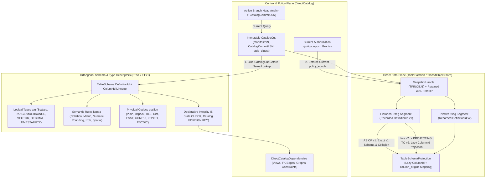

# 10. Standards, collations and historical catalogs

[Roadmap](README.md) · [Issue #31](https://github.com/spoke-sh/transit/issues/31) · **Status:** In Progress ([implementation plan](#implementation-plan--2026-10-30); [delivered evidence](#delivered-implementation-evidence--2026-10-30))

Establish historical query, collation/encoding fidelity, multi-model and branch
semantics using the [grammar inventory](../handbook/reference/sql/grammar-surface.md),
[query model](../handbook/internals/query-engine.md) and
[state model](../handbook/internals/state-model.md).

Extend the [shared data lifecycle](01-declarative-data-lifecycle.md) and
[manifest-backed storage hierarchy](02-storage-and-query-performance.md), using
the [transaction/snapshot contract](05-transactions-and-atomic-composition.md).
Historical retention extends a qualified basis; it neither keeps a transaction
session open nor makes unrelated source versions globally atomic.
Historical inspection must answer which definition, physical encoding and
collation interpreted the data, which immutable Manifest (`manifest/v{N}`) and
`.tseg` segments formed the snapshot, what a derived result depended on and
which current policy (`policy_epoch`) permits disclosure. Do not introduce a
second catalog identity or confuse a historical definition with current rights.

## Delivery sequence

The catalog/snapshot contract in
[#125](https://github.com/spoke-sh/transit/issues/125), retention/pins in
[#127](https://github.com/spoke-sh/transit/issues/127), and exact codec/collation
and layout identities in [#118](https://github.com/spoke-sh/transit/issues/118)
and [#128](https://github.com/spoke-sh/transit/issues/128) are foundations from
milestones 1–2. This milestone implements historical binding and conformance
over those contracts, rather than introducing a second snapshot representation.

1. **Publish a machine-readable standards and collation ledger:** edition/correction,
   feature, owner, dependencies, deviations and separate
   `parse`/`lower`/`execute`/`recover`/`transport` states. Include explicit
   collation descriptors (`UCS_BASIC`, `EBCDIC_037_PAD`, `EBCDIC_1047_NOPAD`,
   `ASCII_CI`, versioned `UCA`) and physical encoding rules (`COMP-3`, `ZONED`,
   `COMP`/`COMP-4`, `IBM_HFP`, `EBCDIC`). Generate capabilities and licensed
   positive/negative fixtures.
2. **Define shared operators and read/mutate/capture/dispatch effects:** propagate
   determinism, fallibility, 5-state cell tags (`value`, `null`, `missing`,
   `type_error`, `conflict`), collation rules, change mode and work bounds.
   Explanation (`EXPLAIN`) does no work.
3. **Define manifest-backed historical catalogs:** bind stable catalog/column
   identities (`CatalogId`, `DefinitionId`, `ColumnId`), ancestry, column
   encodings and collations, immutable `.tseg`/`.tdel` inclusion lists,
   consistency basis (durable manifests and retained `TransitLog` frontiers,
   including accepted unflushed data), typed
   selectors, current access (`policy_epoch`) and conditional head publication.
4. **Bind historical schemas, collations, views, graph mappings and decoders before resolving names or compiling:**
   ensure `FOR SYSTEM_TIME AS OF` queries evaluate comparisons, zone-map pruning,
   sort orders and foreign/mainframe decodings against the exact definition and
   collation recorded at the snapshot manifest, while checking authorization
   against the current `policy_epoch`. Moving a branch cannot change an accepted
   request's basis.
5. **Define declarative relational integrity (`CHECK` and `FOREIGN KEY` constraints) and lazy vs. phased schema evolution:**
   bind deterministic row-level `CHECK` expressions (preserving 5-state `type_error`
   and `null` rules) and cross-table `FOREIGN KEY ... REFERENCES ...` declarations
   (`RESTRICT`, `NO ACTION`, `CASCADE`, `SET NULL` on update/delete) to stable
   `CatalogId`, `DefinitionId` and `ColumnId` identities in the catalog dependency
   graph. Separate metadata- and projection-only `ALTER TABLE` evolutions—evaluated
   lazily on read by projecting each historical `.tseg` segment's recorded
   `DefinitionId` and 5-state `missing`/default cells into the active schema—from
   physical type or collation rewrites, which must execute through the recoverable
   online phased rewrite lifecycle in [Milestone 11](11-indexing-and-access-paths.md)
   rather than blocking large tables with synchronous full-table rewrites.
6. **Formalize companion orthogonal type families ($\tau \perp \kappa \perp \epsilon$) across Ranges, Dense Vectors, Decimal Arithmetic, Pinned-TZ Timestamps and Spatial Descriptors:**
   extend [`FUZE_TYPES_V1.md`](../../contracts/FUZE_TYPES_V1.md) and
   [`TABLE_SCHEMA_V1.md`](../../contracts/TABLE_SCHEMA_V1.md) in a single
   current-v1 cutover so downstream indexing, incremental dataflow, search and
   geospatial milestones share one rigorous type foundation:
   - **Canonical Ranges & Multi-Ranges (`RANGE<T>`, `MULTIRANGE<T>`):** support
     discrete and continuous intervals over `INT64`, `DECIMAL`, `DATE`,
     `TIMESTAMP` and `TIMESTAMPTZ` inheriting the element type's $\kappa_T$ order
     with `[lower, upper)` canonicalization, Allen's interval predicates (`&&`
     overlaps, `@>` contains, `-|-` adjacent), and sorted non-overlapping
     `MULTIRANGE` interval runs (serving as the 1D base case of
     [Milestone 12's](12-sql-and-dataflows.md) `PERIOD FOR valid_time` and
     [Milestone 17's](17-geospatial-and-spatio-temporal-computing.md) `BBOX` /
     `S2` cell coverings).
   - **Unboxed Dense Numeric Vectors (`VECTOR(dim, elem_type)`):** distinguish
     fixed-dimension `FLOAT32`, `FLOAT16`, `BFLOAT16`, `INT8` and `BINARY`
     embedding/coordinate vectors (stored as 64B-aligned unboxed SIMD slabs with
     zero per-element 5-state tag overhead and bound to a distance metric
     descriptor $\kappa_{\text{metric}} \in \{\text{L2\_SQUARED}, \text{COSINE},
     \text{DOT\_PRODUCT}, \text{HAMMING}\}$) from recursive 5-state `ARRAY` cells.
   - **Deterministic Decimal Arithmetic & Pinned-Timezone Timestamps (`DECIMAL`, `TIMESTAMPTZ`):**
     specify exact scale-promotion and rounding rules ($\kappa_{\text{numeric}}
     \in \{\text{REJECT}, \text{HALF\_EVEN}, \text{TOWARD\_ZERO}\}$) for
     `DECIMAL(p, s)` arithmetic and aggregates, and bind `TIMESTAMPTZ` operations
     (`AT TIME ZONE`, calendar bucketing) to an immutable IANA `tzdb` version
     digest ($\kappa_{\text{tz}}$, e.g. `tzdb_2026a`) recorded in `manifest/v{N}`
     so `FOR SYSTEM_TIME AS OF` queries remain bit-for-bit reproducible across
     future timezone database updates.
   - **Spatial & 3D Volumetric Reference & Precision Descriptors ($\kappa_{\text{spatial}}$):**
     reserve the catalog descriptor bindings (`SRID`, vertical datum / unit
     scale / axis orientation `RightHanded_ZUp` vs. `YUp`, `PLANAR` vs.
     `GEODESIC` manifold, 2D/3D snap-rounding grid scale $\delta_{\text{grid}}$,
     Shewchuk exact `orient2d`/`orient3d`/`incircle`/`insphere` predicates, and
     `S2_HILBERT` / `H3` / `HILBERT_3D` space-filling curve order) consumed by
     [Milestone 17](17-geospatial-and-spatio-temporal-computing.md).
7. **Expose historical inspection and explicit projections through shared operations:**
   distinguish metadata permission from row/segment access and report exact
   manifest provenance, constraint dependencies and per-segment schema projection
   coverage.

## Boundaries and evidence

Bind [index definitions and coverage](11-indexing-and-access-paths.md) to these
same retained source/column identities, declared `FOREIGN KEY`/`CHECK` constraints
and exact comparison/collation versions.
Specify rejection or rebuild when an index cannot interpret a requested cut;
current physical indexes are not automatically valid for historical queries.
Register indexing DDL/access-method options as explicit Transit extensions with
separate parse, execution and recovery evidence. A normalized key codec must be
proved against every admitted comparison profile; its existence does not imply
universal UCA, type, direction or five-state support.

Target selected SQL:2023, SQL/JSON, SQL/PGQ and SQL/MED features explicitly.
GQL, Cypher and PGQL need separate frontend/compatibility evidence; the later
[SQL grammar, standards comparison and dialect ergonomics milestone](43-sql-grammar-and-dialect-ergonomics.md)
audits the complete pre-release SQL grammar against industry dialects (PostgreSQL,
DuckDB, Snowflake, ClickHouse, GoogleSQL and Materialize/Flink) and qualifies
compile-time ergonomic desugarings (`FROM`-first queries, `GROUP BY ALL`,
`ORDER BY ALL`, `SELECT * EXCLUDE/REPLACE`). Reserve
system-time syntax for temporal semantics; resource revisions, application
revisions, `TransitLog` LSNs and snapshot manifest versions remain distinct types.

Qualify rename/drop/recreate, changed historical views, collation-sensitive
historical comparisons (`EBCDIC` versus `UCS_BASIC`), unavailable/expired
`.tseg` history, lazy multi-version `.tseg` schema projection, declarative `CHECK`
and `FOREIGN KEY` catalog bindings, old-column success/new-column rejection,
explicit projections, metadata-only rights, revocation after a prefix and branch
movement after admission. Publish independent transition/canonical fixtures before
implementing branch storage.

## Implementation plan — 2026-10-30

### Plan basis and starting point

This plan is grounded in `HEAD` at `baa1bf562`
(2026-10-30). It connects the completed foundations from Milestones 1, 2, 4 and 5
and the active work in Milestones 3, 6, 7, 8, 9, 13, 20, 21 and 29 to a concrete,
reviewable delivery sequence for Milestone 10 (`P0`–`P8`). Planning does not
change runtime status: Milestone 10 remains `Planned` until its implementation
and qualification gates pass.

What earlier milestones have already established in the codebase:

- **Milestones 1 and 2 (Completed):**
  [`DATA_LIFECYCLE_V1.md`](../../contracts/DATA_LIFECYCLE_V1.md) defines neutral
  [`Scope`](../../packages/zig/transit-protocol/src/DataLifecycle.zig),
  `Object`, `Definition`, `Operation`, `Position`, `Content`, `SourceCut` and
  `Snapshot` identities; [`INDEX_LIFECYCLE_V1.md`](../../contracts/INDEX_LIFECYCLE_V1.md)
  defines offline index descriptors (`IndexLifecycle.zig`); and
  `transit-storage` / `transit-fuze` deliver `TransitLog` (`TWAL1`),
  `TransitObjectStore`, `.tseg` immutable segments, `.tdel` deletion vectors,
  [`PhysicalCodecs.zig`](../../packages/zig/transit-fuze/src/PhysicalCodecs.zig)
  (`plain`, `bitpacked`, `rle`, `dictionary`, `fsst`, `comp`, `comp_3`, `zoned`,
  `ibm_hfp`, `ebcdic`),
  [`Collation.zig`](../../packages/zig/transit-fuze/src/Collation.zig)
  (`none`, `utf8_binary`, `ascii_ci`, `ebcdic_cp037`, with `icu_root` reserved
  and rejected), and [`TableSchema.zig`](../../packages/zig/transit-fuze/src/TableSchema.zig)
  (`FTS1`/`FTP1`).
- **Milestone 3 (In Progress):**
  [`DirectCatalog`](../../packages/zig/transit-catalog/src/DirectCatalog.zig) and
  [`TablePartition`](../../packages/zig/transit-storage/src/TablePartition.zig)
  own durable catalog and partition state; Step 1 of [Milestone 6](06-streams-queues-and-durable-runtime.md)
  (`DatabaseRuntime`) decoupled SQL admission from `Station` actor turns; and
  initial lazy schema evolution landed for compatible `ALTER TABLE` mutations
  (`RENAME COLUMN`, nullable/constant-default `ADD COLUMN`, non-key `DROP COLUMN`,
  and `SET/DROP DEFAULT`) across
  [`TableEvolution.zig`](../../packages/zig/transit-fuze/src/TableEvolution.zig),
  [`TableSchemaProjection.zig`](../../packages/zig/transit-fuze/src/TableSchemaProjection.zig),
  [`TableProjection.zig`](../../packages/zig/transit-fuze/src/TableProjection.zig)
  and [`TableInterpretations.zig`](../../packages/zig/transit-storage/src/TableInterpretations.zig)
  (retaining `physical_schemas` and `column_origins` inside
  [`TablePartitionRecord.Root`](../../packages/zig/transit-storage/src/TablePartitionRecord.zig)).
- **Milestones 4 and 5 (Completed):**
  [`transit-sql-results`](../../packages/zig/transit-sql-results/src/root.zig) and
  [`transit-sql-client`](../../packages/zig/transit-sql-client/src/root.zig)
  enforce bounded `StatementResult` / `ResultSet` consumption with observation
  evidence (`SourceCut`, `Snapshot`, `CatalogObservation`, `SettingsObservation`)
  and per-batch `policy_epoch` rechecks;
  [`DirectTransaction`](../../packages/zig/transit-catalog/src/DirectTransaction.zig)
  and [`TableTransaction`](../../packages/zig/transit-storage/src/TableTransaction.zig)
  implement serializable multi-Table transactions, retained common cuts
  (`0x54584331`), private workspaces (`0x54585731`) and `TableGuard` definition
  and policy checks.
- **Milestones 6, 7, 8 and 9 (In Progress):**
  `transit-protocol` defines neutral `StreamQueue` (`STREAM_V1.md`, `QUEUE_V1.md`)
  bindings and `transit-bitmap` provides canonical Roaring containers;
  `transit-document` provides the deterministic `DOC1`/`DCH1`/`DMR1` codecs and
  private `DocumentIndex` `.tseg` staging; `transit-sql` uses event-driven
  recovery and co-hosted local Table dispatch; and `transit-data-client`,
  `transit-fuze` (`QueryValues`, `NeutralEncoding`) and `transit-query-direct`
  (`RelationalBridge`, `TableChangeReader`) form the shared client/data
  extraction layer.

### Pre-implementation source audit

| Milestone 10 boundary | Current source owner | Delivered baseline at `baa1bf562` | Remaining gap for Milestone 10 |
| --- | --- | --- | --- |
| Machine-readable standards & collation ledger (Step 1) | [`grammar-surface.md`](../handbook/reference/sql/grammar-surface.md), [`contracts/sql/corpus/`](../../contracts/sql/README.md) | Prose capability table in `grammar-surface.md`; 5 JSON statement corpora (`statements.json`, `mutations.json`, `relational.json`, `declarations.json`, `parameters.json`) tested by parser/contract suites | No machine-readable standards ledger binding ISO/edition/feature IDs, collation descriptors (`UCS_BASIC`/`UTF8_BINARY`, `ASCII_CI`, `EBCDIC_037_PAD`, `EBCDIC_1047_NOPAD`, versioned `UCA`), physical codecs and separate `parse`/`lower`/`execute`/`recover`/`transport` states to generated capability views and positive/negative fixtures |
| Shared operators & read/mutate/capture/dispatch effects (Step 2) | [`LogicalQuery.zig`](../../packages/zig/transit-fuze/src/LogicalQuery.zig), [`Relational.zig`](../../packages/zig/transit-fuze/src/Relational.zig), [`DatabaseRuntime.zig`](../../packages/zig/transit-sql/src/DatabaseRuntime.zig) | `LogicalQuery` (`FQP1`) and `Relational` evaluate 5-state cells (`value`, `null`, `missing`, `type_error`, `conflict`) and collations; `EXPLAIN` renders logical/storage plan summaries | Operator nodes lack a unified trait/effect descriptor (`read`, `mutate`, `capture`, `dispatch`; determinism; fallibility; 5-state propagation; collation rule; change mode; work bounds) validated during lowering and surfaced in structured `EXPLAIN` without acquiring data pins or executing work |
| Manifest-backed historical catalogs (Step 3) | [`DirectCatalog.zig`](../../packages/zig/transit-catalog/src/DirectCatalog.zig), [`DirectCatalogRoots.zig`](../../packages/zig/transit-catalog/src/DirectCatalogRoots.zig), [`DirectCatalogRecords.zig`](../../packages/zig/transit-catalog/src/DirectCatalogRecords.zig), [`TableSnapshot.zig`](../../packages/zig/transit-storage/src/TableSnapshot.zig) | `DirectCatalogStore` appends every catalog root to the control WAL and `DirectCatalogRoots` traverses hash-verified historical root records from the disk log with bounded memory; `TablePartition` persists `HistoryPoint` and `SnapshotHandle` (`TPINOBJ1`) with `.tseg` segment lists and `DefinitionId` | `DirectCatalog` lookup (`lookup`, `tables`, `describe`) only resolves against `self.root` (the active head). There is no immutable `CatalogCut` / `manifest/v{N}` catalog snapshot index mapping historical cuts or named branch heads to historical object names, `DefinitionId`s, column origins, views, constraints and `tzdb` digests while enforcing current `policy_epoch` grants |
| Historical SQL & query binding (`AS OF`) and explicit projection (Steps 4, 7) | [`TransitExtensions.g4`](../../contracts/sql/TransitExtensions.g4), [`DirectRelationalCompilation.zig`](../../packages/zig/transit-query-direct/src/DirectRelationalCompilation.zig), [`ReadCache.zig`](../../packages/zig/transit-sql/src/ReadCache.zig), [`SnapshotRead.zig`](../../packages/zig/transit-protocol/src/SnapshotRead.zig) | `TablePartition` can read a retained `HistoryPoint` by `Snapshot` identity via `SnapshotRead`, and `TableSchemaProjection` maps old `.tseg` segments into the current schema on live reads | `asOfFragment` in `TransitExtensions.g4` is an isolated `FOR SYSTEM_TIME AS OF integer` rule not wired through end-to-end catalog name resolution. SQL `SELECT`/`SHOW`/`DESCRIBE`/`EXPLAIN` cannot yet bind a historical `CatalogCut` before resolving renamed/dropped tables, columns, views and collations, nor request explicit schema projection (`PROJECTING TO`) with per-segment projection coverage |
| Declarative `CHECK` & `FOREIGN KEY` constraints and lazy vs. phased evolution (Step 5) | [`TableDdl.zig`](../../packages/zig/transit-fuze/src/TableDdl.zig), [`TableSchema.zig`](../../packages/zig/transit-fuze/src/TableSchema.zig), [`TableEvolution.zig`](../../packages/zig/transit-fuze/src/TableEvolution.zig), [`DirectDependency.zig`](../../packages/zig/transit-catalog/src/DirectDependency.zig) | `TableSchema` stores `primary_key`, `nullable` and `max_characters`; `TableEvolution` handles compatible lazy `RENAME`/`ADD`/`DROP`/`DEFAULT`; `DirectCatalogDependencies` maintains paged forward/reverse dependency lists | [`TableDdl.zig:119-122`](../../packages/zig/transit-fuze/src/TableDdl.zig#L119-L122) rejects `CHECK`, `FOREIGN KEY`, `REFERENCES`, `UNIQUE` and `CONSTRAINT` (`error.UnsupportedTableConstraint`). `TableSchema` (`FTS1`) lacks `CHECK` and `FOREIGN KEY` descriptors; `TableEvolution` rejects all physical type/collation changes without distinguishing small synchronous validation from [Milestone 11's](11-indexing-and-access-paths.md) online phased rewrite |
| Companion orthogonal type families $\tau \perp \kappa \perp \epsilon$ (Step 6) | [`Types.zig`](../../packages/zig/transit-fuze/src/Types.zig), [`Values.zig`](../../packages/zig/transit-fuze/src/Values.zig), [`TableSchema.zig`](../../packages/zig/transit-fuze/src/TableSchema.zig), [`Collation.zig`](../../packages/zig/transit-fuze/src/Collation.zig) | `FTY1`/`FVL1` (`transit.fuze.types.v1.2026-09-30`, tags 1–27) and `FTS1`/`FTP1` (`transit.table.schema.v1.2026-10-23`) cover scalars, `decimal128(p,s)`, `timestamp(unit,tz)`, `array`, `struct`, `map`, `variant` and `vector(elem,dim)` without metric/precision descriptors | Missing canonical `RANGE<T>` / `MULTIRANGE<T>` (`&&`, `@>`, `-|-`), unboxed SIMD `VECTOR(dim, elem_type)` with $\kappa_{\text{metric}}$ (`L2_SQUARED`, `COSINE`, `DOT_PRODUCT`, `HAMMING`) and `FLOAT16`/`BFLOAT16`/`BINARY` elements, $\kappa_{\text{numeric}}$ rounding/scale rules, $\kappa_{\text{tz}}$ manifest-pinned IANA `tzdb` version digests, $\kappa_{\text{spatial}}$ catalog descriptors and `EBCDIC_037_PAD` / `EBCDIC_1047_NOPAD` / versioned `UCA` collation profiles |

### Coordination and handoffs across milestones

| Related milestone | Incoming foundation to Milestone 10 | Outgoing contract from Milestone 10 |
| --- | --- | --- |
| [M3: Live storage & SQL cutover](03-live-storage-and-sql-cutover.md) | Installed `DirectCatalog`, `TablePartition`, initial lazy `TableSchemaProjection` (`column_origins`, `physical_schemas`), `DatabaseRuntime` decoupling and warm `ReadCache` leases | Complete historical catalog root retention, lazy vs. phased `ALTER TABLE` classification, row-local 5-state `CHECK` validation in `TablePartition` and historical `AS OF` binding in `DatabaseRuntime` |
| [M4: Statement results](04-statement-results-and-consumption.md) & [M5: Transactions](05-transactions-and-atomic-composition.md) | `StatementResult` observation evidence (`Snapshot`, `CatalogObservation`), `Transaction.Cut` (`0x54584331`), `TableGuard` and serializable multi-Table commits | Historical catalog provenance (`CatalogCut`, `DefinitionId`, $\kappa_{\text{tz}}$, per-segment projection coverage) attached to `Observation` and verified against current `policy_epoch` on every batch |
| [M6: Streams, queues & runtime](06-streams-queues-and-durable-runtime.md) & [M7: Document storage](07-document-storage-and-station-decoupling.md) | `StreamPartition`, `QueuePartition`, direct `KV` and `DocumentPartition` (`DOC1`/`DCH1`/`DMR1`) catalog identities and `.tseg` segments | Shared `CatalogCut` resolution, `DirectDependency` tracking and $\tau \perp \kappa \perp \epsilon$ descriptors across Tables, Streams, Queues, KV and Documents without `Station` actor turns |
| [M8: Gateway architecture](08-gateway-architecture-and-protocol-ingress.md) & [M9: Client foundation](09-client-foundation-and-language-apis.md) | Co-hosted `DatabaseRuntime`, sans-I/O protocol state machines, `transit-data-client` (`Catalog`), `QueryValues` and `NeutralEncoding` | Single current-v1 `FTY1`/`FVL1`/`FTS1`/`FTP1` cutover consumed once across `transit-data-client`, `transit-sql-client`, C ABI (`transit-station-bindings`) and all 10 SDKs |
| [M11: Indexing & access paths](11-indexing-and-access-paths.md) | Offline `IndexLifecycle` (`IDX1`) descriptors in `transit-protocol` | Catalog-bound `FOREIGN KEY` (`RESTRICT`, `NO ACTION`, `CASCADE`, `SET NULL`) and `CHECK` descriptors, collation/codec version bindings for index coverage, and handoff of index-backed `FOREIGN KEY` runtime enforcement and online phased physical table/column rewrites (`Staged -> Backfilling -> CatchingUp -> Validating -> Conditional Cutover`) |
| [M12: Managed computations & dataflows](12-sql-and-dataflows.md) | Single-table relational plans and `TableChangeReader` | Canonical `RANGE<T>`/`MULTIRANGE<T>` backing `PERIOD FOR valid_time`, historical `CatalogCut` semantics for bitemporal `AS OF JOIN`, and operator effect/trait descriptors (`read`, `mutate`, `capture`, `dispatch`) |
| [M13: Data structures & performance](13-data-structures-and-performance.md) & [M14: Strings & search](14-vectorized-strings-and-search.md) | Bounded scratch arenas (`#194`) and dictionary/FSST codecs | Exact collation descriptors ($\kappa$) required by 16B collation-prefixed Umbra/German strings, compressed-domain predicates and order-preserving sort keys |
| [M17: Geospatial & 3D computing](17-geospatial-and-spatio-temporal-computing.md) & [M18: Multi-model & foreign relations](18-multi-model-and-foreign-relations.md) | Architectural review commitments (`2026-10-29`) | Reserved $\kappa_{\text{spatial}}$ catalog descriptors (`SRID`, vertical datum/orientation, `PLANAR`/`GEODESIC`, $\delta_{\text{grid}}$, Shewchuk predicates, curve order), unboxed `VECTOR(dim, T)` with $\kappa_{\text{metric}}$, and catalog bindings for views, SQL/PGQ property graphs and SQL/MED foreign/mainframe tables |
| [M20: Branches, merges & restore](20-branches-merges-and-restore.md) | Single-branch (`main`) catalog and partition roots | Immutable `manifest/v{N}` catalog cuts, typed branch/snapshot selectors, conditional head publication, independent transition/canonical fixtures and constraint descriptors re-verified during 3-way merge |
| [M22: Formal semantics](22-formal-semantics-and-correspondence.md) & [M43: SQL grammar & dialect ergonomics](43-sql-grammar-and-dialect-ergonomics.md) | `A1` (`FuzeRewrite.lean`), `A2` (`CollationOrder.lean`), `A5` (`CodecProofs.lean`) and `T8` (`DdlAndDataflowLifecycle.tla`) proof obligations | Machine-readable standards & collation ledger (`contracts/sql/standards-ledger.json`), normalized key/collation fixtures for `A2`/`A5`, and lazy-evolution/5-state `T8` transition rules |

### Accepted architectural decisions

1. **D1 — Immutable historical catalog cut (`CatalogCut`) bound before name resolution, fenced by current `policy_epoch`:**
   Every historical query (`AS OF SNAPSHOT`, `AS OF` manifest cut, or pinned
   branch head) resolves an immutable `CatalogCut` (`(CatalogId, CatalogCommitLSN,
   ManifestVersion, TzdbVersionDigest)`) in `DirectCatalog` *before* resolving
   table names, column names, views, property-graph mappings, foreign decoders,
   collations ($\kappa$) or physical codecs ($\epsilon$). Subsequent `RENAME`,
   `ALTER`, `DROP`, `CREATE` or branch head movement cannot rebind an admitted
   query or saved operation. Authorization is never historical: read and metadata
   grants are checked against the **current** `policy_epoch` at admission and on
   every disclosed result batch.
2. **D2 — Strict separation between historical interpretation (`AS OF`) and explicit schema projection (`PROJECTING TO`):**
   Reading a table at a historical cut interprets every `.tseg` segment and WAL
   delta using the exact `DefinitionId`, column names, collations and defaults
   active at that cut (or lazily projects segments older than *that* historical
   cut into *that* historical cut's `DefinitionId` via `column_origins`).
   Callers that want to inspect historical data through the lens of a newer or
   explicit target `DefinitionId` must request explicit schema projection,
   matching columns by stable `ColumnId` (never by reused column name),
   distinguishing 5-state `missing` cells from `null` and frozen `ADD`-time
   defaults, and receiving per-segment projection coverage in result provenance.
3. **D3 — Separate lazy metadata/projection `ALTER TABLE` from online phased physical rewrites:**
   Schema evolution in `TableEvolution.zig` and `DirectCatalog` is partitioned
   into two explicit classes:
   - **Class A (Lazy metadata & projection evolution — Milestone 10):** non-key
     `RENAME COLUMN`, `RENAME TABLE`, nullable or constant-default `ADD COLUMN`,
     non-key `DROP COLUMN` (when not referenced by an active `CHECK`,
     `FOREIGN KEY`, index or view), `ALTER COLUMN SET/DROP DEFAULT`, and adding
     a `NOT VALID` constraint. Class A publishes a new `DefinitionId` in one
     control-WAL commit without rewriting existing `.tseg` files; readers project
     older `.tseg` segments on the fly via `TableSchemaProjection.zig`.
   - **Class B (Physical type, encoding $\epsilon$, collation $\kappa$, primary-key or validated constraint rewrite — handed to Milestone 11 for online execution):**
     changing a column's physical storage representation, changing collation
     ($\kappa$), tightening `NULL` $\to$ `NOT NULL` or validating a `CHECK` /
     `FOREIGN KEY` over existing rows. In Milestone 10, `TableEvolution` records
     the required `RewriteKind` (`none_lazy`, `validation_scan_only`,
     `physical_segment_rewrite`) and refuses synchronous unbounded rewrites on
     populated tables with a structured diagnostic pointing to
     [Milestone 11's](11-indexing-and-access-paths.md) recoverable online phased
     rewrite lifecycle (`Staged -> Backfilling -> CatchingUp -> Validating ->
     Conditional Cutover`). Empty tables (`row_count == 0` with no retained
     unprojected segments) may transition definition metadata immediately.
4. **D4 — Bind `CHECK` and `FOREIGN KEY` constraints to stable catalog identities; enforce 5-state `CHECK` locally and gate active `FOREIGN KEY` writes on Milestone 11's index-backed enforcer:**
   - **Row-level `CHECK` constraints:** compiled into deterministic, effect-free
     (`read`-only, no external/subquery access) expressions over stable
     `ColumnId`s inside `TableSchema` (`FTS1`). Under Transit's 5-state cell
     algebra, a `CHECK` expression passes when it evaluates to `value(true)` or
     `null` (SQL `UNKNOWN`), and rejects the write with structured constraint
     attribution (`ConstraintId`, `ConstraintName`, `ColumnId`, `CellState`) when
     it evaluates to `value(false)`, `type_error`, `conflict`, or `missing` on a
     referenced column.
   - **Cross-table `FOREIGN KEY` constraints:** bound to stable target
     `(Object, DefinitionId, []const ColumnId)` identities and referential
     actions (`RESTRICT`, `NO ACTION`, `CASCADE`, `SET NULL` for `ON DELETE` and
     `ON UPDATE`) in `TableSchema` (`FTS1`) and registered as typed edges in
     `DirectCatalogDependencies` so `DROP TABLE RESTRICT` and incompatible parent
     column `DROP`/`ALTER` are rejected immediately by the catalog. Because
     full-table scans on parent/child mutations violate bounded-work rules,
     runtime cross-table `FOREIGN KEY` enforcement during DML/transactions requires
     [Milestone 11's](11-indexing-and-access-paths.md) maintained unique/foreign-key
     indexes and key-range SSI guards. Until Milestone 11's index-backed enforcer
     is active for the bound constraint, `DirectCatalog` admits `FOREIGN KEY`
     declarations in `NOT ENFORCED` / staged catalog validation mode (or on empty
     tables prior to write admission) and refuses unindexed DML that would
     require an unbounded referential scan, never silently ignoring an enforced
     constraint.
5. **D5 — Single coordinated current-v1 cutover for companion orthogonal types ($\tau \perp \kappa \perp \epsilon$):**
   Per the [versioning policy](../handbook/reference/versioning.md), all
   Milestone 10 additions to [`FUZE_TYPES_V1.md`](../../contracts/FUZE_TYPES_V1.md)
   (`FTY1` / `FVL1`) and [`TABLE_SCHEMA_V1.md`](../../contracts/TABLE_SCHEMA_V1.md)
   (`FTS1` / `FTP1`) land in **one coordinated current-v1 hard cutover** (`P1`),
   replacing the definition identifiers once and regenerating all Zig, C ABI,
   TypeScript and SDK fixtures together:
   - Canonical `RANGE<T>` and `MULTIRANGE<T>` over `INT64`, `DECIMAL`, `DATE`,
     `TIMESTAMP` and `TIMESTAMPTZ` with `[lower, upper)` canonicalization for
     discrete domains, empty/unbounded/inclusive/exclusive bound flags, and
     Allen's interval operators (`&&`, `@>`, `<@`, `-|-`, `<<`, `>>`).
   - Unboxed dense `VECTOR(dim, elem_type)` supporting `FLOAT32`, `FLOAT16`,
     `BFLOAT16`, `INT8` and `BINARY` (bit-packed Hamming vectors) with 64-byte
     SIMD alignment, zero per-element 5-state tag overhead, and column-bound
     $\kappa_{\text{metric}} \in \{\text{L2\_SQUARED}, \text{COSINE},
     \text{DOT\_PRODUCT}, \text{HAMMING}\}$.
   - Deterministic `DECIMAL(p, s)` arithmetic/aggregate descriptor
     $\kappa_{\text{numeric}} \in \{\text{REJECT}, \text{HALF\_EVEN},
     \text{TOWARD\_ZERO}\}$ and `TIMESTAMPTZ` calendar descriptor
     $\kappa_{\text{tz}}$ pinning an immutable IANA `tzdb` version digest
     (e.g. `tzdb_2026a`) in the catalog manifest.
   - Reserved $\kappa_{\text{spatial}}$ catalog descriptor (`SRID`, vertical
     datum, unit scale, `RightHanded_ZUp` vs. `YUp` axis orientation, `PLANAR` vs.
     `GEODESIC` manifold, 2D/3D snap-rounding grid $\delta_{\text{grid}}$,
     Shewchuk exact predicate mode and `S2_HILBERT` / `H3` / `HILBERT_3D` curve
     order) so [Milestone 17](17-geospatial-and-spatio-temporal-computing.md)
     activates spatial execution without another breaking `FTS1` schema cutover.
   - Complete collation descriptor $\kappa_{\text{collation}}$ (`none`,
     `ucs_basic` / `utf8_binary`, `ascii_ci`, `ebcdic_037_pad`,
     `ebcdic_037_nopad`, `ebcdic_1047_nopad`, and versioned `uca_v15_1` with
     explicit pad/case/accent attributes) paired with proven order-preserving
     sort-key rules or explicit rejection.
6. **D6 — Machine-readable standards ledger is the single source of capability truth:**
   `contracts/sql/standards-ledger.json` owns every SQL:2023, SQL/JSON, SQL/PGQ,
   SQL/MED and Transit extension feature entry, collation profile and physical
   codec rule, recording separate `parse`, `lower`, `execute`, `recover` and
   `transport` statuses. `docs/handbook/reference/sql/grammar-surface.md` and
   capability inspection tables are verified against this ledger in CI so parser
   grammar (`contracts/sql/`) can never be mistaken for execution support.

### Work package sequence (`P0`–`P8`)

| Package | Scope | Start gate | Primary owners | Exit gate |
| --- | --- | --- | --- | --- |
| [`P0`](#p0-machine-readable-standards-collation-and-operator-effect-ledger) | Machine-readable standards, collation & operator-effect ledger (`standards-ledger.json`, `OperatorTraits`, zero-work `EXPLAIN`) | Current `HEAD` | `contracts/sql/`, `transit-fuze`, `transit-sql`, `tasks/` | Ledger schema + generator check passes; every SQL/collation/codec feature records `parse`/`lower`/`execute`/`recover`/`transport` states; `EXPLAIN` reports operator effects and bounds without data pins |
| [`P1`](#p1-coordinated-current-v1-cutover-for-companion-types-and-collation-descriptors) | Single current-v1 cutover of `FUZE_TYPES_V1` (`FTY1`/`FVL1`) and `TABLE_SCHEMA_V1` (`FTS1`/`FTP1`) for `RANGE`/`MULTIRANGE`, `VECTOR`, $\kappa_{\text{numeric}}$, $\kappa_{\text{tz}}$, $\kappa_{\text{spatial}}$ and collation profiles | `P0` | `transit-fuze`, `transit-protocol`, `transit-storage`, `transit-catalog`, `transit-data-client`, `transit-station-bindings`, `sdks/` | Updated `FTY1`/`FVL1`/`FTS1`/`FTP1` contract IDs, codecs, Allen interval operators, SIMD vector distances, `DECIMAL` rounding, `tzdb` digests, collation sort keys and regenerated SDK/ABI fixtures pass |
| [`P2`](#p2-declarative-check-and-foreign-key-constraints-and-dependency-graph) | Declarative `CHECK` and `FOREIGN KEY` DDL/schema compilation, row-local 5-state `CHECK` evaluation and catalog dependency graph enforcement | `P1` | `transit-fuze` (`TableDdl`, `TableSchema`), `transit-catalog` (`DirectCatalog`, `DirectDependency`), `transit-storage` (`TablePartition`) | `CREATE`/`ALTER TABLE` compiles `CHECK` and `FOREIGN KEY`; `TablePartition` enforces 5-state `CHECK` on insert/update; `DirectCatalog` blocks `DROP`/`ALTER` violating FK edges and gates active FK writes on M11 |
| [`P3`](#p3-lazy-versus-phased-schema-evolution-and-segment-projection-provenance) | Lazy vs. phased `ALTER TABLE` classification, multi-version `.tseg` projection refinement and per-segment projection coverage | `P1`, `P2` | `transit-fuze` (`TableEvolution`, `TableSchemaProjection`), `transit-storage` (`TableInterpretations`, `TablePartition`), `transit-catalog` | Class A lazy evolutions (`RENAME`, `ADD`, `DROP`, `DEFAULT`) project across multi-version `.tseg` segments with frozen `column_origins`; Class B physical rewrites classify `RewriteKind` and hand off to M11 |
| [`P4`](#p4-manifest-backed-historical-catalogs-and-snapshot-catalog-cuts) | Manifest-backed historical catalog roots (`CatalogCut`), snapshot-to-catalog binding, conditional head publication and retention pins | `P1`, `P3` | `transit-catalog` (`DirectCatalog`, `DirectCatalogRoots`, `DirectCatalogStore`), `transit-storage` (`TableSnapshot`), `transit-protocol` | Historical `CatalogCut` resolves exact object names, `DefinitionId`, column origins, constraints and `tzdb` digest at any retained snapshot/manifest cut; expired cuts fail with typed retention errors |
| [`P5`](#p5-historical-sql-binding-as-of-selectors-and-explicit-schema-projection) | End-to-end `AS OF` SQL/query binding before name resolution, explicit `PROJECTING TO` schema projection and historical `SHOW`/`DESCRIBE`/`EXPLAIN` under current `policy_epoch` | `P0`, `P3`, `P4` | `contracts/sql/`, `transit-fuze`, `transit-query-direct`, `transit-sql` (`DatabaseRuntime`, `DirectRelationalCompilation`, `ReadCache`) | Queries bind `CatalogCut` before resolving renamed/dropped tables, columns, views and collations (`EBCDIC` vs. `UCS_BASIC`); current `policy_epoch` revocation blocks historical reads including mid-stream batches |
| [`P6`](#p6-multi-model-catalog-bindings-views-property-graphs-and-foreign-decoders) | Catalog descriptor bindings and historical revalidation for SQL views, SQL/PGQ property-graph mappings and SQL/MED foreign/mainframe table definitions | `P4`, `P5` | `transit-fuze`, `transit-catalog`, `transit-query-direct`, `transit-sql` | Views, property-graph declarations and foreign/mainframe (`COMP-3`, `ZONED`, `EBCDIC`, `IBM_HFP`) descriptors bind by `(Object, DefinitionId, ColumnId)` in `DirectCatalog` and revalidate on `ALTER`/`RENAME`/`DROP` |
| [`P7`](#p7-shared-client-sdk-and-board-historical-and-constraint-inspection) | Shared client, C ABI/SDK and read-only Board inspection for historical provenance, constraints, capability ledger and explicit projections | `P5`, `P6` (coordinated with M9/M30) | `transit-sql-results`, `transit-sql-client`, `transit-data-client`, `transit-board` | Shared clients and Board expose `CatalogCut`, `DefinitionId`, `tzdb` digest, constraint dependencies and per-segment projection coverage without raw storage access or UI-only heuristics |
| [`P8`](#p8-formal-correspondence-and-milestone-10-qualification-gate) | Formal correspondence (`A1`, `A2`, `A5`, `T8` slices), transition/canonical branch fixtures and common-revision qualification in the proof ledger | `P0`–`P7` | `tests/qualification/`, `proofs/` (M22), `docs/history/qualification/` | All Milestone 10 positive, negative, fault and authorization checks pass at one revision and are recorded in the qualification ledger |

---

#### `P0`: Machine-readable standards, collation and operator-effect ledger

- **Goal:** Replace prose-only capability tracking with a validated,
  machine-readable standards, collation and physical-codec ledger and attach
  explicit operator effect/trait descriptors to Fuze logical plans.
- **Concrete changes:**
  1. Create `contracts/sql/standards-ledger.json` (and its validator in
     `tests/query/logical/standards_ledger.py`) cataloging:
     - Standard editions and parts: ISO/IEC 9075-2 (SQL:2023 Foundation),
       9075-14 (SQL/XML), 9075-15 (Multi-Dimensional Arrays / vectors), 9075-16
       (SQL/PGQ), 9075-9 (SQL/MED), SQL/JSON, and explicit Transit extensions.
     - Per-feature lifecycle vector: `parse`, `lower`, `execute`, `recover`,
       `transport` $\in \{\text{implemented}, \text{staged}, \text{reference\_only},
       \text{rejected}\}$, owning package, contract doc, and positive/negative
       corpus fixture IDs in `contracts/sql/corpus/`.
     - Collation ledger entries: `UCS_BASIC` (`UTF8_BINARY`), `ASCII_CI`,
       `EBCDIC_037_PAD`, `EBCDIC_037_NOPAD`, `EBCDIC_1047_NOPAD`, and versioned
       `UCA_V15_1` (recording pad attribute `NO PAD` vs. `PAD SPACE`,
       deterministic tie-breaking, normalized sort-key availability, and zone-map
       pruning soundness).
     - Physical codec ledger entries: `PLAIN`, `BITPACKED`, `RLE`, `DICTIONARY`,
       `FSST`, `COMP` (`COMP-4`), `COMP-3`, `ZONED`, `IBM_HFP`, `EBCDIC` (recording
       valid logical $\tau$ targets, bit/byte width bounds, and 5-state `type_error`
       on invalid sign nibbles or unmappable code points).
  2. Add `OperatorTraits` and `EffectSet` (`read`, `mutate`, `capture`,
     `dispatch`; `deterministic: bool`; `fallible: bool`; `cell_state_rule:
     FiveStateRule`; `collation_propagation: CollationRule`; `change_mode:
     ChangeMode`; `work_bound: WorkBound`) to
     [`packages/zig/transit-fuze/src/LogicalQuery.zig`](../../packages/zig/transit-fuze/src/LogicalQuery.zig)
     and [`packages/zig/transit-fuze/src/Relational.zig`](../../packages/zig/transit-fuze/src/Relational.zig).
  3. Update [`packages/zig/transit-sql/src/DatabaseRuntime.zig`](../../packages/zig/transit-sql/src/DatabaseRuntime.zig)
     and [`packages/zig/transit-query-direct/src/DirectRelationalCompilation.zig`](../../packages/zig/transit-query-direct/src/DirectRelationalCompilation.zig)
     so `EXPLAIN` reports the resolved `EffectSet`, determinism, 5-state
     propagation, active collation $\kappa$, and work bounds strictly from
     catalog/plan metadata—verifying that `EXPLAIN` acquires zero `TablePartition`
     data pins, performs zero `.tseg` reads, and mutates zero state.
- **Verification:** `python3 -B tests/runner/launch.py tests/query/logical/standards_ledger.py`
  verifies the exact generated Zig projection of `contracts/sql/standards-ledger.json`.
  Compiler rejection and installed-session tests establish the corresponding behavior;
  `zig build test-fuze` and `zig build test-sql` verify `OperatorTraits` and
  zero-work `EXPLAIN`.

#### `P1`: Coordinated current-v1 cutover for companion types and collation descriptors

- **Goal:** Extend [`FUZE_TYPES_V1.md`](../../contracts/FUZE_TYPES_V1.md) (`FTY1`/`FVL1`)
  and [`TABLE_SCHEMA_V1.md`](../../contracts/TABLE_SCHEMA_V1.md) (`FTS1`/`FTP1`)
  in a single current-v1 hard cutover covering all Milestone 10 $\tau \perp \kappa \perp \epsilon$
  descriptors so downstream milestones (M11–M20) build on one settled wire and
  stored schema layout.
- **Concrete changes:**
  1. **Logical types ($\tau$) and values in
     [`Types.zig`](../../packages/zig/transit-fuze/src/Types.zig) and
     [`Values.zig`](../../packages/zig/transit-fuze/src/Values.zig):**
     - Add `range: RangeType` and `multirange: RangeType` where
       `RangeSubtype` $\in \{\text{int64}, \text{decimal128}, \text{date32},
       \text{timestamp}, \text{timestamptz}\}$. Implement canonical
       `[lower, upper)` normalization for discrete domains (`int64`, `date32`),
       empty-range canonicalization, sorted non-overlapping coalesced runs in
       `MULTIRANGE<T>`, and Allen's interval predicates (`overlaps` `&&`,
       `contains` `@>`, `contained_by` `<@`, `adjacent` `-|-`, `strictly_left`
       `<<`, `strictly_right` `>>`) in a new
       `packages/zig/transit-fuze/src/Range.zig`.
     - Expand `VectorElementType` in `Types.zig` to `float32`, `float16`,
       `bfloat16`, `int8`, `binary` (where `binary` dimension is a multiple of 8
       bits) with unboxed 64B-aligned SIMD slab representation in `Values.zig`
       and distance kernels (`l2Squared`, `cosineDistance`, `dotProduct`,
       `hammingDistance`) in `packages/zig/transit-fuze/src/VectorMetric.zig`.
  2. **Semantic descriptors ($\kappa$) in
     [`TableSchema.zig`](../../packages/zig/transit-fuze/src/TableSchema.zig) and
     [`Collation.zig`](../../packages/zig/transit-fuze/src/Collation.zig):**
     - Expand `Collation` to `none`, `utf8_binary` (`UCS_BASIC`), `ascii_ci`,
       `ebcdic_037_pad` (legacy `ebcdic_cp037` alias cut over to explicit pad
       semantics), `ebcdic_037_nopad`, `ebcdic_1047_nopad`, and `uca_v15_1`
       (with explicit rejection for any unimplemented locale parameter). Prove
       that normalized sort keys in `Collation.zig` preserve total order for
       every admitted profile so B-tree and `.tseg` zone-map min/max pruning are
       sound.
     - Add per-column semantic descriptor union `SemanticDescriptor` ($\kappa$) in
       `TableSchema.Column`:
       - `collation: Collation` (for `utf8`/`char`),
       - `numeric_rule: NumericRoundingRule` (`reject`, `half_even`,
         `toward_zero`) for `DECIMAL(p, s)` scale-promotion and rounding in a
         new `packages/zig/transit-fuze/src/DecimalArithmetic.zig`,
       - `vector_metric: VectorMetric` (`l2_squared`, `cosine`, `dot_product`,
         `hamming`) for `VECTOR(dim, elem_type)`,
       - `tz_rule: TzRule` referencing the catalog manifest's pinned IANA
         `tzdb` version digest ($\kappa_{\text{tz}}$, e.g. `tzdb_2026a`) for
         `TIMESTAMPTZ` calendar/bucketing operations,
       - `spatial_rule: SpatialDescriptor` ($\kappa_{\text{spatial}}$: `srid: u32`,
         `vertical_datum: u16`, `unit_scale_nm: u64`, `axis_orientation:
         enum { right_handed_z_up, right_handed_y_up }`, `manifold: enum {
         planar, geodesic_wgs84 }`, `snap_grid_scale: f64`, `exact_predicates:
         enum { shewchuk_adaptive }`, `curve_order: enum { none, s2_hilbert, h3,
         hilbert_3d }`) reserved in `FTS1` for
         [Milestone 17](17-geospatial-and-spatio-temporal-computing.md).
  3. **Hard cutover across contracts and bindings:**
     - Bump `FUZE_TYPES_V1` (`FTY1`/`FVL1`) and `TABLE_SCHEMA_V1` (`FTS1`/`FTP1`)
       contract definition identifiers, update `transit-protocol`,
       `transit-storage`, `transit-catalog`, `transit-data-client`,
       `transit-station-bindings` and SDK schema fixtures, and preserve explicit
       rejection tests for old or foreign contract identifiers.
- **Verification:** `zig build test-fuze`, `zig build test-protocol`,
  `zig build test-storage`, `zig build test-catalog`, and fixture verification
  across `contracts/` and `sdks/`.

#### `P2`: Declarative `CHECK` and `FOREIGN KEY` constraints and dependency graph

- **Goal:** Compile declarative `CHECK` and `FOREIGN KEY` constraints into
  `TableSchema` (`FTS1`) and `DirectCatalogDependencies`, enforce row-local
  5-state `CHECK` constraints in `TablePartition`, and prevent catalog or data
  mutations that violate declared referential integrity.
- **Concrete changes:**
  1. **Schema representation in
     [`TableSchema.zig`](../../packages/zig/transit-fuze/src/TableSchema.zig):**
     - Add `ConstraintId` (`u32`), `CheckConstraint` (`id`, `name`, `referenced_columns:
       []const ColumnId`, `predicate_bytes: []const u8`, `validated: bool`), and
       `ForeignKeyConstraint` (`id`, `name`, `local_columns: []const ColumnId`,
       `target_object: DataLifecycle.Object`, `target_definition:
       DataLifecycle.Definition`, `target_columns: []const ColumnId`,
       `on_delete: ReferentialAction`, `on_update: ReferentialAction`,
       `enforcement: enum { staged_awaiting_index, enforced }`) where
       `ReferentialAction` $\in \{\text{restrict}, \text{no\_action},
       \text{cascade}, \text{set\_null}\}$.
     - Enforce invariant checks: `SET NULL` requires all referencing
       `local_columns` to be `nullable`; referencing and referenced column lists
       must have identical arity, compatible logical types $\tau$, and identical
       collation/metric/numeric rules $\kappa$; `CHECK` predicates must be
       pure (`EffectSet == read`, deterministic, single-row, no subqueries or
       non-deterministic clock/random calls).
  2. **DDL parsing and lowering in
     [`TableDdl.zig`](../../packages/zig/transit-fuze/src/TableDdl.zig):**
     - Replace `error.UnsupportedTableConstraint` for `CONSTRAINT <name> CHECK (...)`,
       inline column `CHECK (...)`, `CONSTRAINT <name> FOREIGN KEY (...) REFERENCES
       <target>(...) [ON DELETE ...] [ON UPDATE ...]`, and inline column
       `REFERENCES <target>(...)` with typed AST/schema compilation.
     - Support `ALTER TABLE ... ADD CONSTRAINT ... CHECK (...) [NOT VALID]`,
       `ALTER TABLE ... ADD CONSTRAINT ... FOREIGN KEY (...) REFERENCES ...`, and
       `ALTER TABLE ... DROP CONSTRAINT <name>`.
  3. **Row-local 5-state `CHECK` evaluation in
     [`TablePartition.zig`](../../packages/zig/transit-storage/src/TablePartition.zig)
     and `TableTransaction.zig`:**
     - Evaluate active `CheckConstraint` predicates on every `INSERT`, `UPDATE`
       and `UPSERT` candidate row before WAL append or workspace stage.
     - Enforce the 5-state `CHECK` truth table:
       - `value(true)` or `null` $\to$ row accepted;
       - `value(false)`, `type_error`, `conflict`, or `missing` on a referenced
         column $\to$ reject operation with `error.CheckConstraintViolation` and
         structured diagnostic payload (`constraint_name`, `column_id`,
         `cell_state`).
  4. **Catalog dependency graph & M11 enforcement gate in
     [`DirectDependency.zig`](../../packages/zig/transit-catalog/src/DirectDependency.zig)
     and [`DirectCatalog.zig`](../../packages/zig/transit-catalog/src/DirectCatalog.zig):**
     - Extend `DirectDependency.Edge` with `kind: enum { view_source,
       foreign_key, graph_mapping, computed_source, constraint_column }` and
       referenced `ColumnId` slice.
     - When a `FOREIGN KEY` is declared, register the edge in
       `DirectCatalogDependencies`. `DROP TABLE` (without `CASCADE`), `ALTER TABLE
       DROP COLUMN` on a referenced parent column, or changing a parent/child
       column's $\tau$/$\kappa$ fails with `error.DependentForeignKeyExists`.
     - Enforce the Milestone 11 handoff gate: until a covering unique parent
       index and Milestone 11's index-backed FK runtime enforcer are bound to the
       constraint, `DirectCatalog` either requires explicit `NOT ENFORCED` /
       staged status or rejects DML writes to tables with `enforced` foreign keys
       with `error.ForeignKeyIndexEnforcementUnavailable`—never silently accepting
       writes without verifying the foreign key.
- **Verification:** Unit and integration tests in `transit-fuze`,
  `transit-catalog`, `transit-storage` and `transit-sql` covering 5-state `CHECK`
  acceptance/rejection (`true`, `null`, `false`, `type_error`, `missing`),
  invalid `SET NULL` on `NOT NULL` columns, mismatched $\kappa$ collations across
  FK columns, and blocked `DROP TABLE` / `DROP COLUMN` on referenced parent
  tables.

#### `P3`: Lazy versus phased schema evolution and segment projection provenance

- **Goal:** Complete the separation between instantaneous metadata/projection
  `ALTER TABLE` evolutions (Class A) and physical rewrite evolutions (Class B),
  and report exact per-segment projection coverage when reading multi-version
  `.tseg` files.
- **Concrete changes:**
  1. **Evolution classifier in
     [`TableEvolution.zig`](../../packages/zig/transit-fuze/src/TableEvolution.zig):**
     - Add `EvolutionPlan` returning `RewriteKind`:
       - `.lazy_metadata_or_projection`: `RENAME TABLE`, non-key `RENAME COLUMN`,
         nullable/constant-default `ADD COLUMN`, unreferenced non-key `DROP COLUMN`,
         `SET/DROP DEFAULT`, and `ADD CONSTRAINT ... NOT VALID`.
       - `.validation_scan_only`: `VALIDATE CONSTRAINT` or `SET NOT NULL` where
         physical `.tseg` layout is unchanged but existing rows must be scanned.
       - `.online_phased_rewrite`: physical type widening/conversion, codec
         ($\epsilon$) change, collation ($\kappa$) change, or primary-key
         restructuring.
     - Verify `CheckConstraint` and `ForeignKeyConstraint` column references
       during `DROP COLUMN` and `ALTER COLUMN`: a column referenced by an active
       `CHECK` or `FOREIGN KEY` cannot be dropped or have its $\tau$/$\kappa$
       altered unless the constraint is dropped in the same atomic DDL operation.
  2. **Multi-version `.tseg` lazy projection provenance in
     [`TableSchemaProjection.zig`](../../packages/zig/transit-fuze/src/TableSchemaProjection.zig)
     and [`TableInterpretations.zig`](../../packages/zig/transit-storage/src/TableInterpretations.zig):**
     - Ensure every `.tseg` segment read through `TablePartition` (both live and
       snapshot reads) resolves its recorded `DefinitionId` against
       `TableInterpretations` (`physical_schemas` and `column_origins`) and
       records a `SegmentProjectionSummary` (`source_definition: Definition`,
       `target_definition: Definition`, `segment_count: u32`,
       `synthesized_default_columns: u16`, `omitted_dropped_columns: u16`).
     - Preserve the distinction between a column added with `DEFAULT <const>`
       (synthesized from the frozen `ColumnOrigin` default for segments with
       `definition_sequence < origin.added_at_sequence`), a column added as
       nullable without a default (synthesized as `null`), and a 5-state
       `missing` cell in semi-structured/projected outputs.
- **Verification:** Multi-generation `ALTER TABLE` tests in `transit-storage` and
  `transit-sql`: write `.tseg` segment 1 at `v1`, `ADD COLUMN c2 DEFAULT 42`
  (`v2`), write segment 2, `RENAME COLUMN c2 TO c2_renamed` and `CHANGE DEFAULT`
  (`v3`), write segment 3, `DROP COLUMN` and recreate a column of the same name
  with a new `ColumnId` (`v4`); verify that segments 1, 2 and 3 project
  deterministically by `ColumnId` and `added_at_sequence` without rewriting
  segments 1 or 2.

#### `P4`: Manifest-backed historical catalogs and snapshot catalog cuts

- **Goal:** Promote `DirectCatalogRoots` into a full manifest-backed historical
  catalog index so any retained catalog cut (`manifest/v{N}` or `CatalogCut`)
  resolves historical schemas, column origins, collations, views, constraints and
  pinned `tzdb` digests in $O(\log N)$ bounded memory.
- **Concrete changes:**
  1. **Define `CatalogCut` and `CatalogManifest` in
     [`DirectCatalogRecords.zig`](../../packages/zig/transit-catalog/src/DirectCatalogRecords.zig)
     and [`DirectCatalogRoots.zig`](../../packages/zig/transit-catalog/src/DirectCatalogRoots.zig):**
     - Extend `DirectCatalog.Root` with `manifest_version: u64`, `commit_lsn: u64`,
       `tzdb_version_digest: [32]u8` (e.g. canonical SHA-256 of `tzdb_2026a`),
       `parent_manifest_version: ?u64`, and branch head table (`main` in M10,
       extensible to multi-branch heads in M20) supporting conditional head
       publication (`expected_manifest_version` CAS).
     - Bind every `TablePartition` `SnapshotHandle` (`TPINOBJ1` in
       [`TableSnapshot.zig`](../../packages/zig/transit-storage/src/TableSnapshot.zig))
       and Milestone 5 `Transaction.Cut` (`0x54584331`) to the exact
       `CatalogCut` (`manifest_version`, `commit_lsn`, `DefinitionId`,
       `tzdb_version_digest`) active when the snapshot or transaction cut was
       acquired.
  2. **Historical lookup API on
     [`DirectCatalog.zig`](../../packages/zig/transit-catalog/src/DirectCatalog.zig):**
     - Add `lookupAtCut(cutSelector, scope, kind, name, current_policy_epoch)`,
       `describeAtCut(...)`, and `listTablesAtCut(...)`.
     - Enforce **D1**: resolve the historical `DirectCatalog.Root` from
       `DirectCatalogRoots` first, then resolve `name -> (Object, DefinitionId,
       TableSchema, Constraints, Dependencies)` inside that historical root, and
       finally verify that the caller's grant is valid at `current_policy_epoch`
       (never the historical root's `policy_epoch`).
  3. **Retention and expiry coordination:**
     - Integrate `DirectCatalogRoots` with `DirectStorageGraph.zig` and snapshot
       retention pins: a historical `CatalogCut` remains resolvable as long as
       any active `Snapshot` pin, `Transaction.Cut` lease or retention policy
       covers it. Requesting a compacted/expired `CatalogCut` or `.tseg` segment
       returns `error.HistoricalSnapshotExpired` (distinct from
       `error.ObjectNotFound` and `error.Unauthorized`).
- **Verification:** `zig build test-catalog` and `zig build test-storage`
  verifying historical lookup across `CREATE` $\to$ `RENAME` $\to$ `DROP` $\to$
  re-`CREATE` with the same name (proving distinct `Object` and `DefinitionId`
  resolution at each `manifest/v{N}`), conditional head publication conflict
  rejection, and expired-cut rejection after simulated retention cleanup.

#### `P5`: Historical SQL binding (`AS OF` selectors) and explicit schema projection

- **Goal:** Replace the isolated `asOfFragment` grammar rule with typed historical
  selectors wired end-to-end through SQL compilation, `ReadCache`, and query
  execution, alongside explicit schema projection (`PROJECTING TO`).
- **Concrete changes:**
  1. **SQL grammar and parser update in
     [`contracts/sql/TransitExtensions.g4`](../../contracts/sql/TransitExtensions.g4)
     and `transit-fuze` (`Relational.zig`, `TableDdl.zig`):**
     - Support explicit historical table/query selectors:
       - `AS OF SNAPSHOT <string_or_id>` (binding a retained `Snapshot` /
         `CatalogCut` identity),
       - `AS OF MANIFEST <uint>` (binding `manifest/v{N}` within the scope),
       - `FOR SYSTEM_TIME AS OF <expr>` (bound to the same immutable
         `CatalogCut` / `Snapshot` resolution in M10 and composable with
         [Milestone 12's](12-sql-and-dataflows.md) bitemporal `PERIOD FOR
         valid_time` and `AS OF JOIN`).
     - Support explicit schema projection syntax on historical reads:
       `PROJECTING TO DEFINITION <version_or_current>` so callers can opt into
       projecting a historical snapshot's rows into the current (or a specified
       target) `DefinitionId` via `ColumnId` matching.
     - Keep resource revisions, application revisions, `TransitLog` LSNs and
       snapshot manifest versions strictly typed; passing a raw integer without a
       typed selector or passing a foreign scope's snapshot ID is rejected at
       validation time.
  2. **Bind `CatalogCut` before name resolution in
     [`DirectRelationalCompilation.zig`](../../packages/zig/transit-query-direct/src/DirectRelationalCompilation.zig)
     and [`DatabaseRuntime.zig`](../../packages/zig/transit-sql/src/DatabaseRuntime.zig):**
     - When compiling a statement with an `AS OF` selector, resolve the
       `CatalogCut` first and compile all table names, column names, `WHERE` /
       `ORDER BY` collations ($\kappa$), zone-map pruning bounds, `DECIMAL`
       rounding rules ($\kappa_{\text{numeric}}$), and `TIMESTAMPTZ` `AT TIME ZONE`
       evaluations ($\kappa_{\text{tz}}$) against that historical cut's schema
       and `tzdb` digest.
     - Ensure that if a column had `EBCDIC_037_PAD` at `manifest/v1` and was
       later replaced or recreated with `UCS_BASIC` at `manifest/v2`, a query
       `AS OF MANIFEST 1` evaluates `WHERE` comparisons, `.tseg` zone-map pruning
       and `ORDER BY` using `EBCDIC_037_PAD` (`'a' < 'A' < '0'`), whereas live
       `manifest/v2` queries use `UCS_BASIC` (`'0' < 'A' < 'a'`).
     - Pin the resolved `CatalogCut` and `SnapshotHandle` at statement admission
       so moving a branch head or running `ALTER`/`DROP`/`RENAME` concurrently
       after admission cannot alter the running query's basis.
  3. **Historical `SHOW`, `DESCRIBE` and `EXPLAIN` and per-batch authorization:**
     - Allow `SHOW TABLES AS OF ...`, `DESCRIBE <table> AS OF ...`, and
       `EXPLAIN ... AS OF ...` to inspect historical catalog definitions under
       metadata-only grants without requiring row-read grants on `.tseg` segments.
     - Re-verify `current_policy_epoch` before disclosing every result batch in
       `DatabaseRuntime` / `ReadCache`; revoking a caller's read grant after
       Batch 1 immediately terminates Batch 2 with an authorization error even
       when reading an immutable historical snapshot.
- **Verification:** End-to-end SQL tests in `transit-sql` covering rename/drop/recreate
  historical queries, old-column success / new-column rejection at `v1`,
  `EBCDIC` vs. `UCS_BASIC` historical `ORDER BY` and zone-map pruning,
  `TIMESTAMPTZ` reproducibility across simulated `tzdb` updates, explicit
  `PROJECTING TO` with 5-state `missing` vs. frozen default cells, metadata-only
  `DESCRIBE AS OF` vs. row-level `SELECT AS OF` permissions, and mid-stream
  grant revocation.

#### `P6`: Multi-model catalog bindings (views, property graphs and foreign decoders)

- **Goal:** Bind SQL views, SQL/PGQ property-graph declarations and SQL/MED
  foreign/mainframe table descriptors to stable `(Object, DefinitionId, ColumnId)`
  identities in `DirectCatalog` so historical queries and schema evolutions
  preserve multi-model interpretation.
- **Concrete changes:**
  1. **Versioned view definitions in `DirectCatalogRecords.zig` and `transit-fuze`:**
     - Store compiled view definitions (`ViewRecord`: `DefinitionId`, canonical
       query plan bytes `FQP1`, output column `ColumnId`s and types $\tau$/$\kappa$,
       and bound upstream `(Object, DefinitionId, ColumnId)` dependencies) in
       `DirectCatalog.Root`.
     - When evaluating `SELECT ... FROM <view> AS OF MANIFEST N`, expand the
       view definition recorded at `manifest/v{N}` against the upstream tables at
       `manifest/v{N}`.
  2. **SQL/PGQ property-graph and SQL/MED foreign/mainframe descriptors:**
     - Add catalog record descriptors for `PropertyGraphRecord` (vertex tables,
       edge tables, source/destination key `ColumnId` bindings and label/property
       projections) and `ForeignTableRecord` (format profile, mainframe record
       layout `FB`/`VB`, physical column codecs `COMP-3`, `ZONED`, `COMP`/`COMP-4`,
       `IBM_HFP`, `EBCDIC`, and error-handling mode producing 5-state `type_error`
       cells on malformed nibbles/bytes) so [Milestone 18](18-multi-model-and-foreign-relations.md)
       executes over versioned catalog descriptors rather than ad-hoc query text.
     - Register view, property-graph and foreign-table column dependencies in
       `DirectCatalogDependencies` so upstream `ALTER`/`DROP`/`RENAME` either
       updates name-independent metadata by `ColumnId` or rejects incompatible
       structural changes.
- **Verification:** Catalog and SQL tests verifying historical view expansion
  after `CREATE OR REPLACE VIEW` and upstream column rename, property-graph
  dependency blocking on key column drop, and mainframe (`COMP-3`, `ZONED`,
  `EBCDIC`, `IBM_HFP`) decoding at historical definitions with 5-state
  `type_error` attribution.

#### `P7`: Shared client, SDK and Board historical and constraint inspection

- **Goal:** Expose historical provenance, constraint dependencies, capability
  ledger status and per-segment projection coverage through shared client APIs
  (`transit-sql-results`, `transit-sql-client`, `transit-data-client`) and Board's
  read-only inspection surfaces.
- **Concrete changes:**
  1. **Extend `Observation` provenance in
     [`transit-sql-results`](../../packages/zig/transit-sql-results/src/root.zig)
     and [`transit-sql-client`](../../packages/zig/transit-sql-client/src/root.zig):**
     - Include `catalog_manifest_version: u64`, `definition_id:
       DataLifecycle.Definition`, `tzdb_version_digest: [32]u8`, `policy_epoch:
       u64`, and optional `projection_summary: SegmentProjectionSummary` in
       statement completion and result-set observation metadata.
  2. **Extend `transit-data-client` (`Catalog.zig`) and Board inspection:**
     - Add typed historical catalog inspection requests (`describeAtCut`,
       `listConstraints`, `listDependencies`, `inspectProjectionCoverage`) to
       [`packages/zig/transit-data-client/src/Catalog.zig`](../../packages/zig/transit-data-client/src/Catalog.zig)
       in coordination with [Milestone 9](09-client-foundation-and-language-apis.md).
     - Surface historical `manifest/v{N}` provenance, active/staged `CHECK` and
       `FOREIGN KEY` constraints, column `ColumnId` lineage (`column_origins`),
       and per-segment schema projection coverage in `transit-board` using only
       public read-only client surfaces (preserving [Milestone 30](30-board-reimplementation.md)
       and `AGENTS.md` read-only Board rules).
- **Verification:** `transit-sql-client`, `transit-data-client` and Board API
  tests verifying that historical query results and catalog descriptions carry
  exact `manifest/v{N}`, `DefinitionId`, `tzdb` digest, constraint edges and
  per-segment projection counts.

#### `P8`: Formal correspondence and Milestone 10 qualification gate

- **Goal:** Connect Milestone 10's collation, codec, rewrite and DDL evolution
  implementations to [Milestone 22's](22-formal-semantics-and-correspondence.md)
  formal obligations, publish independent transition/canonical fixtures for
  [Milestone 20](20-branches-merges-and-restore.md), and record common-revision
  qualification evidence.
- **Concrete changes:**
  1. **Formal proof and fixture correspondence (with Milestone 22):**
     - Publish machine-checkable test vectors for `A1` (`FuzeRewrite.lean`:
       5-state propagation across `CHECK` and filter pushdown), `A2`
       (`CollationOrder.lean`: order isomorphism between `Collation.compare` and
       normalized sort keys across `UCS_BASIC`, `ASCII_CI`, `EBCDIC_037_PAD`,
       `EBCDIC_037_NOPAD`, `EBCDIC_1047_NOPAD` and `UCA_V15_1`), `A5`
       (`CodecProofs.lean`: round-trip and zone-map pruning soundness for
       `COMP-3`, `ZONED`, `IBM_HFP`, `EBCDIC`, `RANGE<T>`), and `T8`
       (`DdlAndDataflowLifecycle.tla`: lazy `.tseg` schema projection invariance
       across `ADD`/`DROP`/`RENAME`).
  2. **Branch transition and canonical fixtures (prerequisite for Milestone 20):**
     - Publish independent JSON/binary transition fixtures in
       `contracts/catalog/historical-manifest-fixtures.json` covering linear
       `manifest/v{N}` evolution, conditional head publication, schema projection
       across `DefinitionId` ancestry, and constraint dependency validation
       before Milestone 20 implements multi-commit branch storage.
  3. **Qualification suite and proof ledger:**
     - Add `tests/qualification/standards_and_historical_catalogs.zig` (and wire
       into `just test` / qualification runners) executing the complete
       acceptance matrix below at one committed revision, then promote verified
       semantics to `docs/handbook/reference/` and record the run in
       `docs/history/qualification/README.md`.

### Acceptance matrix and verification schedule

| # | Scenario | Required invariant | Verification owner |
| --- | --- | --- | --- |
| 1 | **Rename / drop / recreate table & column history** | Table `t` created at `v1` (`Object_1`, `col_a: ColumnId(1)`), column renamed at `v2` (`col_b: ColumnId(1)`), dropped and recreated at `v3` (`col_a: ColumnId(2)`), table dropped and recreated at `v4` (`Object_2`): `AS OF MANIFEST 1` resolves `Object_1` and `col_a -> ColumnId(1)` (rejecting `col_b`); `AS OF MANIFEST 2` resolves `col_b -> ColumnId(1)` (rejecting `col_a`); `PROJECTING TO DEFINITION v2` maps `v1`'s `ColumnId(1)` to `col_b`, while `PROJECTING TO DEFINITION v3` treats `ColumnId(2)` as newly added at `v3` (never conflating it with `v1`'s `col_a`) | `P4`, `P5` (`transit-catalog`, `transit-sql`) |
| 2 | **Collation-sensitive historical comparisons & zone maps** | Column with `EBCDIC_037_PAD` at `v1` and recreated/compared with `UCS_BASIC` at `v2` evaluates `WHERE`, `.tseg` zone-map min/max pruning, and `ORDER BY` using `'a' < 'A' < '0'` under `AS OF MANIFEST 1` and `'0' < 'A' < 'a'` under `v2` | `P1`, `P5`, `P8` (`transit-fuze`, `transit-storage`, `transit-sql`) |
| 3 | **Mainframe & foreign physical codecs with 5-state errors** | Historical `.tseg` or foreign segments encoded with `COMP-3`, `ZONED`, `COMP`/`COMP-4`, `IBM_HFP`, and `EBCDIC` decode bit-for-bit against their snapshot `DefinitionId`; corrupted sign/digit nibbles produce 5-state `type_error` cells with column attribution rather than panicking or silently coercing to `0`/`null` | `P0`, `P1`, `P6` (`transit-fuze`, `transit-storage`) |
| 4 | **Companion orthogonal types ($\tau \perp \kappa \perp \epsilon$)** | `RANGE<T>`/`MULTIRANGE<T>` canonicalizes discrete `[lower, upper)` bounds and evaluates `&&`, `@>`, `-|-`; unboxed `VECTOR(dim, T)` evaluates `L2_SQUARED`, `COSINE`, `DOT_PRODUCT`, `HAMMING` on 64B-aligned slabs; `DECIMAL(p, s)` enforces `REJECT`/`HALF_EVEN`/`TOWARD_ZERO`; `TIMESTAMPTZ` `AT TIME ZONE` uses the snapshot manifest's pinned `tzdb` digest ($\kappa_{\text{tz}}$) | `P1`, `P5` (`transit-fuze`, `transit-sql`) |
| 5 | **Declarative `CHECK` and `FOREIGN KEY` catalog bindings** | `CHECK` passes on `true`/`null` and rejects `false`/`type_error`/`conflict`/`missing`; `FOREIGN KEY` binds `(Object, DefinitionId, ColumnId)` in `DirectCatalogDependencies`, blocks `DROP TABLE RESTRICT` and incompatible parent column `DROP`/`ALTER`, and refuses unindexed enforced writes until M11's index-backed enforcer is active | `P2` (`transit-fuze`, `transit-catalog`, `transit-storage`) |
| 6 | **Lazy multi-version `.tseg` schema projection vs. phased rewrite** | Non-key `RENAME`, nullable/constant-default `ADD COLUMN`, and non-key `DROP COLUMN` execute in $O(1)$ metadata commits without rewriting historical `.tseg` files and report `SegmentProjectionSummary`; physical type/collation changes on populated tables classify as `online_phased_rewrite` and refuse synchronous blocking table rewrites | `P3` (`transit-fuze`, `transit-storage`, `transit-catalog`) |
| 7 | **Changed historical views & multi-model descriptors** | `CREATE OR REPLACE VIEW v` at `manifest/v2` does not alter `SELECT * FROM v AS OF MANIFEST 1`; view and property-graph dependencies revalidate by `ColumnId` across upstream `ALTER`/`RENAME` | `P6` (`transit-catalog`, `transit-sql`) |
| 8 | **Unavailable / expired `.tseg` history** | Querying a snapshot or `manifest/v{N}` whose `.tseg` segments or WAL frontier have been reclaimed after retention expiry fails deterministically with `error.HistoricalSnapshotExpired`, never returning partial/empty rows as a complete result | `P4`, `P5` (`transit-storage`, `transit-sql`) |
| 9 | **Metadata-only rights, current `policy_epoch` & revocation after prefix** | A caller with metadata-only grant can run `DESCRIBE t AS OF MANIFEST 1` and `EXPLAIN SELECT * FROM t AS OF MANIFEST 1` (which performs zero `.tseg` work) but is denied `SELECT * FROM t AS OF MANIFEST 1`; revoking read permission at `policy_epoch + 1` after Batch 1 is disclosed aborts Batch 2 of an in-flight `AS OF` query; historical grants at `manifest/v1` never override a revocation at current `policy_epoch` | `P0`, `P4`, `P5`, `P7` (`transit-catalog`, `transit-sql`, `transit-sql-client`) |
| 10 | **Branch / head movement after admission** | Advancing `main` (or renaming/dropping the target table) after a query or `SnapshotRead` has bound its `CatalogCut` does not alter the admitted operation's schema, rows, or observation provenance | `P4`, `P5`, `P8` (`transit-catalog`, `transit-sql`) |

### Delivered implementation evidence — 2026-10-30

PR [#262](https://github.com/spoke-sh/transit/pull/262) introduced standalone
helpers and fixture checks. Those are prerequisites, not completion of the
`P0`–`P8` exit gates. The production SQL compiler still rejects CHECK/FOREIGN KEY,
RANGE/VECTOR and historical catalog selectors; native schemas do not persist
those descriptors. Milestone 10 remains **In Progress**.

| Work package | Current implementation and evidence boundary | Remaining exit work |
| --- | --- | --- |
| `P0` | [Neutral ledger](../../contracts/sql/standards-ledger.json) generates the Zig inventory exactly; [compiler tests](../../packages/zig/transit-fuze/src/operator_traits_test.zig) check unsupported declarations. Direct Table EXPLAIN reports typed traits under inspection permission; [installed session checks](../../tests/interfaces/sql_sessions/native.py) deny data actions and exercise metadata-only grants. | Complete feature-specific positive/negative corpus and capability views; extend trait propagation to all operator owners. |
| `P1` | Standalone range/vector/decimal/spatial/collation helpers. [Timezone](../../packages/zig/transit-fuze/src/Timezone.zig) binds actual TZif bytes and explicitly refuses unsupported coverage. Decimal scale extremes and PAD SPACE prefix/control ordering have regression tests. | Coordinated type/value/schema/ABI current-v1 cutover, query and storage wiring, SQL numeric/timezone expressions, generated consumers and independent interoperability fixtures. No unboxed stored vector slab is delivered by the metric helper. |
| `P2`, `P3` | [TableConstraints](../../packages/zig/transit-fuze/src/TableConstraints.zig) evaluates caller-provided descriptors and classifies proposed changes. Existing Table evolution/projection remains the runtime owner. | Durable constraint descriptors, DDL compilation, actual write checks and dependency edges; connect evolution classification and projection provenance to ALTER/storage/recovery. |
| `P4`, `P5`, `P6` | [HistoricalCatalog](../../packages/zig/transit-catalog/src/HistoricalCatalog.zig) validates immutable caller-owned cuts. Digests bind complete contents; conditional publication retains its successor sequence; row batches retain intra-segment progress. Current grants are supplied explicitly by fixture callers. | Durable paged catalog cuts and retention, snapshot/transaction/WAL binding, SQL selector/name resolution, current runtime authorization, persisted view/graph/foreign dependencies. The helper is not a DirectCatalog store or SQL implementation. |
| `P7` | Direct Table EXPLAIN exposes traits through the existing native result lifecycle. | Historical/constraint/projection provenance in shared results, clients, SDKs and read-only Board inspection. |
| `P8` | [Zig historical tests](../../packages/zig/transit-catalog/src/historical_catalog_test.zig) exercise helper transitions; [neutral fixture checks](../../tests/catalog/tables/historical_catalog.py) verify fixture consistency. | Independent Zig-versus-neutral semantic correspondence, disk recovery/fault/authorization schedules for all ten scenarios, and common-revision qualification evidence. Fixture regeneration and source-symbol checks alone are not an independent execution oracle. |

The next implementation boundary is `P1`'s coordinated descriptor cutover,
followed by `P2`/`P3` write and schema integration before publishing durable
historical cuts. Existing WAL traversal, Table snapshot/transaction identities,
current-policy checks and retention owners must be reused; a separate in-memory
manifest namespace cannot replace them.
