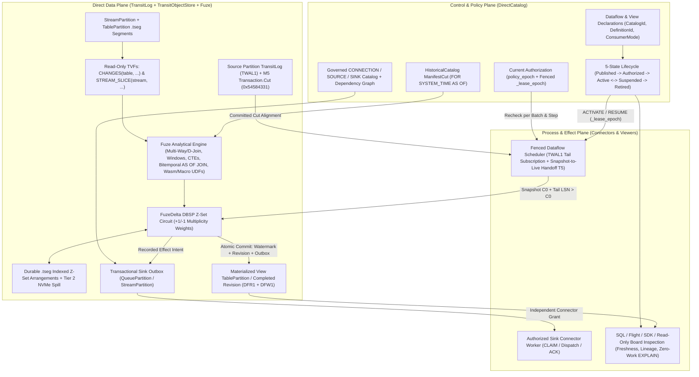

# 12. Managed computations and WAL-activated dataflows

[Roadmap](README.md) · [Issue #31](https://github.com/spoke-sh/transit/issues/31) · **Status:** Planned ([implementation plan](#implementation-plan--2026-10-30))

Let an application declare a derived result, apply it, and inspect the definition,
source basis, completed revision and pending or blocked work while Transit owns
the qualified scheduling, WAL-driven delta activation and recovery. Extend the
[shared lifecycle](01-declarative-data-lifecycle.md),
[four-tier storage hierarchy](02-storage-and-query-performance.md),
[declarative streams, queues and durable runtime](06-streams-queues-and-durable-runtime.md),
[SQL reference](../handbook/reference/sql.md) and
[grammar inventory](../handbook/reference/sql/grammar-surface.md).

Typed Tables, joins/grouping, expressions, parameters, named relational
activation, complete Table history and typed maintained revisions already exist.
Maintained owners currently require host-driven activation and wakeups and
recompute at recorded source bases. Connecting maintained computations, reactive
watches and Station actors directly to **`TransitLog` (`TWAL1`) delta streams**
with service-owned scheduling is the core advancement of this milestone;
incremental delta propagation must preserve equivalence with the finite
recomputation oracle.

## Managed computation sequence

Consume the durable catalog/snapshot contract in
[#125](https://github.com/spoke-sh/transit/issues/125) and logical feed/retention
contract in [#127](https://github.com/spoke-sh/transit/issues/127). Storage-level
subscriptions and history preservation belong to milestone 2; this milestone
owns service scheduling, consumer-specific activation and observable freshness.
Connections/sources/sinks remain separate declarations whose publication does
not authorize external work.
Consume [statement results](04-statement-results-and-consumption.md) for finite
reads, explanation and command outcomes; continuous/maintained computation keeps
its own activation, progress and revision lifecycle. Consume
[transaction decisions](05-transactions-and-atomic-composition.md) for multi-object
changes: computation activation and published successors must respect complete
commits, even when participant records arrive separately. Do not publish a
half-committed transaction as a completed result.

1. **Bind computation declarations to catalog and storage watermarks:** define a
   computation declaration's bound inputs (`CatalogId`, `DefinitionId`), lifetime,
   output sink/table, policy references (`policy_epoch`), budget and desired
   activation revision. Publish/alter definitions separately from authorizing
   work. Bind accepted work to its exact definition; a rename or newer definition
   cannot relabel it.
2. **Drive activation from `TransitLog` delta streams and manifest watermarks:**
   implement a service owner that subscribes to source partition `TransitLog`
   tails (`+row`/`-row` change vectors and manifest commits) from the
   computation's last checkpointed source position. Select each consumer's
   contract explicitly: complete ordered changes, net relation changes, or
   finite recomputation at a new basis. A slow consumer requiring every change
   must recover from retained/archived logical history; snapshot diffs cannot
   recover intermediate `A -> B -> A` events. Use manifest reconciliation or
   recomputation only where the consumer's semantics permit it. Define the
   snapshot-to-live handoff and explicit unavailable-history outcomes; never
   silently downgrade complete capture. Record recoverable intent and progress,
   fence competing owners via epoch leases, and preserve pending work across service
   replacement. Admission pressure must not discard accepted work; reserve
   control capacity.
3. **Expose completed source vectors, result revisions, pending successor and attributable failure/blocked reasons:**
   compare progress with authorized observed input positions (`manifest/v{N}`,
   `lsn`) and define freshness at that observation. A completed result remains
   complete for its own basis while later changes are pending.
4. **Define the five-state computation lifecycle (`Published`, `Authorized`, `Active`, `Suspended`, `Retired`) and explicit DDL controls (`ACTIVATE`, `SUSPEND`, `RESUME`, `REFRESH`, `RETIRE`):**
   rather than collapsing dataflow state into an ambiguous boolean `ENABLE` / `DISABLE`
   toggle, keep definition publication, authorization (`policy_epoch` binding),
   active background scheduling, operational suspension and permanent retirement
   distinct:
   - **`ACTIVATE`:** transitions an authorized definition revision into active
     `TransitLog` delta scheduling under a fenced owner lease.
   - **`SUSPEND`:** pauses background delta consumption and external effect
     dispatch while preserving the computation's checkpointed source watermarks
     (`manifest/v{N}`, `lsn`) and continuing to serve reads from the last
     completed result revision (with its exact frozen source basis visible).
   - **`RESUME` (`WITH (on_resume = 'replay_history' | 'recompute_snapshot')`):**
     resumes scheduling according to the consumer's declared recovery profile—either
     replaying every intermediate `+row`/`-row` delta from the checkpointed
     `TransitLog` position (failing explicitly if required history was compacted
     during the suspension) or establishing a fresh snapshot-to-live handoff at
     the current manifest cut.
   - **`REFRESH` and `RETIRE`:** trigger an explicit bounded recomputation, or
     permanently close a definition revision to new activation and scheduling while
     retaining historical provenance and receipts. Preserve the last complete
     result while any successor is incomplete, and define dependency/schema
     changes, revocation, unavailable history and policy expiry without inventing
     cross-owner atomicity.
5. **Adapt the qualified lifecycle to SQL views/subscriptions and typed SDK operations:**
   expose the same typed lifecycle state machine and DDL verbs across SQL
   (`CREATE` / `ALTER MATERIALIZED VIEW` / `DATAFLOW` / `SUBSCRIPTION`), SDKs and
   Board; [SQL grammar and dialect ergonomics](34-sql-grammar-and-dialect-ergonomics.md)
   audits these forms against PostgreSQL (`ENABLE`/`DISABLE`) and Snowflake
   (`SUSPEND`/`RESUME`/`REFRESH`) dialects. Inspection and `EXPLAIN` do no work.
   Board consumes the same definitions and evidence through its explicit
   capabilities; it adds no hidden scheduler or administrative authority.

## Remaining work

Consume [index coverage and access paths](11-indexing-and-access-paths.md) without
changing source cuts or completed-revision meaning. Preserve durable ordered
operator roots, checkpoint/input progress and retained versions when adding
mutable working-state acceleration. Establish finite/maintained correctness,
spill and freshness baselines here; the
[structure/planner/runtime owner](13-data-structures-and-performance.md) then
compares optimized structures and integrated local workloads. Its later delivery
cannot defer this milestone's bounded execution or activation/recovery gates.

- **Deliver the complete analytical and relational SQL surface in Fuze:** expand
  beyond two-table equijoins to multi-way joins ($>2$ tables), non-equi/range
  joins, `SEMI` (`EXISTS`/`IN`), `ANTI` (`NOT EXISTS`) and `LATERAL` joins with
  universal dependent-join (`D-Join`) correlated subquery unnesting (Neumann &
  Kemper, BTW 2015) so arbitrary correlated subqueries lower algebraically to
  set-oriented hash or merge joins rather than $O(N \times M)$ nested loops;
  **Window Functions** (`OVER (PARTITION BY ... ORDER BY ... ROWS/RANGE/GROUPS
  BETWEEN ...)`), ranking/lag/lead/frame functions and `QUALIFY`; **Common Table
  Expressions** (`WITH` and bounded `WITH RECURSIVE` with cycle detection and
  explicit work budgets) and set operations (`UNION [ALL]`, `INTERSECT`,
  `EXCEPT`); **Rich Aggregates** (`AVG`, `MIN`, `MAX`, `STDDEV`, exact and
  approximate quantiles/`PERCENTILE_CONT`, `ARRAY_AGG`/`STRING_AGG`);
  temporal/interval arithmetic; **compile-time (`comptime`) and plan-bound
  perfect-hash lookup tables** for SQL keywords and constant `WHERE col IN (...)`
  string literal sets (paired with 16-byte SIMD vector comparisons inside the
  `Batch` arena); and **deterministic, resource-bounded scalar and
  table User-Defined Functions (UDFs)** (SQL expression macros and sandboxed
  in-engine Wasm UDFs executing directly over vectorized `Fuze` column batches
  without round-tripping through `128 KiB` `Station` actor mailboxes). Preserve
  five-state values, checked arithmetic, explicit collations, source identities,
  output types and bounded operator state (with Tier 2 NVMe spill for large sorts,
  window frames, joins and aggregations).
- **Deliver first-class bitemporal SQL (`AS OF JOIN` and application-time periods):**
  combine system-time knowledge cuts (`FOR SYSTEM_TIME AS OF`) with declarative
  application/valid-time periods (`PERIOD FOR valid_time` backed by
  [Milestone 10's](10-standards-and-catalogs.md) canonical `RANGE<TIMESTAMPTZ>`
  type) and native streaming **`AS OF JOIN`** (matching each left observation to
  the nearest prior or exact valid-time right row per entity key—and supporting
  [Milestone 17's](17-geospatial-and-spatio-temporal-computing.md) piecewise-linear
  4D `TRAJECTORY` interpolation—without $O(N^2)$ inequality joins). Ensure
  point-in-time research, backtesting and decision auditing evaluate what was
  valid in the domain *and* known to the system at the decision cut, preventing
  later backfill corrections from leaking into earlier simulated decisions.
- **Expose first-class SQL `CHANGES(...)` and `STREAM_SLICE(...)` table-valued functions for CDC egress and side-effect-free relational stream queries:**
  allow SQL, Arrow Flight and SDK callers to query committed Table logical changes
  (`+row`/`-row` or net upserts/deletes with transaction, LSN and manifest
  provenance) between two snapshot cuts or watermarks (`SELECT * FROM CHANGES(table, ...)`)
  and to project bounded historical `.tseg` ranges from declared
  [Streams](06-streams-queues-and-durable-runtime.md) into relational joins and
  bitemporal `AS OF JOIN` backtests (`SELECT * FROM STREAM_SLICE(stream, OFFSET ? TO ?)`
  or `STREAM_SLICE(stream, TIMESTAMP ? TO ?)`) without advancing consumer-group
  offsets, preserving 5-state cells and current `policy_epoch` access checks.
- Provide logical/physical explanation and output-schema inspection without
  source disclosure, mutation or external work.
- Implement general `MERGE`/upsert and prepared-plan lifetime through shared SQL
  composition. The [transaction owner](05-transactions-and-atomic-composition.md)
  owns session control, atomicity/isolation, DDL/constraint interactions and
  transaction-bound plan invalidation; those features do not all become transaction
  syntax merely because they can execute in a transaction. SQL `MERGE` is separate
  from branch merge. [Foreign relations](18-multi-model-and-foreign-relations.md)
  now owns typed `COPY`/import/export and streaming CDC ingress together with its
  actual format adapters.
- Extend the common dependency lifecycle to connections, sources and sinks,
  including conditional alteration and retirement. SQL, SDK and Board use the
  same administrative operations.
- Optimize incremental maintained computation over `TransitLog` (`+row`/`-row`
  Z-set/delta vectors) against the complete finite-recomputation oracle,
  providing the Z-set arrangement and operator foundation extended by
  [Milestone 17](17-geospatial-and-spatio-temporal-computing.md) for algebraic
  half-edge `ST_Union` and `INTERIOR`/`BOUNDARY` cell-covering spatial joins.
  Event-time windows and bitemporal views require explicit timestamps, watermarks,
  allowed-lateness bounds and retraction rules.
- Bind outputs to recorded connector effects through independently authorized
  activation. Compiling, explaining, reading and replaying never dispatch a
  dataflow.

## Formal model follow-through

Own the [T5/T8 dataflow lifecycle and DDL interaction models and A3 incremental delta proofs](21-formal-semantics-and-correspondence.md#t8-catalog-ddl-evolution-and-dataflow-lifecycle-state-machines)
as the computation and phased-DDL contracts settle. Verify that `ACTIVATE`,
`SUSPEND`, `RESUME WITH (on_resume = 'replay_history' | 'recompute_snapshot')`,
`REFRESH` and `RETIRE` preserve last-completed-revision invariants when racing
in-flight worker leases (`_lease_epoch`), upstream `ALTER TABLE` schema
evolutions (`DefinitionId v1 -> v2`), `TransitLog` (`TWAL1`) compaction and
`policy_epoch` revocations, and replay the finite state-graph edges against the
production Zig catalog and dataflow state reducers.

## Prerequisites and completion

The later [reactive context milestone](31-reactive-context-and-agent-activation.md)
uses this scheduling and completed-result evidence for business conditions,
durable application interests and MCP subscriptions/tasks. This owner supplies
computation progress; a changed source or delivered notification alone cannot
establish that an agent ran or a business action completed.

Historical operations consume [catalog contracts](10-standards-and-catalogs.md).
Branch merge and SQL `MERGE` remain distinct. Fuze owns relational and incremental
vector computation; Station and application owners coordinate stateful workflows
and external effects above a generic kernel.

Require independent finite/maintained equivalence at completed source bases,
current grants, lost responses, interrupted publication, retained-history and
snapshot-to-tail handoff, bounded NVMe spill and larger-than-RAM workloads. Test
`A -> B -> A`, insert/delete within one flush, schema changes and compaction
without a logical mutation for every admitted consumer profile. Include
multi-object transactions with delayed participant records and aborted work;
completed maintenance must consume the selected committed cut without omissions
or partial publication. Qualify
actual callers for each exposed slice.

The acceptance journey declares a derived relation, observes its first complete
result, ingests streaming source changes over `TransitLog`, evolves the schema,
inspects catch-up or blocking, replaces the service and recovers the same
accepted work. Exercise pause, revocation and retirement without reporting a
partial successor as a complete result. Measure freshness lag and control
latency under load separately from correctness.

## Implementation plan — 2026-10-30

### Plan basis and starting point

This plan starts from `origin/main` at commit `54e176fd0` (`2026-10-30`) and
coordinates with the active in-progress and recently completed milestones:

- **Milestones 1 and 2 (Completed):**
  [`DATA_LIFECYCLE_V1.md`](../../contracts/DATA_LIFECYCLE_V1.md)
  ([`DataLifecycle.zig`](../../packages/zig/transit-protocol/src/DataLifecycle.zig))
  and [`INDEX_LIFECYCLE_V1.md`](../../contracts/INDEX_LIFECYCLE_V1.md)
  ([`IndexLifecycle.zig`](../../packages/zig/transit-protocol/src/IndexLifecycle.zig))
  define stable object (`CatalogId`, `Object`, `DefinitionId`) and policy
  (`policy_epoch`) identities; [`TransitLog.zig`](../../packages/zig/transit-storage/src/TransitLog.zig)
  (`TWAL1`), [`TransitObjectStore.zig`](../../packages/zig/transit-storage/src/TransitObjectStore.zig),
  [`LocalSegmentStore.zig`](../../packages/zig/transit-storage/src/LocalSegmentStore.zig)
  (`.tseg` segments), [`BitmapDirectory.zig`](../../packages/zig/transit-storage/src/BitmapDirectory.zig)
  (`.tdel` deletion vectors), [`TableChanges.zig`](../../packages/zig/transit-storage/src/TableChanges.zig)
  and [`TableSnapshot.zig`](../../packages/zig/transit-storage/src/TableSnapshot.zig)
  provide local durable segments, snapshots and logical change history.
- **Milestones 4 and 5 (Completed):**
  [`transit-sql-results`](../../packages/zig/transit-sql-results/src/root.zig)
  and [`transit-sql-client`](../../packages/zig/transit-sql-client/src/root.zig)
  enforce bounded `StatementResult` / `ResultSet` consumption with observation
  provenance (`SourceCut`, `Snapshot`, `CatalogObservation`, `SettingsObservation`)
  and per-batch `policy_epoch` rechecks;
  [`DirectTransaction.zig`](../../packages/zig/transit-catalog/src/DirectTransaction.zig),
  [`TableTransaction.zig`](../../packages/zig/transit-storage/src/TableTransaction.zig),
  [`TransactionDecisionLog.zig`](../../packages/zig/transit-storage/src/TransactionDecisionLog.zig)
  and [`TransactionDirectory.zig`](../../packages/zig/transit-storage/src/TransactionDirectory.zig)
  implement serializable multi-Table transactions, retained common cuts
  (`0x54584331`), private workspaces (`0x54585731`) and `TableGuard` definition
  and policy fencing.
- **Milestone 3 (In Progress):**
  [`DirectCatalog.zig`](../../packages/zig/transit-catalog/src/DirectCatalog.zig)
  and [`TablePartition.zig`](../../packages/zig/transit-storage/src/TablePartition.zig)
  own durable catalog and partition state; lazy schema projection across
  `DefinitionId` versions is implemented in
  [`TableEvolution.zig`](../../packages/zig/transit-fuze/src/TableEvolution.zig),
  [`TableSchemaProjection.zig`](../../packages/zig/transit-fuze/src/TableSchemaProjection.zig)
  and [`TableInterpretations.zig`](../../packages/zig/transit-storage/src/TableInterpretations.zig);
  and shared directory barriers, Table replay and crash schedules landed in
  [`TableRecovery.zig`](../../packages/zig/transit-storage/src/TableRecovery.zig).
- **Milestones 6 and 7 (In Progress):**
  [`DatabaseRuntime.zig`](../../packages/zig/transit-sql/src/DatabaseRuntime.zig)
  decoupled SQL admission from `Station` actor turns;
  [`transit-bitmap`](../../packages/zig/transit-bitmap/src/root.zig) provides
  canonical Roaring containers backing `.tdel` and `.tack`
  ([`Tack.zig`](../../packages/zig/transit-storage/src/Tack.zig));
  [`StreamPartition.zig`](../../packages/zig/transit-storage/src/StreamPartition.zig),
  [`DirectLog.zig`](../../packages/zig/transit-catalog/src/DirectLog.zig) and
  [`LogAuthority.zig`](../../packages/zig/transit-catalog/src/LogAuthority.zig)
  (together with active `QueuePartition`, signed stream/queue payload and
  consumer operations, hierarchical timer wheels and bounded notification waits
  on `feat/streams-queues-runtime-composition`) provide direct-plane streams and
  queues; and [`transit-document`](../../packages/zig/transit-document/src/root.zig),
  [`DocumentPartition.zig`](../../packages/zig/transit-storage/src/DocumentPartition.zig)
  and [`DocumentAuthority.zig`](../../packages/zig/transit-catalog/src/DocumentAuthority.zig)
  deliver direct-plane logical document storage (`DOC1`/`DCH1`/`DMR1`).
- **Milestones 8, 9 and 13 (In Progress):**
  [`RecoveryWork.zig`](../../packages/zig/transit-sql/src/RecoveryWork.zig) and
  [`NativeServer.zig`](../../apps/transit-node/NativeServer.zig) provide
  event-driven recovery and co-hosted local Table dispatch;
  [`transit-data-client`](../../packages/zig/transit-data-client/src/root.zig),
  [`QueryValues.zig`](../../packages/zig/transit-fuze/src/QueryValues.zig),
  [`NeutralEncoding.zig`](../../packages/zig/transit-fuze/src/NeutralEncoding.zig),
  [`RelationalBridge.zig`](../../packages/zig/transit-query-direct/src/RelationalBridge.zig)
  and [`TableChangeReader.zig`](../../packages/zig/transit-query-direct/src/TableChangeReader.zig)
  form the shared client/direct-query layer; and
  [`transit-memory`](../../packages/zig/transit-memory/src/root.zig) and
  [`transit-io`](../../packages/zig/transit-io/src/root.zig) provide bounded
  arenas, slabs and generation-based notification primitives (`#194`).
- **Milestone 10 (In Progress, core foundation merged in `54e176fd0`):**
  [`StandardsLedger.zig`](../../packages/zig/transit-fuze/src/StandardsLedger.zig)
  and [`contracts/sql/standards-ledger.json`](../../contracts/sql/standards-ledger.json)
  record per-feature `parse`/`lower`/`execute`/`recover`/`transport` capability
  truth; [`OperatorTraits.zig`](../../packages/zig/transit-fuze/src/OperatorTraits.zig)
  defines operator `EffectSet` (`read`, `mutate`, `capture`, `dispatch`),
  `FiveStateRule`, `CollationRule`, `ChangeMode.retractable_zset`, `WorkBound`
  and zero-work `Summary.forExplain`;
  [`Range.zig`](../../packages/zig/transit-fuze/src/Range.zig) implements
  canonical `Range(T, discrete)` and `MultiRange(R)` with `[lower, upper)`
  normalization and Allen's interval predicates (`overlaps`, `contains`,
  `adjacent`); [`VectorMetric.zig`](../../packages/zig/transit-fuze/src/VectorMetric.zig),
  [`DecimalArithmetic.zig`](../../packages/zig/transit-fuze/src/DecimalArithmetic.zig)
  ($\kappa_{\text{numeric}}$, `TzdbVersion` $\kappa_{\text{tz}}$,
  `SpatialDescriptor` $\kappa_{\text{spatial}}$) and
  [`Ebcdic1047.zig`](../../packages/zig/transit-fuze/src/Ebcdic1047.zig) provide
  companion orthogonal type rules;
  [`TableConstraints.zig`](../../packages/zig/transit-fuze/src/TableConstraints.zig)
  classifies `CHECK`/`FOREIGN KEY` and lazy Class A vs. phased Class B schema
  evolutions; and [`HistoricalCatalog.zig`](../../packages/zig/transit-catalog/src/HistoricalCatalog.zig)
  implements immutable `ManifestCut` timelines, conditional head publication,
  historical `AS OF` binding under current `policy_epoch`, and catalog
  descriptors for views, property graphs and foreign tables.

### Pre-implementation source audit

| Milestone 12 boundary | Current source owner | Delivered baseline at `54e176fd0` | Remaining gap for Milestone 12 |
| --- | --- | --- | --- |
| Five-state computation lifecycle & WAL-activated scheduling (Steps 1, 2, 4, 5) | [`RelationalMaintenance.zig`](../../packages/zig/transit-query/src/RelationalMaintenance.zig), [`RelationalMaintenanceRecords.zig`](../../packages/zig/transit-query/src/RelationalMaintenanceRecords.zig), [`NamedRelational.zig`](../../packages/zig/transit-station-app/src/NamedRelational.zig), [`NAMED_RELATIONAL_V1.md`](../../contracts/NAMED_RELATIONAL_V1.md) | `RelationalMaintenance` persists `RMH1`/`RMW1`/`RMV1`/`RMD1`/`RMC1` inside 28-byte `\x00rm` native KV keys using `Station.Turn` (4-mutation / 256-byte `STATE_V1` limits) and `Station.Publication`; `NamedRelational` (`NRC1`/`NRD1`/`NRA1`) caps names at 21 ASCII bytes and requires host-driven `wake(turn, ...)` and self-cast `advance(turn, ...)` turns | Maintained computations are still coupled to `Station` actor turns and 256-byte KV records rather than `DirectCatalog` and `TransitLog` (`TWAL1`). Missing: the 5-state lifecycle (`Published`, `Authorized`, `Active`, `Suspended`, `Retired`), explicit DDL verbs (`ACTIVATE`, `SUSPEND`, `RESUME WITH (on_resume = 'replay_history' \| 'recompute_snapshot')`, `REFRESH`, `RETIRE`), fenced `_lease_epoch` service-owned `TWAL1` tail subscriptions, and explicit consumer contracts (`complete_ordered_changes`, `net_relation_changes`, `finite_recomputation`) |
| Multi-object transaction boundaries & snapshot-to-live handoff (Steps 2, 3) | [`TableChangeReader.zig`](../../packages/zig/transit-query-direct/src/TableChangeReader.zig), [`RelationalHistory.zig`](../../packages/zig/transit-query/src/RelationalHistory.zig), [`RelationalFreshness.zig`](../../packages/zig/transit-query/src/RelationalFreshness.zig), [`RelationalRevision.zig`](../../packages/zig/transit-query/src/RelationalRevision.zig) | `TableChangeReader` streams single-Table `HistoryPoint` mutations (`inserted`, `updated`, `deleted`); `RelationalHistory` advances multi-source vectors one single-Table `HistoryPoint` at a time via round-robin `scan.preference`; `RelationalFreshness` and `RelationalRevision` encode source vectors and completed revisions (`FRV1`, `FRD1`) | `RelationalHistory` treats multi-table sources as independent per-table vectors without consulting [Milestone 5's](05-transactions-and-atomic-composition.md) `TransactionDecisionLog` (`0x54584331`), risking intermediate evaluation across half-committed multi-table transactions. Missing: atomic multi-object commit-cut alignment, atomic snapshot-to-live `TWAL1` tail handoff (`T5`), and explicit `error.DataflowHistoryExpired` failure when `complete_ordered_changes` / `replay_history` encounters compacted `TWAL1` segments |
| Incremental DBSP / Z-set operator algebra vs. full recomputation | [`RelationalMaintenance.zig`](../../packages/zig/transit-query/src/RelationalMaintenance.zig), [`OperatorTraits.zig`](../../packages/zig/transit-fuze/src/OperatorTraits.zig) | `OperatorTraits.ChangeMode.retractable_zset` is declared in `transit-fuze`, but `RelationalMaintenance.compute` + `delta` recomputes the entire finite query from scratch at the new source basis and merges `old` and `new` full output streams to synthesize `FRD1` deltas | No incremental DBSP Z-set (`+row` weight $+1$, `-row` weight $-1$) operator engine (`FuzeDelta`), no durable `.tseg`-backed indexed Z-set arrangements (with Tier 2 NVMe spill), no event-time watermark / allowed-lateness / retraction state, and no bilinear Z-set hooks for [Milestone 17's](17-geospatial-and-spatio-temporal-computing.md) incremental `ST_Union` ($\partial_2$), `ST_3DUnion` ($\partial_3$) and cell-covering joins |
| Complete analytical & relational SQL in `Fuze` | [`Relational.zig`](../../packages/zig/transit-fuze/src/Relational.zig), [`RelationalExecution.zig`](../../packages/zig/transit-fuze/src/RelationalExecution.zig), [`RelationalSql.zig`](../../packages/zig/transit-fuze/src/RelationalSql.zig), [`LogicalQuery.zig`](../../packages/zig/transit-fuze/src/LogicalQuery.zig) | `Relational` (`FRP1`) supports `max_sources = 2`, a single `inner` or `left` equijoin (`source 0 = source 1`), `int64` and `utf8` columns in `resolveColumn`, and `COUNT(*)`, `COUNT(col)`, `SUM(int64)` aggregates | Missing: multi-way joins ($>2$ tables), non-equi/range/`RIGHT`/`FULL`/`CROSS` joins, `SEMI` (`EXISTS`/`IN`), `ANTI` (`NOT EXISTS`), `LATERAL` joins, universal dependent-join (`D-Join`) correlated subquery unnesting (Neumann & Kemper, BTW 2015), Window Functions (`OVER (...)`, `ROWS`/`RANGE`/`GROUPS` frames, `QUALIFY`), CTEs (`WITH` and cycle-checked budget-bounded `WITH RECURSIVE`), set operations (`UNION [ALL]`, `INTERSECT`, `EXCEPT`), `ORDER BY`/`LIMIT`/`OFFSET`/`DISTINCT`/`HAVING`, rich aggregates (`AVG`, `MIN`, `MAX`, `STDDEV`, `PERCENTILE_CONT`, `ARRAY_AGG`, `STRING_AGG`) across all companion types, temporal/interval arithmetic, `comptime`/plan-bound perfect-hash `IN (...)` sets with 16B SIMD comparisons, and Tier 2 NVMe spill for sorts/windows/joins/aggregations |
| Deterministic scalar & table UDFs | [`StandardsLedger.zig`](../../packages/zig/transit-fuze/src/StandardsLedger.zig), [`Batch.zig`](../../packages/zig/transit-fuze/src/Batch.zig) | `Batch` provides columnar 5-state vectors and bounded scratch arenas; `OperatorTraits` models determinism and `WorkBound` | No `CREATE FUNCTION` / `DROP FUNCTION` catalog declarations, no compile-time/plan-inlined SQL expression/table macros, and no sandboxed in-engine Wasm vectorized UDF runner executing directly over `Batch` column vectors with `MeteredAllocator` + instruction-fuel budgets (without `128 KiB` `Station` actor mailbox round-trips) |
| Bitemporal SQL (`PERIOD FOR valid_time` & streaming `AS OF JOIN`) | [`Range.zig`](../../packages/zig/transit-fuze/src/Range.zig), [`HistoricalCatalog.zig`](../../packages/zig/transit-catalog/src/HistoricalCatalog.zig), [`TransitExtensions.g4`](../../contracts/sql/TransitExtensions.g4) | `Range.zig` implements canonical `Range(T, discrete)` and Allen's interval predicates; `HistoricalCatalog.zig` resolves `ManifestCut` for `FOR SYSTEM_TIME AS OF` | `TableSchema` (`FTS1`) and `TableDdl` do not yet bind `PERIOD FOR valid_time (start_col, end_col)` or `RANGE<TIMESTAMPTZ>` period columns; `Fuze` lacks the streaming $O(N + M)$ merge-sweep `AS OF JOIN` operator (and its kinematic interpolation hook for [Milestone 17's](17-geospatial-and-spatio-temporal-computing.md) 4D `TRAJECTORY`) combined with system-time `ManifestCut` cuts |
| `CHANGES(...)` & `STREAM_SLICE(...)` TVFs and SQL `MERGE INTO` | [`TableChangeReader.zig`](../../packages/zig/transit-query-direct/src/TableChangeReader.zig), [`StreamPartition.zig`](../../packages/zig/transit-storage/src/StreamPartition.zig), [`LogRead.zig`](../../packages/zig/transit-storage/src/LogRead.zig), [`TableDml.zig`](../../packages/zig/transit-fuze/src/TableDml.zig) | `TableChangeReader` reads Table changes at the direct-query layer; `StreamPartition` and `LogRead` read stream segments by offset/timestamp; `TableDml` supports `INSERT`, `UPDATE` and `DELETE` | `CHANGES(table, FROM ... TO ...)` and `STREAM_SLICE(stream, OFFSET ... TO ... \| TIMESTAMP ... TO ...)` are not exposed as side-effect-free relational SQL table-valued functions with transaction/LSN/manifest provenance; general SQL `MERGE INTO` (`WHEN MATCHED` / `WHEN NOT MATCHED`) and transaction-bound prepared-plan invalidation are not yet implemented |
| Governed `CONNECTION`, `SOURCE` & `SINK` lifecycle and atomic sink outbox effects | [`TransitExtensions.g4`](../../contracts/sql/TransitExtensions.g4), [`Declaration.zig`](../../packages/zig/transit-fuze/src/Declaration.zig), [`DirectDependency.zig`](../../packages/zig/transit-catalog/src/DirectDependency.zig) | `TransitExtensions.g4` parses `CREATE CONNECTION`, `CREATE SOURCE`, `CREATE SINK` and `SHOW CONNECTIONS/SOURCES/SINKS`; `DirectDependency` tracks forward/reverse catalog edges | `CONNECTION`, `SOURCE` and `SINK` declarations are not yet persisted as versioned `DirectCatalog` objects with conditional `ALTER`/`RETIRE` and `DROP RESTRICT` dependency edges; active dataflows cannot yet commit source-watermark progress and recorded sink effect intents atomically into [Milestone 6's](06-streams-queues-and-durable-runtime.md) outbox `QUEUE`/`STREAM` partitions under independent activation authorization |

### Coordination and handoffs across milestones

| Related milestone | Incoming foundation to Milestone 12 | Outgoing contract from Milestone 12 |
| --- | --- | --- |
| [M3: Live storage & SQL cutover](03-live-storage-and-sql-cutover.md) | `DirectCatalog`, `TablePartition`, lazy `TableSchemaProjection` (`column_origins`, `physical_schemas`) and `SharedTransactionRecovery` | Direct-plane `DataflowCatalog` & `DataflowPartition` replacing `Station`-coupled `NamedRelational` (`NRC1`) and `RelationalMaintenance` (`RMH1`); schema-evolution catch-up and blocking rules across `DefinitionId v1 -> v2` |
| [M4: Statement results](04-statement-results-and-consumption.md) & [M5: Transactions](05-transactions-and-atomic-composition.md) | `StatementResult`/`ResultSet` with `Observation` provenance; `DirectTransaction`, `TableTransaction`, `TransactionDecisionLog` (`0x54584331`) and `TableGuard` | Multi-object change alignment to committed `Transaction.Cut` boundaries; transactional SQL `MERGE INTO` and prepared-plan invalidation; atomic commit of dataflow checkpoint watermarks + materialized output deltas + sink outbox records |
| [M6: Streams, queues & runtime](06-streams-queues-and-durable-runtime.md) & [M7: Document storage](07-document-storage-and-station-decoupling.md) | `DatabaseRuntime` (SQL decoupled from `Station`), `StreamPartition`, `QueuePartition`, `.tdel`/`.tack` Roaring bitmaps, `transit-io` generation notifications and `DocumentPartition` | Side-effect-free `STREAM_SLICE(stream, ...)` relational TVF; `TransitLog` (`TWAL1`) tail subscriptions for Tables and Streams; atomic dataflow-to-`QueuePartition`/`StreamPartition` sink outbox staging without routing dataflow turns through `Station` actors |
| [M8: Gateway architecture](08-gateway-architecture-and-protocol-ingress.md) & [M9: Client foundation](09-client-foundation-and-language-apis.md) | Co-hosted `DatabaseRuntime`, `transit-data-client`, `QueryValues`, `NeutralEncoding` and `TableChangeReader` | Shared client/SDK/Flight consumption of 5-state dataflow lifecycle verbs (`ACTIVATE`, `SUSPEND`, `RESUME`, `REFRESH`, `RETIRE`), `CHANGES(...)`/`STREAM_SLICE(...)` TVFs, freshness/lag inspection and zero-work `EXPLAIN` |
| [M10: Standards & historical catalogs](10-standards-and-catalogs.md) | `StandardsLedger.zig` (`standards-ledger.json`), `OperatorTraits.zig`, `Range.zig` (`RANGE<T>`, `MULTIRANGE<T>`), `DecimalArithmetic.zig` ($\kappa_{\text{numeric}}$, $\kappa_{\text{tz}}$, $\kappa_{\text{spatial}}$), `TableConstraints.zig` and `HistoricalCatalog.zig` (`ManifestCut`, `ViewDescriptor`) | Execution promotion in `standards-ledger.json` for analytical SQL, bitemporal `PERIOD FOR valid_time` over `RANGE<TIMESTAMPTZ>`, streaming `AS OF JOIN` combined with `FOR SYSTEM_TIME AS OF` `ManifestCut`, and maintained view/dataflow catalog descriptors |
| [M11: Indexing & access paths](11-indexing-and-access-paths.md) | `IndexLifecycle.zig`, `OrderedKeyIndex.zig` and `TableKeyRange.zig` (with full secondary index access paths and online phased Class B rewrites in M11) | Indexed Z-set arrangement lookup interfaces and deterministic handling of Class A lazy projection vs. Class B phased rewrites on upstream dataflow sources |
| [M13: Data structures & performance](13-data-structures-and-performance.md), [M14: Strings & search](14-vectorized-strings-and-search.md) & [M15: Compilation](15-data-centric-compilation-and-specialization.md) | `transit-memory` bounded arenas/slabs (`#194`) and `transit-io` | Correctness, bounded Tier 2 NVMe spill, morsel-budgeted execution and `comptime`/plan-bound perfect-hash `IN (...)` lookup baselines that M13/M14/M15 accelerate via CedarDB hash tables, Umbra strings and data-centric push fusion |
| [M17: Geospatial & 3D computing](17-geospatial-and-spatio-temporal-computing.md) & [M18: Multi-model & foreign relations](18-multi-model-and-foreign-relations.md) | Reserved $\kappa_{\text{spatial}}$ descriptors in `DecimalArithmetic.zig` and `ForeignTableDescriptor`/`PropertyGraphDescriptor` in `HistoricalCatalog.zig` | DBSP Z-set arrangement and bilinear join hooks extended by M17 for incremental `ST_Union` ($\partial_2$), `ST_3DUnion` ($\partial_3$), Discrete Divergence Theorem volume aggregates and `INTERIOR`/`BOUNDARY` cell-covering spatial joins; streaming `AS OF JOIN` interpolation hook for 4D `TRAJECTORY`; `SOURCE`/`SINK` catalog foundation extended by M18 for foreign formats and streaming CDC ingress |
| [M19: Branches, merges & restore](19-branches-merges-and-restore.md) | Single-branch (`main`) `ManifestCut` timeline in `HistoricalCatalog.zig` | Strict separation between relational SQL `MERGE INTO` (DML) and catalog branch `MERGE` (M19), plus branch-scoped computation watermark bindings |
| [M21: Formal semantics](21-formal-semantics-and-correspondence.md), [M29: Board](29-board-reimplementation.md), [M31: Reactive context](31-reactive-context-and-agent-activation.md) & [M34: SQL ergonomics](34-sql-grammar-and-dialect-ergonomics.md) | `StatementResult.tla`, `TransactionDecision.tla`, `FuzeCell.lean`, `FuzeRewrite.lean`, `CollationOrder.lean` and `SchemaProjection.lean` | Executable `T5` (`SubscriptionHandoff.tla`), `T8` (`DdlAndDataflowLifecycle.tla`) and `A3` (`FuzeDelta.lean`) correspondence models; read-only Board lineage/freshness/blocked-reason inspection; qualified completed-revision evidence for M31 reactive watches; and dialect-ergonomic `ENABLE`/`DISABLE` aliases mapped onto the 5-state lifecycle |

### Accepted architectural decisions

1. **D1 — Decouple managed computations and dataflows from `Station` `STATE_V1` actor turns into the Direct Data & Control Plane:**
   Managed computations (`MATERIALIZED VIEW`, `DATAFLOW`, `SUBSCRIPTION`) are
   first-class database declarations owned by `DirectCatalog` and executed in
   the Direct Data Plane over `TransitLog` (`TWAL1`) and `.tseg` segments—never
   stored in `Station` `STATE_V1` 28-byte `\x00rm` KV keys (`RMH1`/`RMW1`/`NRC1`
   with 21-byte name and 256-byte value limits) or driven by `128 KiB` actor
   mailbox turns. `NamedRelational` (`NRC1`/`NRD1`/`NRA1` in
   `transit-station-app`) and `Station`-coupled `RelationalMaintenance`
   (`RMH1`–`RMC1`) are replaced through a single current-v1 hard cutover by
   `contracts/DATAFLOW_V1.md` (`DFL1` declarations,
   `DFW1` checkpoint watermarks, `DFR1` completed revisions and `DFA1` Z-set
   arrangements) in `transit-catalog`, `transit-storage`, `transit-fuze` and
   `transit-sql`. External connector effect delivery remains in the Process &
   Effect Plane, consuming committed outbox records from direct-plane `QUEUE` /
   `STREAM` partitions.
2. **D2 — Five-state computation lifecycle (`Published`, `Authorized`, `Active`, `Suspended`, `Retired`) with explicit DDL verbs:**
   Every managed computation revision transitions through an explicit five-state
   machine persisted in `DirectCatalog`:
   - `Published`: definition (`CatalogId`, `DefinitionId`, bound input
     `(Object, DefinitionId)` vector, consumer contract, output target, work
     budget) is validated and durably recorded; no background scheduling or
     external effects are authorized.
   - `Authorized`: bound to an explicit `policy_epoch` and principal grant (via
     `AUTHORIZE` or `CREATE ... WITH (authorize = true)`), ready for activation.
   - `Active`: transitioned via `ACTIVATE`; a service-owned dataflow worker
     acquires a fenced `_lease_epoch` lease and subscribes to source partition
     `TransitLog` (`TWAL1`) delta streams and `ManifestCut` commits from the
     last checkpointed source vector.
   - `Suspended`: transitioned via `SUSPEND` (or automatic suspension on
     revocable policy/budget pause); background delta consumption and external
     sink outbox staging stop immediately, the checkpointed source watermark
     (`manifest/v{N}`, `lsn`, `tx_cut_id`) is preserved, and read queries
     continue to serve the last completed result revision with its exact frozen
     source basis and freshness lag visible in `Observation` provenance.
   - `Retired`: transitioned via `RETIRE`; permanently closes the definition
     revision to new activation or scheduling while preserving historical
     provenance, completed revision receipts and lineage.
   - `RESUME WITH (on_resume = 'replay_history' | 'recompute_snapshot')`
     transitions `Suspended -> Active` using the caller's or declaration's
     explicit recovery profile: `'replay_history'` replays every intermediate
     `+row`/`-row` delta from the checkpointed `TWAL1` position and fails closed
     with `error.DataflowHistoryExpired` if any required `TWAL1`/`.tseg` history
     was compacted during suspension; `'recompute_snapshot'` establishes a fresh
     atomic snapshot-to-live handoff (`T5`) at the current `ManifestCut`.
   - `REFRESH` triggers a bounded one-shot catch-up or snapshot recomputation to
     a target or current `ManifestCut` while preserving the last completed
     revision until the successor commits. Dialect aliases such as PostgreSQL
     `ENABLE` / `DISABLE` lower explicitly to `ACTIVATE` / `SUSPEND` (`M34`)
     without collapsing the underlying 5-state machine.
3. **D3 — Transaction-consistent multi-source `TransitLog` consumption, explicit consumer contracts and atomic snapshot-to-live handoff (`T5`):**
   Each managed computation declares one of three consumer contracts:
   - `complete_ordered_changes`: processes every committed intermediate
     transition (including `A -> B -> A` and insert-then-delete within a flush
     window) in commit order; compaction of unread `TWAL1` history blocks the
     computation with `BlockedReason.history_expired` and never silently
     downgrades to a snapshot diff.
   - `net_relation_changes`: consumes net `+row`/`-row` Z-set deltas between
     committed cuts, coalescing cancelling intermediate updates within a batch
     while preserving exact multiset weights.
   - `finite_recomputation`: evaluates the query over a consistent snapshot cut
     on `REFRESH` or scheduled cadence.
   Multi-object computations align source partition changes to
   [Milestone 5's](05-transactions-and-atomic-composition.md)
   `TransactionDecisionLog` (`0x54584331`) and `ManifestCut` boundaries: when a
   transaction spans tables $T_1, T_2$, the dataflow scheduler buffers or
   advances per-partition `TWAL1` readers to the common committed
   `Transaction.Cut` before firing the operator graph and publishing a successor
   revision. Aborted transactions and uncommitted workspace records (`0x54585731`)
   are never exposed. Initial activation and `'recompute_snapshot'` execute an
   atomic snapshot-to-live handoff (`T5`): pin the source `SnapshotHandle` /
   `ManifestCut` at cut $C_0$, compute the initial Z-set state at $C_0$, and
   attach the `TWAL1` tail reader at `lsn > C_0` with deduplication across the
   cut boundary so zero committed records are missed or double-counted.
4. **D4 — Incremental DBSP / Z-set operator algebra (`FuzeDelta`) with durable `.tseg` arrangements and finite-oracle equivalence (`A3`):**
   `transit-fuze` implements an incremental Z-set circuit engine (`FuzeDelta.zig`)
   where changes are vectorized batches of rows paired with signed `i64`
   multiplicity weights (`+1` insertion, `-1` retraction/deletion). Linear
   operators ($\sigma$, $\pi$, `UNION ALL`, stateless `MAP` / UDF) stream
   statelessly over Z-set batches; bilinear and stateful operators (`JOIN`,
   `D-Join` unnested subqueries, `SEMI`/`ANTI`, `DISTINCT`, `GROUP BY`
   aggregates, window frames, `EXCEPT`/`INTERSECT`) maintain durable indexed
   Z-set **arrangements** (`Arrangement.zig`) backed by `.tseg` sorted runs and
   bounded Tier 2 NVMe spill slabs. Incremental evaluation preserves Transit's
   5-state cell lattice (`value`, `null`, `missing`, `type_error`, `conflict`)
   and ordered checked arithmetic failure witnesses: every incremental step
   $\Delta Q(I, \Delta I)$ is verified against the finite recomputation oracle
   $Q(I \oplus \Delta I) \ominus Q(I)$ (`A3`). The arrangement and bilinear
   Z-set join traits expose clean extension hooks for
   [Milestone 17's](17-geospatial-and-spatio-temporal-computing.md) algebraic
   2D half-edge `ST_Union` ($\partial_2$), 3D half-face `ST_3DUnion`
   ($\partial_3$), Discrete Divergence Theorem volume sums, and
   `INTERIOR`/`BOUNDARY` cell-covering spatial joins.
5. **D5 — Complete analytical and relational SQL in `Fuze` with universal `D-Join` unnesting, bounded NVMe spill and in-engine vectorized UDFs:**
   `transit-fuze` (`LogicalQuery`, `Relational`, `RelationalExecution`) is
   expanded to a complete relational and analytical engine over `Batch` vectors:
   - **Joins and universal correlated subquery unnesting:** multi-way joins
     ($>2$ inputs), `INNER`, `LEFT`, `RIGHT`, `FULL OUTER`, `CROSS`,
     `SEMI` (`EXISTS` / `IN`), `ANTI` (`NOT EXISTS`), non-equi/range joins, and
     `LATERAL` joins. Correlated subqueries in `SELECT`, `WHERE`, `HAVING` and
     `FROM LATERAL` lower through Neumann & Kemper's universal dependent-join
     (`D-Join`) rewrite rules into duplicate-eliminated domain scans ($D$) and
     set-oriented hash/merge joins—eliminating $O(N \times M)$ per-row nested
     subquery execution.
   - **Window functions, CTEs, set operations and rich aggregates:** `OVER
     (PARTITION BY ... ORDER BY ... ROWS | RANGE | GROUPS BETWEEN ... EXCLUDE
     ...)`, ranking (`ROW_NUMBER`, `RANK`, `DENSE_RANK`, `NTILE`, `PERCENT_RANK`,
     `CUME_DIST`), navigation (`LAG`, `LEAD`, `FIRST_VALUE`, `LAST_VALUE`,
     `NTH_VALUE`), `QUALIFY`, non-recursive `WITH` and cycle-checked
     work-budgeted `WITH RECURSIVE` (`USING KEY`), `UNION [ALL]`,
     `INTERSECT [ALL]`, `EXCEPT [ALL]`, `ORDER BY`, `LIMIT`/`OFFSET`,
     `DISTINCT`, `HAVING`, and rich aggregates (`AVG`, `MIN`, `MAX`,
     `STDDEV_POP`/`STDDEV_SAMP`, `VAR_POP`/`VAR_SAMP`, exact and T-Digest
     `PERCENTILE_CONT`/`PERCENTILE_DISC`, `BOOL_AND`/`BOOL_OR`, `ARRAY_AGG`,
     `STRING_AGG`) across all scalar and companion types (`DECIMAL` with
     $\kappa_{\text{numeric}}$, `TIMESTAMPTZ` with $\kappa_{\text{tz}}$,
     `INTERVAL`, `RANGE`).
   - **Perfect-hash `IN (...)` sets and bounded Tier 2 NVMe spill:** constant
     `WHERE col IN (lit1, ..., litN)` clauses and SQL keyword tables compile into
     zero-collision `comptime` or plan-bound displacement perfect hash tables
     paired with 16-byte SIMD prefix/equality checks inside the `Batch` arena.
     Sorts, hash joins, window partitions and group-by tables enforce explicit
     per-operator memory budgets via `MeteredAllocator` and spill partitioned runs
     to encrypted/checksummed Tier 2 NVMe scratch segments when resident memory
     reaches its quota.
   - **Deterministic scalar and table UDFs:** `CREATE FUNCTION` supports two
     deterministic, effect-free (`EffectSet.read_only`) execution profiles that
     run directly inside `Fuze` morsel pipelines without `Station` actor
     messages: (a) typed SQL expression and table macros inlined during plan
     lowering, and (b) sandboxed in-engine Wasm vectorized UDFs operating over
     pinned `Batch` column slices under strict instruction-fuel and
     `MeteredAllocator` memory caps.
6. **D6 — Bitemporal SQL combining `FOR SYSTEM_TIME AS OF` (`ManifestCut`) with `PERIOD FOR valid_time` (`RANGE<TIMESTAMPTZ>`) and streaming $O(N + M)$ `AS OF JOIN`:**
   Tables and views can declare `PERIOD FOR valid_time (valid_from, valid_to)`
   or a native `RANGE<TIMESTAMPTZ>` valid-time column (using
   [Milestone 10's](10-standards-and-catalogs.md) canonical `[lower, upper)`
   `Range.zig` representation). `Fuze` implements a dedicated streaming
   `AsOfJoin` physical operator (`AS OF JOIN ... MATCH_CONDITION (left.ts >=
   right.valid_from)` with optional tolerance and period containment predicates)
   that sweeps partitioned, valid-time-ordered runs in $O(N + M)$ time and
   bounded per-key state—exposing a pluggable interpolation callback so
   [Milestone 17](17-geospatial-and-spatio-temporal-computing.md) can evaluate
   4D `TRAJECTORY` dead-reckoning / linear interpolation at the matched
   timestamp. Combining `FOR SYSTEM_TIME AS OF <cut>` with `AS OF JOIN`
   evaluates both knowledge time (`ManifestCut`) and domain validity time
   (`valid_time`), preventing post-facto backfills from leaking into historical
   audits or backtests.
7. **D7 — Side-effect-free `CHANGES(...)` and `STREAM_SLICE(...)` table-valued functions and transactional SQL `MERGE INTO`:**
   - `SELECT * FROM CHANGES(table_name, FROM <cut_or_lsn> TO <cut_or_lsn> [, MODE => 'ALL' | 'NET'])`
     projects committed Table changes from `TableChangeReader` / `TransitLog` as
     a relational row stream with system metadata columns (`_change_op`,
     `_change_weight`, `_tx_id`, `_commit_lsn`, `_manifest_version`,
     `_definition_id`), enforcing current `policy_epoch` grants on every batch.
   - `SELECT * FROM STREAM_SLICE(stream_name, OFFSET <start> TO <end> | TIMESTAMP <start> TO <end>)`
     projects bounded historical `.tseg` and `TWAL1` ranges from
     [Milestone 6's](06-streams-queues-and-durable-runtime.md) `StreamPartition`
     into relational queries, joins and bitemporal `AS OF JOIN` backtests as a
     pure `EffectSet.read_only` scan—never mutating or advancing stateful
     `CONSUME ... FROM` consumer-group offsets.
   - General SQL `MERGE INTO target USING source ON ... WHEN MATCHED ... WHEN NOT MATCHED ...`
     executes atomically inside [Milestone 5's](05-transactions-and-atomic-composition.md)
     `TableTransaction` / `DirectTransaction` with deterministic single-join-match
     cardinality verification (`error.MergeMultipleMatches`), 5-state `CHECK`
     enforcement, and automatic prepared-plan invalidation whenever a bound
     object's `DefinitionId` or `policy_epoch` changes.
8. **D8 — Governed `CONNECTION`, `SOURCE` and `SINK` catalog lifecycle and atomic watermark-plus-outbox effect recording:**
   `CONNECTION`, `SOURCE` and `SINK` declarations are stored as first-class
   versioned objects in `DirectCatalog` with `DirectCatalogDependencies` edges
   (`DROP CONNECTION RESTRICT` fails while referenced by any `SOURCE` or `SINK`;
   `DROP SINK RESTRICT` fails while targeted by an non-retired `DATAFLOW`).
   Publishing a `CONNECTION`, `SOURCE` or `SINK` never opens a socket or
   authorizes external network I/O. When an `Active` dataflow targets a `SINK`,
   each completed delta step commits the updated source watermark (`DFW1`),
   result revision (`DFR1`) and recorded sink effect intent (`QUEUE` / `STREAM`
   outbox record bound to `(DataflowId, RevisionNumber, SinkDefinitionId,
   policy_epoch)`) in a single atomic commit. Connectors in the Process & Effect
   Plane claim and dispatch those outbox intents under current authorization;
   compiling, `EXPLAIN`, reading and replaying never dispatch external effects.

### Work package sequence (`P0`–`P9`)

| Package | Scope | Start gate | Primary owners | Exit gate |
| --- | --- | --- | --- | --- |
| [`P0`](#p0-neutral-dataflow-lifecycle-five-state-ddl-and-connector-catalog-contracts) | Neutral `DATAFLOW_V1` (`DFL1`/`DFW1`/`DFR1`/`DFA1`) contract, 5-state lifecycle DDL grammar (`ACTIVATE`, `SUSPEND`, `RESUME`, `REFRESH`, `RETIRE`), consumer-mode descriptors and `standards-ledger.json` entries | Current `HEAD` (`54e176fd0`) | `contracts/`, `transit-protocol`, `transit-fuze` (`StandardsLedger`, `OperatorTraits`, `Declaration`) | `DATAFLOW_V1.md` and Zig codecs pass round-trip/rejection tests; `TransitExtensions.g4` and `Declaration.zig` compile 5-state lifecycle verbs and `CONNECTION`/`SOURCE`/`SINK` options; `standards-ledger.json` check passes |
| [`P1`](#p1-complete-relational-and-analytical-sql--part-1-joins-d-join-unnesting-ctes-and-set-operations) | Multi-way joins ($>2$ tables), non-equi/range/`RIGHT`/`FULL`/`CROSS`/`SEMI`/`ANTI`/`LATERAL` joins, universal `D-Join` correlated subquery unnesting, CTEs (`WITH` / bounded `WITH RECURSIVE`) and set operations (`UNION`/`INTERSECT`/`EXCEPT`) | `P0` | `transit-fuze` (`LogicalQuery`, `Relational`, `RelationalExecution`, `RelationalSql`, `SubqueryUnnest`), `transit-query-direct` | Arbitrary correlated `EXISTS`/`IN`/scalar/lateral subqueries lower to set-oriented joins with zero per-row nested loops; multi-way joins, recursive CTE cycle/budget bounds and set operations pass 5-state and collation suites |
| [`P2`](#p2-complete-relational-and-analytical-sql--part-2-window-functions-rich-aggregates-perfect-hash-in-and-nvme-spill) | Window functions (`OVER`, `ROWS`/`RANGE`/`GROUPS` frames, ranking/navigation, `QUALIFY`), `ORDER BY`/`LIMIT`/`OFFSET`/`DISTINCT`/`HAVING`, rich aggregates, temporal/interval arithmetic, perfect-hash `IN (...)` with 16B SIMD, and Tier 2 NVMe external spill | `P1` | `transit-fuze` (`WindowExecution`, `AggregateExecution`, `PerfectHashIn`, `ExternalSpill`), `transit-storage`, `transit-memory` | Window frames, `QUALIFY`, rich aggregates (`STDDEV`, `PERCENTILE_CONT`, `ARRAY_AGG`, `STRING_AGG`), SIMD perfect-hash `IN` and larger-than-RAM external sort/join/window/group-by spill pass under tight `MeteredAllocator` caps |
| [`P3`](#p3-deterministic-scalar-and-table-udfs-sql-macros-and-sandboxed-vectorized-wasm) | Catalog-managed `CREATE`/`DROP FUNCTION`, compile-time/plan-inlined SQL scalar & table macros, and sandboxed in-engine Wasm vectorized UDFs over `Batch` columns | `P1` | `transit-fuze` (`UdfCatalog`, `SqlMacro`, `WasmVectorUdf`), `transit-catalog` (`DirectCatalog`), `transit-sql` | SQL macros inline cleanly into `Fuze` plans; Wasm UDFs execute directly over `Batch` column slices with deterministic fuel and `MeteredAllocator` limits, 5-state error propagation and zero actor-mailbox hops |
| [`P4`](#p4-bitemporal-sql-period-for-valid_time-and-as-of-join-tvfs-changes-and-stream_slice-and-sql-merge-into) | `PERIOD FOR valid_time` (`RANGE<TIMESTAMPTZ>`), streaming $O(N + M)$ `AS OF JOIN` (with M17 trajectory hook), `CHANGES(...)` and `STREAM_SLICE(...)` TVFs, and transactional SQL `MERGE INTO` with plan invalidation | `P1`, `P2` | `transit-fuze` (`TableDdl`, `AsOfJoin`, `TableDml`), `transit-query-direct` (`TableChangeReader`), `transit-storage` (`StreamPartition`, `TableTransaction`), `transit-sql` | Bitemporal queries combine `FOR SYSTEM_TIME AS OF` `ManifestCut` + `PERIOD FOR valid_time` + streaming `AS OF JOIN`; `CHANGES(...)` and side-effect-free `STREAM_SLICE(...)` stream batches under current `policy_epoch`; `MERGE INTO` commits atomically |
| [`P5`](#p5-incremental-dbsp--z-set-engine-fuzedelta-durable-tseg-arrangements-and-finite-oracle-equivalence) | Incremental DBSP Z-set circuit engine (`FuzeDelta`), durable `.tseg` indexed Z-set arrangements (`Arrangement.zig`), event-time watermarks/lateness/retractions, M17 spatial Z-set hooks and finite-oracle differential checker (`A3`) | `P1`, `P2`, `P4` | `transit-fuze` (`FuzeDelta`, `Arrangement`, `Watermark`), `transit-storage`, `transit-query-direct` | Incremental Z-set execution over `+row`/`-row` batches matches the finite recomputation oracle bit-for-bit across projections, filters, joins, unnested subqueries, aggregates and windows, including `A -> B -> A` and 5-state failure witnesses |
| [`P6`](#p6-service-owned-transitlog-delta-activation-multi-object-transaction-cuts-and-five-state-lifecycle-cutover) | Direct-plane `DataflowCatalog` & `DataflowScheduler`, fenced `_lease_epoch` `TransitLog` (`TWAL1`) tail subscriptions, M5 `Transaction.Cut` multi-object barrier, atomic snapshot-to-live handoff (`T5`), 5-state DDL execution and removal of `Station`-coupled `NamedRelational`/`RMH1` | `P0`, `P5` | `transit-catalog` (`DirectCatalog`, `DataflowCatalog`), `transit-storage` (`DataflowPartition`), `transit-sql` (`DatabaseRuntime`, `DataflowScheduler`), `transit-query` | `CREATE`/`ALTER MATERIALIZED VIEW`/`DATAFLOW`/`SUBSCRIPTION` and `ACTIVATE`/`SUSPEND`/`RESUME`/`REFRESH`/`RETIRE` run in the direct plane; multi-table commits respect M5 cuts; `Station` `\x00rm`/`NRC1` legacy paths are removed |
| [`P7`](#p7-governed-connection-source-and-sink-catalog-lifecycle-and-atomic-outbox-effect-bindings) | Versioned `CONNECTION`, `SOURCE` and `SINK` catalog objects, dependency graph enforcement (`DROP RESTRICT`, conditional `ALTER`/`RETIRE`), and atomic watermark + outbox (`QUEUE`/`STREAM`) effect intent commits | `P6` | `transit-catalog` (`DirectCatalog`, `DirectDependency`), `transit-storage` (`QueuePartition`, `StreamPartition`), `transit-sql`, `transit-station` | `CONNECTION`/`SOURCE`/`SINK` lifecycle enforced in `DirectCatalog`; active sink dataflows commit watermark + outbox intent atomically; compile/`EXPLAIN`/read/replay never dispatch; connectors claim and deliver under independent grants |
| [`P8`](#p8-shared-client-sdk-flight-and-read-only-board-inspection-surfaces) | Shared client (`transit-sql-client`, `transit-data-client`), C ABI, SDK, Arrow Flight and read-only Board inspection for dataflow freshness, source basis, pending/blocked reasons and zero-work `EXPLAIN` | `P4`, `P6`, `P7` | `transit-sql-client`, `transit-data-client`, `transit-station-bindings`, `sdks/`, `apps/transit-board` | SQL, Flight, SDKs and Board inspect completed revisions, source watermarks (`manifest/v{N}`, `lsn`), lag, pending successor and `BlockedReason` using shared read-only contracts; `EXPLAIN` performs zero work and acquires no pins |
| [`P9`](#p9-formal-correspondence-t5-t8-a3-and-milestone-12-common-revision-qualification-gate) | Formal models `T5` (`SubscriptionHandoff.tla`), `T8` (`DdlAndDataflowLifecycle.tla`) and `A3` (`FuzeDelta.lean`), trace replay harnesses and end-to-end Milestone 12 qualification suite | `P5`, `P6`, `P7`, `P8` | `formal/tla/`, `formal/lean/`, `packages/zig/transit-sql/`, `docs/history/qualification/` | TLC and Lean 4 proofs pass with zero counterexamples or `sorry`; Zig trace replay verifies every `T5`/`T8`/`A3` transition; end-to-end acceptance journey passes under crash, schema evolution, compaction and revocation schedules |

---

### `P0`: Neutral dataflow lifecycle, five-state DDL and connector catalog contracts

- **Goal:** Establish the single current-v1 contract and parser/AST surface for
  direct-plane managed computations, the 5-state computation lifecycle, consumer
  change profiles, and governed `CONNECTION`/`SOURCE`/`SINK` catalog objects
  before wiring execution packages.
- **Concrete changes:**
  1. Author `contracts/DATAFLOW_V1.md` and implement
     `packages/zig/transit-protocol/src/DataflowLifecycle.zig` defining:
     - `DataflowKind` (`materialized_view`, `dataflow`, `subscription`),
     - `LifecycleState` (`published`, `authorized`, `active`, `suspended`,
       `retired`),
     - `ConsumerContract` (`complete_ordered_changes`, `net_relation_changes`,
       `finite_recomputation`),
     - `ResumePolicy` (`replay_history`, `recompute_snapshot`),
     - `BlockedReason` (`none`, `awaiting_authorization`, `policy_revoked`,
       `history_expired`, `incompatible_source_schema`,
       `source_phased_rewrite_in_progress`, `sink_unavailable`,
       `budget_exhausted`, `lease_fenced`),
     - Binary wire/storage records `DFL1` (declaration with bound source
       `(Object, DefinitionId, ColumnId)` lineage, target table/sink identity,
       `ConsumerContract`, `ResumePolicy` and `WorkBound`), `DFW1` (checkpointed
       source watermark vector `(Object, DefinitionId, LSN, ManifestVersion)` +
       M5 `TransactionCutId` + `_lease_epoch`), `DFR1` (completed revision
       receipt with row count, byte count, source cut vector and completion
       timestamp) and `DFA1` (`.tseg` Z-set arrangement root descriptor).
  2. Extend [`contracts/sql/TransitExtensions.g4`](../../contracts/sql/TransitExtensions.g4),
     [`packages/zig/transit-fuze/src/Declaration.zig`](../../packages/zig/transit-fuze/src/Declaration.zig)
     and `packages/zig/transit-fuze/src/DataflowDdl.zig` to parse and lower:
     - `CREATE [OR REPLACE] MATERIALIZED VIEW | DATAFLOW | SUBSCRIPTION <name> [WITH (mode = ..., on_resume = ..., budget_bytes = ...)] AS <query>`,
     - `ALTER MATERIALIZED VIEW | DATAFLOW | SUBSCRIPTION <name> ACTIVATE | SUSPEND | RESUME [WITH (on_resume = 'replay_history' | 'recompute_snapshot')] | REFRESH | RETIRE | AUTHORIZE`,
     - PostgreSQL/Snowflake dialect ergonomics (`ALTER ... ENABLE` $\to$
       `ACTIVATE`, `ALTER ... DISABLE` $\to$ `SUSPEND`),
     - `CREATE | ALTER | RETIRE | DROP CONNECTION | SOURCE | SINK` with typed
       connector kind, secret reference bindings (never inline plaintext
       credentials) and `RESTRICT` dependency semantics,
     - `CREATE | DROP FUNCTION` (SQL macro and Wasm module reference forms),
     - `PERIOD FOR valid_time (start_col, end_col)` in `CREATE`/`ALTER TABLE`,
     - `AS OF JOIN ... MATCH_CONDITION (...)`, `CHANGES(table, ...)` and
       `STREAM_SLICE(stream, ...)`.
  3. Update [`contracts/sql/standards-ledger.json`](../../contracts/sql/standards-ledger.json)
     and [`packages/zig/transit-fuze/src/StandardsLedger.zig`](../../packages/zig/transit-fuze/src/StandardsLedger.zig)
     with feature entries for multi-way/lateral/`D-Join`/`AS OF` joins, window
     functions/`QUALIFY`, recursive CTEs, set operations, `MERGE INTO`,
     `CHANGES`, `STREAM_SLICE`, scalar/table UDFs and the 5-state dataflow
     lifecycle verbs.
- **Verification:**
  - `nix develop -c zig build test-fuze test-protocol`
  - `nix develop -c python3 -B tasks/check_standards_ledger.py`

### `P1`: Complete relational and analytical SQL — Part 1: joins, `D-Join` unnesting, CTEs and set operations

- **Goal:** Lift `transit-fuze` from a 2-table equijoin subset to a complete
  relational algebra engine supporting arbitrary multi-way joins, outer/semi/anti/lateral
  joins, universal correlated subquery unnesting (`D-Join`), CTEs (`WITH` and
  bounded `WITH RECURSIVE`) and set operations across all logical types ($\tau$)
  and collations ($\kappa$).
- **Concrete changes:**
  1. Refactor [`packages/zig/transit-fuze/src/Relational.zig`](../../packages/zig/transit-fuze/src/Relational.zig)
     and [`packages/zig/transit-fuze/src/RelationalSql.zig`](../../packages/zig/transit-fuze/src/RelationalSql.zig)
     from fixed 2-source arrays (`max_sources = 2`) into a bounded, multi-input
     relational operator DAG supporting:
     - Multi-way joins ($N \ge 2$ sources) with left-deep and bushy join trees,
     - `JoinKind`: `inner`, `left_outer`, `right_outer`, `full_outer`, `cross`,
       `left_semi` (`EXISTS` / `IN`), `left_anti` (`NOT EXISTS` / `NOT IN` with
       5-state `null`/`missing` anti-join semantics), and `lateral`,
     - Equijoin, composite-key equijoin, non-equi filter predicates and interval
       range predicates (`Range.overlaps`, `Range.contains`, `<`, `<=`, `>=`, `>`),
     - Full column resolution across all `Types.zig` tags (`bool`, `int8`–`int64`,
       `uint8`–`uint64`, `float32`/`float64`, `decimal128` with
       $\kappa_{\text{numeric}}$, `utf8`/`ebcdic` with `Collation`, `bytes`,
       `date`/`time`/`timestamp`/`timestamptz` with $\kappa_{\text{tz}}$,
       `interval`, `uuid`, `range`/`multirange`, `vector`, `array`/`struct`/`map`).
  2. Implement `packages/zig/transit-fuze/src/SubqueryUnnest.zig` implementing
     Neumann & Kemper's universal dependent-join (`D-Join`, $\bowtie_d$) rewrite:
     - Lower correlated scalar subqueries, `EXISTS`, `NOT EXISTS`, quantified
       `IN`/`ANY`/`ALL` and `CROSS`/`LEFT JOIN LATERAL` into algebraic `D-Join`
       nodes,
     - Push $\bowtie_d$ down through projections, selections, joins, aggregates
       and set operations against the deduplicated correlation domain
       $D = \delta(\pi_{\text{corr}}(T_{\text{outer}}))$, replacing $\bowtie_d$
       with standard hash or sort-merge joins so no query executes $O(N \times M)$
       nested-loop probes,
     - Preserve 5-state `conflict` and `type_error` cells and single-row scalar
       subquery cardinality assertions (`error.ScalarSubqueryMultipleRows`).
  3. Implement non-recursive `WITH` CTEs (with shared DAG materialization when
     referenced multiple times) and `WITH RECURSIVE` fixpoint evaluation in
     `packages/zig/transit-fuze/src/RecursiveCte.zig` with `UNION` / `UNION ALL`
     working/delta tables, optional `CYCLE ... SET ... USING` cycle detection,
     and explicit `max_iterations` and `max_rows` bounds from `OperatorTraits.WorkBound`.
  4. Implement set operations (`UNION ALL`, `UNION [DISTINCT]`,
     `INTERSECT [ALL]`, `EXCEPT [ALL]`) respecting explicit column collations
     ($\kappa$) and 5-state cell equality rules.
- **Verification:**
  - `nix develop -c zig build test-fuze test-query-direct`
  - Differential tests comparing correlated subquery plans against unnested
    hash/merge plans over 5-state datasets (`null`, `missing`, empty inner
    domains, duplicate outer keys).

### `P2`: Complete relational and analytical SQL — Part 2: window functions, rich aggregates, perfect-hash `IN` and NVMe spill

- **Goal:** Deliver complete SQL:2023 analytical windowing, `QUALIFY`, rich
  aggregates, temporal/interval arithmetic, `comptime`/plan-bound perfect-hash
  `IN (...)` evaluation with 16B SIMD comparisons, and bounded Tier 2 NVMe spill
  for all stateful operators.
- **Concrete changes:**
  1. Create `packages/zig/transit-fuze/src/WindowExecution.zig` supporting:
     - `OVER (PARTITION BY ... ORDER BY ... [ROWS | RANGE | GROUPS BETWEEN
       <start> AND <end> [EXCLUDE CURRENT ROW | GROUP | TIES | NO OTHERS]])`,
     - Ranking and distribution functions: `ROW_NUMBER()`, `RANK()`,
       `DENSE_RANK()`, `NTILE(k)`, `PERCENT_RANK()`, `CUME_DIST()`,
     - Positional navigation functions: `LAG(expr, offset, default)`,
       `LEAD(expr, offset, default)`, `FIRST_VALUE(expr)`, `LAST_VALUE(expr)`,
       `NTH_VALUE(expr, n)` (with `RESPECT NULLS` / `IGNORE NULLS`),
     - Framing over all standard aggregates (`SUM`, `AVG`, `MIN`, `MAX`, `COUNT`)
       using $O(1)$ segment-tree / ring-buffer sliding-frame accumulators,
     - Post-window `QUALIFY <predicate>` filtering before final projection and
       `ORDER BY` / `LIMIT` / `OFFSET` / `DISTINCT`.
  2. Expand `packages/zig/transit-fuze/src/AggregateExecution.zig` with:
     - `AVG`, `MIN`, `MAX`, `BOOL_AND`, `BOOL_OR`, `BIT_AND`, `BIT_OR`, `BIT_XOR`,
     - Numerically stable Welford `STDDEV_POP`, `STDDEV_SAMP`, `VAR_POP`,
       `VAR_SAMP` and exact checked `DECIMAL128` accumulations respecting
       $\kappa_{\text{numeric}}$ (`DecimalArithmetic.zig`),
     - Exact order-statistic `PERCENTILE_CONT` / `PERCENTILE_DISC` / `MEDIAN`
       and bounded-memory approximate quantiles (`APPROX_PERCENTILE` via
       deterministic T-Digest),
     - Ordered-set collection aggregates `ARRAY_AGG(expr [ORDER BY ...])` and
       `STRING_AGG(expr, delimiter [ORDER BY ...])` with bounded byte caps,
     - `GROUPING SETS`, `ROLLUP` and `CUBE` lowering, plus `FILTER (WHERE ...)`
       clauses on aggregate calls and `HAVING` predicates.
  3. Create `packages/zig/transit-fuze/src/TemporalArithmetic.zig` implementing
     `DATE` / `TIME` / `TIMESTAMP` / `TIMESTAMPTZ` $+ / -$ `INTERVAL`,
     `DATE_TRUNC`, `EXTRACT`, `DATE_BIN` and timezone conversion pinned to the
     catalog's `TzdbVersion` ($\kappa_{\text{tz}}$).
  4. Create `packages/zig/transit-fuze/src/PerfectHashIn.zig`:
     - Compile SQL keyword tables at `comptime` and constant `WHERE col IN
       (lit_1, ..., lit_k)` literal sets at plan lowering time into compact
       seed-and-displacement perfect hash tables,
     - Pair perfect-hash slot probes with 16-byte `@Vector(16, u8)` SIMD prefix
       and full-slice comparisons inside the `Batch` arena, respecting the
       column's declared `Collation` (`utf8_binary`, `ascii_ci`,
       `ebcdic_037_pad`, `ebcdic_1047_nopad`).
  5. Create `packages/zig/transit-fuze/src/ExternalSpill.zig`:
     - Integrate `MeteredAllocator` per-operator memory budgets across external
       merge-sort (`ORDER BY`, `DISTINCT`), Grace/hybrid hash join, hash
       aggregation and window partition buffers,
     - Spill sorted/partitioned intermediate runs to temporary `.tseg`-framed
       Tier 2 NVMe scratch files with CRC32C verification and deterministic
       unlink/cleanup on completion, early close or error.
- **Verification:**
  - `nix develop -c zig build test-fuze`
  - Spill stress test executing multi-way joins, window functions and `GROUP BY`
    over $10^5$ rows under a tight $2\text{ MiB}$ operator memory cap, verifying
    zero heap cap violations and exact result parity with in-memory execution.

### `P3`: Deterministic scalar and table UDFs (SQL macros and sandboxed vectorized Wasm)

- **Goal:** Support user-defined scalar and table functions that execute
  deterministically inside `Fuze` vectorized pipelines without round-tripping
  through `128 KiB` `Station` actor mailboxes or permitting ambient I/O.
- **Concrete changes:**
  1. Add function catalog descriptors (`FunctionId`, `FunctionName`,
     `DefinitionId`, parameter types, return type/table schema, `UdfRuntime` =
     `sql_macro` | `wasm_vector_v1`, determinism, `FiveStateRule` and
     `WorkBound`) to `DirectCatalogRecords.zig` and `DirectCatalog.zig` with
     `DirectCatalogDependencies` edges so dropping a function referenced by a
     view, `CHECK` constraint or active dataflow is rejected under `RESTRICT`.
  2. Implement `packages/zig/transit-fuze/src/SqlMacro.zig`:
     - Compile `CREATE FUNCTION name(args...) RETURNS <type> AS $$ <expr> $$`
       and `CREATE FUNCTION name(args...) RETURNS TABLE(...) AS $$ <query> $$`
       into hygiene-checked, parameter-substituted `Fuze` AST subtrees during
       plan lowering so SQL macros fuse directly into morsel pipelines with zero
       call overhead.
  3. Implement `packages/zig/transit-fuze/src/WasmVectorUdf.zig`:
     - Embed a deterministic, zero-import-I/O Wasm interpreter/sandbox operating
       over `Batch` column vectors (passing contiguous typed data, validity
       bitmaps and 5-state tag slices into linear memory arenas allocated from
       the operator's `MeteredAllocator`),
     - Reject any Wasm module that imports WASI, clock, random, network or host
       effect functions at `CREATE FUNCTION` validation time,
     - Enforce per-batch instruction fuel (`max_fuel_per_row * batch.len`) and
       linear-memory page bounds (`max_wasm_pages`); fuel exhaustion or trap
       maps deterministically to either a row-level 5-state `type_error` witness
       or statement/dataflow `error.UdfBudgetExhausted` per the function's
       declared `OnTrap` policy.
- **Verification:**
  - `nix develop -c zig build test-fuze test-catalog test-sql`
  - Unit and adversarial tests for infinite-loop Wasm UDFs (terminated by fuel
    budget), out-of-bounds memory growth (blocked by `MeteredAllocator`), ambient
    import rejection, and 5-state vector batch execution.

### `P4`: Bitemporal SQL (`PERIOD FOR valid_time` and `AS OF JOIN`), TVFs (`CHANGES` and `STREAM_SLICE`) and SQL `MERGE INTO`

- **Goal:** Combine system-time knowledge cuts (`FOR SYSTEM_TIME AS OF`) with
  application-time validity (`PERIOD FOR valid_time` and streaming $O(N + M)$
  `AS OF JOIN`), expose side-effect-free `CHANGES(...)` and `STREAM_SLICE(...)`
  table-valued functions, and deliver transactional SQL `MERGE INTO` with
  prepared-plan invalidation.
- **Concrete changes:**
  1. Extend [`packages/zig/transit-fuze/src/TableSchema.zig`](../../packages/zig/transit-fuze/src/TableSchema.zig)
     and [`packages/zig/transit-fuze/src/TableDdl.zig`](../../packages/zig/transit-fuze/src/TableDdl.zig)
     with `ValidTimePeriod` binding either a pair of `(start_col_id, end_col_id)`
     temporal columns (implicitly enforcing `start_col < end_col` via a 5-state
     `CHECK` rule) or a canonical `RANGE<TIMESTAMPTZ>` / `RANGE<TIMESTAMP>` /
     `RANGE<DATE>` column (`Range.zig`), plus SQL:2023 period predicates
     (`valid_time CONTAINS ts`, `valid_time OVERLAPS range`, `valid_time SUCCEEDS`,
     `valid_time PRECEDES`, `FOR PORTION OF valid_time FROM t1 TO t2`).
  2. Implement `packages/zig/transit-fuze/src/AsOfJoin.zig`:
     - Execute `left_rel AS OF JOIN right_rel ON <equality_keys> MATCH_CONDITION
       (left.ts >= right.ts [AND left.ts < right.valid_to])` as a streaming
       $O(N + M)$ partitioned merge-sweep operator (sorting or consuming
       index-ordered inputs via `OrderedKeyIndex.zig` / `ExternalSpill.zig`),
     - Support `INNER` and `LEFT` `AS OF JOIN`, maximum lookback tolerance
       (`WITHIN INTERVAL '...'`), and a typed `AsOfInterpolator` callback hook
       so [Milestone 17](17-geospatial-and-spatio-temporal-computing.md) plugs in
       4D `TRAJECTORY` linear / cubic Hermite dead-reckoning at `left.ts`
       without altering the core bitemporal operator,
     - Compose seamlessly with `FOR SYSTEM_TIME AS OF <manifest_cut>`
       (`HistoricalCatalog.zig`) so queries evaluate right-hand rows as known at
       `manifest_cut` and valid at `left.ts`.
  3. Expose `CHANGES(...)` and `STREAM_SLICE(...)` in `DirectRelationalCompilation.zig`
     and `DatabaseRuntime.zig`:
     - `CHANGES(table_ident, FROM <start_cut> TO <end_cut> [, MODE => 'ALL' | 'NET'])`
       binds [`TableChangeReader.zig`](../../packages/zig/transit-query-direct/src/TableChangeReader.zig)
       into a relational scan node emitting `(_change_op, _change_weight,
       _tx_id, _commit_lsn, _manifest_version, ...table_columns)` with lazy
       schema projection (`TableSchemaProjection.zig`) to the target cut's
       `DefinitionId` and per-batch `policy_epoch` verification,
     - `STREAM_SLICE(stream_ident, OFFSET <start> TO <end> | TIMESTAMP <start> TO <end>)`
       binds [`StreamPartition.zig`](../../packages/zig/transit-storage/src/StreamPartition.zig)
       (`.tseg` segments + active `TWAL1` tail) into a pure `EffectSet.read_only`
       relational scan emitting `(_offset, _timestamp, _partition_id, _key,
       ...payload_columns)` without touching `CONSUME ... FROM` consumer-group
       watermarks.
  4. Implement general SQL `MERGE INTO` in
     [`packages/zig/transit-fuze/src/TableDml.zig`](../../packages/zig/transit-fuze/src/TableDml.zig)
     and `DatabaseRuntime.zig`:
     - Support multiple ordered `WHEN MATCHED [AND cond] THEN UPDATE SET ... | DELETE`,
       `WHEN NOT MATCHED [BY TARGET] [AND cond] THEN INSERT ...`, and
       `WHEN NOT MATCHED BY SOURCE [AND cond] THEN UPDATE SET ... | DELETE`
       clauses,
     - Enforce SQL:2023 determinism: if a single target row matches multiple
       source rows in the same `MERGE` statement, abort the statement/transaction
       with `error.MergeCardinalityViolation` before publishing mutations,
     - Bind prepared statements in `DatabaseRuntime.zig` to their resolved
       `(Object, DefinitionId, policy_epoch)` vector and automatically invalidate
       or rebind cached plans when any referenced table/view undergoes DDL or
       grant revocation inside or across [Milestone 5](05-transactions-and-atomic-composition.md)
       transactions.
- **Verification:**
  - `nix develop -c zig build test-fuze test-query-direct test-sql`
  - Bitemporal backtest suite proving that a retroactive correction committed at
    `manifest/v5` for `valid_time = [t1, t2)` is invisible to a query run with
    `FOR SYSTEM_TIME AS OF 4` + `AS OF JOIN` at `t1`, and visible at
    `FOR SYSTEM_TIME AS OF 5`.

### `P5`: Incremental DBSP / Z-set engine (`FuzeDelta`), durable `.tseg` arrangements and finite-oracle equivalence

- **Goal:** Replace full-recomputation diffing in maintained queries with a true
  incremental DBSP / Z-set operator circuit (`FuzeDelta`) backed by durable
  `.tseg` arrangements and bounded NVMe spill, proven equivalent to the finite
  recomputation oracle (`A3`).
- **Concrete changes:**
  1. Create `packages/zig/transit-fuze/src/FuzeDelta.zig` and
     `packages/zig/transit-fuze/src/Arrangement.zig`:
     - Represent delta batches as `ZSetBatch` (`Batch` columns + aligned `[]i64`
       multiplicity weights where $+k$ represents insertions and $-k$ represents
       retractions/deletions, coalescing zero-net weights for canonical keys),
     - Implement incremental linear operators:
       $\Delta(\sigma_p(R)) = \sigma_p(\Delta R)$,
       $\Delta(\pi_f(R)) = \pi_f(\Delta R)$,
       $\Delta(R \cup_{\text{ALL}} S) = \Delta R \oplus \Delta S$, and
       incremental scalar/table macro and Wasm UDF evaluation,
     - Implement incremental bilinear joins using indexed Z-set arrangements
       ($I(R)$ and $I(S)$ persisted as sorted `.tseg` runs with in-memory delta
       consolidation buffers and Tier 2 NVMe spill):
       $$\Delta(R \bowtie S) = (\Delta R \bowtie I(S_{\text{prev}})) \oplus (I(R_{\text{prev}}) \bowtie \Delta S) \oplus (\Delta R \bowtie \Delta S)$$
       covering `INNER`, `LEFT OUTER` (emitting null-extended retractions/insertions
       when match multiplicity crosses $0 \leftrightarrow >0$), `SEMI`, `ANTI`,
       unnested `D-Join` and `AS OF JOIN`,
     - Implement incremental `GROUP BY` and window aggregation over Z-sets:
       maintain algebraic accumulator states (`count`, `sum`, `sum_sq`,
       reversible min/max via arrangement key counts, and exact group
       multiplicity tracking) so retractions ($-1$) update or delete group rows
       in $O(\log N)$ without rescanning the full base table, while preserving
       ordered checked arithmetic failure witnesses (`type_error` / overflow
       tracking counts per group).
  2. Create `packages/zig/transit-fuze/src/Watermark.zig`:
     - Define event-time watermark progression (`WATERMARK FOR event_ts AS
       event_ts - INTERVAL '...'`), allowed-lateness bounds, late-row handling
       (`retract_and_emit` vs. `drop_late_with_receipt`), and window-state
       compaction/GC across `.tseg` arrangements once the watermark passes
       `window_end + allowed_lateness`.
  3. Define `SpatialZSetHook` in `Arrangement.zig` so
     [Milestone 17](17-geospatial-and-spatio-temporal-computing.md) can register
     incremental 2D half-edge boundary cancellation ($\partial_2$ for `ST_Union`),
     3D half-face coboundary cancellation ($\partial_3$ for `ST_3DUnion` and
     Discrete Divergence Theorem volume sums) and `S2`/`H3`/`OCT` cell-covering
     bilinear join probes over the same durable `.tseg` arrangement format.
- **Verification:**
  - `nix develop -c zig build test-fuze`
  - Property and differential oracle suite (`FuzeDeltaOracleTest`) running
    randomized sequences of inserts, updates (`-old`, `+new`), deletes,
    `A -> B -> A` oscillations, 5-state `null`/`missing`/`type_error`/`conflict`
    cells and checked-arithmetic overflows through both `FuzeDelta` and the
    finite `RelationalExecution` oracle, asserting bit-for-bit equality of the
    materialized relation at every step.

### `P6`: Service-owned `TransitLog` delta activation, multi-object transaction cuts and five-state lifecycle cutover

- **Goal:** Move managed computations out of `Station` actor turns (`\x00rm` /
  `NRC1`) into `DirectCatalog`, `DataflowPartition` and a service-owned
  `DataflowScheduler` driven by `TransitLog` (`TWAL1`) tail notifications and
  [Milestone 5](05-transactions-and-atomic-composition.md) multi-object
  transaction cuts.
- **Concrete changes:**
  1. Create `packages/zig/transit-catalog/src/DataflowCatalog.zig` and
     `packages/zig/transit-storage/src/DataflowPartition.zig`:
     - Persist `DFL1` declarations, 5-state `LifecycleState` transitions,
       fenced `_lease_epoch` owner leases, `DFW1` source watermarks, `DFR1`
       completed revision receipts and `DFA1` `.tseg` arrangement roots in the
       direct control/data plane,
     - Enforce the 5-state transition matrix (`Published <-> Authorized ->
       Active <-> Suspended -> Retired`, plus `REFRESH` in `Authorized`/`Active`/`Suspended`)
       and record `DirectCatalogDependencies` edges from every source
       `(Object, DefinitionId)` and target table/sink.
  2. Create `packages/zig/transit-sql/src/DataflowScheduler.zig`:
     - Subscribe to source Table and Stream `TransitLog` (`TWAL1`) tails and
       `HistoricalCatalog` manifest commits using `transit-io` generation-based
       notification waits (zero busy-polling),
     - **Multi-object transaction-cut alignment:** before advancing a
       multi-source dataflow across a `TWAL1` batch that carries a multi-Table
       `TransactionId`, consult `TransactionDecisionLog.zig` (`0x54584331`) and
       hold or advance all participating source readers to the exact committed
       `Transaction.Cut` (discarding aborted transaction records) so a
       half-committed transaction is never evaluated or published as a completed
       revision,
     - **Atomic snapshot-to-live handoff (`T5`):** on initial `ACTIVATE` or
       `RESUME WITH (on_resume = 'recompute_snapshot')`, pin the source
       `ManifestCut` $C_0$, populate initial arrangements from $C_0$, and attach
       `TWAL1` tail readers at `lsn > C_0` with cut-boundary LSN filtering,
     - **History expiration & schema evolution handling:** on `RESUME WITH
       (on_resume = 'replay_history')` or active `complete_ordered_changes`
       consumption, if a source partition's `TWAL1` / `.tseg` history prior to
       the computation's checkpointed `DFW1` watermark was compacted, transition
       the computation to `BlockedReason.history_expired` and return
       `error.DataflowHistoryExpired` without silently falling back to a
       snapshot diff. When an upstream table undergoes a Class A compatible lazy
       evolution (`DefinitionId v1 -> v2`), project deltas through
       `TableSchemaProjection.zig`; when an incompatible column drop/type change
       or Class B phased rewrite occurs, record
       `BlockedReason.incompatible_source_schema` or
       `BlockedReason.source_phased_rewrite_in_progress` while continuing to
       serve the last completed `DFR1` revision.
  3. **Hard cutover of legacy `Station`-coupled maintenance:**
     - Remove `packages/zig/transit-station-app/src/NamedRelational.zig`,
       `contracts/NAMED_RELATIONAL_V1.md` (`NRC1`/`NRD1`/`NRA1`), and the
       `Station.Turn`-coupled `\x00rm` KV storage in
       `packages/zig/transit-query/src/RelationalMaintenance.zig` and
       `RelationalMaintenanceRecords.zig`, migrating all callers, tests and
       fixtures to `DATAFLOW_V1` (`DFL1`/`DFW1`/`DFR1`/`DFA1`) and
       `DataflowScheduler`.
- **Verification:**
  - `nix develop -c zig build test-catalog test-storage test-sql`
  - Crash, lease-fencing and multi-table transaction tests proving that stale
    `_lease_epoch` workers cannot publish revisions, aborted or half-visible
    multi-table transactions never appear in materialized outputs, and `SUSPEND`
    freezes watermarks while serving the last completed revision.

### `P7`: Governed `CONNECTION`, `SOURCE` and `SINK` catalog lifecycle and atomic outbox effect bindings

- **Goal:** Extend `DirectCatalog`'s dependency and lifecycle governance to
  `CONNECTION`, `SOURCE` and `SINK` objects and bind active dataflow outputs to
  recorded connector effect intents atomically without dispatching during
  compilation, explanation, reads or replay.
- **Concrete changes:**
  1. Create `packages/zig/transit-catalog/src/ConnectorCatalog.zig`:
     - Persist versioned `ConnectionDescriptor`, `SourceDescriptor` and
       `SinkDescriptor` records (`CatalogId`, `Object`, `DefinitionId`,
       `ConnectorKind`, secret reference IDs, endpoint/topic metadata, framing
       format, idempotency key strategy and `LifecycleState`),
     - Enforce `DirectCatalogDependencies`: `DROP CONNECTION RESTRICT` and
       incompatible `ALTER CONNECTION` fail while referenced by any `SOURCE` or
       `SINK`; `RETIRE CONNECTION` / `RETIRE SINK` transitions dependent active
       dataflows to `BlockedReason.sink_unavailable` without discarding their
       last completed revision or buffered checkpoint state,
     - Ensure `CREATE`/`ALTER CONNECTION`, `SOURCE` and `SINK` perform pure
       catalog validation and persistence—never opening network connections or
       invoking connectors.
  2. Implement atomic dataflow-to-sink outbox commit in `DataflowScheduler.zig`
     and `DataflowPartition.zig`:
     - When an `Active` dataflow targets a declared `SINK`, verify that both the
       dataflow activation grant and the sink dispatch grant are valid at the
       current `policy_epoch`,
     - In a single atomic commit (consuming
       [Milestone 5](05-transactions-and-atomic-composition.md) and
       [Milestone 6](06-streams-queues-and-durable-runtime.md) primitives), write
       the updated source watermark (`DFW1`), the completed revision receipt
       (`DFR1`) and the net/ordered Z-set delta payload as a recorded effect
       intent into the sink's backing `QueuePartition` / `StreamPartition`
       outbox (tagged with deterministic idempotency token
       `(DataflowId, DefinitionId, RevisionNumber)`),
     - Connector workers in `transit-station` claim outbox items via fenced
       `CLAIM ... WITH LEASE`, dispatch external effects using secret references
       resolved only at the connector boundary, and `ACK`/`NACK` completion;
       replay, `EXPLAIN` and read queries never trigger connector dispatch.
- **Verification:**
  - `nix develop -c zig build test-catalog test-sql test-station`
  - Verify that `CREATE SINK`, `EXPLAIN`, `SELECT`, `SUSPEND` and crash replay
    dispatch zero connector effects, and that revoking the sink grant mid-flight
    fences outbox staging at the next batch boundary while preserving the last
    completed revision.

### `P8`: Shared client, SDK, Flight and read-only Board inspection surfaces

- **Goal:** Expose the 5-state computation lifecycle, freshness/lag provenance,
  `CHANGES(...)` / `STREAM_SLICE(...)` TVFs, bitemporal queries and zero-work
  `EXPLAIN` consistently across `transit-sql-client`, `transit-data-client`,
  Arrow Flight, language SDKs and read-only Board inspection.
- **Concrete changes:**
  1. Extend [`packages/zig/transit-sql-results/src/root.zig`](../../packages/zig/transit-sql-results/src/root.zig),
     [`packages/zig/transit-sql-client/src/root.zig`](../../packages/zig/transit-sql-client/src/root.zig)
     and [`packages/zig/transit-data-client/src/Catalog.zig`](../../packages/zig/transit-data-client/src/Catalog.zig)
     with typed dataflow inspection and lifecycle outcomes:
     - `DataflowStatus` reporting `LifecycleState` (`Published`, `Authorized`,
       `Active`, `Suspended`, `Retired`), bound `DefinitionId`, completed
       revision number (`DFR1`), completed source cut vector (`manifest/v{N}`,
       `lsn`, `tx_cut_id`), current observed source head vector, computed
       freshness lag (in commits/bytes/milliseconds), pending successor state
       and attributable `BlockedReason`,
     - Zero-work `EXPLAIN [LOGICAL | PHYSICAL | DATAFLOW]` returning the
       operator DAG, `SubqueryUnnest` (`D-Join`) rewrites, Z-set arrangement
       keys, `OperatorTraits.Summary` (`EffectSet`, `FiveStateRule`,
       `CollationRule`, `ChangeMode`, `WorkBound`) and output schema without
       acquiring data snapshot pins, mutating state or dispatching work.
  2. Update `SHOW MATERIALIZED VIEWS`, `SHOW DATAFLOWS`, `SHOW SUBSCRIPTIONS`,
     `SHOW CONNECTIONS`, `SHOW SOURCES`, `SHOW SINKS`, `SHOW FUNCTIONS` and
     `DESCRIBE <dataflow>` in `DatabaseRuntime.zig` to return structured
     metadata results with `CatalogObservation` provenance under current
     `policy_epoch` checks.
  3. Update C ABI bindings (`transit-station-bindings`), SDKs (`sdks/zig`,
     `sdks/go`, `sdks/typescript`, `sdks/python`, `sdks/rust`, `sdks/java`,
     `sdks/dotnet`, `sdks/cpp`, `sdks/swift`, `sdks/kotlin`) and Board's
     read-only inspection views (`apps/transit-board`) to render the 5-state
     lifecycle, source lineage graph, completed vs. pending revision basis and
     blocked reasons using the shared public client APIs.
- **Verification:**
  - `nix develop -c zig build test-sql-results test-sql-client test-data-client`
  - Board and SDK conformance tests verifying read-only inspection of active,
    suspended, catching-up and blocked dataflows without hidden mutations or
    separate UI schedulers.

### `P9`: Formal correspondence (`T5`, `T8`, `A3`) and Milestone 12 common-revision qualification gate

- **Goal:** Prove the temporal and algebraic invariants for Milestone 12 in TLA+
  and Lean 4, verify trace correspondence against the production Zig state
  machines, and execute the full Milestone 12 qualification gate.
- **Concrete changes:**
  1. Complete TLA+ model **`T5`** (`formal/tla/SubscriptionHandoff.tla` + `.cfg`):
     - Model snapshot cut $C_0$, concurrent `TransitLog` (`TWAL1`) appends,
       compaction frontiers, consumer contracts (`complete_ordered_changes`,
       `net_relation_changes`, `finite_recomputation`), `_lease_epoch` worker
       replacement and `RESUME WITH (on_resume = 'replay_history' | 'recompute_snapshot')`,
     - Prove `NoGapOrDuplicateAtHandoff`, `NoSilentDowngradeOnCompactedHistory`
       and `MonotonicCompletedSourceVector`.
  2. Complete TLA+ model **`T8`** (`formal/tla/DdlAndDataflowLifecycle.tla` + `.cfg`):
     - Model the 5-state computation lifecycle (`Published`, `Authorized`,
       `Active`, `Suspended`, `Retired`) racing in-flight worker leases
       (`_lease_epoch`), M5 multi-object transaction commit cuts, upstream Class A
       lazy `ALTER TABLE` vs. Class B phased rewrites (`DefinitionId v1 -> v2`),
       and `policy_epoch` revocations,
     - Prove `LastCompletedRevisionPreservedWhileSuccessorIncomplete`,
       `SuspendedDataflowFreezesWatermarksAndEffects`,
       `RetiredDataflowNeverReactivates` and `NoHalfCommittedTransactionPublished`.
  3. Complete Lean 4 proof **`A3`** (`formal/lean/TransitProofs/FuzeDelta.lean`):
     - Formalize Z-set multiplicity weights over the 5-state cell lattice
       (`FuzeCell.lean`) and ordered checked arithmetic failure witnesses,
     - Prove $\text{apply}(Q(I), \Delta Q(I, \Delta I)) = Q(I \oplus \Delta I)$
       for incremental filter, projection, bilinear join, `D-Join` unnesting and
       reversible group-by aggregation.
  4. Add Zig state-graph and differential trace replay tests in
     `packages/zig/transit-sql/src/DataflowFormalCorrespondenceTest.zig` and
     record the executed qualification report under
     [`docs/history/qualification/`](../history/qualification/README.md).
- **Verification:**
  - `nix develop -c just check-formal` (TLC model checking for `T5` and `T8` +
    Lean 4 build for `A3`)
  - `nix develop -c zig build test`

### Acceptance matrix and verification schedule

| # | Acceptance scenario | Exercised packages | Required observable evidence |
| --- | --- | --- | --- |
| 1 | **Complete analytical SQL & universal `D-Join` unnesting** | `P1`, `P2` | Multi-way joins ($>2$ tables), correlated `EXISTS`/`NOT EXISTS`/scalar/`LATERAL` subqueries unnested via `D-Join`, window functions (`ROWS`/`RANGE`/`GROUPS`, `LAG`/`LEAD`/`RANK`, `QUALIFY`), recursive CTEs with cycle detection, set operations, rich aggregates (`STDDEV`, `PERCENTILE_CONT`, `ARRAY_AGG`, `STRING_AGG`) and SIMD perfect-hash `IN (...)` return exact 5-state results and pass `EXPLAIN` plan checks |
| 2 | **Bounded Tier 2 NVMe spill under memory pressure** | `P2`, `P5` | Larger-than-RAM external sort, hash join, window partition, group-by and Z-set arrangement workloads complete within their `MeteredAllocator` ceiling by spilling checksummed runs to Tier 2 NVMe and cleaning up scratch files on completion or cancellation |
| 3 | **Deterministic SQL macro & sandboxed Wasm vectorized UDFs** | `P3` | SQL macros inline into `Fuze` plans; vectorized Wasm UDFs execute directly over `Batch` slices without actor-mailbox hops; ambient imports are rejected at `CREATE FUNCTION`; fuel/memory traps surface deterministic errors or 5-state `type_error` cells |
| 4 | **Bitemporal `FOR SYSTEM_TIME AS OF` + `PERIOD FOR valid_time` + streaming `AS OF JOIN`** | `P4` | Point-in-time query combining `FOR SYSTEM_TIME AS OF <ManifestCut>` with `PERIOD FOR valid_time` (`RANGE<TIMESTAMPTZ>`) and streaming $O(N + M)$ `AS OF JOIN` matches the exact row valid in the domain and known at the decision cut, isolating earlier cuts from later backfill corrections |
| 5 | **Side-effect-free `CHANGES(...)` and `STREAM_SLICE(...)` TVFs & SQL `MERGE INTO`** | `P4` | `SELECT * FROM CHANGES(table, ...)` emits committed deltas with transaction/LSN/manifest provenance; `SELECT * FROM STREAM_SLICE(stream, ...)` joins historical stream ranges without mutating consumer-group offsets; `MERGE INTO` commits atomically and rejects duplicate source matches |
| 6 | **Incremental DBSP Z-set equivalence with finite recomputation oracle (`A3`)** | `P5`, `P9` | Streaming `+row`/`-row` updates including `A -> B -> A` oscillations, insert/delete within one flush, 5-state `null`/`missing`/`type_error`/`conflict` cells and checked-arithmetic overflows produce identical materialized results via `FuzeDelta` and finite recomputation |
| 7 | **Multi-object transaction-cut alignment** | `P6` | A dataflow joining tables $T_1$ and $T_2$ updated in a single M5 multi-Table transaction with delayed participant WAL records or aborted work never publishes a half-committed state and advances atomically to the committed `Transaction.Cut` (`0x54584331`) |
| 8 | **Five-state lifecycle (`Published`, `Authorized`, `Active`, `Suspended`, `Retired`) & DDL controls** | `P0`, `P6`, `P8` | `CREATE` publishes without running; `AUTHORIZE` + `ACTIVATE` starts fenced `TWAL1` scheduling; `SUSPEND` pauses ingestion and sink effects while serving the last completed revision with frozen watermarks; `RESUME` catches up; `REFRESH` recomputes boundedly; `RETIRE` permanently closes scheduling while preserving receipts |
| 9 | **Snapshot-to-live handoff (`T5`) & compacted-history failure protection** | `P6`, `P9` | Initial activation and `RESUME WITH (on_resume = 'recompute_snapshot')` hand off from `ManifestCut` $C_0$ to `TWAL1` `lsn > C_0` without gaps or duplicates; if `TWAL1` history is compacted while `Suspended`, `RESUME WITH (on_resume = 'replay_history')` fails explicitly with `error.DataflowHistoryExpired` and `BlockedReason.history_expired` |
| 10 | **Upstream schema evolution (`ALTER TABLE`) & service crash/lease recovery** | `P6`, `P9` | Compatible Class A `ALTER TABLE` (`RENAME`/`ADD COLUMN`) projects seamlessly into active dataflows; incompatible DDL or Class B phased rewrite records `BlockedReason` while preserving the last completed revision; killing and replacing the node fences the old `_lease_epoch` and recovers accepted work without loss or duplicate publication |
| 11 | **Governed `CONNECTION` / `SOURCE` / `SINK` & atomic outbox effect bindings** | `P7` | `DROP CONNECTION`/`SINK RESTRICT` blocks while referenced; active sink dataflows commit watermark + outbox intent atomically; compile/`EXPLAIN`/read/replay never dispatch; `policy_epoch` revocation fences both dataflow execution and connector outbox claims |
| 12 | **End-to-end acceptance journey & separation of freshness lag from correctness** | `P6`, `P7`, `P8`, `P9` | Declare derived relation $\to$ observe first complete result $\to$ stream `TWAL1` changes $\to$ evolve schema $\to$ inspect catch-up/blocking via SQL/SDK/Board $\to$ suspend/resume $\to$ replace service $\to$ revoke and retire, measuring freshness lag and control latency separately from correctness |
