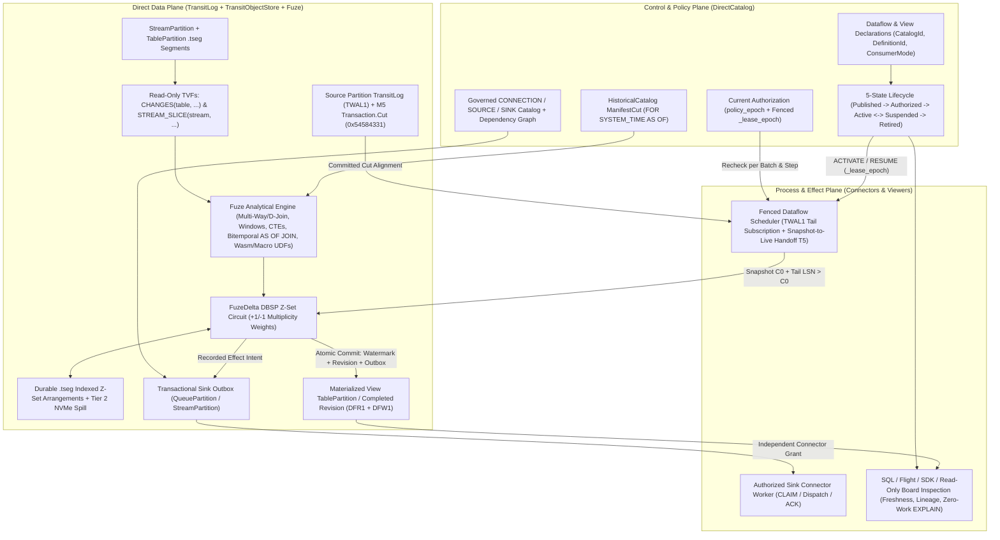

# 12. Managed computations and WAL-activated dataflows

[Roadmap](README.md) · [Issue #31](https://github.com/spoke-sh/transit/issues/31) · **Status:** In Progress ([remaining implementation plan](#implementation-plan-for-remaining-work--2026-11-01); [component delivery record](#delivered-implementation-evidence--2026-10-30))

Let an application declare a derived result, apply it, and inspect the definition,
source basis, completed revision and pending or blocked work while Transit owns
the qualified scheduling, WAL-driven delta activation and recovery. Extend the
[shared lifecycle](01-declarative-data-lifecycle.md),
[four-tier storage hierarchy](02-storage-and-query-performance.md),
[declarative streams, queues and durable runtime](06-streams-queues-and-durable-runtime.md),
[SQL reference](../handbook/reference/sql.md) and
[grammar inventory](../handbook/reference/sql/grammar-surface.md).

Typed Tables, joins/grouping, expressions, parameters, named relational
activation, complete Table history and typed maintained revisions already exist.
The installed managed Table slice now supplies service-owned finite recomputation
for one source after publication notifications. The older typed maintained owner
still uses host-driven activation and wakeups. Complete retained-history
consumption, incremental execution and broader SQL remain this milestone's work.
Connecting computations, reactive watches and Station actors to **`TransitLog`
(`TWAL1`) delta streams** must preserve each consumer's change contract and
equivalence with the finite recomputation oracle.

## Managed computation sequence

Consume the durable catalog/snapshot contract in
[#125](https://github.com/spoke-sh/transit/issues/125) and logical feed/retention
contract in [#127](https://github.com/spoke-sh/transit/issues/127). Storage-level
subscriptions and history preservation belong to milestone 2; this milestone
owns service scheduling, consumer-specific activation and observable freshness.
Connections/sources/sinks remain separate declarations whose publication does
not authorize external work.
Consume [statement results](04-statement-results-and-consumption.md) for finite
reads, explanation and command outcomes; continuous/maintained computation keeps
its own activation, progress and revision lifecycle. Consume
[transaction decisions](05-transactions-and-atomic-composition.md) for multi-object
changes: computation activation and published successors must respect complete
commits, even when participant records arrive separately. Do not publish a
half-committed transaction as a completed result.

1. **Bind computation declarations to catalog and storage watermarks:** define a
   computation declaration's bound inputs (`CatalogId`, `DefinitionId`), lifetime,
   output sink/table, policy references (`policy_epoch`), budget and desired
   activation revision. Publish/alter definitions separately from authorizing
   work. Bind accepted work to its exact definition; a rename or newer definition
   cannot relabel it.
2. **Drive activation from `TransitLog` delta streams and manifest watermarks:**
   implement a service owner that subscribes to source partition `TransitLog`
   tails (`+row`/`-row` change vectors and manifest commits) from the
   computation's last checkpointed source position. Select each consumer's
   contract explicitly: complete ordered changes, net relation changes, or
   finite recomputation at a new basis. A slow consumer requiring every change
   must recover from retained/archived logical history; snapshot diffs cannot
   recover intermediate `A -> B -> A` events. Use manifest reconciliation or
   recomputation only where the consumer's semantics permit it. Define the
   snapshot-to-live handoff and explicit unavailable-history outcomes; never
   silently downgrade complete capture. Record recoverable intent and progress,
   fence competing owners via epoch leases, and preserve pending work across service
   replacement. Admission pressure must not discard accepted work; reserve
   control capacity.
3. **Expose completed source vectors, result revisions, pending successor and attributable failure/blocked reasons:**
   compare progress with authorized observed input positions (`manifest/v{N}`,
   `lsn`) and define freshness at that observation. A completed result remains
   complete for its own basis while later changes are pending.
4. **Define the five-state computation lifecycle (`Published`, `Authorized`, `Active`, `Suspended`, `Retired`) and explicit DDL controls (`ACTIVATE`, `SUSPEND`, `RESUME`, `REFRESH`, `RETIRE`):**
   rather than collapsing dataflow state into an ambiguous boolean `ENABLE` / `DISABLE`
   toggle, keep definition publication, authorization (`policy_epoch` binding),
   active background scheduling, operational suspension and permanent retirement
   distinct:
   - **`ACTIVATE`:** transitions an authorized definition revision into active
     `TransitLog` delta scheduling under a fenced owner lease.
   - **`SUSPEND`:** pauses background delta consumption and external effect
     dispatch while preserving the computation's checkpointed source watermarks
     (`manifest/v{N}`, `lsn`) and continuing to serve reads from the last
     completed result revision (with its exact frozen source basis visible).
   - **`RESUME` (`WITH (on_resume = 'replay_history' | 'recompute_snapshot')`):**
     resumes scheduling according to the consumer's declared recovery profile—either
     replaying every intermediate `+row`/`-row` delta from the checkpointed
     `TransitLog` position (failing explicitly if required history was compacted
     during the suspension) or establishing a fresh snapshot-to-live handoff at
     the current manifest cut.
   - **`REFRESH` and `RETIRE`:** trigger an explicit bounded recomputation, or
     permanently close a definition revision to new activation and scheduling while
     retaining historical provenance and receipts. Preserve the last complete
     result while any successor is incomplete, and define dependency/schema
     changes, revocation, unavailable history and policy expiry without inventing
     cross-owner atomicity. When a computation or connector sink depends on a
     catalog `SECRET` ([Milestone 27](27-control-and-policy-plane.md)) whose
     OAuth 2.1 / PKCE challenge-response flow or lease refresh is pending, the
     computation records `BlockedReason.credential_pending` in `Suspended` and
     resumes from its checkpointed source watermark when the secret's
     `rotation_epoch` advances in `TransitLog`. Stateful security challenge
     games (such as OAuth 2.1 Authorization Code + PKCE `S256` verification,
     single-use anti-replay joins and proactive lease-refresh timing wheels) run
     as deterministic WAL-activated dataflows that emit governed outbox intents
     while keeping entropy generation, remote token exchange and raw token
     storage inside the connector and secret-vault boundaries.
5. **Adapt the qualified lifecycle to SQL views/subscriptions and typed SDK operations:**
   expose the same typed lifecycle state machine and DDL verbs across SQL
   (`CREATE` / `ALTER MATERIALIZED VIEW` / `DATAFLOW` / `SUBSCRIPTION`), SDKs and
   Board; [SQL grammar and dialect ergonomics](43-sql-grammar-and-dialect-ergonomics.md)
   audits these forms against PostgreSQL (`ENABLE`/`DISABLE`) and Snowflake
   (`SUSPEND`/`RESUME`/`REFRESH`) dialects. Inspection and `EXPLAIN` do no work.
   Board consumes the same definitions and evidence through its explicit
   capabilities; it adds no hidden scheduler or administrative authority.

## Remaining work

Consume [index coverage and access paths](11-indexing-and-access-paths.md) without
changing source cuts or completed-revision meaning. Preserve durable ordered
operator roots, checkpoint/input progress and retained versions when adding
mutable working-state acceleration. Establish finite/maintained correctness,
spill and freshness baselines here; the
[structure/planner/runtime owner](13-data-structures-and-performance.md) then
compares optimized structures and integrated local workloads. Its later delivery
cannot defer this milestone's bounded execution or activation/recovery gates.

- **Deliver the complete analytical and relational SQL surface in Fuze:** expand
  beyond two-table equijoins to multi-way joins ($>2$ tables), non-equi/range
  joins, `SEMI` (`EXISTS`/`IN`), `ANTI` (`NOT EXISTS`) and `LATERAL` joins with
  universal dependent-join (`D-Join`) correlated subquery unnesting (Neumann &
  Kemper, BTW 2015) so arbitrary correlated subqueries lower algebraically to
  set-oriented hash or merge joins rather than $O(N \times M)$ nested loops;
  **Window Functions** (`OVER (PARTITION BY ... ORDER BY ... ROWS/RANGE/GROUPS
  BETWEEN ...)`), ranking/lag/lead/frame functions and `QUALIFY`; **Common Table
  Expressions** (`WITH` and bounded `WITH RECURSIVE` with cycle detection and
  explicit work budgets) and set operations (`UNION [ALL]`, `INTERSECT`,
  `EXCEPT`); **Rich Aggregates** (`AVG`, `MIN`, `MAX`, `STDDEV`, exact and
  approximate quantiles/`PERCENTILE_CONT`, `ARRAY_AGG`/`STRING_AGG`);
  temporal/interval arithmetic; **compile-time (`comptime`) and plan-bound
  perfect-hash lookup tables** for SQL keywords and constant `WHERE col IN (...)`
  string literal sets (paired with 16-byte SIMD vector comparisons inside the
  `Batch` arena); and **deterministic, resource-bounded scalar and
  table User-Defined Functions (UDFs)** (SQL expression macros and sandboxed
  in-engine Wasm UDFs executing directly over vectorized `Fuze` column batches
  without round-tripping through `128 KiB` `Station` actor mailboxes). Preserve
  five-state values, checked arithmetic, explicit collations, source identities,
  output types and bounded operator state (with Tier 2 NVMe spill for large sorts,
  window frames, joins and aggregations).
- **Deliver first-class bitemporal SQL (`AS OF JOIN` and application-time periods) and linear DBSP Z-set interval-depth / state-book maintenance:**
  combine system-time knowledge cuts (`FOR SYSTEM_TIME AS OF`) with declarative
  application/valid-time periods (`PERIOD FOR valid_time` backed by
  [Milestone 10's](10-standards-and-catalogs.md) canonical `RANGE<TIMESTAMPTZ>`
  type) and native streaming **`AS OF JOIN`** (matching each left observation to
  the nearest prior or exact valid-time right row per entity key—and supporting
  [Milestone 17's](17-geospatial-and-spatio-temporal-computing.md) piecewise-linear
  4D `TRAJECTORY` interpolation—without $O(N^2)$ inequality joins). In addition,
  exploit DBSP Z-set linearity for **1D interval-depth / genomic pileup coverage**
  (encoding `[start_pos, end_pos)` intervals as $+1$ at `start_pos` and $-1$ at
  `end_pos` so `RANGE_UNION`, coverage depth and overlap joins maintain via
  Abelian prefix sums) and **discrete event-sourced state / Limit-Order-Book
  (`LOB`) depth reconstruction**. Price-level quantity deltas over
  `(resource_id, side, price_tick)` support L2 aggregation; L3 additionally needs
  individual order identity, lifecycle and feed-defined ordering. Qualify
  add/cancel/execute/delete/replace semantics, sequence gaps, duplicate messages
  and corrections before aggregation. VWAP needs its own trade-price/volume
  basis and correction rules. Measure update work and indexed maintenance costs
  rather than assuming every event is constant work. Keep domain/trading policy
  in applications; the [ITCH specification](https://nasdaqtrader.com/content/technicalsupport/specifications/dataproducts/NQTVITCHSpecification.pdf)
  is a scoped protocol reference, not an implicit venue selection. Ensure
  point-in-time research, backtesting and decision auditing evaluate what was
  valid in the domain *and* known to the system at the decision cut, preventing
  later backfill corrections from leaking into earlier simulated decisions.
- **Expose first-class SQL `CHANGES(...)` and `STREAM_SLICE(...)` table-valued functions for CDC egress and side-effect-free relational stream queries:**
  allow SQL, Arrow Flight and SDK callers to query committed Table logical changes
  (`+row`/`-row` or net upserts/deletes with transaction, LSN and manifest
  provenance) between two snapshot cuts or watermarks (`SELECT * FROM CHANGES(table, ...)`)
  and to project bounded historical `.tseg` ranges from declared
  [Streams](06-streams-queues-and-durable-runtime.md) into relational joins and
  bitemporal `AS OF JOIN` backtests (`SELECT * FROM STREAM_SLICE(stream, OFFSET ? TO ?)`
  or `STREAM_SLICE(stream, TIMESTAMP ? TO ?)`) without advancing consumer-group
  offsets, preserving 5-state cells and current `policy_epoch` access checks.
- Provide logical/physical explanation and output-schema inspection without
  source disclosure, mutation or external work.
- Implement general `MERGE`/upsert and prepared-plan lifetime through shared SQL
  composition. The [transaction owner](05-transactions-and-atomic-composition.md)
  owns session control, atomicity/isolation, DDL/constraint interactions and
  transaction-bound plan invalidation; those features do not all become transaction
  syntax merely because they can execute in a transaction. SQL `MERGE` is separate
  from branch merge. [Foreign relations](18-multi-model-and-foreign-relations.md)
  now owns typed `COPY`/import/export and streaming CDC ingress together with its
  actual format adapters.
- Extend the common dependency lifecycle to connections, sources and sinks,
  including conditional alteration and retirement. SQL, SDK and Board use the
  same administrative operations.
- Optimize incremental maintained computation over `TransitLog` (`+row`/`-row`
  Z-set/delta vectors) against the complete finite-recomputation oracle,
  providing the Z-set arrangement and operator foundation extended by
  [Milestone 17](17-geospatial-and-spatio-temporal-computing.md) for algebraic
  half-edge `ST_Union` and `INTERIOR`/`BOUNDARY` cell-covering spatial joins.
  Event-time windows and bitemporal views require explicit timestamps, watermarks,
  allowed-lateness bounds and retraction rules.
- Bind outputs to recorded connector effects through independently authorized
  activation. Compiling, explaining, reading and replaying never dispatch a
  dataflow.

## Rich-workload computation handoff

Keep one shared computation lifecycle as the later workload profiles arrive.
[Scientific computation](35-scientific-arrays-and-measurements.md) extends
operator traits with point/window/halo/graph/global dependency extent, numerical
fidelity and valid update/retraction or bounded-rebuild behavior.
[ML/AI](37-ml-ai-and-experiment-provenance.md) binds feature/model/experiment
identity; [Robotics](38-robotics-and-sensor-replay.md) binds calibrated replay;
[software evidence](39-software-build-and-deployment-evidence.md) binds exact
build/test/deployment observations;
[constrained planning](40-constrained-planning-and-optimization.md) adds domain
candidate/bound/termination evidence;
[deductive rules and Datalog fixpoints](41-deductive-rules-datalog-and-equivalence-graphs.md)
extend `WITH RECURSIVE` and DBSP $\mathcal{Z}$-sets with Tarjan-SCC mutual
recursion, monotonic lattice aggregations, Union-Find equivalence classes and
derivation witnesses; and
[hardware design and EDA verification](42-hardware-design-rtl-and-eda-verification.md)
applies incremental Datalog and spatial dataflows to elaborated Verilog/RTL
taint, CDC and `DRC`/`LVS` checks. Each reuses original accepted identity,
source basis, bounded progress and complete publication rather than introducing
another job authority. SQL completion, solver optimality, model accuracy and
physical consequences remain different facts. These later extensions do not
defer this milestone's existing finite/incremental equivalence gates.

## Formal model follow-through

Own the [T5/T8 dataflow lifecycle and DDL interaction models and A3 incremental delta proofs](22-formal-semantics-and-correspondence.md#t8-catalog-ddl-evolution-and-dataflow-lifecycle-state-machines)
as the computation and phased-DDL contracts settle. Verify that `ACTIVATE`,
`SUSPEND`, `RESUME WITH (on_resume = 'replay_history' | 'recompute_snapshot')`,
`REFRESH` and `RETIRE` preserve last-completed-revision invariants when racing
in-flight worker leases (`_lease_epoch`), upstream `ALTER TABLE` schema
evolutions (`DefinitionId v1 -> v2`), `TransitLog` (`TWAL1`) compaction and
`policy_epoch` revocations, and replay the finite state-graph edges against the
production Zig catalog and dataflow state reducers.

## Prerequisites and completion

The later [reactive context milestone](32-reactive-context-and-agent-activation.md)
uses this scheduling and completed-result evidence for business conditions,
durable application interests and MCP subscriptions/tasks. This owner supplies
computation progress; a changed source or delivered notification alone cannot
establish that an agent ran or a business action completed.

Historical operations consume [catalog contracts](10-standards-and-catalogs.md).
Branch merge and SQL `MERGE` remain distinct. Fuze owns relational and incremental
vector computation; Station and application owners coordinate stateful workflows
and external effects above a generic kernel.

Require independent finite/maintained equivalence at completed source bases,
current grants, lost responses, interrupted publication, retained-history and
snapshot-to-tail handoff, bounded NVMe spill and larger-than-RAM workloads. Test
`A -> B -> A`, insert/delete within one flush, schema changes and compaction
without a logical mutation for every admitted consumer profile. Include
multi-object transactions with delayed participant records and aborted work;
completed maintenance must consume the selected committed cut without omissions
or partial publication. Qualify
actual callers for each exposed slice.

The acceptance journey declares a derived relation, observes its first complete
result, ingests streaming source changes over `TransitLog`, evolves the schema,
inspects catch-up or blocking, replaces the service and recovers the same
accepted work. Exercise pause, revocation and retirement without reporting a
partial successor as a complete result. Measure freshness lag and control
latency under load separately from correctness.

## Implementation plan for remaining work — 2026-11-01

Complete the installed finite Table lifecycle, then connect it to retained
logical history and durable incremental operators. Develop the analytical SQL
track alongside that work once its shared contracts are fixed. Each increment
must expose a complete caller journey: declare, authorize, activate, inspect the
original definition and source basis, and recover the same accepted work after
disconnect or replacement.

**Review proposal, based on fetched `origin/main` at
`f4abc3b18d9a621eb9fcb2f2c10ee72a48aa2ae1`.** This includes the managed Table
implementation in [PR #318](https://github.com/spoke-sh/transit/pull/318), the
production string increment in PR #316, gateway ingress in PR #315 and the
Document storage increment in PR #319. Unmerged milestone branches are not
prerequisites already satisfied. The earlier
[plan at this source revision](https://github.com/spoke-sh/transit/blob/f4abc3b18d9a621eb9fcb2f2c10ee72a48aa2ae1/docs/roadmap/12-sql-and-dataflows.md#implementation-plan-for-remaining-work--2026-11-01)
preserves the pre-implementation assessment; the October 30 `P0`–`P9` record below
preserves original scope and component evidence. Keep the stable `R0`–`R10`
packages, with the [PR sequence](#proposed-pr-sequence) defining their remaining
review boundaries. Milestone 12 remains **In Progress**. This plan establishes
no additional runtime support or executed proof.

### Installed Table implementation slice — 2026-11-01

Merged PR #318 delivers the installed finite Table lifecycle across R0–R3. It
replaces the capability ledger's lifecycle-helper claim with the actual
cohosted native SQL and typed profile: publication, authorization, activation,
suspension, resume, refresh, retirement, metadata-only EXPLAIN and observed state.
Paged catalog tokens and a named direct KV hold definitions, original work,
control epochs and completion checkpoints. The existing serializable Table/KV
transaction pins the source cut and commits output plus checkpoint together.
Publication generations wake a service-owned reconciler; startup scans durable
work and settled computations park. No Station turn owns this path.

The [public profile](../handbook/reference/queries.md#managed-table-computations)
and [DATAFLOW_V1 contract](../../contracts/DATAFLOW_V1.md) own its current limits:
one ordinary Table source, one existing schema-matched output, the finite
projection/filter/grouped COUNT/SUM compiler, and one local connection/namespace.
Output chaining and multiple managed writers reject. The output remains an
ordinary Table; service-only write grants are needed for exclusive managed writes.
Source definition replacement blocks and requires a new declaration. PostgreSQL,
MySQL and standalone remote gateways reject these declarations.

This slice does **not** close every R1/R2/R3 exit gate below. It does not add
ordered/net change consumers, snapshot-to-tail history handoff, historical output
retention, collectible abandoned immutable request records, the full crash-point
matrix or a growth proof beyond the former helper capacities. Those remain
explicit follow-up gates, alongside T5/T8 implementation correspondence. The
finite consumer recomputes at a retained common cut and may coalesce intervening
source changes. Incremental algebra and later SQL/connector packages remain
separate work.

Executable acceptance owners are
[`managed_table.zig`](../../tests/catalog/tables/managed_table.zig) and
[`server_managed_tables.py`](../../tests/interfaces/installation/server_managed_tables.py),
registered as `just test::managed-tables`. Their assertions cover exact output
rows, process replacement with a prepared head barrier, original decisions, control
races, dependency-cycle and budget refusal, empty successors, restart while
suspended and idle parking. The
[executed record](../history/qualification/query.md#managed-finite-table-lifecycle--2026-11-01)
also records constraint and ordered SUM failures preserving the old output.
Its evidence belongs to its named revisions, not automatically to this plan's
newer base. Full crash, growth, installed revocation and T5/T8 correspondence
remain open. The unresolved server-SQL failure after TLS trust replacement,
SDK storage-full failure and interrupted clean lanes must be resolved and rerun;
diagnostic passes do not clear them.

### Retained completed Table revisions — 2026-11-01

The R0/R1a implementation adds `DFR1` manifests published with the original
output/checkpoint transaction. Each manifest retains its exact declaration,
source/output definitions, common cut, output schema and immutable result pages.
`ManagedRevision` consumes one fixed revision with explicit row/byte bounds,
caller-owned rows and current source/output/control read checks. SQL exposes
`SHOW DATAFLOW name REVISION number` metadata through the existing statement
result lifecycle. Output edits and retirement do not rewrite saved results.

This is the first review unit below, not completion of R0 or R1 as a whole.
The current-v1 cutover replaces the old checkpoint-only revision value and
migrates schemas, signatures and binding resources together. Existing
`DirectRecord.Reference` roots retain indefinitely outside collection authority.
R1b still owns creation/closure fences, graph registration and abandoned-work
collection. Historical SQL row fetching, history consumers, multi-source
execution, the full fault/growth matrix and T5/T8 correspondence remain open.
The [qualification record](../history/qualification/query.md#retained-managed-table-revisions--2026-11-01)
records executed checks and their source-specific limits.

### Source assessment at the plan baseline

| Boundary | Present at the plan baseline | Work identified by the plan |
| --- | --- | --- |
| Installed managed Tables | [`ManagedTable`](../../packages/zig/transit-query-direct/src/ManagedTable.zig), [`DatabaseRuntime`](../../packages/zig/transit-sql/src/DatabaseRuntime.zig), [`ManagedSql`](../../packages/zig/transit-sql/src/ManagedSql.zig) and [`ManagedOperations`](../../packages/zig/transit-sql-service/src/ManagedOperations.zig) implement durable declarations, original work, control fencing, finite output/checkpoint transactions and publication-driven recovery | Add retained historical result roots, owned staging cleanup, full recovery/resource qualification and history-driven consumers. Completed revision keys alone do not retain historical output snapshots |
| Earlier captured/maintained queries | [`RelationalMaintenance`](../../packages/zig/transit-query/src/RelationalMaintenance.zig), [`RelationalHistory`](../../packages/zig/transit-query/src/RelationalHistory.zig) and [`NamedRelational`](../../packages/zig/transit-station-app/src/NamedRelational.zig) preserve their [supported host-driven profile](../handbook/reference/queries.md#maintained-table-revisions) | Migrate only after the direct owner preserves captured definitions, retained revisions/deltas, ordered failures, original attribution and cleanup. Their independent Table vectors do not establish common-cut semantics |
| Prototype lifecycle | [`ManagedDataflow`](../../packages/zig/transit-catalog/src/ManagedDataflow.zig) has five-state helpers, 32 endpoint slots, 64 pending/outbox slots and caller-supplied decision labels | This remains separate from the installed owner. Reuse qualified semantics, not its fixed capacities or one maximum LSN for all sources; remove superseded helpers/claims when their production replacements are qualified |
| Incremental algebra | [`FuzeDelta`](../../packages/zig/transit-fuze/src/FuzeDelta.zig) supplies weighted bags, join cross terms, group helpers and watermark cases | Z-sets have 256 resident entries. Arrangement run counts do not write `.tseg` objects. The finite join helper shares the join implementation; the widened aggregate total does not establish equivalence with canonical ordered checked SUM. Supply durable arrangements and independent semantic oracles |
| Analytical operators and spill | [`AnalyticalSql`](../../packages/zig/transit-fuze/src/AnalyticalSql.zig) and [`PerfectHashIn`](../../packages/zig/transit-fuze/src/PerfectHashIn.zig) provide bounded typed-array cases | These are not wired into the production SQL planner. `SpillTracker` counts bytes/runs without disk I/O. Extend the actual plan/executor and reuse [`RelationalSpill`](../../packages/zig/transit-query-direct/src/RelationalSpill.zig); component counters cannot qualify larger-than-RAM execution |
| Temporal, changes and MERGE | [`BitemporalAndTvf`](../../packages/zig/transit-fuze/src/BitemporalAndTvf.zig) evaluates caller-provided history/Stream/target arrays | No retained catalog binding or transaction publication follows from these helpers. The AS OF helper scans right history for each left probe; it does not establish the proposed merge-sweep complexity. Build real source adapters, SQL lowering and atomic mutations |
| Functions | [`VectorUdf`](../../packages/zig/transit-fuze/src/VectorUdf.zig) validates macro trees and a small caller-built `WasmInstr` stack machine with fuel/memory counters | This is not a general Wasm binary loader, persisted function catalog or SQL function service. Validate the actual admitted module format, memory isolation and vector ABI before exposing Wasm UDFs |
| Neutral contract, SQL and callers | [`Dataflow.zig`](../../packages/zig/transit-protocol/src/Dataflow.zig), [DATAFLOW_V1](../../contracts/DATAFLOW_V1.md), reflected schema and actual native SQL lifecycle are delivered; [result](../../contracts/SQL_RESULTS_V1.md) and [named relational](../../contracts/NAMED_RELATIONAL_V1.md) contracts remain separate owners | Extend consumer/result-retention contracts before enabling new modes. Shared data-client/SDK lifecycle, broader gateway/Flight exposure and captured/maintained migration remain open; unsupported syntax/profile tests must accompany each exposure |
| Verification | Real typed and installed managed fixtures now supplement component tests and [`managed_dataflows.py`](../../tests/catalog/tables/managed_dataflows.py) | The latter is still a fixture/source check. Complete faults, growth, revocation, T5/T8 production correspondence, A3 mechanization and common-revision qualification remain open |

The [query qualification ledger](../history/qualification/query.md) and
[verification limits](../handbook/reference/verification.md) remain the basis for
existing captured/maintained guarantees. Reuse their executable schedules and
record the new owner separately; neither a helper's comment nor a passing fixture
drift check expands the public profile.

### Recent milestones and incoming gates

| Owner and progress on this baseline | Reuse in M12 | Gate that remains with the owner |
| --- | --- | --- |
| [M1–M2](02-storage-and-query-performance.md), Completed; [M3](03-live-storage-and-sql-cutover.md), In Progress | Stable object/definition identities, direct catalog dependencies, WAL-inclusive Table pins, retained logical history, local flushing/archival/checkpoint/collection and installed direct callers | Register every new dataflow, arrangement, preparation and cleanup root with the existing storage graph. M3's remaining installed/performance qualification is not completed by M12 |
| [M4](04-statement-results-and-consumption.md), Completed | Command outcomes, `ResultSet`, terminal coverage, current disclosure checks and original-attempt settlement | Use the existing result protocol for finite result/revision reads and metadata; a continuous interest has its own durable progress, not an indefinitely incomplete finite SELECT |
| [M5](05-transactions-and-atomic-composition.md), Completed for local Tables | Serializable Table decisions, common cuts, private workspaces, savepoints and original decision recovery; the managed finite slice already consumes the shared decision owner | Extend through M6's participant owner. A transaction cut descriptor is not a retained change-feed lease or a global ordering of unrelated partition LSNs |
| [M6 R5/R6](06-streams-queues-and-durable-runtime.md#r5-extend-the-transaction-owner-and-deliver-direct-kv), In Progress; PR #303 merged | Named direct KV, native Table/KV plus Stream/Queue append/settlement transactions, explicit log read dependencies, Queue waits and declaration/inspection SQL. The [installed mixed proof](../history/qualification/transactions.md#installed-mixed-state-output-and-input-settlement--2026-10-31) records lost-response and node-replacement recovery | Full preparation/finalization faults and clean qualification remain open; workload SQL, finite `STREAM_SLICE`, automatic DLQ and Station/effect migration are unfinished. Consume qualified native transactions now; do not wait for all of Station or implement a second coordinator |
| [M7](07-document-storage-and-station-decoupling.md#first-integrated-storage-slice--2026-11-01), In Progress; PR #319 merged | Canonical causal map changes now drive paged `DocumentIndex` evaluation, `.tseg` storage and fenced WAL acceptance; owned path reads enforce authentication and cumulative budgets | This is a private storage-library API. BP/subcolumns, lists/spans, versioned merges, logical checkpoints, public catalog/client/SQL, collection routing/scans, transactions and consumer migration remain gates. It does not admit managed Document sources |
| [M8](08-gateway-architecture-and-protocol-ingress.md), In Progress; PR #315 merged | Node-cohosted SQL/direct dispatch, event-driven recovery and pure startup/command ingress continuations | Reuse the installed runtime. Deadline integration, CPU-bounded scheduling, configuration handoff, coarse remote execution and broader Flight/Serving/performance remain owner work. Preserve idle parking; add no per-dataflow polling service |
| [M9](09-client-foundation-and-language-apis.md#remaining-implementation-plan--2026-10-31), In Progress; PR #298 merged | Independent `transit-data-client.Catalog`, neutral values/direct readers, bounded contexts, frozen SQL submission and local recovery storage | Principal coordination, ordinary settlement, result/transaction handles and independent data bindings remain active work. M12 supplies its minimal typed operations and migrates affected callers without waiting for every language redesign |
| [M10](10-standards-and-catalogs.md#delivered-implementation-evidence--2026-10-30), In Progress | Generated standards ledger, operator traits, EXPLAIN integration, collation/timezone/range helpers and historical-cut components | Stored companion types, constraints and durable historical catalog/SQL binding are not delivered by helpers. Gate period types and bitemporal knowledge cuts on their actual owners; do not adopt a private manifest namespace |
| [M11](11-indexing-and-access-paths.md), Planned | Index lifecycle contracts and existing bounded ordered storage primitives | Full secondary indexes, phased rewrites and finer conflict tracking remain M11. Start on bounded scans/paged arrangements; consume index coverage when qualified. M11 builds must not depend on M12 scheduling, avoiding a circular prerequisite |
| [M14](14-vectorized-strings-and-search.md#first-production-strings-increment), In Progress; PR #316 merged | Bounds-safe SIMD, lossless 16-byte Batch strings, owned/borrowed lifetimes, five-state sidecars and production dictionary/FSST predicates | M12 still owns expression admission for constant `IN`/`NOT IN`. Compact retained keys, spill integration and broader search remain open. Reuse the real Batch/reader path and its correctness controls; do not infer an end-to-end speedup |
| [M16 profiles](16-document-profiles-and-gateway-exchange-lifecycle.md), [M17 spatial](17-geospatial-and-spatio-temporal-computing.md), In Progress | Offline JSON/XML profile processing and exact-predicate/bounded planar geometry foundations respectively | Neither supplies installed managed Document/spatial execution. Bind later qualified sources/operators to this lifecycle; do not duplicate their storage or semantic authority |
| [M20](20-branches-merges-and-restore.md#local-table-branch-increment), In Progress; PR #301 merged | Durable immutable single-Table branches with exact retained interpretation and protected pins | This does not supply writable branches, whole-catalog cuts or live branch dataflows. Begin M12 in the qualified local branch-one domain and preserve explicit branch identity for later extension |

### Delivery profile and decisions

Keep the delivered single-Table finite profile usable while extending it. The
next history profile begins in the same local branch-one domain. Admit multiple
sources only after common-cut handoff and delayed-participant recovery are
qualified. Cross-domain vectors remain explicitly independent; requests for
unsupported atomicity reject before admission. Add Stream inputs using M6's
retained readers and native transaction participants. Add KV/Document projections
only after their direct query/change adapters establish the same contracts.
Retained historical results are a new explicit contract, not an interpretation of
today's checkpoint keys. These increments preserve all analytical, temporal,
UDF, connector and interface completion requirements.

1. **Preserve ownership and dependency direction.** `transit-protocol` owns neutral bindings;
   `transit-catalog` owns names, definitions, current policy, operations and
   conditional lifecycle controls; `transit-storage` owns durable roots, pins and
   recovery. Fuze owns pure plans/operators, `transit-query-direct` owns retained
   source/result execution, and the cohosted database runtime owns scheduling.
   Station/connectors consume recorded effects. No database package imports
   Station to implement the new lifecycle.
2. **Persist the computation independently of its worker.** Freeze scope, object and
   definition, bound plan/function digests, exact source identities/columns,
   consumer mode, output identity, execution principal, policy references and
   budgets. Store desired lifecycle revision separately from observed worker
   lease, pending successor and last complete result. Names, worker slots and
   notifications cannot supply identity or authority.
3. **Publish one successor decision.** Use the M5/M6 transaction owner for
   checkpoint metadata in direct KV, materialized Table/output state and optional
   Stream/Queue outbox appends. Immutable arrangement/result roots must be durable
   and reachable through that same accepted decision before source progress moves.
   Add the necessary definition/control-epoch and retained-root guards to this
   owner; do not approximate atomicity with sequential commits or an in-memory
   assignment. A new generic participant is justified only by an obligation the
   existing participants cannot represent, and must satisfy the same protocol.
4. **Bind positions to their domains.** A checkpoint is a paged vector of exact
   source/partition positions, definitions and verified common-decision evidence.
   A physical WAL LSN, logical change position, Stream offset, manifest version
   and transaction identity are different coordinates. Never take their maximum
   to manufacture a global watermark. A completed result is `Q(B)` for its
   recorded basis `B`; freshness compares that basis with separately authorized
   observations, with their observation times and coverage visible.
5. **Make consumer mode enforceable.** Complete ordered capture retains every
   committed transition, including no-op coverage where promised and `A → B → A`.
   Net changes may consolidate only within their declared completed-cut interval.
   Finite recomputation evaluates an explicitly selected basis. Missing retained
   logical history blocks ordered capture; a snapshot reset requires a profile
   that permits it and an explicit new basis. Physical WAL trim is not a gap when
   complete archived logical history still covers the range.
6. **Fence lifecycle races at publication.** `Published` starts no work;
   `Authorized` records an explicit binding but never substitutes for current
   rights. `ACTIVATE`/`RESUME` acquire fenced execution; `SUSPEND` closes new
   progress and outbox staging at its accepted control boundary. `REFRESH`
   records a bounded original request with a fixed target and preserves the last
   complete revision. `RETIRE` permanently prevents new activation of that
   definition. Specify every transition and exact retry in R0, including
   outstanding refreshes, definition replacement and accepted sink work.
   Suspend/retire cannot recall an already dispatched remote request; dispatch
   cancellation and unknown outcomes remain connector semantics.
7. **Preserve meaning across optimization and evolution.** Keep logical types,
   collations/rounding/timezones and physical codecs separate. Preserve bag
   multiplicity, stable contributor identity/order, five-state errors and
   canonical failure witnesses. Compatible source projection needs verified
   interpretation evidence; it cannot rewrite an accepted definition in place.
   Incompatible type/collation changes and incomplete phased rewrites block the
   successor while authorized readers retain the old complete result.

### Work packages and dependencies

| Package | Reviewable outcome | Start gate | Exit evidence |
| --- | --- | --- | --- |
| R0 | Extend delivered contract/capability work for retention, modes and migration | Merged finite profile | Reflected types/fixtures, negative compiler cases, owner and cutover inventory agreed before each extension |
| R1 | Complete retained historical results, staging ownership and cleanup around delivered declarations/work | R0 retention contract | Disk reopen, exact operation retry, paged growth and storage-graph reachability |
| R2 | Connect verified source cuts to durable snapshot-to-history handoff | R0; R1 for durable cursors/roots | No gap/duplicate application across writes, archive/trim and delayed transaction participants |
| R3 | Complete installed finite faults/resources, then integrate history scheduling and multi-source execution | Delivered finite owner; R1; R2 for history modes | Fair bounded work, current authorization, full crash matrix and atomic complete successors through actual callers |
| R4 | Durable incremental execution and event-time semantics | R2/R3; qualified finite operator oracle | Independent finite equivalence, persistent arrangements, bounded spill/recovery |
| R5 | Production analytical planner and executor | R0; proceeds alongside R1–R3 | Actual SQL multi-way/subquery/CTE/set/window/aggregate execution with typed results and resource limits |
| R6 | Retained change/Stream SQL, bitemporal execution and MERGE | R2; R5 as each operator requires; M6/M10/M11 owner gates | Real retained-source TVFs, exact historical interpretation and one original MERGE decision |
| R7 | Catalog-bound SQL macro and real sandboxed Wasm UDFs | R0/R5; descriptor/type gates from M10 | Module/function binding, fuel/memory isolation, recovery and actual SQL/maintained invocation |
| R8 | Governed connections/sources/sinks and durable effect outbox | R1/R3; M6 mixed transactions and connector consumer seam | Atomic progress/output/intent decision, independent dispatch policy and uncertain-outcome recovery |
| R9 | Complete caller migration, inspection and current-v1 cutover | Starts with R0/R3; finishes after exposed R4–R8 slices | Shared SQL/native/SDK/Flight/Board contracts, installed caller proofs and removed superseded paths |
| R10 | Formal correspondence, integrated faults and qualification | Begins with R0; closes after R1–R9 | One committed revision with required evidence, public documentation and explicit limits |

The next path is **R0/R1 retained results → owned cleanup → R3 finite
qualification → R2/R3 history consumption → R4 incremental execution**. R5 can
proceed alongside it after contract review; each operator enters R4 only after
its finite semantics are qualified. R6 splits by feature, and R8 can consume the
finite profile before every incremental operator is ready. R9 and R10 accompany
each slice. Full closure still requires all R0–R10 exit gates; finishing the
first path alone will not complete the milestone.

#### R0 — Freeze contracts and the migration inventory

Extend the delivered [DATAFLOW_V1 contract](../../contracts/DATAFLOW_V1.md) and
protocol-owned types before dependent storage or adapters. Preserve its finite
profile while specifying retained-result access, owned staging closure and
executable ordered/net consumers. Extend the [direct operation contract](../../contracts/DIRECT_TABLE_V1.md)
and [result contract](../../contracts/SQL_RESULTS_V1.md) where their owners need
new typed operations/observations. Define exact dependency registrations,
publication expectations, authorization/activation controls, lease fencing,
consumer modes, source-history retention grants, revision completeness and
original-attempt recovery. Specify recursive/cyclic dependency rejection before
admission; later recursive SQL is bounded computation, not implicit scheduling
of a cyclic dataflow graph.

Resolve the control/transaction boundary explicitly: source bindings and result
identity, internal state/output participants, prepared root retention, current
source/output rights, definition/control epoch validation and final decision
ordering. Freeze suspend/refresh/retire race outcomes and retained-result access;
result retention, computation retirement and physical collection are separate.
Specify named captured-definition migration as well as maintained definitions:
deleting all of `NamedRelational` would otherwise remove supported captured
publication and original result attribution.

Audit [`standards-ledger.json`](../../contracts/sql/standards-ledger.json) against
the actual parser, lowering, execution, recovery and transport paths. Correct
overstated helper coverage with positive and negative service cases. Grammar-only
forms stay labelled as such; fixture declarations are not execution evidence.
Reserve the new record formats only after their full identities and ownership
are defined. Use the shared current-v1 definition cutover, not a parallel legacy
service or a permissive decoder.

**Exit:** generated contracts and rejection fixtures bind complete content;
unsupported source/type/operator/consumer combinations reject before acceptance;
an inventory names every affected captured/maintained caller and persisted
artifact. T5/T8/A3 assertions are assigned to production owners now.

#### R1 — Persist the control lifecycle and retained graph

Keep the delivered paged declarations, dependency edges, original operations,
control epochs, pending directory and completed checkpoint keys. Extend their
retained graph rather than adding another catalog or scheduler. Add a complete
immutable result manifest, exact definition/source attribution and a bounded
reader for each retained revision. Attach its durable roots to the same
output/checkpoint decision. Never acquire the current output Table after commit
and label that potentially newer snapshot as the historical revision.

The [DirectRecord](../../packages/zig/transit-catalog/src/DirectRecord.zig) namespace
is currently excluded from collection. Define explicit ownership, creation
fences and durable closure for managed staging before making any record
collectible. A staged record awaiting a lost admission reply is still live work.
Protect original token requests, pending/prepared transactions, retained results,
shared content and historical recovery references; a terminal head alone is
insufficient deletion evidence. Refuse late acceptance through a closed staging
identity. Keep other DirectRecord formats protected until their owners register
complete lifetimes. Put neutral dependencies in the catalog/storage boundary so
the collector never imports a query executor to decode application meaning.

Register definition bundles, source/history pins, arrangement manifests, result
segments, pending preparations, receipts and cleanup continuations in the
retained graph through
[`DirectStorageGraph`](../../packages/zig/transit-catalog/src/DirectStorageGraph.zig)
and the existing backend collector. Cleanup is paged, idempotent and separately
authorized; denied cleanup remains visible. Disk pressure must block admission or progress without
expiring accepted history. Bound resident caches and active workers independently
of the number of definitions, revisions, dependencies and queued successors.
Unlimited result retention remains the default. Retirement closes execution and
dependencies; releasing retained results requires its own authorized policy.

**Exit:** reopen after every acceptance/publication boundary, recover lost
responses by original identity, preserve DROP restrictions, and exceed the old
32/64/256 component capacities with a one-page resident cache. Prove reachable
objects survive real collection and abandoned private objects become collectible
only after their recovery obligations close.

#### R2 — Build source adapters and a durable handoff

Extend [`TableChangeReader`](../../packages/zig/transit-query-direct/src/TableChangeReader.zig)
and the owning retained-history operations. Each adapter supplies a frozen
definition, source cut, exact snapshot/history pin, bounded records, terminal
coverage, original cursor and current authorization. Acquire history protection
before concurrent changes can escape the initial retained snapshot. Persist the
handoff basis and resume point before backfill; consume after the exact logical
acceptance boundary, including unflushed WAL rows. A notification is only a wake
hint: reconcile from durable history after duplicate/lost notifications or restart.

Join participant evidence to the real M5/M6 decision and selected common cut.
Do not publish until every relevant participant is known committed and covered;
abort/private records contribute no rows. Persist pending transaction references
and page them under a work budget rather than buffering arbitrary payloads in
RAM. A later ready transaction must not advance a checkpoint over earlier
unresolved required input. Distinguish source logical changes, accepted no-ops
and physical flush/compaction records according to the consumer contract.

Stream adapters consume M6's retained partition/offset bounds without advancing
consumer groups for finite reads. Direct KV/Document require their own qualified
change/projection adapters. Do not route the new database executor through a
Station source merely to make those kinds appear supported.

**Exit:** disk-backed snapshot-to-tail tests cover writes during backfill,
duplicate delivery, archived history after trim, true history gaps, independent
LSN domains, aborted work and delayed participants of one mixed transaction.
Every-change cases preserve oscillations and insert/delete within one flush;
net-change cases prove exactly the permitted consolidation.

#### R3 — Complete installed lifecycle recovery and history scheduling

Extend the delivered service owner in `DatabaseRuntime`. Preserve its independent
pending-work scan: prepared control-KV barriers must not prevent discovery of
the transaction that can release them. Reconcile durable work in bounded pages
on activation, then wait on source/control generations and real lease deadlines.
Use bounded fair worker slots, per-computation morsels and reserved control/recovery capacity;
idle computations must not poll storage or each create an OS thread. Shutdown
joins active tasks and leaves accepted progress recoverable.

First finish finite-profile resource/fault qualification. Then integrate R2's
history basis and multi-source coverage with the same owner. Evaluate the finite
plan at that exact basis before adding incremental operators. Stage output and
delta coverage privately. Commit the new checkpoint, result manifest, retained
roots and completion receipt through the
common state/output decision. Revalidate current source/output grants and the
dataflow definition/control/lease guards at that decision. If a reply is lost,
resolve the same operation; if a worker is replaced, resume its accepted work.
Never publish partial pages or silently recapture a different basis.

Extend the delivered typed/SQL controls through the shared compiler and result
lifecycle, adding retained revision reads and exact mode/coverage observations.
Preserve metadata-only EXPLAIN, first-result pending state, last-completed reads
and explicit blocked reasons. A command's accepted activation is distinct from
its first completed result. Closing a client result or session does not retire
the computation. Output chaining stays rejected until a separately qualified
acyclic dependency traversal and common-cut rule can admit it.

**Exit:** installed typed/SQL callers publish, activate, read, mutate sources,
observe a successor, suspend/resume/refresh, replace the node, revoke rights and
retire. Kill before/after output staging, prepare, decision and finalization;
fresh readers see the previous or new complete revision and the original
decision. A stale lease never publishes after an accepted suspension.

#### R4 — Add qualified incremental operators

Keep the existing finite executor as the reference semantics and add an
independent small interpreter/property oracle. Convert `FuzeDelta` into typed
batch operators with checked multiplicities, durable indexed arrangements,
bounded consolidation, actual segment I/O and separately bounded local spill.
Retained arrangement roots are checkpoint data; disposable scratch is not.
Reuse the shared paged/segment structures and integrate M11 access paths only
when their coverage and interpretation match the requested cut.

Start with filter/projection/UNION ALL, then joins with both-side cross terms,
outer/semi/anti match-count transitions, distinct/set multiplicities and groups.
Add windows, subquery/temporal and UDF operators as their finite contracts land.
For ordered checked SUM, `[MAX_INT64, 1, -1]` must still fail at its original
overflow witness even though a widened final total fits. Preserve contributor
order/error evidence or explicitly use the admitted finite-recomputation mode;
do not advertise an unproved incremental aggregate. Compare complete results,
ordered deltas where promised, errors and completion at every committed basis.

Define event timestamps, per-input watermarks, idle-input policy, allowed
lateness, late corrections and finality before admitting event-time windows.
Persist them with the operator checkpoint. A watermark may permit disposal of
reconstructible working state under that contract; it is not retention consent
for accepted input, results or effect receipts.

Qualify the roadmap's interval-depth and discrete event-sourced state workloads
on these operators: interval endpoints, prefix depth and correction/retraction
rules; entity/order identity, ordering, duplicates and sequence-gap outcomes for
state-book reconstruction. Trade-derived measures require a separately defined
trade/correction basis. Keep these as generic workload proofs with measured
update/index work; select no venue or trading policy. M17 supplies spatial and
trajectory semantics when its own operators are qualified.

**Exit:** randomized insert/update/delete/retraction histories and adversarial
five-state/collation/overflow cases match independent finite evaluation. Workloads
exceed RAM, restart from actual arrangement objects, hit disk/memory/work quotas
without corrupting the last result, and meet measured allocation and catch-up
budgets. Unsupported incremental profiles reject explicitly.

#### R5 — Integrate analytical SQL into the real planner

Replace the fixed two-source plan boundary through one current-v1 plan/codec
cutover. Use a bounded typed operator DAG with source bindings and explicit
scratch/output lifetimes. Extend the production
[`RelationalSql`](../../packages/zig/transit-fuze/src/RelationalSql.zig),
[`Relational`](../../packages/zig/transit-fuze/src/Relational.zig) and
[`DirectRelationalQuery`](../../packages/zig/transit-query-direct/src/DirectRelationalQuery.zig)
paths, reusing actual
[`RelationalSpill`](../../packages/zig/transit-query-direct/src/RelationalSpill.zig)
I/O. Integrate, in separately reviewable slices:

- Multi-way inner/outer/cross/range joins, semi/anti joins, scalar/quantified and
  LATERAL subqueries through dependent-join lowering. Verify decorrelation over
  duplicate correlation keys, NULL/unknown states, empty inner inputs and scalar
  cardinality failures. Do not infer universal unnesting from an equality helper.
- Nonrecursive CTE sharing, bounded recursive fixpoints with cycle/work limits,
  UNION/INTERSECT/EXCEPT bag semantics, DISTINCT, HAVING and ORDER/LIMIT/OFFSET.
- Ranking/navigation and aggregate windows with ROWS/RANGE/GROUPS, peer groups,
  exclusions and QUALIFY; rich numeric, boolean, ordered-set and collection
  aggregates. Define empty/all-null, overflow, approximation and output-byte rules.
- Temporal arithmetic over M10's admitted descriptors and pinned timezone data;
  collation-correct constant-set predicates using M14's shared hashing/string
  owners rather than a competing keyword or comparison implementation.

Use real external sort/join/group/window spill files with byte/work quotas,
integrity checks and deterministic close/failure cleanup. Explain the selected
plan and limits without data reads, pins or execution. Do not promise linear
join work for arbitrary predicates or constant-time arbitrary window frames;
record the supported algorithm and measured worst cases.

**Exit:** actual SQL compilation, service execution and shared result readers
agree with independent logical cases, including empty/multi-batch results,
scratch reuse, early close and buffered revocation. Spill tests verify actual
I/O and peak resident memory rather than tracker counters. Promote capability
entries only for the tested path/type/transport.

#### R6 — Compose retained history, temporal SQL and atomic MERGE

Deliver `CHANGES` over R2 with explicit all-change/net-change mode, finite lower
and upper bounds, row/transaction/source-definition provenance and verified
terminal coverage. The [M6 finite Stream bridge](06-streams-queues-and-durable-runtime.md#r6-expose-sql-and-shared-caller-operations)
owns executable `STREAM_SLICE`; share its grammar, source reader and result
adapter rather than build another bridge. M12 composes that reader in joins,
bitemporal queries and managed plans. Timestamp selection must state its index,
scan budget and exact offset coverage; it never commits consumer progress.

Deliver period descriptors only with M10's stored type/schema contract. Bind
system-time selection to the actual durable historical catalog and data owner,
then implement ordered AS OF execution with defined ties, nulls, tolerance,
period endpoints and unmatched rows. Include sorting/spill cost in measurements.
Backfilled corrections must remain invisible at earlier knowledge cuts.
M17 supplies trajectory interpolation later; a callback does not qualify it.

Implement SQL MERGE through the existing transaction workspace: freeze source
and target definitions, evaluate predicates/cardinality/constraints, stage all
mutations, then recover one original decision. Prepared plans cannot silently
rebind accepted work after rename, definition change or revocation. Distinguish
future preparation from already accepted execution. This is DML, not M20 branch
merge; M10/M11 own constraint and index enforcement prerequisites.

**Exit:** retained history/Stream service queries preserve cuts and complete
coverage under trim/denial; temporal backfill tests use actual stored versions;
duplicate-match, constraint, savepoint, lost-response and restart cases establish
all-or-none MERGE without resubmitting SQL as fresh work.

#### R7 — Publish deterministic functions and isolate execution

Add immutable catalog function definitions, exact module/body digests, argument
and result schemas, dependencies, allowed effects and trap/budget policy. Plans
and accepted computations retain those bindings through replacement/retirement.
SQL macros use the actual typed AST with hygienic substitution and bounded
expansion. Table functions have bounded streaming output and owned batch data.

Select and document the supported Wasm binary subset and validation/runtime
implementation before exposing it. Supply a real decoder/validator, deterministic
execution, bounded linear memory, instruction fuel and a five-state vector ABI.
Reject ambient clock/random/network/WASI imports and malformed or unsupported
modules before acceptance. Borrowed host slices cannot survive batch reset or be
modified outside the declared output. The current `WasmInstr` tests remain useful
component cases but do not qualify arbitrary uploaded binaries.

**Exit:** execute persisted SQL macro/scalar/table Wasm functions through actual
finite and admitted maintained paths; prove module replacement attribution,
malformed imports, loops, traps, memory growth, early close and restart behavior.
No function dispatches through Station or an external connector.

#### R8 — Govern connector declarations and atomic effect intents

Persist CONNECTION/SOURCE/SINK objects through the common catalog/dependency
owner, with conditional alteration, retirement, exact secret references and
DROP restrictions. Compilation, publication, explanation and inspection open no
external connection. Use the existing secret/policy owner; M27's broader OAuth,
RLS/masking and workload governance are separate delivery gates. Credential
unavailability records a durable blocked reason and retains progress; a rotation
notification only wakes a fresh authorized check.

Bind each outbox intent to computation/definition, completed revision, exact
sink definition, trigger semantics and original operation identity. Commit it
with source progress and output through M6's native mixed transaction owner.
Preserve ordered versus net triggers: a retracted relation is not a retracted
HTTP request. Connectors claim/dispatch under independently current authority,
record outcomes and settle the original work. Unknown remote outcomes require
the connector's explicit retry/idempotency/compensation policy; local atomicity
does not provide external exactly-once delivery.

**Exit:** crash before/after the common decision and connector attempt; recover
one durable intent and preserve unknown remote outcomes. Exercise denied/full
destinations, secret rotation, suspend/retire races and stale claims. Replay,
EXPLAIN and result reads dispatch nothing. Consume M6's connector migration seam
without making all Station migration a prerequisite of the core scheduler.

#### R9 — Complete callers, inspection and the hard cutover

Expose shared typed lifecycle commands and paged observations through
`transit-data-client`, SQL submission/settlement through `transit-sql-client`,
and finite result/revision consumption through the existing result owner. Report
definition, desired/observed state, last complete basis, separately observed
heads, pending successor, blocked reason, retained-history availability and
budget usage. Counts/lag need units and coverage; unrelated LSNs cannot be
subtracted into a global freshness claim. Recheck current rights for cached
metadata, repeated/empty batches and terminal counts.

Migrate existing captured and maintained naming consumers, ABI/ports, generated
resources, SDKs, fixtures and examples together. Build ordinary data operations
on M9's independent boundary; adding them to Station bindings is not the target
architecture. Qualify SQL native/console and the applicable PG/MySQL adapters.
Flight admits each new relational/type profile only through its actual gateway
tests. Board inspection uses public read operations and never schedules or
authorizes work. Broader language/service coverage remains with M9/M21 and Board
workbench delivery with M30; affected existing APIs must migrate in M12's cutover.

**Exit:** representative installed callers complete the R3/R8 journeys, retained
results preserve old definition attribution, and foreign/missing definition IDs
reject. Remove superseded execution paths when their replacement is qualified;
do not retain a parallel decoder, silently reset old state or delete captured
functionality with the maintained owner. Public references describe the precise
new profile and its incompatible-artifact handling. Upgrade preflight detects
incompatible outstanding work; resolve it with the original build before
replacement instead of reinterpreting or resetting accepted history.

#### R10 — Prove correspondence and qualify one revision

Develop T5 handoff and T8 lifecycle/DDL models alongside R0–R3, in the current
[`tests/verification/models`](../../tests/verification/models/README.md) owner.
Model partition-scoped positions, history protection, the real commit decision,
control/policy/lease races and permanent retirement. Replay exported state-graph
edges against the production reducers with negative controls that remove each
critical guard. For A3, mechanize the admitted Z-set laws and connect them to
real operator traces; conditional mathematical laws cannot justify reordering
fallible SQL arithmetic. Preserve all original model bounds and assumptions.

| Qualification boundary | Required cases and forbidden outcome |
| --- | --- |
| Publication and recovery | Lost admission/control/decision responses and process death at staging, preparation and finalization; no new operation identity, partial successor or lost accepted work |
| Source coverage | WAL-only rows, alias deduplication, two unrelated LSN domains, delayed/aborted participants, no-op commits, `A → B → A`, snapshot/tail races and archive/trim; no skipped committed change or invented common cut |
| Authority and lifecycle | Suspend/refresh/retire/ALTER/revoke against an in-flight lease, denied source that contributes no rows, buffered/empty/terminal disclosure; no stale publication, resurrected definition or unauthorized cached read |
| Operator truth | Independent finite versus incremental bags, prescribed order, duplicate weights, five cell states, collation and ordered-overflow witnesses; no numeric final-total shortcut or omitted failure |
| Resources and storage | More durable objects/work than resident slots, larger-than-RAM joins/groups/windows, full spill disk, allocation/I/O faults, collection and restart; no truncation, unbounded queue or loss of retained roots |
| External effects | Atomic checkpoint/output/intent, current dispatch rights, lost remote response and replay; no dispatch from compilation/read/recovery or claim of remote cancellation |
| Caller completion | Native/SQL/SDK and admitted Flight/Board profiles, empty/multi-batch data, repeated fetch, incomplete EOF, early close and session loss; no finite completion inferred from transport closure |

Measure source-acceptance-to-complete-revision lag separately from notification
and connector latency. Record backlog/catch-up rate, cold restart work, control
latency during saturation, steady-state allocations, peak resident bytes,
spill/read/write bytes and retained amplification. Set numeric budgets from a
matched baseline before optimization, then compare finite and incremental runs
on the same workload, hardware, durability and semantics. Do not invent SLOs or
an incremental speedup from component counters. Use sealed counting-allocator
controls for hot operators after warmup, targeting zero backing allocations;
report each qualified path and any remaining allocation separately.

Use the [task index](../../tasks/README.md) and
[test inventory](../../tests/README.md) to select checks. In `nix develop`,
package-local `zig build test` in the affected Fuze, catalog, storage, direct
query, SQL and client owners provides component coverage; `just check contracts`
and `just check fast` check generated definitions and drift. Add real service,
fault and caller tasks to the existing runner before naming them as runnable
qualification. Execute affected committed-HEAD clean lanes: `core`,
`storage-query`, `interfaces-sql`, `interfaces-relational`, `formal`, and the
connector, SDK and installation/UI lanes for their exposed changes. Run complete
clean integration for milestone closure; selected lanes are not a full pass.

Record executed evidence with source, definition, toolchain, topology, workload,
logs, failures and omissions in [qualification history](../history/qualification/README.md).
Promote supported behavior into the [data model](../handbook/reference/data-model.md),
[queries](../handbook/reference/queries.md), [SQL inventory](../handbook/reference/sql/grammar-surface.md),
[query internals](../handbook/internals/query-engine.md), storage/retention,
connector and caller owners. Update milestone and index status together only
when every scope and qualification gate is met.

### Handoffs to upcoming milestones

| Later owner | M12 supplies | Work that remains there |
| --- | --- | --- |
| [M13 performance](13-data-structures-and-performance.md) | Correct bounded operators, actual spill, allocation/catch-up baselines and per-morsel budget seams | Broader structures, statistics/costing, WCOJ, cache/metering integration and comparative scorecards. M12 cannot defer boundedness or recovery to M13 |
| [M14 strings/search](14-vectorized-strings-and-search.md), [M15 compilation](15-data-centric-compilation-and-specialization.md) | Typed/effect-aware plans, constant-set expression admission, explicit lifetimes and independent finite/incremental oracles | Broader retained string keys/search and later fusion/AOT/tier-up. Reuse M14's delivered production Batch/encoded predicates; qualify each newly composed path |
| [M16 profiles](16-document-profiles-and-gateway-exchange-lifecycle.md), [M17 spatial](17-geospatial-and-spatio-temporal-computing.md), [M18 foreign relations](18-multi-model-and-foreign-relations.md) | Source/decoder definition bindings, function traits, arrangements, temporal joins and governed endpoints | Document/protocol parsers, spatial semantics/indexes, foreign formats, COPY and CDC ingress. Generic callbacks or descriptors do not establish those features |
| [M20 branches](20-branches-merges-and-restore.md) | Branch-scoped computation identities and retained source/result roots | Writable branch computation, merge/restore decisions and execution discontinuities; SQL MERGE stays with M12 |
| [M22 formal semantics](22-formal-semantics-and-correspondence.md) | T5/T8/A3 models, production correspondence and explicit proof limits | Broader composition/refinement. M12's selected proofs remain its own completion gate |
| [M27 policy](27-control-and-policy-plane.md), [M30 Board](30-board-reimplementation.md), [M32 reactive context](32-reactive-context-and-agent-activation.md), [M41 Datalog](41-deductive-rules-datalog-and-equivalence-graphs.md), [M42 EDA](42-hardware-design-rtl-and-eda-verification.md), [M43 SQL ergonomics](43-sql-grammar-and-dialect-ergonomics.md) | Current-policy execution/disclosure, inspectable complete revisions, exact change modes, blocked reasons, bounded recursive CTE evaluation and shared lifecycle verbs | Enterprise policy/authentication workflows, broader workbench editing, durable application interests/business triggers, multi-relation Tarjan-SCC Datalog stratification/lattices/witnesses, RTL/EDA verification suites and dialect audits. Notifications do not prove an agent or external action completed |

### Proposed PR sequence

Each row is a review boundary within R0–R10, not a new milestone. Include its
contract/schema changes, production implementation, shared callers, negative
admission cases and public documentation together. Split a row further if needed
while retaining one executable outcome per PR. No row is complete from helper
tests alone. R9 migration work and R10 correspondence accompany every row.

| Review unit | Concrete deliverable | Depends on | Required acceptance before merge |
| --- | --- | --- | --- |
| **R0/R1a — Retained completed results** | Immutable revision manifests and bounded reads bound to the output/checkpoint decision; neutral retention/root descriptors | Merged finite profile | Read revision A after B publishes, output changes and node replacement; preserve exact attribution, current grants and empty-result coverage |
| **R1b — Owned staging and collection** | Managed-record creation/closure fences, complete graph registration and paged abandoned-work cleanup | R1a; storage owner contract | Real collection preserves every recoverable/referenced object; interrupted cleanup resumes; closed identities cannot be accepted late; unrelated record formats remain protected |
| **R3a — Finite lifecycle qualification** | Bounded fair runtime work, reserved control capacity and complete finite crash/revocation/growth proof | R1a/R1b | Old/new complete output at every staging/prepare/decision/finalize kill; original recovery, stale-worker refusal, growth beyond helper capacities and idle parking |
| **R2a/R3b — Table history consumer** | Persisted history protection, snapshot backfill and exact ordered/net modes in the installed service; explicit resume policy | R3a | Concurrent backfill writes, no-ops, oscillations, archive/trim, true gaps, lost wakes and restart; no checkpoint through an incomplete acceptance |
| **R2b/R3c — Multiple inputs and managed dependencies** | Paged source vector, real common-decision barrier, alias deduplication and bounded acyclic scheduling | R2a/R3b; R5a for joins | Delayed/aborted mixed participants never publish a partial cut; durable waiting and cycle rejection; admit output chaining only with qualified dependency coverage |
| **R4a — Persistent delta execution** | Typed batches, durable arrangements and real spill for projection/filter and admitted UNION ALL | R2a/R3b; finite operator semantics | Independent finite equality at every completed basis; reopen arrangements, checked multiplicities, allocation and disk-budget controls |
| **R4b — Incremental joins and groups** | Join cross terms/match counts, distinct/set/group maintenance and ordered failure evidence | R4a; corresponding R5 operators | Both-side changes, duplicate/retraction cases, five states/collations, SUM overflow witness and larger-than-RAM recovery |
| **R4c — Event time and workload completion** | Durable per-input watermarks, late corrections/finality, admitted windows/temporal/UDF delta paths and interval/state-book workloads | R4b; corresponding R5–R7 operators | Idle inputs, late/retracted data and restart preserve declared finality; independent complete-result/error equivalence and measured catch-up work |
| **R5a — Production plan DAG and joins** | One plan/codec cutover; multi-way inner/outer/cross/range/semi/anti execution with bounded source bindings | R0 plan contract; can proceed alongside R1 | Actual SQL/service result tests, unmatched/NULL/duplicate cases and real bounded join spill |
| **R5b — Subqueries, CTEs and sets** | Dependent-join lowering, scalar/quantified/LATERAL queries, shared and recursive CTEs, bag set operations | R5a | Correlation/scalar-cardinality oracles, cycle/work limits and duplicate multiplicities; no claim of universal decorrelation from an equijoin case |
| **R5c — Windows, aggregates and strings** | Ordering/limits/HAVING, frames/QUALIFY, rich aggregates, M14-backed IN/NOT IN and external sort/group/window spill | R5a/R5b; M10 for admitted temporal types | Frame peers/exclusions, empty/all-null/overflow cases, collation/five-state truth, actual spill I/O and scratch lifetime |
| **R6a — Change and Stream relations** | CHANGES over retained Table history; compose M6's finite STREAM_SLICE reader in relational and managed plans | R2; M6 executable finite bridge; needed R5 operators | Exact lower/upper coverage and definitions, current rights, trim/restart, offset/timestamp limits; no consumer-group progress mutation |
| **R6b — Bitemporal execution** | Durable historical interpretation, application-time periods and ordered AS OF joins | M10 stored types/history; R5 sort/join path | Backfill stays invisible to earlier knowledge cuts; ties/endpoints/tolerance/NULLs and charged sorting/spill match independent results |
| **R6c — Transactional MERGE** | SQL lowering into the existing workspace and original-operation settlement | R5; M5/M6 transactions; admitted M10/M11 constraints | Duplicate matches, constraint failure, savepoints, schema drift, revocation and lost-reply/restart all preserve one decision |
| **R7a — Catalog functions and SQL macros** | Immutable typed function bindings, hygienic expansion and bounded table-function output | R0/R5; M10 descriptors | Stored SQL invocation, replacement attribution, expansion/output budgets and retired dependency protection |
| **R7b — Sandboxed Wasm execution** | Real admitted binary decoder/validator/runtime and five-state vector ABI | R7a; reviewed binary subset | Invalid imports/modules, loops, traps, memory growth, borrowed-buffer lifetime and persisted invocation/recovery |
| **R8a — Governed endpoints** | Durable CONNECTION/SOURCE/SINK declarations, secret references and dependency controls | R0/R1; existing connector/policy owner | Conditional alter/retire/DROP, current rights and blocked credential recovery; inspection/publication dispatch nothing |
| **R8b — Atomic effect outbox** | Output/checkpoint/intent transaction and connector consumption with original outcomes | R3; R8a; M6 mixed transaction/connector seam | Crashes around commit/dispatch, denied/full destinations, unknown remote outcomes, stale claims and suspend/retire races |
| **R9 — Complete migration and caller matrix** | Finish captured/maintained migration, shared data client/SDKs, applicable gateways/Flight and read-only Board | Per-feature migration starts immediately; closure after R4–R8 | Real caller journeys, foreign-definition rejection, retained old attribution, no captured API loss and removal of superseded paths |
| **R10 — Common-revision qualification** | Final T5/T8/A3 correspondence, fault/resource/performance evidence and public profile | All prior exits | Full required clean qualification at one committed revision; unresolved failures closed, omissions explicit and all milestone acceptance criteria met |

**Recommended first implementation PR: R0/R1a.** Start from a freshly fetched
main and keep the existing single-source finite SQL/operator profile. Define the
revision manifest, current source/output disclosure rules and retained-root
ownership before changing `ManagedTable` publication. Add a shared bounded reader
and SQL revision inspection using existing result semantics, with schema/fixture
regeneration if the stored contract changes. Test two nonempty revisions and an
empty successor, same-identity recovery after a lost commit reply, later output
mutation, process replacement, and revocation after buffering. Do not claim
historical retention by saving a checkpoint number or reopening today's output.

Keep reclamation in R1b because `direct-records/` serves other owners and needs
its own complete creation/closure argument. R3a then qualifies the retained finite
lifecycle before history modes add another recovery obligation. R5a can proceed
independently after agreeing on source binding and result contracts; use its
qualified finite execution as R4's oracle.

### Decisions proposed for review

- **Retain finite recomputation as a supported mode and semantic reference.**
  Admit incremental operator combinations only after equivalence, including
  failures, is proved. Unsupported incremental requests reject explicitly.
- **Retain immutable result manifests independently of the mutable output Table.**
  This makes historical reads attributable and costs storage under the default
  unlimited retention policy. Explicit release/expiry never follows merely from
  retirement, quota pressure or a newer revision.
- **Extend one local transaction and scheduling owner.** Start with Tables in
  the existing branch domain; qualify source adapters and acyclic dependencies
  individually. Defer cross-domain atomicity, writable branches and unqualified
  Document/spatial profiles to their owners without narrowing M12's own gates.
- **Use feature admission gates, not calendar estimates.** Wasm's supported binary
  subset, event-time finality and external sink retry semantics must be specified
  before their PRs expose execution. Set numeric resource/performance budgets
  from matched baselines; the existing correctness fixtures establish no SLO.

## Implementation plan — 2026-10-30

This original plan preserves the feature scope, rationale and `P0`–`P9` labels
used by the component record below. Its source audit, proposed filenames,
commands and delivery order are historical. Use the
[November 1 remaining-work plan](#implementation-plan-for-remaining-work--2026-11-01)
for current dependencies, implementation order and evidence gates. In particular,
component delivery did not complete these packages' installed-runtime exits.

### Plan basis and starting point

This plan starts from `origin/main` at commit `54e176fd0` (`2026-10-30`) and
coordinates with the active in-progress and recently completed milestones:

- **Milestones 1 and 2 (Completed):**
  [`DATA_LIFECYCLE_V1.md`](../../contracts/DATA_LIFECYCLE_V1.md)
  ([`DataLifecycle.zig`](../../packages/zig/transit-protocol/src/DataLifecycle.zig))
  and [`INDEX_LIFECYCLE_V1.md`](../../contracts/INDEX_LIFECYCLE_V1.md)
  ([`IndexLifecycle.zig`](../../packages/zig/transit-protocol/src/IndexLifecycle.zig))
  define stable object (`CatalogId`, `Object`, `DefinitionId`) and policy
  (`policy_epoch`) identities; [`TransitLog.zig`](../../packages/zig/transit-storage/src/TransitLog.zig)
  (`TWAL1`), [`TransitObjectStore.zig`](../../packages/zig/transit-storage/src/TransitObjectStore.zig),
  [`LocalSegmentStore.zig`](../../packages/zig/transit-storage/src/LocalSegmentStore.zig)
  (`.tseg` segments), [`BitmapDirectory.zig`](../../packages/zig/transit-storage/src/BitmapDirectory.zig)
  (`.tdel` deletion vectors), [`TableChanges.zig`](../../packages/zig/transit-storage/src/TableChanges.zig)
  and [`TableSnapshot.zig`](../../packages/zig/transit-storage/src/TableSnapshot.zig)
  provide local durable segments, snapshots and logical change history.
- **Milestones 4 and 5 (Completed):**
  [`transit-sql-results`](../../packages/zig/transit-sql-results/src/root.zig)
  and [`transit-sql-client`](../../packages/zig/transit-sql-client/src/root.zig)
  enforce bounded `StatementResult` / `ResultSet` consumption with observation
  provenance (`SourceCut`, `Snapshot`, `CatalogObservation`, `SettingsObservation`)
  and per-batch `policy_epoch` rechecks;
  [`DirectTransaction.zig`](../../packages/zig/transit-catalog/src/DirectTransaction.zig),
  [`TableTransaction.zig`](../../packages/zig/transit-storage/src/TableTransaction.zig),
  [`TransactionDecisionLog.zig`](../../packages/zig/transit-storage/src/TransactionDecisionLog.zig)
  and [`TransactionDirectory.zig`](../../packages/zig/transit-storage/src/TransactionDirectory.zig)
  implement serializable multi-Table transactions, retained common cuts
  (`0x54584331`), private workspaces (`0x54585731`) and `TableGuard` definition
  and policy fencing.
- **Milestone 3 (In Progress):**
  [`DirectCatalog.zig`](../../packages/zig/transit-catalog/src/DirectCatalog.zig)
  and [`TablePartition.zig`](../../packages/zig/transit-storage/src/TablePartition.zig)
  own durable catalog and partition state; lazy schema projection across
  `DefinitionId` versions is implemented in
  [`TableEvolution.zig`](../../packages/zig/transit-fuze/src/TableEvolution.zig),
  [`TableSchemaProjection.zig`](../../packages/zig/transit-fuze/src/TableSchemaProjection.zig)
  and [`TableInterpretations.zig`](../../packages/zig/transit-storage/src/TableInterpretations.zig);
  and shared directory barriers, Table replay and crash schedules landed in
  [`TableRecovery.zig`](../../packages/zig/transit-storage/src/TableRecovery.zig).
- **Milestones 6 and 7 (In Progress):**
  [`DatabaseRuntime.zig`](../../packages/zig/transit-sql/src/DatabaseRuntime.zig)
  decoupled SQL admission from `Station` actor turns;
  [`transit-bitmap`](../../packages/zig/transit-bitmap/src/root.zig) provides
  canonical Roaring containers backing `.tdel` and `.tack`
  ([`Tack.zig`](../../packages/zig/transit-storage/src/Tack.zig));
  [`StreamPartition.zig`](../../packages/zig/transit-storage/src/StreamPartition.zig),
  [`DirectLog.zig`](../../packages/zig/transit-catalog/src/DirectLog.zig) and
  [`LogAuthority.zig`](../../packages/zig/transit-catalog/src/LogAuthority.zig)
  (together with active `QueuePartition`, signed stream/queue payload and
  consumer operations, hierarchical timer wheels and bounded notification waits
  on `feat/streams-queues-runtime-composition`) provide direct-plane streams and
  queues; and [`transit-document`](../../packages/zig/transit-document/src/root.zig),
  [`DocumentPartition.zig`](../../packages/zig/transit-storage/src/DocumentPartition.zig)
  and [`DocumentAuthority.zig`](../../packages/zig/transit-catalog/src/DocumentAuthority.zig)
  deliver direct-plane logical document storage (`DOC1`/`DCH1`/`DMR1`).
- **Milestones 8, 9 and 13 (In Progress):**
  [`RecoveryWork.zig`](../../packages/zig/transit-sql/src/RecoveryWork.zig) and
  [`NativeServer.zig`](../../apps/transit-node/NativeServer.zig) provide
  event-driven recovery and co-hosted local Table dispatch;
  [`transit-data-client`](../../packages/zig/transit-data-client/src/root.zig),
  [`QueryValues.zig`](../../packages/zig/transit-fuze/src/QueryValues.zig),
  [`NeutralEncoding.zig`](../../packages/zig/transit-fuze/src/NeutralEncoding.zig),
  [`RelationalBridge.zig`](../../packages/zig/transit-query-direct/src/RelationalBridge.zig)
  and [`TableChangeReader.zig`](../../packages/zig/transit-query-direct/src/TableChangeReader.zig)
  form the shared client/direct-query layer; and
  [`transit-memory`](../../packages/zig/transit-memory/src/root.zig) and
  [`transit-io`](../../packages/zig/transit-io/src/root.zig) provide bounded
  arenas, slabs and generation-based notification primitives (`#194`).
- **Milestone 10 (In Progress, core foundation merged in `54e176fd0`):**
  [`StandardsLedger.zig`](../../packages/zig/transit-fuze/src/StandardsLedger.zig)
  and [`contracts/sql/standards-ledger.json`](../../contracts/sql/standards-ledger.json)
  record per-feature `parse`/`lower`/`execute`/`recover`/`transport` capability
  truth; [`OperatorTraits.zig`](../../packages/zig/transit-fuze/src/OperatorTraits.zig)
  defines operator `EffectSet` (`read`, `mutate`, `capture`, `dispatch`),
  `FiveStateRule`, `CollationRule`, `ChangeMode.retractable_zset`, `WorkBound`
  and zero-work `Summary.forExplain`;
  [`Range.zig`](../../packages/zig/transit-fuze/src/Range.zig) implements
  canonical `Range(T, discrete)` and `MultiRange(R)` with `[lower, upper)`
  normalization and Allen's interval predicates (`overlaps`, `contains`,
  `adjacent`); [`VectorMetric.zig`](../../packages/zig/transit-fuze/src/VectorMetric.zig),
  [`DecimalArithmetic.zig`](../../packages/zig/transit-fuze/src/DecimalArithmetic.zig)
  ($\kappa_{\text{numeric}}$, `TzdbVersion` $\kappa_{\text{tz}}$,
  `SpatialDescriptor` $\kappa_{\text{spatial}}$) and
  [`Ebcdic1047.zig`](../../packages/zig/transit-fuze/src/Ebcdic1047.zig) provide
  companion orthogonal type rules;
  [`TableConstraints.zig`](../../packages/zig/transit-fuze/src/TableConstraints.zig)
  classifies `CHECK`/`FOREIGN KEY` and lazy Class A vs. phased Class B schema
  evolutions; and [`HistoricalCatalog.zig`](../../packages/zig/transit-catalog/src/HistoricalCatalog.zig)
  implements immutable `ManifestCut` timelines, conditional head publication,
  historical `AS OF` binding under current `policy_epoch`, and catalog
  descriptors for views, property graphs and foreign tables.

### Pre-implementation source audit

| Milestone 12 boundary | Current source owner | Delivered baseline at `54e176fd0` | Remaining gap for Milestone 12 |
| --- | --- | --- | --- |
| Five-state computation lifecycle & WAL-activated scheduling (Steps 1, 2, 4, 5) | [`RelationalMaintenance.zig`](../../packages/zig/transit-query/src/RelationalMaintenance.zig), [`RelationalMaintenanceRecords.zig`](../../packages/zig/transit-query/src/RelationalMaintenanceRecords.zig), [`NamedRelational.zig`](../../packages/zig/transit-station-app/src/NamedRelational.zig), [`NAMED_RELATIONAL_V1.md`](../../contracts/NAMED_RELATIONAL_V1.md) | `RelationalMaintenance` persists `RMH1`/`RMW1`/`RMV1`/`RMD1`/`RMC1` inside 28-byte `\x00rm` native KV keys using `Station.Turn` (4-mutation / 256-byte `STATE_V1` limits) and `Station.Publication`; `NamedRelational` (`NRC1`/`NRD1`/`NRA1`) caps names at 21 ASCII bytes and requires host-driven `wake(turn, ...)` and self-cast `advance(turn, ...)` turns | Maintained computations are still coupled to `Station` actor turns and 256-byte KV records rather than `DirectCatalog` and `TransitLog` (`TWAL1`). Missing: the 5-state lifecycle (`Published`, `Authorized`, `Active`, `Suspended`, `Retired`), explicit DDL verbs (`ACTIVATE`, `SUSPEND`, `RESUME WITH (on_resume = 'replay_history' \| 'recompute_snapshot')`, `REFRESH`, `RETIRE`), fenced `_lease_epoch` service-owned `TWAL1` tail subscriptions, and explicit consumer contracts (`complete_ordered_changes`, `net_relation_changes`, `finite_recomputation`) |
| Multi-object transaction boundaries & snapshot-to-live handoff (Steps 2, 3) | [`TableChangeReader.zig`](../../packages/zig/transit-query-direct/src/TableChangeReader.zig), [`RelationalHistory.zig`](../../packages/zig/transit-query/src/RelationalHistory.zig), [`RelationalFreshness.zig`](../../packages/zig/transit-query/src/RelationalFreshness.zig), [`RelationalRevision.zig`](../../packages/zig/transit-query/src/RelationalRevision.zig) | `TableChangeReader` streams single-Table `HistoryPoint` mutations (`inserted`, `updated`, `deleted`); `RelationalHistory` advances multi-source vectors one single-Table `HistoryPoint` at a time via round-robin `scan.preference`; `RelationalFreshness` and `RelationalRevision` encode source vectors and completed revisions (`FRV1`, `FRD1`) | `RelationalHistory` treats multi-table sources as independent per-table vectors without consulting [Milestone 5's](05-transactions-and-atomic-composition.md) `TransactionDecisionLog` (`0x54584331`), risking intermediate evaluation across half-committed multi-table transactions. Missing: atomic multi-object commit-cut alignment, atomic snapshot-to-live `TWAL1` tail handoff (`T5`), and explicit `error.DataflowHistoryExpired` failure when `complete_ordered_changes` / `replay_history` encounters compacted `TWAL1` segments |
| Incremental DBSP / Z-set operator algebra vs. full recomputation | [`RelationalMaintenance.zig`](../../packages/zig/transit-query/src/RelationalMaintenance.zig), [`OperatorTraits.zig`](../../packages/zig/transit-fuze/src/OperatorTraits.zig) | `OperatorTraits.ChangeMode.retractable_zset` is declared in `transit-fuze`, but `RelationalMaintenance.compute` + `delta` recomputes the entire finite query from scratch at the new source basis and merges `old` and `new` full output streams to synthesize `FRD1` deltas | No incremental DBSP Z-set (`+row` weight $+1$, `-row` weight $-1$) operator engine (`FuzeDelta`), no durable `.tseg`-backed indexed Z-set arrangements (with Tier 2 NVMe spill), no event-time watermark / allowed-lateness / retraction state, and no bilinear Z-set hooks for [Milestone 17's](17-geospatial-and-spatio-temporal-computing.md) incremental `ST_Union` ($\partial_2$), `ST_3DUnion` ($\partial_3$) and cell-covering joins |
| Complete analytical & relational SQL in `Fuze` | [`Relational.zig`](../../packages/zig/transit-fuze/src/Relational.zig), [`RelationalExecution.zig`](../../packages/zig/transit-fuze/src/RelationalExecution.zig), [`RelationalSql.zig`](../../packages/zig/transit-fuze/src/RelationalSql.zig), [`LogicalQuery.zig`](../../packages/zig/transit-fuze/src/LogicalQuery.zig) | `Relational` (`FRP1`) supports `max_sources = 2`, a single `inner` or `left` equijoin (`source 0 = source 1`), `int64` and `utf8` columns in `resolveColumn`, and `COUNT(*)`, `COUNT(col)`, `SUM(int64)` aggregates | Missing: multi-way joins ($>2$ tables), non-equi/range/`RIGHT`/`FULL`/`CROSS` joins, `SEMI` (`EXISTS`/`IN`), `ANTI` (`NOT EXISTS`), `LATERAL` joins, universal dependent-join (`D-Join`) correlated subquery unnesting (Neumann & Kemper, BTW 2015), Window Functions (`OVER (...)`, `ROWS`/`RANGE`/`GROUPS` frames, `QUALIFY`), CTEs (`WITH` and cycle-checked budget-bounded `WITH RECURSIVE`), set operations (`UNION [ALL]`, `INTERSECT`, `EXCEPT`), `ORDER BY`/`LIMIT`/`OFFSET`/`DISTINCT`/`HAVING`, rich aggregates (`AVG`, `MIN`, `MAX`, `STDDEV`, `PERCENTILE_CONT`, `ARRAY_AGG`, `STRING_AGG`) across all companion types, temporal/interval arithmetic, `comptime`/plan-bound perfect-hash `IN (...)` sets with 16B SIMD comparisons, and Tier 2 NVMe spill for sorts/windows/joins/aggregations |
| Deterministic scalar & table UDFs | [`StandardsLedger.zig`](../../packages/zig/transit-fuze/src/StandardsLedger.zig), [`Batch.zig`](../../packages/zig/transit-fuze/src/Batch.zig) | `Batch` provides columnar 5-state vectors and bounded scratch arenas; `OperatorTraits` models determinism and `WorkBound` | No `CREATE FUNCTION` / `DROP FUNCTION` catalog declarations, no compile-time/plan-inlined SQL expression/table macros, and no sandboxed in-engine Wasm vectorized UDF runner executing directly over `Batch` column vectors with `MeteredAllocator` + instruction-fuel budgets (without `128 KiB` `Station` actor mailbox round-trips) |
| Bitemporal SQL (`PERIOD FOR valid_time` & streaming `AS OF JOIN`) | [`Range.zig`](../../packages/zig/transit-fuze/src/Range.zig), [`HistoricalCatalog.zig`](../../packages/zig/transit-catalog/src/HistoricalCatalog.zig), [`TransitExtensions.g4`](../../contracts/sql/TransitExtensions.g4) | `Range.zig` implements canonical `Range(T, discrete)` and Allen's interval predicates; `HistoricalCatalog.zig` resolves `ManifestCut` for `FOR SYSTEM_TIME AS OF` | `TableSchema` (`FTS1`) and `TableDdl` do not yet bind `PERIOD FOR valid_time (start_col, end_col)` or `RANGE<TIMESTAMPTZ>` period columns; `Fuze` lacks the streaming $O(N + M)$ merge-sweep `AS OF JOIN` operator (and its kinematic interpolation hook for [Milestone 17's](17-geospatial-and-spatio-temporal-computing.md) 4D `TRAJECTORY`) combined with system-time `ManifestCut` cuts |
| `CHANGES(...)` & `STREAM_SLICE(...)` TVFs and SQL `MERGE INTO` | [`TableChangeReader.zig`](../../packages/zig/transit-query-direct/src/TableChangeReader.zig), [`StreamPartition.zig`](../../packages/zig/transit-storage/src/StreamPartition.zig), [`LogRead.zig`](../../packages/zig/transit-storage/src/LogRead.zig), [`TableDml.zig`](../../packages/zig/transit-fuze/src/TableDml.zig) | `TableChangeReader` reads Table changes at the direct-query layer; `StreamPartition` and `LogRead` read stream segments by offset/timestamp; `TableDml` supports `INSERT`, `UPDATE` and `DELETE` | `CHANGES(table, FROM ... TO ...)` and `STREAM_SLICE(stream, OFFSET ... TO ... \| TIMESTAMP ... TO ...)` are not exposed as side-effect-free relational SQL table-valued functions with transaction/LSN/manifest provenance; general SQL `MERGE INTO` (`WHEN MATCHED` / `WHEN NOT MATCHED`) and transaction-bound prepared-plan invalidation are not yet implemented |
| Governed `CONNECTION`, `SOURCE` & `SINK` lifecycle and atomic sink outbox effects | [`TransitExtensions.g4`](../../contracts/sql/TransitExtensions.g4), [`Declaration.zig`](../../packages/zig/transit-fuze/src/Declaration.zig), [`DirectDependency.zig`](../../packages/zig/transit-catalog/src/DirectDependency.zig) | `TransitExtensions.g4` parses `CREATE CONNECTION`, `CREATE SOURCE`, `CREATE SINK` and `SHOW CONNECTIONS/SOURCES/SINKS`; `DirectDependency` tracks forward/reverse catalog edges | `CONNECTION`, `SOURCE` and `SINK` declarations are not yet persisted as versioned `DirectCatalog` objects with conditional `ALTER`/`RETIRE` and `DROP RESTRICT` dependency edges; active dataflows cannot yet commit source-watermark progress and recorded sink effect intents atomically into [Milestone 6's](06-streams-queues-and-durable-runtime.md) outbox `QUEUE`/`STREAM` partitions under independent activation authorization |

### Coordination and handoffs across milestones

| Related milestone | Incoming foundation to Milestone 12 | Outgoing contract from Milestone 12 |
| --- | --- | --- |
| [M3: Live storage & SQL cutover](03-live-storage-and-sql-cutover.md) | `DirectCatalog`, `TablePartition`, lazy `TableSchemaProjection` (`column_origins`, `physical_schemas`) and `SharedTransactionRecovery` | Direct-plane `DataflowCatalog` & `DataflowPartition` replacing `Station`-coupled `NamedRelational` (`NRC1`) and `RelationalMaintenance` (`RMH1`); schema-evolution catch-up and blocking rules across `DefinitionId v1 -> v2` |
| [M4: Statement results](04-statement-results-and-consumption.md) & [M5: Transactions](05-transactions-and-atomic-composition.md) | `StatementResult`/`ResultSet` with `Observation` provenance; `DirectTransaction`, `TableTransaction`, `TransactionDecisionLog` (`0x54584331`) and `TableGuard` | Multi-object change alignment to committed `Transaction.Cut` boundaries; transactional SQL `MERGE INTO` and prepared-plan invalidation; atomic commit of dataflow checkpoint watermarks + materialized output deltas + sink outbox records |
| [M6: Streams, queues & runtime](06-streams-queues-and-durable-runtime.md) & [M7: Document storage](07-document-storage-and-station-decoupling.md) | `DatabaseRuntime` (SQL decoupled from `Station`), `StreamPartition`, `QueuePartition`, `.tdel`/`.tack` Roaring bitmaps, `transit-io` generation notifications and `DocumentPartition` | Side-effect-free `STREAM_SLICE(stream, ...)` relational TVF; `TransitLog` (`TWAL1`) tail subscriptions for Tables and Streams; atomic dataflow-to-`QueuePartition`/`StreamPartition` sink outbox staging without routing dataflow turns through `Station` actors |
| [M8: Gateway architecture](08-gateway-architecture-and-protocol-ingress.md) & [M9: Client foundation](09-client-foundation-and-language-apis.md) | Co-hosted `DatabaseRuntime`, `transit-data-client`, `QueryValues`, `NeutralEncoding` and `TableChangeReader` | Shared client/SDK/Flight consumption of 5-state dataflow lifecycle verbs (`ACTIVATE`, `SUSPEND`, `RESUME`, `REFRESH`, `RETIRE`), `CHANGES(...)`/`STREAM_SLICE(...)` TVFs, freshness/lag inspection and zero-work `EXPLAIN` |
| [M10: Standards & historical catalogs](10-standards-and-catalogs.md) | `StandardsLedger.zig` (`standards-ledger.json`), `OperatorTraits.zig`, `Range.zig` (`RANGE<T>`, `MULTIRANGE<T>`), `DecimalArithmetic.zig` ($\kappa_{\text{numeric}}$, $\kappa_{\text{tz}}$, $\kappa_{\text{spatial}}$), `TableConstraints.zig` and `HistoricalCatalog.zig` (`ManifestCut`, `ViewDescriptor`) | Execution promotion in `standards-ledger.json` for analytical SQL, bitemporal `PERIOD FOR valid_time` over `RANGE<TIMESTAMPTZ>`, streaming `AS OF JOIN` combined with `FOR SYSTEM_TIME AS OF` `ManifestCut`, and maintained view/dataflow catalog descriptors |
| [M11: Indexing & access paths](11-indexing-and-access-paths.md) | `IndexLifecycle.zig`, `OrderedKeyIndex.zig` and `TableKeyRange.zig` (with full secondary index access paths and online phased Class B rewrites in M11) | Indexed Z-set arrangement lookup interfaces and deterministic handling of Class A lazy projection vs. Class B phased rewrites on upstream dataflow sources |
| [M13: Data structures & performance](13-data-structures-and-performance.md), [M14: Strings & search](14-vectorized-strings-and-search.md) & [M15: Compilation](15-data-centric-compilation-and-specialization.md) | `transit-memory` bounded arenas/slabs (`#194`) and `transit-io` | Correctness, bounded Tier 2 NVMe spill, morsel-budgeted execution and `comptime`/plan-bound perfect-hash `IN (...)` lookup baselines that M13/M14/M15 accelerate via CedarDB hash tables, Umbra strings and data-centric push fusion |
| [M17: Geospatial & 3D computing](17-geospatial-and-spatio-temporal-computing.md) & [M18: Multi-model & foreign relations](18-multi-model-and-foreign-relations.md) | Reserved $\kappa_{\text{spatial}}$ descriptors in `DecimalArithmetic.zig` and `ForeignTableDescriptor`/`PropertyGraphDescriptor` in `HistoricalCatalog.zig` | DBSP Z-set arrangement and bilinear join hooks extended by M17 for incremental `ST_Union` ($\partial_2$), `ST_3DUnion` ($\partial_3$), Discrete Divergence Theorem volume aggregates and `INTERIOR`/`BOUNDARY` cell-covering spatial joins; streaming `AS OF JOIN` interpolation hook for 4D `TRAJECTORY`; `SOURCE`/`SINK` catalog foundation extended by M18 for foreign formats and streaming CDC ingress |
| [M20: Branches, merges & restore](20-branches-merges-and-restore.md) | Single-branch (`main`) `ManifestCut` timeline in `HistoricalCatalog.zig` | Strict separation between relational SQL `MERGE INTO` (DML) and catalog branch `MERGE` (M20), plus branch-scoped computation watermark bindings |
| [M22: Formal semantics](22-formal-semantics-and-correspondence.md), [M30: Board](30-board-reimplementation.md), [M32: Reactive context](32-reactive-context-and-agent-activation.md) & [M43: SQL ergonomics](43-sql-grammar-and-dialect-ergonomics.md) | `StatementResult.tla`, `TransactionDecision.tla`, `FuzeCell.lean`, `FuzeRewrite.lean`, `CollationOrder.lean` and `SchemaProjection.lean` | Executable `T5` (`SubscriptionHandoff.tla`), `T8` (`DdlAndDataflowLifecycle.tla`) and `A3` (`FuzeDelta.lean`) correspondence models; read-only Board lineage/freshness/blocked-reason inspection; qualified completed-revision evidence for M32 reactive watches; and dialect-ergonomic `ENABLE`/`DISABLE` aliases mapped onto the 5-state lifecycle |

### Accepted architectural decisions

1. **D1 — Decouple managed computations and dataflows from `Station` `STATE_V1` actor turns into the Direct Data & Control Plane:**
   Managed computations (`MATERIALIZED VIEW`, `DATAFLOW`, `SUBSCRIPTION`) are
   first-class database declarations owned by `DirectCatalog` and executed in
   the Direct Data Plane over `TransitLog` (`TWAL1`) and `.tseg` segments—never
   stored in `Station` `STATE_V1` 28-byte `\x00rm` KV keys (`RMH1`/`RMW1`/`NRC1`
   with 21-byte name and 256-byte value limits) or driven by `128 KiB` actor
   mailbox turns. `NamedRelational` (`NRC1`/`NRD1`/`NRA1` in
   `transit-station-app`) and `Station`-coupled `RelationalMaintenance`
   (`RMH1`–`RMC1`) are replaced through a single current-v1 hard cutover by
   `contracts/DATAFLOW_V1.md` (`DFL1` declarations,
   `DFW1` checkpoint watermarks, `DFR1` completed revisions and `DFA1` Z-set
   arrangements) in `transit-catalog`, `transit-storage`, `transit-fuze` and
   `transit-sql`. External connector effect delivery remains in the Process &
   Effect Plane, consuming committed outbox records from direct-plane `QUEUE` /
   `STREAM` partitions.
2. **D2 — Five-state computation lifecycle (`Published`, `Authorized`, `Active`, `Suspended`, `Retired`) with explicit DDL verbs:**
   Every managed computation revision transitions through an explicit five-state
   machine persisted in `DirectCatalog`:
   - `Published`: definition (`CatalogId`, `DefinitionId`, bound input
     `(Object, DefinitionId)` vector, consumer contract, output target, work
     budget) is validated and durably recorded; no background scheduling or
     external effects are authorized.
   - `Authorized`: bound to an explicit `policy_epoch` and principal grant (via
     `AUTHORIZE` or `CREATE ... WITH (authorize = true)`), ready for activation.
   - `Active`: transitioned via `ACTIVATE`; a service-owned dataflow worker
     acquires a fenced `_lease_epoch` lease and subscribes to source partition
     `TransitLog` (`TWAL1`) delta streams and `ManifestCut` commits from the
     last checkpointed source vector.
   - `Suspended`: transitioned via `SUSPEND` (or automatic suspension on
     revocable policy/budget pause); background delta consumption and external
     sink outbox staging stop immediately, the checkpointed source watermark
     (`manifest/v{N}`, `lsn`, `tx_cut_id`) is preserved, and read queries
     continue to serve the last completed result revision with its exact frozen
     source basis and freshness lag visible in `Observation` provenance.
   - `Retired`: transitioned via `RETIRE`; permanently closes the definition
     revision to new activation or scheduling while preserving historical
     provenance, completed revision receipts and lineage.
   - `RESUME WITH (on_resume = 'replay_history' | 'recompute_snapshot')`
     transitions `Suspended -> Active` using the caller's or declaration's
     explicit recovery profile: `'replay_history'` replays every intermediate
     `+row`/`-row` delta from the checkpointed `TWAL1` position and fails closed
     with `error.DataflowHistoryExpired` if any required `TWAL1`/`.tseg` history
     was compacted during suspension; `'recompute_snapshot'` establishes a fresh
     atomic snapshot-to-live handoff (`T5`) at the current `ManifestCut`.
   - `REFRESH` triggers a bounded one-shot catch-up or snapshot recomputation to
     a target or current `ManifestCut` while preserving the last completed
     revision until the successor commits. Dialect aliases such as PostgreSQL
     `ENABLE` / `DISABLE` lower explicitly to `ACTIVATE` / `SUSPEND` (`M43`)
     without collapsing the underlying 5-state machine.
3. **D3 — Transaction-consistent multi-source `TransitLog` consumption, explicit consumer contracts and atomic snapshot-to-live handoff (`T5`):**
   Each managed computation declares one of three consumer contracts:
   - `complete_ordered_changes`: processes every committed intermediate
     transition (including `A -> B -> A` and insert-then-delete within a flush
     window) in commit order; compaction of unread `TWAL1` history blocks the
     computation with `BlockedReason.history_expired` and never silently
     downgrades to a snapshot diff.
   - `net_relation_changes`: consumes net `+row`/`-row` Z-set deltas between
     committed cuts, coalescing cancelling intermediate updates within a batch
     while preserving exact multiset weights.
   - `finite_recomputation`: evaluates the query over a consistent snapshot cut
     on `REFRESH` or scheduled cadence.
   Multi-object computations align source partition changes to
   [Milestone 5's](05-transactions-and-atomic-composition.md)
   `TransactionDecisionLog` (`0x54584331`) and `ManifestCut` boundaries: when a
   transaction spans tables $T_1, T_2$, the dataflow scheduler buffers or
   advances per-partition `TWAL1` readers to the common committed
   `Transaction.Cut` before firing the operator graph and publishing a successor
   revision. Aborted transactions and uncommitted workspace records (`0x54585731`)
   are never exposed. Initial activation and `'recompute_snapshot'` execute an
   atomic snapshot-to-live handoff (`T5`): pin the source `SnapshotHandle` /
   `ManifestCut` at cut $C_0$, compute the initial Z-set state at $C_0$, and
   attach the `TWAL1` tail reader at `lsn > C_0` with deduplication across the
   cut boundary so zero committed records are missed or double-counted.
4. **D4 — Incremental DBSP / Z-set operator algebra (`FuzeDelta`) with durable `.tseg` arrangements and finite-oracle equivalence (`A3`):**
   `transit-fuze` implements an incremental Z-set circuit engine (`FuzeDelta.zig`)
   where changes are vectorized batches of rows paired with signed `i64`
   multiplicity weights (`+1` insertion, `-1` retraction/deletion). Linear
   operators ($\sigma$, $\pi$, `UNION ALL`, stateless `MAP` / UDF) stream
   statelessly over Z-set batches; bilinear and stateful operators (`JOIN`,
   `D-Join` unnested subqueries, `SEMI`/`ANTI`, `DISTINCT`, `GROUP BY`
   aggregates, window frames, `EXCEPT`/`INTERSECT`) maintain durable indexed
   Z-set **arrangements** (`Arrangement.zig`) backed by `.tseg` sorted runs and
   bounded Tier 2 NVMe spill slabs. Incremental evaluation preserves Transit's
   5-state cell lattice (`value`, `null`, `missing`, `type_error`, `conflict`)
   and ordered checked arithmetic failure witnesses: every incremental step
   $\Delta Q(I, \Delta I)$ is verified against the finite recomputation oracle
   $Q(I \oplus \Delta I) \ominus Q(I)$ (`A3`). The arrangement and bilinear
   Z-set join traits expose clean extension hooks for
   [Milestone 17's](17-geospatial-and-spatio-temporal-computing.md) algebraic
   2D half-edge `ST_Union` ($\partial_2$), 3D half-face `ST_3DUnion`
   ($\partial_3$), Discrete Divergence Theorem volume sums, and
   `INTERIOR`/`BOUNDARY` cell-covering spatial joins.
5. **D5 — Complete analytical and relational SQL in `Fuze` with universal `D-Join` unnesting, bounded NVMe spill and in-engine vectorized UDFs:**
   `transit-fuze` (`LogicalQuery`, `Relational`, `RelationalExecution`) is
   expanded to a complete relational and analytical engine over `Batch` vectors:
   - **Joins and universal correlated subquery unnesting:** multi-way joins
     ($>2$ inputs), `INNER`, `LEFT`, `RIGHT`, `FULL OUTER`, `CROSS`,
     `SEMI` (`EXISTS` / `IN`), `ANTI` (`NOT EXISTS`), non-equi/range joins, and
     `LATERAL` joins. Correlated subqueries in `SELECT`, `WHERE`, `HAVING` and
     `FROM LATERAL` lower through Neumann & Kemper's universal dependent-join
     (`D-Join`) rewrite rules into duplicate-eliminated domain scans ($D$) and
     set-oriented hash/merge joins—eliminating $O(N \times M)$ per-row nested
     subquery execution.
   - **Window functions, CTEs, set operations and rich aggregates:** `OVER
     (PARTITION BY ... ORDER BY ... ROWS | RANGE | GROUPS BETWEEN ... EXCLUDE
     ...)`, ranking (`ROW_NUMBER`, `RANK`, `DENSE_RANK`, `NTILE`, `PERCENT_RANK`,
     `CUME_DIST`), navigation (`LAG`, `LEAD`, `FIRST_VALUE`, `LAST_VALUE`,
     `NTH_VALUE`), `QUALIFY`, non-recursive `WITH` and cycle-checked
     work-budgeted `WITH RECURSIVE` (`USING KEY`), `UNION [ALL]`,
     `INTERSECT [ALL]`, `EXCEPT [ALL]`, `ORDER BY`, `LIMIT`/`OFFSET`,
     `DISTINCT`, `HAVING`, and rich aggregates (`AVG`, `MIN`, `MAX`,
     `STDDEV_POP`/`STDDEV_SAMP`, `VAR_POP`/`VAR_SAMP`, exact and T-Digest
     `PERCENTILE_CONT`/`PERCENTILE_DISC`, `BOOL_AND`/`BOOL_OR`, `ARRAY_AGG`,
     `STRING_AGG`) across all scalar and companion types (`DECIMAL` with
     $\kappa_{\text{numeric}}$, `TIMESTAMPTZ` with $\kappa_{\text{tz}}$,
     `INTERVAL`, `RANGE`).
   - **Perfect-hash `IN (...)` sets and bounded Tier 2 NVMe spill:** constant
     `WHERE col IN (lit1, ..., litN)` clauses and SQL keyword tables compile into
     zero-collision `comptime` or plan-bound displacement perfect hash tables
     paired with 16-byte SIMD prefix/equality checks inside the `Batch` arena.
     Sorts, hash joins, window partitions and group-by tables enforce explicit
     per-operator memory budgets via `MeteredAllocator` and spill partitioned runs
     to encrypted/checksummed Tier 2 NVMe scratch segments when resident memory
     reaches its quota.
   - **Deterministic scalar and table UDFs:** `CREATE FUNCTION` supports two
     deterministic, effect-free (`EffectSet.read_only`) execution profiles that
     run directly inside `Fuze` morsel pipelines without `Station` actor
     messages: (a) typed SQL expression and table macros inlined during plan
     lowering, and (b) sandboxed in-engine Wasm vectorized UDFs operating over
     pinned `Batch` column slices under strict instruction-fuel and
     `MeteredAllocator` memory caps.
6. **D6 — Bitemporal SQL combining `FOR SYSTEM_TIME AS OF` (`ManifestCut`) with `PERIOD FOR valid_time` (`RANGE<TIMESTAMPTZ>`) and streaming $O(N + M)$ `AS OF JOIN`:**
   Tables and views can declare `PERIOD FOR valid_time (valid_from, valid_to)`
   or a native `RANGE<TIMESTAMPTZ>` valid-time column (using
   [Milestone 10's](10-standards-and-catalogs.md) canonical `[lower, upper)`
   `Range.zig` representation). `Fuze` implements a dedicated streaming
   `AsOfJoin` physical operator (`AS OF JOIN ... MATCH_CONDITION (left.ts >=
   right.valid_from)` with optional tolerance and period containment predicates)
   that sweeps partitioned, valid-time-ordered runs in $O(N + M)$ time and
   bounded per-key state—exposing a pluggable interpolation callback so
   [Milestone 17](17-geospatial-and-spatio-temporal-computing.md) can evaluate
   4D `TRAJECTORY` dead-reckoning / linear interpolation at the matched
   timestamp. Combining `FOR SYSTEM_TIME AS OF <cut>` with `AS OF JOIN`
   evaluates both knowledge time (`ManifestCut`) and domain validity time
   (`valid_time`), preventing post-facto backfills from leaking into historical
   audits or backtests.
7. **D7 — Side-effect-free `CHANGES(...)` and `STREAM_SLICE(...)` table-valued functions and transactional SQL `MERGE INTO`:**
   - `SELECT * FROM CHANGES(table_name, FROM <cut_or_lsn> TO <cut_or_lsn> [, MODE => 'ALL' | 'NET'])`
     projects committed Table changes from `TableChangeReader` / `TransitLog` as
     a relational row stream with system metadata columns (`_change_op`,
     `_change_weight`, `_tx_id`, `_commit_lsn`, `_manifest_version`,
     `_definition_id`), enforcing current `policy_epoch` grants on every batch.
   - `SELECT * FROM STREAM_SLICE(stream_name, OFFSET <start> TO <end> | TIMESTAMP <start> TO <end>)`
     projects bounded historical `.tseg` and `TWAL1` ranges from
     [Milestone 6's](06-streams-queues-and-durable-runtime.md) `StreamPartition`
     into relational queries, joins and bitemporal `AS OF JOIN` backtests as a
     pure `EffectSet.read_only` scan—never mutating or advancing stateful
     `CONSUME ... FROM` consumer-group offsets.
   - General SQL `MERGE INTO target USING source ON ... WHEN MATCHED ... WHEN NOT MATCHED ...`
     executes atomically inside [Milestone 5's](05-transactions-and-atomic-composition.md)
     `TableTransaction` / `DirectTransaction` with deterministic single-join-match
     cardinality verification (`error.MergeMultipleMatches`), 5-state `CHECK`
     enforcement, and automatic prepared-plan invalidation whenever a bound
     object's `DefinitionId` or `policy_epoch` changes.
8. **D8 — Governed `CONNECTION`, `SOURCE` and `SINK` catalog lifecycle and atomic watermark-plus-outbox effect recording:**
   `CONNECTION`, `SOURCE` and `SINK` declarations are stored as first-class
   versioned objects in `DirectCatalog` with `DirectCatalogDependencies` edges
   (`DROP CONNECTION RESTRICT` fails while referenced by any `SOURCE` or `SINK`;
   `DROP SINK RESTRICT` fails while targeted by an non-retired `DATAFLOW`).
   Publishing a `CONNECTION`, `SOURCE` or `SINK` never opens a socket or
   authorizes external network I/O. When an `Active` dataflow targets a `SINK`,
   each completed delta step commits the updated source watermark (`DFW1`),
   result revision (`DFR1`) and recorded sink effect intent (`QUEUE` / `STREAM`
   outbox record bound to `(DataflowId, RevisionNumber, SinkDefinitionId,
   policy_epoch)`) in a single atomic commit. Connectors in the Process & Effect
   Plane claim and dispatch those outbox intents under current authorization;
   compiling, `EXPLAIN`, reading and replaying never dispatch external effects.

### Work package sequence (`P0`–`P9`)

| Package | Scope | Start gate | Primary owners | Exit gate |
| --- | --- | --- | --- | --- |
| [`P0`](#p0-neutral-dataflow-lifecycle-five-state-ddl-and-connector-catalog-contracts) | Neutral `DATAFLOW_V1` (`DFL1`/`DFW1`/`DFR1`/`DFA1`) contract, 5-state lifecycle DDL grammar (`ACTIVATE`, `SUSPEND`, `RESUME`, `REFRESH`, `RETIRE`), consumer-mode descriptors and `standards-ledger.json` entries | Current `HEAD` (`54e176fd0`) | `contracts/`, `transit-protocol`, `transit-fuze` (`StandardsLedger`, `OperatorTraits`, `Declaration`) | `DATAFLOW_V1.md` and Zig codecs pass round-trip/rejection tests; `TransitExtensions.g4` and `Declaration.zig` compile 5-state lifecycle verbs and `CONNECTION`/`SOURCE`/`SINK` options; `standards-ledger.json` check passes |
| [`P1`](#p1-complete-relational-and-analytical-sql--part-1-joins-d-join-unnesting-ctes-and-set-operations) | Multi-way joins ($>2$ tables), non-equi/range/`RIGHT`/`FULL`/`CROSS`/`SEMI`/`ANTI`/`LATERAL` joins, universal `D-Join` correlated subquery unnesting, CTEs (`WITH` / bounded `WITH RECURSIVE`) and set operations (`UNION`/`INTERSECT`/`EXCEPT`) | `P0` | `transit-fuze` (`LogicalQuery`, `Relational`, `RelationalExecution`, `RelationalSql`, `SubqueryUnnest`), `transit-query-direct` | Arbitrary correlated `EXISTS`/`IN`/scalar/lateral subqueries lower to set-oriented joins with zero per-row nested loops; multi-way joins, recursive CTE cycle/budget bounds and set operations pass 5-state and collation suites |
| [`P2`](#p2-complete-relational-and-analytical-sql--part-2-window-functions-rich-aggregates-perfect-hash-in-and-nvme-spill) | Window functions (`OVER`, `ROWS`/`RANGE`/`GROUPS` frames, ranking/navigation, `QUALIFY`), `ORDER BY`/`LIMIT`/`OFFSET`/`DISTINCT`/`HAVING`, rich aggregates, temporal/interval arithmetic, perfect-hash `IN (...)` with 16B SIMD, and Tier 2 NVMe external spill | `P1` | `transit-fuze` (`WindowExecution`, `AggregateExecution`, `PerfectHashIn`, `ExternalSpill`), `transit-storage`, `transit-memory` | Window frames, `QUALIFY`, rich aggregates (`STDDEV`, `PERCENTILE_CONT`, `ARRAY_AGG`, `STRING_AGG`), SIMD perfect-hash `IN` and larger-than-RAM external sort/join/window/group-by spill pass under tight `MeteredAllocator` caps |
| [`P3`](#p3-deterministic-scalar-and-table-udfs-sql-macros-and-sandboxed-vectorized-wasm) | Catalog-managed `CREATE`/`DROP FUNCTION`, compile-time/plan-inlined SQL scalar & table macros, and sandboxed in-engine Wasm vectorized UDFs over `Batch` columns | `P1` | `transit-fuze` (`UdfCatalog`, `SqlMacro`, `WasmVectorUdf`), `transit-catalog` (`DirectCatalog`), `transit-sql` | SQL macros inline cleanly into `Fuze` plans; Wasm UDFs execute directly over `Batch` column slices with deterministic fuel and `MeteredAllocator` limits, 5-state error propagation and zero actor-mailbox hops |
| [`P4`](#p4-bitemporal-sql-period-for-valid_time-and-as-of-join-tvfs-changes-and-stream_slice-and-sql-merge-into) | `PERIOD FOR valid_time` (`RANGE<TIMESTAMPTZ>`), streaming $O(N + M)$ `AS OF JOIN` (with M17 trajectory hook), `CHANGES(...)` and `STREAM_SLICE(...)` TVFs, and transactional SQL `MERGE INTO` with plan invalidation | `P1`, `P2` | `transit-fuze` (`TableDdl`, `AsOfJoin`, `TableDml`), `transit-query-direct` (`TableChangeReader`), `transit-storage` (`StreamPartition`, `TableTransaction`), `transit-sql` | Bitemporal queries combine `FOR SYSTEM_TIME AS OF` `ManifestCut` + `PERIOD FOR valid_time` + streaming `AS OF JOIN`; `CHANGES(...)` and side-effect-free `STREAM_SLICE(...)` stream batches under current `policy_epoch`; `MERGE INTO` commits atomically |
| [`P5`](#p5-incremental-dbsp--z-set-engine-fuzedelta-durable-tseg-arrangements-and-finite-oracle-equivalence) | Incremental DBSP Z-set circuit engine (`FuzeDelta`), durable `.tseg` indexed Z-set arrangements (`Arrangement.zig`), event-time watermarks/lateness/retractions, M17 spatial Z-set hooks and finite-oracle differential checker (`A3`) | `P1`, `P2`, `P4` | `transit-fuze` (`FuzeDelta`, `Arrangement`, `Watermark`), `transit-storage`, `transit-query-direct` | Incremental Z-set execution over `+row`/`-row` batches matches the finite recomputation oracle bit-for-bit across projections, filters, joins, unnested subqueries, aggregates and windows, including `A -> B -> A` and 5-state failure witnesses |
| [`P6`](#p6-service-owned-transitlog-delta-activation-multi-object-transaction-cuts-and-five-state-lifecycle-cutover) | Direct-plane `DataflowCatalog` & `DataflowScheduler`, fenced `_lease_epoch` `TransitLog` (`TWAL1`) tail subscriptions, M5 `Transaction.Cut` multi-object barrier, atomic snapshot-to-live handoff (`T5`), 5-state DDL execution and removal of `Station`-coupled `NamedRelational`/`RMH1` | `P0`, `P5` | `transit-catalog` (`DirectCatalog`, `DataflowCatalog`), `transit-storage` (`DataflowPartition`), `transit-sql` (`DatabaseRuntime`, `DataflowScheduler`), `transit-query` | `CREATE`/`ALTER MATERIALIZED VIEW`/`DATAFLOW`/`SUBSCRIPTION` and `ACTIVATE`/`SUSPEND`/`RESUME`/`REFRESH`/`RETIRE` run in the direct plane; multi-table commits respect M5 cuts; `Station` `\x00rm`/`NRC1` legacy paths are removed |
| [`P7`](#p7-governed-connection-source-and-sink-catalog-lifecycle-and-atomic-outbox-effect-bindings) | Versioned `CONNECTION`, `SOURCE` and `SINK` catalog objects, dependency graph enforcement (`DROP RESTRICT`, conditional `ALTER`/`RETIRE`), and atomic watermark + outbox (`QUEUE`/`STREAM`) effect intent commits | `P6` | `transit-catalog` (`DirectCatalog`, `DirectDependency`), `transit-storage` (`QueuePartition`, `StreamPartition`), `transit-sql`, `transit-station` | `CONNECTION`/`SOURCE`/`SINK` lifecycle enforced in `DirectCatalog`; active sink dataflows commit watermark + outbox intent atomically; compile/`EXPLAIN`/read/replay never dispatch; connectors claim and deliver under independent grants |
| [`P8`](#p8-shared-client-sdk-flight-and-read-only-board-inspection-surfaces) | Shared client (`transit-sql-client`, `transit-data-client`), C ABI, SDK, Arrow Flight and read-only Board inspection for dataflow freshness, source basis, pending/blocked reasons and zero-work `EXPLAIN` | `P4`, `P6`, `P7` | `transit-sql-client`, `transit-data-client`, `transit-station-bindings`, `sdks/`, `apps/transit-board` | SQL, Flight, SDKs and Board inspect completed revisions, source watermarks (`manifest/v{N}`, `lsn`), lag, pending successor and `BlockedReason` using shared read-only contracts; `EXPLAIN` performs zero work and acquires no pins |
| [`P9`](#p9-formal-correspondence-t5-t8-a3-and-milestone-12-common-revision-qualification-gate) | Formal models `T5` (`SubscriptionHandoff.tla`), `T8` (`DdlAndDataflowLifecycle.tla`) and `A3` (`FuzeDelta.lean`), trace replay harnesses and end-to-end Milestone 12 qualification suite | `P5`, `P6`, `P7`, `P8` | `formal/tla/`, `formal/lean/`, `packages/zig/transit-sql/`, `docs/history/qualification/` | TLC and Lean 4 proofs pass with zero counterexamples or `sorry`; Zig trace replay verifies every `T5`/`T8`/`A3` transition; end-to-end acceptance journey passes under crash, schema evolution, compaction and revocation schedules |

---

### `P0`: Neutral dataflow lifecycle, five-state DDL and connector catalog contracts

- **Goal:** Establish the single current-v1 contract and parser/AST surface for
  direct-plane managed computations, the 5-state computation lifecycle, consumer
  change profiles, and governed `CONNECTION`/`SOURCE`/`SINK` catalog objects
  before wiring execution packages.
- **Concrete changes:**
  1. Author `contracts/DATAFLOW_V1.md` and implement
     `packages/zig/transit-protocol/src/DataflowLifecycle.zig` defining:
     - `DataflowKind` (`materialized_view`, `dataflow`, `subscription`),
     - `LifecycleState` (`published`, `authorized`, `active`, `suspended`,
       `retired`),
     - `ConsumerContract` (`complete_ordered_changes`, `net_relation_changes`,
       `finite_recomputation`),
     - `ResumePolicy` (`replay_history`, `recompute_snapshot`),
     - `BlockedReason` (`none`, `awaiting_authorization`, `policy_revoked`,
       `history_expired`, `incompatible_source_schema`,
       `source_phased_rewrite_in_progress`, `sink_unavailable`,
       `budget_exhausted`, `lease_fenced`),
     - Binary wire/storage records `DFL1` (declaration with bound source
       `(Object, DefinitionId, ColumnId)` lineage, target table/sink identity,
       `ConsumerContract`, `ResumePolicy` and `WorkBound`), `DFW1` (checkpointed
       source watermark vector `(Object, DefinitionId, LSN, ManifestVersion)` +
       M5 `TransactionCutId` + `_lease_epoch`), `DFR1` (completed revision
       receipt with row count, byte count, source cut vector and completion
       timestamp) and `DFA1` (`.tseg` Z-set arrangement root descriptor).
  2. Extend [`contracts/sql/TransitExtensions.g4`](../../contracts/sql/TransitExtensions.g4),
     [`packages/zig/transit-fuze/src/Declaration.zig`](../../packages/zig/transit-fuze/src/Declaration.zig)
     and `packages/zig/transit-fuze/src/DataflowDdl.zig` to parse and lower:
     - `CREATE [OR REPLACE] MATERIALIZED VIEW | DATAFLOW | SUBSCRIPTION <name> [WITH (mode = ..., on_resume = ..., budget_bytes = ...)] AS <query>`,
     - `ALTER MATERIALIZED VIEW | DATAFLOW | SUBSCRIPTION <name> ACTIVATE | SUSPEND | RESUME [WITH (on_resume = 'replay_history' | 'recompute_snapshot')] | REFRESH | RETIRE | AUTHORIZE`,
     - PostgreSQL/Snowflake dialect ergonomics (`ALTER ... ENABLE` $\to$
       `ACTIVATE`, `ALTER ... DISABLE` $\to$ `SUSPEND`),
     - `CREATE | ALTER | RETIRE | DROP CONNECTION | SOURCE | SINK` with typed
       connector kind, secret reference bindings (never inline plaintext
       credentials) and `RESTRICT` dependency semantics,
     - `CREATE | DROP FUNCTION` (SQL macro and Wasm module reference forms),
     - `PERIOD FOR valid_time (start_col, end_col)` in `CREATE`/`ALTER TABLE`,
     - `AS OF JOIN ... MATCH_CONDITION (...)`, `CHANGES(table, ...)` and
       `STREAM_SLICE(stream, ...)`.
  3. Update [`contracts/sql/standards-ledger.json`](../../contracts/sql/standards-ledger.json)
     and [`packages/zig/transit-fuze/src/StandardsLedger.zig`](../../packages/zig/transit-fuze/src/StandardsLedger.zig)
     with feature entries for multi-way/lateral/`D-Join`/`AS OF` joins, window
     functions/`QUALIFY`, recursive CTEs, set operations, `MERGE INTO`,
     `CHANGES`, `STREAM_SLICE`, scalar/table UDFs and the 5-state dataflow
     lifecycle verbs.
- **Verification:**
  - `nix develop -c zig build test-fuze test-protocol`
  - `nix develop -c python3 -B tasks/check_standards_ledger.py`

### `P1`: Complete relational and analytical SQL — Part 1: joins, `D-Join` unnesting, CTEs and set operations

- **Goal:** Lift `transit-fuze` from a 2-table equijoin subset to a complete
  relational algebra engine supporting arbitrary multi-way joins, outer/semi/anti/lateral
  joins, universal correlated subquery unnesting (`D-Join`), CTEs (`WITH` and
  bounded `WITH RECURSIVE`) and set operations across all logical types ($\tau$)
  and collations ($\kappa$).
- **Concrete changes:**
  1. Refactor [`packages/zig/transit-fuze/src/Relational.zig`](../../packages/zig/transit-fuze/src/Relational.zig)
     and [`packages/zig/transit-fuze/src/RelationalSql.zig`](../../packages/zig/transit-fuze/src/RelationalSql.zig)
     from fixed 2-source arrays (`max_sources = 2`) into a bounded, multi-input
     relational operator DAG supporting:
     - Multi-way joins ($N \ge 2$ sources) with left-deep and bushy join trees,
     - `JoinKind`: `inner`, `left_outer`, `right_outer`, `full_outer`, `cross`,
       `left_semi` (`EXISTS` / `IN`), `left_anti` (`NOT EXISTS` / `NOT IN` with
       5-state `null`/`missing` anti-join semantics), and `lateral`,
     - Equijoin, composite-key equijoin, non-equi filter predicates and interval
       range predicates (`Range.overlaps`, `Range.contains`, `<`, `<=`, `>=`, `>`),
     - Full column resolution across all `Types.zig` tags (`bool`, `int8`–`int64`,
       `uint8`–`uint64`, `float32`/`float64`, `decimal128` with
       $\kappa_{\text{numeric}}$, `utf8`/`ebcdic` with `Collation`, `bytes`,
       `date`/`time`/`timestamp`/`timestamptz` with $\kappa_{\text{tz}}$,
       `interval`, `uuid`, `range`/`multirange`, `vector`, `array`/`struct`/`map`).
  2. Implement `packages/zig/transit-fuze/src/SubqueryUnnest.zig` implementing
     Neumann & Kemper's universal dependent-join (`D-Join`, $\bowtie_d$) rewrite:
     - Lower correlated scalar subqueries, `EXISTS`, `NOT EXISTS`, quantified
       `IN`/`ANY`/`ALL` and `CROSS`/`LEFT JOIN LATERAL` into algebraic `D-Join`
       nodes,
     - Push $\bowtie_d$ down through projections, selections, joins, aggregates
       and set operations against the deduplicated correlation domain
       $D = \delta(\pi_{\text{corr}}(T_{\text{outer}}))$, replacing $\bowtie_d$
       with standard hash or sort-merge joins so no query executes $O(N \times M)$
       nested-loop probes,
     - Preserve 5-state `conflict` and `type_error` cells and single-row scalar
       subquery cardinality assertions (`error.ScalarSubqueryMultipleRows`).
  3. Implement non-recursive `WITH` CTEs (with shared DAG materialization when
     referenced multiple times) and `WITH RECURSIVE` fixpoint evaluation in
     `packages/zig/transit-fuze/src/RecursiveCte.zig` with `UNION` / `UNION ALL`
     working/delta tables, optional `CYCLE ... SET ... USING` cycle detection,
     and explicit `max_iterations` and `max_rows` bounds from `OperatorTraits.WorkBound`,
     establishing the semi-naive working/delta table seam extended by
     [Milestone 41](41-deductive-rules-datalog-and-equivalence-graphs.md) for
     mutually recursive Datalog strata, monotonic lattice aggregations and
     Union-Find equivalence classes.
  4. Implement set operations (`UNION ALL`, `UNION [DISTINCT]`,
     `INTERSECT [ALL]`, `EXCEPT [ALL]`) respecting explicit column collations
     ($\kappa$) and 5-state cell equality rules.
- **Verification:**
  - `nix develop -c zig build test-fuze test-query-direct`
  - Differential tests comparing correlated subquery plans against unnested
    hash/merge plans over 5-state datasets (`null`, `missing`, empty inner
    domains, duplicate outer keys).

### `P2`: Complete relational and analytical SQL — Part 2: window functions, rich aggregates, perfect-hash `IN` and NVMe spill

- **Goal:** Deliver complete SQL:2023 analytical windowing, `QUALIFY`, rich
  aggregates, temporal/interval arithmetic, `comptime`/plan-bound perfect-hash
  `IN (...)` evaluation with 16B SIMD comparisons, and bounded Tier 2 NVMe spill
  for all stateful operators.
- **Concrete changes:**
  1. Create `packages/zig/transit-fuze/src/WindowExecution.zig` supporting:
     - `OVER (PARTITION BY ... ORDER BY ... [ROWS | RANGE | GROUPS BETWEEN
       <start> AND <end> [EXCLUDE CURRENT ROW | GROUP | TIES | NO OTHERS]])`,
     - Ranking and distribution functions: `ROW_NUMBER()`, `RANK()`,
       `DENSE_RANK()`, `NTILE(k)`, `PERCENT_RANK()`, `CUME_DIST()`,
     - Positional navigation functions: `LAG(expr, offset, default)`,
       `LEAD(expr, offset, default)`, `FIRST_VALUE(expr)`, `LAST_VALUE(expr)`,
       `NTH_VALUE(expr, n)` (with `RESPECT NULLS` / `IGNORE NULLS`),
     - Framing over all standard aggregates (`SUM`, `AVG`, `MIN`, `MAX`, `COUNT`)
       using $O(1)$ segment-tree / ring-buffer sliding-frame accumulators,
     - Post-window `QUALIFY <predicate>` filtering before final projection and
       `ORDER BY` / `LIMIT` / `OFFSET` / `DISTINCT`.
  2. Expand `packages/zig/transit-fuze/src/AggregateExecution.zig` with:
     - `AVG`, `MIN`, `MAX`, `BOOL_AND`, `BOOL_OR`, `BIT_AND`, `BIT_OR`, `BIT_XOR`,
     - Numerically stable Welford `STDDEV_POP`, `STDDEV_SAMP`, `VAR_POP`,
       `VAR_SAMP` and exact checked `DECIMAL128` accumulations respecting
       $\kappa_{\text{numeric}}$ (`DecimalArithmetic.zig`),
     - Exact order-statistic `PERCENTILE_CONT` / `PERCENTILE_DISC` / `MEDIAN`
       and bounded-memory approximate quantiles (`APPROX_PERCENTILE` via
       deterministic T-Digest),
     - Ordered-set collection aggregates `ARRAY_AGG(expr [ORDER BY ...])` and
       `STRING_AGG(expr, delimiter [ORDER BY ...])` with bounded byte caps,
     - `GROUPING SETS`, `ROLLUP` and `CUBE` lowering, plus `FILTER (WHERE ...)`
       clauses on aggregate calls and `HAVING` predicates.
  3. Create `packages/zig/transit-fuze/src/TemporalArithmetic.zig` implementing
     `DATE` / `TIME` / `TIMESTAMP` / `TIMESTAMPTZ` $+ / -$ `INTERVAL`,
     `DATE_TRUNC`, `EXTRACT`, `DATE_BIN` and timezone conversion pinned to the
     catalog's `TzdbVersion` ($\kappa_{\text{tz}}$).
  4. Create `packages/zig/transit-fuze/src/PerfectHashIn.zig`:
     - Compile SQL keyword tables at `comptime` and constant `WHERE col IN
       (lit_1, ..., lit_k)` literal sets at plan lowering time into compact
       seed-and-displacement perfect hash tables,
     - Pair perfect-hash slot probes with 16-byte `@Vector(16, u8)` SIMD prefix
       and full-slice comparisons inside the `Batch` arena, respecting the
       column's declared `Collation` (`utf8_binary`, `ascii_ci`,
       `ebcdic_037_pad`, `ebcdic_1047_nopad`).
  5. Create `packages/zig/transit-fuze/src/ExternalSpill.zig`:
     - Integrate `MeteredAllocator` per-operator memory budgets across external
       merge-sort (`ORDER BY`, `DISTINCT`), Grace/hybrid hash join, hash
       aggregation and window partition buffers,
     - Spill sorted/partitioned intermediate runs to temporary `.tseg`-framed
       Tier 2 NVMe scratch files with CRC32C verification and deterministic
       unlink/cleanup on completion, early close or error.
- **Verification:**
  - `nix develop -c zig build test-fuze`
  - Spill stress test executing multi-way joins, window functions and `GROUP BY`
    over $10^5$ rows under a tight $2\text{ MiB}$ operator memory cap, verifying
    zero heap cap violations and exact result parity with in-memory execution.

### `P3`: Deterministic scalar and table UDFs (SQL macros and sandboxed vectorized Wasm)

- **Goal:** Support user-defined scalar and table functions that execute
  deterministically inside `Fuze` vectorized pipelines without round-tripping
  through `128 KiB` `Station` actor mailboxes or permitting ambient I/O.
- **Concrete changes:**
  1. Add function catalog descriptors (`FunctionId`, `FunctionName`,
     `DefinitionId`, parameter types, return type/table schema, `UdfRuntime` =
     `sql_macro` | `wasm_vector_v1`, determinism, `FiveStateRule` and
     `WorkBound`) to `DirectCatalogRecords.zig` and `DirectCatalog.zig` with
     `DirectCatalogDependencies` edges so dropping a function referenced by a
     view, `CHECK` constraint or active dataflow is rejected under `RESTRICT`.
  2. Implement `packages/zig/transit-fuze/src/SqlMacro.zig`:
     - Compile `CREATE FUNCTION name(args...) RETURNS <type> AS $$ <expr> $$`
       and `CREATE FUNCTION name(args...) RETURNS TABLE(...) AS $$ <query> $$`
       into hygiene-checked, parameter-substituted `Fuze` AST subtrees during
       plan lowering so SQL macros fuse directly into morsel pipelines with zero
       call overhead.
  3. Implement `packages/zig/transit-fuze/src/WasmVectorUdf.zig`:
     - Embed a deterministic, zero-import-I/O Wasm interpreter/sandbox operating
       over `Batch` column vectors (passing contiguous typed data, validity
       bitmaps and 5-state tag slices into linear memory arenas allocated from
       the operator's `MeteredAllocator`),
     - Reject any Wasm module that imports WASI, clock, random, network or host
       effect functions at `CREATE FUNCTION` validation time,
     - Enforce per-batch instruction fuel (`max_fuel_per_row * batch.len`) and
       linear-memory page bounds (`max_wasm_pages`); fuel exhaustion or trap
       maps deterministically to either a row-level 5-state `type_error` witness
       or statement/dataflow `error.UdfBudgetExhausted` per the function's
       declared `OnTrap` policy.
- **Verification:**
  - `nix develop -c zig build test-fuze test-catalog test-sql`
  - Unit and adversarial tests for infinite-loop Wasm UDFs (terminated by fuel
    budget), out-of-bounds memory growth (blocked by `MeteredAllocator`), ambient
    import rejection, and 5-state vector batch execution.

### `P4`: Bitemporal SQL (`PERIOD FOR valid_time` and `AS OF JOIN`), TVFs (`CHANGES` and `STREAM_SLICE`) and SQL `MERGE INTO`

- **Goal:** Combine system-time knowledge cuts (`FOR SYSTEM_TIME AS OF`) with
  application-time validity (`PERIOD FOR valid_time` and streaming $O(N + M)$
  `AS OF JOIN`), expose side-effect-free `CHANGES(...)` and `STREAM_SLICE(...)`
  table-valued functions, and deliver transactional SQL `MERGE INTO` with
  prepared-plan invalidation.
- **Concrete changes:**
  1. Extend [`packages/zig/transit-fuze/src/TableSchema.zig`](../../packages/zig/transit-fuze/src/TableSchema.zig)
     and [`packages/zig/transit-fuze/src/TableDdl.zig`](../../packages/zig/transit-fuze/src/TableDdl.zig)
     with `ValidTimePeriod` binding either a pair of `(start_col_id, end_col_id)`
     temporal columns (implicitly enforcing `start_col < end_col` via a 5-state
     `CHECK` rule) or a canonical `RANGE<TIMESTAMPTZ>` / `RANGE<TIMESTAMP>` /
     `RANGE<DATE>` column (`Range.zig`), plus SQL:2023 period predicates
     (`valid_time CONTAINS ts`, `valid_time OVERLAPS range`, `valid_time SUCCEEDS`,
     `valid_time PRECEDES`, `FOR PORTION OF valid_time FROM t1 TO t2`).
  2. Implement `packages/zig/transit-fuze/src/AsOfJoin.zig`:
     - Execute `left_rel AS OF JOIN right_rel ON <equality_keys> MATCH_CONDITION
       (left.ts >= right.ts [AND left.ts < right.valid_to])` as a streaming
       $O(N + M)$ partitioned merge-sweep operator (sorting or consuming
       index-ordered inputs via `OrderedKeyIndex.zig` / `ExternalSpill.zig`),
     - Support `INNER` and `LEFT` `AS OF JOIN`, maximum lookback tolerance
       (`WITHIN INTERVAL '...'`), and a typed `AsOfInterpolator` callback hook
       so [Milestone 17](17-geospatial-and-spatio-temporal-computing.md) plugs in
       4D `TRAJECTORY` linear / cubic Hermite dead-reckoning at `left.ts`
       without altering the core bitemporal operator,
     - Compose seamlessly with `FOR SYSTEM_TIME AS OF <manifest_cut>`
       (`HistoricalCatalog.zig`) so queries evaluate right-hand rows as known at
       `manifest_cut` and valid at `left.ts`.
  3. Expose `CHANGES(...)` and `STREAM_SLICE(...)` in `DirectRelationalCompilation.zig`
     and `DatabaseRuntime.zig`:
     - `CHANGES(table_ident, FROM <start_cut> TO <end_cut> [, MODE => 'ALL' | 'NET'])`
       binds [`TableChangeReader.zig`](../../packages/zig/transit-query-direct/src/TableChangeReader.zig)
       into a relational scan node emitting `(_change_op, _change_weight,
       _tx_id, _commit_lsn, _manifest_version, ...table_columns)` with lazy
       schema projection (`TableSchemaProjection.zig`) to the target cut's
       `DefinitionId` and per-batch `policy_epoch` verification,
     - `STREAM_SLICE(stream_ident, OFFSET <start> TO <end> | TIMESTAMP <start> TO <end>)`
       binds [`StreamPartition.zig`](../../packages/zig/transit-storage/src/StreamPartition.zig)
       (`.tseg` segments + active `TWAL1` tail) into a pure `EffectSet.read_only`
       relational scan emitting `(_offset, _timestamp, _partition_id, _key,
       ...payload_columns)` without touching `CONSUME ... FROM` consumer-group
       watermarks.
  4. Implement general SQL `MERGE INTO` in
     [`packages/zig/transit-fuze/src/TableDml.zig`](../../packages/zig/transit-fuze/src/TableDml.zig)
     and `DatabaseRuntime.zig`:
     - Support multiple ordered `WHEN MATCHED [AND cond] THEN UPDATE SET ... | DELETE`,
       `WHEN NOT MATCHED [BY TARGET] [AND cond] THEN INSERT ...`, and
       `WHEN NOT MATCHED BY SOURCE [AND cond] THEN UPDATE SET ... | DELETE`
       clauses,
     - Enforce SQL:2023 determinism: if a single target row matches multiple
       source rows in the same `MERGE` statement, abort the statement/transaction
       with `error.MergeCardinalityViolation` before publishing mutations,
     - Bind prepared statements in `DatabaseRuntime.zig` to their resolved
       `(Object, DefinitionId, policy_epoch)` vector and automatically invalidate
       or rebind cached plans when any referenced table/view undergoes DDL or
       grant revocation inside or across [Milestone 5](05-transactions-and-atomic-composition.md)
       transactions.
- **Verification:**
  - `nix develop -c zig build test-fuze test-query-direct test-sql`
  - Bitemporal backtest suite proving that a retroactive correction committed at
    `manifest/v5` for `valid_time = [t1, t2)` is invisible to a query run with
    `FOR SYSTEM_TIME AS OF 4` + `AS OF JOIN` at `t1`, and visible at
    `FOR SYSTEM_TIME AS OF 5`.

### `P5`: Incremental DBSP / Z-set engine (`FuzeDelta`), durable `.tseg` arrangements and finite-oracle equivalence

- **Goal:** Replace full-recomputation diffing in maintained queries with a true
  incremental DBSP / Z-set operator circuit (`FuzeDelta`) backed by durable
  `.tseg` arrangements and bounded NVMe spill, proven equivalent to the finite
  recomputation oracle (`A3`).
- **Concrete changes:**
  1. Create `packages/zig/transit-fuze/src/FuzeDelta.zig` and
     `packages/zig/transit-fuze/src/Arrangement.zig`:
     - Represent delta batches as `ZSetBatch` (`Batch` columns + aligned `[]i64`
       multiplicity weights where $+k$ represents insertions and $-k$ represents
       retractions/deletions, coalescing zero-net weights for canonical keys),
     - Implement incremental linear operators:
       $\Delta(\sigma_p(R)) = \sigma_p(\Delta R)$,
       $\Delta(\pi_f(R)) = \pi_f(\Delta R)$,
       $\Delta(R \cup_{\text{ALL}} S) = \Delta R \oplus \Delta S$, and
       incremental scalar/table macro and Wasm UDF evaluation,
     - Implement incremental bilinear joins using indexed Z-set arrangements
       ($I(R)$ and $I(S)$ persisted as sorted `.tseg` runs with in-memory delta
       consolidation buffers and Tier 2 NVMe spill):
       $$\Delta(R \bowtie S) = (\Delta R \bowtie I(S_{\text{prev}})) \oplus (I(R_{\text{prev}}) \bowtie \Delta S) \oplus (\Delta R \bowtie \Delta S)$$
       covering `INNER`, `LEFT OUTER` (emitting null-extended retractions/insertions
       when match multiplicity crosses $0 \leftrightarrow >0$), `SEMI`, `ANTI`,
       unnested `D-Join` and `AS OF JOIN`,
     - Implement incremental `GROUP BY` and window aggregation over Z-sets:
       maintain algebraic accumulator states (`count`, `sum`, `sum_sq`,
       reversible min/max via arrangement key counts, and exact group
       multiplicity tracking) so retractions ($-1$) update or delete group rows
       in $O(\log N)$ without rescanning the full base table, while preserving
       ordered checked arithmetic failure witnesses (`type_error` / overflow
       tracking counts per group).
  2. Create `packages/zig/transit-fuze/src/Watermark.zig`:
     - Define event-time watermark progression (`WATERMARK FOR event_ts AS
       event_ts - INTERVAL '...'`), allowed-lateness bounds, late-row handling
       (`retract_and_emit` vs. `drop_late_with_receipt`), and window-state
       compaction/GC across `.tseg` arrangements once the watermark passes
       `window_end + allowed_lateness`.
  3. Define `SpatialZSetHook` in `Arrangement.zig` so
     [Milestone 17](17-geospatial-and-spatio-temporal-computing.md) can register
     incremental 2D half-edge boundary cancellation ($\partial_2$ for `ST_Union`),
     3D half-face coboundary cancellation ($\partial_3$ for `ST_3DUnion` and
     Discrete Divergence Theorem volume sums) and `S2`/`H3`/`OCT` cell-covering
     bilinear join probes over the same durable `.tseg` arrangement format.
- **Verification:**
  - `nix develop -c zig build test-fuze`
  - Property and differential oracle suite (`FuzeDeltaOracleTest`) running
    randomized sequences of inserts, updates (`-old`, `+new`), deletes,
    `A -> B -> A` oscillations, 5-state `null`/`missing`/`type_error`/`conflict`
    cells and checked-arithmetic overflows through both `FuzeDelta` and the
    finite `RelationalExecution` oracle, asserting bit-for-bit equality of the
    materialized relation at every step.

### `P6`: Service-owned `TransitLog` delta activation, multi-object transaction cuts and five-state lifecycle cutover

- **Goal:** Move managed computations out of `Station` actor turns (`\x00rm` /
  `NRC1`) into `DirectCatalog`, `DataflowPartition` and a service-owned
  `DataflowScheduler` driven by `TransitLog` (`TWAL1`) tail notifications and
  [Milestone 5](05-transactions-and-atomic-composition.md) multi-object
  transaction cuts.
- **Concrete changes:**
  1. Create `packages/zig/transit-catalog/src/DataflowCatalog.zig` and
     `packages/zig/transit-storage/src/DataflowPartition.zig`:
     - Persist `DFL1` declarations, 5-state `LifecycleState` transitions,
       fenced `_lease_epoch` owner leases, `DFW1` source watermarks, `DFR1`
       completed revision receipts and `DFA1` `.tseg` arrangement roots in the
       direct control/data plane,
     - Enforce the 5-state transition matrix (`Published <-> Authorized ->
       Active <-> Suspended -> Retired`, plus `REFRESH` in `Authorized`/`Active`/`Suspended`)
       and record `DirectCatalogDependencies` edges from every source
       `(Object, DefinitionId)` and target table/sink.
  2. Create `packages/zig/transit-sql/src/DataflowScheduler.zig`:
     - Subscribe to source Table and Stream `TransitLog` (`TWAL1`) tails and
       `HistoricalCatalog` manifest commits using `transit-io` generation-based
       notification waits (zero busy-polling),
     - **Multi-object transaction-cut alignment:** before advancing a
       multi-source dataflow across a `TWAL1` batch that carries a multi-Table
       `TransactionId`, consult `TransactionDecisionLog.zig` (`0x54584331`) and
       hold or advance all participating source readers to the exact committed
       `Transaction.Cut` (discarding aborted transaction records) so a
       half-committed transaction is never evaluated or published as a completed
       revision,
     - **Atomic snapshot-to-live handoff (`T5`):** on initial `ACTIVATE` or
       `RESUME WITH (on_resume = 'recompute_snapshot')`, pin the source
       `ManifestCut` $C_0$, populate initial arrangements from $C_0$, and attach
       `TWAL1` tail readers at `lsn > C_0` with cut-boundary LSN filtering,
     - **History expiration & schema evolution handling:** on `RESUME WITH
       (on_resume = 'replay_history')` or active `complete_ordered_changes`
       consumption, if a source partition's `TWAL1` / `.tseg` history prior to
       the computation's checkpointed `DFW1` watermark was compacted, transition
       the computation to `BlockedReason.history_expired` and return
       `error.DataflowHistoryExpired` without silently falling back to a
       snapshot diff. When an upstream table undergoes a Class A compatible lazy
       evolution (`DefinitionId v1 -> v2`), project deltas through
       `TableSchemaProjection.zig`; when an incompatible column drop/type change
       or Class B phased rewrite occurs, record
       `BlockedReason.incompatible_source_schema` or
       `BlockedReason.source_phased_rewrite_in_progress` while continuing to
       serve the last completed `DFR1` revision.
  3. **Hard cutover of legacy `Station`-coupled maintenance:**
     - Remove `packages/zig/transit-station-app/src/NamedRelational.zig`,
       `contracts/NAMED_RELATIONAL_V1.md` (`NRC1`/`NRD1`/`NRA1`), and the
       `Station.Turn`-coupled `\x00rm` KV storage in
       `packages/zig/transit-query/src/RelationalMaintenance.zig` and
       `RelationalMaintenanceRecords.zig`, migrating all callers, tests and
       fixtures to `DATAFLOW_V1` (`DFL1`/`DFW1`/`DFR1`/`DFA1`) and
       `DataflowScheduler`.
- **Verification:**
  - `nix develop -c zig build test-catalog test-storage test-sql`
  - Crash, lease-fencing and multi-table transaction tests proving that stale
    `_lease_epoch` workers cannot publish revisions, aborted or half-visible
    multi-table transactions never appear in materialized outputs, and `SUSPEND`
    freezes watermarks while serving the last completed revision.

### `P7`: Governed `CONNECTION`, `SOURCE` and `SINK` catalog lifecycle and atomic outbox effect bindings

- **Goal:** Extend `DirectCatalog`'s dependency and lifecycle governance to
  `CONNECTION`, `SOURCE` and `SINK` objects and bind active dataflow outputs to
  recorded connector effect intents atomically without dispatching during
  compilation, explanation, reads or replay.
- **Concrete changes:**
  1. Create `packages/zig/transit-catalog/src/ConnectorCatalog.zig`:
     - Persist versioned `ConnectionDescriptor`, `SourceDescriptor` and
       `SinkDescriptor` records (`CatalogId`, `Object`, `DefinitionId`,
       `ConnectorKind`, secret reference IDs, endpoint/topic metadata, framing
       format, idempotency key strategy and `LifecycleState`),
     - Enforce `DirectCatalogDependencies`: `DROP CONNECTION RESTRICT` and
       incompatible `ALTER CONNECTION` fail while referenced by any `SOURCE` or
       `SINK`; `RETIRE CONNECTION` / `RETIRE SINK` transitions dependent active
       dataflows to `BlockedReason.sink_unavailable` without discarding their
       last completed revision or buffered checkpoint state,
     - Ensure `CREATE`/`ALTER CONNECTION`, `SOURCE` and `SINK` perform pure
       catalog validation and persistence—never opening network connections or
       invoking connectors.
  2. Implement atomic dataflow-to-sink outbox commit in `DataflowScheduler.zig`
     and `DataflowPartition.zig`:
     - When an `Active` dataflow targets a declared `SINK`, verify that both the
       dataflow activation grant and the sink dispatch grant are valid at the
       current `policy_epoch`,
     - In a single atomic commit (consuming
       [Milestone 5](05-transactions-and-atomic-composition.md) and
       [Milestone 6](06-streams-queues-and-durable-runtime.md) primitives), write
       the updated source watermark (`DFW1`), the completed revision receipt
       (`DFR1`) and the net/ordered Z-set delta payload as a recorded effect
       intent into the sink's backing `QueuePartition` / `StreamPartition`
       outbox (tagged with deterministic idempotency token
       `(DataflowId, DefinitionId, RevisionNumber)`),
     - Connector workers in `transit-station` claim outbox items via fenced
       `CLAIM ... WITH LEASE`, dispatch external effects using secret references
       resolved only at the connector boundary, and `ACK`/`NACK` completion;
       replay, `EXPLAIN` and read queries never trigger connector dispatch.
- **Verification:**
  - `nix develop -c zig build test-catalog test-sql test-station`
  - Verify that `CREATE SINK`, `EXPLAIN`, `SELECT`, `SUSPEND` and crash replay
    dispatch zero connector effects, and that revoking the sink grant mid-flight
    fences outbox staging at the next batch boundary while preserving the last
    completed revision.

### `P8`: Shared client, SDK, Flight and read-only Board inspection surfaces

- **Goal:** Expose the 5-state computation lifecycle, freshness/lag provenance,
  `CHANGES(...)` / `STREAM_SLICE(...)` TVFs, bitemporal queries and zero-work
  `EXPLAIN` consistently across `transit-sql-client`, `transit-data-client`,
  Arrow Flight, language SDKs and read-only Board inspection.
- **Concrete changes:**
  1. Extend [`packages/zig/transit-sql-results/src/root.zig`](../../packages/zig/transit-sql-results/src/root.zig),
     [`packages/zig/transit-sql-client/src/root.zig`](../../packages/zig/transit-sql-client/src/root.zig)
     and [`packages/zig/transit-data-client/src/Catalog.zig`](../../packages/zig/transit-data-client/src/Catalog.zig)
     with typed dataflow inspection and lifecycle outcomes:
     - `DataflowStatus` reporting `LifecycleState` (`Published`, `Authorized`,
       `Active`, `Suspended`, `Retired`), bound `DefinitionId`, completed
       revision number (`DFR1`), completed source cut vector (`manifest/v{N}`,
       `lsn`, `tx_cut_id`), current observed source head vector, computed
       freshness lag (in commits/bytes/milliseconds), pending successor state
       and attributable `BlockedReason`,
     - Zero-work `EXPLAIN [LOGICAL | PHYSICAL | DATAFLOW]` returning the
       operator DAG, `SubqueryUnnest` (`D-Join`) rewrites, Z-set arrangement
       keys, `OperatorTraits.Summary` (`EffectSet`, `FiveStateRule`,
       `CollationRule`, `ChangeMode`, `WorkBound`) and output schema without
       acquiring data snapshot pins, mutating state or dispatching work.
  2. Update `SHOW MATERIALIZED VIEWS`, `SHOW DATAFLOWS`, `SHOW SUBSCRIPTIONS`,
     `SHOW CONNECTIONS`, `SHOW SOURCES`, `SHOW SINKS`, `SHOW FUNCTIONS` and
     `DESCRIBE <dataflow>` in `DatabaseRuntime.zig` to return structured
     metadata results with `CatalogObservation` provenance under current
     `policy_epoch` checks.
  3. Update C ABI bindings (`transit-station-bindings`), SDKs (`sdks/zig`,
     `sdks/go`, `sdks/typescript`, `sdks/python`, `sdks/rust`, `sdks/java`,
     `sdks/dotnet`, `sdks/cpp`, `sdks/swift`, `sdks/kotlin`) and Board's
     read-only inspection views (`apps/transit-board`) to render the 5-state
     lifecycle, source lineage graph, completed vs. pending revision basis and
     blocked reasons using the shared public client APIs.
- **Verification:**
  - `nix develop -c zig build test-sql-results test-sql-client test-data-client`
  - Board and SDK conformance tests verifying read-only inspection of active,
    suspended, catching-up and blocked dataflows without hidden mutations or
    separate UI schedulers.

### `P9`: Formal correspondence (`T5`, `T8`, `A3`) and Milestone 12 common-revision qualification gate

- **Goal:** Prove the temporal and algebraic invariants for Milestone 12 in TLA+
  and Lean 4, verify trace correspondence against the production Zig state
  machines, and execute the full Milestone 12 qualification gate.
- **Concrete changes:**
  1. Complete TLA+ model **`T5`** (`formal/tla/SubscriptionHandoff.tla` + `.cfg`):
     - Model snapshot cut $C_0$, concurrent `TransitLog` (`TWAL1`) appends,
       compaction frontiers, consumer contracts (`complete_ordered_changes`,
       `net_relation_changes`, `finite_recomputation`), `_lease_epoch` worker
       replacement and `RESUME WITH (on_resume = 'replay_history' | 'recompute_snapshot')`,
     - Prove `NoGapOrDuplicateAtHandoff`, `NoSilentDowngradeOnCompactedHistory`
       and `MonotonicCompletedSourceVector`.
  2. Complete TLA+ model **`T8`** (`formal/tla/DdlAndDataflowLifecycle.tla` + `.cfg`):
     - Model the 5-state computation lifecycle (`Published`, `Authorized`,
       `Active`, `Suspended`, `Retired`) racing in-flight worker leases
       (`_lease_epoch`), M5 multi-object transaction commit cuts, upstream Class A
       lazy `ALTER TABLE` vs. Class B phased rewrites (`DefinitionId v1 -> v2`),
       and `policy_epoch` revocations,
     - Prove `LastCompletedRevisionPreservedWhileSuccessorIncomplete`,
       `SuspendedDataflowFreezesWatermarksAndEffects`,
       `RetiredDataflowNeverReactivates` and `NoHalfCommittedTransactionPublished`.
  3. Complete Lean 4 proof **`A3`** (`formal/lean/TransitProofs/FuzeDelta.lean`):
     - Formalize Z-set multiplicity weights over the 5-state cell lattice
       (`FuzeCell.lean`) and ordered checked arithmetic failure witnesses,
     - Prove $\text{apply}(Q(I), \Delta Q(I, \Delta I)) = Q(I \oplus \Delta I)$
       for incremental filter, projection, bilinear join, `D-Join` unnesting and
       reversible group-by aggregation.
  4. Add Zig state-graph and differential trace replay tests in
     `packages/zig/transit-sql/src/DataflowFormalCorrespondenceTest.zig` and
     record the executed qualification report under
     [`docs/history/qualification/`](../history/qualification/README.md).
- **Verification:**
  - `nix develop -c just check-formal` (TLC model checking for `T5` and `T8` +
    Lean 4 build for `A3`)
  - `nix develop -c zig build test`

### Acceptance matrix and verification schedule

| # | Acceptance scenario | Exercised packages | Required observable evidence |
| --- | --- | --- | --- |
| 1 | **Complete analytical SQL & universal `D-Join` unnesting** | `P1`, `P2` | Multi-way joins ($>2$ tables), correlated `EXISTS`/`NOT EXISTS`/scalar/`LATERAL` subqueries unnested via `D-Join`, window functions (`ROWS`/`RANGE`/`GROUPS`, `LAG`/`LEAD`/`RANK`, `QUALIFY`), recursive CTEs with cycle detection, set operations, rich aggregates (`STDDEV`, `PERCENTILE_CONT`, `ARRAY_AGG`, `STRING_AGG`) and SIMD perfect-hash `IN (...)` return exact 5-state results and pass `EXPLAIN` plan checks |
| 2 | **Bounded Tier 2 NVMe spill under memory pressure** | `P2`, `P5` | Larger-than-RAM external sort, hash join, window partition, group-by and Z-set arrangement workloads complete within their `MeteredAllocator` ceiling by spilling checksummed runs to Tier 2 NVMe and cleaning up scratch files on completion or cancellation |
| 3 | **Deterministic SQL macro & sandboxed Wasm vectorized UDFs** | `P3` | SQL macros inline into `Fuze` plans; vectorized Wasm UDFs execute directly over `Batch` slices without actor-mailbox hops; ambient imports are rejected at `CREATE FUNCTION`; fuel/memory traps surface deterministic errors or 5-state `type_error` cells |
| 4 | **Bitemporal `FOR SYSTEM_TIME AS OF` + `PERIOD FOR valid_time` + streaming `AS OF JOIN`** | `P4` | Point-in-time query combining `FOR SYSTEM_TIME AS OF <ManifestCut>` with `PERIOD FOR valid_time` (`RANGE<TIMESTAMPTZ>`) and streaming $O(N + M)$ `AS OF JOIN` matches the exact row valid in the domain and known at the decision cut, isolating earlier cuts from later backfill corrections |
| 5 | **Side-effect-free `CHANGES(...)` and `STREAM_SLICE(...)` TVFs & SQL `MERGE INTO`** | `P4` | `SELECT * FROM CHANGES(table, ...)` emits committed deltas with transaction/LSN/manifest provenance; `SELECT * FROM STREAM_SLICE(stream, ...)` joins historical stream ranges without mutating consumer-group offsets; `MERGE INTO` commits atomically and rejects duplicate source matches |
| 6 | **Incremental DBSP Z-set equivalence with finite recomputation oracle (`A3`)** | `P5`, `P9` | Streaming `+row`/`-row` updates including `A -> B -> A` oscillations, insert/delete within one flush, 5-state `null`/`missing`/`type_error`/`conflict` cells and checked-arithmetic overflows produce identical materialized results via `FuzeDelta` and finite recomputation |
| 7 | **Multi-object transaction-cut alignment** | `P6` | A dataflow joining tables $T_1$ and $T_2$ updated in a single M5 multi-Table transaction with delayed participant WAL records or aborted work never publishes a half-committed state and advances atomically to the committed `Transaction.Cut` (`0x54584331`) |
| 8 | **Five-state lifecycle (`Published`, `Authorized`, `Active`, `Suspended`, `Retired`) & DDL controls** | `P0`, `P6`, `P8` | `CREATE` publishes without running; `AUTHORIZE` + `ACTIVATE` starts fenced `TWAL1` scheduling; `SUSPEND` pauses ingestion and sink effects while serving the last completed revision with frozen watermarks; `RESUME` catches up; `REFRESH` recomputes boundedly; `RETIRE` permanently closes scheduling while preserving receipts |
| 9 | **Snapshot-to-live handoff (`T5`) & compacted-history failure protection** | `P6`, `P9` | Initial activation and `RESUME WITH (on_resume = 'recompute_snapshot')` hand off from `ManifestCut` $C_0$ to `TWAL1` `lsn > C_0` without gaps or duplicates; if `TWAL1` history is compacted while `Suspended`, `RESUME WITH (on_resume = 'replay_history')` fails explicitly with `error.DataflowHistoryExpired` and `BlockedReason.history_expired` |
| 10 | **Upstream schema evolution (`ALTER TABLE`) & service crash/lease recovery** | `P6`, `P9` | Compatible Class A `ALTER TABLE` (`RENAME`/`ADD COLUMN`) projects seamlessly into active dataflows; incompatible DDL or Class B phased rewrite records `BlockedReason` while preserving the last completed revision; killing and replacing the node fences the old `_lease_epoch` and recovers accepted work without loss or duplicate publication |
| 11 | **Governed `CONNECTION` / `SOURCE` / `SINK` & atomic outbox effect bindings** | `P7` | `DROP CONNECTION`/`SINK RESTRICT` blocks while referenced; active sink dataflows commit watermark + outbox intent atomically; compile/`EXPLAIN`/read/replay never dispatch; `policy_epoch` revocation fences both dataflow execution and connector outbox claims |
| 12 | **End-to-end acceptance journey & separation of freshness lag from correctness** | `P6`, `P7`, `P8`, `P9` | Declare derived relation $\to$ observe first complete result $\to$ stream `TWAL1` changes $\to$ evolve schema $\to$ inspect catch-up/blocking via SQL/SDK/Board $\to$ suspend/resume $\to$ replace service $\to$ revoke and retire, measuring freshness lag and control latency separately from correctness |

### Delivered implementation evidence — 2026-10-30

| Work package | Delivered modules and contracts | Executable tests and verification oracles |
| --- | --- | --- |
| `P1`, `P2` — Analytical SQL joins, universal `D-Join` unnesting, windows, recursive CTEs, set operations, rich aggregates, Tier 2 NVMe spill & SIMD perfect-hash `IN (...)` | [`packages/zig/transit-fuze/src/AnalyticalSql.zig`](../../packages/zig/transit-fuze/src/AnalyticalSql.zig), [`packages/zig/transit-fuze/src/PerfectHashIn.zig`](../../packages/zig/transit-fuze/src/PerfectHashIn.zig), [`packages/zig/transit-fuze/src/StandardsLedger.zig`](../../packages/zig/transit-fuze/src/StandardsLedger.zig), [`contracts/sql/standards-ledger.json`](../../contracts/sql/standards-ledger.json) | [`packages/zig/transit-fuze/src/analytical_sql_test.zig`](../../packages/zig/transit-fuze/src/analytical_sql_test.zig), [`tests/query/logical/standards_ledger.py`](../../tests/query/logical/standards_ledger.py) |
| `P3` — Hygiene-checked SQL macros & sandboxed vectorized Wasm UDFs | [`packages/zig/transit-fuze/src/VectorUdf.zig`](../../packages/zig/transit-fuze/src/VectorUdf.zig) | [`packages/zig/transit-fuze/src/analytical_sql_test.zig`](../../packages/zig/transit-fuze/src/analytical_sql_test.zig) |
| `P4` — Bitemporal `AS OF JOIN`, `CHANGES(...)` / `STREAM_SLICE(...)` TVFs & transactional `MERGE INTO` | [`packages/zig/transit-fuze/src/BitemporalAndTvf.zig`](../../packages/zig/transit-fuze/src/BitemporalAndTvf.zig) | [`packages/zig/transit-fuze/src/bitemporal_and_delta_test.zig`](../../packages/zig/transit-fuze/src/bitemporal_and_delta_test.zig) |
| `P5`, `P9` (`A3`) — Incremental DBSP Z-set engine (`FuzeDelta`) & finite recomputation equivalence oracle | [`packages/zig/transit-fuze/src/FuzeDelta.zig`](../../packages/zig/transit-fuze/src/FuzeDelta.zig) | [`packages/zig/transit-fuze/src/bitemporal_and_delta_test.zig`](../../packages/zig/transit-fuze/src/bitemporal_and_delta_test.zig), [`tests/catalog/tables/managed_dataflows.py`](../../tests/catalog/tables/managed_dataflows.py) |
| `P0`, `P6`, `P7`, `P8`, `P9` (`T5`, `T8`) — 5-state WAL-activated dataflow lifecycle, multi-object M5 `Transaction.Cut` barrier, `T5` snapshot-to-live handoff, `EXPLAIN` zero-work invariant & governed `CONNECTION`/`SOURCE`/`SINK` catalog | [`packages/zig/transit-catalog/src/ManagedDataflow.zig`](../../packages/zig/transit-catalog/src/ManagedDataflow.zig), [`contracts/catalog/managed-dataflow-fixtures.json`](../../contracts/catalog/managed-dataflow-fixtures.json) | [`packages/zig/transit-catalog/src/managed_dataflow_test.zig`](../../packages/zig/transit-catalog/src/managed_dataflow_test.zig), [`tests/catalog/tables/managed_dataflows.py`](../../tests/catalog/tables/managed_dataflows.py) |

The delivered module and fixture tests above establish component behavior. Their
integration with durable declared Streams and Queues depends on
[Milestone 6 R5](06-streams-queues-and-durable-runtime.md#r5-extend-the-transaction-owner-and-deliver-direct-kv)
for common state/append/settlement decisions and
[R6](06-streams-queues-and-durable-runtime.md#r6-expose-sql-and-shared-caller-operations)
for finite retained Stream reads through the SQL result lifecycle.
`evaluateStreamSliceTvf` currently consumes a caller-provided array;
`DataflowRuntime` keeps pending records and outbox intents in bounded resident
arrays. Neither component establishes durable outbox publication or the installed
Stream SQL bridge. Preserve their finite semantic oracles while supplying paged
owners, current authorization, exact source cuts and process-death recovery at
those boundaries. The P9 formal correspondence and common-revision qualification
gates still require their specified executed proofs.
