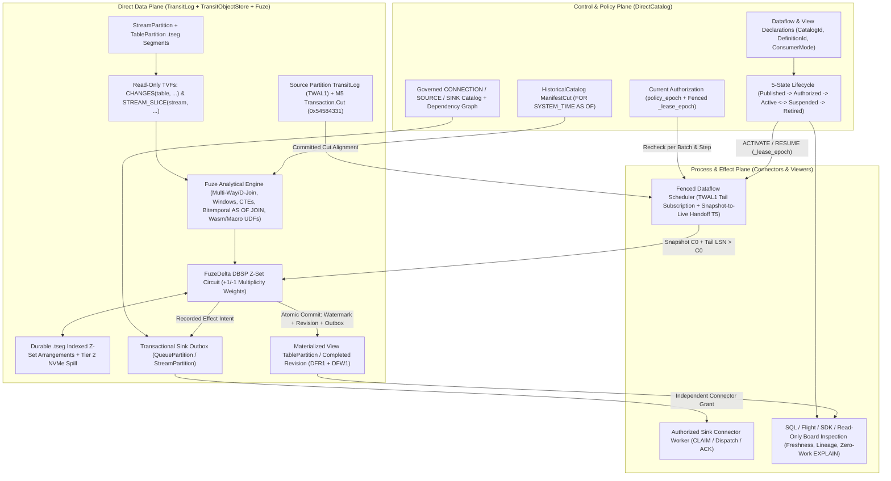

# 12. Managed computations and WAL-activated dataflows

[Roadmap](README.md) · [Issue #31](https://github.com/spoke-sh/transit/issues/31) · **Status:** In Progress ([remaining implementation plan](#implementation-plan-for-remaining-work--2026-11-03); [component delivery record](#delivered-implementation-evidence--2026-10-30))

Let an application declare a derived result, apply it, and inspect the definition,
source basis, completed revision and pending or blocked work while Transit owns
the qualified scheduling, WAL-driven delta activation and recovery. Extend the
[shared lifecycle](01-declarative-data-lifecycle.md),
[four-tier storage hierarchy](02-storage-and-query-performance.md),
[declarative streams, queues and durable runtime](06-streams-queues-and-durable-runtime.md),
[SQL reference](../handbook/reference/sql.md) and
[grammar inventory](../handbook/reference/sql/grammar-surface.md).

Typed Tables, joins/grouping, expressions, parameters, named relational
activation, complete Table history and typed maintained revisions already exist.
The installed managed Table slice now supplies service-owned finite recomputation
for one source after publication notifications. The older typed maintained owner
still uses host-driven activation and wakeups. Complete retained-history
consumption, incremental execution and broader SQL remain this milestone's work.
Connecting computations, reactive watches and Station actors to **`TransitLog`
(`TWAL1`) delta streams** must preserve each consumer's change contract and
equivalence with the finite recomputation oracle.

## Managed computation sequence

Consume the durable catalog/snapshot contract in
[#125](https://github.com/spoke-sh/transit/issues/125) and logical feed/retention
contract in [#127](https://github.com/spoke-sh/transit/issues/127). Storage-level
subscriptions and history preservation belong to milestone 2; this milestone
owns service scheduling, consumer-specific activation and observable freshness.
Connections/sources/sinks remain separate declarations whose publication does
not authorize external work.
Consume [statement results](04-statement-results-and-consumption.md) for finite
reads, explanation and command outcomes; continuous/maintained computation keeps
its own activation, progress and revision lifecycle. Consume
[transaction decisions](05-transactions-and-atomic-composition.md) for multi-object
changes: computation activation and published successors must respect complete
commits, even when participant records arrive separately. Do not publish a
half-committed transaction as a completed result.

1. **Bind computation declarations to catalog and storage watermarks:** define a
   computation declaration's bound inputs (`CatalogId`, `DefinitionId`), lifetime,
   output sink/table, policy references (`policy_epoch`), budget and desired
   activation revision. Publish/alter definitions separately from authorizing
   work. Bind accepted work to its exact definition; a rename or newer definition
   cannot relabel it.
2. **Drive activation from `TransitLog` delta streams and manifest watermarks:**
   implement a service owner that subscribes to source partition `TransitLog`
   tails (`+row`/`-row` change vectors and manifest commits) from the
   computation's last checkpointed source position. Select each consumer's
   contract explicitly: complete ordered changes, net relation changes, or
   finite recomputation at a new basis. A slow consumer requiring every change
   must recover from retained/archived logical history; snapshot diffs cannot
   recover intermediate `A -> B -> A` events. Use manifest reconciliation or
   recomputation only where the consumer's semantics permit it. Define the
   snapshot-to-live handoff and explicit unavailable-history outcomes; never
   silently downgrade complete capture. Record recoverable intent and progress,
   fence competing owners via epoch leases, and preserve pending work across service
   replacement. Admission pressure must not discard accepted work; reserve
   control capacity.
3. **Expose completed source vectors, result revisions, pending successor and attributable failure/blocked reasons:**
   compare progress with authorized observed input positions (`manifest/v{N}`,
   `lsn`) and define freshness at that observation. A completed result remains
   complete for its own basis while later changes are pending.
4. **Define the five-state computation lifecycle (`Published`, `Authorized`, `Active`, `Suspended`, `Retired`) and explicit DDL controls (`ACTIVATE`, `SUSPEND`, `RESUME`, `REFRESH`, `RETIRE`):**
   rather than collapsing dataflow state into an ambiguous boolean `ENABLE` / `DISABLE`
   toggle, keep definition publication, authorization (`policy_epoch` binding),
   active background scheduling, operational suspension and permanent retirement
   distinct:
   - **`ACTIVATE`:** transitions an authorized definition revision into active
     `TransitLog` delta scheduling under a fenced owner lease.
   - **`SUSPEND`:** pauses background delta consumption and external effect
     dispatch while preserving the computation's checkpointed source watermarks
     (`manifest/v{N}`, `lsn`) and continuing to serve reads from the last
     completed result revision (with its exact frozen source basis visible).
   - **`RESUME` (`WITH (on_resume = 'replay_history' | 'recompute_snapshot')`):**
     resumes scheduling according to the consumer's declared recovery profile—either
     replaying every intermediate `+row`/`-row` delta from the checkpointed
     `TransitLog` position (failing explicitly if required history was compacted
     during the suspension) or establishing a fresh snapshot-to-live handoff at
     the current manifest cut.
   - **`REFRESH` and `RETIRE`:** trigger an explicit bounded recomputation, or
     permanently close a definition revision to new activation and scheduling while
     retaining historical provenance and receipts. Preserve the last complete
     result while any successor is incomplete, and define dependency/schema
     changes, revocation, unavailable history and policy expiry without inventing
     cross-owner atomicity. When a computation or connector sink depends on a
     catalog `SECRET` ([Milestone 27](27-control-and-policy-plane.md)) whose
     OAuth 2.1 / PKCE challenge-response flow or lease refresh is pending, the
     computation records `BlockedReason.credential_pending` in `Suspended` and
     resumes from its checkpointed source watermark when the secret's
     `rotation_epoch` advances in `TransitLog`. Stateful security challenge
     games (such as OAuth 2.1 Authorization Code + PKCE `S256` verification,
     single-use anti-replay joins and proactive lease-refresh timing wheels) run
     as deterministic WAL-activated dataflows that emit governed outbox intents
     while keeping entropy generation, remote token exchange and raw token
     storage inside the connector and secret-vault boundaries.
5. **Adapt the qualified lifecycle to SQL views/subscriptions and typed SDK operations:**
   expose the same typed lifecycle state machine and DDL verbs across SQL
   (`CREATE` / `ALTER MATERIALIZED VIEW` / `DATAFLOW` / `SUBSCRIPTION`), SDKs and
   Board; [SQL grammar and dialect ergonomics](43-sql-grammar-and-dialect-ergonomics.md)
   audits these forms against PostgreSQL (`ENABLE`/`DISABLE`) and Snowflake
   (`SUSPEND`/`RESUME`/`REFRESH`) dialects. Inspection and `EXPLAIN` do no work.
   Board consumes the same definitions and evidence through its explicit
   capabilities; it adds no hidden scheduler or administrative authority.

## Remaining work

Consume [index coverage and access paths](11-indexing-and-access-paths.md) without
changing source cuts or completed-revision meaning. Preserve durable ordered
operator roots, checkpoint/input progress and retained versions when adding
mutable working-state acceleration. Establish finite/maintained correctness,
spill and freshness baselines here; the
[structure/planner/runtime owner](13-data-structures-and-performance.md) then
compares optimized structures and integrated local workloads. Its later delivery
cannot defer this milestone's bounded execution or activation/recovery gates.

- **Deliver the complete analytical and relational SQL surface in Fuze:** expand
  beyond two-table equijoins to multi-way joins ($>2$ tables), non-equi/range
  joins, `SEMI` (`EXISTS`/`IN`), `ANTI` (`NOT EXISTS`) and `LATERAL` joins with
  universal dependent-join (`D-Join`) correlated subquery unnesting (Neumann &
  Kemper, BTW 2015) so arbitrary correlated subqueries lower algebraically to
  set-oriented hash or merge joins rather than $O(N \times M)$ nested loops;
  **Window Functions** (`OVER (PARTITION BY ... ORDER BY ... ROWS/RANGE/GROUPS
  BETWEEN ...)`), ranking/lag/lead/frame functions and `QUALIFY`; **Common Table
  Expressions** (`WITH` and bounded `WITH RECURSIVE` with cycle detection and
  explicit work budgets) and set operations (`UNION [ALL]`, `INTERSECT`,
  `EXCEPT`); **Rich Aggregates** (`AVG`, `MIN`, `MAX`, `STDDEV`, exact and
  approximate quantiles/`PERCENTILE_CONT`, `ARRAY_AGG`/`STRING_AGG`);
  temporal/interval arithmetic; **compile-time (`comptime`) and plan-bound
  perfect-hash lookup tables** for SQL keywords and constant `WHERE col IN (...)`
  string literal sets (paired with 16-byte SIMD vector comparisons inside the
  `Batch` arena); and **deterministic, resource-bounded scalar and
  table User-Defined Functions (UDFs)** (SQL expression macros and sandboxed
  in-engine Wasm UDFs executing directly over vectorized `Fuze` column batches
  without round-tripping through `128 KiB` `Station` actor mailboxes). Preserve
  five-state values, checked arithmetic, explicit collations, source identities,
  output types and bounded operator state (with Tier 2 NVMe spill for large sorts,
  window frames, joins and aggregations).
- **Deliver first-class bitemporal SQL (`AS OF JOIN` and application-time periods) and linear DBSP Z-set interval-depth / state-book maintenance:**
  combine system-time knowledge cuts (`FOR SYSTEM_TIME AS OF`) with declarative
  application/valid-time periods (`PERIOD FOR valid_time` backed by
  [Milestone 10's](10-standards-and-catalogs.md) canonical `RANGE<TIMESTAMPTZ>`
  type) and native streaming **`AS OF JOIN`** (matching each left observation to
  the nearest prior or exact valid-time right row per entity key—and supporting
  [Milestone 17's](17-geospatial-and-spatio-temporal-computing.md) piecewise-linear
  4D `TRAJECTORY` interpolation—without $O(N^2)$ inequality joins). In addition,
  exploit DBSP Z-set linearity for **1D interval-depth / genomic pileup coverage**
  (encoding `[start_pos, end_pos)` intervals as $+1$ at `start_pos` and $-1$ at
  `end_pos` so `RANGE_UNION`, coverage depth and overlap joins maintain via
  Abelian prefix sums) and **discrete event-sourced state / Limit-Order-Book
  (`LOB`) depth reconstruction**. Price-level quantity deltas over
  `(resource_id, side, price_tick)` support L2 aggregation; L3 additionally needs
  individual order identity, lifecycle and feed-defined ordering. Qualify
  add/cancel/execute/delete/replace semantics, sequence gaps, duplicate messages
  and corrections before aggregation. VWAP needs its own trade-price/volume
  basis and correction rules. Measure update work and indexed maintenance costs
  rather than assuming every event is constant work. Keep domain/trading policy
  in applications; the [ITCH specification](https://nasdaqtrader.com/content/technicalsupport/specifications/dataproducts/NQTVITCHSpecification.pdf)
  is a scoped protocol reference, not an implicit venue selection. Ensure
  point-in-time research, backtesting and decision auditing evaluate what was
  valid in the domain *and* known to the system at the decision cut, preventing
  later backfill corrections from leaking into earlier simulated decisions.
- **Expose first-class SQL `CHANGES(...)` and `STREAM_SLICE(...)` table-valued functions for CDC egress and side-effect-free relational stream queries:**
  allow SQL, Arrow Flight and SDK callers to query committed Table logical changes
  (`+row`/`-row` or net upserts/deletes with transaction, LSN and manifest
  provenance) between two snapshot cuts or watermarks (`SELECT * FROM CHANGES(table, ...)`)
  and to project bounded historical `.tseg` ranges from declared
  [Streams](06-streams-queues-and-durable-runtime.md) into relational joins and
  bitemporal `AS OF JOIN` backtests (`SELECT * FROM STREAM_SLICE(stream, OFFSET ? TO ?)`
  or `STREAM_SLICE(stream, TIMESTAMP ? TO ?)`) without advancing consumer-group
  offsets, preserving 5-state cells and current `policy_epoch` access checks.
- Provide logical/physical explanation and output-schema inspection without
  source disclosure, mutation or external work.
- Implement general `MERGE`/upsert and prepared-plan lifetime through shared SQL
  composition. The [transaction owner](05-transactions-and-atomic-composition.md)
  owns session control, atomicity/isolation, DDL/constraint interactions and
  transaction-bound plan invalidation; those features do not all become transaction
  syntax merely because they can execute in a transaction. SQL `MERGE` is separate
  from branch merge. [Foreign relations](18-multi-model-and-foreign-relations.md)
  now owns typed `COPY`/import/export and streaming CDC ingress together with its
  actual format adapters.
- Extend the common dependency lifecycle to connections, sources and sinks,
  including conditional alteration and retirement. SQL, SDK and Board use the
  same administrative operations.
- Optimize incremental maintained computation over `TransitLog` (`+row`/`-row`
  Z-set/delta vectors) against the complete finite-recomputation oracle,
  providing the Z-set arrangement and operator foundation extended by
  [Milestone 17](17-geospatial-and-spatio-temporal-computing.md) for algebraic
  half-edge `ST_Union` and `INTERIOR`/`BOUNDARY` cell-covering spatial joins.
  Event-time windows and bitemporal views require explicit timestamps, watermarks,
  allowed-lateness bounds and retraction rules.
- Bind outputs to recorded connector effects through independently authorized
  activation. Compiling, explaining, reading and replaying never dispatch a
  dataflow.

## Rich-workload computation handoff

Keep one shared computation lifecycle as the later workload profiles arrive.
[Scientific computation](35-scientific-arrays-and-measurements.md) extends
operator traits with point/window/halo/graph/global dependency extent, numerical
fidelity and valid update/retraction or bounded-rebuild behavior.
[ML/AI](37-ml-ai-and-experiment-provenance.md) binds feature/model/experiment
identity; [Robotics](38-robotics-and-sensor-replay.md) binds calibrated replay;
[software evidence](39-software-build-and-deployment-evidence.md) binds exact
build/test/deployment observations;
[constrained planning](40-constrained-planning-and-optimization.md) adds domain
candidate/bound/termination evidence;
[deductive rules and Datalog fixpoints](41-deductive-rules-datalog-and-equivalence-graphs.md)
extend `WITH RECURSIVE` and DBSP $\mathcal{Z}$-sets with Tarjan-SCC mutual
recursion, monotonic lattice aggregations, Union-Find equivalence classes and
derivation witnesses; and
[hardware design and EDA verification](42-hardware-design-rtl-and-eda-verification.md)
applies incremental Datalog and spatial dataflows to elaborated Verilog/RTL
taint, CDC and `DRC`/`LVS` checks. Each reuses original accepted identity,
source basis, bounded progress and complete publication rather than introducing
another job authority. SQL completion, solver optimality, model accuracy and
physical consequences remain different facts. These later extensions do not
defer this milestone's existing finite/incremental equivalence gates.

## Propagation delay and knowledge-time joins

[Issue #358](https://github.com/spoke-sh/transit/issues/358) adds a planned
R6/P4 temporal composition gate for terrestrial ADS-B/AIS observations and
cislunar/interplanetary telemetry. Define emission time, reception time,
application validity and system-time knowledge cut separately. Support declared
fixed/measured latency windows and model-derived propagation predicates using
[M17's frame/trajectory profile](17-geospatial-and-spatio-temporal-computing.md#celestial-frames-and-orbital-logistics--issue-358).
The light-time model solves
`t_recv - t_emit = norm(r_receiver(t_recv) - r_emitter(t_emit)) / c`
with both positions expressed in the declared common inertial frame and time
scale. Pin the propagation model, speed/units, ephemeris and transform revisions,
tolerance, iteration budget and transmission/reception convention; a constant
timestamp subtraction cannot implement the moving-endpoint case.

Select only observations available at the requested knowledge cut and physically
eligible at reception, with explicit ties, endpoint inclusivity and unmatched
rows. Late corrections create a new result basis without rewriting earlier
knowledge. Geometric state, light-time-corrected apparent state and optional
aberration/relativistic corrections are distinct profiles. Use pinned
[NAIF reception/transmission light-time semantics](https://naif.jpl.nasa.gov/pub/naif/toolkit_docs/C/cspice/spkezr_c.html)
as a reference, not an implicit default or runtime dependency.

Qualify missing ephemeris, clock mismatch, nonconvergence, late/out-of-order
telemetry, latency-window boundaries and revocation after buffering through
finite SQL and shared typed callers. Unknown propagation or missing history
cannot become a complete negative match. A variable delay can break ordering;
prove monotonicity before reusing a merge sweep, otherwise use bounded candidate
search/refinement and account for its work. This does not inherit the simple
ordered AS OF join's O(N + M) bound. M12 can deliver ordinary temporal joins
first; celestial evaluation waits for M17 S9 and their composed oracle gate.

## Formal model follow-through

Own the [T5/T8 dataflow lifecycle and DDL interaction models and A3 incremental delta proofs](22-formal-semantics-and-correspondence.md#t8-catalog-ddl-evolution-and-dataflow-lifecycle-state-machines)
as the computation and phased-DDL contracts settle. Verify that `ACTIVATE`,
`SUSPEND`, `RESUME WITH (on_resume = 'replay_history' | 'recompute_snapshot')`,
`REFRESH` and `RETIRE` preserve last-completed-revision invariants when racing
in-flight worker leases (`_lease_epoch`), upstream `ALTER TABLE` schema
evolutions (`DefinitionId v1 -> v2`), `TransitLog` (`TWAL1`) compaction and
`policy_epoch` revocations, and replay the finite state-graph edges against the
production Zig catalog and dataflow state reducers.

## Prerequisites and completion

The later [reactive context milestone](32-reactive-context-and-agent-activation.md)
uses this scheduling and completed-result evidence for business conditions,
durable application interests and MCP subscriptions/tasks. This owner supplies
computation progress; a changed source or delivered notification alone cannot
establish that an agent ran or a business action completed.

Historical operations consume [catalog contracts](10-standards-and-catalogs.md).
Branch merge and SQL `MERGE` remain distinct. Fuze owns relational and incremental
vector computation; Station and application owners coordinate stateful workflows
and external effects above a generic kernel.

Require independent finite/maintained equivalence at completed source bases,
current grants, lost responses, interrupted publication, retained-history and
snapshot-to-tail handoff, bounded NVMe spill and larger-than-RAM workloads. Test
`A -> B -> A`, insert/delete within one flush, schema changes and compaction
without a logical mutation for every admitted consumer profile. Include
multi-object transactions with delayed participant records and aborted work;
completed maintenance must consume the selected committed cut without omissions
or partial publication. Qualify
actual callers for each exposed slice.

The acceptance journey declares a derived relation, observes its first complete
result, ingests streaming source changes over `TransitLog`, evolves the schema,
inspects catch-up or blocking, replaces the service and recovers the same
accepted work. Exercise pause, revocation and retirement without reporting a
partial successor as a complete result. Measure freshness lag and control
latency under load separately from correctness.

## Implementation plan for remaining work — 2026-11-03

Complete declaration/work-record closure and the installed finite Table recovery
and resource gates, then connect the retained-result owner to logical history
and durable incremental operators. Develop the analytical SQL track alongside
that work once its shared contracts are fixed. Each increment must expose a
complete caller journey: declare, authorize, activate, inspect the
original definition and source basis, and recover the same accepted work after
disconnect or replacement.

**Implementation proposal, based on fetched `origin/main` at
`63f6369d553dd71abfbb6a06f0867b8ce7c0cb4a` (2026-11-03).** The base includes
the finite lifecycle (#318), retained revisions (#324), transaction-owned result
candidates (#328), independent computation inspection (#339/#340), and current-cut
capture plus multi-row managed pages (#356). It also includes the adjacent
increments in the [handoff table](#recent-milestones-and-incoming-gates) and
the SQL/session/storage fixes in #359. Implementation presence and executed
qualification remain separate in the assessment below. Unmerged work is not a
satisfied prerequisite.

This refresh replaces the November 1 remaining-work assessment in place. Its
[previous version](https://github.com/spoke-sh/transit/blob/db0bb4a8f129bed36e6df6eb30e2f606957798f3/docs/roadmap/12-sql-and-dataflows.md#implementation-plan-for-remaining-work--2026-11-01)
and the October 30 `P0`–`P9` record preserve prior scope and attribution. Keep
the stable `R0`–`R10` packages and the existing milestone scope. The
[PR sequence](#proposed-pr-sequence) marks delivered mechanisms separately from
remaining gates; the [next slice](#next-implementation-slice-owned-staging-and-finite-qualification)
specifies the first changes. Milestone 12 remains **In Progress**; this planning
baseline adds no runtime qualification. The owned-progress increment below
records the subsequent implementation scope. The original-staging increment
below starts from `origin/main` at `2f8be4bae`, including merged CPR1 progress
ownership (#361) and the adjacent local SQL lane-contention fix (#362).

The immediate decisions are to reuse the owned-record and batched-page paths,
finish their recovery/collection qualification before history activation, and
start production analytical planning independently. M11 indexes, M7 Documents,
M6 group SQL and the full Station migration are feature-specific gates; none
requires rebuilding the installed single-Table owner or delaying its cleanup.

### Owned progress implementation slice — 2026-11-03

This R1b increment adds Catalog-owned `CPR1` replacement work records and
moves managed `progressWork` to the shared signed `client_progress.advance`
operation. Each original token has one durable candidate slot. Reservation
precedes byte creation; readiness replaces the current record, and exact retries
never recreate missing accepted bytes. Current/candidate payloads share the
work token's 64 KiB reservation. Collection marks both at its accepted cut and
can reclaim superseded progress without loading obsolete payloads during catalog
recovery. The current-v1 cutover makes the candidate slot mandatory, including
explicit null, and migrates generated callers and signing fixtures together.

PR #361 delivered replacement-record closure. The original-staging slice below
replaces its retained generic `DFD1`/initial `DFW1` admission path with explicit
pre-head ownership and closure; it preserves the CPR1 replacement contract.
The combined installed fault/resource matrix, fair executor yielding, complete
history consumers and R5 analytical execution remain separate gates. Current
semantics and limits are in the [managed computation contract](../../contracts/DATAFLOW_V1.md).

### Original staging and closure implementation slice — 2026-11-03

This R1b increment wraps initial DFD1/DFW1 payloads in Catalog-owned `SOR1`
records. The existing paged client-token owner reserves identity, commitment and
quota before bytes exist. A managed declaration becomes permanently retained
before initialization can publish references. Work staging precedes its pending
head: the owner reserves the exact KV attachment identity, records the intent,
and executes it under the Catalog's exclusive lock. Ordinary KV routes reject
that reserved identity, including after closure.

Explicit closure releases unreferenced staging or terminal originals while
keeping their compact token, operation commitment, attachment fence and terminal
CPR1. A missing attachment receipt can close only under the serialized owner;
an accepted attachment must first reach terminal progress. Recovery resumes the
saved work after a control change, then fences an impossible attachment and
advances past its closed attempt. Collection follows latest open SOR1 roots and
preserves creation epochs and grace. It never collects generic `direct-records/`.

Published/retained declarations, completed revisions and permanent identity/quota
charges remain retained. Conservatively retaining a declaration before
initialization can retain an incomplete publication too; this slice provides no
retirement expiry or automatic timeout cleanup. The [qualification record](../history/qualification/query.md#owned-original-staging-and-closure--2026-11-03)
separates executed owner/installed cases from the remaining combined R3a
process-death, growth, fairness and measured-resource gates. M6/M7 extensions and
M11 indexing remain independent feature gates; they are not assumed to be landed.

### Installed Table implementation slice — 2026-11-01

Merged PR #318 delivers the installed finite Table lifecycle across R0–R3. It
replaces the capability ledger's lifecycle-helper claim with the actual
cohosted native SQL and typed profile: publication, authorization, activation,
suspension, resume, refresh, retirement, metadata-only EXPLAIN and observed state.
Paged catalog tokens and a named direct KV hold definitions, original work,
control epochs and completion checkpoints. The existing serializable Table/KV
transaction pins the source cut and commits output plus checkpoint together.
Publication generations wake a service-owned reconciler; startup scans durable
work and settled computations park. No Station turn owns this path.

The [public profile](../handbook/reference/queries.md#managed-table-computations)
and [DATAFLOW_V1 contract](../../contracts/DATAFLOW_V1.md) own its current limits:
one ordinary Table source, one existing schema-matched output, the finite
projection/filter/grouped COUNT/SUM compiler, and one local connection/namespace.
Output chaining and multiple managed writers reject. The output remains an
ordinary Table; service-only write grants are needed for exclusive managed writes.
Source definition replacement blocks and requires a new declaration. PostgreSQL,
MySQL and standalone remote gateways reject these declarations.

PR #318 alone does **not** close every R1/R2/R3 exit gate below. It does not add
ordered/net change consumers, snapshot-to-tail history handoff, historical output
retention (subsequently delivered by PR #324), collectible abandoned immutable
request records, the full crash-point matrix or a growth proof beyond the former
helper capacities. Apart from delivered retention, those remain explicit
follow-up gates, alongside T5/T8 implementation correspondence. The
finite consumer recomputes at a retained common cut and may coalesce intervening
source changes. Incremental algebra and later SQL/connector packages remain
separate work.

Executable acceptance owners are
[`managed_table.zig`](../../tests/catalog/tables/managed_table.zig) and
[`server_managed_tables.py`](../../tests/interfaces/installation/server_managed_tables.py),
registered as `just test::managed-tables`. Their assertions cover exact output
rows, process replacement with a prepared head barrier, original decisions, control
races, dependency-cycle and budget refusal, empty successors, restart while
suspended and idle parking. The
[executed record](../history/qualification/query.md#managed-finite-table-lifecycle--2026-11-01)
also records constraint and ordered SUM failures preserving the old output.
Its evidence belongs to its named revisions, not automatically to this plan's
newer base. Full crash, growth, installed revocation and T5/T8 correspondence
remain open. The later retained-revision record includes a complete
pre-M6-integration installation lane passing the previously failing TLS case;
it neither explains that earlier failure nor qualifies this combined source.
Use the source-specific recovery failures and rerun requirements in the
[current qualification baseline](#qualification-and-measurement-baseline) below.

### Retained completed Table revisions — 2026-11-01

Merged PR #324 delivers R0/R1a: `DFR1` manifests published with the original
output/checkpoint transaction. Each manifest retains its exact declaration,
source/output definitions, common cut, output schema and immutable result pages.
`ManagedRevision` consumes one fixed revision with explicit row/byte bounds,
caller-owned rows and current source/output/control read checks. The catalog
enforces those reads on raw manifest/page requests too. SQL exposes
`SHOW DATAFLOW name REVISION number` metadata through the existing statement
result lifecycle. Output edits and retirement do not rewrite saved results.

This is the first review unit below, not completion of R0 or R1 as a whole.
The current-v1 cutover replaces the old checkpoint-only revision value and
migrates schemas, signatures and binding resources together. Existing
ordinary `DirectRecord.Reference` roots retain indefinitely outside collection
authority. PR #328 subsequently adds transaction-owned `TXR1` result
pages/manifests: paged registration precedes creation, commit refuses unfinished
registration, and frozen owners cannot create or resurrect bytes. The storage
graph preserves uncertain and committed candidates and releases aborted payloads
only after authoritative transaction cleanup. The later SOR1 slice above adds
explicit original-work closure while preserving retained declarations and
permanent ownership metadata. The full combined collection/crash matrix remains
R3a work.
Historical SQL row fetching, history consumers, multi-source
execution, the full fault/growth matrix and T5/T8 correspondence remain open.
The [qualification record](../history/qualification/query.md#retained-managed-table-revisions--2026-11-01)
records executed checks and their source-specific limits.

### Integrated progress since the previous plan

| Merged increment | Reuse now | Remaining acceptance |
| --- | --- | --- |
| [#328](https://github.com/spoke-sh/transit/pull/328), transaction-owned candidates | `DirectTransactionRecord` registers `TXR1` pages/manifests before creation, requires readiness before commit and fences frozen owners. Real collection preserves active/committed roots and reclaims closed abort payloads | SOR1 now owns original declaration/work staging alongside CPR1 replacement progress. Preserve those owners and finish the combined installed crash/resource matrix; do not implement candidate ownership again |
| [#339](https://github.com/spoke-sh/transit/pull/339) / [#340](https://github.com/spoke-sh/transit/pull/340), computation inspection | Catalog `ManagedInspection`, shared `ManagedTableRecords`, SQL SHOW and Board use independent current read grants for exact current/retained metadata | Extend this owner for source vectors, history coverage and budgets. Board metadata inspection does not read result pages, acquire pins or execute controls; general SDK and historical SQL row adapters remain open |
| [#348](https://github.com/spoke-sh/transit/pull/348), diagnostic instrumentation | Fixed-cardinality counters separate managed phases, record reservations/readiness and observed returns | Preserve failed campaigns and missing allocation/physical-I/O observations. Counters neither establish durable acceptance nor qualify successor latency |
| [#356](https://github.com/spoke-sh/transit/pull/356), current-cut capture and managed batching | `ManagedTable` packs up to 64 rows and 128 KiB of encoded rows into a `DFP1` page, stages one INSERT per page, and retains the original transaction. `ManagedRevision` validates page sequence/ordinals and current disclosure | Qualify row and byte boundaries, exact retries, full envelopes/quotas, collection and foreground interference. The old one-row-per-page cost model is historical. M8's broader batching/performance objectives are not closed by the code change |
| [#359](https://github.com/spoke-sh/transit/pull/359), SQL/session/storage repairs | Original-work admission wakeups, pending outcome handling, cached Table owner routing and bounded collector batching are on the base | Re-run their affected managed, retained-read and collection schedules at the implementation revision. A merged repair does not resolve every earlier timeout or qualify this combined base |

The shared definition at this base is
`1a81487b17b998cf1e5c89eaf621d7c97cbecb389f13fedfc3c0691125beb141`
([owner](../../packages/zig/transit-protocol/src/Growth.zig)). It incorporates
ordered Documents, immutable forks, current-cut capture and multi-row pages.
Use fresh fixtures for this definition; preserve failed older installations with
their matching builds. No old DFP1 decoder or inferred compatibility is part of
this plan.

### Source assessment at the plan baseline

| Boundary | Present at the plan baseline | Work identified by the plan |
| --- | --- | --- |
| Installed managed Tables | [`ManagedTable`](../../packages/zig/transit-query-direct/src/ManagedTable.zig), [`ManagedRevision`](../../packages/zig/transit-query-direct/src/ManagedRevision.zig), [`DatabaseRuntime`](../../packages/zig/transit-sql/src/DatabaseRuntime.zig), [`ManagedSql`](../../packages/zig/transit-sql/src/ManagedSql.zig) and [`ManagedOperations`](../../packages/zig/transit-sql-service/src/ManagedOperations.zig) implement durable declarations, original work, control fencing, atomic output/checkpoint/immutable revision publication, batched pages/statements, bounded retained reads and publication-driven recovery | Complete declaration/work-record cleanup, historical SQL row consumption, full recovery/resource qualification and history-driven consumers. Preserve the DFR1 manifest, original batched work and raw-record disclosure guards |
| Saved-record lifetime | [`DirectTransactionRecord`](../../packages/zig/transit-catalog/src/DirectTransactionRecord.zig) and [`DirectStorageGraph`](../../packages/zig/transit-catalog/src/DirectStorageGraph.zig) own candidate registration/readiness and abort payload collection. Generic [`DirectRecord`](../../packages/zig/transit-catalog/src/DirectRecord.zig) records remain excluded | Add durable creation/closure and reference ownership specifically for declaration/work staging. A guarded read envelope or terminal token is not collection authority; never enable collection for the entire shared prefix |
| Independent inspection | [`ManagedInspection`](../../packages/zig/transit-catalog/src/ManagedInspection.zig) verifies committed current/retained metadata; [`ManagedTableRecords`](../../packages/zig/transit-catalog/src/ManagedTableRecords.zig) owns shared codecs; SQL and Board already consume the signed read | Extend this exact operation with new progress/coverage fields and its bounded policy checks. Do not duplicate the codecs in the executor or build a separate Board scheduler |
| Historical interpretation | [`DirectHistory`](../../packages/zig/transit-catalog/src/DirectHistory.zig), historical SQL and versioned catalog definitions now retain selected names, Table definitions and independent or transferred common cuts | Compose the actual M10 owner in R2/R6. A catalog snapshot is not a protected ordered change interval; temporal periods and AS OF joins still need their own semantics |
| Earlier captured/maintained queries | [`RelationalMaintenance`](../../packages/zig/transit-query/src/RelationalMaintenance.zig), [`RelationalHistory`](../../packages/zig/transit-query/src/RelationalHistory.zig) and [`NamedRelational`](../../packages/zig/transit-station-app/src/NamedRelational.zig) preserve their [supported host-driven profile](../handbook/reference/queries.md#maintained-table-revisions) | Migrate only after the direct owner preserves captured definitions, retained revisions/deltas, ordered failures, original attribution and cleanup. Their independent Table vectors do not establish common-cut semantics |
| Prototype lifecycle | [`ManagedDataflow`](../../packages/zig/transit-catalog/src/ManagedDataflow.zig) has five-state helpers, 32 endpoint slots, 64 pending/outbox slots and caller-supplied decision labels | This remains separate from the installed owner. Reuse qualified semantics, not its fixed capacities or one maximum LSN for all sources; remove superseded helpers/claims when their production replacements are qualified |
| Incremental algebra | [`FuzeDelta`](../../packages/zig/transit-fuze/src/FuzeDelta.zig) supplies weighted bags, join cross terms, group helpers and watermark cases | Z-sets have 256 resident entries. Arrangement run counts do not write `.tseg` objects. The finite join helper shares the join implementation; the widened aggregate total does not establish equivalence with canonical ordered checked SUM. Supply durable arrangements and independent semantic oracles |
| Analytical operators and spill | [`AnalyticalSql`](../../packages/zig/transit-fuze/src/AnalyticalSql.zig) and [`PerfectHashIn`](../../packages/zig/transit-fuze/src/PerfectHashIn.zig) provide bounded typed-array cases | These are not wired into the production SQL planner. `SpillTracker` counts bytes/runs without disk I/O. Extend the actual plan/executor and reuse [`RelationalSpill`](../../packages/zig/transit-query-direct/src/RelationalSpill.zig); component counters cannot qualify larger-than-RAM execution |
| Temporal, changes and MERGE | [`BitemporalAndTvf`](../../packages/zig/transit-fuze/src/BitemporalAndTvf.zig) evaluates caller-provided history/Stream/target arrays | No retained catalog binding or transaction publication follows from these helpers. The AS OF helper scans right history for each left probe; it does not establish the proposed merge-sweep complexity. Build real source adapters, SQL lowering and atomic mutations |
| Functions | [`VectorUdf`](../../packages/zig/transit-fuze/src/VectorUdf.zig) validates macro trees and a small caller-built `WasmInstr` stack machine with fuel/memory counters | This is not a general Wasm binary loader, persisted function catalog or SQL function service. Validate the actual admitted module format, memory isolation and vector ABI before exposing Wasm UDFs |
| Neutral contract, SQL and callers | [`Dataflow.zig`](../../packages/zig/transit-protocol/src/Dataflow.zig), [DATAFLOW_V1](../../contracts/DATAFLOW_V1.md), reflected schema, native SQL lifecycle and fixed-revision metadata are delivered; [result](../../contracts/SQL_RESULTS_V1.md) and [named relational](../../contracts/NAMED_RELATIONAL_V1.md) contracts remain separate owners | Extend owned cleanup and consumer contracts before enabling new modes. Shared data-client/SDK lifecycle, SQL historical rows, broader gateway/Flight exposure and captured/maintained migration remain open; unsupported syntax/profile tests must accompany each exposure |
| Verification | Real typed and installed managed fixtures now supplement component tests and [`managed_dataflows.py`](../../tests/catalog/tables/managed_dataflows.py) | The latter is still a fixture/source check. Complete faults, growth, revocation, T5/T8 production correspondence, A3 mechanization and common-revision qualification remain open |

The [query qualification ledger](../history/qualification/query.md) and
[verification limits](../handbook/reference/verification.md) remain the basis for
existing captured/maintained guarantees. Reuse their executable schedules and
record the new owner separately; neither a helper's comment nor a passing fixture
drift check expands the public profile.

### Recent milestones and incoming gates

| Owner and progress on this baseline | Reuse in M12 | Gate that remains with the owner |
| --- | --- | --- |
| [M1–M2](02-storage-and-query-performance.md), Completed; [M3](03-live-storage-and-sql-cutover.md), In Progress | Stable object/definition identities, direct catalog dependencies, WAL-inclusive Table pins, retained logical history, local flushing/archival/checkpoint/collection and installed direct callers | Register every new dataflow, arrangement, preparation and cleanup root with the existing storage graph. M3's remaining installed/performance qualification is not completed by M12 |
| [M4](04-statement-results-and-consumption.md), Completed | Command outcomes, `ResultSet`, terminal coverage, current disclosure checks and original-attempt settlement | Use the existing result protocol for finite result/revision reads and metadata; a continuous interest has its own durable progress, not an indefinitely incomplete finite SELECT |
| [M5](05-transactions-and-atomic-composition.md), Completed for local Tables | Serializable Table decisions, common cuts, private workspaces, savepoints and original decision recovery; the managed finite slice already consumes the shared decision owner | Extend through M6's participant owner. A transaction cut descriptor is not a retained change-feed lease or a global ordering of unrelated partition LSNs |
| [M6](06-streams-queues-and-durable-runtime.md#original-renewal-results-and-sql-admission--2026-11-02), In Progress; #333/#336/#341/#342/#347 merged | Direct KV and native mixed Table/KV/Stream/Queue decisions; selected installed claim/ACK and unordered cold-Queue proofs; SQL NACK and original renewal handles; bounded recovery/automatic terminal transfers | Group assignment/offset SQL, waits, finite `STREAM_SLICE`, mixed SQL and Station/effect migration remain open. Preserve the unresolved maintenance-profile gate despite later read-only recovery. R6 consumes the finite Stream bridge; R8 consumes mixed intents and connector settlement. Neither requires a duplicate SQL bridge or all Station work first |
| [M7](07-document-storage-and-station-decoupling.md#ordered-storage-increment--2026-11-02), In Progress; #354 merged | Causal maps plus conditional ordered/versioned tree replacement, persisted BP bits/residual nodes/raw parts, retained authenticated pages and verified M16 JSON/XML candidate handoff | This remains storage-component scope. Rank/select, incremental patches, adaptive subcolumns, spans/merges/checkpoints, direct public lifecycle/scans and transaction participation remain gates. Managed Document inputs wait for those exact source/coverage contracts; stored trees alone do not supply them |
| [M8](08-gateway-architecture-and-protocol-ingress.md#next-performance-implementation-after-milestones--2026-11-02), In Progress; #330/#348/#356/#359 merged | Cohosted direct dispatch, event-driven recovery, pure ingress continuations, current-cut capture, batched managed pages/statements and diagnostic drivers | Qualify ordinary fresh-read/managed interference after these changes; complete deadlines, CPU-bounded scheduling, configuration, coarse remote execution and Flight/Serving there. Share one batching/performance effort. Preserve idle parking and avoid per-dataflow polling/thread pools |
| [M9](09-client-foundation-and-language-apis.md#implemented-context-and-kv-recovery-increment--2026-11-01), In Progress; PR #307 merged | Independent data/value/query packages, bounded contexts with separate data/control admission, frozen SQL recovery and direct KV recovery through the shared local store | Aggregate byte accounting, native principal coordination, ordinary Catalog/log settlement, result/transaction handles and independent data bindings remain open. M12 supplies its minimal typed operations and migrates affected callers without waiting for every language redesign |
| [M10](10-standards-and-catalogs.md#integrated-qualification-progress--2026-11-02), In Progress; #345/#355 merged after #320 | Stored companion types/semantic descriptors, historical catalogs and `AS OF SNAPSHOT`, exact lazy projection and versioned descriptors; independent historical readers, original-flush recovery and signed/local single-Table retention through lost replies, collection and cold reopen now have focused evidence | Common-cut transfer, full retention/resource/consumer qualification and M11 FK/phased rewrites remain open. M12 must qualify the history lease/common-cut composition it uses. Application-time periods and temporal knowledge cuts are still new work; RANGE storage alone does not implement bitemporal SQL |
| [M11](11-indexing-and-access-paths.md), Planned | Index lifecycle contracts and existing bounded ordered storage primitives | Full secondary indexes, phased rewrites and finer conflict tracking remain M11. Start on bounded scans/paged arrangements; consume index coverage when qualified. M11 builds must not depend on M12 scheduling, avoiding a circular prerequisite |
| [M14](14-vectorized-strings-and-search.md#implementation-plan--2026-11-02), In Progress; #329/#357 merged after #316 | Production 16-byte Batch strings, dictionary/FSST predicates, shared encoded traversal and owned predicate preparation with source-specific oracle/allocation evidence | Make constant `IN`/`NOT IN` admission a small R5 review with M14's membership owner; it need not wait for all joins/windows. Filter/project page reuse, retained keys, search and installed performance remain M14 gates. Plans/arrangements cannot retain borrowed string pointers |
| [M16 profiles](16-document-profiles-and-gateway-exchange-lifecycle.md), In Progress; #327/#343/#346/#349 merged; [M17 spatial](17-geospatial-and-spatio-temporal-computing.md), In Progress | Pure JSON/XML candidates/construction and bounded MIME framing/construction; M7 can consume verified JSON/XML trees. Spatial foundations retain their own scope | Document persistence, public source adapters, exchange replacement and spatial execution qualify with their owners. M12 supplies definition-bound source/function/endpoint seams; MIME construction is neither ingress authority nor sink dispatch |
| [M20](20-branches-merges-and-restore.md#immutable-table-forks--2026-11-02), In Progress; #344/#353 merged | Bounded immutable branch discovery/retirement and forks with independent exact retained pins, ancestry and collection/recovery evidence | Writable branches, whole-catalog cuts, independent-reader holds, merge/restore and live branch computations remain open. Stay in M12's local branch-one execution domain; an immutable fork does not authorize a new active computation |
| [M30](30-board-reimplementation.md), In Progress; #332/#338/#339/#340 merged | Reactive observation ownership, readable storage and independent current/retained computation inspection through the public Catalog action, with focused API/browser evidence | Extend the existing computation view with M12 coverage and freshness evidence. Read-only inspection must continue to make no pin, row-read, settlement or control request. General workbench persistence, broader browser and performance gates remain M30 |

### Qualification and measurement baseline

The [retained-revision proof](../history/qualification/query.md#retained-managed-table-revisions--2026-11-01),
[owned-candidate proof](../history/qualification/query.md#transaction-owned-managed-result-candidates--2026-11-02)
and [independent inspection proof](../history/qualification/interfaces.md#board-computation-inspection--2026-11-02)
establish their named slices and sources. Preserve their disk collection,
original-work recovery, buffered/empty/terminal denial and immutable revision
cases. Their union does not qualify `63f6369d5`, the batched DFP1 format, the
full finite fault/growth matrix or history/incremental execution.

The [integrated performance packet](../history/qualification/performance.md#integrated-performance-measurement-packet--2026-11-01)
at `a7d659b85` supplies a reproducible starting workload, not a measurement of
PR #324's retained publication/read cost. Both managed profiles passed. Initial
activation took 4.687 s for three rows and 11.570 s for sixteen; three successors
took 6.327–10.795 s and 19.033–27.484 s respectively. Foreground medians rose
from 31.7/34.4 ms to 95.3/143.3 ms during successors. These are different-size
diagnostics with observation/verification costs, not an incremental speed ratio,
tail SLO or proof of a cause. Short settled intervals recorded zero attempts;
graceful retained restart is separate from SIGKILL recovery.

The later [owned-staging diagnostic packet](../history/qualification/performance.md#managed-staging-and-sdk-diagnostic-baselines--2026-11-02)
is the more relevant failure baseline: all four 3/16-row managed campaigns
verified activation but failed a foreground read during the successor interval
with Conflict/AuthorityTimeout. The reporter rejected them; idle/restart stages
did not run. Its 17 records for a 16-row activation describe the old page layout,
not today's batching. The same packet records a passing ordinary console and
Python/Node SDK diagnostics, a failed Zig acquisition, and later partial/failed
installation lanes. None supplies a passing post-#356 performance comparison.

Before further optimization, run the [installed managed profile](../../tests/performance/load/installed.md)
on a fresh combined-revision installation with normal maintenance and unchanged
deadlines. Separate current/retained metadata inspection, retained row reads,
fresh foreground SELECTs, execution and control latency. Measure inputs, output
bytes/pages and retained revision counts independently. Use 0/1/63/64/65/256-row
correctness cases, byte-limited pages and 1/10/100 retained revisions where budgets
admit them; preserve typed refusal for larger cases. The 3/16-row profiles retain
continuity with earlier diagnostics. Compare full outcomes and actual publication
counts before claiming a batching gain. Account for encoded envelopes and the
per-record quota charge, not only raw rows.

Keep these failures visible as owner-specific qualification gates:

| Recorded failure or limitation | Required follow-through |
| --- | --- |
| Managed successors failed foreground verification in all four #348 diagnostic campaigns | M8/M12 share diagnosis and a fresh accepted baseline after #356/#359. Do not publish initial-activation timings as completed-successor evidence or increase deadlines to pass |
| Earlier console/captured/SDK acquisition or release failures | Later ordinary console and selected SDK schedules pass, but do not settle old saved operations. Preserve original builds/identities and require the affected complete SQL/SDK lanes after current-cut changes; never recapture or replay as fresh work |
| #348 integrated installation attempts include workbench timeout, watch cancellation and incomplete runs | M10's later independent-reader/workbench proof passes its own schedule. Preserve both records and run affected installation/Board paths at the combined revision; no union-of-runs full-pass claim |
| M6 maintenance/terminal-retention profile remains unresolved | Selected claim/ACK, unordered cold recovery, NACK and renewal proofs are now delivered. Gate R8 on its actual mixed/connector recovery profile, including maintenance. Do not repeat already-closed fixture work or infer all Queue/runtime gates passed |

Use the recorded original builds to inspect incompatible retained fixtures;
never reopen them under a newer shared definition or resubmit uncertain work as
a new operation. New baselines use fresh private fixtures and keep failures in
their reports. Set resource/regression budgets from those measurements before
optimization; M13's later scorecard does not defer M12's boundedness gates.

### Delivery profile and decisions

Keep the delivered single-Table finite profile usable while extending it. The
next history profile begins in the same local branch-one domain. Admit multiple
sources only after common-cut handoff and delayed-participant recovery are
qualified. Cross-domain vectors remain explicitly independent; requests for
unsupported atomicity reject before admission. Add Stream inputs using M6's
retained readers and native transaction participants. Add KV/Document projections
only after their direct query/change adapters establish the same contracts.
Retained historical results use the delivered immutable manifest contract;
explicit release/expiry and physical collection require additional contracts.
These increments preserve all analytical, temporal,
UDF, connector and interface completion requirements.

1. **Preserve ownership and dependency direction.** `transit-protocol` owns neutral bindings;
   `transit-catalog` owns names, definitions, current policy, operations and
   conditional lifecycle controls; `transit-storage` owns durable roots, pins and
   recovery. Fuze owns pure plans/operators, `transit-query-direct` owns retained
   source/result execution, and the cohosted database runtime owns scheduling.
   Station/connectors consume recorded effects. No database package imports
   Station to implement the new lifecycle.
2. **Persist the computation independently of its worker.** Freeze scope, object and
   definition, bound plan/function digests, exact source identities/columns,
   consumer mode, output identity, execution principal, policy references and
   budgets. Store desired lifecycle revision separately from observed worker
   lease, pending successor and last complete result. Names, worker slots and
   notifications cannot supply identity or authority.
3. **Publish one successor decision.** Use the M5/M6 transaction owner for
   checkpoint metadata in direct KV, materialized Table/output state and optional
   Stream/Queue outbox appends. Immutable arrangement/result roots must be durable
   and reachable through that same accepted decision before source progress moves.
   Add the necessary definition/control-epoch and retained-root guards to this
   owner; do not approximate atomicity with sequential commits or an in-memory
   assignment. A new generic participant is justified only by an obligation the
   existing participants cannot represent, and must satisfy the same protocol.
4. **Bind positions to their domains.** A checkpoint is a paged vector of exact
   source/partition positions, definitions and verified common-decision evidence.
   A physical WAL LSN, logical change position, Stream offset, manifest version
   and transaction identity are different coordinates. Never take their maximum
   to manufacture a global watermark. A completed result is `Q(B)` for its
   recorded basis `B`; freshness compares that basis with separately authorized
   observations, with their observation times and coverage visible.
5. **Make consumer mode enforceable.** Complete ordered capture retains every
   committed transition, including no-op coverage where promised and `A → B → A`.
   Net changes may consolidate only within their declared completed-cut interval.
   Finite recomputation evaluates an explicitly selected basis. Missing retained
   logical history blocks ordered capture; a snapshot reset requires a profile
   that permits it and an explicit new basis. Physical WAL trim is not a gap when
   complete archived logical history still covers the range.
6. **Fence lifecycle races at publication.** `Published` starts no work;
   `Authorized` records an explicit binding but never substitutes for current
   rights. `ACTIVATE`/`RESUME` acquire fenced execution; `SUSPEND` closes new
   progress and outbox staging at its accepted control boundary. `REFRESH`
   records a bounded original request with a fixed target and preserves the last
   complete revision. `RETIRE` permanently prevents new activation of that
   definition. Specify every transition and exact retry in R0, including
   outstanding refreshes, definition replacement and accepted sink work.
   Suspend/retire cannot recall an already dispatched remote request; dispatch
   cancellation and unknown outcomes remain connector semantics.
7. **Preserve meaning across optimization and evolution.** Keep logical types,
   collations/rounding/timezones and physical codecs separate. Preserve bag
   multiplicity, stable contributor identity/order, five-state errors and
   canonical failure witnesses. Compatible source projection needs verified
   interpretation evidence; it cannot rewrite an accepted definition in place.
   Incompatible type/collation changes and incomplete phased rewrites block the
   successor while authorized readers retain the old complete result.

### Work packages and dependencies

| Package | Reviewable outcome | Start gate | Exit evidence |
| --- | --- | --- | --- |
| R0 | Extend delivered contract/capability work for retention, modes and migration | Merged finite profile | Reflected types/fixtures, negative compiler cases, owner and cutover inventory agreed before each extension |
| R1 | Preserve immutable revisions/TXR1 candidates; finish private work ownership and cleanup | Delivered retention/ownership contracts; R0 closure extension | Disk reopen, exact operation retry, paged growth and storage-graph reachability |
| R2 | Connect verified source cuts to durable snapshot-to-history handoff | R0; R1 for durable cursors/roots | No gap/duplicate application across writes, archive/trim and delayed transaction participants |
| R3 | Complete installed finite faults/resources, then integrate history scheduling and multi-source execution | Delivered finite owner; R1; R2 for history modes | Fair bounded work, current authorization, full crash matrix and atomic complete successors through actual callers |
| R4 | Durable incremental execution and event-time semantics | R2/R3; qualified finite operator oracle | Independent finite equivalence, persistent arrangements, bounded spill/recovery |
| R5 | Production analytical planner and executor | R0; proceeds alongside R1–R3 | Actual SQL multi-way/subquery/CTE/set/window/aggregate execution with typed results and resource limits |
| R6 | Retained change/Stream SQL, bitemporal execution and MERGE | R2; R5 as each operator requires; M6/M10/M11 owner gates | Real retained-source TVFs, exact historical interpretation and one original MERGE decision |
| R7 | Catalog-bound SQL macro and real sandboxed Wasm UDFs | R0/R5; descriptor/type gates from M10 | Module/function binding, fuel/memory isolation, recovery and actual SQL/maintained invocation |
| R8 | Governed connections/sources/sinks and durable effect outbox | R1/R3; M6 mixed transactions and connector consumer seam | Atomic progress/output/intent decision, independent dispatch policy and uncertain-outcome recovery |
| R9 | Complete caller migration, inspection and current-v1 cutover | Starts with R0/R3; finishes after exposed R4–R8 slices | Shared SQL/native/SDK/Flight/Board contracts, installed caller proofs and removed superseded paths |
| R10 | Formal correspondence, integrated faults and qualification | Begins with R0; closes after R1–R9 | One committed revision with required evidence, public documentation and explicit limits |

The next path is **R3a finite qualification → R2/R3 history consumption
→ R4 incremental execution**. This slice implements R1b original closure.
Finish R3a's combined-source regression, collection/crash/resource matrix and
measurement baseline before enabling history consumption. R5 can
proceed alongside it after contract review; each operator enters R4 only after
its finite semantics are qualified. R6 splits by feature, and R8 can consume the
finite profile before every incremental operator is ready. R9 and R10 accompany
each slice. Full closure still requires all R0–R10 exit gates; finishing the
first path alone will not complete the milestone.

The handoffs are executable gates, not whole-milestone waits:

| Work that can start now | Integration gate |
| --- | --- |
| R3a closure qualification and T8 lifecycle correspondence | Existing finite owner, TXR1/CPR1/SOR1 ownership, batched pages and current Catalog/storage APIs |
| R2 Table-history contract/adapter work and T5 schedules | Reuse the delivered retained reader; enable service mode only after durable lease/cursor ownership and R3a safety gates |
| R5 plan DAG and independent finite operators; a separate constant-membership slice | Share exact bindings, typed cells, budgets and the result owner; coordinate M14 hashing/preparation without waiting for its search indexes |
| R4 durable arrangements and operator experiments | Enable each production operator only after its finite oracle and R2/R3 coverage/publication gates pass |
| R6 Stream composition, Document sources, R8 effects | Respectively M6's executable finite reader; M7's direct revision/change/query adapter; M6's qualified mixed transaction and connector seam |

M11 contributes optional eligible access paths; bounded scans/arrangements remain
the correctness path. M13/M15 optimization must consume the same checkpoints,
failure order and budget boundaries. Their later delivery cannot defer M12's
spill, memory, authority or recovery obligations.

#### R0 — Freeze contracts and the migration inventory

Extend the delivered [DATAFLOW_V1 contract](../../contracts/DATAFLOW_V1.md) and
protocol-owned types before dependent storage or adapters. Preserve its finite
profile while specifying retained-result access, owned staging closure and
executable ordered/net consumers. Extend the [direct operation contract](../../contracts/DIRECT_TABLE_V1.md)
and [result contract](../../contracts/SQL_RESULTS_V1.md) where their owners need
new typed operations/observations. Define exact dependency registrations,
publication expectations, authorization/activation controls, lease fencing,
consumer modes, source-history retention grants, revision completeness and
original-attempt recovery. Specify recursive/cyclic dependency rejection before
admission; later recursive SQL is bounded computation, not implicit scheduling
of a cyclic dataflow graph.

Resolve the control/transaction boundary explicitly: source bindings and result
identity, internal state/output participants, prepared root retention, current
source/output rights, definition/control epoch validation and final decision
ordering. Freeze suspend/refresh/retire race outcomes and retained-result access;
result retention, computation retirement and physical collection are separate.
Specify named captured-definition migration as well as maintained definitions:
deleting all of `NamedRelational` would otherwise remove supported captured
publication and original result attribution.

Audit [`standards-ledger.json`](../../contracts/sql/standards-ledger.json) against
the actual parser, lowering, execution, recovery and transport paths. Correct
overstated helper coverage with positive and negative service cases. Grammar-only
forms stay labelled as such; fixture declarations are not execution evidence.
Reserve the new record formats only after their full identities and ownership
are defined. Use the shared current-v1 definition cutover, not a parallel legacy
service or a permissive decoder.

**Exit:** generated contracts and rejection fixtures bind complete content;
unsupported source/type/operator/consumer combinations reject before acceptance;
an inventory names every affected captured/maintained caller and persisted
artifact. T5/T8/A3 assertions are assigned to production owners now.

#### R1 — Persist the control lifecycle and retained graph

Keep the delivered paged declarations, dependency edges, original operations,
control epochs, pending directory, DFR1 manifests and `ManagedRevision` reader.
R1a already attaches exact definition/source attribution and immutable result
pages to the output/checkpoint decision. R1b's TXR1 candidate mechanism is also
delivered. Its remaining work extends ownership to private declaration/work
staging and closes superseded work safely through the same retained graph.
Never acquire the current output Table after commit and label that potentially
newer snapshot as the historical revision.

Generic [DirectRecord](../../packages/zig/transit-catalog/src/DirectRecord.zig)
records remain excluded from collection; TXR1 candidates already have their own
inventory. Define explicit ownership, creation fences and durable closure for
`DFD1`/`DFW1` staging before making those private bytes collectible. A staged
record awaiting a lost admission reply is still live work.
Protect original token requests, pending/prepared transactions, retained results,
shared content and historical recovery references; a terminal head alone is
insufficient deletion evidence. Refuse late acceptance through a closed staging
identity. Keep other DirectRecord formats protected until their owners register
complete lifetimes. Put neutral dependencies in the catalog/storage boundary so
the collector never imports a query executor to decode application meaning.

The first contract extension should bind a neutral, paged staging inventory to
the original managed publication/work operation before creating bytes. Pre-head
staging cannot borrow a transaction that does not yet exist. Reuse Catalog's
operation namespace and conditional acceptance: attachment must validate the
same open ownership generation, while closure permanently fences later stage or
attach retries. Keep a discoverable recovery entry across the head-before-token
window. Retain compact original outcome/closure evidence after private payload
cleanup. Specify these transitions in the owning contract before choosing new
record encodings; do not repurpose an in-memory timeout as abandonment.

Reclaim only abandoned publication bundles and superseded work payloads whose
head, token, prepared transaction, retained revision and original-retry references
are closed. Published declarations referenced by retained DFR1 manifests remain
live indefinitely. This slice adds no completed-result expiry or wholesale
declaration deletion on retirement.

Register definition bundles, source/history pins, arrangement manifests, result
segments, pending preparations, receipts and cleanup continuations in the
retained graph through
[`DirectStorageGraph`](../../packages/zig/transit-catalog/src/DirectStorageGraph.zig)
and the existing backend collector. Cleanup is paged, idempotent and separately
authorized; denied cleanup remains visible. Disk pressure must block admission or progress without
expiring accepted history. Bound resident caches and active workers independently
of the number of definitions, revisions, dependencies and queued successors.
Unlimited result retention remains the default. Retirement closes execution and
dependencies; releasing retained results requires its own authorized policy.

**Exit:** reopen after every acceptance/publication boundary, recover lost
responses by original identity, preserve DROP restrictions, and exceed the old
32/64/256 component capacities with a one-page resident cache. Prove reachable
objects survive real collection and abandoned private objects become collectible
only after their recovery obligations close.

#### R2 — Build source adapters and a durable handoff

Extend [`TableChangeReader`](../../packages/zig/transit-query-direct/src/TableChangeReader.zig)
and the owning retained-history operations. Each adapter supplies a frozen
definition, source cut, exact snapshot/history pin, bounded records, terminal
coverage, original cursor and current authorization. Acquire history protection
before concurrent changes can escape the initial retained snapshot. Persist the
handoff basis and resume point before backfill; consume after the exact logical
acceptance boundary, including unflushed WAL rows. A notification is only a wake
hint: reconcile from durable history after duplicate/lost notifications or restart.

Reuse the reader's existing `progress`, `change`, `transaction` and `caught_up`
events. Its `transaction` event offers a checkpoint only after one complete
acceptance, and reopening repeats an incomplete acceptance from its start.
Persist the exact history acquisition request, original lease, backfill basis,
exclusive upper bound and last committed cursor with the managed work. Apply
rows privately; save the offered cursor only with the successor decision. The
reader's local close does not release the durable lease. If lease advancement
needs a new storage operation, retain the old protection until the replacement
and checkpoint are durably attached and original uncertainty is resolved.
Suspension preserves these obligations; schema drift or expired coverage blocks
instead of resetting the cursor. Net-mode snapshot recovery must record a new
basis explicitly and cannot be exposed as recovered ordered history.

Join participant evidence to the real M5/M6 decision and selected common cut.
Do not publish until every relevant participant is known committed and covered;
abort/private records contribute no rows. Persist pending transaction references
and page them under a work budget rather than buffering arbitrary payloads in
RAM. A later ready transaction must not advance a checkpoint over earlier
unresolved required input. Distinguish source logical changes, accepted no-ops
and physical flush/compaction records according to the consumer contract.

Stream adapters consume M6's retained partition/offset bounds without advancing
consumer groups for finite reads. Direct KV/Document require their own qualified
change/projection adapters. Do not route the new database executor through a
Station source merely to make those kinds appear supported.

Reuse M10's historical catalog for retained interpretation and verified
common-cut transfer. It does not replace the source history lease. The current
guarded DirectRecord envelope names three objects (source/output/control);
multi-source publication must first replace that fixed disclosure conjunction
with a bounded, completely checked policy/dependency representation. Specify
policy-epoch fencing across paged checks and recheck before buffered/terminal
disclosure. Raising the array size or checking only contributing inputs does
not qualify a general source vector.

**Exit:** disk-backed snapshot-to-tail tests cover writes during backfill,
duplicate delivery, archived history after trim, true history gaps, independent
LSN domains, aborted work and delayed participants of one mixed transaction.
Every-change cases preserve oscillations and insert/delete within one flush;
net-change cases prove exactly the permitted consolidation.

#### R3 — Complete installed lifecycle recovery and history scheduling

Extend the delivered service owner in `DatabaseRuntime`. Preserve its independent
pending-work scan: prepared control-KV barriers must not prevent discovery of
the transaction that can release them. Reconcile durable work in bounded pages
on activation, then wait on source/control generations and real lease deadlines.
Use bounded fair worker slots, per-computation morsels and reserved control/recovery capacity;
idle computations must not poll storage or each create an OS thread. Shutdown
joins active tasks and leaves accepted progress recoverable.

The current `ManagedTable.evaluate` drains its finite executor within one work
step. Multi-row pages bound staging buffers, but do not by themselves establish
fair scheduling or control latency. Make evaluation yield at charged bounded
morsel/page boundaries through an executor continuation bound to the same retained
cut. Define exact page/ordinal recovery before persisting a continuation, and
keep partial output private. Measure long evaluation alongside suspend, revoke,
foreground reads and a second small computation; do not solve interference by
raising worker counts or per-request deadlines.

First finish finite-profile resource/fault qualification. Then integrate R2's
history basis and multi-source coverage with the same owner. Evaluate the finite
plan at that exact basis before adding incremental operators. Stage output and
delta coverage privately. Commit the new checkpoint, result manifest, retained
roots and completion receipt through the
common state/output decision. Revalidate current source/output grants and the
dataflow definition/control/lease guards at that decision. If a reply is lost,
resolve the same operation; if a worker is replaced, resume its accepted work.
Never publish partial pages or silently recapture a different basis.

Expose source-consumption mode separately from execution strategy. A finite
executor can establish the result oracle at a selected complete acceptance, but
coalescing several acceptances is valid only for a mode that permits it. Ordered
capture must preserve each acceptance's promised changes/no-op coverage before
advancing; announcing that a finite result is fresh does not fulfill that
contract. Use a paged durable backlog when admissions outpace workers, with
notifications only marking work to discover. Record bounded retry/backoff and
the event that unblocks a deterministic refusal; failed work must not spin.

Extend the delivered typed/SQL controls through the shared compiler and result
lifecycle, adding retained revision reads and exact mode/coverage observations.
Preserve metadata-only EXPLAIN, first-result pending state, last-completed reads
and explicit blocked reasons. A command's accepted activation is distinct from
its first completed result. Closing a client result or session does not retire
the computation. Output chaining stays rejected until a separately qualified
acyclic dependency traversal and common-cut rule can admit it.

**Exit:** installed typed/SQL callers publish, activate, read, mutate sources,
observe a successor, suspend/resume/refresh, replace the node, revoke rights and
retire. Kill before/after output staging, prepare, decision and finalization;
fresh readers see the previous or new complete revision and the original
decision. A stale lease never publishes after an accepted suspension.

#### R4 — Add qualified incremental operators

Keep the existing finite executor as the reference semantics and add an
independent small interpreter/property oracle. Convert `FuzeDelta` into typed
batch operators with checked multiplicities, durable indexed arrangements,
bounded consolidation, actual segment I/O and separately bounded local spill.
Retained arrangement roots are checkpoint data; disposable scratch is not.
Reuse the shared paged/segment structures and integrate M11 access paths only
when their coverage and interpretation match the requested cut.

Start with filter/projection/UNION ALL, then joins with both-side cross terms,
outer/semi/anti match-count transitions, distinct/set multiplicities and groups.
Add windows, subquery/temporal and UDF operators as their finite contracts land.
For ordered checked SUM, `[MAX_INT64, 1, -1]` must still fail at its original
overflow witness even though a widened final total fits. Preserve contributor
order/error evidence or explicitly use the admitted finite-recomputation mode;
do not advertise an unproved incremental aggregate. Compare complete results,
ordered deltas where promised, errors and completion at every committed basis.

Define event timestamps, per-input watermarks, idle-input policy, allowed
lateness, late corrections and finality before admitting event-time windows.
Persist them with the operator checkpoint. A watermark may permit disposal of
reconstructible working state under that contract; it is not retention consent
for accepted input, results or effect receipts.

Qualify the roadmap's interval-depth and discrete event-sourced state workloads
on these operators: interval endpoints, prefix depth and correction/retraction
rules; entity/order identity, ordering, duplicates and sequence-gap outcomes for
state-book reconstruction. Trade-derived measures require a separately defined
trade/correction basis. Keep these as generic workload proofs with measured
update/index work; select no venue or trading policy. M17 supplies spatial and
trajectory semantics when its own operators are qualified.

**Exit:** randomized insert/update/delete/retraction histories and adversarial
five-state/collation/overflow cases match independent finite evaluation. Workloads
exceed RAM, restart from actual arrangement objects, hit disk/memory/work quotas
without corrupting the last result, and meet measured allocation and catch-up
budgets. Unsupported incremental profiles reject explicitly.

#### R5 — Integrate analytical SQL into the real planner

Replace the fixed two-source plan boundary through one current-v1 plan/codec
cutover. Use a bounded typed operator DAG with source bindings and explicit
scratch/output lifetimes. Extend the production
[`RelationalSql`](../../packages/zig/transit-fuze/src/RelationalSql.zig),
[`Relational`](../../packages/zig/transit-fuze/src/Relational.zig) and
[`DirectRelationalQuery`](../../packages/zig/transit-query-direct/src/DirectRelationalQuery.zig)
paths, reusing actual
[`RelationalSpill`](../../packages/zig/transit-query-direct/src/RelationalSpill.zig)
I/O. Integrate, in separately reviewable slices:

- Multi-way inner/outer/cross/range joins, semi/anti joins, scalar/quantified and
  LATERAL subqueries through dependent-join lowering. Verify decorrelation over
  duplicate correlation keys, NULL/unknown states, empty inner inputs and scalar
  cardinality failures. Do not infer universal unnesting from an equality helper.
- Nonrecursive CTE sharing, bounded recursive fixpoints with cycle/work limits,
  UNION/INTERSECT/EXCEPT bag semantics, DISTINCT, HAVING and ORDER/LIMIT/OFFSET.
- Ranking/navigation and aggregate windows with ROWS/RANGE/GROUPS, peer groups,
  exclusions and QUALIFY; rich numeric, boolean, ordered-set and collection
  aggregates. Define empty/all-null, overflow, approximation and output-byte rules.
- Temporal arithmetic over M10's admitted descriptors and pinned timezone data;
  collation-correct constant-set predicates using M14's shared hashing/string
  owners rather than a competing keyword or comparison implementation.

Deliver constant `IN`/`NOT IN` admission as an independent early R5 unit, shared
with M14's membership plan. Freeze typed instructions, plan-owned literals,
NULL/unknown/empty-set behavior, collation normalization and canonical error
order across interpreted and encoded paths. Membership does not require the
multi-source DAG; membership subqueries still depend on R5b. Keep plan and
arrangement string data owned across batch resets; durable keys store canonical
values and semantic descriptors, never borrowed Batch pointers.

Use real external sort/join/group/window spill files with byte/work quotas,
integrity checks and deterministic close/failure cleanup. Explain the selected
plan and limits without data reads, pins or execution. Do not promise linear
join work for arbitrary predicates or constant-time arbitrary window frames;
record the supported algorithm and measured worst cases.

**Exit:** actual SQL compilation, service execution and shared result readers
agree with independent logical cases, including empty/multi-batch results,
scratch reuse, early close and buffered revocation. Spill tests verify actual
I/O and peak resident memory rather than tracker counters. Promote capability
entries only for the tested path/type/transport.

#### R6 — Compose retained history, temporal SQL and atomic MERGE

Deliver `CHANGES` over R2 with explicit all-change/net-change mode, finite lower
and upper bounds, row/transaction/source-definition provenance and verified
terminal coverage. The [M6 finite Stream bridge](06-streams-queues-and-durable-runtime.md#r6-expose-sql-and-shared-caller-operations)
owns executable `STREAM_SLICE`; share its grammar, source reader and result
adapter rather than build another bridge. M12 composes that reader in joins,
bitemporal queries and managed plans. Timestamp selection must state its index,
scan budget and exact offset coverage; it never commits consumer progress.

Reuse M10's delivered RANGE/MULTIRANGE, semantic descriptors and retained catalog
operations. Define application-time period constraints and temporal knowledge
cuts before admitting bitemporal syntax. Today's `AS OF SNAPSHOT` selects an
explicit retained catalog; it is not `FOR SYSTEM_TIME AS OF`, which remains
reserved for temporal semantics. Do not restore the removed ambiguous integer
selector or invent a second manifest identity. Compose actual durable historical
selection with ordered AS OF execution with defined ties, nulls, tolerance,
period endpoints and unmatched rows. Include sorting/spill cost in measurements.
Backfilled corrections must remain invisible at earlier knowledge cuts.
M17 supplies trajectory interpolation later; a callback does not qualify it.
The [propagation-delay profile](#propagation-delay-and-knowledge-time-joins)
adds explicit physical-causality predicates when those operators are qualified.

Implement SQL MERGE through the existing transaction workspace: freeze source
and target definitions, evaluate predicates/cardinality/constraints, stage all
mutations, then recover one original decision. Prepared plans cannot silently
rebind accepted work after rename, definition change or revocation. Distinguish
future preparation from already accepted execution. This is DML, not M20 branch
merge; M10/M11 own constraint and index enforcement prerequisites.

**Exit:** retained history/Stream service queries preserve cuts and complete
coverage under trim/denial; temporal backfill tests use actual stored versions;
duplicate-match, constraint, savepoint, lost-response and restart cases establish
all-or-none MERGE without resubmitting SQL as fresh work.

#### R7 — Publish deterministic functions and isolate execution

Add immutable catalog function definitions, exact module/body digests, argument
and result schemas, dependencies, allowed effects and trap/budget policy. Plans
and accepted computations retain those bindings through replacement/retirement.
SQL macros use the actual typed AST with hygienic substitution and bounded
expansion. Table functions have bounded streaming output and owned batch data.

Select and document the supported Wasm binary subset and validation/runtime
implementation before exposing it. Supply a real decoder/validator, deterministic
execution, bounded linear memory, instruction fuel and a five-state vector ABI.
Reject ambient clock/random/network/WASI imports and malformed or unsupported
modules before acceptance. Borrowed host slices cannot survive batch reset or be
modified outside the declared output. The current `WasmInstr` tests remain useful
component cases but do not qualify arbitrary uploaded binaries.

**Exit:** execute persisted SQL macro/scalar/table Wasm functions through actual
finite and admitted maintained paths; prove module replacement attribution,
malformed imports, loops, traps, memory growth, early close and restart behavior.
No function dispatches through Station or an external connector.

#### R8 — Govern connector declarations and atomic effect intents

The [CREATE SOURCE implementation plan](#create-source-implementation-plan--2026-11-05)
defines the first bounded HTTP ingestion slice with an explicit retained Stream
destination. It consumes the connector and capture gates below without claiming
the remaining sink or full R8 lifecycle is delivered.

Persist CONNECTION/SOURCE/SINK objects through the common catalog/dependency
owner, with conditional alteration, retirement, exact secret references and
DROP restrictions. Compilation, publication, explanation and inspection open no
external connection. Use the existing secret/policy owner; M27's broader OAuth,
RLS/masking and workload governance are separate delivery gates. Credential
unavailability records a durable blocked reason and retains progress; a rotation
notification only wakes a fresh authorized check.

Bind each outbox intent to computation/definition, completed revision, exact
sink definition, trigger semantics and original operation identity. Commit it
with source progress and output through M6's native mixed transaction owner.
Preserve ordered versus net triggers: a retracted relation is not a retracted
HTTP request. Connectors claim/dispatch under independently current authority,
record outcomes and settle the original work. Unknown remote outcomes require
the connector's explicit retry/idempotency/compensation policy; local atomicity
does not provide external exactly-once delivery.

**Exit:** crash before/after the common decision and connector attempt; recover
one durable intent and preserve unknown remote outcomes. Exercise denied/full
destinations, secret rotation, suspend/retire races and stale claims. Replay,
EXPLAIN and result reads dispatch nothing. Consume M6's connector migration seam
without making all Station migration a prerequisite of the core scheduler.

#### R9 — Complete callers, inspection and the hard cutover

Extend the delivered Catalog/SQL/Board independent inspection; do not replace it
with executor-owned decoding. Expose shared typed lifecycle commands and paged
observations through `transit-data-client`, SQL submission/settlement through `transit-sql-client`,
and finite result/revision consumption through the existing result owner. Report
definition, desired/observed state, last complete basis, separately observed
heads, pending successor, blocked reason, retained-history availability and
budget usage. Counts/lag need units and coverage; unrelated LSNs cannot be
subtracted into a global freshness claim. Recheck current rights for cached
metadata, repeated/empty batches and terminal counts.

Specify SQL historical-row selection as a separate finite reader adapter over
the exact saved revision. `SHOW DATAFLOW ... REVISION` remains metadata-only
until that contract is implemented. Preserve one schema, bounded batches and
verified terminal coverage; a closed session neither releases the revision nor
retires the computation. Coordinate the syntax/capability entry with M43 before
exposing it, without waiting for the full dialect audit.

Migrate existing captured and maintained naming consumers, ABI/ports, generated
resources, SDKs, fixtures and examples together. Build ordinary data operations
on M9's independent boundary; adding them to Station bindings is not the target
architecture. Qualify SQL native/console and the applicable PG/MySQL adapters.
Flight admits each new relational/type profile only through its actual gateway
tests. Board inspection uses public read operations and never schedules or
authorizes work. Broader language/service coverage remains with M9/M21 and Board
workbench delivery with M30; affected existing APIs must migrate in M12's cutover.

**Exit:** representative installed callers complete the R3/R8 journeys, retained
results preserve old definition attribution, and foreign/missing definition IDs
reject. Remove superseded execution paths when their replacement is qualified;
do not retain a parallel decoder, silently reset old state or delete captured
functionality with the maintained owner. Public references describe the precise
new profile and its incompatible-artifact handling. Upgrade preflight detects
incompatible outstanding work; resolve it with the original build before
replacement instead of reinterpreting or resetting accepted history.

#### R10 — Prove correspondence and qualify one revision

Develop T5 handoff and T8 lifecycle/DDL models alongside R0–R3, in the current
[`tests/verification/models`](../../tests/verification/models/README.md) owner.
Model partition-scoped positions, history protection, the real commit decision,
control/policy/lease races and permanent retirement. Replay exported state-graph
edges against the production reducers with negative controls that remove each
critical guard. For A3, mechanize the admitted Z-set laws and connect them to
real operator traces; conditional mathematical laws cannot justify reordering
fallible SQL arithmetic. Preserve all original model bounds and assumptions.

| Qualification boundary | Required cases and forbidden outcome |
| --- | --- |
| Publication and recovery | Lost admission/control/decision responses and process death at staging, preparation and finalization; no new operation identity, partial successor or lost accepted work |
| Source coverage | WAL-only rows, alias deduplication, two unrelated LSN domains, delayed/aborted participants, no-op commits, `A → B → A`, snapshot/tail races and archive/trim; no skipped committed change or invented common cut |
| Authority and lifecycle | Suspend/refresh/retire/ALTER/revoke against an in-flight lease, denied source that contributes no rows, buffered/empty/terminal disclosure; no stale publication, resurrected definition or unauthorized cached read |
| Operator truth | Independent finite versus incremental bags, prescribed order, duplicate weights, five cell states, collation and ordered-overflow witnesses; no numeric final-total shortcut or omitted failure |
| Resources and storage | More durable objects/work than resident slots, larger-than-RAM joins/groups/windows, full spill disk, allocation/I/O faults, collection and restart; no truncation, unbounded queue or loss of retained roots |
| External effects | Atomic checkpoint/output/intent, current dispatch rights, lost remote response and replay; no dispatch from compilation/read/recovery or claim of remote cancellation |
| Caller completion | Native/SQL/SDK and admitted Flight/Board profiles, empty/multi-batch data, repeated fetch, incomplete EOF, early close and session loss; no finite completion inferred from transport closure |

Measure source-acceptance-to-complete-revision lag separately from notification
and connector latency. Record backlog/catch-up rate, cold restart work, control
latency during saturation, steady-state allocations, peak resident bytes,
spill/read/write bytes and retained amplification. Set numeric budgets from a
matched baseline before optimization, then compare finite and incremental runs
on the same workload, hardware, durability and semantics. Do not invent SLOs or
an incremental speedup from component counters. Use sealed counting-allocator
controls for hot operators after warmup, targeting zero backing allocations;
report each qualified path and any remaining allocation separately.

Use the [task index](../../tasks/README.md) and
[test inventory](../../tests/README.md) to select checks. In `nix develop`,
package-local `zig build test` in the affected Fuze, catalog, storage, direct
query, SQL and client owners provides component coverage; `just check contracts`
and `just check fast` check generated definitions and drift. Add real service,
fault and caller tasks to the existing runner before naming them as runnable
qualification. Execute affected committed-HEAD clean lanes: `core`,
`storage-query`, `interfaces-sql`, `interfaces-relational`, `formal`, and the
connector, SDK and installation/UI lanes for their exposed changes. Run complete
clean integration for milestone closure; selected lanes are not a full pass.

Record executed evidence with source, definition, toolchain, topology, workload,
logs, failures and omissions in [qualification history](../history/qualification/README.md).
Promote supported behavior into the [data model](../handbook/reference/data-model.md),
[queries](../handbook/reference/queries.md), [SQL inventory](../handbook/reference/sql/grammar-surface.md),
[query internals](../handbook/internals/query-engine.md), storage/retention,
connector and caller owners. Update milestone and index status together only
when every scope and qualification gate is met.

Include a public-owner consistency pass in each capability PR: older overview
language about host-only maintained scheduling must distinguish the delivered
finite managed service, and architectural manifest-diff descriptions must not
imply complete ordered capture. The contract and topic reference should state
the executable profile without requiring this plan to discover it.

### Handoffs to upcoming milestones

| Later owner | M12 supplies | Work that remains there |
| --- | --- | --- |
| [M13 performance](13-data-structures-and-performance.md) | Correct bounded operators, actual spill, allocation/catch-up baselines and per-morsel budget seams | Broader structures, statistics/costing, WCOJ, cache/metering integration and comparative scorecards. M12 cannot defer boundedness or recovery to M13 |
| [M14 strings/search](14-vectorized-strings-and-search.md), [M15 compilation](15-data-centric-compilation-and-specialization.md) | Typed/effect-aware plans, constant-set expression admission, explicit lifetimes and independent finite/incremental oracles | Broader retained string keys/search and later fusion/AOT/tier-up. Reuse M14's delivered production Batch/encoded predicates; qualify each newly composed path |
| [M16 profiles](16-document-profiles-and-gateway-exchange-lifecycle.md), [M17 spatial](17-geospatial-and-spatio-temporal-computing.md), [M18 foreign relations](18-multi-model-and-foreign-relations.md) | Source/decoder definition bindings, function traits, arrangements, temporal joins and governed endpoints | Document/protocol parsers, spatial semantics/indexes, foreign formats, COPY and CDC ingress. Generic callbacks or descriptors do not establish those features |
| [M20 branches](20-branches-merges-and-restore.md) | Branch-scoped computation identities and retained source/result roots; independent source-pin ownership at handoff | Immutable forks are delivered but do not copy execution authority. Writable branch computation, merge/restore decisions and execution discontinuities remain there; SQL MERGE stays with M12 |
| [M22 formal semantics](22-formal-semantics-and-correspondence.md) | T5/T8/A3 models, production correspondence and explicit proof limits | Broader composition/refinement. M12's selected proofs remain its own completion gate |
| [M27 policy](27-control-and-policy-plane.md), [M30 Board](30-board-reimplementation.md), [M32 reactive context](32-reactive-context-and-agent-activation.md), [M41 Datalog](41-deductive-rules-datalog-and-equivalence-graphs.md), [M42 EDA](42-hardware-design-rtl-and-eda-verification.md), [M43 SQL ergonomics](43-sql-grammar-and-dialect-ergonomics.md) | Current-policy execution/disclosure, inspectable complete revisions, exact change modes, blocked reasons, bounded recursive CTE evaluation and shared lifecycle verbs | Enterprise policy/authentication workflows, broader workbench editing, durable application interests/business triggers, multi-relation Tarjan-SCC Datalog stratification/lattices/witnesses, RTL/EDA verification suites and dialect audits. Notifications do not prove an agent or external action completed |
| [M35–M40 workload owners](35-scientific-arrays-and-measurements.md), [M46 synthesis research](46-declarative-language-context-and-synthesis.md) and [specialization research](on-demand-specialization-research.md) | Definition-bound operator traits, admitted update/retraction versus bounded rebuild, exact result/error evidence and reproducible finite/incremental comparisons | Domain schemas, scientific/numerical fidelity, model/solver evaluation, candidate synthesis and hardware experiments remain later work. Research adds no prerequisite to this milestone or its release gates; reasoning and delegation remain application policy |

### Proposed PR sequence

Each row is a review boundary within R0–R10, not a new milestone. Include its
contract/schema changes, production implementation, shared callers, negative
admission cases and public documentation together. Split a row further if needed
while retaining one executable outcome per PR. No row is complete from helper
tests alone. R9 migration work and R10 correspondence accompany every row.

| Review unit | Concrete deliverable | Depends on | Required acceptance before merge |
| --- | --- | --- | --- |
| **R0/R1a — Delivered by PR #324** | Immutable DFR1 manifests, guarded bounded revision reads and SQL revision metadata bound to the output/checkpoint decision | Merged finite profile | [Recorded focused proofs](../history/qualification/query.md#retained-managed-table-revisions--2026-11-01); preserve them in later integrations. Work-record closure and full fault/resource qualification remain below |
| **R1b candidate mechanism — Delivered by #328** | TXR1 registration/readiness, creation fences and abort payload collection | R1a | Preserve [owned-candidate evidence](../history/qualification/query.md#transaction-owned-managed-result-candidates--2026-11-02); generic work closure and the full matrix remain below |
| **R9 inspection slice — Delivered by #339/#340** | Shared Catalog metadata codecs and independent SQL/Board current/retained reads | R1a | Preserve [inspection evidence](../history/qualification/interfaces.md#board-computation-inspection--2026-11-02); historical row SQL and broader callers remain open |
| **R3a batching mechanism — Implemented by #356** | Bounded multi-row DFP1 pages and one output INSERT per page inside the original transaction | TXR1 owner and current-v1 cutover | Run the combined batched-page fault, authority and resource matrix below; no accepted performance gain is inferred from implementation |
| **R1b replacement progress — Delivered by #361** | CPR1 reservation before creation, exact readiness retry, current/candidate graph roots and collection of superseded work progress | Original external token and TXR1 collection fences | [Recorded progress evidence](../history/qualification/query.md#catalog-owned-managed-progress--2026-11-03); preserve these checks with the SOR1 original owner below |
| **R1b original closure — Implemented in this slice** | SOR1 reservation before creation, protected KV attachment, permanent closure evidence and paged private-payload collection | Delivered TXR1/CPR1 mechanisms; R0 lifetime contract | Real collection preserves every recoverable/referenced object; interrupted cleanup resumes; closed identities cannot be accepted late; unrelated record formats remain protected |
| **R3a finite qualification** | Combined-source baseline, bounded fair runtime work, reserved control capacity and complete finite crash/revocation/growth proof | Delivered TXR1/CPR1 and the SOR1 closure implementation above | Old/new complete output at every staging/prepare/decision/finalize kill; exact batched recovery, stale-worker refusal, growth beyond helper capacities, idle parking and attributed retained-revision costs |
| **R2a/R3b — Table history consumer** | Persisted history protection, snapshot backfill and exact ordered/net modes in the installed service; explicit resume policy | R3a | Concurrent backfill writes, no-ops, oscillations, archive/trim, true gaps, lost wakes and restart; no checkpoint through an incomplete acceptance |
| **R2b/R3c — Multiple inputs and managed dependencies** | Paged source vector, real common-decision barrier, alias deduplication and bounded acyclic scheduling | R2a/R3b; R5a for joins | Delayed/aborted mixed participants never publish a partial cut; durable waiting and cycle rejection; admit output chaining only with qualified dependency coverage |
| **R4a — Persistent delta execution** | Typed batches, durable arrangements and real spill for projection/filter and admitted UNION ALL | R2a/R3b; finite operator semantics | Independent finite equality at every completed basis; reopen arrangements, checked multiplicities, allocation and disk-budget controls |
| **R4b — Incremental joins and groups** | Join cross terms/match counts, distinct/set/group maintenance and ordered failure evidence | R4a; corresponding R5 operators | Both-side changes, duplicate/retraction cases, five states/collations, SUM overflow witness and larger-than-RAM recovery |
| **R4c — Event time and workload completion** | Durable per-input watermarks, late corrections/finality, admitted windows/temporal/UDF delta paths and interval/state-book workloads | R4b; corresponding R5–R7 operators | Idle inputs, late/retracted data and restart preserve declared finality; independent complete-result/error equivalence and measured catch-up work |
| **R5a — Production plan DAG and joins** | One plan/codec cutover; multi-way inner/outer/cross/range/semi/anti execution with bounded source bindings | R0 plan contract; can proceed alongside R1 | Actual SQL/service result tests, unmatched/NULL/duplicate cases and real bounded join spill |
| **R5 membership — Early independent review** | Constant IN/NOT IN compiler/plan admission over M14's shared collation/hash/preparation owner | R0 expression contract; existing single-source execution | SQL/service truth and ordered-error oracles, NULL/empty/duplicate literals, retained/encoded scans and plan-owned literal lifetime; subquery membership stays R5b |
| **R5b — Subqueries, CTEs and sets** | Dependent-join lowering, scalar/quantified/LATERAL queries, shared and recursive CTEs, bag set operations | R5a | Correlation/scalar-cardinality oracles, cycle/work limits and duplicate multiplicities; no claim of universal decorrelation from an equijoin case |
| **R5c — Windows, aggregates and strings** | Ordering/limits/HAVING, frames/QUALIFY, rich aggregates, M14-backed IN/NOT IN and external sort/group/window spill | R5a/R5b; M10 for admitted temporal types | Frame peers/exclusions, empty/all-null/overflow cases, collation/five-state truth, actual spill I/O and scratch lifetime |
| **R6a — Change and Stream relations** | CHANGES over retained Table history; compose M6's finite STREAM_SLICE reader in relational and managed plans | R2; M6 executable finite bridge; needed R5 operators | Exact lower/upper coverage and definitions, current rights, trim/restart, offset/timestamp limits; no consumer-group progress mutation |
| **R6b — Bitemporal execution** | Compose delivered historical catalogs/stored types with new application-time periods, temporal knowledge cuts and ordered AS OF joins | M10 owners and their qualified profile; R5 sort/join path | Backfill stays invisible to earlier knowledge cuts; ties/endpoints/tolerance/NULLs and charged sorting/spill match independent results |
| **R6c — Transactional MERGE** | SQL lowering into the existing workspace and original-operation settlement | R5; M5/M6 transactions; admitted M10/M11 constraints | Duplicate matches, constraint failure, savepoints, schema drift, revocation and lost-reply/restart all preserve one decision |
| **R7a — Catalog functions and SQL macros** | Immutable typed function bindings, hygienic expansion and bounded table-function output | R0/R5; M10 descriptors | Stored SQL invocation, replacement attribution, expansion/output budgets and retired dependency protection |
| **R7b — Sandboxed Wasm execution** | Real admitted binary decoder/validator/runtime and five-state vector ABI | R7a; reviewed binary subset | Invalid imports/modules, loops, traps, memory growth, borrowed-buffer lifetime and persisted invocation/recovery |
| **R8a — Governed endpoints** | Durable CONNECTION/SOURCE/SINK declarations, secret references and dependency controls | R0/R1; existing connector/policy owner | Conditional alter/retire/DROP, current rights and blocked credential recovery; inspection/publication dispatch nothing |
| **R8b — Atomic effect outbox** | Output/checkpoint/intent transaction and connector consumption with original outcomes | R3; R8a; M6 mixed transaction/connector seam | Crashes around commit/dispatch, denied/full destinations, unknown remote outcomes, stale claims and suspend/retire races |
| **R9 — Complete migration and caller matrix** | Finish captured/maintained migration, shared data client/SDKs, applicable gateways/Flight and read-only Board | Per-feature migration starts immediately; closure after R4–R8 | Real caller journeys, foreign-definition rejection, retained old attribution, no captured API loss and removal of superseded paths |
| **R10 — Common-revision qualification** | Final T5/T8/A3 correspondence, fault/resource/performance evidence and public profile | All prior exits | Full required clean qualification at one committed revision; unresolved failures closed, omissions explicit and all milestone acceptance criteria met |

**Next review unit: R3a qualification.**
Preserve TXR1 result ownership, CPR1 progress replacement, SOR1 original closure,
batched pages and independent inspection. Finish the combined
closure/fault/resource matrix and the finite profile's measurement baseline
before enabling service history consumption. R2 contract/model work, R5a and the small R5 membership review can
proceed alongside it. None requires a new scheduler, a second historical catalog
or completion of the Station migration.

### Next implementation slice: owned staging and finite qualification

The user-visible outcome is that Transit can reclaim explicitly abandoned private
work while every accepted operation and retained completed revision remains
recoverable. A retired computation still serves its retained revisions under
current rights; it does not implicitly opt into expiry. The table records the
implementation target and its remaining qualification. Transaction-owned
candidates, CPR1 replacement progress, batched result pages and independent
inspection are on the base. This slice implements SOR1 original ownership and
closure; the full installed fault/resource matrix remains R3a work.

| Step | Owning code/contracts | Reviewable change and exit |
| --- | --- | --- |
| 1. Freeze the remaining lifetime contract | [DATAFLOW_V1](../../contracts/DATAFLOW_V1.md), [DIRECT_TABLE_V1](../../contracts/DIRECT_TABLE_V1.md), `Dataflow`, `DirectRecord` and token types | Specify pre-head operation-owned DFD1/DFW1 staging, attachment and permanent closure. Preserve the delivered TXR1/CPR1 rules. Define which compact original receipt/reference survives payload cleanup; regenerate schemas/fixtures for the incompatible current-v1 change |
| 2. Persist pre-head ownership and attachment | Catalog operation/token owner, `ManagedTable.publish`, `start` and stored `ManagedTableRecords` | Reserve the original through existing paged client-token directories before initial bytes; condition protected KV attachment on open ownership. Recover stage-before-head by original identity and eliminate head-before-token ordering. Exact late retries return the original outcome or closure; they never recreate closed work |
| 3. Extend retained-graph traversal | `DirectStorageGraph` and [local DataCollection](../../packages/zig/transit-backend-local/src/DataCollection.zig) | Traverse operation-owned initial references from pending heads/tokens, preparations and retained manifests. Reuse TXR1 traversal for pages and CPR1 traversal for replacement progress. Preserve creation/storage epochs, read grace and shared references; keep generic unowned record families excluded |
| 4. Close and reclaim private work | Catalog ownership reducer, existing maintenance admission, managed recovery | Add resumable closure for provably abandoned publications and original work after admission/decision uncertainty settles or is fenced. Persist denied cleanup and compact recovery evidence. A published declaration referenced by DFR1 remains retained; retirement does not expire results |
| 5. Qualify batching and the installed finite profile | [managed owner fixture](../../tests/catalog/tables/managed_table.zig), [installed SQL fixture](../../tests/interfaces/installation/server_managed_tables.py), existing collection/fault owners and installed performance driver | Verify exact batched output/retained rows at page boundaries, real collection, node death and policy races. Preserve original operation and source cut through replay. Run foreground reads and controls under normal maintenance, then finish R3a's growth/fairness and measured resource gates |

Preserve these reachability obligations explicitly:

| Durable reference | Required protection | When private ownership may close |
| --- | --- | --- |
| Declaration and original publication token | Exact definition, source/output bindings and operation retry evidence | Only after publication/retirement obligations and every retained revision reference are accounted for; retirement alone cannot delete the bundle |
| Staged DFW1 work and pending head/token | Original work even if the head reply or token creation reply was lost | Resolve or fence the original attachment; do not infer abandonment from a missing token or elapsed time |
| Candidate DFP1 pages and prepared transaction | Every page/root needed to finish or recover the common decision | Commit transfers reachability to the completed revision; abort closes only after decision/finalization obligations settle |
| DFR1 manifest, declaration and page chain | Every completed revision, including empty results, independently of mutable output | Keep indefinitely in this slice. Any later explicit release/expiry contract must preserve receipts and reader/recovery fences |
| Replaced work versions, shared content and cleanup receipts | References from recovery history, saved requests and any other live owner | Delete private bytes only after complete reachability and closure checks; retain sufficient fencing/identity evidence to reject late reuse |

The creation-versus-collection race is part of the contract: protect a proposed
root before exposing it to a collector cut, verify its ownership epoch on attach,
and prevent closed ownership from re-entering accepted work. A content digest,
read-guard envelope or terminal work phase alone proves none of these facts.
SOR1 implements this neutral layout through the existing token owner. The
`direct-records/` prefix remains outside collection authority.

The minimum disk/installed fault matrix for this slice is:

| Interruption or race | Required observation after restart and collection |
| --- | --- |
| Stage succeeds, response is lost, admission has not resolved | Original staging remains attributable and protected; retry neither changes identity nor duplicates accepted work |
| Staging is ready before head attachment, followed by a control change | Independent recovery finds the saved token; the exact stale attachment closes under its owner, late retries remain fenced and a later attempt can proceed |
| Process dies during pages, participant prepare, decision or finalization | Readers see the old or new complete revision; original transaction recovery settles once, including a prepared control-KV barrier |
| Lost reply or node death inside multi-row staging/preparation/execution | Retry the exact page/statement identity and ordinals; no duplicated rows, skipped page, per-page commit or new source capture. Cover 63/64/65 rows and a byte-boundary split |
| Suspend/retire/revoke races with candidate publication | Actual decision ordering determines the winner; stale work cannot publish, and existing guarded buffered/empty/terminal checks still deny disclosure |
| Collector dies during mark, grace, unlink or progress publication | Retry resumes bounded cleanup; live/shared roots survive and closed private objects eventually reclaim under current authority |
| Source/output change or retirement follows revision A and B | Both saved results retain exact schema/basis; later output rows cannot replace them, and DROP/definition denial remains explicit |
| Quota, allocation, missing-object or I/O failure | Accepted work remains pending or explicitly blocked; no expiry, silent successful cleanup or complete result from a prefix |

Grow definitions, pending operations, revision chains and private staged pages
separately past the old helper capacities under a one-page cache and a fixed
active-work budget. Grow output bytes and foreground pressure separately too;
increasing row limits is not a resident-memory proof. Record peak owned memory,
backing allocations after warmup, storage amplification, recovery work,
source-to-verified-revision lag and suspend/retire latency. Derive numeric
regression thresholds before the corresponding optimization, preserving normal
durability and maintenance. Do not use the old 3/16-row samples as thresholds.

Use these existing commands inside the pinned shell as the starting validation
inventory; extend the real tasks with the new cases before claiming their gates:

```sh
nix develop --command python3 -B tests/runner/docs.py
nix develop --command just check contracts
nix develop --command just check fast
nix develop --command just test::managed-tables
nix develop --command just transit-board::computations-test
nix develop --command just test::installed-performance managed --rows 3 --repeat 3
nix develop --command just test::installed-performance managed --rows 16 --repeat 3
```

The performance tasks require clean committed implementation source and run
separately from heavy builds/proofs. Add catalog/storage/collection owner checks
and committed-source clean lanes from R10 for the actual changed boundary.
Retain failed measurements and original fixtures. Completion of R1b/R3a requires
their real collection, process-death, authority and growth cases as well as the
existing commands; neither docs validation nor a graceful restart supplies them.
The Board task preserves the delivered independent read seam; it does not
substitute for the managed row/closure proof or imply a browser/performance pass.
Promote new lifetime rules into the public storage/retention/query owners when
implemented, and record executed evidence in qualification history.

### Decisions proposed for review

- **Retain finite recomputation as a supported mode and semantic reference.**
  Admit incremental operator combinations only after equivalence, including
  failures, is proved. Unsupported incremental requests reject explicitly.
- **Retain immutable result manifests independently of the mutable output Table.**
  This makes historical reads attributable and costs storage under the default
  unlimited retention policy. Explicit release/expiry never follows merely from
  retirement, quota pressure or a newer revision.
- **Extend one local transaction and scheduling owner.** Start with Tables in
  the existing branch domain; qualify source adapters and acyclic dependencies
  individually. Defer cross-domain atomicity, writable branches and unqualified
  Document/spatial profiles to their owners without narrowing M12's own gates.
- **Use feature admission gates, not calendar estimates.** Wasm's supported binary
  subset, event-time finality and external sink retry semantics must be specified
  before their PRs expose execution. Set numeric resource/performance budgets
  from matched baselines; the existing correctness fixtures establish no SLO.

## Implementation plan — 2026-10-30

This original plan preserves the feature scope, rationale and `P0`–`P9` labels
used by the component record below. Its source audit, proposed filenames,
commands and delivery order are historical. Use the
[November 3 remaining-work plan](#implementation-plan-for-remaining-work--2026-11-03)
for current dependencies, implementation order and evidence gates. In particular,
component delivery did not complete these packages' installed-runtime exits.

### Plan basis and starting point

This plan starts from `origin/main` at commit `54e176fd0` (`2026-10-30`) and
coordinates with the active in-progress and recently completed milestones:

- **Milestones 1 and 2 (Completed):**
  [`DATA_LIFECYCLE_V1.md`](../../contracts/DATA_LIFECYCLE_V1.md)
  ([`DataLifecycle.zig`](../../packages/zig/transit-protocol/src/DataLifecycle.zig))
  and [`INDEX_LIFECYCLE_V1.md`](../../contracts/INDEX_LIFECYCLE_V1.md)
  ([`IndexLifecycle.zig`](../../packages/zig/transit-protocol/src/IndexLifecycle.zig))
  define stable object (`CatalogId`, `Object`, `DefinitionId`) and policy
  (`policy_epoch`) identities; [`TransitLog.zig`](../../packages/zig/transit-storage/src/TransitLog.zig)
  (`TWAL1`), [`TransitObjectStore.zig`](../../packages/zig/transit-storage/src/TransitObjectStore.zig),
  [`LocalSegmentStore.zig`](../../packages/zig/transit-storage/src/LocalSegmentStore.zig)
  (`.tseg` segments), [`BitmapDirectory.zig`](../../packages/zig/transit-storage/src/BitmapDirectory.zig)
  (`.tdel` deletion vectors), [`TableChanges.zig`](../../packages/zig/transit-storage/src/TableChanges.zig)
  and [`TableSnapshot.zig`](../../packages/zig/transit-storage/src/TableSnapshot.zig)
  provide local durable segments, snapshots and logical change history.
- **Milestones 4 and 5 (Completed):**
  [`transit-sql-results`](../../packages/zig/transit-sql-results/src/root.zig)
  and [`transit-sql-client`](../../packages/zig/transit-sql-client/src/root.zig)
  enforce bounded `StatementResult` / `ResultSet` consumption with observation
  provenance (`SourceCut`, `Snapshot`, `CatalogObservation`, `SettingsObservation`)
  and per-batch `policy_epoch` rechecks;
  [`DirectTransaction.zig`](../../packages/zig/transit-catalog/src/DirectTransaction.zig),
  [`TableTransaction.zig`](../../packages/zig/transit-storage/src/TableTransaction.zig),
  [`TransactionDecisionLog.zig`](../../packages/zig/transit-storage/src/TransactionDecisionLog.zig)
  and [`TransactionDirectory.zig`](../../packages/zig/transit-storage/src/TransactionDirectory.zig)
  implement serializable multi-Table transactions, retained common cuts
  (`0x54584331`), private workspaces (`0x54585731`) and `TableGuard` definition
  and policy fencing.
- **Milestone 3 (In Progress):**
  [`DirectCatalog.zig`](../../packages/zig/transit-catalog/src/DirectCatalog.zig)
  and [`TablePartition.zig`](../../packages/zig/transit-storage/src/TablePartition.zig)
  own durable catalog and partition state; lazy schema projection across
  `DefinitionId` versions is implemented in
  [`TableEvolution.zig`](../../packages/zig/transit-fuze/src/TableEvolution.zig),
  [`TableSchemaProjection.zig`](../../packages/zig/transit-fuze/src/TableSchemaProjection.zig)
  and [`TableInterpretations.zig`](../../packages/zig/transit-storage/src/TableInterpretations.zig);
  and shared directory barriers, Table replay and crash schedules landed in
  [`TableRecovery.zig`](../../packages/zig/transit-storage/src/TableRecovery.zig).
- **Milestones 6 and 7 (In Progress):**
  [`DatabaseRuntime.zig`](../../packages/zig/transit-sql/src/DatabaseRuntime.zig)
  decoupled SQL admission from `Station` actor turns;
  [`transit-bitmap`](../../packages/zig/transit-bitmap/src/root.zig) provides
  canonical Roaring containers backing `.tdel` and `.tack`
  ([`Tack.zig`](../../packages/zig/transit-storage/src/Tack.zig));
  [`StreamPartition.zig`](../../packages/zig/transit-storage/src/StreamPartition.zig),
  [`DirectLog.zig`](../../packages/zig/transit-catalog/src/DirectLog.zig) and
  [`LogAuthority.zig`](../../packages/zig/transit-catalog/src/LogAuthority.zig)
  (together with active `QueuePartition`, signed stream/queue payload and
  consumer operations, hierarchical timer wheels and bounded notification waits
  on `feat/streams-queues-runtime-composition`) provide direct-plane streams and
  queues; and [`transit-document`](../../packages/zig/transit-document/src/root.zig),
  [`DocumentPartition.zig`](../../packages/zig/transit-storage/src/DocumentPartition.zig)
  and [`DocumentAuthority.zig`](../../packages/zig/transit-catalog/src/DocumentAuthority.zig)
  deliver direct-plane logical document storage (`DOC1`/`DCH1`/`DMR1`).
- **Milestones 8, 9 and 13 (In Progress):**
  [`RecoveryWork.zig`](../../packages/zig/transit-sql/src/RecoveryWork.zig) and
  [`NativeServer.zig`](../../apps/transit-node/NativeServer.zig) provide
  event-driven recovery and co-hosted local Table dispatch;
  [`transit-data-client`](../../packages/zig/transit-data-client/src/root.zig),
  [`QueryValues.zig`](../../packages/zig/transit-fuze/src/QueryValues.zig),
  [`NeutralEncoding.zig`](../../packages/zig/transit-fuze/src/NeutralEncoding.zig),
  [`RelationalBridge.zig`](../../packages/zig/transit-query-direct/src/RelationalBridge.zig)
  and [`TableChangeReader.zig`](../../packages/zig/transit-query-direct/src/TableChangeReader.zig)
  form the shared client/direct-query layer; and
  [`transit-memory`](../../packages/zig/transit-memory/src/root.zig) and
  [`transit-io`](../../packages/zig/transit-io/src/root.zig) provide bounded
  arenas, slabs and generation-based notification primitives (`#194`).
- **Milestone 10 (In Progress, core foundation merged in `54e176fd0`):**
  [`StandardsLedger.zig`](../../packages/zig/transit-fuze/src/StandardsLedger.zig)
  and [`contracts/sql/standards-ledger.json`](../../contracts/sql/standards-ledger.json)
  record per-feature `parse`/`lower`/`execute`/`recover`/`transport` capability
  truth; [`OperatorTraits.zig`](../../packages/zig/transit-fuze/src/OperatorTraits.zig)
  defines operator `EffectSet` (`read`, `mutate`, `capture`, `dispatch`),
  `FiveStateRule`, `CollationRule`, `ChangeMode.retractable_zset`, `WorkBound`
  and zero-work `Summary.forExplain`;
  [`Range.zig`](../../packages/zig/transit-fuze/src/Range.zig) implements
  canonical `Range(T, discrete)` and `MultiRange(R)` with `[lower, upper)`
  normalization and Allen's interval predicates (`overlaps`, `contains`,
  `adjacent`); [`VectorMetric.zig`](../../packages/zig/transit-fuze/src/VectorMetric.zig),
  [`DecimalArithmetic.zig`](../../packages/zig/transit-fuze/src/DecimalArithmetic.zig)
  ($\kappa_{\text{numeric}}$, `TzdbVersion` $\kappa_{\text{tz}}$,
  `SpatialDescriptor` $\kappa_{\text{spatial}}$) and
  [`Ebcdic1047.zig`](../../packages/zig/transit-fuze/src/Ebcdic1047.zig) provide
  companion orthogonal type rules;
  [`TableConstraints.zig`](../../packages/zig/transit-fuze/src/TableConstraints.zig)
  classifies `CHECK`/`FOREIGN KEY` and lazy Class A vs. phased Class B schema
  evolutions; and [`HistoricalCatalog.zig`](../../packages/zig/transit-catalog/src/HistoricalCatalog.zig)
  implements immutable `ManifestCut` timelines, conditional head publication,
  historical `AS OF` binding under current `policy_epoch`, and catalog
  descriptors for views, property graphs and foreign tables.

### Pre-implementation source audit

| Milestone 12 boundary | Current source owner | Delivered baseline at `54e176fd0` | Remaining gap for Milestone 12 |
| --- | --- | --- | --- |
| Five-state computation lifecycle & WAL-activated scheduling (Steps 1, 2, 4, 5) | [`RelationalMaintenance.zig`](../../packages/zig/transit-query/src/RelationalMaintenance.zig), [`RelationalMaintenanceRecords.zig`](../../packages/zig/transit-query/src/RelationalMaintenanceRecords.zig), [`NamedRelational.zig`](../../packages/zig/transit-station-app/src/NamedRelational.zig), [`NAMED_RELATIONAL_V1.md`](../../contracts/NAMED_RELATIONAL_V1.md) | `RelationalMaintenance` persists `RMH1`/`RMW1`/`RMV1`/`RMD1`/`RMC1` inside 28-byte `\x00rm` native KV keys using `Station.Turn` (4-mutation / 256-byte `STATE_V1` limits) and `Station.Publication`; `NamedRelational` (`NRC1`/`NRD1`/`NRA1`) caps names at 21 ASCII bytes and requires host-driven `wake(turn, ...)` and self-cast `advance(turn, ...)` turns | Maintained computations are still coupled to `Station` actor turns and 256-byte KV records rather than `DirectCatalog` and `TransitLog` (`TWAL1`). Missing: the 5-state lifecycle (`Published`, `Authorized`, `Active`, `Suspended`, `Retired`), explicit DDL verbs (`ACTIVATE`, `SUSPEND`, `RESUME WITH (on_resume = 'replay_history' \| 'recompute_snapshot')`, `REFRESH`, `RETIRE`), fenced `_lease_epoch` service-owned `TWAL1` tail subscriptions, and explicit consumer contracts (`complete_ordered_changes`, `net_relation_changes`, `finite_recomputation`) |
| Multi-object transaction boundaries & snapshot-to-live handoff (Steps 2, 3) | [`TableChangeReader.zig`](../../packages/zig/transit-query-direct/src/TableChangeReader.zig), [`RelationalHistory.zig`](../../packages/zig/transit-query/src/RelationalHistory.zig), [`RelationalFreshness.zig`](../../packages/zig/transit-query/src/RelationalFreshness.zig), [`RelationalRevision.zig`](../../packages/zig/transit-query/src/RelationalRevision.zig) | `TableChangeReader` streams single-Table `HistoryPoint` mutations (`inserted`, `updated`, `deleted`); `RelationalHistory` advances multi-source vectors one single-Table `HistoryPoint` at a time via round-robin `scan.preference`; `RelationalFreshness` and `RelationalRevision` encode source vectors and completed revisions (`FRV1`, `FRD1`) | `RelationalHistory` treats multi-table sources as independent per-table vectors without consulting [Milestone 5's](05-transactions-and-atomic-composition.md) `TransactionDecisionLog` (`0x54584331`), risking intermediate evaluation across half-committed multi-table transactions. Missing: atomic multi-object commit-cut alignment, atomic snapshot-to-live `TWAL1` tail handoff (`T5`), and explicit `error.DataflowHistoryExpired` failure when `complete_ordered_changes` / `replay_history` encounters compacted `TWAL1` segments |
| Incremental DBSP / Z-set operator algebra vs. full recomputation | [`RelationalMaintenance.zig`](../../packages/zig/transit-query/src/RelationalMaintenance.zig), [`OperatorTraits.zig`](../../packages/zig/transit-fuze/src/OperatorTraits.zig) | `OperatorTraits.ChangeMode.retractable_zset` is declared in `transit-fuze`, but `RelationalMaintenance.compute` + `delta` recomputes the entire finite query from scratch at the new source basis and merges `old` and `new` full output streams to synthesize `FRD1` deltas | No incremental DBSP Z-set (`+row` weight $+1$, `-row` weight $-1$) operator engine (`FuzeDelta`), no durable `.tseg`-backed indexed Z-set arrangements (with Tier 2 NVMe spill), no event-time watermark / allowed-lateness / retraction state, and no bilinear Z-set hooks for [Milestone 17's](17-geospatial-and-spatio-temporal-computing.md) incremental `ST_Union` ($\partial_2$), `ST_3DUnion` ($\partial_3$) and cell-covering joins |
| Complete analytical & relational SQL in `Fuze` | [`Relational.zig`](../../packages/zig/transit-fuze/src/Relational.zig), [`RelationalExecution.zig`](../../packages/zig/transit-fuze/src/RelationalExecution.zig), [`RelationalSql.zig`](../../packages/zig/transit-fuze/src/RelationalSql.zig), [`LogicalQuery.zig`](../../packages/zig/transit-fuze/src/LogicalQuery.zig) | `Relational` (`FRP1`) supports `max_sources = 2`, a single `inner` or `left` equijoin (`source 0 = source 1`), `int64` and `utf8` columns in `resolveColumn`, and `COUNT(*)`, `COUNT(col)`, `SUM(int64)` aggregates | Missing: multi-way joins ($>2$ tables), non-equi/range/`RIGHT`/`FULL`/`CROSS` joins, `SEMI` (`EXISTS`/`IN`), `ANTI` (`NOT EXISTS`), `LATERAL` joins, universal dependent-join (`D-Join`) correlated subquery unnesting (Neumann & Kemper, BTW 2015), Window Functions (`OVER (...)`, `ROWS`/`RANGE`/`GROUPS` frames, `QUALIFY`), CTEs (`WITH` and cycle-checked budget-bounded `WITH RECURSIVE`), set operations (`UNION [ALL]`, `INTERSECT`, `EXCEPT`), `ORDER BY`/`LIMIT`/`OFFSET`/`DISTINCT`/`HAVING`, rich aggregates (`AVG`, `MIN`, `MAX`, `STDDEV`, `PERCENTILE_CONT`, `ARRAY_AGG`, `STRING_AGG`) across all companion types, temporal/interval arithmetic, `comptime`/plan-bound perfect-hash `IN (...)` sets with 16B SIMD comparisons, and Tier 2 NVMe spill for sorts/windows/joins/aggregations |
| Deterministic scalar & table UDFs | [`StandardsLedger.zig`](../../packages/zig/transit-fuze/src/StandardsLedger.zig), [`Batch.zig`](../../packages/zig/transit-fuze/src/Batch.zig) | `Batch` provides columnar 5-state vectors and bounded scratch arenas; `OperatorTraits` models determinism and `WorkBound` | No `CREATE FUNCTION` / `DROP FUNCTION` catalog declarations, no compile-time/plan-inlined SQL expression/table macros, and no sandboxed in-engine Wasm vectorized UDF runner executing directly over `Batch` column vectors with `MeteredAllocator` + instruction-fuel budgets (without `128 KiB` `Station` actor mailbox round-trips) |
| Bitemporal SQL (`PERIOD FOR valid_time` & streaming `AS OF JOIN`) | [`Range.zig`](../../packages/zig/transit-fuze/src/Range.zig), [`HistoricalCatalog.zig`](../../packages/zig/transit-catalog/src/HistoricalCatalog.zig), [`TransitExtensions.g4`](../../contracts/sql/TransitExtensions.g4) | `Range.zig` implements canonical `Range(T, discrete)` and Allen's interval predicates; `HistoricalCatalog.zig` resolves `ManifestCut` for `FOR SYSTEM_TIME AS OF` | `TableSchema` (`FTS1`) and `TableDdl` do not yet bind `PERIOD FOR valid_time (start_col, end_col)` or `RANGE<TIMESTAMPTZ>` period columns; `Fuze` lacks the streaming $O(N + M)$ merge-sweep `AS OF JOIN` operator (and its kinematic interpolation hook for [Milestone 17's](17-geospatial-and-spatio-temporal-computing.md) 4D `TRAJECTORY`) combined with system-time `ManifestCut` cuts |
| `CHANGES(...)` & `STREAM_SLICE(...)` TVFs and SQL `MERGE INTO` | [`TableChangeReader.zig`](../../packages/zig/transit-query-direct/src/TableChangeReader.zig), [`StreamPartition.zig`](../../packages/zig/transit-storage/src/StreamPartition.zig), [`LogRead.zig`](../../packages/zig/transit-storage/src/LogRead.zig), [`TableDml.zig`](../../packages/zig/transit-fuze/src/TableDml.zig) | `TableChangeReader` reads Table changes at the direct-query layer; `StreamPartition` and `LogRead` read stream segments by offset/timestamp; `TableDml` supports `INSERT`, `UPDATE` and `DELETE` | `CHANGES(table, FROM ... TO ...)` and `STREAM_SLICE(stream, OFFSET ... TO ... \| TIMESTAMP ... TO ...)` are not exposed as side-effect-free relational SQL table-valued functions with transaction/LSN/manifest provenance; general SQL `MERGE INTO` (`WHEN MATCHED` / `WHEN NOT MATCHED`) and transaction-bound prepared-plan invalidation are not yet implemented |
| Governed `CONNECTION`, `SOURCE` & `SINK` lifecycle and atomic sink outbox effects | [`TransitExtensions.g4`](../../contracts/sql/TransitExtensions.g4), [`Declaration.zig`](../../packages/zig/transit-fuze/src/Declaration.zig), [`DirectDependency.zig`](../../packages/zig/transit-catalog/src/DirectDependency.zig) | `TransitExtensions.g4` parses `CREATE CONNECTION`, `CREATE SOURCE`, `CREATE SINK` and `SHOW CONNECTIONS/SOURCES/SINKS`; `DirectDependency` tracks forward/reverse catalog edges | `CONNECTION`, `SOURCE` and `SINK` declarations are not yet persisted as versioned `DirectCatalog` objects with conditional `ALTER`/`RETIRE` and `DROP RESTRICT` dependency edges; active dataflows cannot yet commit source-watermark progress and recorded sink effect intents atomically into [Milestone 6's](06-streams-queues-and-durable-runtime.md) outbox `QUEUE`/`STREAM` partitions under independent activation authorization |

### Coordination and handoffs across milestones

| Related milestone | Incoming foundation to Milestone 12 | Outgoing contract from Milestone 12 |
| --- | --- | --- |
| [M3: Live storage & SQL cutover](03-live-storage-and-sql-cutover.md) | `DirectCatalog`, `TablePartition`, lazy `TableSchemaProjection` (`column_origins`, `physical_schemas`) and `SharedTransactionRecovery` | Direct-plane `DataflowCatalog` & `DataflowPartition` replacing `Station`-coupled `NamedRelational` (`NRC1`) and `RelationalMaintenance` (`RMH1`); schema-evolution catch-up and blocking rules across `DefinitionId v1 -> v2` |
| [M4: Statement results](04-statement-results-and-consumption.md) & [M5: Transactions](05-transactions-and-atomic-composition.md) | `StatementResult`/`ResultSet` with `Observation` provenance; `DirectTransaction`, `TableTransaction`, `TransactionDecisionLog` (`0x54584331`) and `TableGuard` | Multi-object change alignment to committed `Transaction.Cut` boundaries; transactional SQL `MERGE INTO` and prepared-plan invalidation; atomic commit of dataflow checkpoint watermarks + materialized output deltas + sink outbox records |
| [M6: Streams, queues & runtime](06-streams-queues-and-durable-runtime.md) & [M7: Document storage](07-document-storage-and-station-decoupling.md) | `DatabaseRuntime` (SQL decoupled from `Station`), `StreamPartition`, `QueuePartition`, `.tdel`/`.tack` Roaring bitmaps, `transit-io` generation notifications and `DocumentPartition` | Side-effect-free `STREAM_SLICE(stream, ...)` relational TVF; `TransitLog` (`TWAL1`) tail subscriptions for Tables and Streams; atomic dataflow-to-`QueuePartition`/`StreamPartition` sink outbox staging without routing dataflow turns through `Station` actors |
| [M8: Gateway architecture](08-gateway-architecture-and-protocol-ingress.md) & [M9: Client foundation](09-client-foundation-and-language-apis.md) | Co-hosted `DatabaseRuntime`, `transit-data-client`, `QueryValues`, `NeutralEncoding` and `TableChangeReader` | Shared client/SDK/Flight consumption of 5-state dataflow lifecycle verbs (`ACTIVATE`, `SUSPEND`, `RESUME`, `REFRESH`, `RETIRE`), `CHANGES(...)`/`STREAM_SLICE(...)` TVFs, freshness/lag inspection and zero-work `EXPLAIN` |
| [M10: Standards & historical catalogs](10-standards-and-catalogs.md) | `StandardsLedger.zig` (`standards-ledger.json`), `OperatorTraits.zig`, `Range.zig` (`RANGE<T>`, `MULTIRANGE<T>`), `DecimalArithmetic.zig` ($\kappa_{\text{numeric}}$, $\kappa_{\text{tz}}$, $\kappa_{\text{spatial}}$), `TableConstraints.zig` and `HistoricalCatalog.zig` (`ManifestCut`, `ViewDescriptor`) | Execution promotion in `standards-ledger.json` for analytical SQL, bitemporal `PERIOD FOR valid_time` over `RANGE<TIMESTAMPTZ>`, streaming `AS OF JOIN` combined with `FOR SYSTEM_TIME AS OF` `ManifestCut`, and maintained view/dataflow catalog descriptors |
| [M11: Indexing & access paths](11-indexing-and-access-paths.md) | `IndexLifecycle.zig`, `OrderedKeyIndex.zig` and `TableKeyRange.zig` (with full secondary index access paths and online phased Class B rewrites in M11) | Indexed Z-set arrangement lookup interfaces and deterministic handling of Class A lazy projection vs. Class B phased rewrites on upstream dataflow sources |
| [M13: Data structures & performance](13-data-structures-and-performance.md), [M14: Strings & search](14-vectorized-strings-and-search.md) & [M15: Compilation](15-data-centric-compilation-and-specialization.md) | `transit-memory` bounded arenas/slabs (`#194`) and `transit-io` | Correctness, bounded Tier 2 NVMe spill, morsel-budgeted execution and `comptime`/plan-bound perfect-hash `IN (...)` lookup baselines that M13/M14/M15 accelerate via CedarDB hash tables, Umbra strings and data-centric push fusion |
| [M17: Geospatial & 3D computing](17-geospatial-and-spatio-temporal-computing.md) & [M18: Multi-model & foreign relations](18-multi-model-and-foreign-relations.md) | Reserved $\kappa_{\text{spatial}}$ descriptors in `DecimalArithmetic.zig` and `ForeignTableDescriptor`/`PropertyGraphDescriptor` in `HistoricalCatalog.zig` | DBSP Z-set arrangement and bilinear join hooks extended by M17 for incremental `ST_Union` ($\partial_2$), `ST_3DUnion` ($\partial_3$), Discrete Divergence Theorem volume aggregates and `INTERIOR`/`BOUNDARY` cell-covering spatial joins; streaming `AS OF JOIN` interpolation hook for 4D `TRAJECTORY`; `SOURCE`/`SINK` catalog foundation extended by M18 for foreign formats and streaming CDC ingress |
| [M20: Branches, merges & restore](20-branches-merges-and-restore.md) | Single-branch (`main`) `ManifestCut` timeline in `HistoricalCatalog.zig` | Strict separation between relational SQL `MERGE INTO` (DML) and catalog branch `MERGE` (M20), plus branch-scoped computation watermark bindings |
| [M22: Formal semantics](22-formal-semantics-and-correspondence.md), [M30: Board](30-board-reimplementation.md), [M32: Reactive context](32-reactive-context-and-agent-activation.md) & [M43: SQL ergonomics](43-sql-grammar-and-dialect-ergonomics.md) | `StatementResult.tla`, `TransactionDecision.tla`, `FuzeCell.lean`, `FuzeRewrite.lean`, `CollationOrder.lean` and `SchemaProjection.lean` | Executable `T5` (`SubscriptionHandoff.tla`), `T8` (`DdlAndDataflowLifecycle.tla`) and `A3` (`FuzeDelta.lean`) correspondence models; read-only Board lineage/freshness/blocked-reason inspection; qualified completed-revision evidence for M32 reactive watches; and dialect-ergonomic `ENABLE`/`DISABLE` aliases mapped onto the 5-state lifecycle |

### Accepted architectural decisions

1. **D1 — Decouple managed computations and dataflows from `Station` `STATE_V1` actor turns into the Direct Data & Control Plane:**
   Managed computations (`MATERIALIZED VIEW`, `DATAFLOW`, `SUBSCRIPTION`) are
   first-class database declarations owned by `DirectCatalog` and executed in
   the Direct Data Plane over `TransitLog` (`TWAL1`) and `.tseg` segments—never
   stored in `Station` `STATE_V1` 28-byte `\x00rm` KV keys (`RMH1`/`RMW1`/`NRC1`
   with 21-byte name and 256-byte value limits) or driven by `128 KiB` actor
   mailbox turns. `NamedRelational` (`NRC1`/`NRD1`/`NRA1` in
   `transit-station-app`) and `Station`-coupled `RelationalMaintenance`
   (`RMH1`–`RMC1`) are replaced through a single current-v1 hard cutover by
   `contracts/DATAFLOW_V1.md` (`DFL1` declarations,
   `DFW1` checkpoint watermarks, `DFR1` completed revisions and `DFA1` Z-set
   arrangements) in `transit-catalog`, `transit-storage`, `transit-fuze` and
   `transit-sql`. External connector effect delivery remains in the Process &
   Effect Plane, consuming committed outbox records from direct-plane `QUEUE` /
   `STREAM` partitions.
2. **D2 — Five-state computation lifecycle (`Published`, `Authorized`, `Active`, `Suspended`, `Retired`) with explicit DDL verbs:**
   Every managed computation revision transitions through an explicit five-state
   machine persisted in `DirectCatalog`:
   - `Published`: definition (`CatalogId`, `DefinitionId`, bound input
     `(Object, DefinitionId)` vector, consumer contract, output target, work
     budget) is validated and durably recorded; no background scheduling or
     external effects are authorized.
   - `Authorized`: bound to an explicit `policy_epoch` and principal grant (via
     `AUTHORIZE` or `CREATE ... WITH (authorize = true)`), ready for activation.
   - `Active`: transitioned via `ACTIVATE`; a service-owned dataflow worker
     acquires a fenced `_lease_epoch` lease and subscribes to source partition
     `TransitLog` (`TWAL1`) delta streams and `ManifestCut` commits from the
     last checkpointed source vector.
   - `Suspended`: transitioned via `SUSPEND` (or automatic suspension on
     revocable policy/budget pause); background delta consumption and external
     sink outbox staging stop immediately, the checkpointed source watermark
     (`manifest/v{N}`, `lsn`, `tx_cut_id`) is preserved, and read queries
     continue to serve the last completed result revision with its exact frozen
     source basis and freshness lag visible in `Observation` provenance.
   - `Retired`: transitioned via `RETIRE`; permanently closes the definition
     revision to new activation or scheduling while preserving historical
     provenance, completed revision receipts and lineage.
   - `RESUME WITH (on_resume = 'replay_history' | 'recompute_snapshot')`
     transitions `Suspended -> Active` using the caller's or declaration's
     explicit recovery profile: `'replay_history'` replays every intermediate
     `+row`/`-row` delta from the checkpointed `TWAL1` position and fails closed
     with `error.DataflowHistoryExpired` if any required `TWAL1`/`.tseg` history
     was compacted during suspension; `'recompute_snapshot'` establishes a fresh
     atomic snapshot-to-live handoff (`T5`) at the current `ManifestCut`.
   - `REFRESH` triggers a bounded one-shot catch-up or snapshot recomputation to
     a target or current `ManifestCut` while preserving the last completed
     revision until the successor commits. Dialect aliases such as PostgreSQL
     `ENABLE` / `DISABLE` lower explicitly to `ACTIVATE` / `SUSPEND` (`M43`)
     without collapsing the underlying 5-state machine.
3. **D3 — Transaction-consistent multi-source `TransitLog` consumption, explicit consumer contracts and atomic snapshot-to-live handoff (`T5`):**
   Each managed computation declares one of three consumer contracts:
   - `complete_ordered_changes`: processes every committed intermediate
     transition (including `A -> B -> A` and insert-then-delete within a flush
     window) in commit order; compaction of unread `TWAL1` history blocks the
     computation with `BlockedReason.history_expired` and never silently
     downgrades to a snapshot diff.
   - `net_relation_changes`: consumes net `+row`/`-row` Z-set deltas between
     committed cuts, coalescing cancelling intermediate updates within a batch
     while preserving exact multiset weights.
   - `finite_recomputation`: evaluates the query over a consistent snapshot cut
     on `REFRESH` or scheduled cadence.
   Multi-object computations align source partition changes to
   [Milestone 5's](05-transactions-and-atomic-composition.md)
   `TransactionDecisionLog` (`0x54584331`) and `ManifestCut` boundaries: when a
   transaction spans tables $T_1, T_2$, the dataflow scheduler buffers or
   advances per-partition `TWAL1` readers to the common committed
   `Transaction.Cut` before firing the operator graph and publishing a successor
   revision. Aborted transactions and uncommitted workspace records (`0x54585731`)
   are never exposed. Initial activation and `'recompute_snapshot'` execute an
   atomic snapshot-to-live handoff (`T5`): pin the source `SnapshotHandle` /
   `ManifestCut` at cut $C_0$, compute the initial Z-set state at $C_0$, and
   attach the `TWAL1` tail reader at `lsn > C_0` with deduplication across the
   cut boundary so zero committed records are missed or double-counted.
4. **D4 — Incremental DBSP / Z-set operator algebra (`FuzeDelta`) with durable `.tseg` arrangements and finite-oracle equivalence (`A3`):**
   `transit-fuze` implements an incremental Z-set circuit engine (`FuzeDelta.zig`)
   where changes are vectorized batches of rows paired with signed `i64`
   multiplicity weights (`+1` insertion, `-1` retraction/deletion). Linear
   operators ($\sigma$, $\pi$, `UNION ALL`, stateless `MAP` / UDF) stream
   statelessly over Z-set batches; bilinear and stateful operators (`JOIN`,
   `D-Join` unnested subqueries, `SEMI`/`ANTI`, `DISTINCT`, `GROUP BY`
   aggregates, window frames, `EXCEPT`/`INTERSECT`) maintain durable indexed
   Z-set **arrangements** (`Arrangement.zig`) backed by `.tseg` sorted runs and
   bounded Tier 2 NVMe spill slabs. Incremental evaluation preserves Transit's
   5-state cell lattice (`value`, `null`, `missing`, `type_error`, `conflict`)
   and ordered checked arithmetic failure witnesses: every incremental step
   $\Delta Q(I, \Delta I)$ is verified against the finite recomputation oracle
   $Q(I \oplus \Delta I) \ominus Q(I)$ (`A3`). The arrangement and bilinear
   Z-set join traits expose clean extension hooks for
   [Milestone 17's](17-geospatial-and-spatio-temporal-computing.md) algebraic
   2D half-edge `ST_Union` ($\partial_2$), 3D half-face `ST_3DUnion`
   ($\partial_3$), Discrete Divergence Theorem volume sums, and
   `INTERIOR`/`BOUNDARY` cell-covering spatial joins.
5. **D5 — Complete analytical and relational SQL in `Fuze` with universal `D-Join` unnesting, bounded NVMe spill and in-engine vectorized UDFs:**
   `transit-fuze` (`LogicalQuery`, `Relational`, `RelationalExecution`) is
   expanded to a complete relational and analytical engine over `Batch` vectors:
   - **Joins and universal correlated subquery unnesting:** multi-way joins
     ($>2$ inputs), `INNER`, `LEFT`, `RIGHT`, `FULL OUTER`, `CROSS`,
     `SEMI` (`EXISTS` / `IN`), `ANTI` (`NOT EXISTS`), non-equi/range joins, and
     `LATERAL` joins. Correlated subqueries in `SELECT`, `WHERE`, `HAVING` and
     `FROM LATERAL` lower through Neumann & Kemper's universal dependent-join
     (`D-Join`) rewrite rules into duplicate-eliminated domain scans ($D$) and
     set-oriented hash/merge joins—eliminating $O(N \times M)$ per-row nested
     subquery execution.
   - **Window functions, CTEs, set operations and rich aggregates:** `OVER
     (PARTITION BY ... ORDER BY ... ROWS | RANGE | GROUPS BETWEEN ... EXCLUDE
     ...)`, ranking (`ROW_NUMBER`, `RANK`, `DENSE_RANK`, `NTILE`, `PERCENT_RANK`,
     `CUME_DIST`), navigation (`LAG`, `LEAD`, `FIRST_VALUE`, `LAST_VALUE`,
     `NTH_VALUE`), `QUALIFY`, non-recursive `WITH` and cycle-checked
     work-budgeted `WITH RECURSIVE` (`USING KEY`), `UNION [ALL]`,
     `INTERSECT [ALL]`, `EXCEPT [ALL]`, `ORDER BY`, `LIMIT`/`OFFSET`,
     `DISTINCT`, `HAVING`, and rich aggregates (`AVG`, `MIN`, `MAX`,
     `STDDEV_POP`/`STDDEV_SAMP`, `VAR_POP`/`VAR_SAMP`, exact and T-Digest
     `PERCENTILE_CONT`/`PERCENTILE_DISC`, `BOOL_AND`/`BOOL_OR`, `ARRAY_AGG`,
     `STRING_AGG`) across all scalar and companion types (`DECIMAL` with
     $\kappa_{\text{numeric}}$, `TIMESTAMPTZ` with $\kappa_{\text{tz}}$,
     `INTERVAL`, `RANGE`).
   - **Perfect-hash `IN (...)` sets and bounded Tier 2 NVMe spill:** constant
     `WHERE col IN (lit1, ..., litN)` clauses and SQL keyword tables compile into
     zero-collision `comptime` or plan-bound displacement perfect hash tables
     paired with 16-byte SIMD prefix/equality checks inside the `Batch` arena.
     Sorts, hash joins, window partitions and group-by tables enforce explicit
     per-operator memory budgets via `MeteredAllocator` and spill partitioned runs
     to encrypted/checksummed Tier 2 NVMe scratch segments when resident memory
     reaches its quota.
   - **Deterministic scalar and table UDFs:** `CREATE FUNCTION` supports two
     deterministic, effect-free (`EffectSet.read_only`) execution profiles that
     run directly inside `Fuze` morsel pipelines without `Station` actor
     messages: (a) typed SQL expression and table macros inlined during plan
     lowering, and (b) sandboxed in-engine Wasm vectorized UDFs operating over
     pinned `Batch` column slices under strict instruction-fuel and
     `MeteredAllocator` memory caps.
6. **D6 — Bitemporal SQL combining `FOR SYSTEM_TIME AS OF` (`ManifestCut`) with `PERIOD FOR valid_time` (`RANGE<TIMESTAMPTZ>`) and streaming $O(N + M)$ `AS OF JOIN`:**
   Tables and views can declare `PERIOD FOR valid_time (valid_from, valid_to)`
   or a native `RANGE<TIMESTAMPTZ>` valid-time column (using
   [Milestone 10's](10-standards-and-catalogs.md) canonical `[lower, upper)`
   `Range.zig` representation). `Fuze` implements a dedicated streaming
   `AsOfJoin` physical operator (`AS OF JOIN ... MATCH_CONDITION (left.ts >=
   right.valid_from)` with optional tolerance and period containment predicates)
   that sweeps partitioned, valid-time-ordered runs in $O(N + M)$ time and
   bounded per-key state—exposing a pluggable interpolation callback so
   [Milestone 17](17-geospatial-and-spatio-temporal-computing.md) can evaluate
   4D `TRAJECTORY` dead-reckoning / linear interpolation at the matched
   timestamp. Combining `FOR SYSTEM_TIME AS OF <cut>` with `AS OF JOIN`
   evaluates both knowledge time (`ManifestCut`) and domain validity time
   (`valid_time`), preventing post-facto backfills from leaking into historical
   audits or backtests.
7. **D7 — Side-effect-free `CHANGES(...)` and `STREAM_SLICE(...)` table-valued functions and transactional SQL `MERGE INTO`:**
   - `SELECT * FROM CHANGES(table_name, FROM <cut_or_lsn> TO <cut_or_lsn> [, MODE => 'ALL' | 'NET'])`
     projects committed Table changes from `TableChangeReader` / `TransitLog` as
     a relational row stream with system metadata columns (`_change_op`,
     `_change_weight`, `_tx_id`, `_commit_lsn`, `_manifest_version`,
     `_definition_id`), enforcing current `policy_epoch` grants on every batch.
   - `SELECT * FROM STREAM_SLICE(stream_name, OFFSET <start> TO <end> | TIMESTAMP <start> TO <end>)`
     projects bounded historical `.tseg` and `TWAL1` ranges from
     [Milestone 6's](06-streams-queues-and-durable-runtime.md) `StreamPartition`
     into relational queries, joins and bitemporal `AS OF JOIN` backtests as a
     pure `EffectSet.read_only` scan—never mutating or advancing stateful
     `CONSUME ... FROM` consumer-group offsets.
   - General SQL `MERGE INTO target USING source ON ... WHEN MATCHED ... WHEN NOT MATCHED ...`
     executes atomically inside [Milestone 5's](05-transactions-and-atomic-composition.md)
     `TableTransaction` / `DirectTransaction` with deterministic single-join-match
     cardinality verification (`error.MergeMultipleMatches`), 5-state `CHECK`
     enforcement, and automatic prepared-plan invalidation whenever a bound
     object's `DefinitionId` or `policy_epoch` changes.
8. **D8 — Governed `CONNECTION`, `SOURCE` and `SINK` catalog lifecycle and atomic watermark-plus-outbox effect recording:**
   `CONNECTION`, `SOURCE` and `SINK` declarations are stored as first-class
   versioned objects in `DirectCatalog` with `DirectCatalogDependencies` edges
   (`DROP CONNECTION RESTRICT` fails while referenced by any `SOURCE` or `SINK`;
   `DROP SINK RESTRICT` fails while targeted by an non-retired `DATAFLOW`).
   Publishing a `CONNECTION`, `SOURCE` or `SINK` never opens a socket or
   authorizes external network I/O. When an `Active` dataflow targets a `SINK`,
   each completed delta step commits the updated source watermark (`DFW1`),
   result revision (`DFR1`) and recorded sink effect intent (`QUEUE` / `STREAM`
   outbox record bound to `(DataflowId, RevisionNumber, SinkDefinitionId,
   policy_epoch)`) in a single atomic commit. Connectors in the Process & Effect
   Plane claim and dispatch those outbox intents under current authorization;
   compiling, `EXPLAIN`, reading and replaying never dispatch external effects.



### Work package sequence (`P0`–`P9`)

| Package | Scope | Start gate | Primary owners | Exit gate |
| --- | --- | --- | --- | --- |
| [`P0`](#p0-neutral-dataflow-lifecycle-five-state-ddl-and-connector-catalog-contracts) | Neutral `DATAFLOW_V1` (`DFL1`/`DFW1`/`DFR1`/`DFA1`) contract, 5-state lifecycle DDL grammar (`ACTIVATE`, `SUSPEND`, `RESUME`, `REFRESH`, `RETIRE`), consumer-mode descriptors and `standards-ledger.json` entries | Current `HEAD` (`54e176fd0`) | `contracts/`, `transit-protocol`, `transit-fuze` (`StandardsLedger`, `OperatorTraits`, `Declaration`) | `DATAFLOW_V1.md` and Zig codecs pass round-trip/rejection tests; `TransitExtensions.g4` and `Declaration.zig` compile 5-state lifecycle verbs and `CONNECTION`/`SOURCE`/`SINK` options; `standards-ledger.json` check passes |
| [`P1`](#p1-complete-relational-and-analytical-sql--part-1-joins-d-join-unnesting-ctes-and-set-operations) | Multi-way joins ($>2$ tables), non-equi/range/`RIGHT`/`FULL`/`CROSS`/`SEMI`/`ANTI`/`LATERAL` joins, universal `D-Join` correlated subquery unnesting, CTEs (`WITH` / bounded `WITH RECURSIVE`) and set operations (`UNION`/`INTERSECT`/`EXCEPT`) | `P0` | `transit-fuze` (`LogicalQuery`, `Relational`, `RelationalExecution`, `RelationalSql`, `SubqueryUnnest`), `transit-query-direct` | Arbitrary correlated `EXISTS`/`IN`/scalar/lateral subqueries lower to set-oriented joins with zero per-row nested loops; multi-way joins, recursive CTE cycle/budget bounds and set operations pass 5-state and collation suites |
| [`P2`](#p2-complete-relational-and-analytical-sql--part-2-window-functions-rich-aggregates-perfect-hash-in-and-nvme-spill) | Window functions (`OVER`, `ROWS`/`RANGE`/`GROUPS` frames, ranking/navigation, `QUALIFY`), `ORDER BY`/`LIMIT`/`OFFSET`/`DISTINCT`/`HAVING`, rich aggregates, temporal/interval arithmetic, perfect-hash `IN (...)` with 16B SIMD, and Tier 2 NVMe external spill | `P1` | `transit-fuze` (`WindowExecution`, `AggregateExecution`, `PerfectHashIn`, `ExternalSpill`), `transit-storage`, `transit-memory` | Window frames, `QUALIFY`, rich aggregates (`STDDEV`, `PERCENTILE_CONT`, `ARRAY_AGG`, `STRING_AGG`), SIMD perfect-hash `IN` and larger-than-RAM external sort/join/window/group-by spill pass under tight `MeteredAllocator` caps |
| [`P3`](#p3-deterministic-scalar-and-table-udfs-sql-macros-and-sandboxed-vectorized-wasm) | Catalog-managed `CREATE`/`DROP FUNCTION`, compile-time/plan-inlined SQL scalar & table macros, and sandboxed in-engine Wasm vectorized UDFs over `Batch` columns | `P1` | `transit-fuze` (`UdfCatalog`, `SqlMacro`, `WasmVectorUdf`), `transit-catalog` (`DirectCatalog`), `transit-sql` | SQL macros inline cleanly into `Fuze` plans; Wasm UDFs execute directly over `Batch` column slices with deterministic fuel and `MeteredAllocator` limits, 5-state error propagation and zero actor-mailbox hops |
| [`P4`](#p4-bitemporal-sql-period-for-valid_time-and-as-of-join-tvfs-changes-and-stream_slice-and-sql-merge-into) | `PERIOD FOR valid_time` (`RANGE<TIMESTAMPTZ>`), streaming $O(N + M)$ `AS OF JOIN` (with M17 trajectory hook), `CHANGES(...)` and `STREAM_SLICE(...)` TVFs, and transactional SQL `MERGE INTO` with plan invalidation | `P1`, `P2` | `transit-fuze` (`TableDdl`, `AsOfJoin`, `TableDml`), `transit-query-direct` (`TableChangeReader`), `transit-storage` (`StreamPartition`, `TableTransaction`), `transit-sql` | Bitemporal queries combine `FOR SYSTEM_TIME AS OF` `ManifestCut` + `PERIOD FOR valid_time` + streaming `AS OF JOIN`; `CHANGES(...)` and side-effect-free `STREAM_SLICE(...)` stream batches under current `policy_epoch`; `MERGE INTO` commits atomically |
| [`P5`](#p5-incremental-dbsp--z-set-engine-fuzedelta-durable-tseg-arrangements-and-finite-oracle-equivalence) | Incremental DBSP Z-set circuit engine (`FuzeDelta`), durable `.tseg` indexed Z-set arrangements (`Arrangement.zig`), event-time watermarks/lateness/retractions, M17 spatial Z-set hooks and finite-oracle differential checker (`A3`) | `P1`, `P2`, `P4` | `transit-fuze` (`FuzeDelta`, `Arrangement`, `Watermark`), `transit-storage`, `transit-query-direct` | Incremental Z-set execution over `+row`/`-row` batches matches the finite recomputation oracle bit-for-bit across projections, filters, joins, unnested subqueries, aggregates and windows, including `A -> B -> A` and 5-state failure witnesses |
| [`P6`](#p6-service-owned-transitlog-delta-activation-multi-object-transaction-cuts-and-five-state-lifecycle-cutover) | Direct-plane `DataflowCatalog` & `DataflowScheduler`, fenced `_lease_epoch` `TransitLog` (`TWAL1`) tail subscriptions, M5 `Transaction.Cut` multi-object barrier, atomic snapshot-to-live handoff (`T5`), 5-state DDL execution and removal of `Station`-coupled `NamedRelational`/`RMH1` | `P0`, `P5` | `transit-catalog` (`DirectCatalog`, `DataflowCatalog`), `transit-storage` (`DataflowPartition`), `transit-sql` (`DatabaseRuntime`, `DataflowScheduler`), `transit-query` | `CREATE`/`ALTER MATERIALIZED VIEW`/`DATAFLOW`/`SUBSCRIPTION` and `ACTIVATE`/`SUSPEND`/`RESUME`/`REFRESH`/`RETIRE` run in the direct plane; multi-table commits respect M5 cuts; `Station` `\x00rm`/`NRC1` legacy paths are removed |
| [`P7`](#p7-governed-connection-source-and-sink-catalog-lifecycle-and-atomic-outbox-effect-bindings) | Versioned `CONNECTION`, `SOURCE` and `SINK` catalog objects, dependency graph enforcement (`DROP RESTRICT`, conditional `ALTER`/`RETIRE`), and atomic watermark + outbox (`QUEUE`/`STREAM`) effect intent commits | `P6` | `transit-catalog` (`DirectCatalog`, `DirectDependency`), `transit-storage` (`QueuePartition`, `StreamPartition`), `transit-sql`, `transit-station` | `CONNECTION`/`SOURCE`/`SINK` lifecycle enforced in `DirectCatalog`; active sink dataflows commit watermark + outbox intent atomically; compile/`EXPLAIN`/read/replay never dispatch; connectors claim and deliver under independent grants |
| [`P8`](#p8-shared-client-sdk-flight-and-read-only-board-inspection-surfaces) | Shared client (`transit-sql-client`, `transit-data-client`), C ABI, SDK, Arrow Flight and read-only Board inspection for dataflow freshness, source basis, pending/blocked reasons and zero-work `EXPLAIN` | `P4`, `P6`, `P7` | `transit-sql-client`, `transit-data-client`, `transit-station-bindings`, `sdks/`, `apps/transit-board` | SQL, Flight, SDKs and Board inspect completed revisions, source watermarks (`manifest/v{N}`, `lsn`), lag, pending successor and `BlockedReason` using shared read-only contracts; `EXPLAIN` performs zero work and acquires no pins |
| [`P9`](#p9-formal-correspondence-t5-t8-a3-and-milestone-12-common-revision-qualification-gate) | Formal models `T5` (`SubscriptionHandoff.tla`), `T8` (`DdlAndDataflowLifecycle.tla`) and `A3` (`FuzeDelta.lean`), trace replay harnesses and end-to-end Milestone 12 qualification suite | `P5`, `P6`, `P7`, `P8` | `formal/tla/`, `formal/lean/`, `packages/zig/transit-sql/`, `docs/history/qualification/` | TLC and Lean 4 proofs pass with zero counterexamples or `sorry`; Zig trace replay verifies every `T5`/`T8`/`A3` transition; end-to-end acceptance journey passes under crash, schema evolution, compaction and revocation schedules |

---

### `P0`: Neutral dataflow lifecycle, five-state DDL and connector catalog contracts

- **Goal:** Establish the single current-v1 contract and parser/AST surface for
  direct-plane managed computations, the 5-state computation lifecycle, consumer
  change profiles, and governed `CONNECTION`/`SOURCE`/`SINK` catalog objects
  before wiring execution packages.
- **Concrete changes:**
  1. Author `contracts/DATAFLOW_V1.md` and implement
     `packages/zig/transit-protocol/src/DataflowLifecycle.zig` defining:
     - `DataflowKind` (`materialized_view`, `dataflow`, `subscription`),
     - `LifecycleState` (`published`, `authorized`, `active`, `suspended`,
       `retired`),
     - `ConsumerContract` (`complete_ordered_changes`, `net_relation_changes`,
       `finite_recomputation`),
     - `ResumePolicy` (`replay_history`, `recompute_snapshot`),
     - `BlockedReason` (`none`, `awaiting_authorization`, `policy_revoked`,
       `history_expired`, `incompatible_source_schema`,
       `source_phased_rewrite_in_progress`, `sink_unavailable`,
       `budget_exhausted`, `lease_fenced`),
     - Binary wire/storage records `DFL1` (declaration with bound source
       `(Object, DefinitionId, ColumnId)` lineage, target table/sink identity,
       `ConsumerContract`, `ResumePolicy` and `WorkBound`), `DFW1` (checkpointed
       source watermark vector `(Object, DefinitionId, LSN, ManifestVersion)` +
       M5 `TransactionCutId` + `_lease_epoch`), `DFR1` (completed revision
       receipt with row count, byte count, source cut vector and completion
       timestamp) and `DFA1` (`.tseg` Z-set arrangement root descriptor).
  2. Extend [`contracts/sql/TransitExtensions.g4`](../../contracts/sql/TransitExtensions.g4),
     [`packages/zig/transit-fuze/src/Declaration.zig`](../../packages/zig/transit-fuze/src/Declaration.zig)
     and `packages/zig/transit-fuze/src/DataflowDdl.zig` to parse and lower:
     - `CREATE [OR REPLACE] MATERIALIZED VIEW | DATAFLOW | SUBSCRIPTION <name> [WITH (mode = ..., on_resume = ..., budget_bytes = ...)] AS <query>`,
     - `ALTER MATERIALIZED VIEW | DATAFLOW | SUBSCRIPTION <name> ACTIVATE | SUSPEND | RESUME [WITH (on_resume = 'replay_history' | 'recompute_snapshot')] | REFRESH | RETIRE | AUTHORIZE`,
     - PostgreSQL/Snowflake dialect ergonomics (`ALTER ... ENABLE` $\to$
       `ACTIVATE`, `ALTER ... DISABLE` $\to$ `SUSPEND`),
     - `CREATE | ALTER | RETIRE | DROP CONNECTION | SOURCE | SINK` with typed
       connector kind, secret reference bindings (never inline plaintext
       credentials) and `RESTRICT` dependency semantics,
     - `CREATE | DROP FUNCTION` (SQL macro and Wasm module reference forms),
     - `PERIOD FOR valid_time (start_col, end_col)` in `CREATE`/`ALTER TABLE`,
     - `AS OF JOIN ... MATCH_CONDITION (...)`, `CHANGES(table, ...)` and
       `STREAM_SLICE(stream, ...)`.
  3. Update [`contracts/sql/standards-ledger.json`](../../contracts/sql/standards-ledger.json)
     and [`packages/zig/transit-fuze/src/StandardsLedger.zig`](../../packages/zig/transit-fuze/src/StandardsLedger.zig)
     with feature entries for multi-way/lateral/`D-Join`/`AS OF` joins, window
     functions/`QUALIFY`, recursive CTEs, set operations, `MERGE INTO`,
     `CHANGES`, `STREAM_SLICE`, scalar/table UDFs and the 5-state dataflow
     lifecycle verbs.
- **Verification:**
  - `nix develop -c zig build test-fuze test-protocol`
  - `nix develop -c python3 -B tasks/check_standards_ledger.py`

### `P1`: Complete relational and analytical SQL — Part 1: joins, `D-Join` unnesting, CTEs and set operations

- **Goal:** Lift `transit-fuze` from a 2-table equijoin subset to a complete
  relational algebra engine supporting arbitrary multi-way joins, outer/semi/anti/lateral
  joins, universal correlated subquery unnesting (`D-Join`), CTEs (`WITH` and
  bounded `WITH RECURSIVE`) and set operations across all logical types ($\tau$)
  and collations ($\kappa$).
- **Concrete changes:**
  1. Refactor [`packages/zig/transit-fuze/src/Relational.zig`](../../packages/zig/transit-fuze/src/Relational.zig)
     and [`packages/zig/transit-fuze/src/RelationalSql.zig`](../../packages/zig/transit-fuze/src/RelationalSql.zig)
     from fixed 2-source arrays (`max_sources = 2`) into a bounded, multi-input
     relational operator DAG supporting:
     - Multi-way joins ($N \ge 2$ sources) with left-deep and bushy join trees,
     - `JoinKind`: `inner`, `left_outer`, `right_outer`, `full_outer`, `cross`,
       `left_semi` (`EXISTS` / `IN`), `left_anti` (`NOT EXISTS` / `NOT IN` with
       5-state `null`/`missing` anti-join semantics), and `lateral`,
     - Equijoin, composite-key equijoin, non-equi filter predicates and interval
       range predicates (`Range.overlaps`, `Range.contains`, `<`, `<=`, `>=`, `>`),
     - Full column resolution across all `Types.zig` tags (`bool`, `int8`–`int64`,
       `uint8`–`uint64`, `float32`/`float64`, `decimal128` with
       $\kappa_{\text{numeric}}$, `utf8`/`ebcdic` with `Collation`, `bytes`,
       `date`/`time`/`timestamp`/`timestamptz` with $\kappa_{\text{tz}}$,
       `interval`, `uuid`, `range`/`multirange`, `vector`, `array`/`struct`/`map`).
  2. Implement `packages/zig/transit-fuze/src/SubqueryUnnest.zig` implementing
     Neumann & Kemper's universal dependent-join (`D-Join`, $\bowtie_d$) rewrite:
     - Lower correlated scalar subqueries, `EXISTS`, `NOT EXISTS`, quantified
       `IN`/`ANY`/`ALL` and `CROSS`/`LEFT JOIN LATERAL` into algebraic `D-Join`
       nodes,
     - Push $\bowtie_d$ down through projections, selections, joins, aggregates
       and set operations against the deduplicated correlation domain
       $D = \delta(\pi_{\text{corr}}(T_{\text{outer}}))$, replacing $\bowtie_d$
       with standard hash or sort-merge joins so no query executes $O(N \times M)$
       nested-loop probes,
     - Preserve 5-state `conflict` and `type_error` cells and single-row scalar
       subquery cardinality assertions (`error.ScalarSubqueryMultipleRows`).
  3. Implement non-recursive `WITH` CTEs (with shared DAG materialization when
     referenced multiple times) and `WITH RECURSIVE` fixpoint evaluation in
     `packages/zig/transit-fuze/src/RecursiveCte.zig` with `UNION` / `UNION ALL`
     working/delta tables, optional `CYCLE ... SET ... USING` cycle detection,
     and explicit `max_iterations` and `max_rows` bounds from `OperatorTraits.WorkBound`,
     establishing the semi-naive working/delta table seam extended by
     [Milestone 41](41-deductive-rules-datalog-and-equivalence-graphs.md) for
     mutually recursive Datalog strata, monotonic lattice aggregations and
     Union-Find equivalence classes.
  4. Implement set operations (`UNION ALL`, `UNION [DISTINCT]`,
     `INTERSECT [ALL]`, `EXCEPT [ALL]`) respecting explicit column collations
     ($\kappa$) and 5-state cell equality rules.
- **Verification:**
  - `nix develop -c zig build test-fuze test-query-direct`
  - Differential tests comparing correlated subquery plans against unnested
    hash/merge plans over 5-state datasets (`null`, `missing`, empty inner
    domains, duplicate outer keys).

### `P2`: Complete relational and analytical SQL — Part 2: window functions, rich aggregates, perfect-hash `IN` and NVMe spill

- **Goal:** Deliver complete SQL:2023 analytical windowing, `QUALIFY`, rich
  aggregates, temporal/interval arithmetic, `comptime`/plan-bound perfect-hash
  `IN (...)` evaluation with 16B SIMD comparisons, and bounded Tier 2 NVMe spill
  for all stateful operators.
- **Concrete changes:**
  1. Create `packages/zig/transit-fuze/src/WindowExecution.zig` supporting:
     - `OVER (PARTITION BY ... ORDER BY ... [ROWS | RANGE | GROUPS BETWEEN
       <start> AND <end> [EXCLUDE CURRENT ROW | GROUP | TIES | NO OTHERS]])`,
     - Ranking and distribution functions: `ROW_NUMBER()`, `RANK()`,
       `DENSE_RANK()`, `NTILE(k)`, `PERCENT_RANK()`, `CUME_DIST()`,
     - Positional navigation functions: `LAG(expr, offset, default)`,
       `LEAD(expr, offset, default)`, `FIRST_VALUE(expr)`, `LAST_VALUE(expr)`,
       `NTH_VALUE(expr, n)` (with `RESPECT NULLS` / `IGNORE NULLS`),
     - Framing over all standard aggregates (`SUM`, `AVG`, `MIN`, `MAX`, `COUNT`)
       using $O(1)$ segment-tree / ring-buffer sliding-frame accumulators,
     - Post-window `QUALIFY <predicate>` filtering before final projection and
       `ORDER BY` / `LIMIT` / `OFFSET` / `DISTINCT`.
  2. Expand `packages/zig/transit-fuze/src/AggregateExecution.zig` with:
     - `AVG`, `MIN`, `MAX`, `BOOL_AND`, `BOOL_OR`, `BIT_AND`, `BIT_OR`, `BIT_XOR`,
     - Numerically stable Welford `STDDEV_POP`, `STDDEV_SAMP`, `VAR_POP`,
       `VAR_SAMP` and exact checked `DECIMAL128` accumulations respecting
       $\kappa_{\text{numeric}}$ (`DecimalArithmetic.zig`),
     - Exact order-statistic `PERCENTILE_CONT` / `PERCENTILE_DISC` / `MEDIAN`
       and bounded-memory approximate quantiles (`APPROX_PERCENTILE` via
       deterministic T-Digest),
     - Ordered-set collection aggregates `ARRAY_AGG(expr [ORDER BY ...])` and
       `STRING_AGG(expr, delimiter [ORDER BY ...])` with bounded byte caps,
     - `GROUPING SETS`, `ROLLUP` and `CUBE` lowering, plus `FILTER (WHERE ...)`
       clauses on aggregate calls and `HAVING` predicates.
  3. Create `packages/zig/transit-fuze/src/TemporalArithmetic.zig` implementing
     `DATE` / `TIME` / `TIMESTAMP` / `TIMESTAMPTZ` $+ / -$ `INTERVAL`,
     `DATE_TRUNC`, `EXTRACT`, `DATE_BIN` and timezone conversion pinned to the
     catalog's `TzdbVersion` ($\kappa_{\text{tz}}$).
  4. Create `packages/zig/transit-fuze/src/PerfectHashIn.zig`:
     - Compile SQL keyword tables at `comptime` and constant `WHERE col IN
       (lit_1, ..., lit_k)` literal sets at plan lowering time into compact
       seed-and-displacement perfect hash tables,
     - Pair perfect-hash slot probes with 16-byte `@Vector(16, u8)` SIMD prefix
       and full-slice comparisons inside the `Batch` arena, respecting the
       column's declared `Collation` (`utf8_binary`, `ascii_ci`,
       `ebcdic_037_pad`, `ebcdic_1047_nopad`).
  5. Create `packages/zig/transit-fuze/src/ExternalSpill.zig`:
     - Integrate `MeteredAllocator` per-operator memory budgets across external
       merge-sort (`ORDER BY`, `DISTINCT`), Grace/hybrid hash join, hash
       aggregation and window partition buffers,
     - Spill sorted/partitioned intermediate runs to temporary `.tseg`-framed
       Tier 2 NVMe scratch files with CRC32C verification and deterministic
       unlink/cleanup on completion, early close or error.
- **Verification:**
  - `nix develop -c zig build test-fuze`
  - Spill stress test executing multi-way joins, window functions and `GROUP BY`
    over $10^5$ rows under a tight $2\text{ MiB}$ operator memory cap, verifying
    zero heap cap violations and exact result parity with in-memory execution.

### `P3`: Deterministic scalar and table UDFs (SQL macros and sandboxed vectorized Wasm)

- **Goal:** Support user-defined scalar and table functions that execute
  deterministically inside `Fuze` vectorized pipelines without round-tripping
  through `128 KiB` `Station` actor mailboxes or permitting ambient I/O.
- **Concrete changes:**
  1. Add function catalog descriptors (`FunctionId`, `FunctionName`,
     `DefinitionId`, parameter types, return type/table schema, `UdfRuntime` =
     `sql_macro` | `wasm_vector_v1`, determinism, `FiveStateRule` and
     `WorkBound`) to `DirectCatalogRecords.zig` and `DirectCatalog.zig` with
     `DirectCatalogDependencies` edges so dropping a function referenced by a
     view, `CHECK` constraint or active dataflow is rejected under `RESTRICT`.
  2. Implement `packages/zig/transit-fuze/src/SqlMacro.zig`:
     - Compile `CREATE FUNCTION name(args...) RETURNS <type> AS $$ <expr> $$`
       and `CREATE FUNCTION name(args...) RETURNS TABLE(...) AS $$ <query> $$`
       into hygiene-checked, parameter-substituted `Fuze` AST subtrees during
       plan lowering so SQL macros fuse directly into morsel pipelines with zero
       call overhead.
  3. Implement `packages/zig/transit-fuze/src/WasmVectorUdf.zig`:
     - Embed a deterministic, zero-import-I/O Wasm interpreter/sandbox operating
       over `Batch` column vectors (passing contiguous typed data, validity
       bitmaps and 5-state tag slices into linear memory arenas allocated from
       the operator's `MeteredAllocator`),
     - Reject any Wasm module that imports WASI, clock, random, network or host
       effect functions at `CREATE FUNCTION` validation time,
     - Enforce per-batch instruction fuel (`max_fuel_per_row * batch.len`) and
       linear-memory page bounds (`max_wasm_pages`); fuel exhaustion or trap
       maps deterministically to either a row-level 5-state `type_error` witness
       or statement/dataflow `error.UdfBudgetExhausted` per the function's
       declared `OnTrap` policy.
- **Verification:**
  - `nix develop -c zig build test-fuze test-catalog test-sql`
  - Unit and adversarial tests for infinite-loop Wasm UDFs (terminated by fuel
    budget), out-of-bounds memory growth (blocked by `MeteredAllocator`), ambient
    import rejection, and 5-state vector batch execution.

### `P4`: Bitemporal SQL (`PERIOD FOR valid_time` and `AS OF JOIN`), TVFs (`CHANGES` and `STREAM_SLICE`) and SQL `MERGE INTO`

- **Goal:** Combine system-time knowledge cuts (`FOR SYSTEM_TIME AS OF`) with
  application-time validity (`PERIOD FOR valid_time` and streaming $O(N + M)$
  `AS OF JOIN`), expose side-effect-free `CHANGES(...)` and `STREAM_SLICE(...)`
  table-valued functions, and deliver transactional SQL `MERGE INTO` with
  prepared-plan invalidation.
- **Concrete changes:**
  1. Extend [`packages/zig/transit-fuze/src/TableSchema.zig`](../../packages/zig/transit-fuze/src/TableSchema.zig)
     and [`packages/zig/transit-fuze/src/TableDdl.zig`](../../packages/zig/transit-fuze/src/TableDdl.zig)
     with `ValidTimePeriod` binding either a pair of `(start_col_id, end_col_id)`
     temporal columns (implicitly enforcing `start_col < end_col` via a 5-state
     `CHECK` rule) or a canonical `RANGE<TIMESTAMPTZ>` / `RANGE<TIMESTAMP>` /
     `RANGE<DATE>` column (`Range.zig`), plus SQL:2023 period predicates
     (`valid_time CONTAINS ts`, `valid_time OVERLAPS range`, `valid_time SUCCEEDS`,
     `valid_time PRECEDES`, `FOR PORTION OF valid_time FROM t1 TO t2`).
  2. Implement `packages/zig/transit-fuze/src/AsOfJoin.zig`:
     - Execute `left_rel AS OF JOIN right_rel ON <equality_keys> MATCH_CONDITION
       (left.ts >= right.ts [AND left.ts < right.valid_to])` as a streaming
       $O(N + M)$ partitioned merge-sweep operator (sorting or consuming
       index-ordered inputs via `OrderedKeyIndex.zig` / `ExternalSpill.zig`),
     - Support `INNER` and `LEFT` `AS OF JOIN`, maximum lookback tolerance
       (`WITHIN INTERVAL '...'`), and a typed `AsOfInterpolator` callback hook
       so [Milestone 17](17-geospatial-and-spatio-temporal-computing.md) plugs in
       4D `TRAJECTORY` linear / cubic Hermite dead-reckoning at `left.ts`
       without altering the core bitemporal operator,
     - Compose seamlessly with `FOR SYSTEM_TIME AS OF <manifest_cut>`
       (`HistoricalCatalog.zig`) so queries evaluate right-hand rows as known at
       `manifest_cut` and valid at `left.ts`.
  3. Expose `CHANGES(...)` and `STREAM_SLICE(...)` in `DirectRelationalCompilation.zig`
     and `DatabaseRuntime.zig`:
     - `CHANGES(table_ident, FROM <start_cut> TO <end_cut> [, MODE => 'ALL' | 'NET'])`
       binds [`TableChangeReader.zig`](../../packages/zig/transit-query-direct/src/TableChangeReader.zig)
       into a relational scan node emitting `(_change_op, _change_weight,
       _tx_id, _commit_lsn, _manifest_version, ...table_columns)` with lazy
       schema projection (`TableSchemaProjection.zig`) to the target cut's
       `DefinitionId` and per-batch `policy_epoch` verification,
     - `STREAM_SLICE(stream_ident, OFFSET <start> TO <end> | TIMESTAMP <start> TO <end>)`
       binds [`StreamPartition.zig`](../../packages/zig/transit-storage/src/StreamPartition.zig)
       (`.tseg` segments + active `TWAL1` tail) into a pure `EffectSet.read_only`
       relational scan emitting `(_offset, _timestamp, _partition_id, _key,
       ...payload_columns)` without touching `CONSUME ... FROM` consumer-group
       watermarks.
  4. Implement general SQL `MERGE INTO` in
     [`packages/zig/transit-fuze/src/TableDml.zig`](../../packages/zig/transit-fuze/src/TableDml.zig)
     and `DatabaseRuntime.zig`:
     - Support multiple ordered `WHEN MATCHED [AND cond] THEN UPDATE SET ... | DELETE`,
       `WHEN NOT MATCHED [BY TARGET] [AND cond] THEN INSERT ...`, and
       `WHEN NOT MATCHED BY SOURCE [AND cond] THEN UPDATE SET ... | DELETE`
       clauses,
     - Enforce SQL:2023 determinism: if a single target row matches multiple
       source rows in the same `MERGE` statement, abort the statement/transaction
       with `error.MergeCardinalityViolation` before publishing mutations,
     - Bind prepared statements in `DatabaseRuntime.zig` to their resolved
       `(Object, DefinitionId, policy_epoch)` vector and automatically invalidate
       or rebind cached plans when any referenced table/view undergoes DDL or
       grant revocation inside or across [Milestone 5](05-transactions-and-atomic-composition.md)
       transactions.
- **Verification:**
  - `nix develop -c zig build test-fuze test-query-direct test-sql`
  - Bitemporal backtest suite proving that a retroactive correction committed at
    `manifest/v5` for `valid_time = [t1, t2)` is invisible to a query run with
    `FOR SYSTEM_TIME AS OF 4` + `AS OF JOIN` at `t1`, and visible at
    `FOR SYSTEM_TIME AS OF 5`.

### `P5`: Incremental DBSP / Z-set engine (`FuzeDelta`), durable `.tseg` arrangements and finite-oracle equivalence

- **Goal:** Replace full-recomputation diffing in maintained queries with a true
  incremental DBSP / Z-set operator circuit (`FuzeDelta`) backed by durable
  `.tseg` arrangements and bounded NVMe spill, proven equivalent to the finite
  recomputation oracle (`A3`).
- **Concrete changes:**
  1. Create `packages/zig/transit-fuze/src/FuzeDelta.zig` and
     `packages/zig/transit-fuze/src/Arrangement.zig`:
     - Represent delta batches as `ZSetBatch` (`Batch` columns + aligned `[]i64`
       multiplicity weights where $+k$ represents insertions and $-k$ represents
       retractions/deletions, coalescing zero-net weights for canonical keys),
     - Implement incremental linear operators:
       $\Delta(\sigma_p(R)) = \sigma_p(\Delta R)$,
       $\Delta(\pi_f(R)) = \pi_f(\Delta R)$,
       $\Delta(R \cup_{\text{ALL}} S) = \Delta R \oplus \Delta S$, and
       incremental scalar/table macro and Wasm UDF evaluation,
     - Implement incremental bilinear joins using indexed Z-set arrangements
       ($I(R)$ and $I(S)$ persisted as sorted `.tseg` runs with in-memory delta
       consolidation buffers and Tier 2 NVMe spill):
       $$\Delta(R \bowtie S) = (\Delta R \bowtie I(S_{\text{prev}})) \oplus (I(R_{\text{prev}}) \bowtie \Delta S) \oplus (\Delta R \bowtie \Delta S)$$
       covering `INNER`, `LEFT OUTER` (emitting null-extended retractions/insertions
       when match multiplicity crosses $0 \leftrightarrow >0$), `SEMI`, `ANTI`,
       unnested `D-Join` and `AS OF JOIN`,
     - Implement incremental `GROUP BY` and window aggregation over Z-sets:
       maintain algebraic accumulator states (`count`, `sum`, `sum_sq`,
       reversible min/max via arrangement key counts, and exact group
       multiplicity tracking) so retractions ($-1$) update or delete group rows
       in $O(\log N)$ without rescanning the full base table, while preserving
       ordered checked arithmetic failure witnesses (`type_error` / overflow
       tracking counts per group).
  2. Create `packages/zig/transit-fuze/src/Watermark.zig`:
     - Define event-time watermark progression (`WATERMARK FOR event_ts AS
       event_ts - INTERVAL '...'`), allowed-lateness bounds, late-row handling
       (`retract_and_emit` vs. `drop_late_with_receipt`), and window-state
       compaction/GC across `.tseg` arrangements once the watermark passes
       `window_end + allowed_lateness`.
  3. Define `SpatialZSetHook` in `Arrangement.zig` so
     [Milestone 17](17-geospatial-and-spatio-temporal-computing.md) can register
     incremental 2D half-edge boundary cancellation ($\partial_2$ for `ST_Union`),
     3D half-face coboundary cancellation ($\partial_3$ for `ST_3DUnion` and
     Discrete Divergence Theorem volume sums) and `S2`/`H3`/`OCT` cell-covering
     bilinear join probes over the same durable `.tseg` arrangement format.
- **Verification:**
  - `nix develop -c zig build test-fuze`
  - Property and differential oracle suite (`FuzeDeltaOracleTest`) running
    randomized sequences of inserts, updates (`-old`, `+new`), deletes,
    `A -> B -> A` oscillations, 5-state `null`/`missing`/`type_error`/`conflict`
    cells and checked-arithmetic overflows through both `FuzeDelta` and the
    finite `RelationalExecution` oracle, asserting bit-for-bit equality of the
    materialized relation at every step.

### `P6`: Service-owned `TransitLog` delta activation, multi-object transaction cuts and five-state lifecycle cutover

- **Goal:** Move managed computations out of `Station` actor turns (`\x00rm` /
  `NRC1`) into `DirectCatalog`, `DataflowPartition` and a service-owned
  `DataflowScheduler` driven by `TransitLog` (`TWAL1`) tail notifications and
  [Milestone 5](05-transactions-and-atomic-composition.md) multi-object
  transaction cuts.
- **Concrete changes:**
  1. Create `packages/zig/transit-catalog/src/DataflowCatalog.zig` and
     `packages/zig/transit-storage/src/DataflowPartition.zig`:
     - Persist `DFL1` declarations, 5-state `LifecycleState` transitions,
       fenced `_lease_epoch` owner leases, `DFW1` source watermarks, `DFR1`
       completed revision receipts and `DFA1` `.tseg` arrangement roots in the
       direct control/data plane,
     - Enforce the 5-state transition matrix (`Published <-> Authorized ->
       Active <-> Suspended -> Retired`, plus `REFRESH` in `Authorized`/`Active`/`Suspended`)
       and record `DirectCatalogDependencies` edges from every source
       `(Object, DefinitionId)` and target table/sink.
  2. Create `packages/zig/transit-sql/src/DataflowScheduler.zig`:
     - Subscribe to source Table and Stream `TransitLog` (`TWAL1`) tails and
       `HistoricalCatalog` manifest commits using `transit-io` generation-based
       notification waits (zero busy-polling),
     - **Multi-object transaction-cut alignment:** before advancing a
       multi-source dataflow across a `TWAL1` batch that carries a multi-Table
       `TransactionId`, consult `TransactionDecisionLog.zig` (`0x54584331`) and
       hold or advance all participating source readers to the exact committed
       `Transaction.Cut` (discarding aborted transaction records) so a
       half-committed transaction is never evaluated or published as a completed
       revision,
     - **Atomic snapshot-to-live handoff (`T5`):** on initial `ACTIVATE` or
       `RESUME WITH (on_resume = 'recompute_snapshot')`, pin the source
       `ManifestCut` $C_0$, populate initial arrangements from $C_0$, and attach
       `TWAL1` tail readers at `lsn > C_0` with cut-boundary LSN filtering,
     - **History expiration & schema evolution handling:** on `RESUME WITH
       (on_resume = 'replay_history')` or active `complete_ordered_changes`
       consumption, if a source partition's `TWAL1` / `.tseg` history prior to
       the computation's checkpointed `DFW1` watermark was compacted, transition
       the computation to `BlockedReason.history_expired` and return
       `error.DataflowHistoryExpired` without silently falling back to a
       snapshot diff. When an upstream table undergoes a Class A compatible lazy
       evolution (`DefinitionId v1 -> v2`), project deltas through
       `TableSchemaProjection.zig`; when an incompatible column drop/type change
       or Class B phased rewrite occurs, record
       `BlockedReason.incompatible_source_schema` or
       `BlockedReason.source_phased_rewrite_in_progress` while continuing to
       serve the last completed `DFR1` revision.
  3. **Hard cutover of legacy `Station`-coupled maintenance:**
     - Remove `packages/zig/transit-station-app/src/NamedRelational.zig`,
       `contracts/NAMED_RELATIONAL_V1.md` (`NRC1`/`NRD1`/`NRA1`), and the
       `Station.Turn`-coupled `\x00rm` KV storage in
       `packages/zig/transit-query/src/RelationalMaintenance.zig` and
       `RelationalMaintenanceRecords.zig`, migrating all callers, tests and
       fixtures to `DATAFLOW_V1` (`DFL1`/`DFW1`/`DFR1`/`DFA1`) and
       `DataflowScheduler`.
- **Verification:**
  - `nix develop -c zig build test-catalog test-storage test-sql`
  - Crash, lease-fencing and multi-table transaction tests proving that stale
    `_lease_epoch` workers cannot publish revisions, aborted or half-visible
    multi-table transactions never appear in materialized outputs, and `SUSPEND`
    freezes watermarks while serving the last completed revision.

### `P7`: Governed `CONNECTION`, `SOURCE` and `SINK` catalog lifecycle and atomic outbox effect bindings

- **Goal:** Extend `DirectCatalog`'s dependency and lifecycle governance to
  `CONNECTION`, `SOURCE` and `SINK` objects and bind active dataflow outputs to
  recorded connector effect intents atomically without dispatching during
  compilation, explanation, reads or replay.
- **Concrete changes:**
  1. Create `packages/zig/transit-catalog/src/ConnectorCatalog.zig`:
     - Persist versioned `ConnectionDescriptor`, `SourceDescriptor` and
       `SinkDescriptor` records (`CatalogId`, `Object`, `DefinitionId`,
       `ConnectorKind`, secret reference IDs, endpoint/topic metadata, framing
       format, idempotency key strategy and `LifecycleState`),
     - Enforce `DirectCatalogDependencies`: `DROP CONNECTION RESTRICT` and
       incompatible `ALTER CONNECTION` fail while referenced by any `SOURCE` or
       `SINK`; `RETIRE CONNECTION` / `RETIRE SINK` transitions dependent active
       dataflows to `BlockedReason.sink_unavailable` without discarding their
       last completed revision or buffered checkpoint state,
     - Ensure `CREATE`/`ALTER CONNECTION`, `SOURCE` and `SINK` perform pure
       catalog validation and persistence—never opening network connections or
       invoking connectors.
  2. Implement atomic dataflow-to-sink outbox commit in `DataflowScheduler.zig`
     and `DataflowPartition.zig`:
     - When an `Active` dataflow targets a declared `SINK`, verify that both the
       dataflow activation grant and the sink dispatch grant are valid at the
       current `policy_epoch`,
     - In a single atomic commit (consuming
       [Milestone 5](05-transactions-and-atomic-composition.md) and
       [Milestone 6](06-streams-queues-and-durable-runtime.md) primitives), write
       the updated source watermark (`DFW1`), the completed revision receipt
       (`DFR1`) and the net/ordered Z-set delta payload as a recorded effect
       intent into the sink's backing `QueuePartition` / `StreamPartition`
       outbox (tagged with deterministic idempotency token
       `(DataflowId, DefinitionId, RevisionNumber)`),
     - Connector workers in `transit-station` claim outbox items via fenced
       `CLAIM ... WITH LEASE`, dispatch external effects using secret references
       resolved only at the connector boundary, and `ACK`/`NACK` completion;
       replay, `EXPLAIN` and read queries never trigger connector dispatch.
- **Verification:**
  - `nix develop -c zig build test-catalog test-sql test-station`
  - Verify that `CREATE SINK`, `EXPLAIN`, `SELECT`, `SUSPEND` and crash replay
    dispatch zero connector effects, and that revoking the sink grant mid-flight
    fences outbox staging at the next batch boundary while preserving the last
    completed revision.

### `P8`: Shared client, SDK, Flight and read-only Board inspection surfaces

- **Goal:** Expose the 5-state computation lifecycle, freshness/lag provenance,
  `CHANGES(...)` / `STREAM_SLICE(...)` TVFs, bitemporal queries and zero-work
  `EXPLAIN` consistently across `transit-sql-client`, `transit-data-client`,
  Arrow Flight, language SDKs and read-only Board inspection.
- **Concrete changes:**
  1. Extend [`packages/zig/transit-sql-results/src/root.zig`](../../packages/zig/transit-sql-results/src/root.zig),
     [`packages/zig/transit-sql-client/src/root.zig`](../../packages/zig/transit-sql-client/src/root.zig)
     and [`packages/zig/transit-data-client/src/Catalog.zig`](../../packages/zig/transit-data-client/src/Catalog.zig)
     with typed dataflow inspection and lifecycle outcomes:
     - `DataflowStatus` reporting `LifecycleState` (`Published`, `Authorized`,
       `Active`, `Suspended`, `Retired`), bound `DefinitionId`, completed
       revision number (`DFR1`), completed source cut vector (`manifest/v{N}`,
       `lsn`, `tx_cut_id`), current observed source head vector, computed
       freshness lag (in commits/bytes/milliseconds), pending successor state
       and attributable `BlockedReason`,
     - Zero-work `EXPLAIN [LOGICAL | PHYSICAL | DATAFLOW]` returning the
       operator DAG, `SubqueryUnnest` (`D-Join`) rewrites, Z-set arrangement
       keys, `OperatorTraits.Summary` (`EffectSet`, `FiveStateRule`,
       `CollationRule`, `ChangeMode`, `WorkBound`) and output schema without
       acquiring data snapshot pins, mutating state or dispatching work.
  2. Update `SHOW MATERIALIZED VIEWS`, `SHOW DATAFLOWS`, `SHOW SUBSCRIPTIONS`,
     `SHOW CONNECTIONS`, `SHOW SOURCES`, `SHOW SINKS`, `SHOW FUNCTIONS` and
     `DESCRIBE <dataflow>` in `DatabaseRuntime.zig` to return structured
     metadata results with `CatalogObservation` provenance under current
     `policy_epoch` checks.
  3. Update C ABI bindings (`transit-station-bindings`), SDKs (`sdks/zig`,
     `sdks/go`, `sdks/typescript`, `sdks/python`, `sdks/rust`, `sdks/java`,
     `sdks/dotnet`, `sdks/cpp`, `sdks/swift`, `sdks/kotlin`) and Board's
     read-only inspection views (`apps/transit-board`) to render the 5-state
     lifecycle, source lineage graph, completed vs. pending revision basis and
     blocked reasons using the shared public client APIs.
- **Verification:**
  - `nix develop -c zig build test-sql-results test-sql-client test-data-client`
  - Board and SDK conformance tests verifying read-only inspection of active,
    suspended, catching-up and blocked dataflows without hidden mutations or
    separate UI schedulers.

### `P9`: Formal correspondence (`T5`, `T8`, `A3`) and Milestone 12 common-revision qualification gate

- **Goal:** Prove the temporal and algebraic invariants for Milestone 12 in TLA+
  and Lean 4, verify trace correspondence against the production Zig state
  machines, and execute the full Milestone 12 qualification gate.
- **Concrete changes:**
  1. Complete TLA+ model **`T5`** (`formal/tla/SubscriptionHandoff.tla` + `.cfg`):
     - Model snapshot cut $C_0$, concurrent `TransitLog` (`TWAL1`) appends,
       compaction frontiers, consumer contracts (`complete_ordered_changes`,
       `net_relation_changes`, `finite_recomputation`), `_lease_epoch` worker
       replacement and `RESUME WITH (on_resume = 'replay_history' | 'recompute_snapshot')`,
     - Prove `NoGapOrDuplicateAtHandoff`, `NoSilentDowngradeOnCompactedHistory`
       and `MonotonicCompletedSourceVector`.
  2. Complete TLA+ model **`T8`** (`formal/tla/DdlAndDataflowLifecycle.tla` + `.cfg`):
     - Model the 5-state computation lifecycle (`Published`, `Authorized`,
       `Active`, `Suspended`, `Retired`) racing in-flight worker leases
       (`_lease_epoch`), M5 multi-object transaction commit cuts, upstream Class A
       lazy `ALTER TABLE` vs. Class B phased rewrites (`DefinitionId v1 -> v2`),
       and `policy_epoch` revocations,
     - Prove `LastCompletedRevisionPreservedWhileSuccessorIncomplete`,
       `SuspendedDataflowFreezesWatermarksAndEffects`,
       `RetiredDataflowNeverReactivates` and `NoHalfCommittedTransactionPublished`.
  3. Complete Lean 4 proof **`A3`** (`formal/lean/TransitProofs/FuzeDelta.lean`):
     - Formalize Z-set multiplicity weights over the 5-state cell lattice
       (`FuzeCell.lean`) and ordered checked arithmetic failure witnesses,
     - Prove $\text{apply}(Q(I), \Delta Q(I, \Delta I)) = Q(I \oplus \Delta I)$
       for incremental filter, projection, bilinear join, `D-Join` unnesting and
       reversible group-by aggregation.
  4. Add Zig state-graph and differential trace replay tests in
     `packages/zig/transit-sql/src/DataflowFormalCorrespondenceTest.zig` and
     record the executed qualification report under
     [`docs/history/qualification/`](../history/qualification/README.md).
- **Verification:**
  - `nix develop -c just check-formal` (TLC model checking for `T5` and `T8` +
    Lean 4 build for `A3`)
  - `nix develop -c zig build test`

### Acceptance matrix and verification schedule

| # | Acceptance scenario | Exercised packages | Required observable evidence |
| --- | --- | --- | --- |
| 1 | **Complete analytical SQL & universal `D-Join` unnesting** | `P1`, `P2` | Multi-way joins ($>2$ tables), correlated `EXISTS`/`NOT EXISTS`/scalar/`LATERAL` subqueries unnested via `D-Join`, window functions (`ROWS`/`RANGE`/`GROUPS`, `LAG`/`LEAD`/`RANK`, `QUALIFY`), recursive CTEs with cycle detection, set operations, rich aggregates (`STDDEV`, `PERCENTILE_CONT`, `ARRAY_AGG`, `STRING_AGG`) and SIMD perfect-hash `IN (...)` return exact 5-state results and pass `EXPLAIN` plan checks |
| 2 | **Bounded Tier 2 NVMe spill under memory pressure** | `P2`, `P5` | Larger-than-RAM external sort, hash join, window partition, group-by and Z-set arrangement workloads complete within their `MeteredAllocator` ceiling by spilling checksummed runs to Tier 2 NVMe and cleaning up scratch files on completion or cancellation |
| 3 | **Deterministic SQL macro & sandboxed Wasm vectorized UDFs** | `P3` | SQL macros inline into `Fuze` plans; vectorized Wasm UDFs execute directly over `Batch` slices without actor-mailbox hops; ambient imports are rejected at `CREATE FUNCTION`; fuel/memory traps surface deterministic errors or 5-state `type_error` cells |
| 4 | **Bitemporal `FOR SYSTEM_TIME AS OF` + `PERIOD FOR valid_time` + streaming `AS OF JOIN`** | `P4` | Point-in-time query combining `FOR SYSTEM_TIME AS OF <ManifestCut>` with `PERIOD FOR valid_time` (`RANGE<TIMESTAMPTZ>`) and streaming $O(N + M)$ `AS OF JOIN` matches the exact row valid in the domain and known at the decision cut, isolating earlier cuts from later backfill corrections |
| 5 | **Side-effect-free `CHANGES(...)` and `STREAM_SLICE(...)` TVFs & SQL `MERGE INTO`** | `P4` | `SELECT * FROM CHANGES(table, ...)` emits committed deltas with transaction/LSN/manifest provenance; `SELECT * FROM STREAM_SLICE(stream, ...)` joins historical stream ranges without mutating consumer-group offsets; `MERGE INTO` commits atomically and rejects duplicate source matches |
| 6 | **Incremental DBSP Z-set equivalence with finite recomputation oracle (`A3`)** | `P5`, `P9` | Streaming `+row`/`-row` updates including `A -> B -> A` oscillations, insert/delete within one flush, 5-state `null`/`missing`/`type_error`/`conflict` cells and checked-arithmetic overflows produce identical materialized results via `FuzeDelta` and finite recomputation |
| 7 | **Multi-object transaction-cut alignment** | `P6` | A dataflow joining tables $T_1$ and $T_2$ updated in a single M5 multi-Table transaction with delayed participant WAL records or aborted work never publishes a half-committed state and advances atomically to the committed `Transaction.Cut` (`0x54584331`) |
| 8 | **Five-state lifecycle (`Published`, `Authorized`, `Active`, `Suspended`, `Retired`) & DDL controls** | `P0`, `P6`, `P8` | `CREATE` publishes without running; `AUTHORIZE` + `ACTIVATE` starts fenced `TWAL1` scheduling; `SUSPEND` pauses ingestion and sink effects while serving the last completed revision with frozen watermarks; `RESUME` catches up; `REFRESH` recomputes boundedly; `RETIRE` permanently closes scheduling while preserving receipts |
| 9 | **Snapshot-to-live handoff (`T5`) & compacted-history failure protection** | `P6`, `P9` | Initial activation and `RESUME WITH (on_resume = 'recompute_snapshot')` hand off from `ManifestCut` $C_0$ to `TWAL1` `lsn > C_0` without gaps or duplicates; if `TWAL1` history is compacted while `Suspended`, `RESUME WITH (on_resume = 'replay_history')` fails explicitly with `error.DataflowHistoryExpired` and `BlockedReason.history_expired` |
| 10 | **Upstream schema evolution (`ALTER TABLE`) & service crash/lease recovery** | `P6`, `P9` | Compatible Class A `ALTER TABLE` (`RENAME`/`ADD COLUMN`) projects seamlessly into active dataflows; incompatible DDL or Class B phased rewrite records `BlockedReason` while preserving the last completed revision; killing and replacing the node fences the old `_lease_epoch` and recovers accepted work without loss or duplicate publication |
| 11 | **Governed `CONNECTION` / `SOURCE` / `SINK` & atomic outbox effect bindings** | `P7` | `DROP CONNECTION`/`SINK RESTRICT` blocks while referenced; active sink dataflows commit watermark + outbox intent atomically; compile/`EXPLAIN`/read/replay never dispatch; `policy_epoch` revocation fences both dataflow execution and connector outbox claims |
| 12 | **End-to-end acceptance journey & separation of freshness lag from correctness** | `P6`, `P7`, `P8`, `P9` | Declare derived relation $\to$ observe first complete result $\to$ stream `TWAL1` changes $\to$ evolve schema $\to$ inspect catch-up/blocking via SQL/SDK/Board $\to$ suspend/resume $\to$ replace service $\to$ revoke and retire, measuring freshness lag and control latency separately from correctness |

### Delivered implementation evidence — 2026-10-30

| Work package | Delivered modules and contracts | Executable tests and verification oracles |
| --- | --- | --- |
| `P1`, `P2` — Analytical SQL joins, universal `D-Join` unnesting, windows, recursive CTEs, set operations, rich aggregates, Tier 2 NVMe spill & SIMD perfect-hash `IN (...)` | [`packages/zig/transit-fuze/src/AnalyticalSql.zig`](../../packages/zig/transit-fuze/src/AnalyticalSql.zig), [`packages/zig/transit-fuze/src/PerfectHashIn.zig`](../../packages/zig/transit-fuze/src/PerfectHashIn.zig), [`packages/zig/transit-fuze/src/StandardsLedger.zig`](../../packages/zig/transit-fuze/src/StandardsLedger.zig), [`contracts/sql/standards-ledger.json`](../../contracts/sql/standards-ledger.json) | [`packages/zig/transit-fuze/src/analytical_sql_test.zig`](../../packages/zig/transit-fuze/src/analytical_sql_test.zig), [`tests/query/logical/standards_ledger.py`](../../tests/query/logical/standards_ledger.py) |
| `P3` — Hygiene-checked SQL macros & sandboxed vectorized Wasm UDFs | [`packages/zig/transit-fuze/src/VectorUdf.zig`](../../packages/zig/transit-fuze/src/VectorUdf.zig) | [`packages/zig/transit-fuze/src/analytical_sql_test.zig`](../../packages/zig/transit-fuze/src/analytical_sql_test.zig) |
| `P4` — Bitemporal `AS OF JOIN`, `CHANGES(...)` / `STREAM_SLICE(...)` TVFs & transactional `MERGE INTO` | [`packages/zig/transit-fuze/src/BitemporalAndTvf.zig`](../../packages/zig/transit-fuze/src/BitemporalAndTvf.zig) | [`packages/zig/transit-fuze/src/bitemporal_and_delta_test.zig`](../../packages/zig/transit-fuze/src/bitemporal_and_delta_test.zig) |
| `P5`, `P9` (`A3`) — Incremental DBSP Z-set engine (`FuzeDelta`) & finite recomputation equivalence oracle | [`packages/zig/transit-fuze/src/FuzeDelta.zig`](../../packages/zig/transit-fuze/src/FuzeDelta.zig) | [`packages/zig/transit-fuze/src/bitemporal_and_delta_test.zig`](../../packages/zig/transit-fuze/src/bitemporal_and_delta_test.zig), [`tests/catalog/tables/managed_dataflows.py`](../../tests/catalog/tables/managed_dataflows.py) |
| `P0`, `P6`, `P7`, `P8`, `P9` (`T5`, `T8`) — 5-state WAL-activated dataflow lifecycle, multi-object M5 `Transaction.Cut` barrier, `T5` snapshot-to-live handoff, `EXPLAIN` zero-work invariant & governed `CONNECTION`/`SOURCE`/`SINK` catalog | [`packages/zig/transit-catalog/src/ManagedDataflow.zig`](../../packages/zig/transit-catalog/src/ManagedDataflow.zig), [`contracts/catalog/managed-dataflow-fixtures.json`](../../contracts/catalog/managed-dataflow-fixtures.json) | [`packages/zig/transit-catalog/src/managed_dataflow_test.zig`](../../packages/zig/transit-catalog/src/managed_dataflow_test.zig), [`tests/catalog/tables/managed_dataflows.py`](../../tests/catalog/tables/managed_dataflows.py) |


The delivered module and fixture tests above establish component behavior. Their
integration with durable declared Streams and Queues depends on
[Milestone 6 R5](06-streams-queues-and-durable-runtime.md#r5-extend-the-transaction-owner-and-deliver-direct-kv)
for common state/append/settlement decisions and
[R6](06-streams-queues-and-durable-runtime.md#r6-expose-sql-and-shared-caller-operations)
for finite retained Stream reads through the SQL result lifecycle.
`evaluateStreamSliceTvf` currently consumes a caller-provided array;
`DataflowRuntime` keeps pending records and outbox intents in bounded resident
arrays. Neither component establishes durable outbox publication or the installed
Stream SQL bridge. Preserve their finite semantic oracles while supplying paged
owners, current authorization, exact source cuts and process-death recovery at
those boundaries. The P9 formal correspondence and common-revision qualification
gates still require their specified executed proofs.

## SQL migration integration plan — 2026-11-06

Status: In Progress. Application migrations must use the same SQL operation
owners as interactive statements. The current migration classifier predates
installed finite dataflows and rejects their declarations before preparation.
Adding syntax alone would leave their durable admission, recovery and
postconditions disconnected.

The first delivery composes existing finite Table dataflows with preceding Table
declarations in one migration, including explicit authorization and activation,
inspection and subsequent lifecycle controls. It preserves the existing Table,
schema, DML and grant migration behavior. Definition replacement, connector
publication and transactions spanning DDL do not acquire semantics through this
adapter. The owning contracts must implement those operations first.

### Reviewable implementation sequence

1. **Shared service composition and capability coverage.** Place migration
   orchestration with the SQL session service, above database owners. Share
   statement admission and operation lookup/status/resume with ordinary SQL.
   Require exhaustive migration decisions for prepared statement variants and
   native plan variants, with executable coverage that prevents newly added
   SQL owners from silently bypassing migration review. Unsupported operations
   fail during planning with file, step and location evidence.
2. **Reviewed definitions and dependency planning.** Extend the migration
   contract and direct ledger with dataflow declaration/control evidence and
   operation kind. Plan against the ordered working Table schemas without
   publishing them. Existing sources bind exact identities and definitions;
   sources introduced by earlier steps bind those steps and their accepted
   receipts. Detect definition, target and control drift before new dispatch.
   Publication does not authorize or activate computation.
3. **Original-operation execution and verification.** Admit through the shared
   service using deterministic migration tokens. Recover original dataflow
   publication/control operations after missing replies and process replacement.
   Verify immutable declarations and the final requested lifecycle state while
   preserving later legitimate migration steps and background result progress.
   Activation completion is distinct from the first complete result. Unchanged
   repeat apply must not create another declaration or advance control epochs.
4. **Caller contracts and qualification.** Apply the current-v1 cutover to
   incompatible ledger/wire semantics, regenerate reflected resources and
   preserve foreign/missing-definition rejection. Update the migration contract
   and public usage owner. Extend the installed migration lifecycle proof with
   same-file dependencies, explicit activation, output attribution, repeat apply,
   drift, competing attempts, interruption/restart and current-policy denial.

Each implementation increment is committed separately. Completion requires the
affected owner/caller tests, fast and handbook gates, contract checks, installed
SQL type and console latency gates, and affected committed-source CI lanes.
Planned checks above are not execution evidence. The final PR records commands,
outcomes and remaining capability boundaries; this plan does not claim general
connector publication or definition replacement support.

## CREATE SOURCE implementation plan — 2026-11-05

**Status: In Progress.** This is the bounded R8 ingestion slice requested after the
[earthquake example audit, issue #398](https://github.com/spoke-sh/transit/issues/398).
Audit basis: `fe420d98bab493e7037adf1654c96a7055fc1280`. The
[neutral source contract](../../contracts/SOURCE_V1.md), reflected schema,
independent fixtures and typed `SourceSql` parser establish the initial contract
and syntax foundation, merged in [PR #400](https://github.com/spoke-sh/transit/pull/400).
The [next SOURCE slice](#next-source-slice-durable-declarations-and-inspection--2026-11-06)
details recoverable declaration publication and inspection, merged in
[PR #410](https://github.com/spoke-sh/transit/pull/410). Native cohosted declaration
publication and inspection are implemented; combined qualification remains open.
The [owned capture slice](#next-source-slice-owned-capture-storage-and-readers--2026-11-07)
plans the next storage and disclosure boundary. Connector handoff, scheduling and
the activated SQL lifecycle below remain implementation targets. This foundation
does not complete S0–S6, R8, the earthquake tracker or the dataflow milestone.

### Outcome and language decision

An application declares an external source and an existing retained destination.
It can inspect what was published, authorize an execution identity, activate
bounded ingestion, and recover each original observation after disconnection or
worker replacement. SQL submission never waits for the lifetime of the poller.

Adopt `CREATE SOURCE ... FROM ... INTO STREAM ...`: SOURCE owns the ingestion
lifecycle, CONNECTION owns reusable connector configuration, and STREAM owns the
retained schema-bound observations. This intentionally replaces the existing
reference-only meaning of SOURCE as a query adapter over captures. A source name
is not also a relation or an instruction for SELECT to perform network I/O.
Queries and consumers read its declared destination through their supported
interfaces. Latest-success selection, JSON decoding and complete replacement of
a derived Table remain separate computations.

The first installed profile is HTTP GET polling, one existing single-partition
Stream, one catalog/branch-one scope, and one outstanding poll per source.
Capture complete HTTP responses without application decoding. Use the existing
cohosted native SQL/console deployment first; qualify PostgreSQL/MySQL adapters
separately before advertising those entry points. General connector families,
partition routing, CDC, overlapping polls, pagination, redirects, automatic
request retries, arbitrary request bodies and schema inference are later profiles.
SMTP, branch review, JSON_TABLE and alert triggers retain their owners in #398.

Target journey: declarations, EXPLAIN, inspection and RETIRE are implemented in
the native cohosted profile. AUTHORIZE, ACTIVATE, SUSPEND and RESUME remain
proposed execution steps and reject before admission:

```text
CREATE STREAM quake_captures (
  capture_id UUID NOT NULL,
  source_sequence UINT64 NOT NULL,
  observed_at TIMESTAMPTZ NOT NULL,
  http_status INTEGER NOT NULL,
  body_ref BINARY NOT NULL,
  body_bytes UINT64 NOT NULL,
  body_sha256 BINARY NOT NULL
);

CREATE CONNECTION usgs TO HTTP (
  endpoint = 'https://earthquake.usgs.gov'
);

CREATE SOURCE quake_feed
  FROM HTTP CONNECTION usgs
  INTO STREAM quake_captures
  WITH (
    method = 'GET',
    path = '/earthquakes/feed/v1.0/summary/all_day.geojson',
    poll_interval = '5m',
    request_timeout = '10s',
    response_max_bytes = 4194304
  );

EXPLAIN CREATE SOURCE quake_feed
  FROM HTTP CONNECTION usgs
  INTO STREAM quake_captures
  WITH (method = 'GET', path = '/earthquakes/feed/v1.0/summary/all_day.geojson',
        poll_interval = '5m', request_timeout = '10s',
        response_max_bytes = 4194304);
AUTHORIZE SOURCE quake_feed;
ACTIVATE SOURCE quake_feed;
SHOW SOURCE quake_feed;
CONSUME capture_id, http_status, body_ref FROM quake_captures LIMIT 10;
SUSPEND SOURCE quake_feed;
RESUME SOURCE quake_feed;
RETIRE SOURCE quake_feed;
```

Keep the numeric budget typed; parse durations into bounded integer units with
the shared duration rules. Require all five options in this first profile rather
than choosing a polling cadence or response budget implicitly. Reject unknown,
duplicate or mistyped options before publication. `path` is a validated
origin-relative target, never an alternate authority. `method` must be GET.
`poll_ms`, `timeout_ms`, `capture_stream` and `read_mode` are not aliases in the
new source grammar. CONNECTION retains its own option schema; changing source
options must not broaden every connection/sink option to arbitrary expressions.

Require an exact connector output envelope, resolved by field name to stable
ColumnIds and checked logical types/nullability. Schema order need not match the
example's order. Refuse missing/extra fields, defaults, partition hashing and key
compaction in this first profile. `body_sha256` is exactly 32 bytes, verified by
the connector output validator; BINARY alone does not impose that length.
`body_ref` is an opaque, current-v1 capture descriptor, not a URL, filesystem path
or bearer capability. Its committed manifest binds the source/connection/output
definitions, original poll and effect attempt, completion evidence, body pages,
length and digest. Keep its encoding small enough for the ordinary Stream row.

Do not auto-create the Stream, overwrite its schema, change its grants or adopt
its lifetime. Restrict registered source writers to one per destination in this
profile. As with managed Table output, ordinary object privileges remain in
force: operators grant append only to the intended publisher if they require
exclusive provenance. Readers validate source capture references; arbitrary rows
with a matching schema cannot masquerade as verified connector observations.

### Existing owners and prerequisites

| Boundary | Reuse and exact missing work |
| --- | --- |
| Grammar and typed SQL | [Current SOURCE](../handbook/reference/sql/create-source.md), [reference grammar](../../contracts/sql/TransitExtensions.g4) and `SourceSql` cover the mandatory destination, typed HTTP options and SOURCE lifecycle roots. Native cohosted declaration lowering, resolution and inspection are implemented; activation and HTTP execution remain absent. |
| Identity, definitions and dependencies | [Catalog](../../packages/zig/transit-catalog/README.md) and [data lifecycle](../../contracts/DATA_LIFECYCLE_V1.md) own stable identities, exact definitions and current rights. Extend their object/dependent variants and persisted operations; do not store a second name registry in a poller. |
| Control and scheduling | Reuse [managed lifecycle obligations](../../contracts/DATAFLOW_V1.md), direct KV/progress/token ownership and the paged discovery/wakeup patterns in [DatabaseRuntime](../../packages/zig/transit-sql/src/DatabaseRuntime.zig). Source has its own typed state and poll records, not a fake finite Table query. |
| Atomic decisions | [M6 R5](06-streams-queues-and-durable-runtime.md#r5-extend-the-transaction-owner-and-deliver-direct-kv) and the [direct transaction owner](../../contracts/DIRECT_TABLE_V1.md#signed-transaction-action) must compose source KV, intent/completion Queue work and Stream appends with exact retry. A sequence of standalone SQL writes is not a substitute. |
| Connector handoff | [M6 R8](06-streams-queues-and-durable-runtime.md#r8-migrate-effects-and-consumers-and-remove-polling-delivery) owns Queue consumers, effect attempt fencing and outcome settlement. [HTTP](../../packages/zig/transit-station-http/README.md) already supplies bounded transport and capture validation, but its current service/capture composition uses Station turns. Qualify this consumer seam before source activation; do not import Station into Catalog, SQL or Fuze. |
| Body storage and capture evidence | [M16](16-document-profiles-and-gateway-exchange-lifecycle.md) owns exchange capture and its eventual Document representation. Reuse immutable paged records and transaction-owned staging for the selected raw-body envelope. Existing [DirectRecord](../../packages/zig/transit-catalog/src/DirectRecord.zig) guards cover Table/KV reads; Stream-bound raw-body disclosure and collection reachability need explicit extensions and proofs. |
| Permissions, secrets and network route | Use current [security](../handbook/reference/security.md) and [connector admission](../../contracts/CONNECTOR_ADMISSION_V1.md) owners. Secret references and endpoint/credential policy are separate from a configured transport route. The first HTTP transport uses a provisioned IPv4 route and TLS hostname; an endpoint URL alone does not provide DNS/proxy support. |
| Public callers and evidence | Shared [SQL results](../../contracts/SQL_RESULTS_V1.md), [SQL sessions](../../contracts/SQL_SESSION_V1.md), data-client operations and inspection own completion/disclosure. Board consumes public reads; it does not resolve bodies or activate ingestion implicitly. |

Implement the narrowly required M6/M16 seams with their owners. They need not
wait for all Station behavior migration or every Document profile, but missing
attempt fencing, body retention or common-decision participation blocks executable
activation. Do not ship an unqualified Station bridge to bypass those gates.

### Durable identity and publication contract

Add neutral source/connection/capture types under `transit-protocol`; exact
format specifications and generated resources follow the owning public types.
A dedicated [SOURCE_V1](../../contracts/SOURCE_V1.md) contract now records these
semantics. Its definition identity follows the repository's current-v1 policy;
it is not a parallel legacy profile or a replacement for the HTTP, Stream or
transaction contracts.

Persist four distinct records:

1. **Declaration:** stable object, immutable definition, namespace/name, connector
   kind and typed options, exact CONNECTION and destination STREAM definitions,
   stable output columns, configured execution/publisher identities, policy
   references and admitted resource budgets. Resolve names once, then bind IDs.
2. **Control:** desired lifecycle, control epoch, execution authorization binding,
   fenced scheduler ownership, durable next due time, pending original operation
   and last publication. Worker liveness is an observation, not execution rights.
3. **Poll:** unique capture ID, monotonically increasing source-local sequence,
   frozen request/definitions, scheduled and actual times, original dispatch
   identity, attempt state, outcome or explicit uncertainty, retained capture
   candidate and pending publication decision. Never derive identity from time.
4. **Published observation:** exact Stream partition/offset and common decision,
   capture manifest and original poll. Preserve failure/closure records even when
   no Stream row exists. Last settled poll and last complete capture are distinct.

CREATE publication and dependency registration must be one recoverable Catalog
operation: no executable declaration without its CONNECTION, Stream and required
secret/policy dependencies protected. Where staging spans operations, reserve
original ownership first and keep the publication pending until all exact edges
are verified. DROP RESTRICT, retirement cleanup and uncertain publication must
follow the original identity. Use paged durable directories and bounded pages;
the number of declarations and historical polls cannot be a resident array limit.

Binding a name or publishing configuration grants no dispatch authority.
AUTHORIZE requires current source-control rights and an explicitly configured
execution identity; expose that identity in preview and inspection. It neither
creates grants nor defaults to an administrator. ACTIVATE rechecks the exact
binding, destination append rights, connector/secret policy and execution-host
availability. Recheck current rights at request admission, immediately before
send, at common output publication, and before every read disclosure. A lease,
queued intent or stale authorization state cannot preserve revoked rights.

A changed connection/destination definition blocks new polls until a newly bound
declaration is authorized. Do not auto-follow names or rotate an admitted
request's immutable credential version. Credential rotation supplies a wakeup
and a fresh policy check, not permission to resend old work. Conditional ALTER,
rename and replacement can follow this first immutable-declaration profile;
DROP SOURCE is allowed only after retirement and settlement of original work,
under dependency checks, and does not erase retained captures or the Stream.

### Poll scheduling, completion and failure behavior

Use fixed-delay polling: the first poll is due at the accepted activation's
trusted time; each subsequent due time is the terminal settlement time plus the
declared interval. Persist that decision using trusted time outside deterministic
transition code. Only one poll
per source may be outstanding, including capture/output recovery. Downtime and
suspension do not create a catch-up burst or fictional historical observations.
Resume first resolves original work, then schedules one current observation.
Clock rollback must not duplicate admission; overflow rejects explicitly.

There are three independent durable boundaries:

- **Schedule:** atomically reserve the original poll/sequence and enqueue its
  frozen intent with source progress. A lost reply recovers the same operation.
- **Attempt and capture:** an authorized connector claims intent and records its
  original attempt before external I/O. Reuse strict HTTP framing, TLS checks,
  omission rules and [completion evidence](../../contracts/STATION_HTTP_V1.md#captured-records).
  Queue redelivery never authorizes another send. Network EOF, status headers,
  successful writes and sealed body prefixes cannot establish a complete capture.
- **Publish:** verify retained terminal evidence and seal a destination-owned
  capture candidate, then atomically attach its root, append one observation,
  record the publication/checkpoint and settle the original completion work.
  A crash after commit must recover the original offset without a second append.

The first profile has one remote attempt per poll, no automatic redirects or
retry, and no conditional-request cache. A complete 4xx/5xx response is retained
with its actual status; it is not application success. A complete 204/empty body
is explicit. A 304 does not inherit an earlier body. Malformed, truncated,
oversize or incomplete responses retain diagnostic/outcome evidence without
publishing a complete-body row. Never turn a failed capture into an empty JSON
collection or remove the previous complete observation.

An uncertain dispatch enters the existing bounded reconciliation/closure policy.
Until its original identity is settled or explicitly closed unknown, block later
polls. The next scheduled GET after closure is a new authorized observation with
new identity, not recovery of the unknown response. Show the gap; do not promise
observation of every upstream revision between polls. Storage or authority
unavailability that prevents authoritative closure leaves the source blocked.

SUSPEND fences new poll admission and unstarted dispatch. In-flight work may
record terminal capture evidence, but cannot initiate a new Stream publication
after that fence; an already committed publication still completes normally.
RESUME may publish the retained original candidate under current rights before
scheduling another poll. RETIRE permanently prevents new polls/publications and
records cancellation or retained outcome disposition for unfinished work; it
never turns a sent request into a rollback or discards its evidence. Define the
retirement-versus-publication ordering in the common decision so each race has
one inspectable result. Budget, authorization and dependency blocking are
observed reasons separate from the user's desired Active/Suspended state.

### Large bodies, disclosure and lifetime

Keep response bytes outside the Stream row. A 4 MiB capture must traverse bounded
chunks and reusable scratch buffers; store a paged manifest with content lengths,
digests, order, completion and the exact interpretation. The deployment caps
response bytes, stage bytes, concurrent sources, timers, outstanding work and
publication work. Account for encoding/manifest overhead separately from the raw
HTTP body budget. Do not raise `TableRow` limits to make the example fit.

Own staging before writing bytes. Extend the existing transaction-owned candidate
mechanism and storage graph for the capture format so private pages survive
uncertainty and published roots survive restart, Stream retention and collection.
The publication decision retains the complete root; a hash or Stream BINARY cell
alone is not a retention pin. Stream segments/manifests, retained reads and source
recovery records must preserve the associated capture graph. Explicit retention
eligibility, logical release and physical collection remain separate. Unlimited
retention remains default; source retirement grants no deletion authority.

Expose a bounded shared capture reader over public data-client operations. Bind
its raw-record authorization to the exact destination Stream and the declared
capture disclosure policy; enforce those guards even through generic record
reads, repeated/empty terminal reads and buffered chunks. Publishing from a
connector's private capture into this destination requires explicit disclosure
rights. A caller with only source-control/inspection rights receives no raw body
by implication. Credential values and disallowed headers never enter the payload
or diagnostics exposed by this profile.

Existing Station exchange finalization and the direct output decision are not
one transaction. The connector adapter must hold the original capture while
verifying/copying permitted bytes into owned destination staging. Record the
hold, staged candidate and handoff under original identities; preserve both
sides until the direct decision is authoritative, then release the connector
hold explicitly. Prove restart between each step. If the selected M16 capture
owner already participates in the same decision, reuse that qualified owner
instead. Neither path may depend on a temporary URI, ambient provider access or
an unretained reference after publication. A durable executor assertion records
attribution, not a proof that an untrusted worker computed honestly.

### Inspection and consumer boundary

Provide `SHOW SOURCES`, `SHOW SOURCE name`, `DESCRIBE SOURCE name` and EXPLAIN
through shared typed metadata results. Report exact definitions/dependencies,
destination/schema, execution identity, desired and observed lifecycle, current
control epoch, next due time, pending poll/attempt, last settled outcome, last
published capture/Stream position, byte counts, blocked reason and observation
time. Distinguish never run, no complete capture yet, failed latest poll and an
older retained complete capture. Counts/positions retain their domains; do not
subtract unrelated LSNs into lag. Redact endpoint/credential details according to
current inspection policy and keep responses paged.

Metadata inspection and reads cause no dispatch or cleanup. ACTIVATE completes
when the control transition is accepted, not when a poll returns. CONSUME retains
its finite positional semantics; LIMIT is not newest-first ordering. Use the
shared capture reader to verify body content rather than teaching each SQL/UI
renderer to decode opaque references. An HTTP completion does not validate
GeoJSON. The separately tracked latest-success/JSON computation must choose a
complete capture, validate the entire document and publish a complete Table
successor; this source plan supplies the attributable input and no hidden
`read_mode` transformation.

### Implementation sequence and reviewable increments

`transit-protocol/Source.zig` and `transit-sql/SourceSql.zig` now provide neutral
declarations/evidence and typed statements. The next slice proposes
`transit-catalog/DirectSource.zig` for catalog requests and observations and
`transit-sql-service/SourceOperations.zig` for original SQL admission/settlement;
`transit-catalog/ManagedSource.zig` remains a later scheduling/lifecycle target.
Each belongs in its package's existing `src/` directory. Expose source handles and
the bounded capture reader through `transit-data-client`; extend the existing
`DatabaseRuntime` composition for scheduling. Connector I/O remains in its effect
host. The remaining module names are implementation targets, not existing modules
or a proposal for another standalone server.

| Increment | Implementation owners and scope | Required exit evidence |
| --- | --- | --- |
| S0 — Contract and cutover | `transit-protocol`, source/HTTP/Stream/direct-transaction contracts, neutral fixtures and capability ledger. Freeze identities, output envelope, schedule/unknown/lifecycle rules, authority, retention graph and M6/M16 handoff obligations above. | Independent transition/encoding fixtures, foreign/missing-definition rejection, explicit proof obligations and consumer inventory. No runtime exposure. |
| S1 — Typed declarations and Catalog lifecycle | The [next SOURCE slice](#next-source-slice-durable-declarations-and-inspection--2026-11-06): CONNECTION/SOURCE variants, atomic dependencies, original-token publication, declaration/control records, paged inspection and narrow native SQL lowering. Poll records remain with S3/S4. | CREATE/EXPLAIN/inspect/recover through typed callers; duplicate names/tokens, wrong schema, denied rights, DROP conflicts and crash during publication. These operations issue no connector requests. Activation reports unsupported until S2–S4 qualify. |
| S2 — Owned capture storage and reader | The [next capture slice](#next-source-slice-owned-capture-storage-and-readers--2026-11-07), Catalog/storage/data-client with M16: paged raw-body manifest, transaction-owned candidate attachment, Stream read guards, graph traversal and explicit original capture handoff. | 4 MiB and empty bodies, corrupt/missing/reordered chunks, restart at staging/commit/hold release, revoked buffered reads, retention/GC and growth beyond cache. No orphan accepted output or raw-read bypass. |
| S3 — Fenced connector consumer | HTTP/effect host and M6 Queue owner: configured route/TLS/secret binding, original attempt, one bounded GET, terminal evidence and completion handoff. Keep I/O outside database/query packages. | Independent HTTP/TLS peers; kill before/after send and final seal; duplicate claims, expired leases, revoked policy/secret, timeout, non-2xx, unsupported compression and unknown closure. Replay sends nothing. |
| S4 — Durable source scheduler and atomic output | Catalog/source owner plus cohosted `DatabaseRuntime`: paged discovery, fixed-delay timers, one pending poll, common KV/Queue schedule and KV/Stream/completion publication, suspend/resume/retire fencing. | Full lost-reply/crash matrix, original offset recovery, no duplicate append, no overlapping request, no catch-up burst, bounded idle/recovery work and settlement under pressure. Enable typed activation only after S2/S3 gates. |
| S5 — SQL and caller composition | `transit-sql`, `transit-sql-service`, session/result types, `transit-sql-client`, `transit-data-client`, console, diagnostics and generated bindings. Share typed operations; do not copy retry logic into adapters. | Installed native/console declare → inspect → authorize → activate → consume/read → suspend/resume → retire journey; session close leaves active ingestion intact, exact accepted-token recovery and current disclosure. Unsupported gateways reject explicitly. |
| S6 — Publication and qualification | Public SOURCE/CONNECTION/streaming/connector references, component guides, executable example, tests/runner registrations, qualification record and #398. | One committed-revision proof set and a correctly labeled website example. Qualify PG/MySQL separately if exposed. No claim that JSON_TABLE, reviewed branches or SMTP work follows from this slice. |

S0 precedes dependent implementation. S2 and S3 can develop independently against
its frozen fixtures; S4 integrates both with the qualified M6 common-decision
owner. S1/S5 may land nonexecuting adapters earlier with accurate capability
labels. First executable milestone is one manually activated GET publishing one
verified retained capture through typed callers; scheduling and SQL follow using
the same owner. This orders implementation without introducing a second public
one-shot SOURCE dialect or bypassing authorization.

### Verification and completion gates

Register source-specific compiler, lifecycle, capture-reader, HTTP-poll and
installed-source cases with the existing runner inventories. These are new
required tests, not claims that tasks already exist. Use independent HTTP fixtures
and a controllable clock for deterministic correctness; a manual USGS observation
is optional interoperability evidence and cannot replace those tests.

| Gate | Required negative and recovery controls |
| --- | --- |
| Definition and binding | Omitted INTO, old capture option, unsupported connector/method, duplicate options, invalid duration/overflow, wrong kind/scope/schema, changed definitions, rename/recreate and absent executor configuration reject without dispatch. |
| Permissions | Deny source publication/control, destination append, secret use, dispatch and raw-body reads independently; revoke between preparation/send/publication/disclosure. A name, row reference or old lease grants nothing. |
| Capture coverage | Complete 200, 204/empty and non-2xx; truncated framing, wrong counts/digest, missing terminal, bad TLS, oversized body and capture-store failure. Partial or unknown outcomes never masquerade as complete rows. |
| Original identity | Crash after schedule commit, attempt registration, remote response, chunk seal, candidate attachment, output commit and before Queue settlement/hold release. Verify original poll/attempt/offset and exact row counts. No automatic network retry. |
| Lifecycle and time | Duplicate ACTIVATE, timer/lease races, suspend before send/during capture/at publication, retire while uncertain, repeated resume, clock rollback, missed intervals and destination full. Accepted work is retained; closure is authoritative. |
| Retention and bounds | More sources/polls/chunks than resident cache, paged recovery fairness, body byte boundaries including overhead, unlimited retention, explicit expiry with retained readers, orphan staging and collection after authoritative abort. No steady-state per-chunk heap churn. |
| Callers and inspection | Separate reader identity, empty/multi-batch/repeated terminal results, denial after buffering, lost command response and disconnected session. Explain/read/replay produce zero external requests; active polling outlives the console. |

For implementation PRs, run the repository baselines plus contracts/generated
bindings, SQL grammar/diagnostics and affected Catalog/storage/transaction/
connector/caller tests. SQL service and startup changes also require the pinned
console-latency and server-SQL-types gates; wire changes require their registered
interface checks. Run affected committed-HEAD clean lanes using the
[runner inventory](../../tests/runner/README.md), and record exact commands,
revision, configuration and outcomes in the qualification owner. Planned tests,
installation and skipped checks are not passes.

For this planning change, run the shared documentation source-link/fence check
and diff whitespace check. Before opening or updating a PR, also run all three
[repository baseline gates](../../AGENTS.md#required-checks-before-opening-or-updating-a-pr).
Keep capability labels and current public behavior unchanged until execution is
proved. The source slice completes when S0–S6 establish the installed journey and
all gates above; general R8 and #398 remain open for their other workloads.

## Next SOURCE slice: durable declarations and inspection — 2026-11-06

**Status: Completed (declarations and inspection).** The implementation merged
in [PR #410](https://github.com/spoke-sh/transit/pull/410); its C6 proof is now
recorded at the integrated SOURCE capture definition in the
[combined qualification](../history/qualification/catalog.md#owned-source-capture-storage-and-readers--2026-11-07).
Current behavior is described in
[CREATE SOURCE](../handbook/reference/sql/create-source.md) and
[CREATE CONNECTION](../handbook/reference/sql/create-connection.md); HTTP
execution remains future work. The planning baseline was `origin/main` at
`39a1ef64059576a041025be64a60c8b051ba5385`, after
[PR #400](https://github.com/spoke-sh/transit/pull/400) and
[PR #401](https://github.com/spoke-sh/transit/pull/401). This slice delivers S1 and
the declaration/metadata portion of S5 above. It advances **G2 — Governed capture**
in [issue #398](https://github.com/spoke-sh/transit/issues/398); it does not close
G2 or the earthquake workload. G1's constant projections and column comparisons
remain an adjacent SQL task, followed by capture-to-JSON/current-Table replacement.
Qualified wildcard projection does not establish those expression capabilities.

### Deliverable and boundary

An application can publish an HTTP CONNECTION and a SOURCE bound to an existing
Stream, inspect their exact definitions and dependencies, recover the original
publication after a lost response or process restart, retire the source, and
drop declarations under dependency checks. The installed native SQL/console and
typed Catalog caller must use the same operation owner. Metadata publication is
the delivered behavior; no poll, effect intent, capture body or Stream row is
created by this slice.

Keep the existing branch-one, same-catalog HTTP GET profile and seven-column
capture envelope in [SOURCE_V1](../../contracts/SOURCE_V1.md). CONNECTION/SOURCE
names occupy the existing schema namespace alongside other catalog objects.
Creation neither creates a Stream nor changes its schema, retention or grants.
SOURCE is not a SELECT relation. Generic SINKs, credentials/secret interpolation,
ALTER/rename/replacement, historical branch publication, schedulers and connector
network execution remain outside this slice.

Install only these operations after their shared owner is proved:

| Surface | Delivered behavior |
| --- | --- |
| CREATE CONNECTION / CREATE SOURCE | Recoverable declaration publication; SOURCE starts in `published`, epoch one. |
| EXPLAIN CREATE SOURCE | Resolve current definitions, validate schema/options and show the explicit executor and proposed dependencies; allocate no identity, reservation, native permission object or staged artifact. |
| SHOW CONNECTIONS / SHOW CONNECTION name / DESCRIBE CONNECTION name | Bounded current-policy metadata. Add missing singular/describe forms to both reference and typed grammar. |
| SHOW SOURCES / SHOW SOURCE name / DESCRIBE SOURCE name | Declaration, state, exact dependency identities, executor and execution capability; no payload reads. |
| RETIRE SOURCE | Conditional, original-token `published → retired` transition; preserve the immutable definition and increment the control epoch. |
| DROP SOURCE / DROP CONNECTION | RESTRICT semantics. SOURCE must be retired and have no outstanding original work; CONNECTION must have no dependents. Add explicit `RESTRICT` spelling alongside bare DROP; exclude CASCADE. |

AUTHORIZE, ACTIVATE, SUSPEND and RESUME remain typed-parser forms that installed
execution rejects before admission or control mutation. Enforce this at the
typed Catalog boundary as well as SQL, so a caller cannot bypass the gate.
Do not report `authorized`, fabricate an unavailable-executor diagnosis, or
schedule a first poll merely because a declaration was accepted. Report
`execution_supported = false`, `never_run`, and absent poll/publication positions.
These capability fields are proposed metadata, distinct from `Source.Blocked`.

### Source basis and implementation owners

| Existing owner at the planning revision | Reuse and required extension |
| --- | --- |
| [Source](../../packages/zig/transit-protocol/src/Source.zig), [SourceSql](../../packages/zig/transit-sql/src/SourceSql.zig), [SourceBinding](../../packages/zig/transit-catalog/src/SourceBinding.zig) | Reuse HTTP validation, control transitions and stable column binding. They currently perform no catalog lookup, authorization or persistence. Do not reimplement these rules in service adapters. |
| [DirectCatalogRecords](../../packages/zig/transit-catalog/src/DirectCatalogRecords.zig), [DirectCatalogStore](../../packages/zig/transit-catalog/src/DirectCatalogStore.zig), [DirectCatalog](../../packages/zig/transit-catalog/src/DirectCatalog.zig) | Extend object entries, control records, recovery and existing name/operation/pending directories. Add one paged destination-writer index rooted in the same Catalog. No independent source-name registry or Station state resource. |
| [DirectDefinition](../../packages/zig/transit-catalog/src/DirectDefinition.zig) and `recordDescriptor` | Reuse the pattern of one control-log publication for object/name/dependency updates. Its current artifacts require a relational output schema and Table sources; do not encode a CONNECTION as a fake view or empty Table. Add a dedicated connector declaration variant. |
| [DirectDependency](../../packages/zig/transit-catalog/src/DirectDependency.zig) | Add SOURCE dependent identity and CONNECTION source resolution. Extend `dependentDefinition`, `dependentRequirements`, `dependencySource` and DROP checks; merely adding an enum tag cannot register these dependencies today. |
| [TableAuthority](../../packages/zig/transit-catalog/src/TableAuthority.zig), [LogAuthority](../../packages/zig/transit-catalog/src/LogAuthority.zig) | Reuse native CONNECT, USAGE, CREATE, ownership and current-policy fences. Add explicit CONNECTION/SOURCE kind bindings and registered domains, with connector-specific logical actions. |
| [DirectClientToken](../../packages/zig/transit-catalog/src/DirectClientToken.zig), [OperationBinding](../../packages/zig/transit-catalog/src/OperationBinding.zig), [DirectStorageGraph](../../packages/zig/transit-catalog/src/DirectStorageGraph.zig) | Bind original work before creating retained bytes; retain pending/accepted definitions and receipts through recovery and collection. Extend walkers and all exhaustive object-kind consumers. |
| [ManagedOperations](../../packages/zig/transit-sql-service/src/ManagedOperations.zig), [SessionOperations](../../packages/zig/transit-sql/src/SessionOperations.zig), [DatabaseAccount](../../packages/zig/transit-sql/src/DatabaseAccount.zig) | Follow saved typed request and original-token settlement patterns, with a dedicated SOURCE request/action and explicit executor binding. Do not represent a source as a finite managed Table computation. |

Proposed `DirectSource` request/observation types and Catalog implementation own
publication. `SourceOperations` only adapts SQL admission and completion to that
owner. Put shared typed handles in `transit-data-client` and the existing Catalog
host boundary; protocol/framework semantics stay in Zig. `ManagedSource`
scheduling is not needed to complete this slice.

### Contracts to freeze before persistence

Extend SOURCE_V1 and the [direct catalog contract](../../contracts/DIRECT_TABLE_V1.md)
with canonical declaration artifacts, saved requests, publication receipts,
inspection pages, retirement and DROP. Define a non-self-referential digest:
hash the canonical immutable definition payload including object/revision and
dependencies, excluding its own digest field; construct and verify the full
`DataLifecycle.Definition` from that result. Keep definition identity, catalog
position, operation identity and control epoch distinct.

Store the original name/namespace, native authorization binding, owner, exact
connection and destination definitions, executor, typed HTTP options and seven
ColumnIds. Control changes reference that immutable definition instead of
recomputing its identity. Preserve original receipts and tombstones after DROP
and name reuse. A retry with the same token and different content must fail;
another token for an occupied name is a conflict, not an identical-create success.

Use separately owned bounded artifacts, with a proposed 64 KiB encoded ceiling
and an independent maximum-value encoding proof. Preserve the current 16 KiB
Catalog WAL record bound by storing content references and bounded metadata,
not repeated origin/path strings. Charge staging and index overhead before work;
do not increase existing row, mailbox or WAL limits. Per-operation bounds may be
fixed; durable declaration/receipt cardinality must use paged indexes and quotas.

Changing persisted Catalog roots/entries and authorization configuration requires
a coordinated **current-v1 hard cutover**. Replace the shared definition ID;
regenerate schemas, signed fixtures, ABI/host resources and affected consumers
together. Inventory every exhaustive decoder, registration/configuration path,
launcher, catalog walker, collector and metadata adapter before wiring execution.
Reject foreign or missing definitions and old stored roots before use; no default
new fields, fallback decoder, old-request reinterpretation or silent reset.

### Authority and executor binding

Use the existing native authorization graph, with separately registered
CONNECTION and SOURCE domains and mandatory, distinct domain IDs in the Catalog
profile. Map metadata to `inspect`, CONNECTION binding to `use`, and declaration
administration to ownership; CREATE additionally requires schema CREATE.
Per-object registration follows the original request and existing registrar.
Native registration alone never publishes the declaration. Migrate provisioners,
configuration fixtures and generic grant callers in the same cutover.

SOURCE publication requires the publisher's current CONNECTION `use` and Stream
`inspect`/`append` rights, plus namespace and ownership-selection checks. Neither
edge confers those rights on the executor. Recheck exact dependencies and the
combined current authorization fence at the acceptance boundary; revocation after
preparation prevents publication. Inspecting a receipt after acceptance also
requires current disclosure rights, even if its final response was lost.

The typed request requires an explicit executor identity. For native SQL, add an
explicit per-database SOURCE executor binding to the existing account/host
configuration, including its digest and saved-request validation. An omitted
binding rejects CREATE SOURCE before admission; never substitute the submitting
caller, account's Table principal or administrator. Validate that the identity is
valid and admitted by that configuration. Publication grants it no role membership,
Stream privileges, credentials or dispatch authority. Route/TLS configuration and
current executor/connector authorization remain activation prerequisites for S3/S4.

Independent readers can inspect published source metadata through their own
grants; they do not acquire the publisher's private token-recovery rights.
Source metadata may expose its bound reference identities, but resolving related
names/configuration checks those objects' rights. Endpoint details require
CONNECTION inspection; no renderer performs a raw-record bypass or resolves secrets.

### Original publication, dependencies and cleanup

Use one recoverable sequence, driven by public typed operations:

1. **Prepare/preview:** parse and resolve the current namespace, connection and
   Stream; load its exact schema/policy and call `SourceBinding`. Return owned
   metadata and refusal reasons. Perform no publication or connector I/O.
2. **Reserve original work:** bind the caller token, fingerprint, immutable
   resolved request and object identity. Atomically reserve the name, staging
   ownership and destination-writer slot under the Catalog's pending operation.
   Retries return this reservation; they do not resolve replacement names or
   allocate another object. A frozen reservation is not a visible declaration.
3. **Stage and register:** create only bytes owned by that reservation; verify
   canonical content and complete original native permission registration.
   Record bounded progress. Missing/corrupt bytes cannot be normalized into an
   accepted declaration. A crash or uncertain registration keeps the original
   discoverable and resumable, without conferring activation authority.
4. **Publish:** recheck dependencies, schema, exact expectations and current
   policy; accept one Catalog decision containing the visible declaration,
   initial control, both forward/reverse dependency edges, writer ownership and
   original operation outcome. No interval exposes a source without its edges.
5. **Observe or close:** a lost acceptance response resolves the original receipt.
   Rejection/cancellation closes only unaccepted work and releases its private
   reservations through an authoritative decision. Collection follows recorded
   ownership and terminal disposition; timeout or quota pressure cannot delete
   unresolved work. Reserve enough control budget for observation and closure.

The two source edges bind SOURCE to CONNECTION and destination STREAM. The
writer index is keyed by the destination's **stable object**, with the exact
definition recorded in its value: changing a definition cannot evade exclusivity.
Competing reservations must have one winner without scanning all sources.
This is exclusivity among registered SOURCE writers, not a new restriction on
ordinary Stream producers; ordinary append grants remain the policy mechanism.

DROP CONNECTION and DROP STREAM must reject while the source's edges remain.
Preserve existing permitted Stream ALTER/RENAME behavior: a changed dependency
invalidates an unpublished frozen request, while a published source retains its
original definition and reports `definition_changed` on inspection. It never
silently follows the new name/definition. Destination maintenance that changes no
definition does not invalidate the binding.

RETIRE SOURCE leaves its name, dependency edges and writer slot retained. DROP
requires retirement, no dependents and authoritative absence of pending work;
it removes live visibility, edges and writer reservation in one decision while
retaining the original definition/control/receipt graph. Only then can a new
source claim that Stream. S1 admits no polls, but the DROP precondition must be
explicit so later attempted work cannot accidentally pass an empty implementation.
Neither operation drops or expires the destination Stream.

### Installed callers and inspection

Install the bounded native cohosted SQL/console profile through `SourceSql`,
the service's shared command routing, `SourceOperations` and the Catalog owner.
Reject these mutations inside explicit transactions in this slice. Add explicit
capability rejection to PostgreSQL/MySQL, Flight and standalone/inspection
profiles until their own journeys execute; parser acceptance cannot enable them
incidentally through shared routing. Board continues to use read-only operations.

Use [SQL_RESULTS_V1](../../contracts/SQL_RESULTS_V1.md) and the existing shared
SQL client for command completion and SHOW/DESCRIBE/EXPLAIN results. Commands
report authoritative applied/rejected/cancelled outcomes and original identity;
do not invent affected data-row counts for declaration changes. Admission is not
completion, stopping a wait is not rollback, and a disconnected console cannot
erase accepted publication. Recovery executes the saved typed request, not SQL
text reparsed against new names or settings.

Listings scan at most 32 Catalog entries and emit at most four owned summaries
per page; exact lookups may return the bounded full artifact. Bind continuation
to principal/role, namespace, kind/selector and last **scanned** object. Support
empty nonterminal pages under filtering. Check current rights after buffering and
before repeated, empty or terminal disclosure. Report live catalog observation
positions and metadata provenance; these pages are not an atomic data snapshot
or a promise of complete coverage of concurrent inserts before the cursor.
Preserve output memory independently from reusable scratch.

### Commit sequence and exit evidence

Each implementation commit includes its owning positive/negative controls.
The final proof combines the owners rather than postponing testing until SQL.

| Commit | Change | Required evidence |
| --- | --- | --- |
| C1 — Contract, identities and authority | Freeze declaration/control/request formats, dependency/action kinds, domains, executor binding and current-v1 cutover inventory. Regenerate affected resources. | Independent maximum/empty/foreign-definition fixtures; domain/kind separation and no implicit executor. Existing catalog consumers migrate together. |
| C2 — Durable CONNECTION | Catalog entry, original reservation, bounded staging, registration, publication, inspect and restricted DROP. Extend recovery/storage graph. | Lost replies at reservation/registration/publication; current-policy denial; no visible partial definition; original receipt after restart/name reuse. |
| C3 — Bound SOURCE | Resolve Stream schema through `SourceBinding`, freeze exact identities, atomically publish edges/control/writer slot; implement retirement and DROP. | Wrong types/kind/scope, reordered valid columns, concurrent writers, altered dependencies, revocation and every publication/closure fault boundary. |
| C4 — Shared caller and metadata | Typed data-client/Catalog host requests, saved original handles, independent read access and bounded pages. | Full-width IDs, owned lifetimes, sparse/empty/terminal pages, changed cursor selection, revocation after buffering and original-token recovery. |
| C5 — Native SQL composition | Install the declared subset, explicit configured executor, shared completion/results and unsupported-profile controls. Update grammar/diagnostics together. | Native console journey, no reparsing on restart, session closure, typed/native parity, forbidden controls/transactions/adapters, no external requests. |
| C6 — Combined qualification and publication | Disk-backed installed fixture, fault/growth controls, public capability descriptions and qualification evidence at one revision. Link results to #398. | Complete lifecycle and exact counts/identities under restart, denied rights, pressure and collection; no claim that HTTP capture is implemented. |

Acceptance journey: create the seven-column Stream from the parent plan;
configure a distinct executor without dispatch credentials; CREATE CONNECTION;
EXPLAIN and CREATE SOURCE; inspect through a separate authorized reader; restart
and recover the same operation, object, definitions and epoch. Verify that DROP
CONNECTION/STREAM is refused, a second SOURCE cannot reserve the Stream, and all
execution controls reject with no control or Stream change. RETIRE and DROP the
source, then DROP the connection; the Stream still exists and has zero new rows.
Create a new declaration using the old name and verify old receipts still resolve
the original identity. A denied reader observes no protected metadata.

Run this journey against a controlled HTTP peer and record **zero connector
requests** during compile, preview, publication, inspection, retirement, DROP and
replay. Catalog/SQL transport calls are not connector requests. With more
declarations/receipts than the configured resident cache, verify bounded scan,
staging and recovery work, current-policy filtering, quotas and usable closure
under exhausted admission capacity. Inject storage errors and process death
before/after each owned stage, native registration and Catalog acceptance;
assert the exact original result, dependency graph, writer slot and retained
roots, not merely a final object count.

### Validation, handoff and completion

For the implementation, run repository fast and handbook gates, contract/schema
generation checks, affected protocol/Catalog/SQL/service/data-client package
checks, grammar/diagnostic checks and registered native caller/recovery proofs.
SQL service/startup integration additionally requires `console-latency-gate`
in the pinned `ci-experience` shell and `server-sql-types`. Run committed-HEAD
clean `core` and affected caller/SDK lanes selected from the
[runner inventory](../../tests/runner/README.md); public host/ABI cutovers include
dependent binding consumers. Preserve explicit adapter rejection tests without
claiming those adapters now execute SOURCE. Record commands, revision, budgets,
raw evidence and terminal results in the qualification owner.

The registered `source-declarations` installed journey and Catalog publication,
fault, growth and collection controls pass at the integrated revision in the
[combined qualification](../history/qualification/catalog.md#owned-source-capture-storage-and-readers--2026-11-07). This closes C6 for the scoped
declaration/inspection behavior; M12 remains `In Progress`, and #398 remains open
for the remaining workload.

After C1–C6, S2 implements owned paged captures and Stream-scoped disclosure;
S3 implements the fenced original HTTP attempt and retained handoff. S4 joins
those owners through the mixed transaction boundary before activation is exposed.
G3 can then select and validate a complete GeoJSON capture for atomic current-Table
replacement; G4–G7 retain their own composition, reviewed-policy, delivery and
installed-workload gates. No closure of those gaps follows from declaration
publication alone.

## Next SOURCE slice: owned capture storage and readers — 2026-11-07

**Status: Completed (owned capture storage and readers).** The planning baseline
was `origin/main` at `d837992fe`, including
[PR #410](https://github.com/spoke-sh/transit/pull/410). P0–P5 are implemented and
qualified at `7f557aaf7`, rebased onto `87ccf4e15`; the
[combined qualification](../history/qualification/catalog.md#owned-source-capture-storage-and-readers--2026-11-07)
records component, process-death, signed native reader and dependent installed
proofs. This slice delivers S2 above and advances **G2 — Governed capture** in
[#398](https://github.com/spoke-sh/transit/issues/398). The application needs to
retain one complete external observation, recover its original publication, and
read its bytes under the destination's current policy. A 4 MiB body must fit that
lifecycle without becoming a 4 MiB Stream cell or an actor message.

The declaration prerequisite C6 now passes at the same integrated definition;
its earlier evidence remains in the
[original account](../history/qualification/catalog.md#durable-connection-and-source-declarations--2026-11-06).
The qualified capture importer starts from an already sealed finite response in
an explicitly trusted host. S3/S4 admission, HTTP polling and activation remain
future work; S0–S6 as a whole, R8, M12 and G2 remain incomplete.

### Deliverable and scope

Deliver a bounded, destination-owned capture candidate, a transaction attachment
that retains its complete graph with exactly one Stream envelope, and a shared
typed reader with original-publication evidence. Recover the same candidate,
decision and offset after lost replies or restart. Preserve the original receipt
after payload release, distinguishing retained metadata from available bytes.

The first proof starts from an **already sealed finite HTTP capture** and uses
the single-owner, branch-one, same-Catalog, one-partition profile. HTTP status,
framing coverage, original attempt and retained content must all agree. Complete
200, non-2xx and empty responses remain distinct observations. The reader returns
raw permitted body bytes; it performs no JSON decoding or current-Table update.

Stage/attach are component operations for the explicitly trusted capture owner.
The existing declaration executor field alone cannot authorize them. Bind their
admission to a host-verified original attempt and current destination rights;
client-supplied `Poll.state = captured` or a `Source.Capture` value is insufficient.
Exercise these operations through the shared typed caller in an explicitly
configured test host. Install the public read boundary over that accepted state,
but keep installed capture mutation routes unavailable until S3/S4 supply their
qualified admission owner. No SQL upload/import verb or alternate one-shot SOURCE
dialect is introduced to bypass activation.

AUTHORIZE, ACTIVATE, SUSPEND and RESUME continue to reject, and the ordinary
installed declaration test continues to observe zero HTTP requests and zero
capture rows. Poll scheduling, Queue dispatch/settlement, live HTTP attempts,
control-versus-output races and the activated SQL journey remain S3–S5 work.
G1's constant projections and column comparisons can proceed independently;
G3's JSON_TABLE and replacement, reviewed rules and alert delivery keep their
own gates. Do not expand this slice to a general Document runtime or SMTP.

### Current owners and concrete gaps

| Owner at the baseline | Reuse and required extension |
| --- | --- |
| [Source](../../packages/zig/transit-protocol/src/Source.zig), [SOURCE_V1](../../contracts/SOURCE_V1.md), [SourceBinding](../../packages/zig/transit-catalog/src/SourceBinding.zig) | Exact definitions, poll/capture identities, body budget and seven stable columns exist. `Capture.manifest` is only a content commitment; it supplies neither retained pages, a complete HTTP proof nor a reader. |
| [DirectSource](../../packages/zig/transit-catalog/src/DirectSource.zig) and [SourceDeclaration](../../packages/zig/transit-catalog/src/SourceDeclaration.zig) | Preserve immutable declarations, dependency edges, destination writer and retired/dropped attribution. Add capture ownership separately from declaration control; metadata publication remains free of effect execution. |
| [DirectTransactionRecord](../../packages/zig/transit-catalog/src/DirectTransactionRecord.zig), [DirectOwnedRecord](../../packages/zig/transit-catalog/src/DirectOwnedRecord.zig) and [direct transactions](../../contracts/DIRECT_TABLE_V1.md#signed-transaction-action) | Reuse reservation before creation, readiness, frozen workspaces and original common decisions. TXR1 stores individual bounded records; it does not recursively retain a capture manifest or prove an attachment matches a Stream row. |
| [DocumentSource](../../packages/zig/transit-storage/src/DocumentSource.zig) and [DirectDocumentSource](../../packages/zig/transit-catalog/src/DirectDocumentSource.zig) | Reuse the 64 KiB immutable-chunk/paged-index mechanics and reservation/readiness/verification controls. Document targets, DSS1 authority and its uninstalled attachment path cannot be reused as Stream authority. Factor genuinely shared storage mechanics below both owners; do not create a fake Document. |
| [DirectRecord](../../packages/zig/transit-catalog/src/DirectRecord.zig) and [LogAuthority](../../packages/zig/transit-catalog/src/LogAuthority.zig) | Existing guarded records cover Table/KV objects. Add exact Stream-bound disclosure and reject capture-specific formats through unguarded generic staging, reading and attachment paths. |
| [DirectStorageGraph](../../packages/zig/transit-catalog/src/DirectStorageGraph.zig), [Stream storage](../../packages/zig/transit-storage/README.md) and [retention](../handbook/reference/retention.md) | Walk candidates, attachment directories, manifest pages and chunks from accepted roots, retained Stream reads and uncertain work. A BINARY cell or a digest does not create a graph edge. |
| [HTTP Replay](../../packages/zig/transit-station-http/src/Replay.zig), [Exchange](../../packages/zig/transit-exchange/README.md) and [M16's handoffs](16-document-profiles-and-gateway-exchange-lifecycle.md#dependencies-and-handoffs) | Reuse current-policy complete replay and token/holder retention. The adapter sits above the database and connector packages. Catalog/storage/data-client must not import Station, perform transport I/O or reimplement HTTP framing. |
| [Data client](../../packages/zig/transit-data-client/README.md), native Catalog dispatch and the [public Zig SDK](../../sdks/zig/README.md) | Add saved capture handles and bounded reader ownership through the existing signed boundary. Keep Board read-only and do not add a second SDK retry or permission authority. |

### Contract decisions before persistence

Extend SOURCE_V1 and the direct transaction/record contracts before exposing
dependent operations. Define neutral types and independently encoded fixtures
for the candidate, manifest, attachment, original receipt and reader continuation.
Use the shared current-v1 hard cutover for incompatible persisted/wire changes;
migrate generated schemas, host resources, signing fixtures and affected consumers
together. Reject missing or foreign definitions before reading saved work.

Freeze these identities separately:

- Exact SOURCE, CONNECTION and destination Stream definitions; stable output
  column IDs; original poll operation, UUID, sequence and admitted control epoch.
- Original finite exchange/effect attempt and its complete coverage commitment;
  the authenticated verifier/adapter and its versioned interpretation. A signed
  executor assertion establishes attribution, not honest remote computation.
- Candidate owner/token, byte commitment and manifest root; output transaction,
  decision and exact Stream partition/offset. An identical body in two polls
  remains two observations with different originals.

Use a canonical bounded root and a paged ordered inventory of chunk offset,
length and SHA-256. Retain the terminal HTTP evidence and the exact source capture
reference with that root. Separate whole-body SHA-256 from manifest commitment.
An empty body has zero data chunks, an explicit verified terminal record and the
SHA-256 of empty bytes; absence of a page is never evidence of an empty response.
Missing, duplicate, reordered, overlapping, extra or inconsistent chunks reject.

The proposed `body_ref` encoding is an opaque descriptor bounded to 4 KiB,
containing identity/commitment references rather than the page inventory. Prove
its maximum encoding and the complete seven-column envelope fit the existing
Stream budgets. Keep 64 KiB raw chunks and the current 16 KiB Catalog WAL ceiling;
charge base64/wire encoding, manifests, index updates and closure separately.
No change raises the existing TableRow or actor-message limits.

For this profile, destination Stream READ is the published raw-body disclosure
policy, alongside current database CONNECT and schema USAGE. Source inspection,
control, CONNECTION use and Stream metadata inspection confer no body access.
Private candidate reads additionally require the original owner. The importing
adapter needs current source-capture read/disclosure authority and destination
append authority; downstream readers need no credentials or private connector
resource access. Any stronger disclosure policy requires an explicit contract,
not an ambient provider credential or a new implicit permission bit.

### Ownership, publication and recovery

1. **Hold the original.** Persist an import/handoff identity before requesting
   an Exchange consumer hold. Resolve an uncertain hold through the same token
   and holder. The adapter must prove its current disclosure rights; the hold
   grants lifetime protection only. Do not release the finite caller's existing
   hold before the new ownership is authoritative.
2. **Verify the retained input.** Read the complete sealed exchange using the
   existing HTTP replay validator and shared coverage checks. Derive status,
   body length and whole-body digest only after terminal verification. Freeze
   those results with the exact exchange commitment. A status line, HTC1 alone
   or a body hash without exchange coverage cannot authorize publication.
3. **Reserve and stage.** Reserve the destination candidate and its aggregate
   byte/work budget before writing. Make a second bounded replay pass to copy
   permitted body bytes into sequential chunks, reserving each chunk before its
   put and publishing readiness afterward. Recheck current rights and the frozen
   commitment throughout. This deliberate two-pass profile uses an already
   sealed input; it avoids pretending the existing fixed-content Document source
   API can accept an unknown live body. Charge both passes and repeated recovery.
4. **Seal the candidate.** Recompute complete ordered coverage and the body hash,
   then publish readiness for the bounded root. Seal is not a Stream append or
   source progress update. A ready retry verifies existing bytes; it cannot repair
   accepted missing content from a caller's replacement bytes.
5. **Attach in the original transaction.** Freeze the ready root, exact envelope
   and Stream participant in one saved request. Register capture ownership before
   accepting the common decision. Commit makes the attachment, one envelope and
   its authoritative position visible together. Refuse incomplete registration,
   wrong definitions/columns, an unrelated output row, a competing original or
   authority loss. A lost reply resolves the same decision/offset; it never
   creates another transaction or append. S4 later adds source progress and Queue
   completion to this same owner, rather than following publication with a
   separately accepted checkpoint.
6. **Transfer or close.** Persist the authoritative destination result before
   releasing the original Exchange hold. A release timeout retains the same
   pending acknowledgement. Abort permits private-byte cleanup only after its
   authoritative decision and complete participant cleanup; an uncertain decision
   preserves both sides. A revoked permission or failed inspection is not an
   abort. Late writes cannot reopen a closed candidate or attach it elsewhere.

Give the handoff a paged durable directory and bounded recovery steps using the
existing original-token/progress owner. Each stored phase names the original
hold, candidate and transaction; a process-local hash continuation is only an
optimization. Reopen may rehash from the start under the accepted work budget.
Exhaustion refuses further data work while preserving control capacity for
original inspection and closure. The initial implementation admits one unfinished
handoff per original, without a total-cardinality in-memory array.

### Reachability and reader contract

Use an explicit capture attachment entry keyed by the accepted destination
partition/offset and original decision. Verify its exact envelope and root;
ordinary appends with lookalike binary values do not install attachments.
Copying a valid descriptor preserves its original provenance and cannot certify
a different row, poll or destination. Readers resolve the authoritative attachment
before disclosing bytes; arbitrary provider paths and unattached candidates reject.

Uncertain candidates retain their graph through their original owner. Committed
attachments retain it through current Stream data, retained reads and required
recovery/history roots. Abort cleanup, logical payload expiry and physical
collection are separate decisions. Preserve original operation commitments after
payload release without keeping every expired body alive through a permanent
receipt. Do not change the existing lifetime of unrelated committed TXR1 managed
results: capture attachment/release needs its own explicit ownership semantics.

Reuse the Stream's declared retention and read-pin machinery. Default retention
is unlimited. With explicit age expiry, a retained reader continues to protect
its original attachment; a new reader below the retained boundary receives a gap.
Retire/DROP of SOURCE or CONNECTION does not release destination-owned bytes.
Destination DROP/name reuse cannot retarget historical reads. Walk manifests and
chunks in bounded collector steps, preserving allocation-epoch and reader-grace
fences, including objects created after a collection cut.

The shared reader has open, bounded next/read, original observation and explicit
close operations. Open acquires the required durable retention before disclosure;
failed/uncertain acquisition recovers its original pin rather than retrying with
a new identity. Bind continuation to caller/effective role, exact publication,
retained root, position and budget. Own returned bytes independently of the next
scratch reset. Return at most one 64 KiB raw chunk per call and mark prefixes
provisional until verified terminal coverage; distinguish empty completion from
EOF, cancellation, budget exhaustion and missing content.

Recheck current rights after buffering and before every disclosure, including
duplicate, empty and terminal calls. Clear pending output on failure; restoring
rights does not splice a new publication into an invalidated reader. Explicit
early close releases only that reader's pin, using control capacity and the same
original identity after lost replies. It does not roll back publication or release
another reader or the upstream handoff hold.

### Implementation sequence and exit evidence

| Commit group | Scope and owners | Required executed evidence |
| --- | --- | --- |
| P0 — Contracts and independent fixtures | Freeze identities, capture admission trust, body/ref encodings, Stream read policy, attachment/release lifecycle, bounds and current-v1 migration inventory in the existing owners. | Independent empty/maximum encodings, wrong definition/kind/scope/attempt and all capability refusals; explicit list of affected schemas/SDK consumers. |
| P1 — Owned paged candidates | Factor shared chunk/index mechanics in storage; implement Catalog reservation, sequential staging, seal, original inspection and closure without Station dependencies. | Disk reopen and lost replies before/after reservation, put, readiness and seal; corrupt/missing/duplicate/reordered chunks; zero/exact-bound/over-budget inputs; no visible accepted root from a prefix. |
| P2 — Atomic attachment and collection | Extend the transaction owner, Stream attachment directory, accepted output validation and DirectStorageGraph. Keep unrelated TXR1 lifetimes intact. | Commit/abort/lost decision replies yield exactly one original offset or no row; incomplete registration and forged rows reject; uncertain work survives collection; explicit expiry plus final read release permits cleanup while original receipts remain attributable. |
| P3 — Shared guarded reader | Typed Catalog/data-client operations, signed native read dispatch, retained-pin recovery, independent output buffers and bounded continuation. | Independent reader without producer credentials; source-inspect-only denial; raw generic-read bypass controls; revocation after buffering and on repeated/empty terminal reads; early close, uncertain pin acquisition, incomplete prefixes and cross-principal/cross-publication cursors. |
| P4 — Retained HTTP handoff | Adapter above HTTP/Exchange and the data client, durable hold/copy/attach/release phases and two-pass complete replay. No dispatch or scheduler. | Already sealed finite capture; restart/lost replies at every hold, pass, candidate, decision and release boundary; revoked source disclosure, expired original availability, closure races and zero replay network requests. |
| P5 — Combined qualification and public owners | Test-host component journey, installed public reader, unchanged SOURCE execution refusals, contracts/SDK migration and current capability documentation. | One committed-revision proof set combines a 4 MiB capture, exact hashes/bytes/offset, two independent readers, original recovery, pressure, retention and collection. Publish exact supported profile and remaining S3/S4 admission gates. |

P0 precedes persisted implementation. P1/P2 establish ownership before the public
reader; P4 composes those operations with the existing finite capture owner.
Every group includes its owning positive and negative tests. P5 is integration
evidence, not the first time storage, authorization or recovery is exercised.

### Acceptance matrix and validation

Use independently constructed binary bodies with known hashes: empty, one byte,
64 KiB minus/at/plus one, multiple manifest pages, exactly 4,194,304 bytes, and one
byte over the configured budget. Split HTTP records across capture chunks and
body chunks across storage boundaries. Cover complete 200/204/4xx/5xx responses,
missing final coverage, truncated/extra bytes, wrong lengths/digests and unsupported
framing. Failure cannot become an empty observation or overwrite a previous one.

Run a real process-death schedule around reservation, readiness, sealing, common
decision and hold release in addition to deterministic lost-reply injection.
For each boundary verify original identities, exact bytes/offset, retained roots
and cleanup, not only final row counts. Label process death, disk reopen and
injected I/O faults separately; none establishes physical power-loss durability.

Create more captures, chunks, receipts and readers than the configured caches.
Measure peak capture working memory separately from storage caches and transport
buffers, charge every active owner across accounts, and refuse before exceeding
the declared limits. Use reusable chunk buffers and bounded scratch, with
counting-allocator controls for the steady-state storage loop. No allocation may
scale with the full body or retained history. Exhaust data admission and prove
inspection, original decision recovery and closure still have reserved capacity.

`just test::source-capture` now runs the importer components and real process-death
oracle in the `interfaces-connectors` lane. `test::local-catalog` includes the
signed native capture reader, and `test::source-declarations` preserves the
installed declaration-only journey with zero HTTP requests and zero capture rows.
Run focused storage/Catalog/HTTP/caller proofs, then affected committed-HEAD clean
`core`, `storage-query`, `interfaces-sql`, `interfaces-connectors`,
`installation-ui` and dependent SDK lanes according to the final changed surface. Extend model checks when ownership
or decision transitions change. SQL service/startup changes require the pinned
console latency and server SQL type gates; adapter changes require their owning
wire checks. Generated browser contracts require Board and affected browser
proofs. Preserve the existing budgets and rejection/recovery cases.

Before opening or updating the implementation PR, run all repository baseline
gates and `just check contracts`; record exact commands, revisions, terminal
outcomes and limits in the qualification owner. Promote delivered behavior into
SOURCE_V1, the direct contract, Stream/retention references and component/client
guides. Keep future scheduling and M16's Document-backed exchange cutover in their
owners; this raw-body representation does not complete either.

P0–P5 now qualify the bounded storage/read seam, with exact executed gates and
limits in the [combined qualification](../history/qualification/catalog.md#owned-source-capture-storage-and-readers--2026-11-07).
S3 must supply fenced original-attempt admission, and S4 must join schedule,
progress and output through the common decision before activation is exposed.
This completion does not close G2 or make the earthquake script run.
