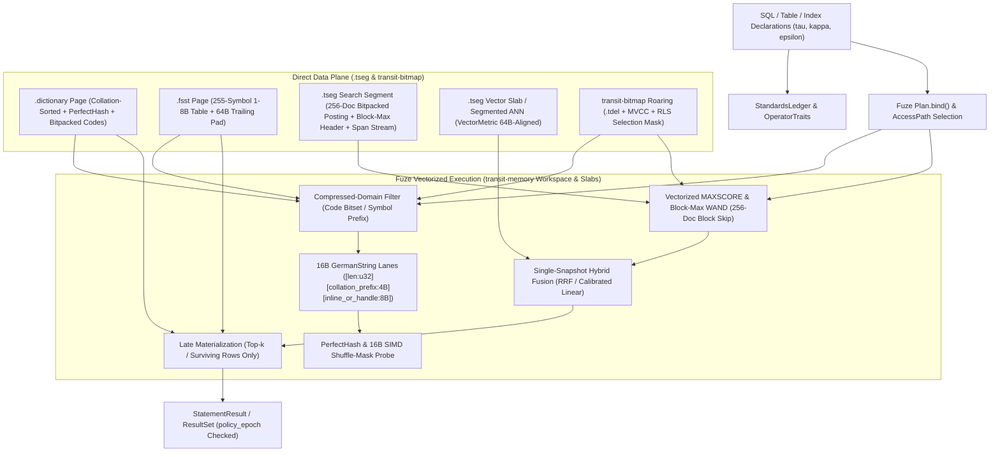

# 14. First-class strings, perfect hashing and vectorized search execution

[Roadmap](README.md) · [Performance #76](https://github.com/spoke-sh/transit/issues/76) · [Standards & Multi-Model #31](https://github.com/spoke-sh/transit/issues/31) · **Status:** In Progress ([remaining implementation plan](#implementation-plan--2026-11-01); [earlier component inventory](#delivered-implementation-evidence--2026-10-30))

Make text representation, string comparison, static/immutable key lookup and
declarative lexical/structural and hybrid search first-class, cache-resident
operations in `Fuze` and `.tseg` storage. Eliminate pointer-chasing heap
dereferences on short and medium strings, push string predicates directly into
compressed `.dictionary` and `.fsst` pages, replace linear keyword/dictionary
scans with compile-time (`comptime`) and segment-sealed perfect hash tables, and
separate declarative text segmentation, pattern/proximity matching and scoring
contracts from swappable physical `.tseg` index profiles—qualifying
fully-vectorized 256-document Block-Max BM25 and hybrid search first without
boxing text or code workloads into a bag-of-words model.

## Prerequisites and scope

The proposed [issue #194 implementation plan](13-data-structures-and-performance.md#implementation-plan-for-issue-194)
defines the shared allocation contract and sequences this milestone's string,
lookup and search gates in phase H. This milestone retains ownership of those
capabilities and their prerequisites; the plan does not establish support.

Consume the qualified [local engine](02-storage-and-query-performance.md),
[installed cutover](03-live-storage-and-sql-cutover.md),
[results](04-statement-results-and-consumption.md),
[transactions](05-transactions-and-atomic-composition.md),
[collations and historical catalogs](10-standards-and-catalogs.md),
[indexing](11-indexing-and-access-paths.md),
[analytical SQL](12-sql-and-dataflows.md) and
[data structures and resource metering](13-data-structures-and-performance.md).
Start from [queries](../handbook/reference/queries.md),
[tables](../handbook/reference/tables.md),
[storage mechanisms](../handbook/internals/storage-runtime.md),
[query mechanisms](../handbook/internals/query-engine.md) and the
[benchmark tooling](../../tests/performance/query/README.md).

Keep logical types and span projections ($\tau$: `UTF8`, `BINARY`, biological
sequences `BIO_SEQ`, molecular graphs `MOLECULE`), collations and deterministic
analyzers/segmenters ($\kappa$: `utf8_binary`, `ascii_ci`, `ebcdic_cp037`,
`icu:<locale>`, versioned token/span boundaries, reference genome assembly
$\kappa_{\text{genome}}$ and canonical chemical tautomer/stereochemistry rules
$\kappa_{\text{chem}}$) and physical codecs and index
profiles ($\epsilon$: `.dictionary`, `.fsst`, `.rle`, `EBCDIC`, `.seq_2bit`,
`.cram_ref_delta`, `.fm_bwt`, `.geno_pbwt`, `.mol_graph`, `.audio_fingerprint`,
posting blocks, trigram/substring bitmaps, suffix/automaton structures) orthogonal. Declarative
match, substring/pattern, proximity (`NEAR` / `WITHIN`), sequence-alignment and ranking contracts
must remain independent of any single physical index or bag-of-words heuristic
so `Fuze` can swap physical access paths behind an exact scalar reference oracle.
Every string representation, sort prefix, hash probe and search index evaluation
must preserve five-state cell semantics (`missing`, `null`, `type_error`,
`conflict`, `value`), snapshot pins, `.tdel` deletion visibility and
current-authority disclosure checks.

## Delivery sequence

1. **Deliver 16-byte collation-prefixed inline strings ("Umbra / German Strings") in `Fuze` vectors and working state.**
   Adapt the 16-byte string representation introduced by [Umbra](https://umbra-db.com/)
   and [CedarDB](https://cedardb.com/) (Neumann & Freitag, CIDR 2020) for
   variable-length `UTF8` and `BINARY` column lanes in `Batch` vectors,
   join/group hash tables and sort buffers
   (`[len: u32][collation_sort_prefix: 4B][inline_or_offset: 8B]`):
   - Strings up to 12 bytes store their complete payload inline inside the 16-byte
     slot with zero out-of-line arena dereferences.
   - Strings longer than 12 bytes extend Umbra's raw-byte prefix by storing the
     first 4 bytes of the column's **collation-normalized sort key**
     (`utf8_binary` raw bytes, `ascii_ci` lowercased bytes, `ebcdic_cp037`
     translated sort bytes, or `icu:<locale>` primary-weight prefix) in the
     4-byte prefix field alongside a 32-bit arena offset and 32-bit buffer/page
     handle (or swizzled slab pointer).
   - Equality (`=`, `!=`), range (`<`, `<=`, `>`, `>=`), `ORDER BY` radix/merge
     sorts and hash-join probes compare `(len, collation_sort_prefix)` in a single
     64-bit register or `@Vector` SIMD instruction first across all supported
     collations, touching out-of-line payload bytes only when two strings > 12
     bytes share an identical 4-byte collation prefix.
2. **Execute string predicates directly in the compressed domain over `.dictionary` and `.fsst` pages.**
   Push string equality (`col = 'lit'`), `IN (...)` sets, range comparisons and
   prefix/substring (`STARTS_WITH`, `LIKE 'prefix%'`, `CONTAINS`) filters down
   into `.tseg` column readers before materializing `Batch` string views:
   - On **`.dictionary` pages**, resolve string literals against the sorted or
     perfect-hashed page dictionary once per row group, converting string equality
     into integer code equality and `IN (...)` into a compact bitset test over
     bitpacked dictionary codes.
   - On **`.fsst` (Fast Static Symbol Table) pages**, evaluate prefix and fixed-
     pattern comparisons against the 255-entry 1–8 byte symbol table or decode
     only candidate lanes selected by prior predicate bitmasks (late
     materialization) inside a stack/batch-scoped scratch buffer.
3. **Deliver pure-Zig `comptime` and segment-sealed perfect hash tables with branchless 16-byte SIMD comparisons.**
   Implement a shared zero-dependency perfect-hash package in Zig using greedy
   association-table construction (`slot = (len + asso[key[i]] + asso[key[j]]) & mask`
   with power-of-two table sizes) paired with branchless 16-byte `@Vector(16, u8)`
   SIMD shuffle-mask string comparisons:
   - **Compile-time (`comptime`) lookup tables:** Replace linear `std.mem.eql`
     chains and runtime hash maps in SQL/application lexers, DDL option parsers,
     PostgreSQL/MySQL/HTTP wire-protocol header/setting routers and diagnostic
     registries with collision-free `comptime` perfect hash maps.
   - **Plan-bound and segment-sealed perfect hash directories:** Build compact
     frozen perfect hash directories at SQL `Plan.bind()` time for constant
     `WHERE col IN ('a', 'b', ...)` literal lists, at `TableSchema` initialization
     for column-name resolution, and at `.tseg` flush time for immutable
     `.dictionary` pages and row-group equality directories.
   - **Safe wide SIMD loads:** Guarantee 16–64 bytes of trailing zero-padding on
     `.tseg` page buffers, `Batch` string arenas and `comptime` key literals so
     16-byte `@Vector(16, u8)` loads execute unconditionally on internal buffers;
     use bounds-safe loads, scalar tails or a copy into padded scratch for
     external unpadded slices. Staying inside a mapped 4 KiB page does not prove
     that a load is inside the caller's allocation.
4. **Separate declarative text search and proximity contracts from swappable `.tseg` index profiles, and qualify vectorized 256-doc Block-Max BM25 first.**
   Define declarative text index and match specifications (`CREATE FULLTEXT INDEX`
   and swappable `USING <profile>` bindings) with versioned analyzer/segmenter
   pipelines (Unicode word/span boundaries, ASCII/case folding, configurable stop
   words, and n-gram, substring or code/structural segmenters) stored as
   immutable `.tseg`-aligned index segments and verified against a finite scalar
   reference oracle:
   - **Swappable index and scoring boundary:** Keep the logical match, phrase/span
     proximity (`NEAR` / `WITHIN`) and ranking contracts decoupled from the
     physical index layout so `Fuze` is never locked into bag-of-words tokenization.
     An index profile is selected only when its bound segmenter/collation digest,
     predicate coverage and exactness/recall contract match the query; otherwise
     `Fuze` falls back to another qualified index profile or the bounded scalar
     reference scan.
   - **Initial qualified lexical profile — 256-document bitpacked posting blocks with Block-Max impact weights:**
     Partition inverted posting lists into fixed 256-document blocks aligned with
     `.tseg` row groups. Encode doc ID deltas, term frequencies (`tf`) and
     optional positional/span streams with SIMD bitpacking (`StreamVByte` /
     `BitWeaver`) and store per-block upper-bound impact metadata (`max_tf`,
     `min_doc_len`, quantized max block score).
   - **Vectorized `MAXSCORE` and Block-Max WAND execution in `Fuze`:** Evaluate
     multi-term disjunctive (`OR`) and conjunctive (`AND`) top-$k$ queries as
     native vectorized `Fuze` operators that maintain a dynamic top-$k$ threshold
     heap and skip entire 256-document blocks whose block-max score upper bound
     cannot enter the top-$k$.
   - **SIMD bitmask intersection and late materialization:** Intersect candidate
     posting or substring/trigram blocks directly in SIMD registers with `.tdel`
     deletion bitmaps, MVCC snapshot visibility masks and relational predicate
     selection vectors (`WHERE tenant_id = ? AND MATCH(body, ?)`), deferring
     document/row payload decoding until final top-$k$ row IDs are selected.
   - **Biological sequence (`BIO_SEQ`), biobank genotype (`.geno_pbwt`), chemical substructure (`MOLECULE`) and spectral constellation (`.audio_fingerprint`) codecs and index profiles:**
     Extend the swappable `.tseg` codec and inverted/succinct index architecture to
     non-word-tokenized scientific and signal domains:
     - *`BIO_SEQ(alphabet)` (`DNA`, `RNA`, `IUPAC_NUCLEOTIDE`, `AMINO_ACID`) with `.seq_2bit` & `.cram_ref_delta`:*
       pack 4 nucleotides per byte (32 bases per `u64` SIMD lane) in `.seq_2bit`
       with a sparse Roaring bitmap for ambiguous IUPAC codes and RLE/quantized
       Phred quality scores; for aligned reads (`BAM`/`CRAM`), encode
       `.cram_ref_delta` tuples `(ref_contig_id, start_pos, cigar_ops, mismatch_edits)`
       against a catalog-pinned reference genome $\kappa_{\text{genome}}$
       (`GRCh38.p14`, `T2T-CHM13v2.0`) for $10\times\text{–}50\times$ compression
       and direct delta-stream pileup scans.
     - *Succinct FM-Index / Run-Length BWT (`.fm_bwt` / `r-index`) & $(w, k)$-Minimizer Roaring Index (`USING FM_INDEX` / `USING MINIMIZER`):*
       combine [Milestone 7's](07-document-storage-and-station-decoupling.md)
       succinct wavelet-tree `rank`/`select` bitvectors with Roaring $(w, k)$-minimizer
       posting lists to execute $O(|q|)$ exact seed matching, $k$-mer containment /
       Jaccard similarity (`SEQ_KmerJaccard`), and SIMD Myers bit-parallel /
       Wavefront Alignment (`WFA`, `SEQ_Align(read, ref, scoring)`).
     - *Positional Burrows–Wheeler Transform (`.geno_pbwt`) for Biobank Cohort Matrices (`VCF`/`BCF`):*
       compress population genotype columns (`0/0` hom-ref, `0/1` het, `1/1`
       hom-alt, and `./.` mapped natively to 5-state `IS MISSING`) via Durbin's
       `PBWT` and rare-variant Roaring bitmaps so minor-allele frequency (`MAF`),
       Hardy–Weinberg equilibrium and GWAS case-control association scans execute
       as vectorized bitwise `@popCount` intersections.
     - *Cheminformatics (`MOLECULE` / `.mol_graph`) & Spectral Constellation Hashing (`.audio_fingerprint`):*
       canonicalize molecular graphs (`SMILES` / `InChI` / `SDF`) under
       $\kappa_{\text{chem}}$, pre-filtering substructure queries
       (`MOL_ContainsSubstructure(mol, smarts)`) and Tanimoto similarity
       (`MOL_Tanimoto`) with 2048-bit Morgan/ECFP fingerprint SIMD bitwise screens
       (`(fp_mol & fp_query) == fp_query`), and index 2D time-frequency spectrogram
       peak pairs `(f1, f2, delta_t)` as 32-bit `.audio_fingerprint` hashes in
       Roaring posting lists for sub-millisecond acoustic/seismic matching
       ([Milestone 19](19-game-asset-pipelines-and-simulation-streaming.md)).
5. **Compose pluggable multi-signal and hybrid search under one snapshot, and hand off multi-model, reactive-context and corpus-synthesis extensions.**
   Combine vectorized lexical/structural search operators (starting with
   Block-Max BM25) and segmented HNSW / IVF-PQ approximate nearest-neighbor
   (ANN) vector indexes (`VECTOR(d)`) under a single pinned Table snapshot cut.
   Support reciprocal rank fusion (`RRF`) and calibrated linear score combination
   in `Fuze` without multiple round-trips or external search engines, preserving
   per-morsel CPU/memory/IOPS metering from
   [Milestone 13](13-data-structures-and-performance.md).
   Hand off the multi-format Document Type Library (`JSON`, `XML`, `HTTP`, `FTP`,
   `EDI`) and unified gateway/connector exchange lifecycle to
   [Milestone 16](16-document-profiles-and-gateway-exchange-lifecycle.md),
   multi-model Document/Graph structural search and foreign-format
   projections to [Milestone 18](18-multi-model-and-foreign-relations.md),
   governed reactive context assembly to
   [Milestone 32](32-reactive-context-and-agent-activation.md), and speculative
   research into declarative span/proximity maps (`NEAR`), context-conditioned
   sequence continuation and branch-verified agency to
   [Milestone 46](46-declarative-language-context-and-synthesis.md).

## Candidate structures and selection evidence

| Work and candidate | Evidence required before selection |
| --- | --- |
| 16-byte collation-prefixed strings ("German Strings") | Short ($\le 12\text{B}$), medium and long UTF-8/EBCDIC/binary distributions, shared-prefix adversarial inputs, collation sort-key fidelity across `utf8_binary`, `ascii_ci`, `ebcdic_cp037` and `icu:<locale>`, five-state tag preservation and arena memory footprint |
| Compressed-domain `.dictionary` and `.fsst` string kernels | Predicate selectivity sweep ($0.01\%$ to $90\%$), dictionary cardinality, FSST symbol compression ratio, late-materialization decode savings and equivalence against decoded scalar oracle |
| `comptime` and segment-sealed perfect hashing (`ConstexprCore/perfect_hash` style) | Construction bound at `comptime` and `.tseg` flush time, fallback behavior when key sets exceed greedy association budgets, cycles/ns per lookup on 6–1,000 keys, 4 KiB page-boundary safety and zero false positives on non-member probes |
| Swappable `.tseg` search profiles: vectorized 256-doc Block-Max BM25 (`turbopuffer` style), positional/proximity streams, n-gram/trigram bitmaps and hybrid `RRF`/linear fusion | 256-doc posting block compression ratio, block-skip rate on top-$k$ ($k \in \{10, 100, 1000\}$), filtered lexical/proximity + relational predicate selectivity, `.tdel` tombstone filtering, cold/warm NVMe cache behavior and exact top-$k$ score/order agreement with the unpruned scalar reference oracle |
| Biological sequence (`BIO_SEQ`: `.seq_2bit`, `.cram_ref_delta`, `.fm_bwt`, `.geno_pbwt`), chemical (`MOLECULE`: `.mol_graph` + Morgan bitvectors) & acoustic (`.audio_fingerprint`) profiles | `.seq_2bit` / `.cram_ref_delta` / `.geno_pbwt` compression ratio vs. `BAM`/`CRAM`/`BCF`, `FM_INDEX` / $(w,k)$-minimizer seed recall and SIMD Wavefront Alignment (`WFA`) equivalence against dynamic-programming reference oracle, 5-state `IS MISSING` preservation on `./.` genotypes, Morgan fingerprint zero-false-negative substructure pruning (`(fp_mol & fp_query) == fp_query`), and `.audio_fingerprint` time-offset recall under additive noise |

[Umbra's string layout](https://db.in.tum.de/~freitag/papers/p29-neumann-cidr20.pdf),
[FSST](https://www.vldb.org/pvldb/vol13/p2649-boncz.pdf),
[ConstexprCore/perfect_hash](https://github.com/ConstexprCore/perfect_hash) and
[turbopuffer's fully-vectorized search engine](https://turbopuffer.com/blog/fully-vectorized-search-engine)
are named architectural inputs. Keep upstream algorithms and license attribution
separate from evidence for Transit's Zig implementations.

## Acceptance criteria

- 16-byte collation-prefixed strings, compressed-domain `.dictionary`/`.fsst`
  predicates, `comptime`/immutable perfect hashing and vectorized search
  operators (starting with the 256-doc Block-Max BM25 profile) pass differential
  equivalence and fuzz checks against the independent scalar `Fuze` oracle
  across all supported collations, analyzer/segmenter bindings, five-state error
  lanes, snapshots and `.tdel` deletions.
- Hot-path string comparisons, dictionary probes and search block evaluations run
  with zero steady-state heap allocations after warmup and enforce per-morsel
  CPU, memory and IOPS budgets from [Milestone 13](13-data-structures-and-performance.md).
- Benchmarks on ClickBench string-heavy queries (`LIKE`, `REGEXP`, `GROUP BY`
  strings, `IN (...)`) and standard information-retrieval workloads (lexical
  top-$k$, substring/proximity filtering and hybrid search) meet predeclared
  latency, throughput and allocation budgets in the
  [qualification scorecard](44-qualification-and-benchmarks.md).

## Implementation plan — 2026-11-01

### Outcome, source basis and scope

An application should be able to query declared text with its exact collation,
declare a search index independently of matching/ranking semantics, inspect its
build and coverage, and obtain an attributable complete result through the
existing SQL result reader. Changing encoding, selecting an index, flushing,
compacting or restarting must preserve the logical answer and current access
checks. Index acceptance, build progress, published coverage and query completion
are separate observations.

This plan is based on fetched `origin/main` at
`c8d060cb2dfcf3bc531ef2e41fcdf7d4f172c2d5` on 2026-11-01. It supersedes the
2026-10-30 sequence for remaining implementation. That proposal and its component
inventory remain below as historical context. Source inspection establishes the
gaps here; it is not a new runtime, allocation or performance qualification.
Milestone 14 remains **In Progress**.

The first implementation increment is rebased onto `origin/main`
`90b6a0737c606f4b43fb408d698ae9561d10f5fc`. That integration includes M9's
fair client admission and original direct-KV recovery, the current protocol
definition cutover, the expanded workload roadmap, and the offline Document
profile and spatial foundations, and the M8 connection-ingress and M12
managed-computation increments. Biological, chemical and audio search remain
later work outside this strings increment. References below use the updated
numbering; the source audit retains its original basis.

Deliver the first installed profile over one direct Table's retained cut, with
existing admitted text/binary types and collations. Extend the same owners to
Document projections and stored vectors only as their contracts become usable.
Exact lexical execution comes before ANN-backed hybrid execution. This sequence
does not remove Document, positional/substring, ANN or hybrid work from the
milestone's scope. Each unsupported profile must remain explicit in capability
evidence until its own gates pass.

### First production strings increment

The selected PR boundary is the first production strings increment in R0–R3.
It does not complete Milestone 14 or qualify the later search components.

| Package | Delivered in this increment | Explicit next boundary |
| --- | --- | --- |
| R0 | Corrected X004/X005/X007 stage claims; real compiler rejection controls; independent Python-to-Zig string execution with retained corpus/output/provenance | Ranking/fusion correspondence and end-to-end benchmark qualification accompany their production integration |
| R1 | External SIMD reads bounded by slice length, including exact allocations and protected-page tails; existing SQL/LogDdl maps retained | Constant IN/NOT IN binding follows M12 expression admission; schema/page directories need bound-owner reuse and measured benefit |
| R2 | Lossless 16-byte Batch string lanes, cached long-string prefixes, aligned arrays, owned/borrowed lifetimes, five-state sidecars and sealed allocation tests across 300 resets | Compact retained relational keys, partitions/spill and M13 page-lease integration remain separate operator work |
| R3 | Production FSST streaming comparisons/prefixes, shared full validation and late projection; dictionary outcome caching without the prototype's 1,024-entry ceiling or rejection of equivalent spellings | Reuse encoded pages across atoms, additional pattern kernels and format-level packed directories need their own qualification |

The old separate compressed-string evaluator and normalized-key materializer
are removed. Production reads use `evaluateColumnPage` and
`decodeColumnPageSelected`; normalized `GermanString` helper keys do not supply
raw projections. Canonical values, saved plans and TCP1 bytes are unchanged.
Malformed conflict details are rejected using the existing logical value rules;
synthetic eager-failure fixtures now contain valid multi-alternative conflicts.

The frozen test scope is UTF-8 values under UTF8_BINARY, ASCII_CI and CP037,
six comparisons, all five states, dictionary/FSST pages and selected raw output.
The runtime oracle exercises 222 cases / 4,758 rows. Resource controls cover
64 KiB Batch reservations with zero backing attempts after warmup, short inline
payloads without arena growth, and a real TSeg predicate over a 16 KiB value
within a 4 KiB decoded-work budget. Projection has its own charged decode budget.
These are deterministic resource/correctness controls, not throughput or latency
qualification. No new end-to-end performance improvement is claimed.

R4–R9 remain explicitly open: durable search admission/build/publication and
reopenable postings, exact vectorized lexical/proximity execution, retained-cut
vector/hybrid composition, installed result delivery and final qualification.
Their dependencies on M10 type admission, M11 lifecycle, M12 expressions,
M13 resource control and M27 policy remain the gates described below.

### Source audit: reusable components and missing execution paths

| Area | Reuse at the source basis | Remaining implementation boundary |
| --- | --- | --- |
| String representation | [GermanString](../../packages/zig/transit-fuze/src/GermanString.zig) supplies a 16-byte comparison representation, inline collation weights, a padded arena and checked handles. [VectorKernel](../../packages/zig/transit-fuze/src/VectorKernel.zig) uses short-string comparison shortcuts. | `Storage` still has `words`, `values` and `states_only`, with no retained compact string lane. Batch, sorting and join/group state need integration. Normalized inline weights do not preserve original spelling/padding for projection. The actual struct alignment is 4, and handles have an 8-bit generation; neither the old claimed 16-byte alignment nor indefinite stale-handle detection follows from the helper. |
| Perfect hashing | [PerfectHash](../../packages/zig/transit-fuze/src/PerfectHash.zig) implements closed-set maps, bounded frozen directories and a sorted fallback. SQL reserved words and the new [LogDdl](../../packages/zig/transit-fuze/src/LogDdl.zig) option/unit maps use it. [TableSchema](../../packages/zig/transit-fuze/src/TableSchema.zig) offers a `NameDirectory`. | External short-slice SIMD checks currently rely on page address, not allocation bounds. Audit actual directory consumers, construction cost and duplicate handling. [PerfectHashIn](../../packages/zig/transit-fuze/src/PerfectHashIn.zig) is a separate helper; its presence does not establish production SQL `IN` lowering. |
| Encoded predicates | [PhysicalCodecs](../../packages/zig/transit-fuze/src/PhysicalCodecs.zig) has compressed-string filtering and selected compact-string materialization, plus 1–8-byte FSST symbols. | The new helpers are exercised by component tests, without calls from `TSegReader`/`BatchExecution`. Dictionary codes remain `u32`; lookup directories are rebuilt in the helper. Integrate through the real reader with shared validation, incoming selections, charged scratch and detached output lifetimes. |
| Search declarations | [SearchOracle](../../packages/zig/transit-fuze/src/SearchOracle.zig) and [TSearchSegment](../../packages/zig/transit-fuze/src/TSearchSegment.zig) define finite segmentation, scoring and local access-path descriptors. | Their local lifecycle enum and default `.ready` are not catalog acceptance or coverage. [IndexLifecycle](../../contracts/INDEX_LIFECYCLE_V1.md) is an offline contract that currently excludes inverted/vector profiles; installed index operations and search grammar/lowering must be implemented. |
| Search storage and execution | `TSearchSegment.Segment` builds resident posting/position arrays; [VectorizedSearch](../../packages/zig/transit-fuze/src/VectorizedSearch.zig) filters 256-row windows with block upper bounds and a bounded result array. | `encodeHeaderEnvelope` writes header metadata, not a reopenable posting/position artifact. Postings are unpacked `u32`/`u16` arrays; scoring loops are scalar and top-k replacement scans the result array. This is a useful reference implementation, not the planned packed SIMD MAXSCORE/WAND pipeline or durable index. |
| Hybrid search | [HybridSearch](../../packages/zig/transit-fuze/src/HybridSearch.zig) combines lexical candidates and exact caller-owned vector bytes using RRF/linear fusion. | Caller-supplied LSN/catalog/epoch fields and a row-count check do not acquire a snapshot, validate both sources or re-read current authority. No segmented ANN path is connected. Truncated candidate fusion must have an explicit candidate-domain contract, not a claim of exact corpus-wide top-k. |
| Evidence | The [lookup/oracle](../../packages/zig/transit-fuze/src/perfect_hash_and_oracle_test.zig), [string/codec](../../packages/zig/transit-fuze/src/german_string_and_codecs_test.zig) and [search](../../packages/zig/transit-fuze/src/vectorized_search_test.zig) component suites, [neutral fixtures](../../contracts/sql/vectorized-strings-and-search-fixtures.json) and [Phase H inventory](../../tests/performance/allocations.json) exist. | The [Python check](../../tests/query/logical/vectorized_strings_and_search.py) regenerates fixtures and searches source symbols; it does not compare actual Zig executions to Python. An `executable` allocation inventory entry records a runnable scoped gate, not an executed installed pass. Ledger parse/lower/recover claims need reconciliation with real callers. |

### Recent progress and prerequisite handoffs

Statuses refer to the roadmap at the source basis. Completed milestones supply
their qualified profiles, not every proposed extension in their older plans.

| Owner and status | Progress to consume | Boundary for this plan |
| --- | --- | --- |
| [M1](01-declarative-data-lifecycle.md), [M2](02-storage-and-query-performance.md), [M4](04-statement-results-and-consumption.md), [M5](05-transactions-and-atomic-composition.md) — Completed | Stable definitions, local WAL/segments, bounded logical results and local Table transactions/common cuts. | Reuse exact row/source identities, pins, transaction decisions, ordered failures and verified result completion. Search does not create a second transaction or result protocol. |
| [M3](03-live-storage-and-sql-cutover.md), [M6](06-streams-queues-and-durable-runtime.md) — In Progress | Direct database/SQL separation; recent named direct KV, mixed Table/KV/Stream/Queue transactions and installed Stream/Queue declaration work are merged. Shared Roaring containers already serve `.tdel` and `.tack`. | Use the direct owners and shared bitmap package. Do not route indexing through Station turns or wait for the remaining Station/workload-SQL cutover. Stream search still needs a qualified finite source binding. |
| [M7](07-document-storage-and-station-decoupling.md) — In Progress | Logical tree/span/shredding helpers and private `.tseg` candidates exist. Recent partition work adds bounded WAL recovery and authenticated retained revision reads with cumulative byte/work budgets; it still accepts supplied state bytes. | Integrate logical evaluation, persisted shredded projections and the installed direct lifecycle before treating them as a Document search source. Bind text to exact interpretation/revision/path and five-state provenance. |
| [M8](08-gateway-architecture-and-protocol-ingress.md), [M9](09-client-foundation-and-language-apis.md) — In Progress | Co-hosted direct execution, resumable wire/session work, bounded client contexts and original SQL submission/recovery are available. | Extend shared typed plans/results once; adapters carry canonical values and diagnostics, never internal string handles. Reuse session cancellation, exact fetch retries and current disclosure checks. |
| [M10](10-standards-and-catalogs.md) — In Progress | Neutral standards ledger with generated Zig projection; collation, vector-metric and historical-catalog helpers; PAD SPACE/control-order regression work. | The earlier M14 plan's “completed M10” claim is superseded. Stored vector descriptors and broad historical binding remain gates. ICU remains explicitly unsupported. Reuse only admitted schema collations; test other helper profiles without advertising SQL support. |
| [M11](11-indexing-and-access-paths.md) — Planned | Exact index declarations, generations, source cuts and conditional coverage descriptors exist offline. | Co-deliver the minimum durable lifecycle needed by search. M11 owns generic publication/maintenance/retirement; M14 owns lexical, positional/substring and ANN methods. Do not wait for every ordered/covering/constraint feature or invent a search-only catalog. |
| [M12](12-sql-and-dataflows.md) — In Progress | Analytical, `PerfectHashIn`, incremental and managed-dataflow components exist; installed composition remains unfinished. | Agree on typed string/match expressions and bind-time constants. Wire finite execution first; maintained search consumes M12's eventual exact commit/catch-up owner, not another polling scheduler. |
| [M13](13-data-structures-and-performance.md) — In Progress | Issue #194 A–E provides workspaces, slabs, quotas, allocation probes and bounded result/transport ownership. F/G/J still track source, cache, CPU/I/O and composed-process gaps. | H can qualify bounded kernels now. End-to-end zero-allocation and per-morsel CPU/I/O claims wait for those owners; `Budget` currently accounts memory, not a complete CPU/IOPS system. |
| [M20](20-branches-merges-and-restore.md#local-table-branch-increment) — In Progress | Recent immutable single-Table branches retain exact definition/data pins and original outcomes. | Bind index coverage to branch and source interpretation. Preserve branch-held generations during compaction/retirement. Writable branches, catalog-wide cuts and merge support remain separate gates. |

### Contract and correctness decisions before exposure

1. **Preserve values independently of comparison keys.** A compact comparison
   header can normalize case, EBCDIC weights or trailing spaces; result values,
   string functions and Arrow/SDK exports must retain original logical bytes.
   Specify the raw-value owner alongside the comparison representation. Equality,
   ordering, hashing, grouping and joins must use the same admitted collation.
   Prefix inequality may decide order only under its proved profile; a prefix
   tie needs the full key. Raw byte length is not lexical order or a general
   collation-equivalence test. Cover embedded NUL/control bytes and PAD SPACE
   ordering; do not assume zero-fill is a valid pad weight.
2. **Make padding and lifetimes real.** Reserve, initialize and charge internal
   padding and 64-byte-aligned vector storage. A 16-byte header need not itself
   have 16-byte alignment unless the chosen load interface requires it. External
   slices require bounds-safe loads even inside a mapped page. Define which
   output can borrow a page/workspace and which must detach; prevent generation
   wrap or wrong-arena reuse from making old handles valid. A durable pin and a
   resident buffer lease serve different purposes.
3. **Bind search meaning before selecting a method.** Define typed segmentation,
   normalization, stop-word/version commitments, byte/token/span coordinates,
   repeated query terms, AND/OR/phrase/ordered and unordered proximity, pattern
   escaping and score parameters. Pin Unicode rules explicitly; a profile name
   is not evidence of a full Unicode segmentation algorithm. Define admissible
   non-finite/negative parameters and score accumulation order. Extend the actual
   [query contract](../../contracts/UNIFIED_QUERY_V1.md),
   [type contract](../../contracts/FUZE_TYPES_V1.md),
   [index contract](../../contracts/INDEX_LIFECYCLE_V1.md) and
   [SQL grammar](../../contracts/sql/README.md); the earlier proposed
   `FUZE_PLAN_V1.md` is not a file in this baseline. Proposed `CREATE FULLTEXT
   INDEX`, `MATCH`, `NEAR` and `WITHIN` spellings require grammar and execution
   decisions; examples in the earlier plan do not make them runnable.
4. **Make coverage and ranking snapshot-specific.** Bind source object/definition,
   stable column and row/version identities, branch, analyzer, method generation,
   complete data/deletion cut, statistics and index-root commitment. A `.ready`
   flag cannot replace exact coverage, including accepted unflushed WAL rows and
   transaction-local writes. Select a complete qualified scan when coverage is
   absent; index-plus-delta requires a proved gap-free composition. Define BM25
   document count, term frequency and average length over a pinned logical corpus
   so segment splits/compaction do not change scores. Bounds computed for different
   statistics cannot be reused without a proof of conservativeness.
5. **Preserve failure order and disclosure.** Apply current authorization and any
   qualified security-barrier visibility before observable scores, snippets,
   counts or errors. Preserve the existing eager row/instruction failure frontier;
   ordinary relational filters do not automatically suppress errors in another
   evaluated atom. Rank pruning must not hide an earlier visible failure. Re-read
   authority through the owner after buffering and before every disclosure,
   including metadata, empty results and completion. Define permitted ranking
   statistics under RLS with M27; do not leak hidden corpus facts through scores.
6. **Distinguish exact and approximate outcomes.** Exact lexical top-k requires
   sound upper bounds and stable row-identity tie-breaking across segments. Q16
   saturation must never round an upper bound below a possible score: use a
   proved admissible range or a conservative overflow representation. Hybrid
   fusion specifies candidate limits, missing-leg scores, normalization and
   recall. Finite per-leg overfetch alone cannot establish exact global fused
   top-k. ANN results must retain their explicit approximation profile.
7. **Keep one authority and current-v1 definition.** General build operations
   use catalog admission, original operation identity, fences, dependency edges,
   progress, conditional publication and retained roots. Incompatible stored,
   wire or ABI changes replace the shared definition and migrate affected
   consumers/fixtures together under the [cutover policy](../handbook/reference/versioning.md).
   Internal optimizations that preserve those definitions need no invented wire
   format change. No legacy decoder, missing-definition default or automatic
   data reset is permitted.

### Work packages and delivery order

`R0`–`R9` replace the earlier `P0`–`P8` as the remaining-work sequence. Each row
is an independently reviewable outcome; dependencies are capability gates, not
a requirement to complete every upstream milestone first.

| Package | Depends on | Reviewable outcome |
| --- | --- | --- |
| R0 | Current source audit | Truthful capability inventory, semantic contracts, independent harness and frozen measurement scope |
| R1 | R0 | Bounds-safe reusable perfect hashing and production closed-set/constant-set consumers |
| R2 | R0; M10 admitted collations; M13 leases | Compact string lanes integrated into finite operators with lossless output |
| R3 | R1–R2 | Real encoded scans and late materialization through the direct Table reader |
| R4 | R0; M11 shared lifecycle | Accepted search declarations, recoverable builds and exact coverage |
| R5 | R1, R4 contracts | Reopenable paged search artifacts, maintenance and corpus statistics |
| R6 | R3–R5; M13 work charging | Exact SIMD lexical/proximity execution through finite SQL |
| R7 | R6; M10 stored vectors; M11 lifecycle | Exact-vector hybrid composition, then qualified ANN methods |
| R8 | R4–R7 by admitted profile; M4/M8/M9 | Shared inspection, result delivery and installed caller journeys |
| R9 | Every claimed profile above | Correspondence, resource/performance evidence and completion review |

R1 and R2 can proceed after R0 while the M11/R4 lifecycle is developed. Deliver
ordinary string-query improvements through R3 without waiting for search DDL or
ANN. R8 accompanies each exposed slice; it is not a final adapter rewrite.

#### R0 — Settle semantics, capability evidence and measurement scope

Reconcile `X004-GERMAN-STRING`, `X005-SEARCH-WAND` and `X007-PERFECT-HASH-IN`
against compiler, binder, runtime, recovery and transport behavior in the neutral
[standards ledger](../../contracts/sql/standards-ledger.json). Regenerate
`StandardsLedgerData.zig`; never edit that projection independently. Preserve
component evidence while adding explicit unavailable/rejected cases for public
syntax. Agree the decisions above with M10/M11/M12 and record the exact contract
cutover boundary before persisted descriptors or messages change.

Extend the fixture harness to invoke Zig and compare actual outputs/failures with
an independent implementation, rather than only regenerating the same fixture.
Record baseline binaries/revision, datasets, supported query profiles and numeric
latency/throughput/resource budgets before performance changes. Separate kernel,
decode, full direct-query and installed result costs; unsupported ClickBench
syntax remains a recorded coverage gap rather than a skipped success.

**Exit:** positive/negative capability tests reach real owners; scalar string,
segmentation, ranking and fusion cases are executable across both implementations;
benchmark manifests name hardware, cache state, sizes and admission budgets.

#### R1 — Bounds-safe lookup and real consumers

Repair external short-slice comparisons first. Retain padded internal fast paths
only through an API that establishes the allocation bound. Test short allocations,
zero-length inputs, arbitrary alignments, guard pages and SIMD tails. Qualify
non-members, long identical prefixes, collation-equivalent duplicates and frozen
directory fallback. Bound construction by bytes, steps and resident scratch;
the 1,024-key helper limit must be a bounded artifact limit, not a database-wide
dictionary or search-vocabulary ceiling.

Reuse the existing SQL/LogDdl maps and measure other closed keyword/option/header
sets before replacing dispatch. Join M12's `PerfectHashIn` to actual typed
constant binding, including NULL/NOT IN and five-state behavior. Build immutable
schema/page directories once per bound owner, with exact identity/lifetime checks.
If cross-package consumers need a neutral library, extract one real Zig package
with its own manifest/tests rather than importing sibling source or making wire
codecs depend on the query engine.

**Exit:** exact lookup equivalence, bounded pathological construction/fallback,
zero post-warmup backing attempts for probes, and a production caller test for
each migrated consumer. Record build/code-size cost as well as lookup latency.

#### R2 — First-class string lanes and retained operator state

Integrate compact lanes through `VectorKernel.Storage`/views, `Batch`, comparison
kernels, sort buffers and relational hash/group keys. Preserve original bytes
separately where normalized comparison data cannot reconstruct them. Reuse
`Collation` for equal/order/hash consistency; do not enable ICU or broaden
schema collation admission as a side effect. Define byte/handle/alignment bounds
and relocation across batches, retained output, hash partitions and spill.

Use charged workspace/slab reserves, with explicit copying or page leases for
long strings. Exercise source closure, scratch reset, arena replacement and
generation rollover while retaining results. Non-value lanes keep canonical
initialized slots and independent error/conflict evidence. M12 receives these
keys for its operators only as those operators are integrated.

**Exit:** exact comparisons, grouping, join multiplicity and ordering against
the scalar path; lossless projection of mixed case, Unicode and padded strings;
five-state failure attribution; bounded memory and zero steady-state allocations
in each claimed warm path. Exported values outlive their original source owner
only through an explicit retained/detached lifetime.

#### R3 — Compressed predicates in the installed scan path

Route compiled supported predicates through `ColumnPredicate`, `PhysicalCodecs`,
`TSegReader`, `BatchExecution` and the retained direct Table scan. Preserve full
page integrity/encoding validation, semantic failure order and selected-row
identity. Reuse a validated encoded page and prepared literal directory across
atoms instead of rebuilding them per row or per predicate call.

Implement collation-ordered dictionary lookup and bitpacked codes with exact
equivalence classes: different spellings may compare equal without being the
same projected value. Prepare matching-code sets once. For FSST, define the
actual symbol/escape format (the helper currently admits at most 254 symbols),
prove each compressed shortcut and decode ambiguous candidates in reusable
scratch. Patterns spanning symbols and multi-byte boundaries require the same
answer as decoded execution. Carry incoming selection masks, but do not use
them to suppress required integrity checks or eager semantic failures.

**Exit:** installed finite SELECT exercises the new reader path across plain,
dictionary and FSST pages, WAL tails and mixed encodings. Empty selections,
malformed skipped values, retained output, multi-batch results and post-buffer
revocation match the existing path. Counters demonstrate actual code-domain
filtering and bounded selected decoding, not just a component function call.

#### R4 — Durable declarations, builds and query eligibility

Extend M11's exact declaration/generation/coverage model for search semantics
and physical methods; replace the local search lifecycle interpretation with
that shared owner. Implement typed declare/inspect/build-or-rebuild/retire
operations through `DirectCatalog`, then lower the agreed SQL forms to them.
Bind source/column identities and register dependencies before publication.
Distinguish the accepted DDL outcome from build completion and query eligibility.

Build from a retained exact cut, including committed unflushed rows; persist
paged progress, consume complete intervening commits and conditionally publish
validated coverage under a fenced owner. Bound backfill and catch-up work.
Retain original identity after lost acknowledgements, cancellation or restart.
When the requested cut cannot be covered, report the reason and use the qualified
scan (or explicit required-index refusal). Keep M5's conservative read-conflict
tracking until M11 proves any narrower search predicate tracking.

**Exit:** typed and SQL callers observe the same accepted definition, progress,
coverage and failure. Disk reopen/lost-reply tests cover each publication boundary,
schema changes, source DROP/recreation, stale builders, revoked permissions and
incomplete history. No partially built or merely newer generation is eligible.

#### R5 — Persistent posting, position and substring artifacts

Replace header-only `TSS1` evidence with a complete bounded writer/range reader:
term directory, postings, optional positions/spans, norms, five-state summaries,
statistics binding and integrity commitments. Store doc-ID deltas and frequencies
in measured packed blocks of up to 256 postings. Specify their mapping to
256-row visibility windows, row groups and 65,536-offset Roaring containers;
sparse postings need not align one-to-one with windows. Decode across all those
boundaries, including partial final blocks.

Page vocabularies, directories and build state so corpus growth exceeds the
current 65,536-document/1,024-term resident helper bounds. Translate local
offsets into stable source row/version identities. Publish objects before their
coverage root, preserve old generations for readers/branches, and integrate
updates, deletes, flush, compaction and collection with the existing storage
owners. Index creation is derived work; failure cannot lose accepted base data.
Implement the positional/span and trigram candidate profiles with exact
verification; do not advertise an enum tag as a working access method.

**Exit:** fresh-process reopen answers from persisted bytes without rebuilding
an in-memory corpus. Corruption/truncation and foreign definitions reject;
interrupted staging/publication recovers the original outcome. Compaction and
changed physical segmentation preserve logical scores, ties, provenance and
branch-held results. Measure build/write amplification, cold range I/O and
bounded memory with more data and terms than one resident window can hold.

#### R6 — Exact vectorized search in finite query execution

Bind `MATCH`/proximity/pattern/ranking operations through the actual SQL compiler
and finite plan, then select complete scan or persisted index access. Establish
an exhaustive reference result before optimizing. Implement packed SIMD decode,
candidate-mask intersection, real MAXSCORE essential/nonessential term handling
and Block-Max WAND advancement, plus a bounded logarithmic top-k heap and
cross-segment merge. Preserve original query-term order for proximity after any
cursor reordering; include repeated terms and adversarial frequency ordering.

Prove conservative score bounds at parameter/quantization extremes and equality
at the top-k threshold. Define accumulation order so SIMD/cursor reordering
does not silently alter scores or ties. Preserve source/instruction error
witnesses before skipping candidates. Decode positions only when required and
meter proximity work, including highly repetitive documents; recursive exhaustive
position combinations cannot run without a work bound. Apply deterministic work
charges and host-owned I/O/cancellation checks at morsel boundaries. Use typed
budget refusal when no qualified spill path exists.

**Exit:** independent exact `(stable row identity, score, order, failure)`
agreement for AND/OR, phrases and proximity; deletion/filter selectivity sweeps;
all five states; multiple pages/segments and large vocabularies. Installed SQL
shows the selected algorithm and measured pruning, with the same answer after
concurrent commits, flush and compaction at its retained cut.

#### R7 — Hybrid semantics, stored vectors and ANN

First compose lexical search with a qualified exact stored-vector scan. Require
M10's actual schema/value/storage binding for `VECTOR`, not just `VectorMetric`
helpers. Obtain one retained source cut through the database owner and bind
lexical rows, vectors, deletions, statistics and projected payloads to it. For
multiple sources, use an admitted common transaction cut or explicitly report
an independent basis; matching integer LSNs do not create atomicity.

Specify deterministic RRF/linear normalization, candidate limits, missing-leg
scores and ties. Either define fusion over the declared finite candidate domain
or implement bounds/exhaustive consumption sufficient for exact corpus ranking.
Then implement and benchmark segmented ANN methods under R4's lifecycle. Select
the first HNSW/IVF-family profile using declared recall, filter selectivity,
memory, build and recovery budgets; retain the other planned methods as open
scope until qualified. Exact scans remain the correctness/recall baseline.

**Exit:** concurrent-write tests prove both legs and late materialization use
the original cut; current-owner authorization is checked before each result
batch. ANN tests report recall and approximation metadata, restart/build/drop
behavior and bounded candidate/state costs. Neither row-count equality nor a
constant epoch argument can satisfy this gate.

#### R8 — Shared results, inspection and downstream interfaces

Expose selected/fallback access paths, analyzer/collation commitments, coverage,
exactness, budgets and aggregate counters through shared typed plan/inspection
results. `EXPLAIN` remains metadata-only; actual blocks decoded/skipped and rows
materialized are execution observations, never invented planning counts.
Distinguish rows returned by top-k from total matches unless exhaustive counting
is explicitly requested and completed. Respect metadata/source rights.

Use [SQL_RESULTS_V1](../../contracts/SQL_RESULTS_V1.md), the shared client and
existing gateway mappings. Internal string headers and borrowed arena handles
never cross native/Arrow/language boundaries. Exercise the console and native
SQL caller first, then each supported PostgreSQL/MySQL/Flight profile; record
unavailable type/operator mappings explicitly. Board consumes authorized public
inspection/results without a second catalog or raw storage access.

**Exit:** declare, inspect, query, update, rebuild, retire and recover journeys
run through real callers. Include empty and multi-batch results, early close,
lease expiry, exact fetch retry, missing terminal evidence and revocation after
buffering. Update owning public references/component guides as each behavior
lands; the roadmap must not become its usage specification.

#### R9 — Correspondence, benchmarks and completion review

Extend M22's [collation proof](../../contracts/sql/CollationOrder.lean) and
five-state/rewrite correspondence for the admitted compact-key and encoded-filter
profiles. Add the Block-Max pruning obligation with explicit scoring-domain,
rounding, tie and coverage assumptions. Connect proofs to actual Zig vectors
and negative controls; a theorem about an abstract order does not establish
that a concrete prefix encoder or posting decoder implements it.

Run the qualification matrix below on committed source. Retain raw evidence,
failed/incomplete attempts, binary/toolchain/fixture hashes, configuration and
baseline comparisons in [qualification history](../history/qualification/README.md).
Promote only proven capability states. Completion requires the milestone's
advertised string, search and hybrid profiles, including resource and installed
recovery gates; an early exact lexical slice does not close the remaining scope.

### Qualification matrix and measurement gates

These are required future runs, not results of preparing this plan.

| Gate | Required cases and observable evidence |
| --- | --- |
| Value and collation correctness | Boundary lengths 0/4/12/13 and long values; identical prefixes; embedded NUL/control bytes; Unicode and EBCDIC; PAD/NO PAD helper cases; unsupported ICU rejection; lossless raw output; compare/hash/group/join agreement and exact failure witnesses. |
| SIMD and ownership | Exact-size allocations and guard pages, all tail lengths/alignments, padding charged/initialized, stale/wrong-arena handles and rollover, source closure/reset while retaining batches, independent Arrow/output ownership and bounded cleanup after refusal. |
| Encoded execution | Plain/dictionary/FSST equivalence for admitted comparisons, IN/NOT IN and patterns; duplicate collation keys; patterns across symbols; malformed unselected values; dictionary cardinality and 0.01%–90% selectivity sweeps; production reader counters. |
| Index lifecycle and storage | Original-operation recovery before/after object staging and coverage publication; stale fence, denied build/inspect/read, committed WAL tail, transaction-local writes, missing history, incompatible definitions, corrupted postings, deletion/compaction races and branch-retained generations. |
| Exact search and fusion | `k` of 0, 1, 10, 100, 1,000 and admitted boundary; empty/no-match corpora; repeated terms and score ties; Q16 overflow/rounding; 0%–100% deletions; all five states; ordered/unordered proximity; multi-segment global statistics; exact oracle/fusion-domain agreement. |
| Public completion and authority | Same pinned rows/scores across concurrent mutation and source rename/drop; fresh checks on repeated, empty and terminal batches; early close, transport EOF and cancellation remain incomplete; no SQL restart or snapshot splice. Metadata-only EXPLAIN acquires no data scan or effect. |
| Memory and work | Sealed probes below each reusable owner, varied data after finite warmup, no allocation/growing-resize/remap attempts on claimed paths; full reserve/padding/stack accounting; large corpus independent of resident state; deterministic budget refusal and cancellation without starvation. M13 F/G/J compose source/cache/host CPU/I/O evidence separately. |
| Performance and quality | Frozen ClickBench string subset plus IR lexical/proximity/substring and hybrid corpora; warm/cold cache, size/skew/cardinality, filters and tombstones; first result and verified completion, throughput, p50/p95/p99 where sampled, CPU, RSS, decoded bytes, page I/O, build/compaction amplification and ANN recall. Compare identical semantics and durability with predeclared numeric budgets; report regressions and unsupported queries. |

Use the existing owning checks while developing: Fuze package `zig build test`
(including `perfect_hash_and_oracle_test`, `german_string_and_codecs_test` and
`vectorized_search_test`), protocol/catalog/storage tests for changed owners,
`just test::sql`, `just test::sql-sessions`, `just test::direct-catalog-abi`,
`just test::sql-result-allocations` and `just test::sql-rewrites` as applicable,
inside `nix develop`. Extend the fixture driver and
[query benchmark tooling](../../tests/performance/query/README.md) with real
execution before counting those gates. Before implementation pushes, run affected
`just ci clean --lane NAME` lanes against committed HEAD; cross-domain cutovers
require dependent lanes. Final common-revision qualification belongs with M44.

### Upcoming consumers and first changes

| Consumer | Handoff from M14; work that stays with the consumer |
| --- | --- |
| [M15](15-data-centric-compilation-and-specialization.md) | Stable compact-key/value ownership, masks, failure frontiers and bounded kernel interfaces. Fusion, AOT, adaptive compilation and executable-code caches stay in M15. Do not freeze the current helper layout as a public ABI before R2. |
| [M16](16-document-profiles-and-gateway-exchange-lifecycle.md), [M18](18-multi-model-and-foreign-relations.md) | Bounded vocabulary lookup, exact span provenance and reusable search methods. Profile/container parsing and multi-model source composition stay with those owners; require M7's qualified Document boundary. |
| [M17](17-geospatial-and-spatio-temporal-computing.md), [M19](19-game-asset-pipelines-and-simulation-streaming.md) | Reusable bitmap, padded-buffer, bounded vocabulary and late-materialization contracts. Similar 16-byte layouts do not establish spatial comparison, topology, asset interpretation or pruning semantics. |
| [M22](22-formal-semantics-and-correspondence.md), [M27](27-control-and-policy-plane.md), [M30](30-board-reimplementation.md), [M44](44-qualification-and-benchmarks.md) | Implementation correspondence, current policy/RLS integration, read-only inspection and common-revision scorecards respectively. No component helper certifies installed security or performance. |
| [M32](32-reactive-context-and-agent-activation.md), [M46](46-declarative-language-context-and-synthesis.md) | Version-bound finite matches, spans and explicit exact/approximate ranking. Continuous activation, broader structural context and speculative synthesis remain later work; they are not prerequisites for finite search. |

Start with three reviewable changes: **(1)** R0 capability corrections and an
actual Zig-versus-independent oracle harness, including raw-value preservation,
short-slice bounds, PAD SPACE ordering and score-bound counterexamples;
**(2)** R1 SIMD safety and measured production lookup adoption;
**(3)** R2 compact lanes plus an installed lossless string-query regression,
while settling the shared R4/M11 lifecycle contract. Continue to R3 before
exposing search DDL. Do not repeat the earlier component-only implementation
sequence or mark its existence as completion.

## Implementation plan — 2026-10-30

Historical proposal, superseded by the [2026-11-01 plan](#implementation-plan--2026-11-01).
Its milestone statuses, proposed layouts, page-boundary SIMD rule, named plan
contract and implied runtime integrations are not current capability claims.
The source audit above controls remaining work; the component inventory below
does not establish that these earlier exit gates passed.

### Plan basis and starting point

This plan starts from `origin/main` at `54e176fd0` (2026-10-30) and sequences
Milestone 14 against completed foundations and active in-progress milestones:

- **Completed relational, result, and transactional foundations ([Milestones 1](01-declarative-data-lifecycle.md), [2](02-storage-and-query-performance.md), [4](04-statement-results-and-consumption.md), and [5](05-transactions-and-atomic-composition.md)):**
  `.tseg` column pages (`TCP1`), segments (`TSF1`), tombstone bitmaps (`TDL1`),
  five-state cell preservation (`missing`, `null`, `type_error`, `conflict`,
  `value`), `Batch` execution, streaming `StatementResult` / `ResultSet`
  consumption with per-batch `policy_epoch` disclosure checks, and interactive
  SSI transactions (`BEGIN` / `COMMIT` / `ROLLBACK`) over `DirectCatalog` and
  `TablePartition` are implemented and qualified.
- **Completed standards, collation profiles, and companion types ([Milestone 10](10-standards-and-catalogs.md), PR #262):**
  `StandardsLedger.zig` (`transit.sql.standards-ledger.v1.2026-10-30`) and
  `OperatorTraits.zig` classify `parse` / `lower` / `execute` / `recover` /
  `transport` states; `Collation.zig` implements both 4-profile schema tags
  (`none`, `utf8_binary`, `ascii_ci`, `ebcdic_cp037`) and 7-profile runtime
  semantics (`icu_root`, `ebcdic_037_pad` with `PAD SPACE`, and
  `ebcdic_1047_nopad` with `NO PAD`), plus order-preserving sort keys
  (`encodeSortKeyProfile`); `VectorMetric.zig` provides unboxed 64-byte-aligned
  `VECTOR(dim, elem_type)` slabs (`float32`, `float16`, `bfloat16`, `int8`,
  `binary`) and exact `L2_SQUARED`, `COSINE`, `DOT_PRODUCT`, and `HAMMING`
  distance kernels.
- **In-progress memory hierarchy, Roaring bitmaps, and document/stream foundations ([Milestones 3](03-live-storage-and-sql-cutover.md), [6](06-streams-queues-and-durable-runtime.md), [7](07-document-storage-and-station-decoupling.md), [8](08-gateway-architecture-and-protocol-ingress.md), [9](09-client-foundation-and-language-apis.md), and [13](13-data-structures-and-performance.md)):**
  - `transit-memory` (`AllocationProbe`, `Quota`, `Budget`, `Workspace`, `Pool`,
    `Slab`) and `tests/performance/allocations.json` (Issue #194 Phases A–E)
    provide deterministic per-morsel memory accounting, leased scratch
    workspaces, fixed-size slabs, and zero-allocation-after-warmup probe gates.
    Issue #194 Phase H defines the memory and lifetime rules that Milestone 14's
    16-byte strings, perfect hash directories, and vectorized search operators
    must obey.
  - `transit-bitmap` (`packages/zig/transit-bitmap/src/root.zig`, `RBC1`)
    provides zero-allocation 64-byte-aligned Roaring `array`, `bitmap`, and
    `run` containers (`values_per_container = 65536`) with hardware `@popCount`
    and `@ctz` iteration, already shared by `.tdel` (`TDel.zig`), `.tack`
    (`QueuePartition.zig`), and `DocumentShredder.zig`.
  - `transit-document` (`SpanText.zig`, `SuccinctTree.zig`,
    `VersionedMerge.zig`) and `transit-storage` (`DocumentShredder.zig`,
    `DocumentPartition.zig`, PR #259) provide UTF-8 span-piece text, $2N$-bit
    Balanced Parentheses (`BP`) succinct trees, and `.tseg` subcolumn shredding
    with collation-aware zone maps.
  - `transit-data-client` (`QueryValues.zig`, `NeutralEncoding.zig`,
    `RelationalBridge.zig`) and co-hosted `DatabaseRuntime` (`Milestone 3` PR
    #261 and `Milestone 8` PR #260) wire native direct-engine execution and
    typed statement results end-to-end without `Station` actor turns.

### Pre-implementation source audit

| Capability area | Current source owners | Delivered baseline (`54e176fd0`) | Remaining Milestone 14 gap |
| --- | --- | --- | --- |
| 16-byte collation-prefixed strings ("Umbra / German Strings") in vectors, sorts, and hash state | [`Batch.zig`](../../packages/zig/transit-fuze/src/Batch.zig), [`VectorKernel.zig`](../../packages/zig/transit-fuze/src/VectorKernel.zig), [`RelationalValues.zig`](../../packages/zig/transit-fuze/src/RelationalValues.zig), [`RelationalIndex.zig`](../../packages/zig/transit-fuze/src/RelationalIndex.zig), [`Collation.zig`](../../packages/zig/transit-fuze/src/Collation.zig) | `VectorKernel.hot(kind)` only vectorizes `.int64`, `.uint64`, `.float64`, and `.boolean` via `Storage.words: []u64`. `.utf8`, `.char`, `.binary`, and `.json` fall back to `Storage.values: []t.Values.Value`, pointer-chasing into the batch arena on every row in `Compare(void, op)`. `Collation.zig` builds variable-length sort keys (`encodeSortKeyProfile`) but has no 4-byte inline `collation_sort_prefix` extractor or `NO PAD` vs `PAD SPACE` prefix/length short-circuit proofs. | Deliver `GermanString` (`extern struct` of 16 bytes: `len: u32`, `prefix: [4]u8`, `payload: [8]u8`) as a first-class `Storage.strings: []GermanString` lane in `Batch.zig`, `VectorKernel.zig`, sort buffers, and hash/group tables, backed by `transit-memory` workspace/page handles and proved sound across all `Collation.Profile`s (`utf8_binary`, `ascii_ci`, `ebcdic_cp037`, `icu_root`, `ebcdic_037_pad`, `ebcdic_1047_nopad`). |
| Compressed-domain `.dictionary` and `.fsst` string execution & late materialization | [`PhysicalCodecs.zig`](../../packages/zig/transit-fuze/src/PhysicalCodecs.zig), [`PlainColumnBuffers.zig`](../../packages/zig/transit-fuze/src/PlainColumnBuffers.zig), [`ColumnPredicate.zig`](../../packages/zig/transit-fuze/src/ColumnPredicate.zig), [`TSegReader.zig`](../../packages/zig/transit-fuze/src/TSegReader.zig), [`BatchExecution.zig`](../../packages/zig/transit-fuze/src/BatchExecution.zig) | `PhysicalCodecs.zig` encodes/decodes `.dictionary` (unsorted `u32` codes) and `.fsst` (up to 64 4-byte symbols). `evaluateColumnPage` evaluates `PredicateSink` per dictionary entry for `.dictionary`, but `.fsst` decodes *every* row into a heap-backed `temporary` arena before filtering, `.dictionary` does not sort or seal a perfect-hash directory or bitpack codes, and `ColumnPredicate.Predicate` only supports `=`, `!=`, `<`, `<=`, `>`, `>=`, and `IS [NOT] NULL`. | Sort `.dictionary` entries by declared collation at `.tseg` flush time, seal an optional per-page perfect-hash directory, bitpack codes, and evaluate `=`, `!=`, `<`, `<=`, `>`, `>=`, `IN (...)`, `STARTS_WITH` / `LIKE 'prefix%'`, and `CONTAINS` as bitset/code filters; upgrade `.fsst` to a 255-entry 1–8 byte symbol table with compressed-domain prefix/fixed-pattern pushdown and selection-masked late materialization inside a `transit-memory` `Workspace` lease. |
| `comptime` and segment-sealed perfect hashing + 16-byte SIMD string comparisons | [`SqlInput.zig`](../../packages/zig/transit-fuze/src/SqlInput.zig), [`Sql.zig`](../../packages/zig/transit-fuze/src/Sql.zig), [`TableDdl.zig`](../../packages/zig/transit-fuze/src/TableDdl.zig), [`TableSchema.zig`](../../packages/zig/transit-fuze/src/TableSchema.zig), [`TSeg.zig`](../../packages/zig/transit-fuze/src/TSeg.zig) | SQL/DDL keyword and option dispatch, `TableSchema` column lookups, and wire-protocol command parsers use linear `std.mem.eql` chains or runtime maps. `.tseg` page buffers and `Batch` arenas do not enforce trailing 16–64B zero-padding for unconditional `@Vector(16, u8)` loads. | Implement pure-Zig `PerfectHash` (`slot = (len + asso[key[i]] + asso[key[j]]) & mask`) + branchless `@Vector(16, u8)` shuffle-mask equality with deterministic fallback when key sets exceed construction budgets; enforce 64-byte trailing zero-padding on `.tseg`/`Batch` buffers and `(addr & 0xfff) <= 4080` 4 KiB page-boundary guards on external slices; adopt across SQL/DDL lexers, wire routers, `TableSchema`, `WHERE col IN (...)` plan binding, and `.tseg` `.dictionary` pages. |
| Declarative text/span segmentation, proximity (`NEAR`/`WITHIN`), and swappable `.tseg` search profiles (256-doc Block-Max BM25) | [`IndexLifecycle.zig`](../../packages/zig/transit-protocol/src/IndexLifecycle.zig), [`StandardsLedger.zig`](../../packages/zig/transit-fuze/src/StandardsLedger.zig), [`TDel.zig`](../../packages/zig/transit-fuze/src/TDel.zig), [`SpanText.zig`](../../packages/zig/transit-document/src/SpanText.zig), [`root.zig` (`transit-bitmap`)](../../packages/zig/transit-bitmap/src/root.zig) | `IndexLifecycle.zig` models ordered column `Key`s and `acceleration` / `constraint` purposes (`ILC1`), and `transit-bitmap` provides 65,536-bit Roaring containers (`RBC1`), but no declarative analyzer/segmenter descriptors ($\kappa_{\text{search}}$), `MATCH` / `NEAR` / `WITHIN` scalar oracle, 256-doc bitpacked Block-Max posting blocks, or `MAXSCORE` / Block-Max WAND operators exist yet. | Define versioned analyzer/segmenter digests ($\kappa_{\text{search}}$: Unicode word/span, ASCII fold, code/identifier, $n$-gram) and swappable `.tseg` search index profiles ($\epsilon$) behind a finite scalar reference oracle; qualify 256-document bitpacked posting blocks (`StreamVByte`/`BitWeaver` doc-ID deltas, `tf`, optional span/position streams, and Block-Max impact headers) with vectorized `MAXSCORE` and Block-Max WAND intersected in SIMD registers with `.tdel` and relational selection bitmasks. |
| Single-snapshot hybrid search (`RRF` and calibrated linear combination) and cross-milestone handoffs | [`VectorMetric.zig`](../../packages/zig/transit-fuze/src/VectorMetric.zig), [`BatchExecution.zig`](../../packages/zig/transit-fuze/src/BatchExecution.zig), [`Budget.zig`](../../packages/zig/transit-memory/src/Budget.zig) | `VectorMetric.zig` implements unboxed SIMD slabs and exact `L2_SQUARED`, `COSINE`, `DOT_PRODUCT`, and `HAMMING` distance evaluation (Milestone 10), and `transit-memory` tracks per-morsel budgets (Milestone 13), but segmented ANN index probes and single-snapshot rank/score fusion (`RRF`, calibrated linear combination) with Block-Max BM25 are not yet wired into `Fuze`. | Compose lexical/proximity top-$k$ operators and `VECTOR(dim, elem_type)` exact/segmented-ANN top-$k$ operators under one pinned `Snapshot` and `CatalogCut` with deterministic `RRF` (`1 / (k_rrf + rank)`) and calibrated linear score fusion, per-morsel `transit-memory` budget enforcement, and per-batch `policy_epoch` disclosure checks. |

### Coordination and handoffs across milestones

| Milestone | Dependency / handoff direction | Concrete boundary |
| --- | --- | --- |
| [3. Live storage cutover and native SQL service](03-live-storage-and-sql-cutover.md), [4. Statement results](04-statement-results-and-consumption.md), and [5. Transactions](05-transactions-and-atomic-composition.md) | Upstream foundation $\rightarrow$ M14 | Search and string-heavy `SELECT` queries execute over live `TablePartition` snapshots and `.tseg` segments without `Station` actor turns, streaming bounded `ResultSet` batches that re-verify `policy_epoch` authorization before every batch disclosure. |
| [6. Declarative streams, queues, and durable runtime](06-streams-queues-and-durable-runtime.md) (In Progress) | Shared primitive (`transit-bitmap`) $\leftrightarrow$ M14 | M6 R1 delivered `transit-bitmap` (`RBC1`) Roaring containers for `.tdel` and `.tack`. M14 reuses `transit-bitmap` for 256-document posting block visibility masks, trigram/dictionary code bitsets, and SIMD candidate intersection without introducing a second bitmap format. |
| [7. Document storage and Station decoupling](07-document-storage-and-station-decoupling.md) (In Progress) | Upstream foundation $\rightarrow$ M14 | M7 PR #259 delivered `SpanText`, `SuccinctTree`, `DocumentShredder`, and `DocumentPartition`. M14 consumes `SpanText` byte/scalar span boundaries for declarative text segmentation and accelerates shredded `DocumentShredder` string subcolumn zone maps and predicates with 16-byte `GermanString` prefixes and `.dictionary`/`.fsst` pushdown. |
| [8. Gateway architecture and protocol ingress](08-gateway-architecture-and-protocol-ingress.md) and [9. Client foundation](09-client-foundation-and-language-apis.md) (In Progress) | Shared boundary $\leftrightarrow$ M14 | 16-byte `GermanString` headers and perfect-hash directories are internal `Fuze` / `.tseg` execution structures; `transit-data-client` (`NeutralEncoding`, `QueryValues`) continues to expose canonical UTF-8/binary slices and structured diagnostic/explain metadata across language boundaries. |
| [10. Standards and historical catalogs](10-standards-and-catalogs.md) (Delivered in PR #262) | Upstream foundation $\rightarrow$ M14 | M10 delivered `StandardsLedger.zig`, `OperatorTraits.zig`, `Collation.Profile` (`utf8_binary`, `ascii_ci`, `ebcdic_cp037`, `icu_root`, `ebcdic_037_pad`, `ebcdic_1047_nopad`), and `VectorMetric.zig`. M14 promotes string/search codecs and operators in `StandardsLedger.zig` and composes `VectorMetric.zig` into single-snapshot hybrid search. |
| [11. Indexing and access paths](11-indexing-and-access-paths.md) (Planned) | Co-designed contract $\leftrightarrow$ M14 | M11 owns the general secondary-index lifecycle (`INDEX_LIFECYCLE_V1.md`: `building`, `backfilling`, `catching_up`, `ready`, `failed`, `dropped`), key-range SSI locks, and online backfill; M14 plugs segment-sealed `.dictionary`/equality perfect-hash directories and `.tseg`-aligned 256-doc Block-Max BM25 / positional / ANN search segments into M11's lifecycle and `AccessPath` cost model. |
| [12. Analytical SQL and dataflows](12-sql-and-dataflows.md) (Planned) | Co-designed contract $\leftrightarrow$ M14 | M12's `Plan.bind()` invokes M14's `PerfectHash` builder for constant `WHERE col IN ('a', 'b', ...)` lists, uses 16-byte `GermanString` keys in partitioned hash joins, `GROUP BY`, and window frames, and lowers `MATCH`, `NEAR`/`WITHIN`, and hybrid search score expressions into `Fuze` plans. |
| [13. Data structures and resource metering](13-data-structures-and-performance.md) (In Progress — Issue #194) | Upstream contract $\rightarrow$ M14 (Phase H) | M13 Phases A–E delivered `transit-memory` (`Workspace`, `Slab`, `Pool`, `Budget`, `AllocationProbe`) and `tests/performance/allocations.json`. M14 implements Issue #194 Phase H: every `GermanString` arena handle, FSST late-materialization buffer, frozen perfect-hash table, and WAND top-$k$ heap runs inside pre-allocated `Workspace` / `Slab` leases with zero steady-state heap allocations after warmup. |
| [15. Data-centric compilation and specialization](15-data-centric-compilation-and-specialization.md) (Planned) | M14 $\rightarrow$ Downstream consumer | M15 consumes M14's 16-byte `GermanString` ABI (`@Vector(2, u64)`) and `comptime` perfect hash tables to specialize fused filter-project-aggregate morsels and AOT-compiled `transit-app` ingestion routers. |
| [16. Document profiles and gateway exchange lifecycle](16-document-profiles-and-gateway-exchange-lifecycle.md) (Planned) | M14 $\rightarrow$ Downstream consumer | M16 reuses M14's `comptime` and segment-sealed perfect hash tables for `XML`/`HTML`/OData/XLSX `sharedStrings.xml` and `HTTP` header/MIME vocabularies, 16-byte `GermanString` values for zero-copy token slices, and 256-doc Block-Max BM25 + `NEAR` proximity over shredded `PDF`, `DOCX`, `XML`, and `EDI` corpora. |
| [17. Geospatial](17-geospatial-and-spatio-temporal-computing.md), [18. Multi-model](18-multi-model-and-foreign-relations.md), [20. Branches, merges and restore](20-branches-merges-and-restore.md), [22. Formal semantics](22-formal-semantics-and-correspondence.md), [27. Control & policy plane](27-control-and-policy-plane.md), [30. Board](30-board-reimplementation.md), [32. Reactive context](32-reactive-context-and-agent-activation.md), [41. Datalog](41-deductive-rules-datalog-and-equivalence-graphs.md), [42. Hardware/EDA](42-hardware-design-rtl-and-eda-verification.md), [43. SQL grammar](43-sql-grammar-and-dialect-ergonomics.md), and [46. Language context & synthesis](46-declarative-language-context-and-synthesis.md) | M14 $\rightarrow$ Downstream consumers | M17 mirrors M14's 16-byte inline header layout for spatial geometries; M18/M32/M41/M42/M46 consume M14's symbol dictionaries, span/proximity (`NEAR`/`WITHIN`) and hybrid search operators; M20 uses M14's block-max/dictionary summaries in branch `DIFF` skipping; M22 proves `A1`/`A2`/`A5` correspondence in Lean 4; M27 enforces security-barrier RLS bitmasks before WAND score disclosure; M30 exposes search block-skip and dictionary pushdown metrics in Board `EXPLAIN`; M43 audits search/string syntax across dialects. |

### Accepted architectural decisions

1. **`D1` — 16-byte collation-prefixed string layout (`GermanString`) with proved `NO PAD` / `PAD SPACE` prefix soundness and explicit handle lifetimes:**
   - Represent variable-length `UTF8` and `BINARY` lanes in `Batch` vectors,
     sort buffers, and hash/group tables as an `extern struct` of exactly 16
     bytes aligned to 16 bytes (`GermanString`):
     - When `len <= 12`: `[len: u32][inline_bytes: [12]u8]` (remaining trailing
       bytes zero-padded; zero out-of-line arena dereferences).
     - When `len > 12`: `[len: u32][collation_sort_prefix: [4]u8][handle: PayloadHandle]`
       where `PayloadHandle` (`packed struct(u64) { offset: u32, source_id: u16, generation: u16 }`)
       addresses a `transit-memory` `Workspace` slab or pinned `.tseg` page
       buffer and is checked against `generation` in debug/test builds so
       borrowed views never outlive their backing page or scratch reset.
   - Five-state cell semantics (`missing`, `null`, `type_error`, `conflict`,
     `value`) remain orthogonal in `Batch`/`VectorPage` `states` and `details`
     streams; non-`value` lanes store a canonical zeroed `GermanString` slot so
     SIMD masks never inspect uninitialized prefix bytes.
   - **Collation prefix & length soundness oracle (`Collation.zig`):**
     - The 4-byte `collation_sort_prefix` stores the first 4 bytes of the
       column's declared **collation sort key** (`utf8_binary` raw bytes,
       `ascii_ci` ASCII-lowercased bytes, `ebcdic_cp037` / `ebcdic_1047_nopad`
       CP037/CP1047 sort weights, or `icu_root` primary collation weights).
     - For `<`, `<=`, `>`, `>=`, and `ORDER BY`, comparing the 4-byte
       `collation_sort_prefix` as a big-endian `u32` (via `@byteSwap` on
       little-endian targets) is a sound strict-order decision whenever
       `prefix_a != prefix_b`; raw `len` is **never** used to decide `<` or `>`
       before prefix comparison.
     - For `=` and `!=`: under `NO PAD` collations whose mapping is length-
       preserving (`utf8_binary`, `ascii_ci`, `ebcdic_cp037`,
       `ebcdic_1047_nopad`), `(len_a != len_b) or (prefix_a != prefix_b)`
       soundly proves inequality (`!=`) in a single 64-bit register comparison,
       and when `len <= 12` under injective encodings (`utf8_binary`,
       `ebcdic_cp037`, `ebcdic_1047_nopad`), identical 16-byte words prove
       equality (`=`) without out-of-line reads (for `ascii_ci` with `len <= 12`,
       inline bytes are ASCII-lowercased in a single `@Vector(16, u8)` SIMD
       comparison). Under `PAD SPACE` collations (`ebcdic_037_pad`), `len` in
       the header stores the **rtrimmed canonical byte length** (excluding
       trailing collation pad characters `0x40` / `' '`) so `'a'` and `'a   '`
       normalize to identical `(canonical_len, prefix)` headers and never suffer
       false-negative equality rejections.
2. **`D2` — Compressed-domain `.dictionary` and `.fsst` execution with `Workspace`-bounded late materialization:**
   - Extend `.tseg` `.dictionary` pages (`PhysicalCodecs.zig`) so dictionary
     entries are sorted in declared-collation order at segment flush time, codes
     are bitpacked to the minimum bit width $\lceil \log_2(D) \rceil$, and an
     optional segment-sealed perfect-hash directory is attached when $D \ge 8$.
     Equality (`col = 'lit'`) resolves to a single code comparison; range
     predicates (`<`, `<=`, `>`, `>=`) and prefix predicates (`STARTS_WITH`,
     `LIKE 'prefix%'` under `utf8_binary` / `ascii_ci`) binary-search the
     collation-sorted dictionary into a contiguous code range `[code_lo, code_hi]`;
     and `IN (...)` / `CONTAINS` evaluate once against the dictionary entries to
     populate a `transit-bitmap` or 64-bit word bitset tested directly against
     the encoded code stream without constructing `Values.Cell` or `GermanString`
     views for rejected rows.
   - Upgrade `.fsst` pages (`PhysicalCodecs.zig`) from the prototype 64-entry
     4-byte table to a canonical 255-entry 1–8 byte Fast Static Symbol Table
     (`0xFF` escape byte) stored in the `.tseg` page header. Evaluate anchored
     prefix predicates (`STARTS_WITH`, `LIKE 'prefix%'`) directly against initial
     symbol codes where unambiguous, and decode only rows whose bit is set in
     the incoming selection vector (late materialization) into a reusable
     `transit-memory` `Workspace` scratch slice.
3. **`D3` — Pure-Zig `comptime` and segment-sealed perfect hashing paired with page-safe 16-byte SIMD comparisons:**
   - Implement a shared zero-dependency `PerfectHash` module in `transit-fuze`
     using greedy association-table displacements over power-of-two slot tables
     (`slot = (len +% asso[@as(usize, key[i]) + shift] +% asso[@as(usize, key[j])]) & mask`)
     paired with branchless 16-byte `@Vector(16, u8)` shuffle-mask key
     verification for keys $\le 16$ bytes (and prefix + tail verification for
     longer keys).
   - Bound construction work deterministically: at `comptime`, exceed-budget key
     sets fail compilation with an explicit diagnostic; at runtime (`Plan.bind()`
     for `IN (...)` or `.tseg` flush for `.dictionary` pages), if a key set
     exceeds the greedy construction step budget or maximum cardinality bound,
     deterministic fallback selects a sorted binary-search / Robin-Hood lookup
     directory recorded in the plan/segment metadata—never an unbounded retry loop
     or silent false positive.
   - Enforce a **64-byte trailing zero-padding invariant** on `.tseg` page
     buffers, `Batch` string arenas, `Workspace` late-materialization slabs, and
     `comptime` key tables so internal `@Vector(16, u8)` loads execute
     unconditionally; for external caller-supplied slices, guard 16-byte loads
     with `((@intFromPtr(ptr) & 0xfff) <= 4080)` and fall back to a branchless
     scalar byte read across 4 KiB page boundaries.
4. **`D4` — Orthogonal declarative search contracts ($\kappa_{\text{search}}$) and finite scalar reference oracle decoupled from physical `.tseg` index profiles ($\epsilon$):**
   - Separate what a search expression means from how an index accelerates it:
     - **Declarative segmenter/analyzer contract ($\kappa_{\text{search}}$):** A
       versioned, deterministic function mapping a UTF-8 `SpanText` / byte slice
       into an ordered sequence of `TokenSpan { term_bytes, ordinal_position, start_byte, end_byte }`
       under a declared profile (`unicode_word_v1`, `ascii_fold_v1`,
       `code_identifier_v1`, `ngram_3_v1`, or `raw_bytes_v1`).
     - **Logical match, proximity, and score oracle:** Define a finite scalar
       reference evaluator in `Fuze` for conjunctive/disjunctive term matching
       (`MATCH`), ordered and unordered token/span proximity
       (`NEAR(terms, max_distance, ordered)` / `WITHIN`), substring/pattern
       matching (`STARTS_WITH`, `CONTAINS`, `LIKE`), and exact BM25 scoring
       ($\text{score}(D, Q) = \sum_{t \in Q} \text{IDF}(t) \cdot \frac{f(t, D) \cdot (k_1 + 1)}{f(t, D) + k_1 \cdot (1 - b + b \cdot \frac{|D|}{\text{avgdl}})}$
       evaluated in deterministic IEEE 754 `f64` with quantized `dl` norm rules
       and `(score DESC, row_id ASC)` tie-breaking).
     - `Fuze` selects a physical `.tseg` search index profile ($\epsilon$) only
       when its catalog-bound `(segmenter_digest, collation, parameters)` match
       the query and its index state in `IndexLifecycle` (`ILC1`) is `.ready`;
       otherwise execution falls back to another qualified index or the bounded
       scalar reference scan.
5. **`D5` — 256-document bitpacked Block-Max BM25 posting blocks and vectorized `MAXSCORE` / Block-Max WAND execution:**
   - Partition inverted posting lists inside `.tseg`-aligned search segments into
     fixed **256-document blocks** aligned with `.tseg` row-group boundaries and
     `transit-bitmap` (`RBC1`) 65,536-row Roaring containers ($256 \times 256 = 65,536$).
   - Each 256-document block stores:
     - SIMD-bitpacked (`StreamVByte` / `BitWeaver` 32-bit/16-bit lanes) document
       ID deltas and term frequencies (`tf: u16`), plus an optional separate
       bitpacked positional/span sub-stream decoded only when `NEAR` / `WITHIN`
       or phrase verification is requested after block/candidate filtering.
     - A conservative **Block-Max impact header** (`max_doc_id: u32`,
       `max_tf: u16`, `min_norm_dl: u8`, `max_block_impact_q16: u16`) whose
       upper bound is proved $\ge$ the exact BM25 contribution of every live
       document in the block.
   - `Fuze` executes multi-term top-$k$ queries via native vectorized `MAXSCORE`
     (partitioning query terms into essential and non-essential sets as the
     min-heap threshold $\theta$ rises) and **Block-Max WAND** (skipping entire
     256-doc blocks whose sum of `max_block_impact` upper bounds is $< \theta$).
     Candidate blocks are intersected in SIMD registers (`@Vector(4, u64)`) with
     `.tdel` deletion bitmaps, MVCC snapshot visibility masks, security-barrier
     RLS masks, and relational filter bitmasks (`WHERE tenant_id = ?`) *before*
     scoring or reading positional streams, and full row payloads are
     late-materialized only for final surviving top-$k$ row IDs.
6. **`D6` — Single-snapshot hybrid search (`RRF` and calibrated linear combination) over Block-Max BM25 and `VectorMetric` ANN:**
   - Combine lexical/proximity top-$k$ streams and dense/binary `VECTOR(dim, T)`
     similarity streams (`VectorMetric.zig` exact slab scans and `.tseg`-aligned
     segmented IVF/HNSW ANN probes from Milestone 11/14) inside a single `Fuze`
     plan pinned to one `Snapshot` and `CatalogCut`.
   - Support two deterministic fusion contracts with `(fused_score DESC, row_id ASC)`
     canonical tie-breaking:
     - **Reciprocal Rank Fusion (`RRF`):**
       $\text{score}_{\text{RRF}}(d) = \sum_{m \in M} \frac{w_m}{k_{\text{rrf}} + \text{rank}_m(d)}$
       (default $k_{\text{rrf}} = 60$, configurable positive constant and weights
       $w_m$).
     - **Calibrated linear combination:**
       $\text{score}_{\text{lin}}(d) = \alpha \cdot \text{norm}_{\text{lex}}(s_{\text{lex}}(d)) + (1 - \alpha) \cdot \text{norm}_{\text{vec}}(s_{\text{vec}}(d))$
       with explicit min-max or theoretical-bound normalization modes declared in
       the query so score scales are never mixed silently.
7. **`D7` — Single current-v1 contract cutover and Issue #194 Phase H allocation enforcement:**
   - Evolve `.tseg` column-page / search-segment definitions (`TCP1` / `TSF1`),
     `INDEX_LIFECYCLE_V1.md` (`ILC1`), `FUZE_PLAN_V1.md` (`FQP1`), and
     `StandardsLedger.zig` through a single coordinated current-v1 cutover with
     explicit definition-ID validation and zero fallback decoders.
   - Register every Milestone 14 hot path (`GermanString` vector comparison/sort,
     `.dictionary`/`.fsst` compressed scan, `PerfectHash` lookup, Block-Max WAND
     top-$k$ evaluation, and hybrid `RRF` fusion) in
     `tests/performance/allocations.json` with `steady_state_allocations = 0`
     under `transit-memory.AllocationProbe`.

### Work package sequence (`P0`–`P8`)

#### `P0` — Scalar reference oracles for collated strings, compressed predicates, segmenters, `NEAR`/`WITHIN`, and BM25 + Issue #194 Phase H harness

- **Goals:** Establish the independent scalar reference oracles and zero-allocation probe harnesses before introducing 16-byte string shortcuts, compressed-domain pushdown, perfect hash tables, or Block-Max WAND pruning.
- **Concrete changes:**
  - Extend [`Collation.zig`](../../packages/zig/transit-fuze/src/Collation.zig) with `computeSortPrefix4B(bytes: []const u8, profile: Profile) ![4]u8`, `canonicalByteLen(bytes: []const u8, profile: Profile) !u32` (handling `PAD SPACE` trailing-space stripping for `ebcdic_037_pad` vs `NO PAD` profiles), and a scalar oracle test suite proving that for every admitted `Profile`:
    1. `compare(a, b) == .lt` whenever `std.mem.readInt(u32, &prefix(a), .big) < std.mem.readInt(u32, &prefix(b), .big)`, and
    2. `compare(a, b) != .eq` whenever `(canonicalByteLen(a) != canonicalByteLen(b)) or (prefix(a) != prefix(b))`.
  - Add `packages/zig/transit-fuze/src/SearchOracle.zig` implementing the finite scalar reference model for:
    - Deterministic text/span segmentation (`SegmenterProfile`: `unicode_word_v1`, `ascii_fold_v1`, `code_identifier_v1`, `ngram_3_v1`, `raw_bytes_v1`) over UTF-8 byte slices and [`SpanText.zig`](../../packages/zig/transit-document/src/SpanText.zig) pieces, emitting `TokenSpan { term: []const u8, position: u32, start_byte: u32, end_byte: u32 }`.
    - Five-state string pattern predicates (`STARTS_WITH`, `CONTAINS`, `LIKE` with `%`/`_` and escape byte) respecting declared collations and propagating `.missing`, `.null`, `.type_error`, and `.conflict` cells.
    - Exact conjunctive/disjunctive `MATCH`, ordered/unordered `NEAR(terms, max_distance, ordered)` / `WITHIN` span proximity, exact `f64` BM25 scoring with deterministic `(score DESC, row_id ASC)` ordering, and exact `RRF` / linear hybrid score fusion.
  - Register Phase H benchmark and allocation-probe targets in [`tests/performance/allocations.json`](../../tests/performance/allocations.json), [`StandardsLedger.zig`](../../packages/zig/transit-fuze/src/StandardsLedger.zig), and [`OperatorTraits.zig`](../../packages/zig/transit-fuze/src/OperatorTraits.zig).
- **Verification:**
  - `zig build test` in `packages/zig/transit-fuze` exercises the collation prefix/length soundness proofs across adversarial UTF-8, ASCII case-folded, EBCDIC CP037 (`PAD SPACE`), EBCDIC CP1047 (`NO PAD`), and ICU root inputs, plus `SearchOracle.zig` golden corpus vectors.

#### `P1` — Pure-Zig `comptime` and segment-sealed perfect hashing + 16-byte SIMD string comparisons (`Step 3`)

- **Goals:** Deliver the zero-dependency `PerfectHash` engine and 16-byte SIMD string comparison primitives with 64-byte trailing buffer padding and 4 KiB page-boundary guards, and adopt them across lexers, schemas, wire routers, and `IN (...)` plan binding.
- **Concrete changes:**
  - Create `packages/zig/transit-fuze/src/PerfectHash.zig`:
    - Implement greedy association-table construction (`ComptimeMap(comptime V: type, comptime entries: anytype)` and runtime frozen `FrozenDirectory` initialized into a caller-supplied `transit-memory` `Workspace` or `.tseg` page buffer) using `slot = (len +% asso[@as(usize, key[i]) + shift] +% asso[@as(usize, key[j])]) & mask` over power-of-two table sizes.
    - Pair slot lookup with branchless `@Vector(16, u8)` SIMD shuffle-mask key comparison (`simdEql16Padded` for internal 64B-padded arenas/tables and `simdEql16PageSafe` checking `(@intFromPtr(slice.ptr) & 0xfff) <= 4080` before wide loads on external unpadded caller slices).
    - Enforce bounded construction steps (`max_asso_attempts`) with deterministic fallback to a collation-sorted binary-search directory when a dynamic key set (`IN (...)` or `.dictionary` page) has duplicate 2-byte signatures or exceeds the construction budget.
  - Enforce 64-byte trailing zero-padding in [`PlainColumnBuffers.zig`](../../packages/zig/transit-fuze/src/PlainColumnBuffers.zig), [`PhysicalCodecs.zig`](../../packages/zig/transit-fuze/src/PhysicalCodecs.zig), [`TSegReader.zig`](../../packages/zig/transit-fuze/src/TSegReader.zig), and [`Batch.zig`](../../packages/zig/transit-fuze/src/Batch.zig) string arenas.
  - Adopt `PerfectHash.ComptimeMap` in [`SqlInput.zig`](../../packages/zig/transit-fuze/src/SqlInput.zig), [`Sql.zig`](../../packages/zig/transit-fuze/src/Sql.zig), [`TableDdl.zig`](../../packages/zig/transit-fuze/src/TableDdl.zig), and wire-protocol command/header routers; adopt `PerfectHash.FrozenDirectory` in [`TableSchema.zig`](../../packages/zig/transit-fuze/src/TableSchema.zig) for $O(1)$ column-name resolution and in `Plan.bind()` for constant `WHERE col IN ('a', 'b', ...)` string literal sets.
- **Verification:**
  - Unit, fuzz, and page-boundary tests (allocating keys immediately adjacent to an unmapped `mprotect` `PROT_NONE` guard page) proving zero segfaults on 1–15 byte unpadded slices at offset `4081..4095`, zero false positives on 1,000,000 non-member probes, and zero steady-state allocations under `AllocationProbe`.

#### `P2` — 16-byte collation-prefixed inline strings ("Umbra / German Strings") in `Fuze` vectors, sorts, and hash state (`Step 1`)

- **Goals:** Replace pointer-chasing `[]t.Values.Value` string lanes in `Fuze` with 16-byte collation-prefixed `GermanString` slots across `Batch`, `VectorKernel`, sort operators, and hash-join / `GROUP BY` working state.
- **Concrete changes:**
  - Add `packages/zig/transit-fuze/src/GermanString.zig` defining the 16-byte `extern struct` (`len: u32`, `prefix: [4]u8`, `payload: Payload` where `Payload` is either `inline_bytes: [8]u8` completing a 12-byte inline string or `handle: PayloadHandle` referencing a `Workspace` slab or pinned `.tseg` page slice).
  - Provide vectorized and register-level kernels in `GermanString.zig`:
    - `eqlHeaderFast` and `orderHeaderFast` comparing `(len, prefix)` in a single 64-bit register or `@Vector` lane before touching out-of-line bytes.
    - `compareFull` resolving `PayloadHandle` only when `len > 12` and `prefix_a == prefix_b` (or when `PAD SPACE` / multi-level collation ties require full byte comparison via `Collation.compareBytesProfile`).
  - Upgrade [`Batch.zig`](../../packages/zig/transit-fuze/src/Batch.zig) and [`VectorKernel.zig`](../../packages/zig/transit-fuze/src/VectorKernel.zig) so `.utf8`, `.char`, and `.binary` columns use `Storage.strings: []GermanString` backed by a `Batch`-scoped or `Workspace`-leased string payload slab (with 64-byte trailing zero-padding) instead of `Storage.values: []t.Values.Value`.
  - Upgrade [`RelationalValues.zig`](../../packages/zig/transit-fuze/src/RelationalValues.zig), [`RelationalIndex.zig`](../../packages/zig/transit-fuze/src/RelationalIndex.zig), `ORDER BY` radix/merge sort comparators, and `GROUP BY` / hash-join key tables to store and probe 16-byte `GermanString` headers first, falling back to out-of-line payload bytes only on $> 12$-byte prefix ties.
  - Update [`DocumentShredder.zig`](../../packages/zig/transit-storage/src/DocumentShredder.zig) `ZoneMap` to cache 16-byte `GermanString` min/max summaries for $O(1)$ prefix-accelerated subcolumn zone-map pruning.
- **Verification:**
  - Differential fuzz tests comparing `GermanString` vector comparisons, sorts, and group/join probes against `P0`'s scalar `Collation` oracle across short ($\le 12\text{B}$), medium ($13\text{--}64\text{B}$), and long ($> 64\text{B}$) strings, adversarial 12-byte shared-prefix strings, all 7 `Collation.Profile`s, and all 5 cell states (`missing`, `null`, `type_error`, `conflict`, `value`).

#### `P3` — Compressed-domain `.dictionary` and `.fsst` string predicates and late materialization (`Step 2`)

- **Goals:** Push string equality, `IN (...)`, range, and prefix/substring filters directly into `.tseg` `.dictionary` and `.fsst` pages before materializing `GermanString` batches, and decode surviving payloads lazily inside bounded `Workspace` scratch.
- **Concrete changes:**
  - Extend [`ColumnPredicate.zig`](../../packages/zig/transit-fuze/src/ColumnPredicate.zig) with `.in_set` (backed by `P1`'s `PerfectHash.FrozenDirectory` or sorted slice), `.starts_with` / `.like_prefix`, `.contains`, and `.like_pattern` predicate variants.
  - Upgrade `.dictionary` encoding and evaluation in [`PhysicalCodecs.zig`](../../packages/zig/transit-fuze/src/PhysicalCodecs.zig) and [`TSegReader.zig`](../../packages/zig/transit-fuze/src/TSegReader.zig):
    - Sort dictionary entries by the column's declared `Collation` at `.tseg` page encode time, store an optional embedded `PerfectHash.FrozenDirectory` for exact literal lookup, and bitpack dictionary codes to $\lceil \log_2(D) \rceil$ bits.
    - Evaluate `=`, `!=` via $O(1)$ perfect-hash or $O(\log D)$ binary search to a single dictionary code; evaluate `<`, `<=`, `>`, `>=` and `STARTS_WITH` / `LIKE 'prefix%'` (for `utf8_binary` / `ascii_ci`) as a contiguous code interval `[code_lo, code_hi]`; evaluate `IN (...)` and `CONTAINS` once over the $D$ dictionary entries into a code bitset (`transit-bitmap` `Container` or inline `u64` words) and filter bitpacked row codes via SIMD bitset tests.
    - Support dictionary-coded `GermanString` batch projection so downstream operators can group or filter on dictionary codes + 16-byte dictionary headers without copying string bytes per row.
  - Upgrade `.fsst` encoding and evaluation in [`PhysicalCodecs.zig`](../../packages/zig/transit-fuze/src/PhysicalCodecs.zig):
    - Replace the 64-entry 4-byte prototype with a canonical 255-entry 1–8 byte FSST symbol table (`0xFF` escape code) trained per `.tseg` page/row-group.
    - Evaluate anchored prefix predicates (`STARTS_WITH`, `LIKE 'prefix%'`) against compressed symbol prefixes where deterministic, and replace full-page `temporary` arena decoding with **selection-masked late materialization** that decodes only rows selected by prior predicate bitmasks into a reusable `transit-memory` `Workspace` buffer.
- **Verification:**
  - Differential equivalence tests across selectivity sweeps ($0.01\%$ to $90\%$) verifying that compressed-domain `.dictionary` and `.fsst` scans produce bit-identical 5-state `Batch` results to plain-page decoding + `P0` scalar evaluation, while `AllocationProbe` confirms zero heap allocations during steady-state page scans.

#### `P4` — Declarative text/span segmentation and search index lifecycle contracts (`Step 4a`)

- **Goals:** Define the neutral catalog, SQL DDL, and `IndexLifecycle` contracts for declarative text/span analyzers ($\kappa_{\text{search}}$) and swappable `.tseg` search index profiles ($\epsilon$) without coupling query semantics to bag-of-words tokenization.
- **Concrete changes:**
  - Extend [`contracts/INDEX_LIFECYCLE_V1.md`](../../contracts/INDEX_LIFECYCLE_V1.md) and [`IndexLifecycle.zig`](../../packages/zig/transit-protocol/src/IndexLifecycle.zig) (coordinating with Milestone 11's `ILC1` descriptor) with `SearchProfileDescriptor`:
    - `segmenter_profile`: `unicode_word_v1`, `ascii_fold_v1`, `code_identifier_v1`, `ngram_3_v1`, `raw_bytes_v1` (plus `segmenter_digest: [32]u8` pinning normalization tables and optional stop-word list digest).
    - `index_profile`: `block_max_bm25_v1` (256-doc bitpacked postings + Block-Max impact headers + optional positional/span stream), `trigram_bitmap_v1` (`transit-bitmap` Roaring 3-gram index for `CONTAINS` / `LIKE '%sub%'` / code search), or `vector_ann_v1` (segmented `VectorMetric` ANN index).
    - `bm25_params`: IEEE 754 deterministic fixed-point/float parameters ($k_1$, $b$, quantized document-length table version) and `positions_enabled: bool` (required for index-accelerated `NEAR` / `WITHIN` phrase/proximity verification).
  - Extend SQL DDL and query grammar in [`TableDdl.zig`](../../packages/zig/transit-fuze/src/TableDdl.zig) and [`Sql.zig`](../../packages/zig/transit-fuze/src/Sql.zig) for `CREATE FULLTEXT INDEX <name> ON <table> (<col>) USING <profile> WITH (...)` and query predicates/expressions `MATCH(<col>, <query_text> [, <options>])`, `NEAR((<term1>, <term2>, ...), <max_distance> [, <ordered>])`, `BM25_SCORE(...)`, and `HYBRID_SCORE(...)`.
  - Enforce in `Plan.bind()` that a physical search index is selected only when its `segmenter_digest`, `collation`, `positions_enabled` flag, and `.ready` lifecycle state satisfy the query; otherwise `Plan.bind()` lowers to another qualified `.ready` index or the bounded scalar `SearchOracle` scan (or rejects with an explicit diagnostic if `require_index = true`).
- **Verification:**
  - Contract fixture and DDL round-trip tests in `transit-protocol` and `transit-fuze` verifying deterministic rejection of mismatched `segmenter_digest` or non-`.ready` (`building`, `backfilling`, `failed`, `dropped`) search indexes.

#### `P5` — `.tseg` 256-document bitpacked posting blocks, Block-Max impact metadata, and positional/trigram streams (`Step 4b`)

- **Goals:** Implement the immutable `.tseg`-aligned search segment writer and reader (`TSS1`) for 256-document bitpacked posting lists, Block-Max impact weights, optional positional/span streams, and Roaring trigram bitmaps.
- **Concrete changes:**
  - Create `packages/zig/transit-fuze/src/TSearchSegment.zig`:
    - **Term dictionary:** Collation/byte-sorted term directory with a segment-sealed `PerfectHash.FrozenDirectory` (for fast $O(1)$ exact query-term lookup) and an FSST-compressed prefix-shared term table (for prefix/wildcard term expansion).
    - **256-document bitpacked posting blocks:** Partition each term's posting list into fixed 256-document blocks aligned with `.tseg` row-group IDs (`0..65535` per Roaring container range). Encode doc-ID deltas and `tf: u16` values with SIMD bitpacking (`StreamVByte` / `BitWeaver` 16-way/8-way lanes) and 64-byte trailing zero-padding.
    - **Block-Max impact directory:** Store a contiguous cache-aligned array of `BlockHeader { max_doc_id: u32, max_tf: u16, min_norm_dl: u8, flags: u8, max_impact_q16: u16, posting_offset: u32, pos_offset: u32 }` per posting list so block skipping scans compact 16-byte headers without touching compressed posting payloads.
    - **Positional / span stream & trigram bitmap profile:** Store bitpacked token-position deltas and byte-span offsets in a separate column/stream read only when `NEAR` / `WITHIN` proximity verification is active after block/bitmap pruning; support optional `transit-bitmap` (`RBC1`) 3-gram containers for `CONTAINS` / `LIKE '%sub%'` acceleration.
    - **Five-state and `.tdel` integration:** Track per-row five-state summary bitmaps (`type_error` / `conflict` rows) inside the search segment header so five-state eager failure semantics are preserved even when blocks are skipped.
- **Verification:**
  - Codec round-trip, corruption-rejection (bit-flip CRC/magic/bounds checks), and upper-bound invariant tests proving that for every encoded 256-doc block and every live document $d$ in that block, `dequantize(block.max_impact_q16) >= exactBm25TermScore(t, d)`.

#### `P6` — Vectorized `MAXSCORE` and Block-Max WAND execution, SIMD Roaring intersection, and late materialization (`Step 4c`)

- **Goals:** Execute top-$k$ lexical and proximity search queries in `Fuze` using vectorized `MAXSCORE` and Block-Max WAND, intersecting candidate blocks in SIMD registers with `.tdel` tombstones, MVCC visibility, security-barrier RLS, and relational selection vectors before late-materializing surviving rows.
- **Concrete changes:**
  - Create `packages/zig/transit-fuze/src/VectorizedSearch.zig` and wire it into [`BatchExecution.zig`](../../packages/zig/transit-fuze/src/BatchExecution.zig):
    - **Pre-scoring visibility & predicate bitmask composition:** Intersect `.tdel` tombstone bitmaps (`TDel.zig`), MVCC snapshot visibility masks, security-barrier RLS bitmasks, and pushed-down relational filter bitmasks (`WHERE tenant_id = ?`) using `transit-bitmap` (`Container.intersectWith` over 64B-aligned `u64` words). If a 256-document range is completely zeroed in the visibility/filter mask, skip the corresponding 256-document posting block in $O(1)$ without decoding deltas or computing scores.
    - **Five-state eager failure frontier:** Before pruning blocks via score thresholds, intersect the visibility/filter mask with the column's `type_error` / `conflict` state bitmap so any visible invalid row deterministically triggers Transit's five-state error/conflict reporting regardless of Block-Max score skipping.
    - **Vectorized `MAXSCORE` and Block-Max WAND cursor coordination:** Maintain a bounded top-$k$ min-heap `(score, row_id)` inside a pre-allocated `transit-memory` `Workspace` slab. Partition query terms into essential and non-essential cursors as the heap threshold $\theta$ grows, advance shallow `BlockHeader` cursors to pivot documents, skip any 256-document block whose sum of `max_impact` upper bounds cannot exceed $\theta$, and evaluate surviving 256-doc blocks with `@Vector` SIMD BM25 kernels.
    - **Lazy positional/span verification (`NEAR` / `WITHIN`):** Decode positional/span sub-streams only for candidate documents whose lexical upper bound exceeds $\theta$ and whose visibility/filter bit is 1.
    - **Late materialization:** Defer reading `.tseg` `.dictionary`, `.fsst`, or plain column payloads until the final top-$k$ `(row_id, score)` winners are finalized for the segment/partition.
- **Verification:**
  - Differential equivalence and fuzz suite comparing `VectorizedSearch` (`MAXSCORE` and Block-Max WAND at $k \in \{1, 10, 100, 1000\}$) against `P0`'s unpruned scalar `SearchOracle` across conjunctive (`AND`), disjunctive (`OR`), `NEAR`/`WITHIN`, `.tdel` deletion waves ($0\%$ to $95\%$ tombstones), relational filter selectivities, and 5-state error rows—requiring **exact** top-$k$ `(row_id, score)` agreement.

#### `P7` — Single-snapshot hybrid search (`RRF` and calibrated linear combination), explainability, and downstream handoffs (`Step 5`)

- **Goals:** Compose vectorized lexical/proximity search (`P6`) and `VectorMetric` (`VECTOR(dim, elem_type)`) exact/ANN similarity search under a single pinned snapshot and `transit-memory` budget, expose search telemetry in `EXPLAIN` and Board, and complete downstream handoffs to Milestones 15, 16, 17, 18, 32, and 44.
- **Concrete changes:**
  - Create `packages/zig/transit-fuze/src/HybridSearch.zig`:
    - Execute lexical/structural top-$k_{\text{cand}}$ (`VectorizedSearch.zig`) and dense/binary vector top-$k_{\text{cand}}$ ([`VectorMetric.zig`](../../packages/zig/transit-fuze/src/VectorMetric.zig) 64B-aligned SIMD slab scan or segmented IVF/HNSW ANN index probe) against the **same** pinned `TablePartition` `Snapshot`, `.tdel` tombstone cut, and `CatalogCut`.
    - Fuse candidate lists inside a `Workspace`-allocated hash/merge buffer using deterministic Reciprocal Rank Fusion (`RRF`: $\sum_m w_m / (k_{\text{rrf}} + \text{rank}_m(d))$) or calibrated linear combination ($\alpha \cdot \text{norm}_{\text{lex}}(s_{\text{lex}}) + (1 - \alpha) \cdot \text{norm}_{\text{vec}}(s_{\text{vec}})$) with canonical `(fused_score DESC, row_id ASC)` tie-breaking, then perform a single late-materialization pass for the final top-$k$ projected columns.
    - Enforce per-morsel CPU/memory/IOPS budgets via [`Budget.zig`](../../packages/zig/transit-memory/src/Budget.zig) and re-verify `policy_epoch` authorization before emitting each `ResultSet` batch.
  - Extend `EXPLAIN` / operator metrics (`FUZE_PLAN_V1.md`, `transit-sql-client`, and Board read-only inspection views) to report: selected `segmenter_profile` and `index_profile`, dictionary/FSST compressed-domain rows filtered, 256-doc posting blocks inspected vs skipped by Block-Max WAND, positional verifications executed, ANN candidates probed, and late-materialized rows decoded.
  - Export stable Zig package interfaces from `transit-fuze` (`GermanString`, `PerfectHash`, `SearchOracle`, `TSearchSegment`, `VectorizedSearch`, `HybridSearch`) for consumption by:
    - [Milestone 15](15-data-centric-compilation-and-specialization.md) (16B `GermanString` register ABI and `comptime` perfect hash specialization in fused morsels),
    - [Milestone 16](16-document-profiles-and-gateway-exchange-lifecycle.md) (`PerfectHash` vocabulary tables for XML/HTTP/XLSX `sharedStrings.xml` and Block-Max BM25 + `NEAR` over shredded documents),
    - [Milestone 17](17-geospatial-and-spatio-temporal-computing.md) (shared 16-byte inline vector header convention and Roaring candidate intersection), and
    - [Milestones 18](18-multi-model-and-foreign-relations.md), [32](32-reactive-context-and-agent-activation.md), [41](41-deductive-rules-datalog-and-equivalence-graphs.md), [42](42-hardware-design-rtl-and-eda-verification.md), and [46](46-declarative-language-context-and-synthesis.md) (multi-model structural search, governed reactive context assembly, deductive/RTL symbol interning, and span/proximity maps).
- **Verification:**
  - End-to-end single-snapshot consistency tests proving that concurrent `INSERT` / `UPDATE` / `DELETE` transactions committing after a hybrid query's snapshot cut never cause split-brain mismatches between the lexical BM25 leg, the `VectorMetric` ANN leg, and the late-materialized row projection.

#### `P8` — Formal correspondence (`A1`, `A2`, `A5`), ClickBench & IR benchmarks, and Milestone 14 qualification gate

- **Goals:** Mechanize Milestone 14's collation prefix, codec pushdown, and Block-Max pruning soundness theorems in Lean 4 ([Milestone 22](22-formal-semantics-and-correspondence.md)), execute the ClickBench string and IR benchmark suites ([Milestone 44](44-qualification-and-benchmarks.md)), and promote all Milestone 14 features in `StandardsLedger.zig`.
- **Concrete changes:**
  - Add Lean 4 mechanization artifacts and differential conformance vectors for:
    - **`A1` (5-state rewrite soundness):** Pushing `=`, `IN (...)`, `STARTS_WITH`, and `MATCH` into `.dictionary`, `.fsst`, and 256-doc Block-Max indexes preserves 5-state cell outcomes (`missing`, `null`, `type_error`, `conflict`, `value`) identically to plain decoding + scalar evaluation.
    - **`A2` (Collation prefix & canonical length order soundness):** The 4-byte `collation_sort_prefix` and `canonicalByteLen` comparison rules in `GermanString` are order- and equality-sound across `NO PAD` and `PAD SPACE` collation profiles.
    - **`A5` (Codec & Block-Max WAND pruning soundness):** Given a monotone non-negative term scoring function and per-block upper bounds $U_{t, b} \ge \max_{d \in b} s(t, d)$, Block-Max WAND and `MAXSCORE` never prune a document whose true score is $\ge$ the $k$-th highest score in the unpruned corpus.
  - Run the ClickBench string-heavy benchmark suite (`LIKE`, `REGEXP`, `GROUP BY` strings, `IN (...)`) and standard IR benchmark suite (256-doc Block-Max BM25 top-$k$, `NEAR` proximity filtering, `.tdel` tombstone sweep, and hybrid `RRF` / linear search) under `tests/performance/query/` and verify zero steady-state allocations in `tests/performance/allocations.json`.
  - Promote Milestone 14 descriptors in [`StandardsLedger.zig`](../../packages/zig/transit-fuze/src/StandardsLedger.zig) to `.full_implemented` once all local, recovery, and transport gates pass on a single revision.
- **Verification:**
  - `just check` and `tests/performance/` scorecard validation confirming all correctness, differential fuzz, zero-allocation, and throughput/latency gates pass on one revision.

### Acceptance matrix and verification schedule

| # | Scenario | Required invariant | Verification owner |
| --- | --- | --- | --- |
| 1 | `GermanString` ($\le 12\text{B}$ inline and $> 12\text{B}$ out-of-line) equality, range, `ORDER BY`, and `GROUP BY` / hash join across `utf8_binary`, `ascii_ci`, `ebcdic_cp037`, `icu_root`, `ebcdic_037_pad` (`PAD SPACE`), and `ebcdic_1047_nopad` (`NO PAD`) | Bit-identical ordering and grouping to the scalar `Collation` oracle; zero out-of-line arena reads when `(canonical_len, prefix)` decides the comparison; `PAD SPACE` strings differing only in trailing spaces hash and compare equal | `GermanString.zig` + `Collation.zig` differential fuzz suite (`P0`, `P2`) |
| 2 | Adversarial strings $> 12\text{B}$ sharing identical 4-byte `collation_sort_prefix` and 5-state error/conflict lanes | Ties in `collation_sort_prefix` deterministically fall back to full `Collation.compareBytesProfile` over `PayloadHandle`; `missing`, `null`, `type_error`, and `conflict` cells propagate without inspecting payload handles | `GermanString.zig` + `VectorKernel.zig` unit & property tests (`P2`) |
| 3 | Compressed-domain `.dictionary` and `.fsst` evaluation for `=`, `!=`, `<`, `<=`, `>`, `>=`, `IN (...)`, `STARTS_WITH`, `LIKE 'prefix%'`, and `CONTAINS` across $0.01\%\text{--}90\%$ selectivity | Identical 5-state `Batch` output to decoded plain pages; `.dictionary` evaluates predicates over codes/bitsets; `.fsst` late-materializes only selected rows into a bounded `Workspace` slice | `PhysicalCodecs.zig` + `TSegReader.zig` selectivity sweep (`P3`) |
| 4 | `comptime` and segment-sealed `PerfectHash` lookup on 6–1,000 keys and adversarial non-member probes | $O(1)$ slot computation (`(len + asso[key[i]] + asso[key[j]]) & mask`) + `@Vector(16, u8)` verification; zero false positives on non-member keys; deterministic sorted-directory fallback when construction step budget is exceeded | `PerfectHash.zig` unit, fuzz, and budget-fallback tests (`P1`) |
| 5 | 16-byte SIMD string comparison at 4 KiB hardware page boundaries | Internal `.tseg`, `Batch`, and `Workspace` buffers carry $\ge 64\text{B}$ trailing zero-padding; external unpadded slices at `(addr & 0xfff) > 4080` take the safe scalar fallback without reading into an unmapped `PROT_NONE` guard page | `PerfectHash.zig` `mprotect` guard-page test (`P1`) |
| 6 | Declarative text/span analyzer (`unicode_word_v1`, `ascii_fold_v1`, `code_identifier_v1`, `ngram_3_v1`) and index binding mismatches | `Plan.bind()` selects a `.tseg` search index only when `(segmenter_digest, collation, positions_enabled, state == .ready)` match the query; mismatched digests or non-`.ready` indexes deterministically fall back to the scalar oracle or reject when `require_index = true` | `IndexLifecycle.zig` + `SearchOracle.zig` binding tests (`P4`) |
| 7 | Vectorized 256-document Block-Max BM25 (`MAXSCORE` and Block-Max WAND) top-$k$ ($k \in \{1, 10, 100, 1000\}$) with `.tdel` deletions and relational filters | Exact `(row_id, score)` top-$k$ agreement with the unpruned `SearchOracle`; 100% tombstone or relational-filtered 256-doc blocks are skipped via `transit-bitmap` intersection before scoring; visible `type_error` / `conflict` rows trigger eager 5-state failure | `TSearchSegment.zig` + `VectorizedSearch.zig` differential fuzz suite (`P5`, `P6`) |
| 8 | Phrase and span proximity queries (`NEAR` / `WITHIN`) over 256-doc posting blocks | Positional/span sub-streams are decoded only for candidate documents surviving block-max, `.tdel`, and relational bitmask pruning; results match the scalar span oracle across `SpanText` and UTF-8 columns | `VectorizedSearch.zig` proximity conformance tests (`P6`) |
| 9 | Single-snapshot hybrid search (`RRF` and calibrated linear combination) combining Block-Max BM25 and `VectorMetric` (`VECTOR(dim, elem_type)`) under concurrent writes | Both lexical and vector legs observe the exact same `Snapshot` and `.tdel` cut; late materialization decodes only the final fused top-$k$ rows; every `ResultSet` batch re-verifies `policy_epoch` before disclosure | `HybridSearch.zig` + MVCC concurrency tests (`P7`) |
| 10 | Issue #194 Phase H zero-allocation and per-morsel budget enforcement on ClickBench string and IR workloads | `steady_state_allocations == 0` under `transit-memory.AllocationProbe` after warmup across `GermanString` sorts/joins, `.dictionary`/`.fsst` scans, `PerfectHash` probes, Block-Max WAND, and hybrid `RRF`; per-morsel budget exhaustion halts cleanly with `error.QueryMemoryBudgetExceeded` | `tests/performance/allocations.json` + ClickBench/IR benchmark gate (`P8`) |

### Delivered implementation evidence — 2026-10-30

This preserves the earlier component inventory and its work-package labels.
Those labels do not establish completed production integration, persisted search
recovery, independent Zig-versus-Python execution or installed performance. The
[current source audit](#source-audit-reusable-components-and-missing-execution-paths)
states the narrower evidence boundaries and remaining work. Preparing this plan
did not rerun these runtime suites.

| Work package | Delivered implementation & contracts | Executable verification |
| --- | --- | --- |
| **`P0` & `P1`: Collation sort-prefix oracle, scalar search reference oracle & `comptime`/frozen `PerfectHash`** | [`Collation.zig`](../../packages/zig/transit-fuze/src/Collation.zig) (`canonicalSliceProfile`, `canonicalByteLenProfile`, `computeSortPrefix4BProfile`, `compareSortPrefix4B`), [`PerfectHash.zig`](../../packages/zig/transit-fuze/src/PerfectHash.zig) (`ComptimeMap`, `FrozenDirectory` with `.sorted_fallback`, `padding_bytes = 64`, `simdEql16Padded`, `simdEql16PageSafe`, `ReservedSqlKeywordMap`, `DdlOptionMap`, `WireHeaderMap`), [`Sql.zig`](../../packages/zig/transit-fuze/src/Sql.zig), [`TableSchema.zig`](../../packages/zig/transit-fuze/src/TableSchema.zig) (`NameDirectory`), [`SearchOracle.zig`](../../packages/zig/transit-fuze/src/SearchOracle.zig) (`SegmenterProfile`, `computeSegmenterDigest`, `segmentText`, `evaluatePatternCell`, `nearTokens`, `quantizeNormDl`/`dequantizeNormDl`, `quantizeImpactQ16`/`dequantizeImpactQ16`, `fuseRrf`, `fuseLinear`) | [`perfect_hash_and_oracle_test.zig`](../../packages/zig/transit-fuze/src/perfect_hash_and_oracle_test.zig) (`mprotect` `PROT_NONE` 4 KiB guard-page test, `AllocationProbe` zero-allocation checks) |
| **`P2` & `P3`: 16-byte collation-prefixed `GermanString` vectors & compressed-domain `.dictionary`/`.fsst` execution** | [`GermanString.zig`](../../packages/zig/transit-fuze/src/GermanString.zig) (`GermanString` 16B layout with inline $\le 12\text{B}$ collation weights and $> 12\text{B}$ generation-checked `PayloadHandle` into 64B-padded `StringArena`, `GermanCell`, `filterSliceMask64`), [`VectorKernel.zig`](../../packages/zig/transit-fuze/src/VectorKernel.zig), [`ColumnPredicate.zig`](../../packages/zig/transit-fuze/src/ColumnPredicate.zig) (`.in_set`, `.starts_with`, `.contains`, `.like`), [`PhysicalCodecs.zig`](../../packages/zig/transit-fuze/src/PhysicalCodecs.zig) (254-symbol 1–8B `.fsst` harvester, `evaluateCompressedStringPage`, `lateMaterializeSelectedGermanStrings`), [`DocumentShredder.zig`](../../packages/zig/transit-storage/src/DocumentShredder.zig) (`min_prefix_u32`, `max_prefix_u32`) | [`german_string_and_codecs_test.zig`](../../packages/zig/transit-fuze/src/german_string_and_codecs_test.zig) (`A1` compressed-domain vs scalar equivalence, late materialization under `AllocationProbe`) |
| **`P4`–`P7`: Declarative search access paths, 256-doc Block-Max BM25 segments (`TSS1`), vectorized WAND & single-snapshot hybrid search** | [`TSearchSegment.zig`](../../packages/zig/transit-fuze/src/TSearchSegment.zig) (`SearchIndexDescriptor`, `selectSearchAccessPath`, `BlockHeader`, `TermMetadata`, `Segment`, `encodeHeaderEnvelope`, `validateHeaderEnvelope`), [`VectorizedSearch.zig`](../../packages/zig/transit-fuze/src/VectorizedSearch.zig) (`executeBlockMaxSearch` with `.tdel` and visibility `transit-bitmap` intersection, 5-state eager failure frontier, Block-Max WAND pruning, lazy `NEAR`/`WITHIN` verification), [`HybridSearch.zig`](../../packages/zig/transit-fuze/src/HybridSearch.zig) (`SnapshotBinding`, `VectorSlab`, `executeHybridSearch` with `RRF` and calibrated linear combination, `policy_epoch` disclosure check, `Quota` accounting, late materialization, `ExplainSummary`) | [`vectorized_search_test.zig`](../../packages/zig/transit-fuze/src/vectorized_search_test.zig) (`A5` differential equivalence against `SearchOracle`, `.tdel`/visibility skipping, `AllocationProbe`) |
| **`P8`: Standards ledger (`X004-GERMAN-STRING`, `X005-SEARCH-WAND`), Phase H allocation gate & independent conformance oracle** | [`StandardsLedger.zig`](../../packages/zig/transit-fuze/src/StandardsLedger.zig), [`OperatorTraits.zig`](../../packages/zig/transit-fuze/src/OperatorTraits.zig) (`forSearchQuery`), [`contracts/sql/standards-ledger.json`](../../contracts/sql/standards-ledger.json), [`tests/performance/allocations.json`](../../tests/performance/allocations.json) (`strings_search` Phase H executable gate), [`contracts/sql/vectorized-strings-and-search-fixtures.json`](../../contracts/sql/vectorized-strings-and-search-fixtures.json) | [`standards_ledger.py`](../../tests/query/logical/standards_ledger.py), [`vectorized_strings_and_search.py`](../../tests/query/logical/vectorized_strings_and_search.py) |
