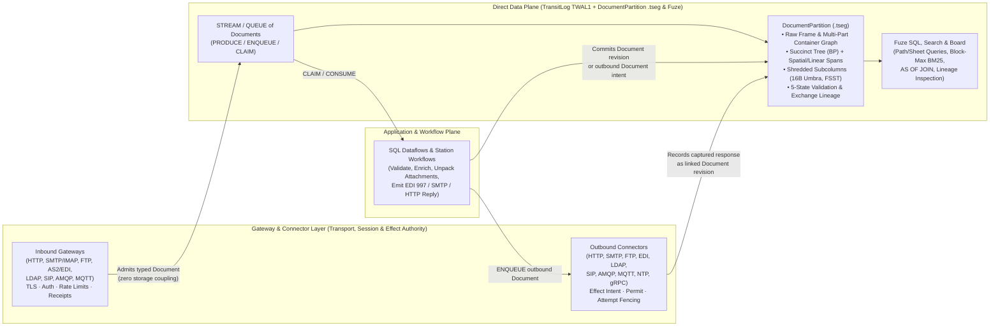

# 16. Document type library, protocol grammars and gateway exchange lifecycle

[Roadmap](README.md) · [Standards & Multi-Model #31](https://github.com/spoke-sh/transit/issues/31) · [Performance #76](https://github.com/spoke-sh/transit/issues/76) · **Status:** Planned

Deliver a declarative **library of Document types, application-protocol
grammars and compound office/publishing formats**—spanning structured/interchange
formats (`JSON`, `XML`, `EDI_X12`, `EDIFACT`, `HL7`), application and network
protocols (`HTTP`, `MIME`, `FTP`, `SMTP`, `IMAP`, `POP3`, `LDAP`, `SIP`/`SDP`,
`AMQP`, `MQTT`, `NTP`), and compound container/layout formats (`PDF`, `DOCX`,
`XLSX`, `ODF`)—powered by a shared suite of vectorized parsing, succinct-tree,
perfect-hashing, container-graph and path-shredding algorithms over
[`DocumentPartition`](07-document-storage-and-station-decoupling.md) (`.tseg`).
Unify **inbound gateway and outbound connector exchange capture**
([`SERVING_V1.md`](../../contracts/SERVING_V1.md) and
[`STATION_EXCHANGE_V1.md`](../../contracts/STATION_EXCHANGE_V1.md)) with the
native `Document` lifecycle and revision history while keeping transport/effect
authority and document storage strictly decoupled.

## Prerequisites and architectural rationale

Consume [transactions](05-transactions-and-atomic-composition.md),
[declarative streams, queues and durable runtime](06-streams-queues-and-durable-runtime.md),
[logical document storage and Station decoupling](07-document-storage-and-station-decoupling.md),
[gateway architecture, sans-I/O wire protocols and direct-plane ingress](08-gateway-architecture-and-protocol-ingress.md),
[standards, collations and historical catalogs](10-standards-and-catalogs.md),
[indexing](11-indexing-and-access-paths.md),
[analytical SQL and dataflows](12-sql-and-dataflows.md),
[zero-allocation slabs and buffer management](13-data-structures-and-performance.md),
[first-class strings, perfect hashing and vectorized search](14-vectorized-strings-and-search.md)
and [data-centric compilation and AOT specialization](15-data-centric-compilation-and-specialization.md).
Start from [Documents](../handbook/reference/documents.md),
[serving](../handbook/reference/serving.md),
[connectors](../handbook/reference/connectors.md),
[storage runtime](../handbook/internals/storage-runtime.md) and
[query engine](../handbook/internals/query-engine.md).

This milestone resolves three closely related architectural problems:

1. **One suite of data structures and algorithms for a comprehensive library of Document and Protocol workloads:**
   Applications ingest, validate, query and archive far more than JSON blobs:
   they process XML schemas (`XSD`/`RelaxNG`), EDI interchanges (`X12`
   `850`/`810`/`837`/`997`/`999`, `EDIFACT`, `HL7` in `EBCDIC` or `ASCII` with
   `COMP-3`/`ZONED` decimals), web and file transfers (`HTTP`, `MIME`, `FTP`),
   email and directory protocols (`SMTP`, `IMAP`, `POP3`, `LDAP`/`LDIF`),
   real-time signaling and messaging (`SIP`/`SDP`, `AMQP`, `MQTT`), precision
   time synchronization packets (`NTP`), and compound office/publishing
   documents (`PDF`, `DOCX`, `XLSX`, `ODF`). Instead of treating non-JSON formats
   as opaque binary blobs or maintaining isolated storage engines per protocol,
   every format is defined as a composable **Document Profile (Vectorized
   Lexer/Grammar + Container/Part Graph + Schema Binding)** that lowers into
   `DocumentPartition`'s shared `.tseg` succinct trees ($2N$-bit Balanced
   Parentheses `BP`), 16-byte Umbra/German collated subcolumns,
   `comptime`/segment-sealed perfect hash symbol tables and five-state (`value`,
   `null`, `missing`, `type_error`, `conflict`) span provenance.
2. **Compound Office & Publishing Formats (`PDF`, `DOCX`, `XLSX`, `ODF`) as Composed Document & Table Graphs:**
   OpenXML (`DOCX`, `XLSX`, `PPTX` — ECMA-376) and OpenDocument (`ODF` `ODT`,
   `ODS` — ISO 26300) are ZIP/OPC containers of linked `XML` documents, while
   `PDF` (ISO 32000) is a versioned Carousel Object System (`COS`) dictionary/stream
   graph with incremental `%%EOF` cross-reference (`xref`) revisions and page
   content streams. Because `DocumentPartition` natively models multi-part
   container graphs, succinct XML/object trees, `.dictionary` symbol tables and
   spatial/linear spans:
   - `DOCX` and `ODT` decompose directly into linked `XML` Document parts
     (`word/document.xml`, `content.xml`, `styles.xml`, `comments.xml`) over the
     existing vectorized XML scanner and `BP` succinct tree.
   - `XLSX` and `ODS` map their shared-string table (`xl/sharedStrings.xml`)
     directly into a **`.tseg` `.dictionary` symbol table**, exposing each
     worksheet simultaneously as a logical `Document` tree (preserving formulas
     `<f>`, styles and merged cells) and as a **five-state relational `Table`
     projection** where spreadsheet formula errors (`#REF!`, `#DIV/0!`,
     `#VALUE!`, `#NAME?`, `#N/A`) map natively to Transit's `type_error` cell
     state with `(sheet, cell_ref, formula)` provenance.
   - `PDF` maps its `COS` object graph and incremental `%%EOF` updates into
     `DocumentPartition`'s succinct tree and revision history while projecting
     page content streams (`BT ... Tj ET`), `/ToUnicode` CMaps, `/StructTreeRoot`
     tagged structures and `/AcroForm` fields through a deterministic **Spatial
     Layout & Span Segmenter** ($\kappa$) into queryable `(page_no, bbox, span)`
     records.
3. **Decoupling Gateways and Connectors from bespoke KV storage while unifying their exchange lifecycle and history with `Document`:**
   Previously, outbound HTTP/gRPC connectors
   ([`STATION_EXCHANGE_V1.md`](../../contracts/STATION_EXCHANGE_V1.md) /
   [`transit-exchange`](../../packages/zig/transit-exchange/README.md)) and
   inbound serving gateways
   ([`SERVING_V1.md`](../../contracts/SERVING_V1.md)) invented bespoke binary KV
   layouts (`EXF1`, `EXP1`, `EXB2`, `EXL1`/`EXL2`) over
   [`STATION_PUBLICATION_V1.md`](../../contracts/STATION_PUBLICATION_V1.md) to
   stage request/response chunks, SHA-256 coverage chains, preparation/transport
   failures and retry/redirect lineage. By separating **Transport, Session &
   Effect Authority** (owned by Gateways and Connectors in the *Process & Effect
   Plane*) from **Document Representation, Lineage & Queryability** (owned by
   `DocumentPartition` in the *Direct Data Plane*), gateways and connectors
   become thin protocol transducers that emit and consume typed `DOCUMENT`s (and
   `STREAM`s/`QUEUE`s of `DOCUMENT`s), while every `Document` profile remains
   100% constructible, transformable, branchable and queryable offline with zero
   gateway or network dependency.

## Library of Document types, protocols and compound formats

| Category & Profile | Logical Envelope, Container & Tree Grammar | Shared `.tseg` & `Fuze` Data Structures ($\tau \perp \kappa \perp \epsilon$) |
| --- | --- | --- |
| **Core Structured (`JSON`, `XML`)** | `JSON` objects/arrays; `XML` prolog, ordered elements, `@attr` attributes, namespace URI/prefix bindings, mixed text/element content, `JSON_SCHEMA` / `XSD` / `RelaxNG` | SIMD quote/brace and `<`/`>`/`&` structural bitmask scanners + segment-sealed perfect hash field/tag directories + $2N$-bit `BP` succinct tree + Region Algebra (`WITHIN`/`LCA`) + Dremel subcolumn shredding |
| **Web & File Transfer (`HTTP`, `MIME`, `FTP`)** | `HTTP` start-line (`method`/`target`/`status`), `ASCII_CI` multimap headers, chunked/multipart bodies, trailers, `SecretRef` redactions; `FTP` command/reply transcript (`USER`, `PASV`, `STOR`/`RETR`, `226`) + verified file transfer manifest | `comptime` perfect hash for RFC 9110 headers & FTP commands + `ASCII_CI` 16-byte Umbra/German header subcolumns + recursive `MIME` multipart `BP` tree + SHA-256 coverage chain + catalog dependency link to transferred payload |
| **Enterprise Interchange (`EDI_X12`, `EDIFACT`, `HL7`)** | Parameterized delimiters (`ISA`/`UNA`/`MSH` `*`, `:`, `^`, `~`), nested envelope & business loops (`ISA` $\to$ `GS` $\to$ `ST` $\to$ `850`/`810`/`837`/`997`/`999`), `EBCDIC` or `ASCII`, fixed-point decimals | Parameterized SIMD delimiter scanner + `comptime` perfect hash for X12/EDIFACT/HL7 segment & element IDs + `EBCDIC_CP037`/`ASCII` collations + `ZONED`/`COMP-3`/decimal codecs + shredded control numbers (`ISA13`, `GS06`, `ST02`) + 5-state `type_error` diagnostics |
| **Email & Mailboxes (`SMTP`, `IMAP`, `POP3`)** | `SMTP`/`POP3` command/reply transcripts (`EHLO`, `MAIL FROM`, `RCPT TO`, `DATA`, `RETR`); `IMAP` tagged commands, mailbox/UID/flags (`\Seen`, `\Flagged`) + `BODYSTRUCTURE`; `RFC 5322` envelope (`Message-ID`, `In-Reply-To`, `References`, `DKIM-Signature`) + `MIME` multipart tree & attachments | `ASCII_CI` `comptime` perfect-hashed `RFC 5322` headers + causal thread/conversation lineage graph (`Message-ID` $\to$ `In-Reply-To`/`References`) + `IMAP` flag Roaring bitmaps + child `part_ref` links to attached `PDF`/`DOCX`/`XLSX` Documents |
| **Directory Services (`LDAP` / `LDIF` / `X.500`)** | ASN.1 `BER` protocol PDUs (`Bind`, `SearchRequest`, `SearchResultEntry`, `Modify`, `LDIF` change records); hierarchical Distinguished Name (`DN: cn=...,ou=...,dc=...`) tree; OID/attribute schemas with `CaseIgnoreMatch`, `DistinguishedNameMatch`, `NumericStringMatch` | Zero-allocation ASN.1 `BER` TLV structural scanner + `comptime`/sealed perfect hash for OIDs & attribute names + reversed-DN hierarchy index + multi-valued `.tseg` attribute subcolumns bound to LDAP matching-rule collations ($\kappa$) |
| **Real-Time Signaling (`SIP` + `SDP`)** | `RFC 3261` request/response envelopes (`INVITE`, `180 Ringing`, `200 OK`, `ACK`, `BYE`), `Via`/`From`/`To`/`Call-ID`/`CSeq` dialog headers (`ASCII_CI`), plus `SDP` (`v=`, `o=`, `s=`, `c=`, `m=`, `a=`) media/codec descriptor subtrees | Dialog & transaction correlation lineage (`Call-ID`, `From-tag`, `To-tag`, `CSeq` branch) + shared HTTP/SIP header shredder + vectorized `SDP` line-type scanner |
| **Brokered & IoT Messaging (`AMQP`, `MQTT`)** | `AMQP 0-9-1 / 1.0` performative frames (`open`, `begin`, `attach`, `transfer`, `disposition`), typed binary properties & delivery tags; `MQTT v3.1.1 / v5.0` packets (`PUBLISH`, `SUBSCRIBE`, `PUBACK`/`PUBCOMP`), UTF-8 topic hierarchy (`a/b/c`), QoS `0`/`1`/`2`, retained flags, user properties | Binary frame/property descriptor scanner + hierarchical topic-segment trie with `+`/`#` wildcard bitmap intersection in `.tseg` + direct transactional bridge to Transit `STREAM` (`PRODUCE INTO`) and `QUEUE` (`ENQUEUE INTO` / `CLAIM` / `ACK`) |
| **Precision Time (`NTP` / `SNTP`)** | 48-byte (+ extension/MAC) packet: `LI`, `VN`, `Mode`, `Stratum`, `Poll`, `Precision`, `Root Delay`, `Root Dispersion`, `Reference ID`, and four 64-bit fixed-point timestamps (`Ref`, `Orig T1`, `Recv T2`, `Xmt T3`, local `Dst T4`) | Fixed-layout binary codec + 64-bit fixed-point arithmetic shredding clock offset $\theta = ((T_2 - T_1) + (T_3 - T_4))/2$ and round-trip delay $\delta = (T_4 - T_1) - (T_3 - T_2)$ into `.tseg` columns as verifiable clock-uncertainty provenance for `AS OF` and deadline audits |
| **Compound Office & Spreadsheets (`DOCX`, `XLSX`, `ODF`)** | ZIP/OPC (`[Content_Types].xml`, `_rels/.rels`) and ODF (`META-INF/manifest.xml`) package graphs; `DOCX`/`ODT` paragraph/run/table/comment XML parts; `XLSX`/`ODS` workbook, `sharedStrings.xml` (`<sst>`), styles and worksheet (`<row>`/`<c>`/`<f>`/`<v>`) XML parts | Bounded streaming ZIP/OPC container graph unpacker + shared `XML` `BP` succinct tree + `XLSX` `sharedStrings.xml` mapped directly to `.tseg` `.dictionary` symbol tables + dual `Document` and 5-state relational `Table` worksheet projection (`#REF!`/`#DIV/0!`/`#VALUE!` $\to$ `type_error` with cell/formula provenance) |
| **Publishing & Layout (`PDF` ISO 32000)** | Header, `xref` table/stream, `COS` object graph (`<< /Type /Page ... >>`, arrays, compressed `FlateDecode` streams), incremental `%%EOF` update generations, `/StructTreeRoot` tagged tree, `/AcroForm` fields, and page content streams (`BT ... Tj ET`, `/ToUnicode` CMaps) | Streaming `xref`/`COS` object-graph indexer + incremental `%%EOF` revision lineage + deterministic **Spatial Layout & Span Segmenter** ($\kappa$) projecting page content streams into `(page_no, bbox: [x0, y0, x1, y1], font_symbol, span)` columns for SQL and Block-Max BM25 / `NEAR` search |

## Delivery sequence

1. **Define the declarative Document Profile and Compound Container contract (`CREATE DOCUMENT ... AS <PROFILE>`).**
   Extend `DirectCatalog` and `DocumentPartition` so a `DOCUMENT` declaration (or
   `STREAM`/`QUEUE` of `DOCUMENT`s) binds an explicit, versioned **Document
   Profile** (`DefinitionId`):
   - **Orthogonal framing, container packaging, encoding and collation:** Declare
     wire/container framing (raw stream, delimiter-framed, ASN.1 `BER`, `ZIP`/`OPC`
     package, `PDF` `xref` container), character encoding (`UTF-8`, `ASCII`,
     `ISO-8859-1`, `EBCDIC_CP037`/`CP500`/`CP1047`) and default key/value
     collations ($\kappa$) independently of the logical tree/part grammar ($\tau$)
     and `.tseg` physical codecs ($\epsilon$).
   - **Composable multi-part container graphs:** Allow a parent `DOCUMENT` (such
     as an `SMTP`/`IMAP` email with a `MIME` tree, an `OPC`/`ZIP` archive for
     `DOCX`/`XLSX`/`ODF`, or a `PDF` with embedded files) to reference child
     parts as typed nodes (`part_ref`) within the same `DocumentPartition`
     snapshot, enforcing strict decompression-ratio, part-count and byte budgets
     via [Milestone 13's](13-data-structures-and-performance.md)
     `MeteredAllocator` to prevent zip-bomb or decompression-bomb amplification.
   - **Non-aborting five-state schema, grammar and formula validation:** Attach
     optional declarative schemas (`JSON_SCHEMA`, `XSD`, EDI implementation guide,
     LDAP OID schema, OpenAPI/HTTP contract, spreadsheet formula validator).
     Malformed fields, invalid EDI elements, corrupt ASN.1 tags or spreadsheet
     formula errors (`#DIV/0!`, `#REF!`, `#VALUE!`) record a `type_error` cell at
     that exact node/cell with `(part_id, byte_start, byte_end, rule_id)`
     provenance while keeping the envelope and valid sibling subtrees/rows
     queryable. Truncated outer frames remain explicitly marked in the lifecycle
     state (`unknown` / `incomplete_frame`), never published as complete.

2. **Implement the Structured, Web, Enterprise Interchange and Protocol Profiles (`JSON`, `XML`, `HTTP`/`MIME`, `FTP`, `EDI`, `SMTP`/`IMAP`/`POP3`, `LDAP`, `SIP`/`SDP`, `AMQP`, `MQTT`, `NTP`).**
   Build the protocol and interchange profiles in Zig over
   [`DocumentPartition`](07-document-storage-and-station-decoupling.md):
   - **`JSON` and `XML`:** Vectorized structural indexing, namespace dictionaries,
     `BP` succinct trees, Region Algebra containment (`WITHIN`/`LCA`) and
     automatic/declared subcolumn shredding.
   - **`HTTP`, `MIME`, `SMTP`, `IMAP` and `POP3`:** Shared `RFC 9110` / `RFC 5322`
     `ASCII_CI` header shredder with `comptime` perfect hashing, `MIME` multipart
     boundary scanner, `SMTP`/`POP3` command-reply transcript trees, `IMAP`
     UID/flag Roaring bitmaps and `BODYSTRUCTURE` trees, causal email threading
     (`Message-ID` $\to$ `In-Reply-To`/`References`), and first-class `SecretRef`
     redaction markers for credentials/tokens.
   - **`EDI` (`EDI_X12`, `EDIFACT`, `HL7`) and `FTP`:** Header-driven delimiter
     extraction (`ISA`/`UNA`/`MSH`), nested loop hierarchy state machines, native
     `EBCDIC` and `COMP-3`/`ZONED`/decimal decoding, functional acknowledgment
     (`997`/`999`) derivation from five-state validation diagnostics, and `FTP`
     control transcripts linked to verified file transfer manifests.
   - **`LDAP` (`BER` / `LDIF`) and `SIP` (`RFC 3261` + `SDP`):** Zero-allocation
     ASN.1 `BER` TLV scanner, OID and Distinguished Name (`DN`) hierarchical path
     indexing with LDAP collation matching rules (`CaseIgnoreMatch`,
     `DistinguishedNameMatch`), and `SIP` dialog/transaction state machines
     paired with `SDP` media descriptor trees.
   - **`AMQP`, `MQTT` and `NTP`:** Binary frame/performative and header scanners
     for `AMQP` and `MQTT` with hierarchical topic-trie / wildcard (`+`, `#`)
     bitmap indexing and native routing into Transit `STREAM`s and `QUEUE`s, plus
     fixed-layout `NTP` packet decoding that shreds 64-bit fixed-point timestamps
     `(T1, T2, T3, T4)`, stratum, root dispersion, clock offset $\theta$ and
     round-trip delay $\delta$ into `.tseg` columns as verifiable clock-bound
     evidence.

3. **Implement the Compound Office, Spreadsheet and Publishing Profiles (`DOCX`, `XLSX`, `ODF`, `PDF`) over `DocumentPartition`.**
   Layer compound document formats directly on top of the container, XML,
   dictionary and span primitives without external runtime dependencies:
   - **`DOCX` and `ODF` (`ODT` / `ODP`):** Unpack the `OPC`/`ODF` relationship
     graph (`_rels/.rels`, `META-INF/manifest.xml`) in streaming chunks and index
     `word/document.xml` / `content.xml`, `styles.xml`, `numbering.xml` and
     `comments.xml` as linked `XML` succinct trees, exposing structural
     sections, headings, paragraphs, runs, embedded tables, revision tracked
     changes (`<w:ins>` / `<w:del>`) and comments to `Fuze` SQL and search.
   - **`XLSX` and `ODS` Spreadsheets:** Map `xl/sharedStrings.xml` directly into
     a `.tseg` `.dictionary` symbol table and parse `xl/worksheets/sheet*.xml`
     into both the logical `Document` tree and a **five-state relational `Table`
     view** (`SELECT * FROM DOCUMENT_TABLE(workbook_doc, SHEET => 'BalanceSheet')`),
     preserving numeric/date types, formula strings, cell coordinates and
     five-state `type_error` cells for spreadsheet formula errors.
   - **`PDF` (`ISO 32000`):** Parse `xref` tables/streams, trailers and
     incremental `%%EOF` updates into `DocumentPartition`'s revision lineage;
     index the `COS` dictionary/array/stream graph (bounded `FlateDecode`
     decompression inside `scratch` slabs); and project `/Type /Page` content
     streams, `/ToUnicode` font maps, `/StructTreeRoot` tagged structures and
     `/AcroForm` fields through a deterministic **Spatial Layout & Span
     Segmenter** ($\kappa$) into addressable `(page_no, bbox, span)` columns.

4. **Build the shared suite of zero-allocation SIMD structural scanners and `transit-app` AOT grammar specialization.**
   Apply the execution rules from
   [Milestone 13](13-data-structures-and-performance.md),
   [Milestone 14](14-vectorized-strings-and-search.md) and
   [Milestone 15](15-data-centric-compilation-and-specialization.md):
   - **Vectorized structural bitmask and TLV scanners:** Scan raw frames in
     64-byte cache-line blocks using `@Vector` SIMD instructions for quote/escape
     masks, XML `<`/`>`/`&` boundaries, HTTP/SMTP/SIP `CRLF` headers, EDI
     segment/element terminators, and ASN.1 `BER` / binary frame headers over
     swizzled LeanStore/Umbra buffer slabs with zero steady-state heap
     allocations after warmup.
   - **`comptime` and segment-sealed perfect hash vocabularies:** Use
     [Milestone 14's](14-vectorized-strings-and-search.md) greedy association-table
     perfect hashing with 16-byte SIMD comparisons for closed protocol and
     document vocabularies (`HTTP`/`SMTP`/`SIP` headers, `XML`/`DOCX`/`XLSX`
     schema tags, `EDI` X12/EDIFACT segment IDs, `LDAP` OIDs, `PDF` dictionary
     `/Name` keys) at `comptime`, and seal per-segment perfect hash directories
     for custom document keys at `.tseg` flush time.
   - **Ahead-of-Time (`transit-app`) grammar & shredder compilation:** Extend
     [Milestone 15's](15-data-centric-compilation-and-specialization.md) AOT Zig
     compiler so declared XML/OOXML schemas, EDI transaction-set guides, LDAP
     schemas or protocol contracts compile ahead of time into branchless Zig
     state machines and `.tseg` subcolumn shredders.

5. **Formalize the transport-independent Document Lifecycle, Revision Lineage and Gateway/Connector Exchange Cutover.**
   Unify the document lifecycle and causal history across offline documents,
   inbound gateways and outbound connectors while keeping the **Gateway/Connector
   Layer** and **`DocumentPartition`** strictly decoupled:
   - **Transport-independent lifecycle states & causal lineage graph:** Every
     Document tracks its lifecycle (`preparing`, `ready`, `capturing`,
     `complete`, `validated`, `acknowledged`, `unknown`, `retired`) and indexed
     causal lineage edges (`initial`, `edit`, `merge`, `retry`, `redirect`,
     `reconcile`, `cancel`, `response_to`, `functional_ack`, `email_reply`,
     `sip_dialog_step`, `pdf_incremental_eof`, `attachment_of`) as `.tseg`
     subcolumns supporting $O(1)$ hop traversal in SQL.
   - **Clean Plane Separation (`Gateway / Connector` $\perp$ `DocumentPartition`):**
     - **Gateways and Connectors own Transport, Session & Effect Authority:**
       TLS/socket lifecycle, authentication, rate/byte budgets, live flow
       control, secret resolution, and—for outbound connectors—pre-dispatch
       **Effect Intent, Permit Authorization and Unknown-Outcome Fencing**
       ([`connectors.md`](../handbook/reference/connectors.md)).
     - **`DocumentPartition` owns Representation, Staging, Lineage & Queryability:**
       `DocumentPartition` has zero dependency on sockets, TLS or network
       protocols; Gateways and Connectors simply stage and commit typed
       `DOCUMENT` revisions (or `PRODUCE`/`ENQUEUE` into `STREAM`/`QUEUE` of
       `DOCUMENT`s).
   - **Outbound connector cutover (`STATION_EXCHANGE_V1` $\to$ `DOCUMENT`):**
     Migrate [`transit-station-http`](../../packages/zig/transit-station-http/README.md),
     [`transit-station-grpc`](../../packages/zig/transit-station-grpc/README.md)
     and outbound protocol connectors (`SMTP`, `FTP`, `EDI`, `LDAP`, `SIP`,
     `AMQP`, `MQTT`, `NTP`) to record requests, streaming responses, preparation
     failures (replacing `EXP1`), capture/transport failures (replacing `EXF1`),
     attempt budgets (replacing `EXB2`) and follow-up redirects/retries (replacing
     `EXL1`/`EXL2`) as linked `DOCUMENT` revisions in `DocumentPartition`,
     retiring [`STATION_EXCHANGE_V1.md`](../../contracts/STATION_EXCHANGE_V1.md)
     while preserving pre-dispatch effect fencing, `SecretRef` redaction,
     unknown-outcome preservation, network-free replay and caller/consumer
     retirement holds.
   - **Inbound gateway integration ([`transit-serving`](../../packages/zig/transit-serving/docs/compatibility.md) and protocol listeners):**
     Allow inbound gateways (`HTTP`, `SMTP`/`IMAP`, `FTP`, `AS2`/`EDI`, `LDAP`,
     `SIP`, `AMQP`, `MQTT`) to admit wire envelopes into declared `DOCUMENT`
     collections, `STREAM`s or `QUEUE`s with idempotent receipts and
     transactionally linked response `DOCUMENT`s.

6. **Expose unified SQL, structural/spatial search, spreadsheet relational views and Board inspection.**
   Make every Document Profile, compound office document and captured exchange a
   first-class citizen of `Fuze` SQL, search and [Board](29-board-reimplementation.md):
   - Query shredded paths, `LDAP` DN subtrees, `MQTT` topic wildcards, `NTP`
     clock-offset/uncertainty bounds, `XLSX`/`ODS` spreadsheet tables and `PDF`
     spatial/page spans through standard `Fuze` SQL (`SELECT`, `WHERE`,
     `GROUP BY`, [Milestone 12](12-sql-and-dataflows.md) `AS OF JOIN`), five-state
     predicates (`IS MISSING`, `IS TYPE_ERROR`, `IS CONFLICT`) and byte/bbox
     provenance functions.
   - Compose [Milestone 14's](14-vectorized-strings-and-search.md) vectorized
     256-document Block-Max BM25 and structural/spatial `NEAR` / `WITHIN`
     operators across `XML`, `DOCX`, `ODF`, `PDF`, `HTTP`, `SMTP`/`MIME` and
     `EDI` documents under a single pinned `SnapshotId` and `policy_epoch`.
   - Replace bespoke exchange-only inspection RPCs with unified read-only Board
     and SQL views over `DOCUMENT` lineage, container part graphs, five-state
     validation/formula errors and effect/capture diagnostics, rechecking current
     `policy_epoch` grants on every disclosure.

## Candidate structures and selection evidence

| Work and candidate | Evidence required before selection |
| --- | --- |
| SIMD structural, delimiter and TLV scanners (`JSON`, `XML`, `HTTP`/`SMTP`/`SIP`, parameterized `EDI`, ASN.1 `BER`) | GB/s throughput on 1 KiB–100 MiB inputs across UTF-8 and EBCDIC, zero steady-state heap allocations after warmup, 4 KiB page-boundary safety, and byte-exact span/error equivalence with scalar reference parsers |
| `comptime` and segment-sealed perfect hash vocabularies (`HTTP`/`SMTP`/`SIP` headers, `XML`/`OOXML` tags, `EDI` segment IDs, `LDAP` OIDs, `PDF` `/Name` keys) | Lookup latency in cycles/ns vs. `std.mem.eql` / runtime hash maps, `comptime` construction time, collision-free verification and non-member rejection |
| Streaming `ZIP`/`OPC` (`DOCX`, `XLSX`, `ODF`) and `PDF` `xref`/`COS` container-graph unpackers | Decompression-bomb / zip-bomb quota enforcement under `MeteredAllocator`, zero-copy `.dictionary` reuse on `XLSX` `sharedStrings.xml`, `PDF` incremental `%%EOF` revision fidelity, and spatial/cell provenance accuracy |
| Unified `DOCUMENT`-backed connector/gateway capture replacing `STATION_EXCHANGE_V1` (`EXF1`/`EXP1`/`EXB2`/`EXL2`) | Single-round-trip staging/seal cost vs. 4-mutation KV turns, SHA-256 coverage verification, zero credential leakage (`SecretRef`), exact `unknown`/failure diagnostic preservation across crash/restart, and query latency over 100k captured exchanges |

## Completion evidence

Require executable proof through real SQL, typed callers, gateways and
connectors in the [proof ledger](../history/qualification/README.md):

- **Multi-format Document & Protocol Library correctness and five-state provenance:**
  Ingest, validate and query representative documents across all supported
  profiles: `JSON`, `XML`, `HTTP`/`MIME`, `FTP`, `EDI` (`X12` `850`/`810`/`997`
  and `EDIFACT` in `UTF-8`/`ASCII` and `EBCDIC_CP037` with `COMP-3`/`ZONED`
  decimals), `SMTP`/`IMAP`/`POP3` (with `RFC 5322` threading and `MIME`
  attachments), `LDAP`/`LDIF` (with `DN` hierarchy and matching-rule collations),
  `SIP`/`SDP` dialogs, `AMQP`/`MQTT` frames/topics, and `NTP` packets (verifying
  64-bit fixed-point offset $\theta$ and round-trip delay $\delta$ computation).
  Verify that malformed fields/segments/tags surface as `IS TYPE_ERROR` with
  exact `(part_id, byte_start, byte_end, rule_id)` provenance while valid
  envelope and sibling paths remain queryable, and that truncated frames record
  `unknown` / `incomplete_frame` without publishing partial data as complete.
- **Compound Office, Spreadsheet and PDF container/layout fidelity:**
  Ingest multi-part `DOCX`, `ODF` (`ODT`/`ODS`), `XLSX` and `PDF` (including
  incremental `%%EOF` revisions and tagged/form structures) into
  `DocumentPartition`. Verify that decompression-bomb inputs deterministically
  trip `MeteredAllocator` quotas without OOM; that `XLSX` worksheets query
  identically through `DOCUMENT_TABLE(...)` and reference spreadsheet oracles
  while surfacing `#REF!`/`#DIV/0!`/`#VALUE!` cells as `IS TYPE_ERROR` with
  formula provenance; and that an `SMTP`/`IMAP` email containing a `MIME`-attached
  `PDF` invoice and `XLSX` statement can be joined in one SQL query across
  envelope headers, `PDF` page spans and `XLSX` rows.
- **Offline independence from Gateways and Connectors:** Prove that all Document
  Profiles (`JSON`, `XML`, `HTTP`, `FTP`, `EDI`, `SMTP`/`IMAP`/`POP3`, `LDAP`,
  `SIP`, `AMQP`, `MQTT`, `NTP`, `PDF`, `DOCX`, `XLSX`, `ODF`) can be declared,
  constructed, validated, mutated, branched, searched and queried in SQL and
  typed clients with zero running gateway or connector processes.
- **Gateway and Connector exchange capture cutover and fault recovery:**
  Execute the full connector and gateway fault schedules (preparation failure,
  body/container budget refusal, invalid header/target, credential-reference
  policy denial, worker crash before/after dispatch, truncated stream,
  redirect/retry followup budgets, caller/consumer holds, credential rotation
  and retirement) over `DocumentPartition`, verifying removal of
  `STATION_EXCHANGE_V1` KV state while preserving every safety, unknown-outcome,
  `SecretRef` redaction and network-free replay guarantee.

## Later owners and execution gates

- [Geospatial and spatio-temporal computing](17-geospatial-and-spatio-temporal-computing.md)
  shares the `BBOX2D` / `GEOMETRY(SRID 0)` representation and 2D interval/R-tree
  operators with `PDF` `(page_no, bbox, span)` layout spans, `GeoJSON` and
  `GML`/`KML` XML profiles.
- [Multi-model and multi-format foreign relations](18-multi-model-and-foreign-relations.md)
  composes these Document Profiles with property-graph (`SQL/PGQ`) projections,
  Worst-Case Optimal Joins (`WCOJ`), vector/hybrid ANN search, external
  `FOREIGN TABLE` / `COPY` datasets (`PARQUET`/`GeoParquet`, `ARROW_IPC`, `CSV`, mainframe
  `FB`/`VB` copybooks) and streaming CDC ingress.
- [Branches, merges and restore](19-branches-merges-and-restore.md) extends
  zero-copy manifest branching and three-way structural/causal merging across
  all Document Profiles while keeping external effects disabled on branches by
  default.
- [Board reimplementation](29-board-reimplementation.md) presents structured
  Document trees, container part graphs, spreadsheet/PDF previews, raw-frame
  byte provenance, five-state validation errors and exchange lineage graphs
  through read-only public queries.
- [Recorded outbound MCP](32-recorded-mcp-integrations.md) reuses this
  `DOCUMENT`-backed exchange capture and lineage model for governed agent tool
  and MCP interactions.
