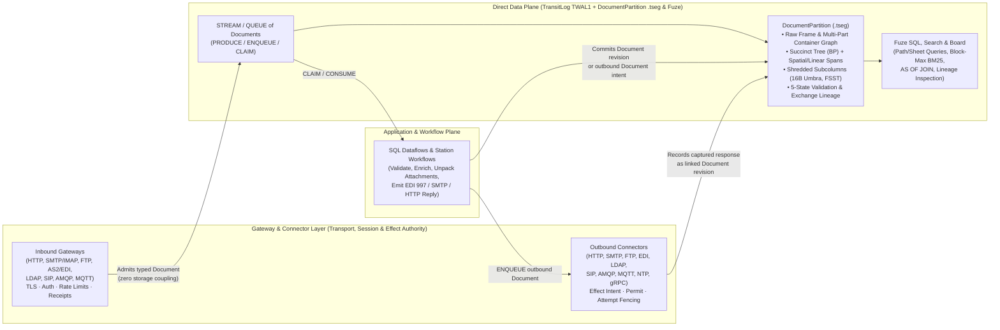

# 16. Document type library, protocol grammars and gateway exchange lifecycle

[Roadmap](README.md) · [Standards & Multi-Model #31](https://github.com/spoke-sh/transit/issues/31) · [Performance #76](https://github.com/spoke-sh/transit/issues/76) · **Status:** In Progress ([implementation plan](#implementation-plan--2026-11-02))

Deliver a declarative **library of Document types, application-protocol
grammars and compound office/publishing formats**—spanning structured/interchange
formats (`JSON`, `XML`, `EDI_X12`, `EDIFACT`, `HL7`), application and network
protocols (`HTTP`, `MIME`, `FTP`, `SMTP`, `IMAP`, `POP3`, `LDAP`, `SIP`/`SDP`,
`AMQP`, `MQTT`, `NTP`), and compound container/layout formats (`PDF`, `DOCX`,
`XLSX`, `ODF`)—powered by a shared suite of vectorized parsing, succinct-tree,
perfect-hashing, container-graph and path-shredding algorithms over
[`DocumentPartition`](07-document-storage-and-station-decoupling.md) (`.tseg`).
Unify **inbound gateway and outbound connector exchange capture**
([`SERVING_V1.md`](../../contracts/SERVING_V1.md) and
[`STATION_EXCHANGE_V1.md`](../../contracts/STATION_EXCHANGE_V1.md)) with the
native `Document` lifecycle and revision history while keeping transport/effect
authority and document storage strictly decoupled.

## Prerequisites and architectural rationale

Consume [transactions](05-transactions-and-atomic-composition.md),
[declarative streams, queues and durable runtime](06-streams-queues-and-durable-runtime.md),
[logical document storage and Station decoupling](07-document-storage-and-station-decoupling.md),
[gateway architecture, sans-I/O wire protocols and direct-plane ingress](08-gateway-architecture-and-protocol-ingress.md),
[standards, collations and historical catalogs](10-standards-and-catalogs.md),
[indexing](11-indexing-and-access-paths.md),
[analytical SQL and dataflows](12-sql-and-dataflows.md),
[zero-allocation slabs and buffer management](13-data-structures-and-performance.md),
[first-class strings, perfect hashing and vectorized search](14-vectorized-strings-and-search.md)
and [data-centric compilation and AOT specialization](15-data-centric-compilation-and-specialization.md).
Start from [Documents](../handbook/reference/documents.md),
[serving](../handbook/reference/serving.md),
[connectors](../handbook/reference/connectors.md),
[storage runtime](../handbook/internals/storage-runtime.md) and
[query engine](../handbook/internals/query-engine.md).

This milestone resolves three closely related architectural problems:

1. **One suite of data structures and algorithms for a comprehensive library of Document and Protocol workloads:**
   Applications ingest, validate, query and archive far more than JSON blobs:
   they process XML schemas (`XSD`/`RelaxNG`), EDI interchanges (`X12`
   `850`/`810`/`837`/`997`/`999`, `EDIFACT`, `HL7` in `EBCDIC` or `ASCII` with
   `COMP-3`/`ZONED` decimals), web and file transfers (`HTTP`, `MIME`, `FTP`),
   email and directory protocols (`SMTP`, `IMAP`, `POP3`, `LDAP`/`LDIF`),
   real-time signaling and messaging (`SIP`/`SDP`, `AMQP`, `MQTT`), precision
   time synchronization packets (`NTP`), and compound office/publishing
   documents (`PDF`, `DOCX`, `XLSX`, `ODF`). Instead of treating non-JSON formats
   as opaque binary blobs or maintaining isolated storage engines per protocol,
   every format is defined as a composable **Document Profile (Vectorized
   Lexer/Grammar + Container/Part Graph + Schema Binding)** that lowers into
   `DocumentPartition`'s shared `.tseg` succinct trees ($2N$-bit Balanced
   Parentheses `BP`), 16-byte Umbra/German collated subcolumns,
   `comptime`/segment-sealed perfect hash symbol tables and five-state (`value`,
   `null`, `missing`, `type_error`, `conflict`) span provenance.
2. **Compound Office & Publishing Formats (`PDF`, `DOCX`, `XLSX`, `ODF`) as Composed Document & Table Graphs:**
   OpenXML (`DOCX`, `XLSX`, `PPTX` — ECMA-376) and OpenDocument (`ODF` `ODT`,
   `ODS` — ISO 26300) are ZIP/OPC containers of linked `XML` documents, while
   `PDF` (ISO 32000) is a versioned Carousel Object System (`COS`) dictionary/stream
   graph with incremental `%%EOF` cross-reference (`xref`) revisions and page
   content streams. The target `DocumentPartition` model provides multi-part
   container graphs, succinct XML/object trees, `.dictionary` symbol tables and
   spatial/linear spans; the profile implementations will compose them as follows:
   - `DOCX` and `ODT` decompose directly into linked `XML` Document parts
     (`word/document.xml`, `content.xml`, `styles.xml`, `comments.xml`) over the
     shared XML scanner and `BP` succinct tree.
   - `XLSX` and `ODS` lower worksheet strings (including XLSX's
     `xl/sharedStrings.xml`) into **`.tseg` `.dictionary` symbol tables**, exposing each
     worksheet simultaneously as a logical `Document` tree (preserving formulas
     `<f>`, styles and merged cells) and as a **five-state relational `Table`
     projection** where spreadsheet formula errors (`#REF!`, `#DIV/0!`,
     `#VALUE!`, `#NAME?`, `#N/A`) map natively to Transit's `type_error` cell
     state with `(sheet, cell_ref, formula)` provenance.
   - `PDF` maps its `COS` object graph and incremental `%%EOF` updates into
     `DocumentPartition`'s succinct tree and revision history while projecting
     page content streams (`BT ... Tj ET`), `/ToUnicode` CMaps, `/StructTreeRoot`
     tagged structures and `/AcroForm` fields through a deterministic **Spatial
     Layout & Span Segmenter** ($\kappa$) into queryable `(page_no, bbox, span)`
     records.
3. **Decoupling Gateways and Connectors from bespoke KV storage while unifying their exchange lifecycle and history with `Document`:**
   Today, outbound HTTP/gRPC connectors
   ([`STATION_EXCHANGE_V1.md`](../../contracts/STATION_EXCHANGE_V1.md) /
   [`transit-exchange`](../../packages/zig/transit-exchange/README.md)) use binary
   KV layouts (`EXF1`, `EXP1`, `EXB2`, `EXL1`/`EXL2`) over
   [`STATION_PUBLICATION_V1.md`](../../contracts/STATION_PUBLICATION_V1.md) for
   request/response chunks, SHA-256 coverage chains, preparation/transport
   failures and retry/redirect lineage. Inbound serving separately uses `SV1`
   admission, routing and outcome records under
   [`SERVING_V1.md`](../../contracts/SERVING_V1.md); it is not already an Exchange
   capture adapter. By separating **Transport, Session &
   Effect Authority** (owned by Gateways and Connectors in the *Process & Effect
   Plane*) from **Document Representation, Lineage & Queryability** (owned by
   `DocumentPartition` in the *Direct Data Plane*), gateways and connectors
   become thin protocol transducers that emit and consume typed `DOCUMENT`s (and
   `STREAM`s/`QUEUE`s of `DOCUMENT`s), while every `Document` profile remains
   100% constructible, transformable, branchable and queryable offline with zero
   gateway or network dependency.

## Library of Document types, protocols and compound formats

| Category & Profile | Logical Envelope, Container & Tree Grammar | Shared `.tseg` & `Fuze` Data Structures ($\tau \perp \kappa \perp \epsilon$) |
| --- | --- | --- |
| **Core Structured (`JSON`, `XML`)** | `JSON` objects/arrays; `XML` prolog, ordered elements, `@attr` attributes, namespace URI/prefix bindings, mixed text/element content, `JSON_SCHEMA` / `XSD` / `RelaxNG` | SIMD quote/brace and `<`/`>`/`&` structural bitmask scanners + segment-sealed perfect hash field/tag directories + $2N$-bit `BP` succinct tree + Region Algebra (`WITHIN`/`LCA`) + Dremel subcolumn shredding |
| **Web & File Transfer (`HTTP`, `MIME`, `FTP`)** | `HTTP` start-line (`method`/`target`/`status`), `ASCII_CI` multimap headers, chunked/multipart bodies, trailers, `SecretRef` redactions; `FTP` command/reply transcript (`USER`, `PASV`, `STOR`/`RETR`, `226`) + verified file transfer manifest | `comptime` perfect hash for RFC 9110 headers & FTP commands + `ASCII_CI` 16-byte Umbra/German header subcolumns + recursive `MIME` multipart `BP` tree + SHA-256 coverage chain + catalog dependency link to transferred payload |
| **Enterprise Interchange (`EDI_X12`, `EDIFACT`, `HL7`)** | Parameterized delimiters (`ISA`/`UNA`/`MSH` `*`, `:`, `^`, `~`), nested envelope & business loops (`ISA` $\to$ `GS` $\to$ `ST` $\to$ `850`/`810`/`837`/`997`/`999`), `EBCDIC` or `ASCII`, fixed-point decimals | Parameterized SIMD delimiter scanner + `comptime` perfect hash for X12/EDIFACT/HL7 segment & element IDs + `EBCDIC_CP037`/`ASCII` collations + `ZONED`/`COMP-3`/decimal codecs + shredded control numbers (`ISA13`, `GS06`, `ST02`) + 5-state `type_error` diagnostics |
| **Email & Mailboxes (`SMTP`, `IMAP`, `POP3`)** | `SMTP`/`POP3` command/reply transcripts (`EHLO`, `MAIL FROM`, `RCPT TO`, `DATA`, `RETR`); `IMAP` tagged commands, mailbox/UID/flags (`\Seen`, `\Flagged`) + `BODYSTRUCTURE`; `RFC 5322` envelope (`Message-ID`, `In-Reply-To`, `References`, `DKIM-Signature`) + `MIME` multipart tree & attachments | `ASCII_CI` `comptime` perfect-hashed `RFC 5322` headers + causal thread/conversation lineage graph (`Message-ID` $\to$ `In-Reply-To`/`References`) + `IMAP` flag Roaring bitmaps + child `part_ref` links to attached `PDF`/`DOCX`/`XLSX` Documents |
| **Directory Services (`LDAP` / `LDIF` / `X.500`)** | ASN.1 `BER` protocol PDUs (`Bind`, `SearchRequest`, `SearchResultEntry`, `Modify`, `LDIF` change records); hierarchical Distinguished Name (`DN: cn=...,ou=...,dc=...`) tree; OID/attribute schemas with `CaseIgnoreMatch`, `DistinguishedNameMatch`, `NumericStringMatch` | Zero-allocation ASN.1 `BER` TLV structural scanner + `comptime`/sealed perfect hash for OIDs & attribute names + reversed-DN hierarchy index + multi-valued `.tseg` attribute subcolumns bound to LDAP matching-rule collations ($\kappa$) |
| **Real-Time Signaling (`SIP` + `SDP`)** | `RFC 3261` request/response envelopes (`INVITE`, `180 Ringing`, `200 OK`, `ACK`, `BYE`), `Via`/`From`/`To`/`Call-ID`/`CSeq` dialog headers (`ASCII_CI`), plus `SDP` (`v=`, `o=`, `s=`, `c=`, `m=`, `a=`) media/codec descriptor subtrees | Dialog & transaction correlation lineage (`Call-ID`, `From-tag`, `To-tag`, `CSeq` branch) + shared HTTP/SIP header shredder + vectorized `SDP` line-type scanner |
| **Brokered & IoT Messaging (`AMQP`, `MQTT`)** | `AMQP 0-9-1 / 1.0` performative frames (`open`, `begin`, `attach`, `transfer`, `disposition`), typed binary properties & delivery tags; `MQTT v3.1.1 / v5.0` packets (`PUBLISH`, `SUBSCRIBE`, `PUBACK`/`PUBCOMP`), UTF-8 topic hierarchy (`a/b/c`), QoS `0`/`1`/`2`, retained flags, user properties | Binary frame/property descriptor scanner + hierarchical topic-segment trie with `+`/`#` wildcard bitmap intersection in `.tseg` + direct transactional bridge to Transit `STREAM` (`PRODUCE INTO`) and `QUEUE` (`ENQUEUE INTO` / `CLAIM` / `ACK`) |
| **Precision Time (`NTP` / `SNTP`)** | 48-byte (+ extension/MAC) packet: `LI`, `VN`, `Mode`, `Stratum`, `Poll`, `Precision`, `Root Delay`, `Root Dispersion`, `Reference ID`, and four 64-bit fixed-point timestamps (`Ref`, `Orig T1`, `Recv T2`, `Xmt T3`, local `Dst T4`) | Fixed-layout binary codec + 64-bit fixed-point arithmetic shredding clock offset $\theta = ((T_2 - T_1) + (T_3 - T_4))/2$ and round-trip delay $\delta = (T_4 - T_1) - (T_3 - T_2)$ into `.tseg` columns as verifiable clock-uncertainty provenance for `AS OF` and deadline audits |
| **Compound Office & Spreadsheets (`DOCX`, `XLSX`, `ODF`)** | ZIP/OPC (`[Content_Types].xml`, `_rels/.rels`) and ODF (`META-INF/manifest.xml`) package graphs; `DOCX`/`ODT` paragraph/run/table/comment XML parts; `XLSX`/`ODS` workbook, `sharedStrings.xml` (`<sst>`), styles and worksheet (`<row>`/`<c>`/`<f>`/`<v>`) XML parts | Bounded streaming ZIP/OPC container graph unpacker + shared `XML` `BP` succinct tree + `XLSX` `sharedStrings.xml` mapped directly to `.tseg` `.dictionary` symbol tables + dual `Document` and 5-state relational `Table` worksheet projection (`#REF!`/`#DIV/0!`/`#VALUE!` $\to$ `type_error` with cell/formula provenance) |
| **Publishing & Layout (`PDF` ISO 32000)** | Header, `xref` table/stream, `COS` object graph (`<< /Type /Page ... >>`, arrays, compressed `FlateDecode` streams), incremental `%%EOF` update generations, `/StructTreeRoot` tagged tree, `/AcroForm` fields, and page content streams (`BT ... Tj ET`, `/ToUnicode` CMaps) | Streaming `xref`/`COS` object-graph indexer + incremental `%%EOF` revision lineage + deterministic **Spatial Layout & Span Segmenter** ($\kappa$) projecting page content streams into `(page_no, bbox: [x0, y0, x1, y1], font_symbol, span)` columns for SQL and Block-Max BM25 / `NEAR` search |

## Delivery sequence

1. **Define the declarative Document Profile and Compound Container contract (`CREATE DOCUMENT ... AS <PROFILE>`).**
   Extend `DirectCatalog` and `DocumentPartition` so a `DOCUMENT` declaration (or
   `STREAM`/`QUEUE` of `DOCUMENT`s) binds an explicit, versioned **Document
   Profile** (`DefinitionId`):
   - **Orthogonal framing, container packaging, encoding and collation:** Declare
     wire/container framing (raw stream, delimiter-framed, ASN.1 `BER`, `ZIP`/`OPC`
     package, `PDF` `xref` container), character encoding (`UTF-8`, `ASCII`,
     `ISO-8859-1`, `EBCDIC_CP037`/`CP500`/`CP1047`) and default key/value
     collations ($\kappa$) independently of the logical tree/part grammar ($\tau$)
     and `.tseg` physical codecs ($\epsilon$).
   - **Composable multi-part container graphs:** Allow a parent `DOCUMENT` (such
     as an `SMTP`/`IMAP` email with a `MIME` tree, an `OPC`/`ZIP` archive for
     `DOCX`/`XLSX`/`ODF`, or a `PDF` with embedded files) to reference child
     parts as typed nodes (`part_ref`) within the same `DocumentPartition`
     snapshot, enforcing strict decompression-ratio, part-count and byte budgets
     via [Milestone 13's](13-data-structures-and-performance.md)
     `MeteredAllocator` to prevent zip-bomb or decompression-bomb amplification.
   - **Non-aborting five-state schema, grammar and formula validation:** Attach
     optional declarative schemas (`JSON_SCHEMA`, `XSD`, EDI implementation guide,
     LDAP OID schema, OpenAPI/HTTP contract, spreadsheet formula validator).
     Malformed fields, invalid EDI elements, corrupt ASN.1 tags or spreadsheet
     formula errors (`#DIV/0!`, `#REF!`, `#VALUE!`) record a `type_error` cell at
     that exact node/cell with `(part_id, byte_start, byte_end, rule_id)`
     provenance while keeping the envelope and valid sibling subtrees/rows
     queryable. Truncated outer frames remain explicitly marked in the lifecycle
     state (`unknown` / `incomplete_frame`), never published as complete.

2. **Implement the Structured, Web, Enterprise Interchange and Protocol Profiles (`JSON`, `XML`, `HTTP`/`MIME`, `FTP`, `EDI`, `SMTP`/`IMAP`/`POP3`, `LDAP`, `SIP`/`SDP`, `AMQP`, `MQTT`, `NTP`).**
   Build the protocol and interchange profiles in Zig over
   [`DocumentPartition`](07-document-storage-and-station-decoupling.md):
   - **`JSON` and `XML`:** Vectorized structural indexing, namespace dictionaries,
     `BP` succinct trees, Region Algebra containment (`WITHIN`/`LCA`) and
     automatic/declared subcolumn shredding.
   - **`HTTP`, `MIME`, `SMTP`, `IMAP` and `POP3`:** Shared `RFC 9110` / `RFC 5322`
     `ASCII_CI` header shredder with `comptime` perfect hashing, `MIME` multipart
     boundary scanner, `SMTP`/`POP3` command-reply transcript trees, `IMAP`
     UID/flag Roaring bitmaps and `BODYSTRUCTURE` trees, causal email threading
     (`Message-ID` $\to$ `In-Reply-To`/`References`), and first-class `SecretRef`
     redaction markers for credentials/tokens.
   - **`EDI` (`EDI_X12`, `EDIFACT`, `HL7`) and `FTP`:** Header-driven delimiter
     extraction (`ISA`/`UNA`/`MSH`), nested loop hierarchy state machines, native
     `EBCDIC` and `COMP-3`/`ZONED`/decimal decoding, functional acknowledgment
     (`997`/`999`) derivation from five-state validation diagnostics, and `FTP`
     control transcripts linked to verified file transfer manifests.
   - **`LDAP` (`BER` / `LDIF`) and `SIP` (`RFC 3261` + `SDP`):** Zero-allocation
     ASN.1 `BER` TLV scanner, OID and Distinguished Name (`DN`) hierarchical path
     indexing with LDAP collation matching rules (`CaseIgnoreMatch`,
     `DistinguishedNameMatch`), and `SIP` dialog/transaction state machines
     paired with `SDP` media descriptor trees.
   - **`AMQP`, `MQTT` and `NTP`:** Binary frame/performative and header scanners
     for `AMQP` and `MQTT` with hierarchical topic-trie / wildcard (`+`, `#`)
     bitmap indexing and native routing into Transit `STREAM`s and `QUEUE`s, plus
     fixed-layout `NTP` packet decoding that shreds 64-bit fixed-point timestamps
     `(T1, T2, T3, T4)`, stratum, root dispersion, clock offset $\theta$ and
     round-trip delay $\delta$ into `.tseg` columns as verifiable clock-bound
     evidence.

3. **Implement the Compound Office, Spreadsheet and Publishing Profiles (`DOCX`, `XLSX`, `ODF`, `PDF`) over `DocumentPartition`.**
   Layer compound document formats directly on top of the container, XML,
   dictionary and span primitives without external runtime dependencies:
   - **`DOCX` and `ODF` (`ODT` / `ODP`):** Unpack the `OPC`/`ODF` relationship
     graph (`_rels/.rels`, `META-INF/manifest.xml`) in streaming chunks and index
     `word/document.xml` / `content.xml`, `styles.xml`, `numbering.xml` and
     `comments.xml` as linked `XML` succinct trees, exposing structural
     sections, headings, paragraphs, runs, embedded tables, revision tracked
     changes (`<w:ins>` / `<w:del>`) and comments to `Fuze` SQL and search.
   - **`XLSX` and `ODS` Spreadsheets:** Map `xl/sharedStrings.xml` directly into
     a `.tseg` `.dictionary` symbol table and parse `xl/worksheets/sheet*.xml`
     into both the logical `Document` tree and a **five-state relational `Table`
     view** (`SELECT * FROM DOCUMENT_TABLE(workbook_doc, SHEET => 'BalanceSheet')`),
     preserving numeric/date types, formula strings, cell coordinates and
     five-state `type_error` cells for spreadsheet formula errors.
   - **`PDF` (`ISO 32000`):** Parse `xref` tables/streams, trailers and
     incremental `%%EOF` updates into `DocumentPartition`'s revision lineage;
     index the `COS` dictionary/array/stream graph (bounded `FlateDecode`
     decompression inside `scratch` slabs); and project `/Type /Page` content
     streams, `/ToUnicode` font maps, `/StructTreeRoot` tagged structures and
     `/AcroForm` fields through a deterministic **Spatial Layout & Span
     Segmenter** ($\kappa$) into addressable `(page_no, bbox, span)` columns.

4. **Build the shared suite of zero-allocation SIMD structural scanners and `transit-app` AOT grammar specialization.**
   Apply the execution rules from
   [Milestone 13](13-data-structures-and-performance.md),
   [Milestone 14](14-vectorized-strings-and-search.md) and
   [Milestone 15](15-data-centric-compilation-and-specialization.md):
   - **Vectorized structural bitmask and TLV scanners:** Scan raw frames in
     64-byte cache-line blocks using `@Vector` SIMD instructions for quote/escape
     masks, XML `<`/`>`/`&` boundaries, HTTP/SMTP/SIP `CRLF` headers, EDI
     segment/element terminators, and ASN.1 `BER` / binary frame headers over
     swizzled LeanStore/Umbra buffer slabs with zero steady-state heap
     allocations after warmup.
   - **`comptime` and segment-sealed perfect hash vocabularies:** Use
     [Milestone 14's](14-vectorized-strings-and-search.md) greedy association-table
     perfect hashing with 16-byte SIMD comparisons for closed protocol and
     document vocabularies (`HTTP`/`SMTP`/`SIP` headers, `XML`/`DOCX`/`XLSX`
     schema tags, `EDI` X12/EDIFACT segment IDs, `LDAP` OIDs, `PDF` dictionary
     `/Name` keys) at `comptime`, and seal per-segment perfect hash directories
     for custom document keys at `.tseg` flush time.
   - **Ahead-of-Time (`transit-app`) grammar & shredder compilation:** Extend
     [Milestone 15's](15-data-centric-compilation-and-specialization.md) AOT Zig
     compiler so declared XML/OOXML schemas, EDI transaction-set guides, LDAP
     schemas or protocol contracts compile ahead of time into branchless Zig
     state machines and `.tseg` subcolumn shredders.

5. **Formalize the transport-independent Document Lifecycle, Revision Lineage and Gateway/Connector Exchange Cutover.**
   Unify the document lifecycle and causal history across offline documents,
   inbound gateways and outbound connectors while keeping the **Gateway/Connector
   Layer** and **`DocumentPartition`** strictly decoupled:
   - **Transport-independent lifecycle states & causal lineage graph:** Every
     Document tracks its lifecycle (`preparing`, `ready`, `capturing`,
     `complete`, `validated`, `acknowledged`, `unknown`, `retired`) and indexed
     causal lineage edges (`initial`, `edit`, `merge`, `retry`, `redirect`,
     `reconcile`, `cancel`, `response_to`, `functional_ack`, `email_reply`,
     `sip_dialog_step`, `pdf_incremental_eof`, `attachment_of`) as `.tseg`
     subcolumns supporting $O(1)$ hop traversal in SQL.
   - **Clean Plane Separation (`Gateway / Connector` $\perp$ `DocumentPartition`):**
     - **Gateways and Connectors own Transport, Session & Effect Authority:**
       TLS/socket lifecycle, authentication, rate/byte budgets, live flow
       control, secret resolution, and—for outbound connectors—pre-dispatch
       **Effect Intent, Permit Authorization and Unknown-Outcome Fencing**
       ([`connectors.md`](../handbook/reference/connectors.md)).
     - **`DocumentPartition` owns Representation, Staging, Lineage & Queryability:**
       `DocumentPartition` has zero dependency on sockets, TLS or network
       protocols; Gateways and Connectors simply stage and commit typed
       `DOCUMENT` revisions (or `PRODUCE`/`ENQUEUE` into `STREAM`/`QUEUE` of
       `DOCUMENT`s).
   - **Outbound connector cutover (`STATION_EXCHANGE_V1` $\to$ `DOCUMENT`):**
     Migrate [`transit-station-http`](../../packages/zig/transit-station-http/README.md),
     [`transit-station-grpc`](../../packages/zig/transit-station-grpc/README.md)
     and outbound protocol connectors (`SMTP`, `FTP`, `EDI`, `LDAP`, `SIP`,
     `AMQP`, `MQTT`, `NTP`) to record requests, streaming responses, preparation
     failures (replacing `EXP1`), capture/transport failures (replacing `EXF1`),
     attempt budgets (replacing `EXB2`) and follow-up redirects/retries (replacing
     `EXL1`/`EXL2`) as linked `DOCUMENT` revisions in `DocumentPartition`,
     retiring [`STATION_EXCHANGE_V1.md`](../../contracts/STATION_EXCHANGE_V1.md)
     while preserving pre-dispatch effect fencing, `SecretRef` redaction,
     unknown-outcome preservation, network-free replay and caller/consumer
     retirement holds.
   - **Inbound gateway integration ([`transit-serving`](../../packages/zig/transit-serving/docs/compatibility.md) and protocol listeners):**
     Allow inbound gateways (`HTTP`, `SMTP`/`IMAP`, `FTP`, `AS2`/`EDI`, `LDAP`,
     `SIP`, `AMQP`, `MQTT`) to admit wire envelopes into declared `DOCUMENT`
     collections, `STREAM`s or `QUEUE`s with idempotent receipts and
     transactionally linked response `DOCUMENT`s.

6. **Expose unified SQL, structural/spatial search, spreadsheet relational views and Board inspection.**
   Make every Document Profile, compound office document and captured exchange a
   first-class citizen of `Fuze` SQL, search and [Board](30-board-reimplementation.md):
   - Query shredded paths, `LDAP` DN subtrees, `MQTT` topic wildcards, `NTP`
     clock-offset/uncertainty bounds, `XLSX`/`ODS` spreadsheet tables and `PDF`
     spatial/page spans through standard `Fuze` SQL (`SELECT`, `WHERE`,
     `GROUP BY`, [Milestone 12](12-sql-and-dataflows.md) `AS OF JOIN`), five-state
     predicates (`IS MISSING`, `IS TYPE_ERROR`, `IS CONFLICT`) and byte/bbox
     provenance functions.
   - Compose [Milestone 14's](14-vectorized-strings-and-search.md) vectorized
     256-document Block-Max BM25 and structural/spatial `NEAR` / `WITHIN`
     operators across `XML`, `DOCX`, `ODF`, `PDF`, `HTTP`, `SMTP`/`MIME` and
     `EDI` documents under a single pinned `SnapshotId` and `policy_epoch`.
   - Replace bespoke exchange-only inspection RPCs with unified read-only Board
     and SQL views over `DOCUMENT` lineage, container part graphs, five-state
     validation/formula errors and effect/capture diagnostics, rechecking current
     `policy_epoch` grants on every disclosure.

## Implementation plan — 2026-11-02

### Outcome and source basis

**Source basis:** fetched `origin/main` at
`5e00b53bfed8a552dc7306e1338394ec037ac9bb`, 2026-11-02, after PR #340.
This refresh advances the 2026-11-01 assessment at `db0bb4a8f129` and preserves
its P0–P11 scope. It includes M16 construction/compound commitments (#327),
M12 transaction-owned staging (#328), M14 shared encoded predicate traversal
(#329), SDK validator/captured-read work (#330), M6 recovery integration and
SQL NACK (#333/#336), and Board reactive ownership, storage and independent
computation inspection (#331/#338/#339/#340). Earlier M7 causal storage,
M8 startup continuations, M10 historical interpretation and M20 Table branches
remain prerequisites with the limits below.

The current shared definition is
`c3cbdfe99cdb08a8a21cc2429783fd746b1311b096d9ca8371058e1abb037b64`.
It includes the transaction-owned-record cutover; pre-cutover fixtures and
retained installations require their matching definition/build. This plan does
not change the definition or treat older runtime evidence as a current pass.

The audit uses checked-in implementation, public contracts and source-attributed
qualification records. Other branches/worktrees and upcoming milestone plans
are context, not delivered prerequisites. No runtime proof was rerun for this
planning change; earlier passes retain their source, definition and exclusions.
M16 remains **In Progress** through the offline foundation below. P0–P11 remain
the stable work-package identifiers; the [next implementation sequence](#first-implementation-changes)
selects concrete review units within them without dropping the full scope.

An application must be able to declare a Document interpretation, ingest or
construct a document without a gateway, inspect its accepted revision and exact
provenance, query its valid and invalid fields, and recover the original
operation. A gateway or connector must use that same representation while
retaining its own admission, dispatch and outcome authority. A complete capture,
a valid document, an application acknowledgement and a successful external
operation are different observations.

Deliver the first installed journey on one local catalog and branch one using
disk-backed `TransitLog`/`TransitObjectStore`, explicit current grants and bounded
typed Zig/SQL callers. Extend it to the profile library and existing consumers
through the gates below. This first journey does not reduce the full milestone's
format, offline, exchange, search or branching requirements.

### Initial implementation scope

The merged first implementation adds an additive
[profile/provenance contract](../../contracts/DOCUMENT_PROFILE_V1.md), independently
encoded commitment fixtures, and the pure
[`transit-document-profiles`](../../packages/zig/transit-document-profiles/README.md)
package. It supplies resumable scalar JSON and an explicitly restricted UTF-8
XML grammar, ordered events with raw part offsets, caller-owned bounded workspace,
and a reader that checks complete permitted coverage, grammar, length and hash
before reporting completion. It adds no catalog declaration or stored-format
cutover. It consumes the integrated current definition without changing existing
native/Document/Exchange operations or stored layouts.

P0 and P1 remain **partial**. The initial profile subset and its resource rules
are executable; complete capability/lifecycle contracts, namespaces,
shared protocol framing, durable container graphs and the other profile families
remain open. Component tests and the independent Python JSON/Expat oracle are runnable
through the existing component/fixture owners. They do not establish installed
publication, a SIMD throughput claim or gateway/effect recovery.

The construction increment adds neutral compound manifests, ordered
relationships and exact external part/revision references, an independent
canonical commitment fixture, and a constant-state local part verifier. It also
adds JSON/XML semantic constructors using caller-owned workspace and bounded
output windows. Constructors preserve duplicates/number lexemes or ordered XML
attributes/mixed content respectively and commit generated bytes. Raw source
replay remains separate. Local endpoint/byte verification preserves shared/cyclic
relationships and incomplete/redacted coverage; it does not resolve external
parts, validate graph reachability, unpack archives, seal a protocol exchange or
publish storage. These additive types and pure APIs leave existing stored/wire
semantics and the shared current-v1 definition unchanged.

The [construction qualification account](../history/qualification/catalog.md#offline-document-construction-and-compound-commitments--2026-11-02)
records the independent oracles, bounded-workspace checks and exact integration
outcomes, including the failed service-wait assertion and separate passing retry.

The candidate increment adds exact capability discovery, canonical bindings for
the original target/operation/base/profile/source, and a bounded single-part
`Candidate` driver. A pending event remains borrowed until explicitly consumed;
backpressure cannot advance the reader. Source/sink failure or cancellation
invalidates the local candidate, including when a writer has already finished.
Independent reader/candidate oracles and fixed-workspace failure schedules cover
this offline handoff. These additive APIs expose no persisted operation and do
not change the shared definition. Schema validation, editing, persistence,
query/search/branch and live transport remain unsupported by this library.

The MIME framing increment starts P4's independent grammar work on the merged
candidate foundation. Its exact parse-only descriptor admits ordered duplicate
ASCII fields, CRLF unfolding, a mandatory separator and an opaque binary body.
The same `Reader`/`Candidate` verify source bytes and preserve bounded event
handoff. Component checks cover every split, quotas, raw spans, late hash failure,
cancellation and 400,000 body bytes through two three-byte buffers. The existing
oracle owner adds 1,674 independent MIME field/order, binary-body, span and refusal
schedules using Python's header parser and generated expectations. This is an
offline framing slice: HTTP/gRPC grammars, multipart trees, transfer decoding,
MIME construction and field semantics remain open, alongside live adapters.
It does not alter stored/wire definitions or satisfy P2/P5/P6 publication gates.

The remaining [P0/P1 publication handoff](#next-increment-profile-candidates-and-publication-handoff)
must connect P2 to M7's evaluated, paged direct owner. M7 now supplies a causal-map
storage slice, but its ordered-tree/raw-part, public-admission and transaction
handoffs remain open. P5/P6 additionally require the Document participant and
M6's Station/effect composition. No parser result may bypass those gates or
replace the current Exchange/Serving authority. The full milestone completion
criteria below remain unchanged.

### Current implementation and recent progress

Older prerequisite tables in the related milestones describe their own source
revisions. Use their dated delivery sections, current contracts and actual caller
paths for the handoffs below. Neither an earlier gap nor a newer component pass
establishes the installed profile at this plan's HEAD.

| Boundary at this source | Available basis | Consequence for M16 |
| --- | --- | --- |
| M4/M5 results and transactions | Completed logical statement/results and local serializable Table transaction profiles; shared `Executor`/`ResultSet`, common cuts, private workspaces and original decisions | Reuse these owners. Neither completion includes direct Documents or external effects. |
| M6 direct primitives and composition | Named direct KV, typed Stream/Queue operations, mixed transactions and automatic Queue terminal transfers remain available. The [checkpoint](06-streams-queues-and-durable-runtime.md#progress-checkpoint--2026-11-01) records installed claim/ACK, selected large-Queue cold recovery and clean storage/query passes at their identified revisions. [SQL NACK](06-streams-queues-and-durable-runtime.md#queue-settlement-sql-follow-up--2026-11-02) now freezes the original lease and optional absolute visibility time. | Reuse original workload receipts/results; do not reopen those closed narrow gates. SQL renewal, acquisition predicates, groups/WAIT/offset settlement, `STREAM_SLICE`, mixed SQL and complete baseline/fault qualification remain open. Document participation and transactional Station/effect ownership still gate P5/P6; ACK/NACK are mutations, never read projections. |
| M7 logical and storage integration | [`applyCausal` and authenticated path pages](../../packages/zig/transit-storage/docs/document-partitions.md#evaluated-causal-map-trees) derive causal-map roots, stage `.tseg` records and accept through a fenced WAL append. Duplicate changes under new operation identities retain the first revision. The [disk/recovery evidence](../history/qualification/storage.md#integrated-causal-document-map-trees--2026-11-01) includes a 5,000-byte value and lost-reply reopen. | This private component is not general profile publication. Ordered lists/XML, versioned merges, raw parts, BP/subcolumns, logical checkpoints, collection scans, direct catalog/client/SQL and Document transactions remain open. The opaque `applyMutation` path still accepts supplied state; it is not the profile ingestion API. |
| M8 gateway separation | Pure command engines now include [PG/MySQL startup continuations](08-gateway-architecture-and-protocol-ingress.md#connection-startup-continuations--2026-11-01): token-fenced TLS/credential/admission events with host-owned cryptography and reserved command resources. Local co-hosting and event-driven SQL recovery exist. | Reuse this boundary for new protocol adapters. Socket/non-socket deadlines, runnable worker bounds, coarse remote placement and Flight/Serving/native HTTP composition remain open. Pure startup state does not establish a fully asynchronous host or bounded installed thread count. |
| M9 caller foundation | Bounded context/SQL leases, frozen pre-submit records, `LocalRecoveryStore`, `Context.callKV` and `KVRecovery` supply original-operation ownership. The [SDK follow-up](../history/qualification/performance.md#sdk-validator-initialization-and-captured-read-recovery--2026-11-02) adds generated standalone validators and scoped captured-read recovery evidence. | Reuse admission/recovery and generated validation. The combined SDK performance campaign still has exact-acquisition conflicts; import improvements do not qualify Document reads. Aggregate byte accounting, broader managed handles/composition and the direct Document facet remain open. Never replace a conflicted retained cut silently. |
| M10 interpretation and historical catalogs | The [progress increment](10-standards-and-catalogs.md#progress-pr-scope--2026-11-01) supplies retained historical catalogs/SQL, persisted interpretation descriptors, distinct CP037 PAD SPACE/CP1047 NO PAD collations, constraints and shared inspection. | Bind profile grammar/schema/encoding/collation to exact definitions using these owners. Historical Table capability does not enable historical Document reads or LDAP matching rules. Current grants still govern old data; final integrated qualification remains open. |
| M12 computations and retained results | [DFR1 revisions](12-sql-and-dataflows.md#retained-completed-table-revisions--2026-11-01) retain exact definitions, common cuts and immutable output. [Transaction-owned candidates](../history/qualification/query.md#transaction-owned-managed-result-candidates--2026-11-02) add `TXR1` reservation before creation, readiness before commit and payload collection only after authoritative abort/cleanup. | Reuse ownership and retention invariants when designing Document staging; `TXR1` is not an arbitrary-size part store or a Document participant. Generic declaration/work records remain retained. Document sources, multi-source activation, incremental execution and broader cleanup/qualification still gate managed enrichment and functional-ACK workflows. |
| M13–M15 resources, strings and compilation | [M14's production increment](14-vectorized-strings-and-search.md#first-production-strings-increment) supplies lossless 16-byte lanes, bounded strings, safe SIMD tails and FSST/dictionary predicates. [Shared predicate traversal](../history/qualification/query.md#shared-encoded-predicate-traversal--2026-11-01) reuses column decoding across atoms while retaining logical failure order and full malformed-suffix checks. M13 owns shared resource integration; M15 remains Planned. | Use these production interfaces for shredded paths and the same scalar oracles for optimizations. Reduced work counts are not throughput evidence. Durable search/postings, proximity, hybrid execution, service metering and AOT grammar compilation retain separate gates. |
| M20 branching | PR #301 delivers a typed, immutable branch of one selected Table, retained pin ownership and original outcome recovery. Its [qualification](../history/qualification/catalog.md#immutable-single-table-branches--2026-10-31) retains failed/incomplete wider runs. | This is neither a writable Document branch nor a whole-catalog cut. M16 can bind revision/part identity now; full Document branching/merge depends on M20. |
| Existing exchanges and serving | [`transit-exchange`](../../packages/zig/transit-exchange/README.md), HTTP/gRPC/Flight and their workers retain Station publication, exact intent binding, capture coverage, diagnostics and holds. Serving owns independent `SV1` admission/reply records; PR #305 adds shared native/Go caller recovery and copied recovery with redaction. | All existing safety and consumer contracts are migration inputs. No Document-backed exchange or general protocol listener is enabled by this plan. |
| M30 inspection | Reactive ownership and readable-storage delivery now include [independent computation inspection](../history/qualification/interfaces.md#board-computation-inspection--2026-11-02): a separately authorized catalog reader verifies current/retained completion metadata without publisher impersonation, row reads or new pins. Deferred diagram/grid/Inspector views preserve exact selection. | Reuse public metadata/disclosure composition for Document/profile inspection, not private storage reads. This does not expose Document parts or application previews. The [saved-workbook proposal](30-board-reimplementation.md#local-connections-and-document-persistence-plan--2026-11-02) needs M7's public lifecycle; basic draft persistence need not wait for M16 office profiles. R4 reliability/resource qualification remains open. |
| Integrated performance | The [measurement packet](../history/qualification/performance.md#integrated-performance-measurement-packet--2026-11-01) records finite managed work, connection pressure, SDK initialization and retained restart, alongside console and cold-recovery failures. Its executed source predates DFR1. | Build a fresh profile/capture baseline after the relevant cutover. Do not transfer Table/startup timings, a traced rerun or earlier passing lanes into a Document budget or current-HEAD pass. |

The decisive source boundaries are
[`DOCUMENT_V1`](../../contracts/DOCUMENT_V1.md),
[`Transaction.Participant`](../../packages/zig/transit-protocol/src/Transaction.zig)
(which still refuses Document participation),
[`STATION_EXCHANGE_V1`](../../contracts/STATION_EXCHANGE_V1.md),
[`STATION_HTTP_V1`](../../contracts/STATION_HTTP_V1.md),
[`STATION_GRPC_V1`](../../contracts/STATION_GRPC_V1.md) and
[`SERVING_V1`](../../contracts/SERVING_V1.md). Preserve their qualified behavior
until the replacement passes its coordinated cutover gate.

### Dependencies and handoffs

| Owner | Required handoff | Work that can proceed before full milestone completion |
| --- | --- | --- |
| [M6](06-streams-queues-and-durable-runtime.md#r5-extend-the-transaction-owner-and-deliver-direct-kv) and [M7](07-document-storage-and-station-decoupling.md#remaining-work-packages-and-gates) | Extend M7's delivered causal-map slice through C0–C4/C6: ordered profile representation, immutable raw parts, derived columns, paged reads and installed catalog/client/SQL access. C5 plus M6 R5/R7/R8 must compose Document state, input settlement, output and effect intent in the original decision. | P0/P1 and offline P4/P7/P8 grammar work can proceed now. P2 requires the qualified representation/public-owner subset, not every M7 optimization. P5/P6 additionally require the participant/effect handoff; SQL append/ACK support alone cannot open that gate. |
| [M8](08-gateway-architecture-and-protocol-ingress.md#resumable-command-session-implementation--2026-10-31) | Bounded host input/output leases, cancellation join, event fencing, deadlines and current disclosure; appropriate direct data ingress. | Pure protocol grammars and offline transcripts need no live listener. M16 must not add another socket scheduler, polling recovery service or per-chunk HTTP orchestration layer. |
| [M9](09-client-foundation-and-language-apis.md#remaining-implementation-plan--2026-11-01), [M21](21-service-and-sdk-coverage.md) | Direct Document facet, owned/borrowed result lifetimes, exact original-operation recovery and generated bindings. | Typed Zig is the first caller. M16 migrates every existing affected HTTP/gRPC/Flight/Document consumer; broader new language/protocol coverage retains its own owner. |
| [M10](10-standards-and-catalogs.md#progress-pr-scope--2026-11-01) | Reuse implemented capability/interpretation and historical-catalog owners; extend exact profile dependency binding and retained Document reads through M7. | Keep character decoding separate from comparison and padding rules. CP1047 collation availability does not enable CP1047 profile parsing; LDAP matching rules still need qualified descriptors. |
| [M11](11-indexing-and-access-paths.md), [M14](14-vectorized-strings-and-search.md) | Persisted index definitions, coverage/maintenance and sound path/text search at retained cuts. | M7 base traversal and finite scans establish correctness first. M16 supplies structural/part/span facts and protocol vocabularies; it does not create an independent search catalog. |
| [M12](12-sql-and-dataflows.md#next-implementation-slice-owned-staging-and-finite-qualification) | Extend finite Table/DFR1 ownership to qualified Document sources, retained dependencies and actual analytical/TVF lowering; adapt the delivered transaction-record ownership rules to M7's chunked candidates where applicable. | Finite Document projections and lineage queries can land first. `TXR1` does not make all private staging collectible. `AS OF JOIN`, managed enrichment and functional-ACK dispatch wait for source, activation and effect gates. |
| [M13](13-data-structures-and-performance.md#allocation-contract-and-measurement-boundary) | Shared allocation accounting, resource quotas and scratch/output lifetime rules. | Bound input, expansion, stack/depth, output and CPU work from the first parser. Hierarchical `MeteredAllocator`, swizzled zero-copy storage and service-wide allocation claims require integration evidence. |
| [M15](15-data-centric-compilation-and-specialization.md) | AOT artifact identity, compiler integration, invalidation and interpreted-versus-compiled equivalence. | Scalar/interpreted grammar semantics and shared descriptors land first. M16's AOT package remains open until the compiler handoff exists; it does not block the first offline or HTTP journey. |
| [M17](17-geospatial-and-spatio-temporal-computing.md#implemented-foundation), [M18](18-multi-model-and-foreign-relations.md) | Consume `transit-spatial.Reference` and bounded scalar predicates where appropriate; type/index/SQL integration and foreign/graph/hybrid composition remain upcoming work. | Define PDF page origin, axes, units, transforms and layout revision now. Basic page/span projection need not wait for spatial SQL. Do not invent a PDF-only spatial type or treat canonical `SPR1` bytes as installed R-tree support; foreign imports/CDC stay in M18. |
| [M19](19-game-asset-pipelines-and-simulation-streaming.md) | Typed asset/container provenance and later dependency-aware cooking/streaming. | M16 owns immutable container parts and interpretation; target asset codecs, simulation semantics and execution belong to M19. Its planned workloads do not add installed Document support. |
| [M20](20-branches-merges-and-restore.md#local-table-branch-increment) | Document roots, writable branches, common cuts, merge and branch-aware GC. | Retain exact revisions and part/lineage dependencies now. Full offline branch acceptance waits for this handoff; copied captures never authorize dispatch on a branch. |
| [M27](27-control-and-policy-plane.md), [M28](28-published-resources-and-investigations.md) | Current subject/audience policy, admitted secret references and explicit retained investigation dependencies. | Reuse current grants and qualified secret resolution. Enterprise policy components and browser Table publications do not establish Document RLS, delegated capture disclosure or automatic retention pins. |
| [M30](30-board-reimplementation.md), [M33](33-recorded-mcp-integrations.md) | Read-only public inspection and later governed tool capture. | M16 migrates existing Board exchange metadata and publishes bounded typed views. New spreadsheet/PDF workbench UX belongs to M30; MCP protocol/agent policy belongs to M33. |
| [M36](36-video-and-multimodal-timelines.md), [M39](39-software-build-and-deployment-evidence.md), [M42](42-hardware-design-rtl-and-eda-verification.md) — Planned consumers | Immutable container/part identities, exact source spans, explicit transformations and interpretation-bound projections. | Preserve reusable provenance for media containers, manifests/attestations and RTL source locations now. Media codecs/timelines, software trust/build policy and RTL elaboration/EDA ingestion remain with these owners and M18; they do not expand M16's initial grammar list. |
| [M43](43-sql-grammar-and-dialect-ergonomics.md), [M46](46-declarative-language-context-and-synthesis.md) — Planned language/research work | Shared typed profile operations and capability inventory; immutable segmenter definitions and revision-bound structural spans. | Qualify M16's executable syntax with its own delivery, then feed the later grammar audit. Keep spans independent of BM25 or a particular tokenizer; speculative segmentation/context synthesis must not delay finite profile parsing or introduce execution/authorization semantics here. |

These are capability gates, not a requirement to finish every earlier milestone
before starting. In particular, M7 owns generic Document storage and M6 owns the
transactional runtime; M16 owns format interpretation and exchange composition.
Do not make M7 wait for a finished parser library or make M16 rebuild its storage.

### Contract decisions before runtime exposure

#### Identities, interpretation and operations

Extend the owning direct Document contract with neutral public types before
adding SQL or transport adapters. The delivered `DocumentProfile.Descriptor`
already binds grammar, optional schema/segmenter commitments, framing, encoding,
collations and limits. Bind that exact interpretation to the accepted direct
Document definition, compound representation and validation outcomes. Its format
identity remains separate from M7's `causal_crdt` or `versioned` merge profile.
Profile revisions and upstream protocol editions are also separate from
Transit's shared current-v1 definition.

Keep catalog object, logical `DocumentId`, accepted revision, part identity,
interpretation definition, client token/operation, transaction decision and
exchange/effect/attempt identities explicit. A part reference names an exact
accepted revision/content commitment, never the latest object with a matching
name. Retain schema/vocabulary/segmenter dependencies with the result basis.

Specify shared operations for declaration/preview, bounded staging, seal/publish,
validation, revision reads, lineage/part traversal, original-outcome inspection,
hold release and retirement. Map SQL and clients to those operations. The
`CREATE DOCUMENT ... AS <PROFILE>` and `DOCUMENT_TABLE(...)` forms above are
proposed language targets, not executable syntax at the source basis. Finalize
grammar, type resolution, diagnostics and capability reporting before exposing
them; use the existing statement/result lifecycle for commands and rows.

#### Parts, raw bytes and bounded publication

Use M7's part references and paged storage to represent `Container → Parts →
Trees/Tables/Spans`. A PDF object graph or package relationship graph is not a
tree: preserve shared references and cycles explicitly, with bounded visited
state/traversal. BP encodes selected ordered trees without duplicating an entire
referenced graph. Define which relationship cycles are valid per profile.

Stage immutable chunks and parsed candidates privately, then publish a complete
revision manifest containing exact part commitments, coverage and interpretation.
No partial staging step publishes a complete document. Raw prefixes may remain
inspectable through an explicitly incomplete observation. Specify exact staging
identity, duplicate/conflicting chunks, cancellation, abandoned-work cleanup and
restart recovery; parser buffers are not the durable continuation authority.

Define byte ranges as half-open intervals in an identified immutable part.
Encoded wire bytes, decompressed part bytes, decoded text and normalized search
text have different coordinate spaces. Record transformation/source mappings;
do not invent exact compressed offsets for every extracted glyph or cell. A
derived value without a one-to-one raw span carries its derivation and source
references. Redacted/withheld regions have explicit coverage gaps and cannot
claim an unredacted digest or byte-exact replay. Retain authorized bytes only;
never stage resolved credentials in a generic raw-part store before redaction.

Parent/child, revision, search-index, caller and replay relationships carry
explicit retention obligations where needed, independently of access rights.
Cross-object publication needs the common transaction owner or a documented
private-staging/final-manifest boundary; multiple successful writes do not make
one snapshot. Collection walks retained graphs in bounded pages and protects
unresolved publication/transaction/effect work. History remains unlimited by
default; quota pressure cannot release holds or expire evidence.

Apply the delivered [transaction-record ownership rules](../../contracts/DIRECT_TABLE_V1.md#durable-client-token-bindings)
to the Document handoff deliberately. `TXR1` already separates reservation,
physical creation, readiness and the common transaction decision, and keeps
aborted ownership evidence after private payload collection. M7 must define
equivalent protection for paged parts/candidate roots before P2 exposes them;
it must not pack a large document into a bounded `DirectRecord` request or add
a second transaction coordinator. A single-Document publication can retain
M7's own fenced acceptance boundary. Document-plus-reference or effect-intent
publication additionally requires its qualified common-decision participant.

The staging contract must cover a put arriving after a collector's mark and
before sweep, lost reservation/readiness replies, and a closed candidate's late
retry. Unknown owners, generic saved-work records and unresolved decisions stay
protected. Neither the current `Container` commitment nor an external part
reference registers ownership or a retention hold by itself.

#### Immediate representation gap and M7 acceptance handoff

The merged parser and storage components are not yet composable without semantic
work. [`Event`](../../packages/zig/transit-document-profiles/src/Event.zig)
preserves ordered JSON members/arrays, exact number lexemes and XML mixed content.
[`applyCausal`](../../packages/zig/transit-storage/src/DocumentPartition.zig)
accepts canonical causal-map changes and explicitly refuses `raw_span` and
versioned ancestry. It cannot serve as a lossless general JSON/XML import API.

| Profile fact | Decision and implementation owner before P2 | Negative control |
| --- | --- | --- |
| Duplicate JSON keys, arrays and exact numbers | P0 fixes ordered syntax-tree identity and numeric projection rules; M7 supplies its persistent ordered/residual representation. Preserve lexical bytes separately from typed extraction. | Duplicate members survive reopen in order; a wide number never silently rounds to a machine float or becomes an arbitrary map winner. |
| XML attributes, namespaces and mixed text | P1 extends the exact grammar descriptor when namespaces are implemented; M7 persists ordered elements/attributes/text with explicit namespace bindings. | Existing namespace-free descriptors reject namespace input; an extension cannot reinterpret an earlier accepted revision. |
| Verified raw parts and derived values | P0 binds a part to revision, extent, coverage and transformation; M7 stores and traces the immutable roots. Copy borrowed parser events into bounded candidate pages before the next `next` call. | Scratch reuse, late digest failure, a missing part and an offset in the wrong coordinate space cannot yield a published complete revision. |
| Parser completion versus accepted state | P1 produces a private candidate; M7 derives/verifies its logical roots and P2 publishes only after full grammar/coverage and current authority checks. | A caller-supplied root/count, early root-end event or truncated final chunk cannot bypass validation. |
| Original-operation recovery | Reuse the M7 receipt/token owner for staging/final publication; persist exact profile, source commitment and original operation before uncertain dispatch. | A lost final reply recovers the original revision even after a newer profile is published; retry never reparses under the new default. |

The first persisted profile slice may use M7's qualified residual representation
before adaptive shredding is complete, provided it preserves the complete
advertised logical profile and bounded reads. Limit declarations to the supported
subset explicitly. Do not call causal-map import full JSON, retain only opaque
bytes while claiming queryable trees, or introduce an M16-owned document store
to avoid this handoff. Storage, collection and transaction implementation remain
with M7; P0/P1 can supply independent fixtures and candidate-interface tests now.

#### Validation and independent lifecycle facts

Define transitions and evidence for capture availability (`preparing`, `ready`,
`capturing`, `complete`, `unknown`, `retired`) separately from validation and
acknowledgement. `validated` names a validator definition, revision and result;
`acknowledged` names the actor/peer, exact target and acknowledgement meaning.
Neither is a universal step after capture completion. Offline Documents need no
effect attempt; a fully captured HTTP error may be complete; valid bytes may
still describe a failed business operation.

Five-state diagnostics retain `(part_id, byte_start, byte_end, rule_id)` plus
the bound schema/profile and applicable path/cell. Continue at a malformed field
only when the grammar establishes the next boundary. Corrupt outer lengths,
ambiguous framing, missing parts or exhausted decompression work cannot be
treated as harmless cell errors with invented sibling coverage. Preserve the
known prefix and an explicit `incomplete_frame` or typed refusal. Define separate
dispositions for unsupported features, invalid input, denied access, budget
exhaustion and storage/integrity failure.

Lineage edges distinguish document derivation (`edit`, `merge`, attachment,
PDF revision) from protocol correlation (`response_to`, email reply, functional
ACK, SIP dialog) and authorized attempts (`retry`, `redirect`, reconciliation,
cancellation). An untrusted header supplies correlation evidence, not authority
or proof of causation. Use paged adjacency/indexes; constant-time hop and complete
lineage-query claims require measured bounds and actual coverage.

#### Pure grammars, hosts and resource ownership

Keep scanner/grammar/validator code deterministic Zig with explicit input/output
lifetimes and resumable events. It imports no sockets, TLS, clocks, worker pools,
credential resolver or effect client. Reuse `transit-document` for logical
algebra and extend the existing `transit-document-profiles` package for format
code, preserving its manifest, public module, direct dependencies and checks.
Share existing M14 hashing/collation helpers through
package interfaces; extract a neutral utility only if dependency direction
requires it. Do not copy them or import sibling source files.

`transit-storage` owns durable representation, `transit-catalog` owns publication
and current grants, Fuze owns projections/search, and gateway/connector hosts own
transport/session/effect authority. `transit-exchange` may retain its public
composition role while its Station KV persistence is replaced. Core must not
import profile parsers. No separate per-format database, transaction coordinator,
secret catalog or permission authority is introduced.

Publish numeric limits for input/chunk/output bytes, expanded bytes and expansion
ratio, part/node counts, nesting, token/header/TLV lengths, live candidates,
diagnostic bytes, active decoders, CPU/work steps and retained read windows.
Enforce them before allocation and at resumable work boundaries, including
nested expansion totals. Reset reusable scratch per chunk/batch with retained
capacity; returned data owns output storage or a generation-checked lease.
Closed vocabularies use verified perfect hashes; arbitrary keys use a bounded
general path and segment-sealed directories. Arbitrary socket slices are not
guaranteed padded: vector loads require owned padding or a safe tail path.

#### Exchange atomicity and the current-v1 cutover

Resolve the M6/M7 effect handoff before replacing a running connector. Freezing
request coverage, recording the effect intent and acquiring caller replay holds
must preserve today's single acceptance boundary. Use the common committed
decision and its recorded intent/outbox binding; qualify how the existing native
dispatch owner resolves that binding exactly once. A Document `ready` flag,
Queue enqueue or separately written native intent cannot bridge an unproved
dual-write window. If the necessary participant/binding is absent, the exchange
cutover remains blocked while independent profile work continues.

Keep dispatch permits, recorded destinations, finite reconciliation deadlines,
attempt budgets, actual effect/attempt/executor identity, terminal observation
and closure in their authority owners. Capture sealing and effect observation
remain separate: closure may win and leave complete orphaned capture. Neither
recovery nor replay resolves secrets, reconnects or sends. Followups are new
authorized effects with linked Documents and nonrefundable root budgets; exact
retry of an accepted Transit operation recovers its original identity.

Inventory and migrate `EX*` persistence plus affected HTTP/RPC `HT*`/`GR*` records,
worker inputs, routing, diagnostics, ABI/SDK resources, examples, Board/query
readers and outbound Flight consumers. Preserve every old invariant in a new
fixture; remove superseded writable paths and decoders in the coordinated
cutover. Retire the old Exchange specification as an active contract and retain
its evidence in history. Keep serving admission identity and result semantics;
adding capture is not permission to replace them with a new operation key.

Use this migration inventory as P0's starting checklist. P5 must resolve every
row to concrete public types, persistence owners, consumers and executed proofs;
it cannot close with only request/response bodies migrated.

| Existing owner and evidence | Replacement obligation | Gate |
| --- | --- | --- |
| Exchange ready, `EXI1` frozen intent and `EXC1` control | Atomically freeze request revision/coverage, publish the exact authorized intent binding and establish the caller hold. Keep native attempt/observation authority independent of Document availability. | M6/M7 common decision; crash between every preparation, decision and visibility step |
| Publication members and SHA-256 coverage chain | Immutable permitted raw parts, explicit empty records, exact order/direction, final manifest and protocol-terminal evidence; bounded verified replay | P4 corpus plus P5 disk corruption, missing member and late-terminal faults |
| `EXP1`, `EXF1` and connector admission diagnostics | Preserve first accepted preparation/capture cause, original input, rejected versus not-dispatched versus unknown outcomes and redacted comparisons | Changed worker configuration after failure admission; lost failure reply; capture close racing effect closure |
| `EXB2`, `EXL1`/`EXL2`, `EXH1` and caller holds | Nonrefundable root attempt budget, immutable child lineage/routing, unsettled-child protection and permanent consumer release tokens | Duplicate/conflicting followup, descendant crash, retirement refusal and authorized exact release |
| HTTP/gRPC services, workers, shared bindings and outbound Flight | Replace persisted exchange references and diagnostic/replay readers together while preserving finite RPC descriptors, half-close, terminal cardinality and recorded destinations | Real worker/example/SDK binaries and independent peers; replay with network and secret resolution denied |
| Exchange client/replay authorization and Board inspection | Resolve exact Document-backed metadata/parts through public readers, recheck current capture and effect rights after buffering, and retain independent effect diagnostics | Revocation, retired capture, held ancestor, denied child and incomplete lineage without payload/count leakage |
| Serving `SV1`, shared native/Go callers and browser boundary | Attach request/response revisions to the original admitted service command and route; preserve original-subject authorization and uncertain receipt recovery | P6 disconnect before/after admission, duplicate command and response loss; native receipt never implies application completion |

The concrete call sites below identify the current implementation boundaries for
that future cutover. They are still active; the offline candidate driver replaces
none of them. Remove their superseded Exchange representations only when the
corresponding Document owner and recovery proof exist. Shared Publication and
native effect authority have other consumers and are not removal targets.

| Boundary | Current call sites | Cutover responsibility |
| --- | --- | --- |
| Exchange state and lifetime | [`Exchange.zig`](../../packages/zig/transit-exchange/src/Exchange.zig): `create`, `commitIntent`, `bind`, `settle`, `followupWithContextDiagnostic`, `retain`, `release`, `releaseCaller`, `retire`, `collect`; [`root.zig`](../../packages/zig/transit-exchange/src/root.zig): `Descriptor`, `Member`, `Coverage` | Replace `EX*` record encoders/readers and keys together; preserve the original effect binding, nonrefundable attempts, child protection and release-token semantics. |
| Part staging and replay | `Exchange.beginSegment`/`append`/`sealSegment`/`finish`/`open`/`read`; [`Publication.zig`](../../packages/zig/transit-station/src/Publication.zig): `begin`, `append`, `publish`, `open`, `read` | Move Exchange-owned publication members to exact Document parts and manifests. Retain Publication for its other domains; verify empty records, coverage and terminal evidence before exposing complete replay. |
| Admission, routes and failure recovery | [`Service.zig`](../../packages/zig/transit-exchange/src/Service.zig): `admit`, `admitFollowup`, `release`, `publish`; [`Worker.zig`](../../packages/zig/transit-exchange/src/Worker.zig): `handle`, `apply`, `stageAt`, `capture`; `Exchange.closePreparation`/`closeUnknown` | Replace frozen route/reference and failure persistence as one composition; preserve committed rejection, accepted first cause, original input and immutable followup context across worker replacement. |
| HTTP preparation, capture and replay | [`RequestRecord.zig`](../../packages/zig/transit-station-http/src/RequestRecord.zig): `prepare`, `stage`, `read`; [`Transport.zig`](../../packages/zig/transit-station-http/src/Transport.zig): `execute`; [`Replay.zig`](../../packages/zig/transit-station-http/src/Replay.zig): `open`, `read`; [`HTTP worker`](../../apps/transit-station-http-worker/main.zig): `Driver.capture`, `capturedLocation`, `validateAdmission` | Replace stored request/capture references and `HT*` interpretation together. Keep request secrets as references, ordered headers/body/trailers, redirect evidence, capture failure and unknown external outcomes. |
| gRPC preparation, capture and replay | [`RequestRecord.zig`](../../packages/zig/transit-station-grpc/src/RequestRecord.zig): `prepare`, `stage`, `read`; [`Capture.zig`](../../packages/zig/transit-station-grpc/src/Capture.zig): `emit`, `finish`; [`Replay.zig`](../../packages/zig/transit-station-grpc/src/Replay.zig): `open`, `read`; [`RPC worker`](../../apps/transit-station-grpc-worker/main.zig): `Driver.capture`, `validateAdmission` | Replace `GR*` and Exchange references while preserving exact descriptors, message order/cardinality, half-close, trailers/status and recorded destinations. |
| Shared language bindings and outbound Flight | [`HttpCodec.zig`](../../packages/zig/transit-station-bindings/src/HttpCodec.zig) and [`GrpcCodec.zig`](../../packages/zig/transit-station-bindings/src/GrpcCodec.zig): `Action`, `Result`, `apply`; [`Flight Call.prepare`](../../packages/zig/transit-station-flight/src/root.zig); [`Flight Replay.open`/`next`](../../packages/zig/transit-station-flight/src/Replay.zig) | Regenerate affected ABI/schema/SDK resources and migrate their callers in the same definition change. Flight continues to compose the RPC owner; it acquires no separate capture store or dispatch authority. |
| Authorized reads and Board projections | [`Client.zig`](../../packages/zig/transit-exchange/src/Client.zig): `inspect`, `failure`, `diagnostic`, `open`, `read`; [`Board Growing.metadata`](../../apps/transit-board/Growing.zig); [`HTTP`](../../packages/zig/transit-board-api/src/Http.zig), [`gRPC`](../../packages/zig/transit-board-api/src/Grpc.zig) and [`Exchange`](../../packages/zig/transit-board-api/src/Exchange.zig) projections | Migrate exact references, coverage and diagnostics through public reads with current authorization. Keep Board read-only and qualify denial after buffering. |
| Inbound Serving | [`Service.zig`](../../packages/zig/transit-serving/src/Service.zig): `dispatchCommand`, `apply`, `operation`; [`Caller.zig`](../../packages/zig/transit-serving/src/Caller.zig): `prepare`, `inspect`, `process`; [`HTTP gateway`](../../packages/zig/transit-serving-http/src/root.zig), [`browser runtime`](../../packages/zig/transit-serving-http/src/BrowserRuntime.zig), [`Go caller`](../../sdks/go/serving/client.go) | Attach request/response revisions to the existing admission identity and response route. Replace affected `SV1` fields/consumers together; preserve original-subject policy and uncertain receipt recovery. |

[`transit-query/ExchangeAuthorization.zig`](../../packages/zig/transit-query/src/ExchangeAuthorization.zig)
authorizes relational worker exchange, not HTTP/gRPC capture. Its query source
delegation is outside this removal map; an eventual Document query adapter must
declare its own exact source and authorization contract.

Every incompatible public/stored/ABI increment changes the shared current-v1
definition and regenerates schemas/signing fixtures/consumers together. Do not
call a format profile v2 to avoid that rule, dual-write old/new live exchanges,
default missing definitions or reinterpret old accepted work. Preserve old
recovery material and require its matching build for disposition; an explicit
offline converter would need its own contract/proof. M16 does not authorize a
data reset or automatic conversion. New manifests follow root `VERSION` and
`python3 -B tasks/version.py`.

### Profile delivery matrix

Complete P0 by freezing exact upstream editions, extensions, validation subsets,
permitted encodings, unsupported features and independent corpus/oracle
provenance for each row. Capability reporting distinguishes parse, construct/serialize, edit,
validate, query/search, branch and live gateway/connector support. A successful
decoder or offline transcript does not establish a protocol server/client.
Every family below remains in M16; initial subsets cannot silently discharge the
broader completion criteria.

| Delivery family | Representation and semantic work | Required profile-specific evidence |
| --- | --- | --- |
| JSON/XML | Scalar reference parsers, resumable structural scanners, ordered/mixed XML content, namespaces/attributes, duplicate-key policy, schema bindings and shredded/residual paths | Exact independent trees/spans, duplicate/escape/encoding cases, invalid field versus unrecoverable frame, safe entity/schema resolution, parse/serialize semantics and revision reads |
| HTTP/MIME and existing gRPC capture | Ordered repeated headers and trailers, protocol-specific normalization, body/framing coverage, multipart part graph, omissions/`SecretRef`; preserve gRPC method/descriptor, message direction, frozen outgoing batch and terminal status | Current strict HTTP and finite RPC corpora, every input split, truncated bodies/trailers, multipart boundaries across chunks, no credential-bearing raw parts and no invented cross-direction ordering |
| FTP and enterprise interchange | Control transcript plus verified transfer manifest; parameterized X12/EDIFACT/HL7 delimiters/envelopes/loops; explicit schema/codepage/decimal descriptors; linked 997/999 validation acknowledgements | Selected transaction sets including 850/810/837/997/999, delimiter changes, fixed-point error/overflow cases, CP037 and separately qualified additional codepages, corrupt boundaries, transfer-versus-control completion and acknowledgement provenance |
| SMTP/IMAP/POP3 | Command/reply transcripts, RFC 5322/MIME composition, threading evidence, UID/flag scope and BODYSTRUCTURE/attachment references | Partial literals/data, session/UID scope changes, duplicate identifiers, mixed attachment profiles, secret omission and per-command/peer acknowledgement semantics |
| LDAP/LDIF and SIP/SDP | Bounded BER TLV and LDIF changes, DN/OID matching descriptors; SIP transaction/dialog correlation and ordered SDP descriptions | Length/depth/encoding failures, schema-specific matching or explicit refusal, malformed subtrees, repeated messages, ambiguous correlation and deterministic revision-bound queries |
| AMQP/MQTT | Explicit separate upstream-version grammars, typed frames/properties, delivery/session identities and topic predicates; qualified mapping to Stream/Queue data and settlements | Duplicate/redelivered frames, restart and ACK races, packet/session identity reuse, wildcard semantics, QoS-specific admission/recovery and credit limits. No blanket remote exactly-once claim from Transit commit. |
| NTP/SNTP | Fixed-layout fields, packet/observation timestamps and fixed-point derived offset/delay with explicit era/rounding/overflow rules | Independent numeric vectors, era rollover, unavailable local receive timestamp, malformed extension/MAC and provenance. Captured time observations never become the trusted authorization clock automatically. |
| DOCX/ODF text/presentations | Bounded ZIP/package relationships and linked XML parts for ODT/ODP, paragraphs/runs/tables/styles/comments/tracked changes | Nested archives, duplicate names, invalid paths/relationships, encrypted or unsupported features, expansion limits and structural fidelity. PPTX mentioned in the rationale needs a separate explicit capability decision; it is not implied by DOCX. |
| XLSX/ODS | Workbook/sheet/cell identities, shared strings, style/date interpretation, formula text/cached result/error, merged/sparse cells and five-state relational projection | Independent worksheet results, invalid references and formula errors, date-system/precision cases, huge sparse coordinates, repeated cells and exact cell/formula provenance. Cached results are not a recalculation engine. |
| PDF | Bounded xref/COS graph, object generations, incremental revisions, selected filters, tagged/form structure, font maps and versioned page/span layout | Cyclic/shared objects, malformed offsets/lengths, truncated incremental updates, decompression limits, missing fonts/maps and extraction coverage. Stored PDF revision order is not a Transit commit history; page extraction does not imply OCR or arbitrary rendering. |

Schema retrieval, linked files, embedded scripts/macros, formula external links
and remote package relationships are never hidden parser I/O. Resolve only
explicitly supplied, authorized, immutable inputs; any network acquisition uses
the recorded effect boundary. Serialize edited documents as a new revision and
retain original capture bytes. Define lossy/unsupported round trips explicitly.

### Work packages and exit gates

At the audited HEAD, **P0 and P1 are partial** through the additive descriptor,
verified reader and scalar JSON/XML subset. P2–P11 are planned; related milestone
components are inputs to their gates, not completed M16 packages. This status
also applies to the proposed syntax and live protocol families above.

| Package | Reviewable result | Prerequisites | Exit gate |
| --- | --- | --- | --- |
| P0 | Neutral profile/part/validation/lifecycle contracts, capability matrix and migration inventory | Source audit; M6/M7 contract agreement | Canonical fixtures, transition/atomicity table, numeric limits and exact owner/removal map |
| P1 | Extend delivered parsers, semantic writers and compound commitments with candidate interfaces, namespace/schema increments and shared framing | P0; preserve existing bounded pure APIs | Independent tree/span equivalence, split-input tests, round trips, quota and allocation-failure cleanup |
| P2 | Offline JSON/XML profile publication and retained reads on direct Documents | P0/P1 publication subset; M7 evaluated/paged storage and public owner | Installed declare → ingest/edit → inspect/query → restart/recover without a Document worker, gateway or connector |
| P3 | Shared SQL/client profile declarations and finite projections | P2; M4/M9 and M7 SQL seams | Native SQL, real console and typed caller agree on definitions, five-state rows, original outcomes and verified completion |
| P4 | HTTP/MIME and finite gRPC Document representations | P1 for pure representation; P2 for persisted capture | Existing capture corpora represented with identical permitted bytes, terminal rules, omissions and diagnostics |
| P5 | Existing outbound exchange migration and consumer cutover | P3/P4; M6 effect/Station composition plus M7 participant | HTTP/gRPC/Flight fault and replay schedules, holds/retirement, existing SDK/Board consumers and current-v1 rejection |
| P6 | Inbound HTTP admission and linked response Documents | P3/P4; M8 host and M6/M7 atomic admission | Original receipt recovery, one admitted request, correct response linkage and explicit disconnect/unknown states |
| P7 | Enterprise, mail, directory, signaling, messaging and time families | P1/P2; reuse P4; live adapters additionally P5/P6 and owner gates | Every matrix row's offline corpus and separately qualified live listener/connector journey |
| P8 | Office/spreadsheet/PDF container and layout profiles | P1/P2; XML/MIME; shared bounded expansion | Large multi-part disk round trips, worksheet/spans/lineage oracles and deterministic budget refusal |
| P9 | Integrated structural/text/lineage views and inspection | P3/P7/P8; M11/M14 and relevant M12/M17/M20 gates | One exact-basis email + PDF + workbook query, search/branch proofs and authorized public Board metadata |
| P10 | SIMD, dictionary/index reuse and AOT grammar specialization | P1 oracles; M13/M14; M15 for AOT | Scalar/compiled equivalence, allocation/resource gates and paired persisted-path measurements |
| P11 | Complete migration, installed qualification and public promotion | All applicable profile/consumer gates above | One committed revision with full acceptance matrix and retained failures/omissions |

The first vertical path is **P0 → P1 → P2 → P3**, followed by **P4 → P5/P6**
when their authority gates open. Pure P4/P7/P8 grammars can progress after their
P0/P1 contracts; their persisted journeys wait for P2. P10 scanner work can
follow P1, while AOT waits for M15.
P9's finite projections need not wait for every search/branch operator, but those
remaining gates stay open. P11 cannot close M16 on the HTTP-only journey.

#### P0–P1: contracts and independent semantics

Extend public types in `transit-protocol`, M7's Document contract and applicable
storage/transaction contracts; keep format-specific interpretation in the existing
profile package. Add reflected schemas, independent canonical fixtures and the
SQL capability/grammar inventory. Define an interpretation dependency on exact
schema and grammar bytes so later changes cannot relabel an accepted revision.

Inventory current `transit-exchange`, HTTP/gRPC/Flight, serving, query, Board,
Station bindings and SDK call sites, including preparation failure before any
effect exists. Associate every invariant with its replacement operation and
proof. Resolve the ready/intent/hold acceptance boundary before selecting a
record layout. A contract that only lists state names is insufficient.

Build scalar byte/tree/span oracles before optimized scanners. Exercise every
possible split for small frames and seeded splits for large frames, including
inside escapes, delimiters, multibyte characters, lengths and compressed input.
Use independent parsers or hand-derived normative vectors in tests; never
compare two wrappers around the same production parser. Keep external oracles
out of runtime dependencies. Define resumable progress for bounded work that
produces no node; refusal must release all private scratch/output leases.

#### P2–P3: the first offline installed journey

Connect parse/validate output to M7's authoritative evaluator and private
candidate publication. Do not expose `DocumentPartition.applyMutation` with
caller-supplied accepted state as the profile API. Persist and reopen trees,
raw parts, diagnostics, residual paths and shredded columns through the shared
segment writer/reader as their M7 capabilities land. The first slice must meet
the [representation handoff](#immediate-representation-gap-and-m7-acceptance-handoff);
adaptive columns may follow a correct bounded residual path. Add staged
construction and deterministic edits with exact original operation recovery;
schema failure policy determines whether
the document publishes with diagnostics or the mutation refuses atomically.

Use `transit-catalog`, the node/direct host and `transit-data-client` for
declaration, current authority and revision access. Extend M7 SQL lowering in
`transit-sql`/`transit-query-direct` and Fuze for path/part/validation projections.
Do not create a second named-Document lifecycle. Named profile inspection is
metadata with its own observation evidence; row reads bind actual retained cuts.

The installed proof declares JSON/XML objects, ingests values larger than old
Station limits, edits them, queries five-state paths, loses an acceptance reply,
restarts the node and recovers the original revision. Include empty/multi-batch
results, valid siblings beside invalid fields, early close, cancellation,
revocation after buffering and incomplete prefixes. Larger-than-resident input
must page through storage; a fixture-sized DOM does not pass this gate.

#### P4–P6: representation, outbound replacement and inbound admission

First translate independent HTTP/MIME and finite gRPC fixtures into Document
parts without dispatch. Preserve HTTP framing/informational heads/trailers and
gRPC descriptor binding, directional records, frozen batch/half-close and exact
terminal cardinality. A gRPC UNKNOWN status remains distinct from unknown
capture. `require_unredacted` semantics survive the new representation.

Then replace existing outbound persistence under one current-v1 cutover. Cover
preparation refusal and the first retained cause (`EXP1`), capture failure and
prefix context (`EXF1`), attempt/unsettled-child accounting (`EXB2`), lineage and
frozen reply context (`EXL1`/`EXL2`), effect settlement and caller/consumer holds.
Identity and references change through shared contracts, never renderer-local
translations. Update actual worker binaries, HTTP/gRPC shared service/caller
helpers, outbound Flight, generated host/ABI resources, SDKs, examples and Board
readers together. Broader new protocol adapters are subsequent P7 increments.

Inject loss before/after staging, seal, request/intent publication, dispatch,
attempt binding, capture close, observation, settlement and hold release.
Replace workers after possible remote execution. Use an independent peer and a
network-denying replay host to prove replay makes zero connection, secret or
send attempts. No source of capture truth may be rebuilt by rerunning a changed
validator/configuration after its original failure has been accepted.

For inbound HTTP, extend the existing serving owner. Freeze original subject,
service/binding revision, command digest/token, target Document definition,
budgets and response route. Specify whether acceptance commits one Document,
a Document plus Stream/Queue reference, or application admission, and expose
each distinct receipt. Publish atomic Document/reference/admission combinations
only through qualified participants. A transport response, application reply and
client acknowledgement remain separate evidence; disconnect does not undo an
admitted command. Preserve current signed native, service and browser admission
boundaries, including [`BROWSER_V1`](../../contracts/BROWSER_V1.md), without
trusting forwarding headers or broadening an ingress credential's authority.

#### P7–P8: complete the profile library

Implement families in dependency order: shared delimiter/header/MIME facilities
before FTP/EDI/mail; shared TLV/line scanners before LDAP/SIP; binary frames
before AMQP/MQTT; fixed-point observations for NTP; XML and bounded package
relationships before OOXML/ODF; PDF graph/filter/layout logic as a separate
parser over the same part model. Preserve format-specific rules even when
scanners are shared; one permissive header or delimiter parser cannot silently
widen another protocol's accepted language.

For every live adapter, declare session/command/attempt boundaries, inbound
idempotency and remote acknowledgement policy explicitly. Reuse M8 scheduling
and P5/P6 acceptance/capture. FTP data channels, mail commands, SIP exchanges and
broker settlements require their own faults and flow-control evidence. An
offline transcript test cannot count toward a live adapter's completion.

Office/PDF parsing must stream part directories and large payloads, meter all
nested expansion, and refuse unsupported encrypted/compressed/active-content
features explicitly. Reuse shared-string dictionaries only when descriptor,
encoding and lifetime are compatible; otherwise record the bounded conversion.
Preserve formulas and cached results with their basis; a formula validator must
not claim fresh evaluation. Pin PDF extraction/layout rules and coordinate
conventions; preserve missing/ambiguous text as incomplete extraction evidence.

#### P9–P10: query composition and measured specialization

Expose bounded profile, revision, part, validation, sheet/span and lineage reads
through existing typed query/results and public read-only Board surfaces.
Recheck grants after buffering every metadata/data/terminal disclosure,
including counts, snippets and diagnostics. A parent reference grants no child
read; denied dependencies must not leak through search terms or lineage counts.
Do not add Board raw-provider reads or application-value decoders.

Bind an email envelope, attached PDF and spreadsheet to one verified Document
part/revision basis. Across independently stored objects, use a qualified common
cut or report the independent vector; labeling it `SnapshotId` does not make it
atomic. Add `DOCUMENT_TABLE` as a read projection with typed five-state cells;
ordinary Table mutation/constraint semantics require their own mapping. Route
structural `WITHIN`/`LCA`, text proximity, topic/DN predicates and PDF spatial
operations through their declared semantic/index owners. Search scores are
derived values, not validation or remote-outcome evidence.

Integrate SIMD and perfect hashing against the same oracles, then compare
persisted ingest/seal/reopen/query behavior. Pin declared schemas/vocabularies
and compiler/interpretation identity in M15 AOT artifacts; reject stale or foreign
artifacts. Generated and interpreted grammars must agree on ordered errors,
provenance, budgets and resumptions as well as successful values. Changing an
optimization cannot change accepted meaning. No runtime LLVM or non-Zig engine
dependency is introduced.

### Acceptance, performance and rollout

The following are planned proofs. Retain executed outcomes with source revision,
toolchain, binaries, topology, corpus hashes, limits, raw logs and explicit failed
or incomplete runs in the [qualification ledger](../history/qualification/README.md).
Do not combine older passing component records into a claimed pass at a new HEAD.

| Boundary | Required acceptance and negative controls |
| --- | --- |
| Definitions and compatibility | Missing/foreign definition, stale schema/grammar, conflicting operation bytes, rename/drop/recreate and incompatible saved request fail before publication/disclosure/dispatch; retained revisions keep original interpretation. |
| Pure profiles | All matrix families have independent expected values/trees/spans, serialization/edit behavior, every small-frame split, unsupported-feature refusals and byte/encoding/decimal/validation diagnostics. |
| Persistent representation | Real disk seal/reopen, missing/corrupt chunks, interrupted manifests, raw/derived coordinate mapping, sparse and deeply nested inputs, graph sharing/cycles, retained reads and cleanup beyond resident cache size. |
| Transaction and admission | Document plus Table/KV state, Queue ACK or Stream offset, and output/intent references share the original decision. Crash at preparation/decision/finalization, expire leases and revoke each participant; fresh readers see all or none. |
| Outbound effects | Pre-intent failure, permit/dispatch uncertainty, capture/observation closure race, exact retries, redirected destinations, rotated credentials, exhausted attempts, late replies, replay with network/secrets unavailable, held ancestors and permanent retirement. |
| Inbound gateways | Lost durable receipt/response, duplicate or conflicting command, partial body, disconnect, response deadline, current original-subject policy and saturation. Demonstrate each live adapter against an independent peer. |
| SQL and inspection | Real typed caller, console and selected wire consumers; empty/multi-batch results, bounded windows, early close, cancelled/incomplete prefixes, exact basis and post-buffer revocation for rows/metadata/terminal counts. |
| Offline composition | Declare, construct, validate, mutate, query/search and branch each advertised profile with no gateway/connector process. Email + MIME + PDF + workbook joins preserve revision/part provenance; M20-dependent branch cases remain open until executed. |
| Resources and optimization | Declared limits fail before uncontrolled allocation; allocation-failure unwind, guard-page/tail safety, no retained scratch pointers, scalar/SIMD/AOT equivalence, and continuing control/recovery progress under slow peers and expansion pressure. |
| Consumer cutover | Real existing HTTP/gRPC/Flight SDK/example binaries and Board inspection use the new contracts; old `EX*` storage paths are absent; foreign definitions reject; release/manifests/generated fixtures agree. |

Freeze benchmark workloads and acceptance budgets in P0 before optimization.
Measure 1 KiB–100 MiB valid, malformed, deep, many-part and poorly compressible
inputs across supported encodings; growing histories and at least 100k captures
must exceed configured resident caches without unbounded memory growth. Record
parse throughput, time to first inspectable output, durable admission/seal and
end-to-end outcome p50/p95/p99, query/replay latency, CPU, allocation attempts,
peak resident bytes, WAL/object write amplification, disk/cache I/O and bounded
restart/cleanup work. Measure per-family and mixed workloads with control traffic.

Use paired runs on identical hardware/configuration/durability and preserve
regressions. Zero allocations after warmup applies only to explicitly instrumented
hot paths and their full backing owners, with negative controls for hidden
allocation. One local publication target is not a one-round-trip guarantee for
multi-partition transactions. Zero-copy dictionaries, constant-time lineage
traversal and branchless/AOT speedups remain candidates until measured; no
unqualified throughput target is selected by this plan.

The recent [performance packet](../history/qualification/performance.md#integrated-performance-measurement-packet--2026-11-01)
is a method and failure inventory, not the M16 control arm. Rebuild both arms at
identified revisions with the same definition-compatible corpus, host, backend,
grants and durability. Separate parser-only, persisted publication, capture and
complete-result measurements. Include retained-history cold recovery, slow peers,
post-buffer revocation and unrelated control requests; a parser speedup cannot
offset failed recovery or starved control progress. M6's now-passing selected
claim/ACK and cold-recovery profiles retain their exact source and budgets;
remaining workload profiles and M8's deadline/worker work stay visible when the
new adapter depends on them. Freeze numeric budgets after repeatable baselines;
do not copy the Table latency target into unrelated protocol workloads.

Use the pinned `nix develop` environment and the owning package tests, contract
generation checks and independent corpora while iterating. Add new profile/fault
drivers under the existing test ownership and task inventory before claiming
their gate. Preserve and adapt existing HTTP/gRPC/Flight, serving, transaction,
Document, SDK and Board schedules. Before implementation is pushed, run affected
committed-source `just ci clean --lane NAME` checks selected through the current
[task workflow](../../tasks/README.md), including dependent authority/storage,
interface and SDK lanes for the shared cutover. Full common-revision qualification
is the integration gate; a selected lane or component run is not that result.

Promote each supported slice to [Documents](../handbook/reference/documents.md),
[connectors](../handbook/reference/connectors.md),
[serving](../handbook/reference/serving.md), SQL/types/grammar, the component
guides and exact contracts. Put durable representation, parser tradeoffs and
effect-boundary reasoning in their public Internals owners. Keep this file as
the scope/status owner. Update the milestone and index together when executable
work starts and when all completion evidence is satisfied; leave pending
profiles, AOT, branch/search dependencies or failed recovery proofs visible.

### Next increment: profile candidates and publication handoff

This increment makes the existing offline library consumable by M7 without
claiming storage acceptance. The capability/binding portion of A and the bounded
composition in B are implemented; A's persisted transition contract and C remain
open. Preserve `Json`, `Xml`, `Reader`,
`JsonWriter`, `XmlWriter` and `Container`; their construction and commitment work
is delivered. Complete the P0/P1 subset needed for the first installed JSON/XML
journey. Namespaces, full schema languages and other families can follow as
explicitly qualified increments; they are not prerequisites for publishing the
already supported grammar subset. P0/P1 remain partial until their broader
obligations are met.

#### A. Freeze capabilities, candidate binding and publication transitions

Extend [DocumentProfile](../../packages/zig/transit-protocol/src/DocumentProfile.zig),
[compound types](../../packages/zig/transit-protocol/src/DocumentProfileContainer.zig)
and [DOCUMENT_PROFILE_V1](../../contracts/DOCUMENT_PROFILE_V1.md) for the pure
representation boundary. Put persisted staging, acceptance and read ownership
in [DOCUMENT_V1](../../contracts/DOCUMENT_V1.md) with M7. Produce these concrete
review artifacts before a storage or SQL adapter is enabled:

1. **An exact capability description.** Bind grammar/validator/segmenter
   commitments, supported descriptor combinations and processing limits to
   separate parse, construct, validate, edit, persist, query, search, branch and
   live-transport capabilities. At this HEAD only JSON/restricted XML parsing
   and semantic construction plus local compound verification are available in
   the pure library. A neutral enum member, valid digest or constructor cannot
   advertise schema validation, durable publication or a protocol listener.
2. **A candidate binding.** Identify the original operation, target object and
   definition, logical Document/base revision, exact profile, source commitment,
   ordered part/relationship directory and aggregate limits. Specify duplicate
   chunk equality, conflicting offsets/lengths, source replay and deterministic
   edit preconditions. Grammar validation and source hash verification must both
   finish; generated bytes get a new part identity and commitment.
3. **An ownership/transition table.** Define the observations below in the owning
   contracts. These are proposed proof boundaries, not existing API phase names.
   A process-local parser cursor is not a durable resume token.
4. **Independent canonical fixtures and a removal map.** Extend the profile and
   compound fixtures plus reflected schema; enumerate exact Exchange/HTTP/RPC/
   Flight/Serving call sites for the migration inventory. An incompatible
   persisted/public change replaces the current-v1 definition and consumers in
   its implementation PR; an additive pure type must not claim that cutover.

| Boundary | Required durable owner and visibility | Recovery/refusal requirement |
| --- | --- | --- |
| Original binding and reservation | M7 catalog/operation owner freezes the request and protects private roots before physical creation; no complete revision is visible | Lost reservation response resolves the original identity; a changed profile, source or base conflicts |
| Chunk and candidate staging | Paged private roots retain ordered bytes/events and explicit incomplete coverage within aggregate quotas | Exact retransmission is idempotent; conflicting chunks refuse. Restart resumes a qualified durable continuation or replays the exact retained source into the same private operation under a bounded work budget |
| Verified candidate | Grammar, permitted coverage, hashes, part references and required validator outcomes agree; verification alone grants no acceptance | Late hash failure, unresolved required parts or invalid outer framing cannot leave a complete candidate. Field diagnostics follow the declared publish/refuse policy |
| Revision acceptance | M7 checks current authority/base and publishes one complete revision; multi-owner state/reference/effect publication uses the common transaction decision | Lost final reply inspects that operation's receipt and accepted revision, even after a newer definition or head exists; recovery cannot create a fresh edit |
| Explicit closure and cleanup | Unaccepted private ownership closes only after acceptance/decision uncertainty is resolved or fenced; accepted revisions retain their dependencies | Collector restart, late puts, active pins and shared roots cannot resurrect closed work or delete live bytes. Retirement, payload cleanup and effect closure remain distinct |

**Exit:** reviewers can map each row to its public owner, invariant, canonical
fixture and future disk fault. Unavailable storage transitions remain explicitly
unexposed. Freeze operation/resource limits from the existing per-format budgets
and baseline measurements, not a single maximum document count.

#### B. Implement bounded event-to-candidate composition

Delivered by [`Candidate`](../../packages/zig/transit-document-profiles/src/Candidate.zig)
for one complete local JSON/XML part with no relationships. Its public ownership,
failure and verification contract is in the [package guide](../../packages/zig/transit-document-profiles/README.md#resumable-candidate-handoff).
Compound traversal, editing and durable continuation remain separate work.

Add the neutral sink/driver interface in `transit-document-profiles` through its
public module; it must not import `transit-storage` or Station. Adapt
[`Event`](../../packages/zig/transit-document-profiles/src/Event.zig) and
[`Reader`](../../packages/zig/transit-document-profiles/src/Reader.zig) so a sink
can consume or copy one bounded event before the parser advances. If output
capacity is exhausted, retain at most the pending event within the caller-owned
workspace and return resumable progress; never skip an event or keep a borrowed
pointer after the next parser call. Chunk, output and no-output work consume
explicit budgets, and all derived candidates remain provisional until verified
source completion.

Compose the existing writers and compound verifier with the same interface for
constructed/edited candidates. Distinguish preserving semantic values from
replaying original bytes; a successful writer does not verify its source reader.
Use a bounded test sink to exercise the contract without inventing durable
storage or exposing a catalog operation.

Extend the existing [independent oracle](../../tests/catalog/tables/document_profiles.py)
and package checks with input/output split schedules, overwritten scratch,
sink backpressure and cancellation at every event boundary. Include zero-byte
progress, empty containers/parts, duplicate JSON keys, large exact numbers,
ordered XML attributes/mixed content, a late source hash mismatch, sticky
refusals and aggregate part/work exhaustion. Verify candidate invalidation and
unchanged workspace as history/input grows, not just successful serialization.
The JSON/XML/Expat and canonical-byte oracles must remain independent of the new
driver. This exit is offline composition evidence only.

#### C. Connect and qualify the first persisted profile

Start this review unit only when M7 provides the ordered representation, raw-part
retention, candidate ownership and authoritative publication described in the
[handoff](#immediate-representation-gap-and-m7-acceptance-handoff). Implement
the storage sink in the owning storage package. Reuse the current operation and
catalog owners; neither opaque `applyMutation` nor a precomputed map root can
substitute for profile evaluation. Admit exactly the qualified JSON/XML subset.
Keep unsupported namespaces/schemas explicit while implementing their separate
P1 extensions against the same contracts.

Qualify disk reopen and original-operation recovery first, then add typed
declaration/ingest/edit/read and SQL projection through P2/P3. One caller must
publish; a different authorized caller must inspect the original definition,
revision, parts and diagnostics through public reads. Deny each required right
after buffering, including empty/terminal responses and external child parts.
Match M30's independent-reader discipline without reusing a publisher identity.

The installed checkpoint is JSON and restricted XML larger than the old native
value limits and, for aggregate input/history, larger than resident windows;
lossless ordered reads; explicit five-state diagnostics where the selected
projection/validator supports them; and restart after lost acceptance replies.
No running Document worker, gateway or connector participates. Until this passes,
continue pure HTTP/MIME, namespace/schema and container-corpus work, keeping
installed publication and exchange cutover marked open.

### First implementation changes

Keep each change independently reviewable and preserve the P identifiers as the
full scope. The first two changes are partially delivered by the compound
commitments, semantic constructors, exact capability metadata, candidate bindings
and bounded event handoff described above; staging/publication, schemas and
namespaces remain open. Incoming M7 and M6 work
is an explicit prerequisite for later exposure, not permission to route
profile publication through Station or create a second transaction owner.

| Order / package | Concrete change and owning files/packages | Required review result |
| --- | --- | --- |
| 1 / P0 remainder | Deliver increment A: capability stages and candidate binding around the existing exact part/relationship commitments; agree M7's staging/publication, ordered-tree/raw-part and retention handoff in `DOCUMENT_V1`. Complete the migration map with call sites. | Independent transition/commitment fixtures, unsupported-descriptor controls, exact publication/hold boundary and owner/removal inventory. Existing `Container` commitments are retained, not reimplemented. |
| 2 / P1 remainder | Deliver increment B: bounded event-to-candidate interfaces around the delivered readers/writers; then independently qualify schema/namespace and pure framing extensions. | Parse/construct/edit/serialize/reparse oracles; borrowed lifetimes, output backpressure, late hash failure, work yields, unsupported schema/entity resolution and unwind. The supported JSON/XML subset can reach P2 without waiting for all schema languages. |
| 3 / P2 storage bridge | With M7 C0–C3's qualified representation, connect verified profile events to private paged candidates and raw-part roots in `transit-document`/`transit-storage`. Bind profile/validator identity to the accepted manifest. | Disk-backed JSON and XML round trips preserve ordering, duplicate keys, exact numbers, provenance and invalid-field states. Lost final append reply recovers the original revision; denied or corrupt input exposes no complete candidate. Histories and values exceed resident windows. |
| 4 / P2–P3 public journey | With M7 C4/C6 and M9 ownership, extend `transit-catalog`, node dispatch, `transit-data-client`, Fuze and SQL lowering/results. Publish the supported declaration/projection grammar and current capability stages together. | Typed Zig plus real console/native SQL declare → ingest → edit → inspect/query → restart/recover without a Document worker or connector. Cover metadata rights, rename/drop/recreate, empty/multi-batch reads, original-token uncertainty and revoked buffered output. |
| 5 / P4 | Add pure HTTP/MIME and finite gRPC representations using the common part graph, existing strict transport corpora and descriptor-bound protocol rules. Offline representation work can start after change 1; persistent qualification follows change 3. | Exact permitted-byte replay and terminal coverage, repeated headers/trailers, multipart boundary splits, secret omissions and directional RPC ordering. Representation does not send or grant admission. |
| 6 / P5–P6 | After M7 C5 and M6 R7/R8 prove the common decision and effect binding, cut Exchange/HTTP/gRPC/Flight consumers over together; then extend inbound HTTP admission with original-command Document links through M8's host. | Original effect/receipt recovery across all crash boundaries, zero-I/O replay, holds/retirement, current subject checks and old-definition rejection. Remove replaced records/readers in the same incompatible current-v1 increment; preserve unresolved old work under its matching build. |
| 7 / P7–P9 | Deliver profile-family increments in the order below; extend shared projections and public Board metadata after each storage/caller gate. Coordinate search, spatial and branch work with M11/M14/M17/M20. | Each advertised capability has independent offline and, separately, live-peer evidence. Complete the email + PDF + workbook exact-basis query without claiming unsupported common cuts, spatial indexes or branch dispatch. |
| 8 / P10–P11 | Optimize the measured persisted path using M13/M14; add AOT grammar artifacts only after M15's identity/equivalence contract. Finish migration, full profile matrix and common-revision qualification. | Scalar/SIMD/AOT equality on values, failure order, provenance and work bounds; paired resource/latency evidence; current public contracts and clean dependent lanes. Partial families, failed proofs and pending branch/search gates keep M16 open. |

Family increments under change 7 retain separate capability and proof boundaries:

1. HTTP/MIME framing supports FTP and mail transcripts; parameterized delimiter
   grammars then add X12/EDIFACT/HL7 and deterministic acknowledgement documents.
   Sending an acknowledgement waits for the effect gate even when offline
   generation is complete.
2. BER/TLV and line grammars add LDAP/LDIF and SIP/SDP; binary framing adds the
   explicitly selected AMQP/MQTT editions; NTP adds fixed-point observation
   semantics. Live sessions, broker ACKs and clock trust have separate owners.
3. Bounded package graphs and the qualified XML grammar add DOCX/ODF and then
   XLSX/ODS projections. PDF xref/COS/filter/layout parsing is a separate family
   over the same part model. Neither branch needs a live gateway.
4. Shared structural/text and lineage reads compose these families. M14's durable
   search coverage, M17's admitted spatial operations and M20's Document branches
   open their respective capabilities separately; their unfinished work is not
   erased by a successful finite scan.

The first useful installed checkpoint is changes 1–4 with one explicitly
qualified JSON/XML profile subset. The second adds existing outbound capture and
inbound HTTP through changes 5–6. These are delivery checkpoints, not reduced
milestone completion criteria. If a prerequisite is unfinished, continue the
independent pure grammar/corpus work and report the exact blocked capability.

## Candidate structures and selection evidence

| Work and candidate | Evidence required before selection |
| --- | --- |
| SIMD structural, delimiter and TLV scanners (`JSON`, `XML`, `HTTP`/`SMTP`/`SIP`, parameterized `EDI`, ASN.1 `BER`) | GB/s throughput on 1 KiB–100 MiB inputs across UTF-8 and EBCDIC, zero steady-state heap allocations after warmup, 4 KiB page-boundary safety, and byte-exact span/error equivalence with scalar reference parsers |
| `comptime` and segment-sealed perfect hash vocabularies (`HTTP`/`SMTP`/`SIP` headers, `XML`/`OOXML` tags, `EDI` segment IDs, `LDAP` OIDs, `PDF` `/Name` keys) | Lookup latency in cycles/ns vs. `std.mem.eql` / runtime hash maps, `comptime` construction time, collision-free verification and non-member rejection |
| Streaming `ZIP`/`OPC` (`DOCX`, `XLSX`, `ODF`) and `PDF` `xref`/`COS` container-graph unpackers | Decompression-bomb / zip-bomb quota enforcement under `MeteredAllocator`, zero-copy `.dictionary` reuse on `XLSX` `sharedStrings.xml`, `PDF` incremental `%%EOF` revision fidelity, and spatial/cell provenance accuracy |
| Unified `DOCUMENT`-backed connector/gateway capture replacing `STATION_EXCHANGE_V1` (`EXF1`/`EXP1`/`EXB2`/`EXL2`) | Single-round-trip staging/seal cost vs. 4-mutation KV turns, SHA-256 coverage verification, zero credential leakage (`SecretRef`), exact `unknown`/failure diagnostic preservation across crash/restart, and query latency over 100k captured exchanges |

## Completion evidence

Require executable proof through real SQL, typed callers, gateways and
connectors in the [proof ledger](../history/qualification/README.md):

- **Multi-format Document & Protocol Library correctness and five-state provenance:**
  Ingest, validate and query representative documents across all supported
  profiles: `JSON`, `XML`, `HTTP`/`MIME`, `FTP`, `EDI` (`X12` `850`/`810`/`997`
  and `EDIFACT` in `UTF-8`/`ASCII` and `EBCDIC_CP037` with `COMP-3`/`ZONED`
  decimals), `SMTP`/`IMAP`/`POP3` (with `RFC 5322` threading and `MIME`
  attachments), `LDAP`/`LDIF` (with `DN` hierarchy and matching-rule collations),
  `SIP`/`SDP` dialogs, `AMQP`/`MQTT` frames/topics, and `NTP` packets (verifying
  64-bit fixed-point offset $\theta$ and round-trip delay $\delta$ computation).
  Verify that malformed fields/segments/tags surface as `IS TYPE_ERROR` with
  exact `(part_id, byte_start, byte_end, rule_id)` provenance while valid
  envelope and sibling paths remain queryable, and that truncated frames record
  `unknown` / `incomplete_frame` without publishing partial data as complete.
- **Compound Office, Spreadsheet and PDF container/layout fidelity:**
  Ingest multi-part `DOCX`, `ODF` (`ODT`/`ODS`), `XLSX` and `PDF` (including
  incremental `%%EOF` revisions and tagged/form structures) into
  `DocumentPartition`. Verify that decompression-bomb inputs deterministically
  trip `MeteredAllocator` quotas without OOM; that `XLSX` worksheets query
  identically through `DOCUMENT_TABLE(...)` and reference spreadsheet oracles
  while surfacing `#REF!`/`#DIV/0!`/`#VALUE!` cells as `IS TYPE_ERROR` with
  formula provenance; and that an `SMTP`/`IMAP` email containing a `MIME`-attached
  `PDF` invoice and `XLSX` statement can be joined in one SQL query across
  envelope headers, `PDF` page spans and `XLSX` rows.
- **Offline independence from Gateways and Connectors:** Prove that all Document
  Profiles (`JSON`, `XML`, `HTTP`, `FTP`, `EDI`, `SMTP`/`IMAP`/`POP3`, `LDAP`,
  `SIP`, `AMQP`, `MQTT`, `NTP`, `PDF`, `DOCX`, `XLSX`, `ODF`) can be declared,
  constructed, validated, mutated, branched, searched and queried in SQL and
  typed clients with zero running gateway or connector processes.
- **Gateway and Connector exchange capture cutover and fault recovery:**
  Execute the full connector and gateway fault schedules (preparation failure,
  body/container budget refusal, invalid header/target, credential-reference
  policy denial, worker crash before/after dispatch, truncated stream,
  redirect/retry followup budgets, caller/consumer holds, credential rotation
  and retirement) over `DocumentPartition`, verifying removal of
  `STATION_EXCHANGE_V1` KV state while preserving every safety, unknown-outcome,
  `SecretRef` redaction and network-free replay guarantee.

## Later owners and execution gates

- [Geospatial and spatio-temporal computing](17-geospatial-and-spatio-temporal-computing.md)
  shares the `BBOX2D` / `GEOMETRY(SRID 0)` representation and 2D interval/R-tree
  operators with `PDF` `(page_no, bbox, span)` layout spans, `GeoJSON` and
  `GML`/`KML` XML profiles.
- [Multi-model and multi-format foreign relations](18-multi-model-and-foreign-relations.md)
  composes these Document Profiles with property-graph (`SQL/PGQ`) projections,
  Worst-Case Optimal Joins (`WCOJ`), vector/hybrid ANN search, external
  `FOREIGN TABLE` / `COPY` datasets (`PARQUET`/`GeoParquet`, `ARROW_IPC`, `CSV`, mainframe
  `FB`/`VB` copybooks) and streaming CDC ingress.
- [Branches, merges and restore](20-branches-merges-and-restore.md) extends
  zero-copy manifest branching and three-way structural/causal merging across
  all Document Profiles while keeping external effects disabled on branches by
  default.
- [Board reimplementation](30-board-reimplementation.md) presents structured
  Document trees, container part graphs, spreadsheet/PDF previews, raw-frame
  byte provenance, five-state validation errors and exchange lineage graphs
  through read-only public queries.
- [Recorded outbound MCP](33-recorded-mcp-integrations.md) reuses this
  `DOCUMENT`-backed exchange capture and lineage model for governed agent tool
  and MCP interactions.
