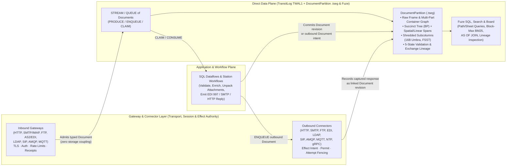

# 16. Document type library, protocol grammars and gateway exchange lifecycle

[Roadmap](README.md) · [Standards & Multi-Model #31](https://github.com/spoke-sh/transit/issues/31) · [Performance #76](https://github.com/spoke-sh/transit/issues/76) · **Status:** In progress ([implementation plan](#implementation-plan--2026-11-01))

Deliver a declarative **library of Document types, application-protocol
grammars and compound office/publishing formats**—spanning structured/interchange
formats (`JSON`, `XML`, `EDI_X12`, `EDIFACT`, `HL7`), application and network
protocols (`HTTP`, `MIME`, `FTP`, `SMTP`, `IMAP`, `POP3`, `LDAP`, `SIP`/`SDP`,
`AMQP`, `MQTT`, `NTP`), and compound container/layout formats (`PDF`, `DOCX`,
`XLSX`, `ODF`)—powered by a shared suite of vectorized parsing, succinct-tree,
perfect-hashing, container-graph and path-shredding algorithms over
[`DocumentPartition`](07-document-storage-and-station-decoupling.md) (`.tseg`).
Unify **inbound gateway and outbound connector exchange capture**
([`SERVING_V1.md`](../../contracts/SERVING_V1.md) and
[`STATION_EXCHANGE_V1.md`](../../contracts/STATION_EXCHANGE_V1.md)) with the
native `Document` lifecycle and revision history while keeping transport/effect
authority and document storage strictly decoupled.

## Prerequisites and architectural rationale

Consume [transactions](05-transactions-and-atomic-composition.md),
[declarative streams, queues and durable runtime](06-streams-queues-and-durable-runtime.md),
[logical document storage and Station decoupling](07-document-storage-and-station-decoupling.md),
[gateway architecture, sans-I/O wire protocols and direct-plane ingress](08-gateway-architecture-and-protocol-ingress.md),
[standards, collations and historical catalogs](10-standards-and-catalogs.md),
[indexing](11-indexing-and-access-paths.md),
[analytical SQL and dataflows](12-sql-and-dataflows.md),
[zero-allocation slabs and buffer management](13-data-structures-and-performance.md),
[first-class strings, perfect hashing and vectorized search](14-vectorized-strings-and-search.md)
and [data-centric compilation and AOT specialization](15-data-centric-compilation-and-specialization.md).
Start from [Documents](../handbook/reference/documents.md),
[serving](../handbook/reference/serving.md),
[connectors](../handbook/reference/connectors.md),
[storage runtime](../handbook/internals/storage-runtime.md) and
[query engine](../handbook/internals/query-engine.md).

This milestone resolves three closely related architectural problems:

1. **One suite of data structures and algorithms for a comprehensive library of Document and Protocol workloads:**
   Applications ingest, validate, query and archive far more than JSON blobs:
   they process XML schemas (`XSD`/`RelaxNG`), EDI interchanges (`X12`
   `850`/`810`/`837`/`997`/`999`, `EDIFACT`, `HL7` in `EBCDIC` or `ASCII` with
   `COMP-3`/`ZONED` decimals), web and file transfers (`HTTP`, `MIME`, `FTP`),
   email and directory protocols (`SMTP`, `IMAP`, `POP3`, `LDAP`/`LDIF`),
   real-time signaling and messaging (`SIP`/`SDP`, `AMQP`, `MQTT`), precision
   time synchronization packets (`NTP`), and compound office/publishing
   documents (`PDF`, `DOCX`, `XLSX`, `ODF`). Instead of treating non-JSON formats
   as opaque binary blobs or maintaining isolated storage engines per protocol,
   every format is defined as a composable **Document Profile (Vectorized
   Lexer/Grammar + Container/Part Graph + Schema Binding)** that lowers into
   `DocumentPartition`'s shared `.tseg` succinct trees ($2N$-bit Balanced
   Parentheses `BP`), 16-byte Umbra/German collated subcolumns,
   `comptime`/segment-sealed perfect hash symbol tables and five-state (`value`,
   `null`, `missing`, `type_error`, `conflict`) span provenance.
2. **Compound Office & Publishing Formats (`PDF`, `DOCX`, `XLSX`, `ODF`) as Composed Document & Table Graphs:**
   OpenXML (`DOCX`, `XLSX`, `PPTX` — ECMA-376) and OpenDocument (`ODF` `ODT`,
   `ODS` — ISO 26300) are ZIP/OPC containers of linked `XML` documents, while
   `PDF` (ISO 32000) is a versioned Carousel Object System (`COS`) dictionary/stream
   graph with incremental `%%EOF` cross-reference (`xref`) revisions and page
   content streams. The target `DocumentPartition` model provides multi-part
   container graphs, succinct XML/object trees, `.dictionary` symbol tables and
   spatial/linear spans; the profile implementations will compose them as follows:
   - `DOCX` and `ODT` decompose directly into linked `XML` Document parts
     (`word/document.xml`, `content.xml`, `styles.xml`, `comments.xml`) over the
     shared XML scanner and `BP` succinct tree.
   - `XLSX` and `ODS` lower worksheet strings (including XLSX's
     `xl/sharedStrings.xml`) into **`.tseg` `.dictionary` symbol tables**, exposing each
     worksheet simultaneously as a logical `Document` tree (preserving formulas
     `<f>`, styles and merged cells) and as a **five-state relational `Table`
     projection** where spreadsheet formula errors (`#REF!`, `#DIV/0!`,
     `#VALUE!`, `#NAME?`, `#N/A`) map natively to Transit's `type_error` cell
     state with `(sheet, cell_ref, formula)` provenance.
   - `PDF` maps its `COS` object graph and incremental `%%EOF` updates into
     `DocumentPartition`'s succinct tree and revision history while projecting
     page content streams (`BT ... Tj ET`), `/ToUnicode` CMaps, `/StructTreeRoot`
     tagged structures and `/AcroForm` fields through a deterministic **Spatial
     Layout & Span Segmenter** ($\kappa$) into queryable `(page_no, bbox, span)`
     records.
3. **Decoupling Gateways and Connectors from bespoke KV storage while unifying their exchange lifecycle and history with `Document`:**
   Today, outbound HTTP/gRPC connectors
   ([`STATION_EXCHANGE_V1.md`](../../contracts/STATION_EXCHANGE_V1.md) /
   [`transit-exchange`](../../packages/zig/transit-exchange/README.md)) use binary
   KV layouts (`EXF1`, `EXP1`, `EXB2`, `EXL1`/`EXL2`) over
   [`STATION_PUBLICATION_V1.md`](../../contracts/STATION_PUBLICATION_V1.md) for
   request/response chunks, SHA-256 coverage chains, preparation/transport
   failures and retry/redirect lineage. Inbound serving separately uses `SV1`
   admission, routing and outcome records under
   [`SERVING_V1.md`](../../contracts/SERVING_V1.md); it is not already an Exchange
   capture adapter. By separating **Transport, Session &
   Effect Authority** (owned by Gateways and Connectors in the *Process & Effect
   Plane*) from **Document Representation, Lineage & Queryability** (owned by
   `DocumentPartition` in the *Direct Data Plane*), gateways and connectors
   become thin protocol transducers that emit and consume typed `DOCUMENT`s (and
   `STREAM`s/`QUEUE`s of `DOCUMENT`s), while every `Document` profile remains
   100% constructible, transformable, branchable and queryable offline with zero
   gateway or network dependency.

## Library of Document types, protocols and compound formats

| Category & Profile | Logical Envelope, Container & Tree Grammar | Shared `.tseg` & `Fuze` Data Structures ($\tau \perp \kappa \perp \epsilon$) |
| --- | --- | --- |
| **Core Structured (`JSON`, `XML`)** | `JSON` objects/arrays; `XML` prolog, ordered elements, `@attr` attributes, namespace URI/prefix bindings, mixed text/element content, `JSON_SCHEMA` / `XSD` / `RelaxNG` | SIMD quote/brace and `<`/`>`/`&` structural bitmask scanners + segment-sealed perfect hash field/tag directories + $2N$-bit `BP` succinct tree + Region Algebra (`WITHIN`/`LCA`) + Dremel subcolumn shredding |
| **Web & File Transfer (`HTTP`, `MIME`, `FTP`)** | `HTTP` start-line (`method`/`target`/`status`), `ASCII_CI` multimap headers, chunked/multipart bodies, trailers, `SecretRef` redactions; `FTP` command/reply transcript (`USER`, `PASV`, `STOR`/`RETR`, `226`) + verified file transfer manifest | `comptime` perfect hash for RFC 9110 headers & FTP commands + `ASCII_CI` 16-byte Umbra/German header subcolumns + recursive `MIME` multipart `BP` tree + SHA-256 coverage chain + catalog dependency link to transferred payload |
| **Enterprise Interchange (`EDI_X12`, `EDIFACT`, `HL7`)** | Parameterized delimiters (`ISA`/`UNA`/`MSH` `*`, `:`, `^`, `~`), nested envelope & business loops (`ISA` $\to$ `GS` $\to$ `ST` $\to$ `850`/`810`/`837`/`997`/`999`), `EBCDIC` or `ASCII`, fixed-point decimals | Parameterized SIMD delimiter scanner + `comptime` perfect hash for X12/EDIFACT/HL7 segment & element IDs + `EBCDIC_CP037`/`ASCII` collations + `ZONED`/`COMP-3`/decimal codecs + shredded control numbers (`ISA13`, `GS06`, `ST02`) + 5-state `type_error` diagnostics |
| **Email & Mailboxes (`SMTP`, `IMAP`, `POP3`)** | `SMTP`/`POP3` command/reply transcripts (`EHLO`, `MAIL FROM`, `RCPT TO`, `DATA`, `RETR`); `IMAP` tagged commands, mailbox/UID/flags (`\Seen`, `\Flagged`) + `BODYSTRUCTURE`; `RFC 5322` envelope (`Message-ID`, `In-Reply-To`, `References`, `DKIM-Signature`) + `MIME` multipart tree & attachments | `ASCII_CI` `comptime` perfect-hashed `RFC 5322` headers + causal thread/conversation lineage graph (`Message-ID` $\to$ `In-Reply-To`/`References`) + `IMAP` flag Roaring bitmaps + child `part_ref` links to attached `PDF`/`DOCX`/`XLSX` Documents |
| **Directory Services (`LDAP` / `LDIF` / `X.500`)** | ASN.1 `BER` protocol PDUs (`Bind`, `SearchRequest`, `SearchResultEntry`, `Modify`, `LDIF` change records); hierarchical Distinguished Name (`DN: cn=...,ou=...,dc=...`) tree; OID/attribute schemas with `CaseIgnoreMatch`, `DistinguishedNameMatch`, `NumericStringMatch` | Zero-allocation ASN.1 `BER` TLV structural scanner + `comptime`/sealed perfect hash for OIDs & attribute names + reversed-DN hierarchy index + multi-valued `.tseg` attribute subcolumns bound to LDAP matching-rule collations ($\kappa$) |
| **Real-Time Signaling (`SIP` + `SDP`)** | `RFC 3261` request/response envelopes (`INVITE`, `180 Ringing`, `200 OK`, `ACK`, `BYE`), `Via`/`From`/`To`/`Call-ID`/`CSeq` dialog headers (`ASCII_CI`), plus `SDP` (`v=`, `o=`, `s=`, `c=`, `m=`, `a=`) media/codec descriptor subtrees | Dialog & transaction correlation lineage (`Call-ID`, `From-tag`, `To-tag`, `CSeq` branch) + shared HTTP/SIP header shredder + vectorized `SDP` line-type scanner |
| **Brokered & IoT Messaging (`AMQP`, `MQTT`)** | `AMQP 0-9-1 / 1.0` performative frames (`open`, `begin`, `attach`, `transfer`, `disposition`), typed binary properties & delivery tags; `MQTT v3.1.1 / v5.0` packets (`PUBLISH`, `SUBSCRIBE`, `PUBACK`/`PUBCOMP`), UTF-8 topic hierarchy (`a/b/c`), QoS `0`/`1`/`2`, retained flags, user properties | Binary frame/property descriptor scanner + hierarchical topic-segment trie with `+`/`#` wildcard bitmap intersection in `.tseg` + direct transactional bridge to Transit `STREAM` (`PRODUCE INTO`) and `QUEUE` (`ENQUEUE INTO` / `CLAIM` / `ACK`) |
| **Precision Time (`NTP` / `SNTP`)** | 48-byte (+ extension/MAC) packet: `LI`, `VN`, `Mode`, `Stratum`, `Poll`, `Precision`, `Root Delay`, `Root Dispersion`, `Reference ID`, and four 64-bit fixed-point timestamps (`Ref`, `Orig T1`, `Recv T2`, `Xmt T3`, local `Dst T4`) | Fixed-layout binary codec + 64-bit fixed-point arithmetic shredding clock offset $\theta = ((T_2 - T_1) + (T_3 - T_4))/2$ and round-trip delay $\delta = (T_4 - T_1) - (T_3 - T_2)$ into `.tseg` columns as verifiable clock-uncertainty provenance for `AS OF` and deadline audits |
| **Compound Office & Spreadsheets (`DOCX`, `XLSX`, `ODF`)** | ZIP/OPC (`[Content_Types].xml`, `_rels/.rels`) and ODF (`META-INF/manifest.xml`) package graphs; `DOCX`/`ODT` paragraph/run/table/comment XML parts; `XLSX`/`ODS` workbook, `sharedStrings.xml` (`<sst>`), styles and worksheet (`<row>`/`<c>`/`<f>`/`<v>`) XML parts | Bounded streaming ZIP/OPC container graph unpacker + shared `XML` `BP` succinct tree + `XLSX` `sharedStrings.xml` mapped directly to `.tseg` `.dictionary` symbol tables + dual `Document` and 5-state relational `Table` worksheet projection (`#REF!`/`#DIV/0!`/`#VALUE!` $\to$ `type_error` with cell/formula provenance) |
| **Publishing & Layout (`PDF` ISO 32000)** | Header, `xref` table/stream, `COS` object graph (`<< /Type /Page ... >>`, arrays, compressed `FlateDecode` streams), incremental `%%EOF` update generations, `/StructTreeRoot` tagged tree, `/AcroForm` fields, and page content streams (`BT ... Tj ET`, `/ToUnicode` CMaps) | Streaming `xref`/`COS` object-graph indexer + incremental `%%EOF` revision lineage + deterministic **Spatial Layout & Span Segmenter** ($\kappa$) projecting page content streams into `(page_no, bbox: [x0, y0, x1, y1], font_symbol, span)` columns for SQL and Block-Max BM25 / `NEAR` search |

## Delivery sequence

1. **Define the declarative Document Profile and Compound Container contract (`CREATE DOCUMENT ... AS <PROFILE>`).**
   Extend `DirectCatalog` and `DocumentPartition` so a `DOCUMENT` declaration (or
   `STREAM`/`QUEUE` of `DOCUMENT`s) binds an explicit, versioned **Document
   Profile** (`DefinitionId`):
   - **Orthogonal framing, container packaging, encoding and collation:** Declare
     wire/container framing (raw stream, delimiter-framed, ASN.1 `BER`, `ZIP`/`OPC`
     package, `PDF` `xref` container), character encoding (`UTF-8`, `ASCII`,
     `ISO-8859-1`, `EBCDIC_CP037`/`CP500`/`CP1047`) and default key/value
     collations ($\kappa$) independently of the logical tree/part grammar ($\tau$)
     and `.tseg` physical codecs ($\epsilon$).
   - **Composable multi-part container graphs:** Allow a parent `DOCUMENT` (such
     as an `SMTP`/`IMAP` email with a `MIME` tree, an `OPC`/`ZIP` archive for
     `DOCX`/`XLSX`/`ODF`, or a `PDF` with embedded files) to reference child
     parts as typed nodes (`part_ref`) within the same `DocumentPartition`
     snapshot, enforcing strict decompression-ratio, part-count and byte budgets
     via [Milestone 13's](13-data-structures-and-performance.md)
     `MeteredAllocator` to prevent zip-bomb or decompression-bomb amplification.
   - **Non-aborting five-state schema, grammar and formula validation:** Attach
     optional declarative schemas (`JSON_SCHEMA`, `XSD`, EDI implementation guide,
     LDAP OID schema, OpenAPI/HTTP contract, spreadsheet formula validator).
     Malformed fields, invalid EDI elements, corrupt ASN.1 tags or spreadsheet
     formula errors (`#DIV/0!`, `#REF!`, `#VALUE!`) record a `type_error` cell at
     that exact node/cell with `(part_id, byte_start, byte_end, rule_id)`
     provenance while keeping the envelope and valid sibling subtrees/rows
     queryable. Truncated outer frames remain explicitly marked in the lifecycle
     state (`unknown` / `incomplete_frame`), never published as complete.

2. **Implement the Structured, Web, Enterprise Interchange and Protocol Profiles (`JSON`, `XML`, `HTTP`/`MIME`, `FTP`, `EDI`, `SMTP`/`IMAP`/`POP3`, `LDAP`, `SIP`/`SDP`, `AMQP`, `MQTT`, `NTP`).**
   Build the protocol and interchange profiles in Zig over
   [`DocumentPartition`](07-document-storage-and-station-decoupling.md):
   - **`JSON` and `XML`:** Vectorized structural indexing, namespace dictionaries,
     `BP` succinct trees, Region Algebra containment (`WITHIN`/`LCA`) and
     automatic/declared subcolumn shredding.
   - **`HTTP`, `MIME`, `SMTP`, `IMAP` and `POP3`:** Shared `RFC 9110` / `RFC 5322`
     `ASCII_CI` header shredder with `comptime` perfect hashing, `MIME` multipart
     boundary scanner, `SMTP`/`POP3` command-reply transcript trees, `IMAP`
     UID/flag Roaring bitmaps and `BODYSTRUCTURE` trees, causal email threading
     (`Message-ID` $\to$ `In-Reply-To`/`References`), and first-class `SecretRef`
     redaction markers for credentials/tokens.
   - **`EDI` (`EDI_X12`, `EDIFACT`, `HL7`) and `FTP`:** Header-driven delimiter
     extraction (`ISA`/`UNA`/`MSH`), nested loop hierarchy state machines, native
     `EBCDIC` and `COMP-3`/`ZONED`/decimal decoding, functional acknowledgment
     (`997`/`999`) derivation from five-state validation diagnostics, and `FTP`
     control transcripts linked to verified file transfer manifests.
   - **`LDAP` (`BER` / `LDIF`) and `SIP` (`RFC 3261` + `SDP`):** Zero-allocation
     ASN.1 `BER` TLV scanner, OID and Distinguished Name (`DN`) hierarchical path
     indexing with LDAP collation matching rules (`CaseIgnoreMatch`,
     `DistinguishedNameMatch`), and `SIP` dialog/transaction state machines
     paired with `SDP` media descriptor trees.
   - **`AMQP`, `MQTT` and `NTP`:** Binary frame/performative and header scanners
     for `AMQP` and `MQTT` with hierarchical topic-trie / wildcard (`+`, `#`)
     bitmap indexing and native routing into Transit `STREAM`s and `QUEUE`s, plus
     fixed-layout `NTP` packet decoding that shreds 64-bit fixed-point timestamps
     `(T1, T2, T3, T4)`, stratum, root dispersion, clock offset $\theta$ and
     round-trip delay $\delta$ into `.tseg` columns as verifiable clock-bound
     evidence.

3. **Implement the Compound Office, Spreadsheet and Publishing Profiles (`DOCX`, `XLSX`, `ODF`, `PDF`) over `DocumentPartition`.**
   Layer compound document formats directly on top of the container, XML,
   dictionary and span primitives without external runtime dependencies:
   - **`DOCX` and `ODF` (`ODT` / `ODP`):** Unpack the `OPC`/`ODF` relationship
     graph (`_rels/.rels`, `META-INF/manifest.xml`) in streaming chunks and index
     `word/document.xml` / `content.xml`, `styles.xml`, `numbering.xml` and
     `comments.xml` as linked `XML` succinct trees, exposing structural
     sections, headings, paragraphs, runs, embedded tables, revision tracked
     changes (`<w:ins>` / `<w:del>`) and comments to `Fuze` SQL and search.
   - **`XLSX` and `ODS` Spreadsheets:** Map `xl/sharedStrings.xml` directly into
     a `.tseg` `.dictionary` symbol table and parse `xl/worksheets/sheet*.xml`
     into both the logical `Document` tree and a **five-state relational `Table`
     view** (`SELECT * FROM DOCUMENT_TABLE(workbook_doc, SHEET => 'BalanceSheet')`),
     preserving numeric/date types, formula strings, cell coordinates and
     five-state `type_error` cells for spreadsheet formula errors.
   - **`PDF` (`ISO 32000`):** Parse `xref` tables/streams, trailers and
     incremental `%%EOF` updates into `DocumentPartition`'s revision lineage;
     index the `COS` dictionary/array/stream graph (bounded `FlateDecode`
     decompression inside `scratch` slabs); and project `/Type /Page` content
     streams, `/ToUnicode` font maps, `/StructTreeRoot` tagged structures and
     `/AcroForm` fields through a deterministic **Spatial Layout & Span
     Segmenter** ($\kappa$) into addressable `(page_no, bbox, span)` columns.

4. **Build the shared suite of zero-allocation SIMD structural scanners and `transit-app` AOT grammar specialization.**
   Apply the execution rules from
   [Milestone 13](13-data-structures-and-performance.md),
   [Milestone 14](14-vectorized-strings-and-search.md) and
   [Milestone 15](15-data-centric-compilation-and-specialization.md):
   - **Vectorized structural bitmask and TLV scanners:** Scan raw frames in
     64-byte cache-line blocks using `@Vector` SIMD instructions for quote/escape
     masks, XML `<`/`>`/`&` boundaries, HTTP/SMTP/SIP `CRLF` headers, EDI
     segment/element terminators, and ASN.1 `BER` / binary frame headers over
     swizzled LeanStore/Umbra buffer slabs with zero steady-state heap
     allocations after warmup.
   - **`comptime` and segment-sealed perfect hash vocabularies:** Use
     [Milestone 14's](14-vectorized-strings-and-search.md) greedy association-table
     perfect hashing with 16-byte SIMD comparisons for closed protocol and
     document vocabularies (`HTTP`/`SMTP`/`SIP` headers, `XML`/`DOCX`/`XLSX`
     schema tags, `EDI` X12/EDIFACT segment IDs, `LDAP` OIDs, `PDF` dictionary
     `/Name` keys) at `comptime`, and seal per-segment perfect hash directories
     for custom document keys at `.tseg` flush time.
   - **Ahead-of-Time (`transit-app`) grammar & shredder compilation:** Extend
     [Milestone 15's](15-data-centric-compilation-and-specialization.md) AOT Zig
     compiler so declared XML/OOXML schemas, EDI transaction-set guides, LDAP
     schemas or protocol contracts compile ahead of time into branchless Zig
     state machines and `.tseg` subcolumn shredders.

5. **Formalize the transport-independent Document Lifecycle, Revision Lineage and Gateway/Connector Exchange Cutover.**
   Unify the document lifecycle and causal history across offline documents,
   inbound gateways and outbound connectors while keeping the **Gateway/Connector
   Layer** and **`DocumentPartition`** strictly decoupled:
   - **Transport-independent lifecycle states & causal lineage graph:** Every
     Document tracks its lifecycle (`preparing`, `ready`, `capturing`,
     `complete`, `validated`, `acknowledged`, `unknown`, `retired`) and indexed
     causal lineage edges (`initial`, `edit`, `merge`, `retry`, `redirect`,
     `reconcile`, `cancel`, `response_to`, `functional_ack`, `email_reply`,
     `sip_dialog_step`, `pdf_incremental_eof`, `attachment_of`) as `.tseg`
     subcolumns supporting $O(1)$ hop traversal in SQL.
   - **Clean Plane Separation (`Gateway / Connector` $\perp$ `DocumentPartition`):**
     - **Gateways and Connectors own Transport, Session & Effect Authority:**
       TLS/socket lifecycle, authentication, rate/byte budgets, live flow
       control, secret resolution, and—for outbound connectors—pre-dispatch
       **Effect Intent, Permit Authorization and Unknown-Outcome Fencing**
       ([`connectors.md`](../handbook/reference/connectors.md)).
     - **`DocumentPartition` owns Representation, Staging, Lineage & Queryability:**
       `DocumentPartition` has zero dependency on sockets, TLS or network
       protocols; Gateways and Connectors simply stage and commit typed
       `DOCUMENT` revisions (or `PRODUCE`/`ENQUEUE` into `STREAM`/`QUEUE` of
       `DOCUMENT`s).
   - **Outbound connector cutover (`STATION_EXCHANGE_V1` $\to$ `DOCUMENT`):**
     Migrate [`transit-station-http`](../../packages/zig/transit-station-http/README.md),
     [`transit-station-grpc`](../../packages/zig/transit-station-grpc/README.md)
     and outbound protocol connectors (`SMTP`, `FTP`, `EDI`, `LDAP`, `SIP`,
     `AMQP`, `MQTT`, `NTP`) to record requests, streaming responses, preparation
     failures (replacing `EXP1`), capture/transport failures (replacing `EXF1`),
     attempt budgets (replacing `EXB2`) and follow-up redirects/retries (replacing
     `EXL1`/`EXL2`) as linked `DOCUMENT` revisions in `DocumentPartition`,
     retiring [`STATION_EXCHANGE_V1.md`](../../contracts/STATION_EXCHANGE_V1.md)
     while preserving pre-dispatch effect fencing, `SecretRef` redaction,
     unknown-outcome preservation, network-free replay and caller/consumer
     retirement holds.
   - **Inbound gateway integration ([`transit-serving`](../../packages/zig/transit-serving/docs/compatibility.md) and protocol listeners):**
     Allow inbound gateways (`HTTP`, `SMTP`/`IMAP`, `FTP`, `AS2`/`EDI`, `LDAP`,
     `SIP`, `AMQP`, `MQTT`) to admit wire envelopes into declared `DOCUMENT`
     collections, `STREAM`s or `QUEUE`s with idempotent receipts and
     transactionally linked response `DOCUMENT`s.

6. **Expose unified SQL, structural/spatial search, spreadsheet relational views and Board inspection.**
   Make every Document Profile, compound office document and captured exchange a
   first-class citizen of `Fuze` SQL, search and [Board](30-board-reimplementation.md):
   - Query shredded paths, `LDAP` DN subtrees, `MQTT` topic wildcards, `NTP`
     clock-offset/uncertainty bounds, `XLSX`/`ODS` spreadsheet tables and `PDF`
     spatial/page spans through standard `Fuze` SQL (`SELECT`, `WHERE`,
     `GROUP BY`, [Milestone 12](12-sql-and-dataflows.md) `AS OF JOIN`), five-state
     predicates (`IS MISSING`, `IS TYPE_ERROR`, `IS CONFLICT`) and byte/bbox
     provenance functions.
   - Compose [Milestone 14's](14-vectorized-strings-and-search.md) vectorized
     256-document Block-Max BM25 and structural/spatial `NEAR` / `WITHIN`
     operators across `XML`, `DOCX`, `ODF`, `PDF`, `HTTP`, `SMTP`/`MIME` and
     `EDI` documents under a single pinned `SnapshotId` and `policy_epoch`.
   - Replace bespoke exchange-only inspection RPCs with unified read-only Board
     and SQL views over `DOCUMENT` lineage, container part graphs, five-state
     validation/formula errors and effect/capture diagnostics, rechecking current
     `policy_epoch` grants on every disclosure.

## Implementation plan — 2026-11-01

### Outcome and source basis

**Source basis:** fetched `origin/main` at
`c8d060cb2dfcf3bc531ef2e41fcdf7d4f172c2d5`. This plan uses merged source and
source-attributed qualification records, including PRs #298–#304. It does not
count work in other branches or checkouts as delivered. No runtime proof was
rerun to prepare the source audit. M16 is **In progress** through the offline
foundation below; the remaining work packages are implementation and acceptance
obligations.

**Integration refresh:** `origin/main` at `f49a3da65` adds the November 1
current-definition cutover, shared KV admission/recovery and Serving caller
work. The profile schema and independent commitment fixture use that definition.
The new game/simulation milestone is M19; branching is now M20 and service/SDK
coverage is M21. The audit below incorporates those changes while preserving
each qualification record's source and limits.

An application must be able to declare a Document interpretation, ingest or
construct a document without a gateway, inspect its accepted revision and exact
provenance, query its valid and invalid fields, and recover the original
operation. A gateway or connector must use that same representation while
retaining its own admission, dispatch and outcome authority. A complete capture,
a valid document, an application acknowledgement and a successful external
operation are different observations.

Deliver the first installed journey on one local catalog and branch one using
disk-backed `TransitLog`/`TransitObjectStore`, explicit current grants and bounded
typed Zig/SQL callers. Extend it to the profile library and existing consumers
through the gates below. This first journey does not reduce the full milestone's
format, offline, exchange, search or branching requirements.

### Initial implementation scope

The first implementation adds an additive
[profile/provenance contract](../../contracts/DOCUMENT_PROFILE_V1.md), independently
encoded commitment fixtures, and the pure
[`transit-document-profiles`](../../packages/zig/transit-document-profiles/README.md)
package. It supplies resumable scalar JSON and an explicitly restricted UTF-8
XML grammar, ordered events with raw part offsets, caller-owned bounded workspace,
and a reader that checks complete permitted coverage, grammar, length and hash
before reporting completion. It adds no catalog declaration or stored-format
cutover. It consumes the integrated current definition without changing existing
native/Document/Exchange operations or stored layouts.

P0 and P1 remain **partial**. The initial profile subset and its resource rules
are executable; complete capability/lifecycle contracts, namespaces, serializers,
shared protocol framing, container graphs and the other profile families remain
open. Component tests and the independent Python JSON/Expat oracle are runnable
through the existing component/fixture owners. They do not establish installed
publication, a SIMD throughput claim or gateway/effect recovery.

The next installed step remains P2: integrate evaluated, paged direct Documents
with public admission and current-policy reads in M7 before adding profile
publication. P5/P6 additionally require the native Document transaction participant
and M6's Station/effect composition. No parser result may bypass those gates or
replace the current Exchange/Serving authority. The full milestone completion
criteria below remain unchanged.

### Current implementation and recent progress

The older prerequisite tables in M6–M9 describe their own source revisions.
In particular, M6's initial Table-only transaction assessment predates the
following mixed-participant and declaration work. Use each current public owner
and the actual acceptance path when deciding whether a gate has opened.

| Boundary at this source | Available basis | Consequence for M16 |
| --- | --- | --- |
| M4/M5 results and transactions | Completed logical statement/results and local serializable Table transaction profiles; shared `Executor`/`ResultSet`, common cuts, private workspaces and original decisions | Reuse these owners. Neither completion includes direct Documents or external effects. |
| M6 direct primitives and composition | Named direct KV, typed Stream/Queue operations, bounded Queue waits, native Table/KV/Stream/Queue statements and explicit Queue transfers. The [installed mixed schedule](../history/qualification/transactions.md#installed-mixed-state-output-and-input-settlement--2026-10-31) records 85 signed requests, two lost replies and two node replacements. [SQL declarations](../history/qualification/sql.md#stream-and-queue-declaration-sql--2026-10-31) include real console/PostgreSQL/MySQL callers. | Do not rebuild these foundations. Document participation, workload SQL verbs, automatic DLQ scheduling, Station composition and complete common-revision qualification remain separate gates. The installed mixed run is not a clean dependent-lane pass. |
| M7 logical and storage components | `transit-document` supplies tree/span/merge components; `DocumentShredder` supplies in-memory columns; [`DocumentPartition`](../../packages/zig/transit-storage/docs/document-partitions.md) supplies paged directories, exact receipts, retained reads and bounded recovery. PR #300 tightens read budgets, signing and recovery. | `applyMutation` still accepts supplied state/conflict counts, does not invoke the evaluator/shredder, and reads whole revisions within a budget. Installed Documents still use Station. Persisted part graphs, integrated evaluation, within-revision paging, direct dispatch and the transaction participant are incoming M7 work. |
| M8 gateway separation | PR #299 adds pure resumable PostgreSQL/MySQL command engines with event/generation fencing and resumed disclosure checks; local co-hosting and event-driven SQL recovery exist. | Reuse the byte/event and host ownership pattern. The installed driver still has blocking workers/timer races; complete deadline/scheduler, remote-placement and Flight/Serving integration remain open. |
| M9 caller foundation | PR #298 adds bounded context/SQL leases, frozen pre-submit records and `LocalRecoveryStore`; PR #307 adds `Context.callKV`, finite fair admission waits and `KVRecovery` with persist-before-dispatch and original-outcome observation. Its [qualification](../history/qualification/sdk.md#bounded-admission-and-direct-kv-recovery--2026-11-01) separates passing scoped checks from failed/incomplete broad lanes. | Reuse these context, admission and recovery owners. Aggregate byte accounting, managed handles, native principal coordination, installed Python/Node composition and a direct Document facet remain open. |
| M10–M15 interpretation, queries and performance | Collation/standards helpers, analytical/dataflow oracles, result memory reserves, `PerfectHash`, `GermanString`, compressed predicates and search components exist. M15 remains Planned. | Verify actual storage/compiler integration. No general historical-catalog service, installed Document search, hierarchical service metering or AOT grammar compiler follows from component presence. |
| M20 branching | PR #301 delivers a typed, immutable branch of one selected Table, retained pin ownership and original outcome recovery. Its [qualification](../history/qualification/catalog.md#immutable-single-table-branches--2026-10-31) retains failed/incomplete wider runs. | This is neither a writable Document branch nor a whole-catalog cut. M16 can bind revision/part identity now; full Document branching/merge depends on M20. |
| Existing exchanges and serving | [`transit-exchange`](../../packages/zig/transit-exchange/README.md), HTTP/gRPC/Flight and their workers retain Station publication, exact intent binding, capture coverage, diagnostics and holds. Serving owns independent `SV1` admission/reply records; PR #305 adds shared native/Go caller recovery and copied recovery with redaction. | All existing safety and consumer contracts are migration inputs. No Document-backed exchange or general protocol listener is enabled by this plan. |

The decisive source boundaries are
[`DOCUMENT_V1`](../../contracts/DOCUMENT_V1.md),
[`Transaction.Participant`](../../packages/zig/transit-protocol/src/Transaction.zig)
(which still refuses Document participation),
[`STATION_EXCHANGE_V1`](../../contracts/STATION_EXCHANGE_V1.md),
[`STATION_HTTP_V1`](../../contracts/STATION_HTTP_V1.md),
[`STATION_GRPC_V1`](../../contracts/STATION_GRPC_V1.md) and
[`SERVING_V1`](../../contracts/SERVING_V1.md). Preserve their qualified behavior
until the replacement passes its coordinated cutover gate.

### Dependencies and handoffs

| Owner | Required handoff | Work that can proceed before full milestone completion |
| --- | --- | --- |
| [M6](06-streams-queues-and-durable-runtime.md#r5-extend-the-transaction-owner-and-deliver-direct-kv) and [M7](07-document-storage-and-station-decoupling.md#remaining-work-packages-and-gates) | M7 C0–C4/C6: canonical evaluated mutations, durable raw parts/tree/subcolumns, paged reads and installed catalog/client/SQL access. M7 C5 and M6 R5/R7/R8: Document plus input settlement/output/intent composition and Station/effect migration. | Profile contracts, pure parsers, independent corpora and resource tests can start now. Installed profile publication waits for the direct Document owner; exchange replacement additionally waits for the common-decision/effect handoff. |
| [M8](08-gateway-architecture-and-protocol-ingress.md#resumable-command-session-implementation--2026-10-31) | Bounded host input/output leases, cancellation join, event fencing, deadlines and current disclosure; appropriate direct data ingress. | Pure protocol grammars and offline transcripts need no live listener. M16 must not add another socket scheduler, polling recovery service or per-chunk HTTP orchestration layer. |
| [M9](09-client-foundation-and-language-apis.md#remaining-implementation-plan--2026-11-01), [M21](21-service-and-sdk-coverage.md) | Direct Document facet, owned/borrowed result lifetimes, exact original-operation recovery and generated bindings. | Typed Zig is the first caller. M16 migrates every existing affected HTTP/gRPC/Flight/Document consumer; broader new language/protocol coverage retains its own owner. |
| [M10](10-standards-and-catalogs.md#delivered-implementation-evidence--2026-10-30) | Exact interpretation/collation descriptors, capability evidence and retained definition binding. | Start with explicitly supported encodings/collations. LDAP matching rules and additional codepages require their own qualified descriptors; a helper or familiar name does not establish support. |
| [M11](11-indexing-and-access-paths.md), [M14](14-vectorized-strings-and-search.md) | Persisted index definitions, coverage/maintenance and sound path/text search at retained cuts. | M7 base traversal and finite scans establish correctness first. M16 supplies structural/part/span facts and protocol vocabularies; it does not create an independent search catalog. |
| [M12](12-sql-and-dataflows.md) | Actual finite analytical/TVF lowering, common source cuts and durable managed activation where exposed. | Finite Document projections and lineage queries can land first. `AS OF JOIN`, continuous enrichment and automatic acknowledgement workflows wait for their executable owners. |
| [M13](13-data-structures-and-performance.md#allocation-contract-and-measurement-boundary) | Shared allocation accounting, resource quotas and scratch/output lifetime rules. | Bound input, expansion, stack/depth, output and CPU work from the first parser. Hierarchical `MeteredAllocator`, swizzled zero-copy storage and service-wide allocation claims require integration evidence. |
| [M15](15-data-centric-compilation-and-specialization.md) | AOT artifact identity, compiler integration, invalidation and interpreted-versus-compiled equivalence. | Scalar/interpreted grammar semantics and shared descriptors land first. M16's AOT package remains open until the compiler handoff exists; it does not block the first offline or HTTP journey. |
| [M17](17-geospatial-and-spatio-temporal-computing.md), [M18](18-multi-model-and-foreign-relations.md) | Shared spatial descriptors/indexes and later foreign/graph/hybrid composition. | Define PDF page coordinates, units and layout revision now. Basic page/span projection does not require the full geospatial engine; spatial type/operator exposure uses M17, and foreign imports/CDC stay in M18. |
| [M19](19-game-asset-pipelines-and-simulation-streaming.md) | Typed asset/container provenance and later dependency-aware cooking/streaming. | M16 owns immutable container parts and interpretation; target asset codecs, simulation semantics and execution belong to M19. Its planned workloads do not add installed Document support. |
| [M20](20-branches-merges-and-restore.md#local-table-branch-increment) | Document roots, writable branches, common cuts, merge and branch-aware GC. | Retain exact revisions and part/lineage dependencies now. Full offline branch acceptance waits for this handoff; copied captures never authorize dispatch on a branch. |
| [M27](27-control-and-policy-plane.md), [M28](28-published-resources-and-investigations.md) | Current subject/audience policy, admitted secret references and explicit retained investigation dependencies. | Reuse current grants and qualified secret resolution. Enterprise policy components and browser Table publications do not establish Document RLS, delegated capture disclosure or automatic retention pins. |
| [M30](30-board-reimplementation.md), [M33](33-recorded-mcp-integrations.md) | Read-only public inspection and later governed tool capture. | M16 migrates existing Board exchange metadata and publishes bounded typed views. New spreadsheet/PDF workbench UX belongs to M30; MCP protocol/agent policy belongs to M33. |

These are capability gates, not a requirement to finish every earlier milestone
before starting. In particular, M7 owns generic Document storage and M6 owns the
transactional runtime; M16 owns format interpretation and exchange composition.
Do not make M7 wait for a finished parser library or make M16 rebuild its storage.

### Contract decisions before runtime exposure

#### Identities, interpretation and operations

Extend the owning direct Document contract with neutral public types before
adding SQL or transport adapters. A proposed `DocumentProfile` binds immutable
grammar, schema/validation, container/framing, encoding, collation and segmenter
definitions/digests. Its format identity is separate from M7's `causal_crdt` or
`versioned` merge profile. Profile revisions and upstream protocol editions are
also separate from Transit's shared current-v1 definition.

Keep catalog object, logical `DocumentId`, accepted revision, part identity,
interpretation definition, client token/operation, transaction decision and
exchange/effect/attempt identities explicit. A part reference names an exact
accepted revision/content commitment, never the latest object with a matching
name. Retain schema/vocabulary/segmenter dependencies with the result basis.

Specify shared operations for declaration/preview, bounded staging, seal/publish,
validation, revision reads, lineage/part traversal, original-outcome inspection,
hold release and retirement. Map SQL and clients to those operations. The
`CREATE DOCUMENT ... AS <PROFILE>` and `DOCUMENT_TABLE(...)` forms above are
proposed language targets, not executable syntax at the source basis. Finalize
grammar, type resolution, diagnostics and capability reporting before exposing
them; use the existing statement/result lifecycle for commands and rows.

#### Parts, raw bytes and bounded publication

Use M7's part references and paged storage to represent `Container → Parts →
Trees/Tables/Spans`. A PDF object graph or package relationship graph is not a
tree: preserve shared references and cycles explicitly, with bounded visited
state/traversal. BP encodes selected ordered trees without duplicating an entire
referenced graph. Define which relationship cycles are valid per profile.

Stage immutable chunks and parsed candidates privately, then publish a complete
revision manifest containing exact part commitments, coverage and interpretation.
No partial staging step publishes a complete document. Raw prefixes may remain
inspectable through an explicitly incomplete observation. Specify exact staging
identity, duplicate/conflicting chunks, cancellation, abandoned-work cleanup and
restart recovery; parser buffers are not the durable continuation authority.

Define byte ranges as half-open intervals in an identified immutable part.
Encoded wire bytes, decompressed part bytes, decoded text and normalized search
text have different coordinate spaces. Record transformation/source mappings;
do not invent exact compressed offsets for every extracted glyph or cell. A
derived value without a one-to-one raw span carries its derivation and source
references. Redacted/withheld regions have explicit coverage gaps and cannot
claim an unredacted digest or byte-exact replay. Retain authorized bytes only;
never stage resolved credentials in a generic raw-part store before redaction.

Parent/child, revision, search-index, caller and replay relationships carry
explicit retention obligations where needed, independently of access rights.
Cross-object publication needs the common transaction owner or a documented
private-staging/final-manifest boundary; multiple successful writes do not make
one snapshot. Collection walks retained graphs in bounded pages and protects
unresolved publication/transaction/effect work. History remains unlimited by
default; quota pressure cannot release holds or expire evidence.

#### Validation and independent lifecycle facts

Define transitions and evidence for capture availability (`preparing`, `ready`,
`capturing`, `complete`, `unknown`, `retired`) separately from validation and
acknowledgement. `validated` names a validator definition, revision and result;
`acknowledged` names the actor/peer, exact target and acknowledgement meaning.
Neither is a universal step after capture completion. Offline Documents need no
effect attempt; a fully captured HTTP error may be complete; valid bytes may
still describe a failed business operation.

Five-state diagnostics retain `(part_id, byte_start, byte_end, rule_id)` plus
the bound schema/profile and applicable path/cell. Continue at a malformed field
only when the grammar establishes the next boundary. Corrupt outer lengths,
ambiguous framing, missing parts or exhausted decompression work cannot be
treated as harmless cell errors with invented sibling coverage. Preserve the
known prefix and an explicit `incomplete_frame` or typed refusal. Define separate
dispositions for unsupported features, invalid input, denied access, budget
exhaustion and storage/integrity failure.

Lineage edges distinguish document derivation (`edit`, `merge`, attachment,
PDF revision) from protocol correlation (`response_to`, email reply, functional
ACK, SIP dialog) and authorized attempts (`retry`, `redirect`, reconciliation,
cancellation). An untrusted header supplies correlation evidence, not authority
or proof of causation. Use paged adjacency/indexes; constant-time hop and complete
lineage-query claims require measured bounds and actual coverage.

#### Pure grammars, hosts and resource ownership

Keep scanner/grammar/validator code deterministic Zig with explicit input/output
lifetimes and resumable events. It imports no sockets, TLS, clocks, worker pools,
credential resolver or effect client. Reuse `transit-document` for logical
algebra; introduce a real `transit-document-profiles` package for format code
when implementation starts, with its own manifest, public module, direct
dependencies and checks. Share existing M14 hashing/collation helpers through
package interfaces; extract a neutral utility only if dependency direction
requires it. Do not copy them or import sibling source files.

`transit-storage` owns durable representation, `transit-catalog` owns publication
and current grants, Fuze owns projections/search, and gateway/connector hosts own
transport/session/effect authority. `transit-exchange` may retain its public
composition role while its Station KV persistence is replaced. Core must not
import profile parsers. No separate per-format database, transaction coordinator,
secret catalog or permission authority is introduced.

Publish numeric limits for input/chunk/output bytes, expanded bytes and expansion
ratio, part/node counts, nesting, token/header/TLV lengths, live candidates,
diagnostic bytes, active decoders, CPU/work steps and retained read windows.
Enforce them before allocation and at resumable work boundaries, including
nested expansion totals. Reset reusable scratch per chunk/batch with retained
capacity; returned data owns output storage or a generation-checked lease.
Closed vocabularies use verified perfect hashes; arbitrary keys use a bounded
general path and segment-sealed directories. Arbitrary socket slices are not
guaranteed padded: vector loads require owned padding or a safe tail path.

#### Exchange atomicity and the current-v1 cutover

Resolve the M6/M7 effect handoff before replacing a running connector. Freezing
request coverage, recording the effect intent and acquiring caller replay holds
must preserve today's single acceptance boundary. Use the common committed
decision and its recorded intent/outbox binding; qualify how the existing native
dispatch owner resolves that binding exactly once. A Document `ready` flag,
Queue enqueue or separately written native intent cannot bridge an unproved
dual-write window. If the necessary participant/binding is absent, the exchange
cutover remains blocked while independent profile work continues.

Keep dispatch permits, recorded destinations, finite reconciliation deadlines,
attempt budgets, actual effect/attempt/executor identity, terminal observation
and closure in their authority owners. Capture sealing and effect observation
remain separate: closure may win and leave complete orphaned capture. Neither
recovery nor replay resolves secrets, reconnects or sends. Followups are new
authorized effects with linked Documents and nonrefundable root budgets; exact
retry of an accepted Transit operation recovers its original identity.

Inventory and migrate `EX*` persistence plus affected HTTP/RPC `HT*`/`GR*` records,
worker inputs, routing, diagnostics, ABI/SDK resources, examples, Board/query
readers and outbound Flight consumers. Preserve every old invariant in a new
fixture; remove superseded writable paths and decoders in the coordinated
cutover. Retire the old Exchange specification as an active contract and retain
its evidence in history. Keep serving admission identity and result semantics;
adding capture is not permission to replace them with a new operation key.

Every incompatible public/stored/ABI increment changes the shared current-v1
definition and regenerates schemas/signing fixtures/consumers together. Do not
call a format profile v2 to avoid that rule, dual-write old/new live exchanges,
default missing definitions or reinterpret old accepted work. Preserve old
recovery material and require its matching build for disposition; an explicit
offline converter would need its own contract/proof. M16 does not authorize a
data reset or automatic conversion. New manifests follow root `VERSION` and
`python3 -B tasks/version.py`.

### Profile delivery matrix

P0 freezes exact upstream editions, extensions, validation subsets, permitted
encodings, unsupported features and independent corpus/oracle provenance for
each row. Capability reporting distinguishes parse, construct/serialize, edit,
validate, query/search, branch and live gateway/connector support. A successful
decoder or offline transcript does not establish a protocol server/client.
Every family below remains in M16; initial subsets cannot silently discharge the
broader completion criteria.

| Delivery family | Representation and semantic work | Required profile-specific evidence |
| --- | --- | --- |
| JSON/XML | Scalar reference parsers, resumable structural scanners, ordered/mixed XML content, namespaces/attributes, duplicate-key policy, schema bindings and shredded/residual paths | Exact independent trees/spans, duplicate/escape/encoding cases, invalid field versus unrecoverable frame, safe entity/schema resolution, parse/serialize semantics and revision reads |
| HTTP/MIME and existing gRPC capture | Ordered repeated headers and trailers, protocol-specific normalization, body/framing coverage, multipart part graph, omissions/`SecretRef`; preserve gRPC method/descriptor, message direction, frozen outgoing batch and terminal status | Current strict HTTP and finite RPC corpora, every input split, truncated bodies/trailers, multipart boundaries across chunks, no credential-bearing raw parts and no invented cross-direction ordering |
| FTP and enterprise interchange | Control transcript plus verified transfer manifest; parameterized X12/EDIFACT/HL7 delimiters/envelopes/loops; explicit schema/codepage/decimal descriptors; linked 997/999 validation acknowledgements | Selected transaction sets including 850/810/837/997/999, delimiter changes, fixed-point error/overflow cases, CP037 and separately qualified additional codepages, corrupt boundaries, transfer-versus-control completion and acknowledgement provenance |
| SMTP/IMAP/POP3 | Command/reply transcripts, RFC 5322/MIME composition, threading evidence, UID/flag scope and BODYSTRUCTURE/attachment references | Partial literals/data, session/UID scope changes, duplicate identifiers, mixed attachment profiles, secret omission and per-command/peer acknowledgement semantics |
| LDAP/LDIF and SIP/SDP | Bounded BER TLV and LDIF changes, DN/OID matching descriptors; SIP transaction/dialog correlation and ordered SDP descriptions | Length/depth/encoding failures, schema-specific matching or explicit refusal, malformed subtrees, repeated messages, ambiguous correlation and deterministic revision-bound queries |
| AMQP/MQTT | Explicit separate upstream-version grammars, typed frames/properties, delivery/session identities and topic predicates; qualified mapping to Stream/Queue data and settlements | Duplicate/redelivered frames, restart and ACK races, packet/session identity reuse, wildcard semantics, QoS-specific admission/recovery and credit limits. No blanket remote exactly-once claim from Transit commit. |
| NTP/SNTP | Fixed-layout fields, packet/observation timestamps and fixed-point derived offset/delay with explicit era/rounding/overflow rules | Independent numeric vectors, era rollover, unavailable local receive timestamp, malformed extension/MAC and provenance. Captured time observations never become the trusted authorization clock automatically. |
| DOCX/ODF text/presentations | Bounded ZIP/package relationships and linked XML parts for ODT/ODP, paragraphs/runs/tables/styles/comments/tracked changes | Nested archives, duplicate names, invalid paths/relationships, encrypted or unsupported features, expansion limits and structural fidelity. PPTX mentioned in the rationale needs a separate explicit capability decision; it is not implied by DOCX. |
| XLSX/ODS | Workbook/sheet/cell identities, shared strings, style/date interpretation, formula text/cached result/error, merged/sparse cells and five-state relational projection | Independent worksheet results, invalid references and formula errors, date-system/precision cases, huge sparse coordinates, repeated cells and exact cell/formula provenance. Cached results are not a recalculation engine. |
| PDF | Bounded xref/COS graph, object generations, incremental revisions, selected filters, tagged/form structure, font maps and versioned page/span layout | Cyclic/shared objects, malformed offsets/lengths, truncated incremental updates, decompression limits, missing fonts/maps and extraction coverage. Stored PDF revision order is not a Transit commit history; page extraction does not imply OCR or arbitrary rendering. |

Schema retrieval, linked files, embedded scripts/macros, formula external links
and remote package relationships are never hidden parser I/O. Resolve only
explicitly supplied, authorized, immutable inputs; any network acquisition uses
the recorded effect boundary. Serialize edited documents as a new revision and
retain original capture bytes. Define lossy/unsupported round trips explicitly.

### Work packages and exit gates

| Package | Reviewable result | Prerequisites | Exit gate |
| --- | --- | --- | --- |
| P0 | Neutral profile/part/validation/lifecycle contracts, capability matrix and migration inventory | Source audit; M6/M7 contract agreement | Canonical fixtures, transition/atomicity table, numeric limits and exact owner/removal map |
| P1 | Pure package, scalar oracles and resumable scanner/container interfaces | P0 | Independent tree/span equivalence, split-input tests, quota and allocation-failure cleanup |
| P2 | Offline JSON/XML profile publication and retained reads on direct Documents | P1; M7 evaluated/paged storage and public owner | Installed declare → ingest/edit → inspect/query → restart/recover without a Document worker, gateway or connector |
| P3 | Shared SQL/client profile declarations and finite projections | P2; M4/M9 and M7 SQL seams | Native SQL, real console and typed caller agree on definitions, five-state rows, original outcomes and verified completion |
| P4 | HTTP/MIME and finite gRPC Document representations | P1/P2 | Existing capture corpora represented with identical permitted bytes, terminal rules, omissions and diagnostics |
| P5 | Existing outbound exchange migration and consumer cutover | P3/P4; M6 effect/Station composition plus M7 participant | HTTP/gRPC/Flight fault and replay schedules, holds/retirement, existing SDK/Board consumers and current-v1 rejection |
| P6 | Inbound HTTP admission and linked response Documents | P3/P4; M8 host and M6/M7 atomic admission | Original receipt recovery, one admitted request, correct response linkage and explicit disconnect/unknown states |
| P7 | Enterprise, mail, directory, signaling, messaging and time families | P1/P2; reuse P4; live adapters additionally P5/P6 and owner gates | Every matrix row's offline corpus and separately qualified live listener/connector journey |
| P8 | Office/spreadsheet/PDF container and layout profiles | P1/P2; XML/MIME; shared bounded expansion | Large multi-part disk round trips, worksheet/spans/lineage oracles and deterministic budget refusal |
| P9 | Integrated structural/text/lineage views and inspection | P3/P7/P8; M11/M14 and relevant M12/M17/M20 gates | One exact-basis email + PDF + workbook query, search/branch proofs and authorized public Board metadata |
| P10 | SIMD, dictionary/index reuse and AOT grammar specialization | P1 oracles; M13/M14; M15 for AOT | Scalar/compiled equivalence, allocation/resource gates and paired persisted-path measurements |
| P11 | Complete migration, installed qualification and public promotion | All applicable profile/consumer gates above | One committed revision with full acceptance matrix and retained failures/omissions |

The first vertical path is **P0 → P1 → P2 → P3**, followed by **P4 → P5/P6**
when their authority gates open. P7 and P8 can progress independently over the
same representation; P10 scanner work can follow P1, while AOT waits for M15.
P9's finite projections need not wait for every search/branch operator, but those
remaining gates stay open. P11 cannot close M16 on the HTTP-only journey.

#### P0–P1: contracts and independent semantics

Extend public types in `transit-protocol`, M7's Document contract and applicable
storage/transaction contracts; keep format-specific interpretation in the new
profile package. Add reflected schemas, independent canonical fixtures and the
SQL capability/grammar inventory. Define an interpretation dependency on exact
schema and grammar bytes so later changes cannot relabel an accepted revision.

Inventory current `transit-exchange`, HTTP/gRPC/Flight, serving, query, Board,
Station bindings and SDK call sites, including preparation failure before any
effect exists. Associate every invariant with its replacement operation and
proof. Resolve the ready/intent/hold acceptance boundary before selecting a
record layout. A contract that only lists state names is insufficient.

Build scalar byte/tree/span oracles before optimized scanners. Exercise every
possible split for small frames and seeded splits for large frames, including
inside escapes, delimiters, multibyte characters, lengths and compressed input.
Use independent parsers or hand-derived normative vectors in tests; never
compare two wrappers around the same production parser. Keep external oracles
out of runtime dependencies. Define resumable progress for bounded work that
produces no node; refusal must release all private scratch/output leases.

#### P2–P3: the first offline installed journey

Connect parse/validate output to M7's authoritative evaluator and private
candidate publication. Do not expose `DocumentPartition.applyMutation` with
caller-supplied accepted state as the profile API. Persist and reopen trees,
raw parts, diagnostics, residual paths and shredded columns through the shared
segment writer/reader. Add staged construction and deterministic edits with
exact original operation recovery; schema failure policy determines whether
the document publishes with diagnostics or the mutation refuses atomically.

Use `transit-catalog`, the node/direct host and `transit-data-client` for
declaration, current authority and revision access. Extend M7 SQL lowering in
`transit-sql`/`transit-query-direct` and Fuze for path/part/validation projections.
Do not create a second named-Document lifecycle. Named profile inspection is
metadata with its own observation evidence; row reads bind actual retained cuts.

The installed proof declares JSON/XML objects, ingests values larger than old
Station limits, edits them, queries five-state paths, loses an acceptance reply,
restarts the node and recovers the original revision. Include empty/multi-batch
results, valid siblings beside invalid fields, early close, cancellation,
revocation after buffering and incomplete prefixes. Larger-than-resident input
must page through storage; a fixture-sized DOM does not pass this gate.

#### P4–P6: representation, outbound replacement and inbound admission

First translate independent HTTP/MIME and finite gRPC fixtures into Document
parts without dispatch. Preserve HTTP framing/informational heads/trailers and
gRPC descriptor binding, directional records, frozen batch/half-close and exact
terminal cardinality. A gRPC UNKNOWN status remains distinct from unknown
capture. `require_unredacted` semantics survive the new representation.

Then replace existing outbound persistence under one current-v1 cutover. Cover
preparation refusal and the first retained cause (`EXP1`), capture failure and
prefix context (`EXF1`), attempt/unsettled-child accounting (`EXB2`), lineage and
frozen reply context (`EXL1`/`EXL2`), effect settlement and caller/consumer holds.
Identity and references change through shared contracts, never renderer-local
translations. Update actual worker binaries, HTTP/gRPC shared service/caller
helpers, outbound Flight, generated host/ABI resources, SDKs, examples and Board
readers together. Broader new protocol adapters are subsequent P7 increments.

Inject loss before/after staging, seal, request/intent publication, dispatch,
attempt binding, capture close, observation, settlement and hold release.
Replace workers after possible remote execution. Use an independent peer and a
network-denying replay host to prove replay makes zero connection, secret or
send attempts. No source of capture truth may be rebuilt by rerunning a changed
validator/configuration after its original failure has been accepted.

For inbound HTTP, extend the existing serving owner. Freeze original subject,
service/binding revision, command digest/token, target Document definition,
budgets and response route. Specify whether acceptance commits one Document,
a Document plus Stream/Queue reference, or application admission, and expose
each distinct receipt. Publish atomic Document/reference/admission combinations
only through qualified participants. A transport response, application reply and
client acknowledgement remain separate evidence; disconnect does not undo an
admitted command. Preserve current signed native, service and browser admission
boundaries, including [`BROWSER_V1`](../../contracts/BROWSER_V1.md), without
trusting forwarding headers or broadening an ingress credential's authority.

#### P7–P8: complete the profile library

Implement families in dependency order: shared delimiter/header/MIME facilities
before FTP/EDI/mail; shared TLV/line scanners before LDAP/SIP; binary frames
before AMQP/MQTT; fixed-point observations for NTP; XML and bounded package
relationships before OOXML/ODF; PDF graph/filter/layout logic as a separate
parser over the same part model. Preserve format-specific rules even when
scanners are shared; one permissive header or delimiter parser cannot silently
widen another protocol's accepted language.

For every live adapter, declare session/command/attempt boundaries, inbound
idempotency and remote acknowledgement policy explicitly. Reuse M8 scheduling
and P5/P6 acceptance/capture. FTP data channels, mail commands, SIP exchanges and
broker settlements require their own faults and flow-control evidence. An
offline transcript test cannot count toward a live adapter's completion.

Office/PDF parsing must stream part directories and large payloads, meter all
nested expansion, and refuse unsupported encrypted/compressed/active-content
features explicitly. Reuse shared-string dictionaries only when descriptor,
encoding and lifetime are compatible; otherwise record the bounded conversion.
Preserve formulas and cached results with their basis; a formula validator must
not claim fresh evaluation. Pin PDF extraction/layout rules and coordinate
conventions; preserve missing/ambiguous text as incomplete extraction evidence.

#### P9–P10: query composition and measured specialization

Expose bounded profile, revision, part, validation, sheet/span and lineage reads
through existing typed query/results and public read-only Board surfaces.
Recheck grants after buffering every metadata/data/terminal disclosure,
including counts, snippets and diagnostics. A parent reference grants no child
read; denied dependencies must not leak through search terms or lineage counts.
Do not add Board raw-provider reads or application-value decoders.

Bind an email envelope, attached PDF and spreadsheet to one verified Document
part/revision basis. Across independently stored objects, use a qualified common
cut or report the independent vector; labeling it `SnapshotId` does not make it
atomic. Add `DOCUMENT_TABLE` as a read projection with typed five-state cells;
ordinary Table mutation/constraint semantics require their own mapping. Route
structural `WITHIN`/`LCA`, text proximity, topic/DN predicates and PDF spatial
operations through their declared semantic/index owners. Search scores are
derived values, not validation or remote-outcome evidence.

Integrate SIMD and perfect hashing against the same oracles, then compare
persisted ingest/seal/reopen/query behavior. Pin declared schemas/vocabularies
and compiler/interpretation identity in M15 AOT artifacts; reject stale or foreign
artifacts. Generated and interpreted grammars must agree on ordered errors,
provenance, budgets and resumptions as well as successful values. Changing an
optimization cannot change accepted meaning. No runtime LLVM or non-Zig engine
dependency is introduced.

### Acceptance, performance and rollout

The following are planned proofs. Retain executed outcomes with source revision,
toolchain, binaries, topology, corpus hashes, limits, raw logs and explicit failed
or incomplete runs in the [qualification ledger](../history/qualification/README.md).
Do not combine older passing component records into a claimed pass at a new HEAD.

| Boundary | Required acceptance and negative controls |
| --- | --- |
| Definitions and compatibility | Missing/foreign definition, stale schema/grammar, conflicting operation bytes, rename/drop/recreate and incompatible saved request fail before publication/disclosure/dispatch; retained revisions keep original interpretation. |
| Pure profiles | All matrix families have independent expected values/trees/spans, serialization/edit behavior, every small-frame split, unsupported-feature refusals and byte/encoding/decimal/validation diagnostics. |
| Persistent representation | Real disk seal/reopen, missing/corrupt chunks, interrupted manifests, raw/derived coordinate mapping, sparse and deeply nested inputs, graph sharing/cycles, retained reads and cleanup beyond resident cache size. |
| Transaction and admission | Document plus Table/KV state, Queue ACK or Stream offset, and output/intent references share the original decision. Crash at preparation/decision/finalization, expire leases and revoke each participant; fresh readers see all or none. |
| Outbound effects | Pre-intent failure, permit/dispatch uncertainty, capture/observation closure race, exact retries, redirected destinations, rotated credentials, exhausted attempts, late replies, replay with network/secrets unavailable, held ancestors and permanent retirement. |
| Inbound gateways | Lost durable receipt/response, duplicate or conflicting command, partial body, disconnect, response deadline, current original-subject policy and saturation. Demonstrate each live adapter against an independent peer. |
| SQL and inspection | Real typed caller, console and selected wire consumers; empty/multi-batch results, bounded windows, early close, cancelled/incomplete prefixes, exact basis and post-buffer revocation for rows/metadata/terminal counts. |
| Offline composition | Declare, construct, validate, mutate, query/search and branch each advertised profile with no gateway/connector process. Email + MIME + PDF + workbook joins preserve revision/part provenance; M20-dependent branch cases remain open until executed. |
| Resources and optimization | Declared limits fail before uncontrolled allocation; allocation-failure unwind, guard-page/tail safety, no retained scratch pointers, scalar/SIMD/AOT equivalence, and continuing control/recovery progress under slow peers and expansion pressure. |
| Consumer cutover | Real existing HTTP/gRPC/Flight SDK/example binaries and Board inspection use the new contracts; old `EX*` storage paths are absent; foreign definitions reject; release/manifests/generated fixtures agree. |

Freeze benchmark workloads and acceptance budgets in P0 before optimization.
Measure 1 KiB–100 MiB valid, malformed, deep, many-part and poorly compressible
inputs across supported encodings; growing histories and at least 100k captures
must exceed configured resident caches without unbounded memory growth. Record
parse throughput, time to first inspectable output, durable admission/seal and
end-to-end outcome p50/p95/p99, query/replay latency, CPU, allocation attempts,
peak resident bytes, WAL/object write amplification, disk/cache I/O and bounded
restart/cleanup work. Measure per-family and mixed workloads with control traffic.

Use paired runs on identical hardware/configuration/durability and preserve
regressions. Zero allocations after warmup applies only to explicitly instrumented
hot paths and their full backing owners, with negative controls for hidden
allocation. One local publication target is not a one-round-trip guarantee for
multi-partition transactions. Zero-copy dictionaries, constant-time lineage
traversal and branchless/AOT speedups remain candidates until measured; no
unqualified throughput target is selected by this plan.

Use the pinned `nix develop` environment and the owning package tests, contract
generation checks and independent corpora while iterating. Add new profile/fault
drivers under the existing test ownership and task inventory before claiming
their gate. Preserve and adapt existing HTTP/gRPC/Flight, serving, transaction,
Document, SDK and Board schedules. Before implementation is pushed, run affected
committed-source `just ci clean --lane NAME` checks selected through the current
[task workflow](../../tasks/README.md), including dependent authority/storage,
interface and SDK lanes for the shared cutover. Full common-revision qualification
is the integration gate; a selected lane or component run is not that result.

Promote each supported slice to [Documents](../handbook/reference/documents.md),
[connectors](../handbook/reference/connectors.md),
[serving](../handbook/reference/serving.md), SQL/types/grammar, the component
guides and exact contracts. Put durable representation, parser tradeoffs and
effect-boundary reasoning in their public Internals owners. Keep this file as
the scope/status owner. Update the milestone and index together when executable
work starts and when all completion evidence is satisfied; leave pending
profiles, AOT, branch/search dependencies or failed recovery proofs visible.

### First implementation changes

1. Land P0's profile/part/coverage types, lifecycle/atomicity decisions, numeric
   budgets, upstream capability matrix and exhaustive Exchange consumer map.
   Agree M7 part/staging and M6 committed intent bindings before persistence work.
2. Land P1's pure package with scalar JSON/XML and shared framing/container
   interfaces, independent malformed/split-input fixtures and resource controls.
3. Complete the incoming M7 evaluated/paged/public-owner handoff, then land P2/P3's
   offline installed JSON/XML declaration, mutation, projection and exact recovery
   journey. Keep missing upstream work with its existing milestone.
4. Land P4's HTTP/MIME and finite gRPC representation proofs; implement P5's
   coordinated exchange replacement only after the transaction/effect gate
   passes. Follow with P6 inbound HTTP and the P7/P8 family increments.

## Candidate structures and selection evidence

| Work and candidate | Evidence required before selection |
| --- | --- |
| SIMD structural, delimiter and TLV scanners (`JSON`, `XML`, `HTTP`/`SMTP`/`SIP`, parameterized `EDI`, ASN.1 `BER`) | GB/s throughput on 1 KiB–100 MiB inputs across UTF-8 and EBCDIC, zero steady-state heap allocations after warmup, 4 KiB page-boundary safety, and byte-exact span/error equivalence with scalar reference parsers |
| `comptime` and segment-sealed perfect hash vocabularies (`HTTP`/`SMTP`/`SIP` headers, `XML`/`OOXML` tags, `EDI` segment IDs, `LDAP` OIDs, `PDF` `/Name` keys) | Lookup latency in cycles/ns vs. `std.mem.eql` / runtime hash maps, `comptime` construction time, collision-free verification and non-member rejection |
| Streaming `ZIP`/`OPC` (`DOCX`, `XLSX`, `ODF`) and `PDF` `xref`/`COS` container-graph unpackers | Decompression-bomb / zip-bomb quota enforcement under `MeteredAllocator`, zero-copy `.dictionary` reuse on `XLSX` `sharedStrings.xml`, `PDF` incremental `%%EOF` revision fidelity, and spatial/cell provenance accuracy |
| Unified `DOCUMENT`-backed connector/gateway capture replacing `STATION_EXCHANGE_V1` (`EXF1`/`EXP1`/`EXB2`/`EXL2`) | Single-round-trip staging/seal cost vs. 4-mutation KV turns, SHA-256 coverage verification, zero credential leakage (`SecretRef`), exact `unknown`/failure diagnostic preservation across crash/restart, and query latency over 100k captured exchanges |

## Completion evidence

Require executable proof through real SQL, typed callers, gateways and
connectors in the [proof ledger](../history/qualification/README.md):

- **Multi-format Document & Protocol Library correctness and five-state provenance:**
  Ingest, validate and query representative documents across all supported
  profiles: `JSON`, `XML`, `HTTP`/`MIME`, `FTP`, `EDI` (`X12` `850`/`810`/`997`
  and `EDIFACT` in `UTF-8`/`ASCII` and `EBCDIC_CP037` with `COMP-3`/`ZONED`
  decimals), `SMTP`/`IMAP`/`POP3` (with `RFC 5322` threading and `MIME`
  attachments), `LDAP`/`LDIF` (with `DN` hierarchy and matching-rule collations),
  `SIP`/`SDP` dialogs, `AMQP`/`MQTT` frames/topics, and `NTP` packets (verifying
  64-bit fixed-point offset $\theta$ and round-trip delay $\delta$ computation).
  Verify that malformed fields/segments/tags surface as `IS TYPE_ERROR` with
  exact `(part_id, byte_start, byte_end, rule_id)` provenance while valid
  envelope and sibling paths remain queryable, and that truncated frames record
  `unknown` / `incomplete_frame` without publishing partial data as complete.
- **Compound Office, Spreadsheet and PDF container/layout fidelity:**
  Ingest multi-part `DOCX`, `ODF` (`ODT`/`ODS`), `XLSX` and `PDF` (including
  incremental `%%EOF` revisions and tagged/form structures) into
  `DocumentPartition`. Verify that decompression-bomb inputs deterministically
  trip `MeteredAllocator` quotas without OOM; that `XLSX` worksheets query
  identically through `DOCUMENT_TABLE(...)` and reference spreadsheet oracles
  while surfacing `#REF!`/`#DIV/0!`/`#VALUE!` cells as `IS TYPE_ERROR` with
  formula provenance; and that an `SMTP`/`IMAP` email containing a `MIME`-attached
  `PDF` invoice and `XLSX` statement can be joined in one SQL query across
  envelope headers, `PDF` page spans and `XLSX` rows.
- **Offline independence from Gateways and Connectors:** Prove that all Document
  Profiles (`JSON`, `XML`, `HTTP`, `FTP`, `EDI`, `SMTP`/`IMAP`/`POP3`, `LDAP`,
  `SIP`, `AMQP`, `MQTT`, `NTP`, `PDF`, `DOCX`, `XLSX`, `ODF`) can be declared,
  constructed, validated, mutated, branched, searched and queried in SQL and
  typed clients with zero running gateway or connector processes.
- **Gateway and Connector exchange capture cutover and fault recovery:**
  Execute the full connector and gateway fault schedules (preparation failure,
  body/container budget refusal, invalid header/target, credential-reference
  policy denial, worker crash before/after dispatch, truncated stream,
  redirect/retry followup budgets, caller/consumer holds, credential rotation
  and retirement) over `DocumentPartition`, verifying removal of
  `STATION_EXCHANGE_V1` KV state while preserving every safety, unknown-outcome,
  `SecretRef` redaction and network-free replay guarantee.

## Later owners and execution gates

- [Geospatial and spatio-temporal computing](17-geospatial-and-spatio-temporal-computing.md)
  shares the `BBOX2D` / `GEOMETRY(SRID 0)` representation and 2D interval/R-tree
  operators with `PDF` `(page_no, bbox, span)` layout spans, `GeoJSON` and
  `GML`/`KML` XML profiles.
- [Multi-model and multi-format foreign relations](18-multi-model-and-foreign-relations.md)
  composes these Document Profiles with property-graph (`SQL/PGQ`) projections,
  Worst-Case Optimal Joins (`WCOJ`), vector/hybrid ANN search, external
  `FOREIGN TABLE` / `COPY` datasets (`PARQUET`/`GeoParquet`, `ARROW_IPC`, `CSV`, mainframe
  `FB`/`VB` copybooks) and streaming CDC ingress.
- [Branches, merges and restore](20-branches-merges-and-restore.md) extends
  zero-copy manifest branching and three-way structural/causal merging across
  all Document Profiles while keeping external effects disabled on branches by
  default.
- [Board reimplementation](30-board-reimplementation.md) presents structured
  Document trees, container part graphs, spreadsheet/PDF previews, raw-frame
  byte provenance, five-state validation errors and exchange lineage graphs
  through read-only public queries.
- [Recorded outbound MCP](33-recorded-mcp-integrations.md) reuses this
  `DOCUMENT`-backed exchange capture and lineage model for governed agent tool
  and MCP interactions.
