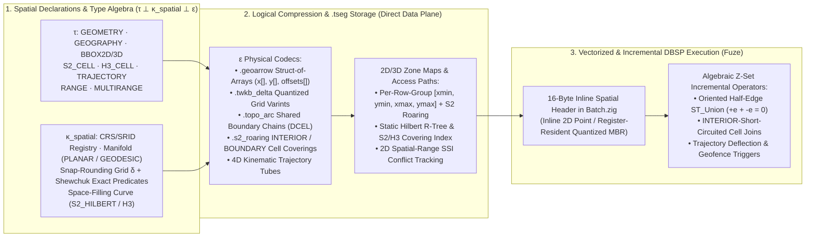

# 17. Geospatial types, topological compression, spatial indexing and incremental spatio-temporal queries

[Roadmap](README.md) · [Standards & Multi-Model #31](https://github.com/spoke-sh/transit/issues/31) · [Performance #76](https://github.com/spoke-sh/transit/issues/76) · **Status:** Planned

Deliver first-class **geospatial and spatio-temporal storage, logical
compression, indexing and vectorized/incremental query execution** across
`TablePartition`, `StreamPartition`, `DocumentPartition` and `Fuze`. Formalize
spatial data under Transit's orthogonal **logical type ($\tau$), spatial
reference/manifold/precision rule ($\kappa_{\text{spatial}}$) and physical codec
($\epsilon$)** architecture, and exploit the mathematical duality between planar
/ grid graphs and continuous geometry to compress polygonal coverages, cell
coverings and moving-object trajectories in concert with the **DBSP / Z-set
incremental dataflow engine**.

## Prerequisites and architectural rationale

Consume [data identities](01-declarative-data-lifecycle.md),
[`.tseg` storage and codecs](02-storage-and-query-performance.md),
[statement results](04-statement-results-and-consumption.md),
[transactions](05-transactions-and-atomic-composition.md),
[declarative streams and queues](06-streams-queues-and-durable-runtime.md),
[logical Document storage](07-document-storage-and-station-decoupling.md),
[standards, collations and type formalizations](10-standards-and-catalogs.md),
[indexing and access paths](11-indexing-and-access-paths.md),
[analytical SQL, bitemporal `AS OF JOIN` and WAL-activated dataflows](12-sql-and-dataflows.md),
[zero-allocation slabs, `CLUSTER BY` space-filling curves and WCOJ](13-data-structures-and-performance.md),
[16-byte inline vector headers and Roaring posting intersections](14-vectorized-strings-and-search.md),
[data-centric compilation and SIMD specialization](15-data-centric-compilation-and-specialization.md)
and [Document profiles and `PDF` spatial layout spans](16-document-profiles-and-gateway-exchange-lifecycle.md).
Start from [Tables](../handbook/reference/tables.md),
[data types](../handbook/reference/sql/types.md),
[storage runtime](../handbook/internals/storage-runtime.md) and
[query engine](../handbook/internals/query-engine.md).

This milestone resolves four foundational problems in spatial and
spatio-temporal data systems:

1. **Bridging the Graph $\leftrightarrow$ Geometry Duality with Continuous Manifold & Precision Semantics ($\tau \perp \kappa_{\text{spatial}} \perp \epsilon$):**
   Discrete structures in computational geometry behave like graphs: a polygonal
   coverage (parcels, census blocks, administrative boundaries) or road network
   is a planar embedded graph $G = (V, E, F)$ (a Doubly-Connected Edge List /
   DCEL of $0$-vertices, $1$-boundary chains and $2$-faces), a Discrete Global
   Grid System (`S2`, `H3`) is a hierarchical tree vertically and a $k$-regular
   adjacency graph horizontally, and a spatial join `ST_Intersects(A, B)` defines
   a bipartite intersection graph $G_\bowtie$. Yet unlike a pure property graph
   where edges are declared by discrete key equality (`u.id = e.src`), spatial
   incidence is **implicit in a continuous metric manifold**:
   - Coordinates are interpreted under a **Coordinate Reference System (CRS /
     SRID)** and an edge-interpolation model: Euclidean straight lines in
     `GEOMETRY` (`PLANAR`) versus great-circle / ellipsoidal arcs on the WGS84
     ellipsoid in `GEOGRAPHY` (`GEODESIC`, with $\pm 180^\circ$ antimeridian
     wrapping and polar singularities).
   - $\ge 2$-dimensional spaces have **no canonical 1D total order**: any
     space-filling curve ($\mathbb{R}^2 \to \mathbb{R}^1$ via Hilbert or Z-order)
     suffers quadrant-boundary discontinuities, requiring multi-dimensional
     bounding-box zone maps (`[xmin, ymin, xmax, ymax]`) and multi-interval range
     decomposition for sound pruning.
   - Naive IEEE-754 `float64` coordinate arithmetic is non-associative and
     topologically brittle: without **Shewchuk adaptive-precision exact
     orientation predicates (`orient2d`, `incircle`)** and a **deterministic
     Snap-Rounding Grid ($\delta_{\text{grid}}$)**, constructive operations
     (`ST_Intersection`, `ST_Union`) produce self-intersecting slivers or
     platform-dependent FMA drift.
   By formalizing $\kappa_{\text{spatial}} = (\text{SRID}, \text{Manifold},
   \delta_{\text{grid}}, \text{SpaceFillingCurve})$ as the spatial analog of
   string collation $\kappa$, every spatial comparison, index probe, zone map and
   constructive operator executes deterministically across architectures.
2. **Logical Compression in Concert with the DBSP / Z-Set Incremental Engine:**
   Conventional spatial extensions (PostGIS, DuckDB Spatial, Sedona) store each
   row as an isolated WKB vertex blob. That representation duplicates shared
   boundaries between adjacent polygons, forces full $O(V)$ point-in-polygon math
   on every join candidate, makes `ST_Union` a non-linear, non-invertible
   $O(V \log V)$ cascade that cannot retract deleted (`-row`) polygons in an
   incremental dataflow, and triggers continuous geofence queries on every raw
   GPS ping. Transit combines three logical compression primitives with
   [Milestone 12's](12-sql-and-dataflows.md) DBSP Z-set engine:
   - **Topological Shared-Arc Decomposition (`.topo_arc`) $\implies$ Linear Z-Set `ST_Union`:**
     Shared boundary chains between topological junctions are stored once per
     segment with fixed-grid delta-varint coding, and polygons reference signed
     chain IDs (`[+e_1, +e_2, -e_7]`). Because adjacent faces traverse their
     shared boundary in opposite orientations ($+\vec{e}$ and $-\vec{e}$),
     boundary homology turns incremental `GROUP BY ... ST_Union(geom)` and
     `-row` retractions into **linear Z-set integer weight addition and
     cancellation** ($\partial(F_1 \cup F_2) = \partial F_1 \oplus \partial F_2$
     where $(+\vec{e}) + (-\vec{e}) = 0$) in $O(1)$ per boundary arc without
     running polygon clipping on unchanged interiors.
   - **Hierarchical `INTERIOR` / `BOUNDARY` Cell Coverings (`S2` / `H3` + Roaring Bitmaps) $\implies$ $O(1)$ Short-Circuit Spatial Joins:**
     Geometries decompose into canonical multi-resolution `S2` Hilbert intervals
     or `H3` cells partitioned into **`INTERIOR` cells** (100% contained inside
     the geometry, compressed into `.tseg` Roaring bitmaps with zero vertex
     coordinates) and **`BOUNDARY` cells** (storing only the clipped edge subset
     intersecting that cell). In finite and incremental bilinear spatial joins
     ($dA \bowtie B + A \bowtie dB + dA \bowtie dB$), any collision involving an
     `INTERIOR` cell immediately evaluates `ST_Intersects` / `ST_Contains` to
     `TRUE` in $O(1)$ bitmask/hash time with **zero floating-point geometry
     math**, while localized vertex edits emit Z-set deltas (`+cell`/`-cell`)
     only for the affected boundary cells.
   - **Spatio-Temporal Dead-Reckoning Trajectory Tubes $\implies$ Semantic Delta Suppression:**
     High-frequency moving-entity streams (`StreamPartition`) compress colinear
     constant-velocity runs within declared tolerance $\varepsilon_{\text{meters}}$
     into piecewise-linear 4D `(x0, y0, t0) -> (x1, y1, t1)` trajectory segments.
     Downstream continuous geofence dataflows and reactive watches wake **only**
     when a trajectory deflects outside its $\varepsilon$-tube or crosses a cell
     covering boundary, while bitemporal `AS OF JOIN` interpolates exact
     bounded-error positions at any historical timestamp $t$.
3. **16-Byte Inline Spatial Vector Headers & Columnar `.geoarrow` Execution:**
   Mirroring [Milestone 14's](14-vectorized-strings-and-search.md) 16-byte
   Umbra/German string header, `Fuze`'s `Batch.zig` represents spatial columns
   with a **16-byte Inline Spatial Header**
   (`[subtype_and_flags: u16][srid_id: u16][s2_hilbert_prefix: u32][quantized_mbr_or_inline_xy: 8B]`).
   2D `POINT(x, y)` coordinates reside completely inline with zero pointer
   indirection, while `LINESTRING` and `POLYGON` lanes carry an inline quantized
   64-bit bounding box and `S2`/Hilbert prefix so SIMD filter and join kernels
   reject $>95\%$ of non-intersecting pairs in CPU registers before touching
   out-of-line `.geoarrow` Struct-of-Arrays coordinate buffers.
4. **Five-State Topological Validity & Three-Way Spatial Branch Merging:**
   Malformed external geometries (unclosed polygon rings, bow-tie
   self-intersections, `NaN`/`Inf` coordinates, out-of-range latitudes or unknown
   SRIDs) never abort a bulk `COPY` or silently produce bogus `ST_Area` results:
   they are preserved as **`IS TYPE_ERROR`** cells with exact ring/edge/byte
   provenance (`SelfIntersection at ring 0, edge 14 <-> 89`), inspectable via
   `ST_IsValidReason` and repairable via declarative `ST_MakeValid`. Across
   branches ([Milestone 19](19-branches-merges-and-restore.md)), incompatible
   edits to shared topological boundary arcs or feature geometries surface
   natively as **`IS CONFLICT`** cells.

## Orthogonal spatial type, manifold and codec matrix ($\tau \perp \kappa_{\text{spatial}} \perp \epsilon$)

| Logical Type ($\tau$) | Spatial Reference, Manifold & Precision ($\kappa_{\text{spatial}}$) | Physical `.tseg` & `Batch` Codecs ($\epsilon$) | Five-State & Incremental DBSP Semantics |
| --- | --- | --- | --- |
| **`GEOMETRY(subtype, srid, dim)`** (`POINT`, `LINESTRING`, `POLYGON`, `MULTI*`, `GEOMETRYCOLLECTION`, `XY`/`XYZ`/`XYM`/`XYZM`) | Planar Cartesian manifold (`PLANAR`); catalog-bound `SRID` (e.g., `0` local CAD/PDF layout, `3857` Web Mercator, state-plane/UTM); snap-rounding grid scale $\delta_{\text{grid}}$; `HILBERT_2D` curve order | **16B Inline Spatial Header** + `.geoarrow` Struct-of-Arrays (`float64` or quantized `int64` `x[]`, `y[]`, `z[]`, `m[]` + ring/part offsets) or `.twkb_delta` zig-zag varints | Unclosed rings, self-intersections or `NaN`/`Inf` $\to$ `IS TYPE_ERROR` with ring/edge witness; 3-way branch feature conflicts $\to$ `IS CONFLICT` |
| **`GEOGRAPHY(subtype, srid, dim)`** (default `SRID 4326` WGS84 lon/lat) | Spherical / Karney WGS84 ellipsoidal geodesic manifold (`GEODESIC`); great-circle edge interpolation with $\pm 180^\circ$ antimeridian and polar cap handling; `S2_HILBERT` / `H3` ordering | **16B Inline Spatial Header** (unit-sphere / quantized `S2` cell prefix + geodesic bounding cap) + `.geoarrow` or `.twkb_delta` + `.s2_roaring` (`INTERIOR` / `BOUNDARY` covering) | Out-of-bounds latitude ($|\phi| > 90^\circ$) or degenerate antipodal edges $\to$ `IS TYPE_ERROR`; `INTERIOR` cell matches short-circuit narrow-phase geodesic math in $O(1)$ |
| **Topological Coverage (`TOPOLOGY` / `.topo_arc` Polygon & Network Coverages)** | Planar or geodesic snap-rounded DCEL graph $G = (V, E, F)$ at grid resolution $\delta_{\text{grid}}$ with exact Shewchuk `orient2d` node-edge snapping | Shared directed 1-chain table (`arc_id -> delta_quantized_coords`) + per-polygon signed chain-ID list (`[+e_1, +e_2, -e_7]`) + wing/coboundary (`left_face`, `right_face`) index | Incremental `ST_Union(geom)` and `-row` retractions evaluate as linear Z-set sums over oriented boundary arcs ($\partial(F_1 \cup F_2) = \partial F_1 \oplus \partial F_2$, $(+\vec{e}) + (-\vec{e}) = 0$) |
| **`BBOX2D` / `BBOX3D`** (`[xmin, ymin, xmax, ymax]` / `+ [zmin, zmax]`) | Axis-aligned planar box or spherical lon/lat box (explicitly distinguishing antimeridian-crossing boxes where `xmin > xmax`); unified with [Milestone 16](16-document-profiles-and-gateway-exchange-lifecycle.md) `PDF` `(page_no, bbox, span)` layout spans | Unboxed 32-byte (`4 x f64` or quantized `4 x i32`/`i64`) SIMD vector lanes + per-row-group summary zone maps | `xmin > xmax` (in non-wrapping planar `SRID`) or `ymin > ymax` $\to$ `IS TYPE_ERROR`; supports Allen/R-tree box predicates (`&&`, `@>`, `<@`) |
| **`S2_CELL` / `H3_CELL`** (`u64` discrete hierarchical grid identifiers) | Hierarchical containment (`parent(level)`, `children(level)`), Hilbert range intervals (`[cell_min, cell_max]`), and $k$-ring graph adjacency | 64-bit integer vector with `.bitpack` / `.for_delta` or `.s2_roaring` interval-run bitmaps; $O(1)$ bit-shift level truncation and range-join alignment | Corrupt/unassigned face or resolution bits $\to$ `IS TYPE_ERROR`; native equijoin/range-join key for multi-resolution spatial aggregation |
| **`TRAJECTORY`** (`POINT` / `POSE` time series with kinematic interpolation) | Coupled $(\kappa_{\text{spatial}}, \kappa_{\text{tz}})$ with declared dead-reckoning spatial tolerance $\varepsilon_{\text{meters}}$ and temporal period `RANGE<TIMESTAMPTZ>` | Piecewise-linear 4D tube segments (`[x0, y0, t0] -> [x1, y1, t1]`, $\varepsilon$) with delta-quantized waypoints in `StreamPartition` / `TablePartition` `.tseg` | Non-monotonic timestamps or invalid coordinates $\to$ `IS TYPE_ERROR`; suppresses downstream incremental dataflow deltas while motion stays within the active $\varepsilon$-tube and cell covering |

## Delivery sequence

1. **Define the spatial catalog, CRS/SRID registry and $\tau \perp \kappa_{\text{spatial}} \perp \epsilon$ contract.**
   Extend [`FUZE_TYPES_V1.md`](../../contracts/FUZE_TYPES_V1.md),
   [`TABLE_SCHEMA_V1.md`](../../contracts/TABLE_SCHEMA_V1.md) and `DirectCatalog`
   alongside [Milestone 10's](10-standards-and-catalogs.md) companion type
   formalizations (`RANGE<T>` / `MULTIRANGE<T>`, unboxed `VECTOR(dim, T)`,
   deterministic `DECIMAL` arithmetic rules and manifest-pinned `TIMESTAMPTZ`):
   - Bind every `GEOMETRY`, `GEOGRAPHY`, `BBOX2D`/`3D`, `S2_CELL`, `H3_CELL` and
     `TRAJECTORY` column to an immutable $\kappa_{\text{spatial}}$ descriptor in
     the catalog manifest (`manifest/v{N}`), recording the exact `SRID`,
     ellipsoid/projection parameters, `PLANAR` vs. `GEODESIC` edge rule,
     snap-rounding grid scale $\delta_{\text{grid}}$ and space-filling curve
     version.
   - Ship a deterministic, zero-I/O in-engine CRS registry for standard
     coordinate systems (`SRID 0` local/engineering/PDF layout, `SRID 4326`
     WGS84, `SRID 3857` Web Mercator, and standard UTM / national grid zones) with
     explicit `ST_Transform(geom, target_srid)` projective/ellipsoidal
     conversions. Reject implicit cross-SRID binary predicates at compile/admission
     time with an actionable diagnostic rather than silently mixing coordinate
     systems.
   - Implement **Shewchuk adaptive-precision exact geometric predicates**
     (`orient2d`, `orient3d`, `incircle`) in pure Zig with zero heap allocations
     so topological sign decisions and snap-rounding on $\delta_{\text{grid}}$
     are bit-for-bit identical across `x86_64` and `aarch64` targets.
2. **Deliver 16-byte inline spatial headers in `Batch.zig` and columnar `.geoarrow` / `.twkb_delta` codecs in `.tseg`.**
   - Equip `Fuze`'s vectorized `Batch` execution lanes with the **16-byte Inline
     Spatial Header**
     (`[subtype_and_flags: u16][srid_id: u16][s2_hilbert_prefix: u32][quantized_mbr_or_inline_xy: 8B]`):
     store 2D `POINT(x, y)` coordinates directly in the 8-byte payload slot, and
     store a quantized 64-bit bounding box (`[q_xmin: i16, q_ymin: i16, q_xmax: i16, q_ymax: i16]`)
     plus 32-bit `S2`/Hilbert prefix for `LINESTRING`, `POLYGON` and `MULTI*`
     geometries, guaranteeing 16–64 bytes of trailing zero-padding on coordinate
     buffers for unconditional SIMD loads.
   - Implement orthogonal `.tseg` physical codecs ($\epsilon$):
     - **`.geoarrow` (Columnar Struct-of-Arrays):** separate 64-byte-aligned
       `x[]`, `y[]` (and optional `z[]`, `m[]`) coordinate vectors and Arrow
       `ring_offsets[]` / `part_offsets[]` / `geom_offsets[]` buffers so SIMD
       bounding-box, distance and affine-transform kernels scan coordinates
       sequentially without WKB byte-parsing.
     - **`.twkb_delta` (Quantized Grid Delta-Varint):** snap coordinates to
       $\delta_{\text{grid}}$ and encode sequential vertex deltas (`dx`, `dy`)
       with zig-zag bitpacking/varints for $3\times\text{–}6\times$ storage
       compression on dense polylines and polygons.
   - Preserve five-state cell tags (`value`, `null`, `missing`, `type_error`,
     `conflict`): classify unclosed rings, self-intersections, invalid coordinate
     bounds and corrupt WKB/GeoJSON frames as `type_error` cells with exact
     ring/edge/byte offsets, and expose `ST_IsValid`, `ST_IsValidReason` and
     declarative `ST_MakeValid` repair without aborting table scans.
3. **Deliver logical compression for topological coverages (`.topo_arc`), `INTERIOR`/`BOUNDARY` cell coverings (`.s2_roaring`) and 4D trajectories.**
   - **Topological Shared-Arc Decomposition (`.topo_arc`):** decompose polygonal
     coverages and planar networks into shared directed boundary chains between
     topological junctions over $\delta_{\text{grid}}$. Store each unique chain
     once per `.tseg` segment with its bounding box and vertex deltas, and encode
     each polygon as a sequence of signed chain IDs (`[+e_1, +e_2, -e_7]`) so
     adjacent polygons share exact boundaries with zero duplicate vertex storage
     or sliver gaps.
   - **Multi-Resolution `INTERIOR` / `BOUNDARY` Cell Coverings (`.s2_roaring` / `.h3_roaring`):**
     compute bounded adaptive `S2` Hilbert interval coverings (and `H3` hex
     coverings) for polygons and buffers, separating **`INTERIOR` cells**
     (stored as compressed 64-bit prefix intervals in `.tseg` Roaring bitmaps
     sharing [Milestone 6's](06-streams-queues-and-durable-runtime.md) and
     [Milestone 21 A5's](21-formal-semantics-and-correspondence.md#a5-physical-codecs-and-selected-bitmap-representations)
     Roaring container implementation) from **`BOUNDARY` cells** (storing clipped
     edge slices per cell).
   - **Kinematic Trajectory Tube Compression:** provide a declarative trajectory
     segmenter over `StreamPartition` and `TablePartition` that merges colinear
     constant-velocity observations within $\varepsilon_{\text{meters}}$ into 4D
     `TRAJECTORY` segments (`[x0, y0, t0] -> [x1, y1, t1]`, $\varepsilon$),
     supporting exact error-bounded `ST_ValueAtTimestamp`, `ST_LocateAlong`,
     `ST_ClosestPointOfApproach` and spatiotemporal `AS OF JOIN`.
4. **Integrate 2D/3D `.tseg` zone maps, Hilbert R-Tree / `S2` covering indexes and 2D spatial SSI conflict tracking.**
   Extend [Milestone 11](11-indexing-and-access-paths.md) and
   [Milestone 13](13-data-structures-and-performance.md):
   - Record **2D/3D Bounding-Box Zone Maps (`[xmin, ymin, xmax, ymax]`)** (with
     geodesic cap / antimeridian-aware bounds for `GEOGRAPHY`) and **Roaring
     `S2`/`H3` cell summaries** in `.tseg` row-group and segment footers, paired
     with `CLUSTER BY HILBERT(geom)` / `CLUSTER BY S2_CELL(geom)` compaction so
     spatial viewport and proximity queries skip non-overlapping `.tseg`
     segments and row groups in $O(1)$.
   - Deliver two qualified secondary spatial access-method profiles under
     [`INDEX_LIFECYCLE_V1.md`](../../contracts/INDEX_LIFECYCLE_V1.md):
     1. **Static Hilbert-Packed R-Tree (`USING RTREE`)** per immutable `.tseg`
        segment with bounded memtable overlay for arbitrary 2D/3D bounding-box,
        window and $k$-Nearest-Neighbor (`ORDER BY geom <-> pt LIMIT k` branch-and-bound
        priority queue) queries.
     2. **Inverted `S2` / `H3` Cell-Covering Index (`USING S2` / `USING H3`)**
        backed by `.tseg` Roaring bitmaps with separate `INTERIOR` and
        `BOUNDARY` posting lists for high-throughput point-in-polygon, geofence
        and region-intersection joins.
   - Extend [Milestone 11's](11-indexing-and-access-paths.md) fine-grained
     **Serializable Snapshot Isolation (SSI)** validator to track **2D bounding-box
     and `S2` Hilbert-interval read/write predicates**, allowing concurrent
     read-write transactions mutating features in disjoint geographic regions on
     the same Table to commit without false whole-table SSI aborts while
     preventing spatial phantoms and write skew.
5. **Deliver vectorized `ST_*` kernels and DBSP / Z-set incremental spatial operators in `Fuze`.**
   - Implement the core **ISO SQL/MM Spatial (ISO/IEC 13249-3) and OGC Simple
     Features `ST_*` function and aggregate library** over `Fuze`'s two-stage
     broad-phase (16B inline MBR + Roaring `INTERIOR`/`BOUNDARY` cell filter) and
     narrow-phase (SIMD segment sweep + Shewchuk exact predicates) pipeline:
     - *Constructors & Codecs:* `ST_Point`, `ST_MakeLine`, `ST_MakePolygon`,
       `ST_MakeEnvelope`, `ST_GeomFromText` (`WKT`), `ST_GeomFromWKB` / `EWKB`,
       `ST_GeomFromGeoJSON`, `ST_AsText`, `ST_AsBinary`, `ST_AsGeoJSON`,
       `ST_AsMVTGeom` / `ST_AsMVT` (Mapbox Vector Tiles).
     - *Topological Predicates (DE-9IM):* `ST_Intersects`, `ST_Contains`,
       `ST_Within`, `ST_Covers`, `ST_CoveredBy`, `ST_Touches`, `ST_Crosses`,
       `ST_Overlaps`, `ST_Disjoint`, `ST_Equals`, `ST_Relate`.
     - *Measurement & Distance:* planar and Karney WGS84 geodesic `ST_Distance`,
       `ST_DWithin`, `ST_Area`, `ST_Length`, `ST_Perimeter`, `ST_Azimuth`,
       `ST_Centroid`, `ST_PointOnSurface`, `ST_Envelope`, `ST_Extent`.
     - *Constructive & Overlay Operations:* `ST_Intersection`, `ST_Union`,
       `ST_Difference`, `ST_SymDifference`, `ST_Buffer`, `ST_ConvexHull`,
       `ST_Simplify` (topology-preserving Douglas-Peucker / Visvalingam-Whyatt),
       `ST_SnapToGrid`, `ST_DelaunayTriangles`, `ST_VoronoiPolygons`.
     - *Discrete Grid (`S2` / `H3`) Operations:* `S2_CellFromPoint`,
       `S2_Covering`, `S2_CellToPolygon`, `H3_LatLngToCell`, `H3_PolygonToCells`,
       `H3_GridDisk` (`k-ring`), `H3_CellToParent`, `H3_CellToChildren`.
   - Implement **DBSP / Z-set incremental spatial operators** for
     [Milestone 12's](12-sql-and-dataflows.md) `TransitLog`-activated maintained
     views and continuous queries:
     - **Algebraic Z-Set `ST_Union` Aggregate:** maintain a keyed Z-set of
       oriented topological boundary half-edges ($\pm \vec{e}$) per group so
       inserting (`+1`) or retracting (`-1`) a polygon updates the dissolved
       boundary by canceling shared internal half-edges ($(+\vec{e}) + (-\vec{e}) = 0$)
       and reconstructing only modified outer/hole rings, matching the finite
       `ST_Union` recomputation oracle exactly on snap-rounded coverages.
     - **Incremental `INTERIOR` / `BOUNDARY` Spatial Joins:** maintain indexed
       `(cell_id, is_interior, row_id)` Z-set arrangements for
       `ST_Intersects`, `ST_Contains` and `ST_DWithin` joins so streaming point/trajectory
       updates (`dA`) or geofence updates (`dB`) short-circuit narrow-phase
       geometry evaluation on `INTERIOR` hits and bound per-batch memory with
       Tier 2 NVMe spill.
     - **Semantic Trajectory Delta Suppression:** filter continuous stream
       operators so moving entities emit downstream join deltas only when
       crossing an indexed `S2`/`H3` covering boundary or exceeding their
       declared $\varepsilon_{\text{meters}}$ dead-reckoning tube.
6. **Qualify correctness, resource budgets and performance against independent spatial oracles.**
   Verify all operators against independent reference oracles (GEOS / PostGIS /
   Karney GeographicLib / reference `S2` & `H3` fixtures), enforce zero
   steady-state heap allocations after warmup on spatial scan/filter/join hot
   paths via `scratch` arenas, and record benchmark scorecards against PostGIS
   and DuckDB Spatial in the [proof ledger](../history/qualification/README.md).

## Completion evidence

| Journey | Required evidence |
| --- | --- |
| Declare and validate $\tau \perp \kappa_{\text{spatial}} \perp \epsilon$ | SQL and SDK callers declare `GEOMETRY`, `GEOGRAPHY`, `BBOX2D`/`3D`, `S2_CELL`, `H3_CELL` and `TRAJECTORY` columns with explicit `SRID`, manifold and precision grid $\delta_{\text{grid}}$; cross-SRID predicate mismatches reject at compile time; malformed rings/bounds surface as `IS TYPE_ERROR` with exact ring/edge provenance |
| Query through 2D/3D zone maps and `RTREE` / `S2` / `H3` indexes | Independent full-scan oracle at the same `SnapshotId` cut agrees on values, multiplicity, five-state tags and `ORDER BY geom <-> pt LIMIT k` tie-breaking across planar, antimeridian-wrapping (`\pm 180^\circ`), polar (`\pm 90^\circ`) and degenerate cases |
| Logical compression & incremental DBSP equivalence | Incremental maintained views running `GROUP BY ... ST_Union(geom)` (via topological half-edge Z-set cancellation), `ST_Intersects` / `ST_DWithin` joins (via `INTERIOR`/`BOUNDARY` cell coverings) and trajectory geofencing under `+row`/`-row` `TransitLog` updates match the finite recomputation oracle at every completed basis |
| Concurrent spatial transactions & online index builds | Concurrent read-write transactions updating disjoint spatial regions commit under 2D Hilbert/cell-range SSI while overlapping write-skew/phantom schedules abort; interrupted online `RTREE`/`S2` index backfills catch up from `TWAL1` without omitting or double-counting features |
| Exceed RAM and enforce `policy_epoch` | Spatial joins, polygon overlays and `ST_AsMVT` tile aggregations exceeding morsel memory budgets spill deterministically to Tier 2 NVMe and recheck current `policy_epoch` authorization before disclosing geometry batches |

## Later owners

- [Multi-model and multi-format foreign relations](18-multi-model-and-foreign-relations.md)
  composes spatial networks with SQL/PGQ Property Graphs (`A*` / shortest-path
  routing and WCOJ + spatial joins), **Geo-Filtered Hybrid Search** (combining
  256-doc Block-Max BM25, ANN vector similarity and `.s2_roaring` spatial cell
  bitmaps in one query plan), and `FOREIGN TABLE` / `COPY` adapters for
  **`GeoParquet` v1.1**, **`FlatGeobuf`**, **`GeoArrow`** IPC/Flight,
  **`Shapefile` / `GeoPackage`** and **`PMTiles` / `MVT`** vector tiles.
- [Branches, merges and restore](19-branches-merges-and-restore.md) uses `.tseg`
  2D bounding-box and Hilbert zone maps for $O(1)$ spatial segment skipping in
  `DIFF(table, base, branch)` and detects three-way topological arc/feature
  conflicts (`IS CONFLICT`).
- [Formal semantics and implementation correspondence](21-formal-semantics-and-correspondence.md)
  extends **A2 (`CollationOrder.lean`)** to prove 2D MBR / Hilbert / `S2`
  covering pruning soundness (including geodesic edge-inflation bounds) and
  **A3 (`FuzeDelta.lean`)** to prove DBSP Z-set equivalence for oriented
  topological half-edge `ST_Union` and `INTERIOR`/`BOUNDARY` cell-covering
  spatial joins.
- [Enterprise identity and the Control & Policy Plane](26-control-and-policy-plane.md)
  enforces **Geospatial Row-Level Security (Spatial RLS)** (such as
  `USING (ST_CoveredBy(location, authorized_region))`) with security-barrier
  evaluation so untrusted predicates or zone maps never leak out-of-region
  geometry coordinates or `type_error` side-channels.
- [Board reimplementation and data-first workbench](29-board-reimplementation.md)
  renders read-only interactive map layers (`MVT` / `GeoArrow`), trajectory
  streams, `PDF` layout bounding boxes and 2-way/3-way spatial `DIFF` /
  `IS CONFLICT` overlays over public result APIs.
- [SQL grammar, standards comparison and dialect ergonomics](34-sql-grammar-and-dialect-ergonomics.md)
  audits `GEOMETRY`/`GEOGRAPHY` type modifiers, `ST_*` functions and `RANGE`
  operators against **ISO/IEC 13249-3 (SQL/MM Spatial)**, **OGC Simple
  Features**, **PostGIS**, **DuckDB Spatial**, **Snowflake** and **GoogleSQL**.
