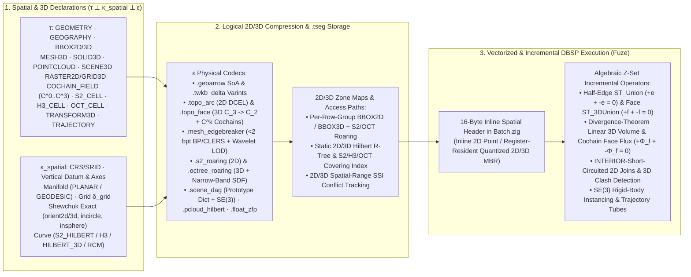

# 17. Geospatial types, topological compression, spatial indexing and incremental spatio-temporal queries

[Roadmap](README.md) · [Standards & Multi-Model #31](https://github.com/spoke-sh/transit/issues/31) · [Performance #76](https://github.com/spoke-sh/transit/issues/76) · **Status:** Planned

Deliver first-class **2D/3D geospatial, volumetric 3D model, discrete exterior
calculus (DEC) / finite-volume cochain field and spatio-temporal
storage, logical compression, indexing and vectorized/incremental query
execution** across `TablePartition`, `StreamPartition`, `DocumentPartition` and
`Fuze`. Formalize spatial, 3D volumetric and continuum field data under Transit's orthogonal
**logical type ($\tau$), spatial reference/manifold/precision rule
($\kappa_{\text{spatial}}$) and physical codec ($\epsilon$)** architecture, and
exploit the mathematical duality between **cellular chain complexes ($C_0, C_1,
C_2, C_3$) / cochain spaces ($C^0, C^1, C^2, C^3$) / discrete grid graphs** and continuous geometry to compress
polygonal coverages, 3D manifold meshes, volumetric polyhedral solids,
topology-decoupled finite-volume/DEC field slices (`COCHAIN_FIELD` with
error-bounded `.float_zfp` bitplane encoding), instanced
scene graphs, LiDAR point clouds, cell/octree coverings and moving-object
trajectories in concert with the **DBSP / Z-set incremental dataflow engine**.

## Prerequisites and architectural rationale

Consume [data identities](01-declarative-data-lifecycle.md),
[`.tseg` storage and codecs](02-storage-and-query-performance.md),
[statement results](04-statement-results-and-consumption.md),
[transactions](05-transactions-and-atomic-composition.md),
[declarative streams and queues](06-streams-queues-and-durable-runtime.md),
[logical Document storage](07-document-storage-and-station-decoupling.md),
[standards, collations and type formalizations](10-standards-and-catalogs.md),
[indexing and access paths](11-indexing-and-access-paths.md),
[analytical SQL, bitemporal `AS OF JOIN` and WAL-activated dataflows](12-sql-and-dataflows.md),
[zero-allocation slabs, `CLUSTER BY` space-filling curves and WCOJ](13-data-structures-and-performance.md),
[16-byte inline vector headers and Roaring posting intersections](14-vectorized-strings-and-search.md),
[data-centric compilation and SIMD specialization](15-data-centric-compilation-and-specialization.md)
and [Document profiles and `PDF` spatial layout spans](16-document-profiles-and-gateway-exchange-lifecycle.md).
Start from [Tables](../handbook/reference/tables.md),
[data types](../handbook/reference/sql/types.md),
[storage runtime](../handbook/internals/storage-runtime.md) and
[query engine](../handbook/internals/query-engine.md).

This milestone resolves four foundational problems in 2D/3D spatial, volumetric
3D model and spatio-temporal data systems:

1. **Bridging the Cellular Chain Complex $\leftrightarrow$ Continuous Manifold Duality ($\tau \perp \kappa_{\text{spatial}} \perp \epsilon$):**
   Discrete structures in 2D and 3D computational geometry form a graded
   **Cellular Chain Complex ($C_0, C_1, C_2, C_3$)** equipped with linear
   boundary operators $\partial_k: C_k \to C_{k-1}$ satisfying the fundamental
   homological identity $\partial_{k-1} \circ \partial_k = 0$:
   $$C_3 \text{ (3-Solids/Volumes)} \xrightarrow{\partial_3} C_2 \text{ (Oriented 2-Faces)} \xrightarrow{\partial_2} C_1 \text{ (Directed 1-Edges)} \xrightarrow{\partial_1} C_0 \text{ (0-Vertices)}$$
   A 2D polygonal coverage or road network is a planar Doubly-Connected Edge
   List (DCEL) over $(C_0, C_1, C_2)$, a 3D manifold mesh or polyhedral B-Rep
   solid (`MESH3D`, `SOLID3D`) is a Half-Edge / Radial-Edge complex over
   $(C_0, C_1, C_2, C_3)$ whose coboundary operator $\delta_2 = \partial_3^\top$
   maps each shared 2-face to `(left_solid, right_solid)` (defining the dual room
   / mechanical-part adjacency graph), a Discrete Global Grid or Octree (`S2`,
   `H3`, `OCT_CELL`) is a hierarchical tree vertically and a $k$-regular
   adjacency graph horizontally, and a 2D/3D spatial join (`ST_Intersects`,
   `ST_3DIntersects`) defines a bipartite intersection or clash graph $G_\bowtie$.
   Yet unlike a pure property graph where edges are declared by discrete key
   equality (`u.id = e.src`), spatial and volumetric incidence is **implicit in
   a continuous metric manifold**:
   - Coordinates are interpreted under a **Coordinate Reference System (CRS /
     SRID)**, vertical datum and axis/unit convention: Euclidean straight lines
     and flat planes in `GEOMETRY` / `MESH3D` / `SOLID3D` (`PLANAR`, including
     local engineering/CAD/BIM `SRID 0` with explicit unit scale `mm`/`m` and
     `RightHanded_ZUp` vs. `YUp` orientation, or 3D `EPSG:4979` ellipsoidal /
     `EGM2008` orthometric height) versus great-circle / ellipsoidal arcs on the
     WGS84 ellipsoid in `GEOGRAPHY` (`GEODESIC`, with $\pm 180^\circ$
     antimeridian wrapping and polar singularities).
   - $\ge 2$-dimensional spaces have **no canonical 1D total order**: any
     space-filling curve ($\mathbb{R}^2 \text{ or } \mathbb{R}^3 \to \mathbb{R}^1$
     via 2D/3D Hilbert or Z-order/Morton) suffers quadrant/octant-boundary
     discontinuities, requiring multi-dimensional bounding-box zone maps
     (`BBOX2D` `[xmin, ymin, xmax, ymax]` and `BBOX3D` `+ [zmin, zmax]`) and
     multi-interval range decomposition for sound pruning.
   - Naive IEEE-754 `float64` coordinate arithmetic is non-associative and
     topologically brittle: without **Shewchuk adaptive-precision exact
     orientation predicates (`orient2d`, `orient3d`, `incircle`, `insphere`)**
     and a **deterministic 2D/3D Snap-Rounding Grid ($\delta_{\text{grid}}$)**,
     boolean overlays (`ST_Intersection`, `ST_Union`, `ST_3DUnion`,
     `ST_3DDifference`) produce self-intersecting slivers, non-manifold edges or
     platform-dependent FMA drift.
   By formalizing $\kappa_{\text{spatial}} = (\text{SRID}, \text{Manifold},
   \text{VerticalDatum/Axes}, \delta_{\text{grid}}, \text{SpaceFillingCurve})$ as
   the spatial analog of string collation $\kappa$, every 2D/3D spatial
   comparison, index probe, zone map and constructive operator executes
   deterministically across architectures.
2. **Logical 2D & 3D Compression in Concert with the DBSP / Z-Set Incremental Engine:**
   Conventional spatial and 3D extensions (PostGIS / SFCGAL, DuckDB Spatial,
   uncompressed STL/OBJ/WKB blobs) store each polygon or 3D triangle soup as an
   isolated vertex/triangle array. That representation duplicates shared 1-edges
   and 2-faces between adjacent features, wastes 384 bits per triangle on pointer
   connectivity, duplicates identical CAD/BIM parts (`M8` bolts, structural
   columns, chairs) thousands of times across an assembly, forces $O(F^2)$
   triangle-triangle intersection tests during 3D clash detection, and makes
   `ST_Union`, `ST_3DUnion` and `SUM(ST_Volume)` non-linear cascades that cannot
   retract deleted (`-row`) features in an incremental dataflow. Transit combines
   eight logical compression primitives with [Milestone 12's](12-sql-and-dataflows.md)
   DBSP Z-set engine:
   - **Topological Shared-Arc (`.topo_arc`) & Shared-Face (`.topo_face`) Decomposition + Discrete Divergence Theorem $\implies$ Linear Z-Set `ST_Union`, `ST_3DUnion` & Volume Aggregates:**
     In 2D coverages (`.topo_arc`), shared 1-chains between junctions are stored
     once per segment and polygons reference signed chain IDs (`[+e_1, +e_2, -e_7]`).
     In 3D cellular complexes (`.topo_face`), shared 2-faces between adjacent 3D
     solids (BIM rooms sharing a wall/slab, geological strata, finite-element
     cells) are stored once with coboundary `(left_solid, right_solid)` links and
     solids reference signed face IDs (`[+f_1, +f_4, -f_9]`). Because adjacent
     regions traverse shared boundaries in opposite orientations ($+\vec{e}/-\vec{e}$
     in 2D, $+\vec{f}/-\vec{f}$ in 3D), **boundary homology turns incremental
     `ST_Union(geom)` and `ST_3DUnion(solid)`—including `-row` retractions—into
     linear Z-set integer weight addition and cancellation**:
     $$\partial_2(F_1 \cup F_2) = \partial_2 F_1 \oplus \partial_2 F_2 \quad ((+\vec{e}) + (-\vec{e}) = 0), \qquad \partial_3(V_1 \cup V_2) = \partial_3 V_1 \oplus \partial_3 V_2 \quad ((+\vec{f}) + (-\vec{f}) = 0)$$
     Furthermore, by the **Discrete Divergence Theorem (Gauss–Ostrogradsky)**, the
     signed volume, centroid and inertia tensor of any closed 3D solid $V$ reduce
     to linear sums over its oriented boundary triangles $\partial_3 V$:
     $$\text{Volume}(V) = \frac{1}{6} \sum_{f=(p_1, p_2, p_3) \in \partial_3 V} \text{orient3d}(0, p_1, p_2, p_3)$$
     making incremental 3D volume, surface-area and mass-property maintenance an
     $O(|\Delta \partial_3 V|)$ Abelian group sum in DBSP.
   - **Succinct Edgebreaker Mesh Connectivity & Wavelet LOD (`.mesh_edgebreaker`) $\implies$ $<2\text{ Bits/Triangle}$ + Progressive Streaming:**
     Instead of storing $3 \times 32 = 96$ bits of vertex indices per triangle,
     manifold 3D meshes decompose into a **vertex spanning tree + dual triangle
     spanning tree** encoded via **Rossignac Edgebreaker (`CLERS` opcodes)** and
     [Milestone 7's](07-document-storage-and-station-decoupling.md) $2N$-bit
     Balanced Parentheses (`BP`) succinct tree bitvectors in **$< 2$ bits per
     triangle**, paired with **parallelogram vertex prediction**
     ($\hat{v}_{\text{new}} = v_L + v_R - v_{\text{opp}}$) zig-zag varint
     residuals, 16-bit **octahedral unit normals**, and **multi-resolution wavelet
     LOD page prefixes** (`LOD_0` coarse base mesh $\to$ `LOD_k` progressive
     vertex-split refinements) so queries and viewport renderers read only the
     required LOD prefix.
   - **Hierarchical `INTERIOR` / `BOUNDARY` 2D Cell (`.s2_roaring`) & 3D Octree/Voxel (`.octree_roaring`) Coverings $\implies$ $O(1)$ Short-Circuit Spatial Joins & 3D Clash Detection:**
     2D geometries decompose into `S2`/`H3` cells (`.s2_roaring`) and 3D solids
     decompose into 64-bit hierarchical Morton/Hilbert octree cells (`OCT_CELL`
     in `.octree_roaring`), partitioned into **`INTERIOR` cells/octants** (100%
     inside the polygon/solid, compressed into `.tseg` Roaring bitmaps with zero
     vertex/triangle storage) and **`BOUNDARY` (narrow-band surface) cells/octants**
     (storing only the clipped local edge/triangle patch or a quantized
     Dual-Contouring Signed Distance Field `SDF` + Hermite surface normal). In
     finite and incremental bilinear joins ($dA \bowtie B + A \bowtie dB + dA \bowtie dB$),
     any collision with an `INTERIOR` cell/octant immediately evaluates
     `ST_Intersects`, `ST_Contains` or 3D BIM/CAD clash detection
     (`ST_3DIntersects`, `ST_3DClearance`) to `TRUE` in **$O(1)$ Roaring bitmask
     time with zero floating-point triangle-triangle math**, while local surface
     edits emit Z-set deltas (`+oct_cell`/`-oct_cell`) only for the touched
     octants.
   - **Instanced Scene-Graph DAGs (`.scene_dag`) & Lie Group $SE(3)/\text{Sim}(3)$ Action $\implies$ Zero-Copy Kinematic Updates:**
     Canonical 3D part geometries (`MESH3D` / `SOLID3D`) are stored once in a
     `.tseg` prototype dictionary (`prototype_id -> .mesh_edgebreaker + .octree_roaring`),
     while scene graphs and CAD/BIM assemblies (`SCENE3D`) are stored as compact
     relational DAG rows `(node_id, parent_id, prototype_id, transform_se3, world_bbox3d)`
     with 48-byte `TRANSFORM3D` rigid/similarity transforms (`vec3` translation +
     `quat4` unit quaternion + scale). Moving a robot arm, vehicle or assembly
     sub-tree updates only the 48-byte `TRANSFORM3D` in `TWAL1` and transforms the
     local octree/BBOX on the fly without copying or re-indexing the prototype's
     triangles.
   - **3D Hilbert Point-Cloud Compression (`.pcloud_hilbert`) & 4D Dead-Reckoning Trajectory Tubes $\implies$ Sub-Byte Point Clouds & Semantic Delta Suppression:**
     LiDAR, photogrammetry and RGB-D `POINTCLOUD` tables cluster points by 3D
     Hilbert key (`CLUSTER BY HILBERT3D(pt)`) into 4,096-point `.pcloud_hilbert`
     blocks with Frame-of-Reference (`FOR`) bitpacked $(\Delta x, \Delta y, \Delta z)$
     offsets from the block's `BBOX3D` origin. Moving-entity streams
     (`StreamPartition`) compress colinear constant-velocity runs within
     $\varepsilon_{\text{meters}}$ into 4D `(x0, y0, z0, t0) -> (x1, y1, z1, t1)`
     `TRAJECTORY` tubes, waking downstream continuous geofences and 3D zone
     watches only when a trajectory deflects outside its $\varepsilon$-tube or
     crosses an `S2`/`H3`/`OCT_CELL` covering boundary.
   - **Topology-Decoupled Discrete Exterior Calculus (DEC) / Finite-Volume Cochain Fields (`COCHAIN_FIELD`) & Error-Bounded Bitplane Float Compression (`.float_zfp`) $\implies$ Zero-Duplication Continuum Time Series & Linear Z-Set Flux Conservation:**
     In Computational Fluid Dynamics (CFD), weather/ocean modeling and continuum
     mechanics, an unstructured polyhedral finite-volume mesh (`polyMesh`) is a
     `.topo_face` cellular complex $(C_0, C_1, C_2, C_3)$ whose coboundary
     operator $\delta_2 = \partial_3^\top: C_2 \to C_3 \times C_3$ is the exact
     `owner[f]` / `neighbour[f]` face-adjacency table. Rather than duplicating a
     multi-gigabyte mesh across 10,000 timesteps, Transit stores the immutable or
     incrementally remeshed `.topo_face` / `OCT_CELL` topology once in a cataloged
     mesh table (`mesh_definition_id`, with cells ordered by `HILBERT_3D` or
     Reverse Cuthill–McKee `RCM` bandwidth reduction so $>90\%$ of interior faces
     connect cells within the same L1d/L2 cache morsel) and represents each
     timestep's physical state as a **topology-decoupled `COCHAIN_FIELD` column**
     over dual cochain spaces: 0-cochains $C^0$ (nodal potentials), 1-cochains
     $C^1$ (edge circulations $\int_e \vec{u} \cdot d\vec{\ell}$), 2-cochains
     $C^2$ (oriented face fluxes $\Phi_f = \int_f \rho \vec{u} \cdot d\vec{A}$)
     and 3-cochains $C^3$ (cell-averaged conserved states $\rho, \rho\vec{u}, E, p$).
     Because continuous IEEE-754 mantissas appear pseudo-random to integer
     bitpacking/LZ4, floating-point field arrays in `COCHAIN_FIELD`,
     `RASTER2D`/`GRID3D` and [Milestone 19's](19-game-asset-pipelines-and-simulation-streaming.md)
     `VOLUME_GRID` use **`.float_zfp` error-bounded bitplane compression**: a
     $4^d$ ($4\times 4\times 4$) `HILBERT_3D`-blocked decorrelating lifting
     transform with embedded bitplane coding governed by $\kappa_{\text{numeric}}$
     (`LOSSY_ABS_TOL(eps)` $\|\hat{u} - u\|_\infty \le \varepsilon_{\text{abs}}$,
     `FIXED_RATE(bits)` or `LOSSLESS`), storing conservation-preserving block
     headers (`min`, `max`, exact block mean/integral in the 0th transform
     coefficient, `max_gradient_norm`, `max_divergence`) and enabling progressive
     most-significant-bitplane streaming. By the **Generalized Stokes /
     Gauss–Ostrogradsky Theorem** ($\langle d\omega, c \rangle = \langle \omega, \partial c \rangle$),
     net control-volume flux across any union of 3-cells reduces to a linear
     DBSP Z-set sum over 2-cochain face fluxes where shared interior faces cancel
     identically ($(+\Phi_f) + (-\Phi_f) = 0$).
   - **2.5D VLSI / EDA Manhattan Chip Layouts (`.layout_manhattan`), 3D Structural-Biology Atomic Clouds & Block-Compressed Sparse Matrices (`.sparse_bcsr`) $\implies$ Incremental DBSP `DRC`/`LVS` & Spatial Multi-Omics:**
     Semiconductor physical designs (`OASIS` / `GDSII` / `LEF` / `DEF`) repeat
     standard cells and `SRAM` bitcells $10^8\text{–}10^{11}$ times on a
     nanometer integer grid ($\delta_{\text{grid}} = 1\,\text{nm}$) across 50–100
     metal/via layers (`M1..Mn`, `V1..Vn`). By specializing `.scene_dag` and
     `.topo_arc` into **`.layout_manhattan`** (encoding axis-aligned/45° integer
     rectangles, $D_4$ dihedral reflections/rotations, and 2D array pitch
     `(nx, ny, dx, dy)`), **Design Rule Checking (`DRC`: minimum width, spacing,
     enclosure via `ST_DWithin` / boundary cancellation)** and **Layout-Versus-Schematic
     (`LVS`: via-connected SQL/PGQ netlist extraction)** evaluate incrementally in
     DBSP in $O(|\Delta \text{tiles}|)$ when an engineer edits a cell on a branch.
     In structural biology and spatial omics, 3D protein/molecular structures
     (`PDB` / `mmCIF`) map onto `.pcloud_hilbert` at Ångström precision
     ($\delta_{\text{grid}} = 10^{-3}\,\text{Å}$) with **Solvent-Accessible
     Surface Area (`SASA`) and Connolly excluded volume** computed via
     `.octree_roaring` (`INTERIOR`/`BOUNDARY` van der Waals sphere unions),
     subcellular mRNA transcript spots (`10x Xenium`/`MERFISH`) join against 2D/3D
     segmented cell boundaries via `INTERIOR`-short-circuited coverings, and
     single-cell expression matrices (`AnnData` `.h5ad` / `TileDB-SOMA`) compress
     into **`.sparse_bcsr` (Block-Compressed Sparse Row/Column with Roaring
     non-zero bitmaps)**.
3. **16-Byte Inline Spatial Vector Headers & Columnar `.geoarrow` / 3D Execution:**
   Mirroring [Milestone 14's](14-vectorized-strings-and-search.md) 16-byte
   Umbra/German string header, `Fuze`'s `Batch.zig` represents 2D and 3D spatial
   columns with a **16-byte Inline Spatial Header**
   (`[subtype_and_flags: u16][srid_id: u16][hilbert_s2_or_oct_prefix: u32][quantized_mbr_or_inline_xy: 8B]`).
   2D `POINT(x, y)` coordinates reside completely inline with zero pointer
   indirection, while 2D/3D polylines, polygons, `MESH3D`, `SOLID3D` and
   `POINTCLOUD` patches carry an inline quantized 64-bit 2D/3D bounding box and
   32-bit `S2` or 3D Hilbert/`OCT_CELL` prefix so SIMD filter and join kernels
   reject $>95\%$ of non-intersecting pairs in CPU registers before touching
   out-of-line `.geoarrow` or `.mesh_edgebreaker` buffers.
4. **Five-State 2D/3D Topological Validity & Three-Way Spatial/Volumetric Branch Merging:**
   Malformed external 2D/3D geometries (unclosed polygon rings, bow-tie
   self-intersections, non-manifold 3D edges with $>2$ incident faces, open /
   non-watertight `SOLID3D` shells where $\partial_2(\partial_3 V) \neq 0$ or the
   Euler–Poincaré invariant $V - E + F = 2(1 - g)$ fails, inverted face normals,
   non-unit quaternions, `NaN`/`Inf` coordinates or unknown SRIDs) never abort a
   bulk `COPY` or silently produce bogus `ST_Area` / `ST_Volume` results: they
   are preserved as **`IS TYPE_ERROR`** cells with exact ring/face/edge/byte
   provenance (`NonManifoldEdge at shell 0, edge 412; OpenBoundaryLoop at face 89`),
   inspectable via `ST_IsValidReason` / `ST_IsSolid` and repairable via
   declarative `ST_MakeValid` / `ST_3DMakeValid` (hole-filling, normal
   orientation or SDF voxel-remeshing). Across branches
   ([Milestone 20](20-branches-merges-and-restore.md)), incompatible edits to
   shared `.topo_arc` / `.topo_face` boundaries or 3D spatial clash collisions
   surface natively as **`IS CONFLICT`** cells.

## Orthogonal spatial & 3D type, manifold and codec matrix ($\tau \perp \kappa_{\text{spatial}} \perp \epsilon$)

| Logical Type ($\tau$) | Spatial Reference, Manifold & Precision ($\kappa_{\text{spatial}}$) | Physical `.tseg` & `Batch` Codecs ($\epsilon$) | Five-State & Incremental DBSP Semantics |
| --- | --- | --- | --- |
| **`GEOMETRY(subtype, srid, dim)`** (`POINT`, `LINESTRING`, `POLYGON`, `POLYHEDRALSURFACE`, `TIN`, `MULTI*`, `XY`/`XYZ`/`XYM`/`XYZM`) | Planar Cartesian manifold (`PLANAR`); catalog-bound `SRID` (e.g., `0` local CAD/PDF layout, `3857` Web Mercator, UTM); snap-rounding grid scale $\delta_{\text{grid}}$; `HILBERT_2D` / `HILBERT_3D` curve order | **16B Inline Spatial Header** + `.geoarrow` Struct-of-Arrays (`float64` or quantized `int64` `x[]`, `y[]`, `z[]`, `m[]` + ring/part offsets) or `.twkb_delta` zig-zag varints | Unclosed rings, self-intersections or `NaN`/`Inf` $\to$ `IS TYPE_ERROR` with ring/edge witness; 3-way branch feature conflicts $\to$ `IS CONFLICT` |
| **`GEOGRAPHY(subtype, srid, dim)`** (default `SRID 4326` WGS84 lon/lat or `4979` lon/lat/ellipsoidal-height) | Spherical / Karney WGS84 ellipsoidal geodesic manifold (`GEODESIC`); great-circle edge interpolation with $\pm 180^\circ$ antimeridian and polar cap handling; `S2_HILBERT` / `H3` ordering | **16B Inline Spatial Header** (unit-sphere / quantized `S2` cell prefix + geodesic bounding cap) + `.geoarrow` or `.twkb_delta` + `.s2_roaring` (`INTERIOR` / `BOUNDARY` covering) | Out-of-bounds latitude ($|\phi| > 90^\circ$) or degenerate antipodal edges $\to$ `IS TYPE_ERROR`; `INTERIOR` cell matches short-circuit narrow-phase geodesic math in $O(1)$ |
| **Topological Coverage (`TOPOLOGY` / `.topo_arc` 2D & `.topo_face` 3D Cellular Complexes)** | 2D snap-rounded DCEL $(C_0, C_1, C_2)$ or 3D cellular complex $(C_0, C_1, C_2, C_3)$ at grid $\delta_{\text{grid}}$ with exact Shewchuk `orient2d` / `orient3d` predicates and coboundary adjacency ($\delta_1 = \partial_2^\top$, $\delta_2 = \partial_3^\top$) | `.topo_arc`: shared 1-chains + signed chain lists (`[+e_1, -e_7]`); `.topo_face`: shared oriented 2-faces + coboundary `(left_solid, right_solid)` + per-solid signed face lists (`[+f_1, -f_9]`) | Incremental `ST_Union` ($\partial_2$) and `ST_3DUnion` ($\partial_3$) evaluate as linear Z-set sums where shared internal boundaries cancel ($(+\vec{e}) + (-\vec{e}) = 0$, $(+\vec{f}) + (-\vec{f}) = 0$) |
| **`MESH3D` & `SOLID3D`** (2-manifold surface meshes & closed watertight volumetric 3-solids / CSG / B-Rep) | 3D Euclidean (`SRID 0` with unit scale `mm`/`m` and `RightHanded_ZUp`/`YUp`) or geodetic (`EPSG:4979` + `EGM2008`); exact `orient3d`/`insphere` over 3D grid $\delta_{\text{grid}}$; boundary $\partial_2(\partial_3 V) = 0$ and Euler–Poincaré $\chi = V - E + F$ | **`.mesh_edgebreaker`** ($<2\text{ bpt}$ `BP`/`CLERS` dual spanning trees + parallelogram vertex delta-varints + 16-bit octahedral normals + progressive wavelet `LOD_0..LOD_k` pages) + **`.octree_roaring`** (`INTERIOR` octant Roaring bitmaps + narrow-band `BOUNDARY` triangle patches / quantized `SDF`) | Non-manifold edges ($>2$ incident faces), open shells on `SOLID3D` ($\partial_2 \partial_3 V \neq 0$), self-intersecting faces or inverted normals $\to$ `IS TYPE_ERROR` with `(shell_id, face_id, edge_id)` witness; linear Z-set volume/centroid/inertia via Discrete Divergence Theorem |
| **`SCENE3D` & `TRANSFORM3D`** (Hierarchical instanced 3D assemblies, $SE(3)/\text{Sim}(3)$ poses & 2.5D VLSI/EDA chip cell hierarchies) | Lie group $SE(3)$ / $\text{Sim}(3)$ composition ($T_{\text{world}}(u) = T_{\text{world}}(\text{parent}(u)) \cdot T_{\text{local}}(u)$) with unit-quaternion normalization ($|q| = 1$) and positive scale ($s > 0$), or 2D dihedral group $D_4$ + lattice array pitch `(nx, ny, dx, dy)` on $\delta_{\text{grid}} = 1\,\text{nm}$ | **`.scene_dag`**: `.tseg` prototype dictionary (`prototype_id -> .mesh_edgebreaker + .octree_roaring`) + columnar DAG rows `(node_id, parent_id, prototype_id, transform_se3, world_bbox3d)` with unboxed 48-byte `TRANSFORM3D`; **`.layout_manhattan`**: multi-layer (`M1..Mn`, `V1..Vn`) axis-aligned/45° integer rectangles + $D_4$ array instances | Non-invertible transforms, zero/negative scale, cyclic `parent_id` links or DRC width/spacing violations $\to$ `IS TYPE_ERROR`; articulating a part or editing a VLSI cell updates only the instance/tile delta in $O(|\Delta \text{tiles}|)$ for incremental DBSP `DRC`/`LVS` |
| **`POINTCLOUD`** (LiDAR, photogrammetry, RGB-D, 3D structural-biology atoms & spatial-transcriptomics spots) | 3D CRS + vertical datum (or local Ångström/micrometer frame $\delta_{\text{grid}} = 10^{-3}\,\text{Å}$) + `HILBERT_3D` / `MORTON_3D` spatial clustering order | **`.pcloud_hilbert`**: 4,096-point 3D Hilbert-sorted blocks with `BBOX3D` Frame-of-Reference (`FOR`) bitpacked $(\Delta x, \Delta y, \Delta z)$ integers and dictionary/RLE intensity, RGB, classification, atomic element/residue/B-factor or gene-ID subcolumns | Out-of-bounds coordinates or corrupt LAS/LAZ/PDB/mmCIF records $\to$ `IS TYPE_ERROR`; block-level `BBOX3D` + `OCT_CELL` zone maps prune $>98\%$ of blocks and accelerate `SASA` van der Waals unions and transcript-in-cell spatial joins |
| **`RASTER2D` / `GRID3D` & `SPARSE_MATRIX`** (2D EO/DEM/pathology rasters, 3D regular/medical `DICOM`/`NIfTI` grids & sparse single-cell matrices) | Coupled $\kappa_{\text{spatial}}$ + affine geo- or patient-frame transform (`pixel_to_crs`, `RAS`/`LPS` millimeter frame) + band schema / `nodata` sentinel, pyramid resampling rule (`NEAREST`, `BILINEAR`, `MIN`/`MAX`) and $\kappa_{\text{numeric}}$ float compression rule | **`.raster_morton`** & **`.float_zfp`**: 2D/3D Morton-ordered (Z-curve) multi-resolution overview tiles (`64x64` / `256x256` with `FOR` bitpacking or $4^d$ `.float_zfp` error-bounded bitplanes) + per-tile `(min, max, integral, nodata_bitmap)` zone maps; **`.sparse_bcsr`**: Block-Compressed Sparse Row/Column with Roaring non-zero index bitmaps | Non-invertible geo/patient transform, corrupt tile blocks, dimension mismatch or `NaN` bands $\to$ `IS TYPE_ERROR`; supports vectorized map/volume algebra (`ST_Value`, `ST_Band`, `ST_Clip`, `ST_Slope`, `ST_Hillshade`), terrain raycast and sparse matrix-vector reductions |
| **`COCHAIN_FIELD(degree, mesh_ref, T)`** (Topology-decoupled 0/1/2/3-cochain continuum/CFD field slices over `.topo_face` or `OCT_CELL`) | Coupled $(\kappa_{\text{spatial}}, \kappa_{\text{numeric}})$ bound to a cataloged mesh `DefinitionId` (`C^0` nodal potentials, `C^1` edge circulations, `C^2` oriented face fluxes $\Phi_f$, `C^3` cell-averaged conserved states $\rho, \rho\vec{u}, E, p$), ordered by `HILBERT_3D` / Reverse Cuthill–McKee (`RCM`) cache-locality permutation | **`.float_zfp`**: $4^d$ ($4\times 4\times 4$) `HILBERT_3D`-blocked decorrelating lifting transform + progressive bitplane encoding under `LOSSLESS`, `FIXED_RATE(bits)` or strict pointwise $L_\infty$ error bound (`LOSSY_ABS_TOL(eps)` $\|\hat{u} - u\|_\infty \le \varepsilon_{\text{abs}}$) + conservation-preserving block headers (`min`, `max`, exact 0th-coefficient block integral, `max_gradient_norm`, `max_divergence`) | Element-count mismatch with referenced `mesh_definition_id`, `NaN`/`Inf` field components, negative absolute density/pressure or CFL/conservation residual blowups $\to$ `IS TYPE_ERROR` with `(timestep, cell_or_face_id)` witness; interior face fluxes cancel ($(+\Phi_f) + (-\Phi_f) = 0$) in DBSP Z-set control-volume sums |
| **`BBOX2D` / `BBOX3D`** (`[xmin, ymin, xmax, ymax]` / `+ [zmin, zmax]`) | Axis-aligned 2D/3D planar box or spherical lon/lat/alt box (explicitly distinguishing antimeridian-crossing boxes where `xmin > xmax`); unified with [Milestone 16](16-document-profiles-and-gateway-exchange-lifecycle.md) `PDF` `(page_no, bbox, span)` layout spans | Unboxed 32-byte (`4 x f64` / `4 x i32`) or 48-byte (`6 x f64` / `6 x i32`) SIMD vector lanes + per-row-group summary zone maps | `xmin > xmax` (in non-wrapping planar `SRID`), `ymin > ymax` or `zmin > zmax` $\to$ `IS TYPE_ERROR`; supports 2D/3D box predicates (`&&`, `&&&`, `@>`, `<@`) |
| **`S2_CELL` / `H3_CELL` / `OCT_CELL`** (`u64` discrete hierarchical 2D/3D grid & octree identifiers) | Hierarchical containment (`parent(level)`, `children(level)`), 2D/3D Hilbert/Morton range intervals (`[cell_min, cell_max]`), and $k$-ring / 6-face / 26-neighbor graph adjacency | 64-bit integer vector with `.bitpack` / `.for_delta` or `.s2_roaring` / `.octree_roaring` interval-run bitmaps; $O(1)$ bit-shift level truncation and range-join alignment | Corrupt/unassigned face, octant or resolution bits $\to$ `IS TYPE_ERROR`; native equijoin/range-join key for multi-resolution 2D/3D spatial aggregation |
| **`TRAJECTORY`** (3D/4D `POINT` or 6-DoF `TRANSFORM3D` time series with kinematic interpolation) | Coupled $(\kappa_{\text{spatial}}, \kappa_{\text{tz}})$ with declared dead-reckoning spatial/angular tolerance $\varepsilon$ and temporal period `RANGE<TIMESTAMPTZ>` | Piecewise-linear/SLERP 4D/6-DoF tube segments (`[pose0, t0] -> [pose1, t1]`, $\varepsilon$) with delta-quantized waypoints in `StreamPartition` / `TablePartition` `.tseg` | Non-monotonic timestamps or invalid poses $\to$ `IS TYPE_ERROR`; suppresses downstream incremental dataflow deltas while motion stays within the active $\varepsilon$-tube and 2D/3D cell covering |

## Delivery sequence

1. **Define the 2D/3D spatial catalog, CRS/vertical-datum registry and $\tau \perp \kappa_{\text{spatial}} \perp \epsilon$ contract.**
   Extend [`FUZE_TYPES_V1.md`](../../contracts/FUZE_TYPES_V1.md),
   [`TABLE_SCHEMA_V1.md`](../../contracts/TABLE_SCHEMA_V1.md) and `DirectCatalog`
   alongside [Milestone 10's](10-standards-and-catalogs.md) companion type
   formalizations (`RANGE<T>` / `MULTIRANGE<T>`, unboxed `VECTOR(dim, T)`,
   deterministic `DECIMAL` arithmetic rules and manifest-pinned `TIMESTAMPTZ`):
   - Bind every `GEOMETRY`, `GEOGRAPHY`, `MESH3D`, `SOLID3D`, `SCENE3D`,
     `TRANSFORM3D`, `POINTCLOUD`, `RASTER2D`/`GRID3D`, `COCHAIN_FIELD`, `BBOX2D`/`3D`, `S2_CELL`, `H3_CELL`, `OCT_CELL`
     and `TRAJECTORY` column to an immutable $\kappa_{\text{spatial}}$ (and, for
     floating-point grids/fields, $\kappa_{\text{numeric}}$) descriptor
     in the catalog manifest (`manifest/v{N}`), recording the exact `SRID`,
     vertical datum / unit scale / axis orientation (`RightHanded_ZUp` vs. `YUp`),
     `PLANAR` vs. `GEODESIC` manifold rule, 2D/3D snap-rounding grid scale
     $\delta_{\text{grid}}$, space-filling curve / cell-ordering version (`S2_HILBERT`, `H3`,
     `HILBERT_3D`, `MORTON_3D`, `RCM`) and error-bounded float policy (`LOSSLESS`,
     `FIXED_RATE(bits)`, `LOSSY_ABS_TOL(eps)`).
   - Ship a deterministic, zero-I/O in-engine CRS and 3D engineering-frame
     registry for standard coordinate systems (`SRID 0` local CAD/BIM/PDF layout
     with unit scale, `SRID 4326` WGS84 2D, `SRID 4979` WGS84 3D + `EGM2008`
     geoid height, `SRID 3857` Web Mercator, and standard UTM / national grid
     zones) with explicit `ST_Transform(geom, target_srid)` and rigid/similarity
     `SE3_Transform(geom3d, transform3d)` conversions. Reject implicit cross-SRID
     or mismatched-unit binary predicates at compile/admission time with an
     actionable diagnostic rather than silently mixing coordinate systems.
   - Implement **Shewchuk adaptive-precision exact 2D and 3D geometric predicates**
     (`orient2d`, `orient3d`, `incircle`, `insphere`) in pure Zig with zero heap
     allocations so 2D and 3D topological sign decisions, coplanarity checks and
     snap-rounding on $\delta_{\text{grid}}$ are bit-for-bit identical across
     `x86_64` and `aarch64` targets.
2. **Deliver 16-byte inline spatial headers in `Batch.zig` and columnar `.geoarrow`, `.twkb_delta` and `.mesh_edgebreaker` codecs in `.tseg`.**
   - Equip `Fuze`'s vectorized `Batch` execution lanes with the **16-byte Inline
     Spatial Header**
     (`[subtype_and_flags: u16][srid_id: u16][hilbert_s2_or_oct_prefix: u32][quantized_mbr_or_inline_xy: 8B]`):
     store 2D `POINT(x, y)` coordinates directly in the 8-byte payload slot, and
     store a quantized 64-bit 2D/3D bounding box plus 32-bit `S2` or 3D
     Hilbert/`OCT_CELL` prefix for `LINESTRING`, `POLYGON`, `MESH3D`, `SOLID3D`
     and `POINTCLOUD` patches, guaranteeing 16–64 bytes of trailing zero-padding
     on coordinate buffers for unconditional SIMD loads.
   - Implement orthogonal `.tseg` physical codecs ($\epsilon$) for 2D geometries
     and 3D surface meshes:
     - **`.geoarrow` (Columnar Struct-of-Arrays):** separate 64-byte-aligned
       `x[]`, `y[]` (and optional `z[]`, `m[]`) coordinate vectors and Arrow
       `ring_offsets[]` / `part_offsets[]` / `geom_offsets[]` buffers so SIMD
       bounding-box, distance and affine/`SE(3)`-transform kernels scan
       coordinates sequentially without WKB byte-parsing.
     - **`.twkb_delta` (Quantized Grid Delta-Varint):** snap coordinates to
       $\delta_{\text{grid}}$ and encode sequential vertex deltas (`dx`, `dy`,
       `dz`) with zig-zag bitpacking/varints for $3\times\text{–}6\times$ storage
       compression on dense polylines and polygons.
     - **`.mesh_edgebreaker` (Succinct 3D Mesh Connectivity, Parallelogram Prediction & Progressive Wavelet LOD):**
       encode manifold 3D triangle/polygon meshes using Rossignac Edgebreaker
       `CLERS` opcodes and [Milestone 7's](07-document-storage-and-station-decoupling.md)
       $2N$-bit `BP` succinct tree bitvectors ($< 2\text{ bits/triangle}$),
       parallelogram vertex prediction ($\hat{v}_{\text{new}} = v_L + v_R - v_{\text{opp}}$)
       quantized on $\delta_{\text{grid}}$, 16-bit octahedral unit normals, and
       progressive Hoppe wavelet LOD page prefixes (`LOD_0` coarse base mesh +
       `LOD_1..LOD_k` detail deltas) so coarse-to-fine queries and viewport
       renderers stream only the required LOD prefix.
   - Preserve five-state cell tags (`value`, `null`, `missing`, `type_error`,
     `conflict`): classify unclosed 2D rings, bow-tie self-intersections,
     non-manifold 3D edges ($>2$ incident faces), open shells on `SOLID3D`
     ($\partial_2 \partial_3 V \neq 0$), inverted face normals, invalid
     coordinate bounds and corrupt WKB/GeoJSON/glTF frames as `type_error` cells
     with exact ring/shell/face/edge/byte offsets, and expose `ST_IsValid`,
     `ST_IsValidReason`, `ST_IsSolid`, `ST_MakeValid` and `ST_3DMakeValid`
     without aborting table scans.
3. **Deliver logical compression for 2D/3D cellular complexes (`.topo_arc`, `.topo_face`), `INTERIOR`/`BOUNDARY` 2D/3D coverings (`.s2_roaring`, `.octree_roaring`), instanced scenes (`.scene_dag`), point clouds (`.pcloud_hilbert`) and 4D/6-DoF trajectories.**
   - **2D Shared-Arc (`.topo_arc`), 3D Shared-Face (`.topo_face`) Cellular Decomposition & Topology-Decoupled Cochain Fields (`COCHAIN_FIELD` + `.float_zfp`):**
     decompose 2D polygonal coverages into shared directed 1-chains (`[+e_1, -e_7]`)
     and 3D volumetric multi-solid models (BIM rooms/zones, CAD assemblies,
     geological blocks, finite-volume `polyMesh` domains) into shared oriented 2-faces (`[+f_1, -f_9]`) with explicit
     coboundary `(left_solid, right_solid)` (`owner[f]`, `neighbour[f]`) links over $\delta_{\text{grid}}$, so
     adjacent 2D polygons and 3D solids share exact water-tight boundaries with
     zero duplicate vertex/triangle storage and expose their dual adjacency graph
     directly to [Milestone 18's](18-multi-model-and-foreign-relations.md)
     SQL/PGQ engine. Allow time-series continuum tables and streams to declare
     **`COCHAIN_FIELD(C^k, mesh_ref, T)`** columns bound to a cataloged
     `.topo_face` or `OCT_CELL` mesh `DefinitionId` (permuted by `HILBERT_3D` or
     Reverse Cuthill–McKee `RCM` so $>90\%$ of interior faces connect cells in the
     same L1d/L2 cache morsel) and compress floating-point field arrays via
     **`.float_zfp`** ($4^d$ lifting transform + progressive bitplanes under
     $\kappa_{\text{numeric}}$ with conservation-preserving block headers storing
     `min`, `max`, exact 0th-coefficient block integral, `max_gradient_norm` and
     `max_divergence`).
   - **Multi-Resolution `INTERIOR` / `BOUNDARY` 2D Cell (`.s2_roaring`) & 3D Octree/Voxel (`.octree_roaring`) Coverings:**
     compute bounded adaptive `S2`/`H3` 2D coverings and 64-bit `OCT_CELL` 3D
     octree coverings, separating **`INTERIOR` cells/octants** (stored as
     compressed 64-bit prefix intervals in `.tseg` Roaring bitmaps sharing
     [Milestone 6's](06-streams-queues-and-durable-runtime.md) and
     [Milestone 22 A5's](22-formal-semantics-and-correspondence.md#a5-physical-codecs-and-selected-bitmap-representations)
     Roaring container implementation) from **`BOUNDARY` (narrow-band surface)
     cells/octants** (storing clipped edge/triangle slices or a quantized
     Dual-Contouring Signed Distance Field `SDF` + Hermite surface plane per
     boundary octant).
   - **Instanced 3D Scene-Graph DAGs (`.scene_dag`) & Hilbert Point Clouds (`.pcloud_hilbert`):**
     store deduplicated `MESH3D`/`SOLID3D` part prototypes once per segment in
     `.scene_dag` and encode assembly hierarchies as `(node_id, parent_id, prototype_id, transform_se3, world_bbox3d)`
     rows with 48-byte `TRANSFORM3D` poses; encode `POINTCLOUD` tables in
     3D-Hilbert-clustered 4,096-point `.pcloud_hilbert` blocks with `BBOX3D`
     Frame-of-Reference (`FOR`) bitpacked $(\Delta x, \Delta y, \Delta z)$ coordinates.
   - **Kinematic 4D & 6-DoF Trajectory Tube Compression:** provide a declarative
     trajectory segmenter over `StreamPartition` and `TablePartition` that merges
     colinear constant-velocity (and constant-angular-velocity SLERP) observations
     within tolerance $\varepsilon$ into 4D/6-DoF `TRAJECTORY` segments,
     supporting exact error-bounded `ST_ValueAtTimestamp`, `ST_LocateAlong`,
     `ST_ClosestPointOfApproach`, `ST_3DClosestPointOfApproach` and spatiotemporal
     `AS OF JOIN`.
4. **Integrate 2D/3D `.tseg` zone maps, Hilbert R-Tree / `S2` / `OCT` covering indexes and 2D/3D spatial SSI conflict tracking.**
   Extend [Milestone 11](11-indexing-and-access-paths.md) and
   [Milestone 13](13-data-structures-and-performance.md):
   - Record **2D and 3D Bounding-Box Zone Maps (`BBOX2D` / `BBOX3D`)** (with
     geodesic cap / antimeridian-aware bounds for `GEOGRAPHY`) and **Roaring
     `S2`/`H3`/`OCT_CELL` summaries** in `.tseg` row-group and segment footers,
     paired with `CLUSTER BY HILBERT(geom)`, `CLUSTER BY S2_CELL(geom)` and
     `CLUSTER BY HILBERT3D(geom3d)` compaction so 2D/3D viewport, frustum, slice
     and proximity queries skip non-overlapping `.tseg` segments and row groups
     in $O(1)$.
   - Deliver two qualified secondary spatial access-method profiles under
     [`INDEX_LIFECYCLE_V1.md`](../../contracts/INDEX_LIFECYCLE_V1.md):
     1. **Static 2D/3D Hilbert-Packed R-Tree (`USING RTREE`)** per immutable
        `.tseg` segment with bounded memtable overlay for arbitrary 2D/3D
        bounding-box, view-frustum, ray-cast and $k$-Nearest-Neighbor
        (`ORDER BY geom <-> pt LIMIT k` and `ORDER BY geom3d <<->> pt3d LIMIT k`
        branch-and-bound priority queue) queries.
     2. **Inverted `S2` / `H3` / `OCT_CELL` Covering Index (`USING S2` / `USING H3` / `USING OCTREE`)**
        backed by `.tseg` Roaring bitmaps with separate `INTERIOR` and
        `BOUNDARY` posting lists for high-throughput point-in-polygon,
        point-in-solid, 3D BIM/CAD clash detection and region-intersection joins.
   - Extend [Milestone 11's](11-indexing-and-access-paths.md) fine-grained
     **Serializable Snapshot Isolation (SSI)** validator to track **2D/3D
     bounding-box and `S2` / `OCT_CELL` Hilbert-interval read/write predicates**,
     allowing concurrent read-write transactions mutating features or 3D
     assembly sub-trees in disjoint spatial regions/octants on the same Table to
     commit without false whole-table SSI aborts while preventing spatial
     phantoms and write skew.
5. **Deliver vectorized 2D `ST_*` and 3D `ST_3D*` kernels and DBSP / Z-set incremental spatial & volumetric operators in `Fuze`.**
   - Implement the core **ISO SQL/MM Spatial (ISO/IEC 13249-3), OGC Simple
     Features and 3D Volumetric `ST_*` / `ST_3D*` function and aggregate library**
     over `Fuze`'s two-stage broad-phase (16B inline 2D/3D MBR + Roaring
     `INTERIOR`/`BOUNDARY` `S2`/`OCT_CELL` filter) and narrow-phase (SIMD
     segment/triangle sweep + Bounding Volume Hierarchy `BVH` + Shewchuk exact
     `orient2d`/`orient3d` predicates) pipeline:
     - *Constructors, Transforms & Codecs:* `ST_Point`, `ST_MakeLine`,
       `ST_MakePolygon`, `ST_MakeEnvelope`, `ST_3DMakeBox`, `ST_Extrude`,
       `ST_RotateX/Y/Z`, `ST_Affine`, `SE3_Transform`, `ST_GeomFromText` (`WKT`),
       `ST_GeomFromWKB` / `EWKB`, `ST_GeomFromGeoJSON`, `ST_MeshFromGlTF`,
       `ST_AsText`, `ST_AsBinary`, `ST_AsGeoJSON`, `ST_AsMVTGeom` / `ST_AsMVT`,
       `ST_AsGlTF` / `ST_As3DTiles`, `ST_LOD(mesh3d, level)`.
     - *2D & 3D Topological / Volumetric Predicates:* 2D DE-9IM (`ST_Intersects`,
       `ST_Contains`, `ST_Within`, `ST_Covers`, `ST_CoveredBy`, `ST_Touches`,
       `ST_Crosses`, `ST_Overlaps`, `ST_Disjoint`, `ST_Equals`, `ST_Relate`) and
       3D volumetric predicates (`ST_3DIntersects`, `ST_3DContains`,
       `ST_3DWithin`, `ST_3DDWithin`, `ST_3DClearance`, `ST_RayIntersects`).
     - *2D & 3D Measurement, Mass Properties & Distance:* planar and Karney WGS84
       geodesic `ST_Distance`, `ST_DWithin`, `ST_Area`, `ST_Length`,
       `ST_Perimeter`, `ST_Azimuth`, `ST_Centroid`, `ST_PointOnSurface`,
       `ST_Envelope`, `ST_Extent`, plus 3D `ST_3DDistance`, `ST_3DMaxDistance`,
       `ST_3DShortestLine`, `ST_3DArea`, `ST_Volume`, `ST_3DCentroid`,
       `ST_InertiaTensor` and `ST_3DExtent`.
     - *2D & 3D Constructive, Boolean CSG & Mesh Operations:* 2D
       (`ST_Intersection`, `ST_Union`, `ST_Difference`, `ST_SymDifference`,
       `ST_Buffer`, `ST_ConvexHull`, `ST_Simplify`, `ST_SnapToGrid`,
       `ST_DelaunayTriangles`, `ST_VoronoiPolygons`) and 3D exact corefined CSG /
       SDF operators (`ST_3DUnion`, `ST_3DIntersection`, `ST_3DDifference`,
       `ST_3DConvexHull`, `ST_DelaunayTetrahedralize`, `ST_CrossSection(solid3d, plane)`
       producing a 2D `POLYGON`, `ST_SimplifyMesh` via quadric error metrics).
     - *Discrete 2D/3D Grid (`S2` / `H3` / `OCT_CELL`) Operations:*
       `S2_CellFromPoint`, `S2_Covering`, `S2_CellToPolygon`, `H3_LatLngToCell`,
       `H3_PolygonToCells`, `H3_GridDisk`, `OCT_CellFromPoint3D`, `OCT_Covering`,
       `OCT_CellToBox3D`, `OCT_Parent`, `OCT_Children`.
   - Implement **DBSP / Z-set incremental 2D and 3D spatial operators** for
     [Milestone 12's](12-sql-and-dataflows.md) `TransitLog`-activated maintained
     views and continuous queries:
     - **Algebraic Z-Set 2D `ST_Union` ($\partial_2$), 3D `ST_3DUnion` ($\partial_3$), Linear Volume/Mass Aggregates & Cochain Face-Flux Cancellation:**
       maintain keyed Z-sets of oriented 2D boundary half-edges ($\pm \vec{e}$)
       and 3D oriented boundary faces ($\pm \vec{f}$) per group so inserting
       (`+1`) or retracting (`-1`) a polygon or 3D solid cancels shared internal
       half-edges ($(+\vec{e}) + (-\vec{e}) = 0$) and shared internal 2-faces
       ($(+\vec{f}) + (-\vec{f}) = 0$) in $O(1)$ integer arithmetic, while
       maintaining `ST_Volume`, `ST_3DArea`, `ST_3DCentroid`,
       `ST_InertiaTensor` and control-volume 2-cochain net flux
       ($\sum_{f \in \partial_3 V} \Phi_f$, where shared interior face fluxes
       cancel $(+\Phi_f) + (-\Phi_f) = 0$) as strictly linear Abelian Z-set sums via the Discrete
       Divergence / Stokes Theorem ($\frac{1}{6}\sum \text{orient3d}(0, p_1, p_2, p_3)$).
     - **Incremental `INTERIOR` / `BOUNDARY` 2D Spatial Joins & 3D Clash Detection:**
       maintain indexed `(cell_or_oct_id, is_interior, row_id)` Z-set
       arrangements for `ST_Intersects`, `ST_Contains`, `ST_3DIntersects` and
       `ST_3DClearance < min_dist` joins so streaming updates (`dA`, `dB`) or
       `SE(3)` pose updates short-circuit narrow-phase triangle/edge evaluation
       in $O(1)$ on `INTERIOR` Roaring hits and bound per-batch memory with
       Tier 2 NVMe spill.
     - **Semantic Trajectory & Kinematic Delta Suppression:** filter continuous
       stream operators so moving 2D/3D entities and articulated `SCENE3D` nodes
       emit downstream join deltas only when crossing an indexed
       `S2`/`H3`/`OCT_CELL` covering boundary or exceeding their declared
       $\varepsilon$ dead-reckoning tube.
6. **Qualify correctness, resource budgets and performance against independent 2D/3D spatial oracles.**
   Verify all operators against independent reference oracles (GEOS / PostGIS /
   CGAL 3D Nef polyhedra & corefinement / Karney GeographicLib / reference `S2`,
   `H3` & octree fixtures), enforce zero steady-state heap allocations after
   warmup on 2D/3D scan/filter/join hot paths via `scratch` arenas, and record
   benchmark scorecards against PostGIS / SFCGAL and DuckDB Spatial in the
   [proof ledger](../history/qualification/README.md).

## Completion evidence

| Journey | Required evidence |
| --- | --- |
| Declare and validate $\tau \perp \kappa_{\text{spatial}} \perp \epsilon$ across 2D & 3D | SQL and SDK callers declare `GEOMETRY`, `GEOGRAPHY`, `MESH3D`, `SOLID3D`, `SCENE3D`, `TRANSFORM3D`, `POINTCLOUD`, `BBOX2D`/`3D`, `S2_CELL`, `H3_CELL`, `OCT_CELL` and `TRAJECTORY` columns with explicit `SRID`, vertical datum/axes, manifold and precision grid $\delta_{\text{grid}}$; cross-SRID/unit mismatches reject at compile time; malformed rings, non-manifold 3D edges or open `SOLID3D` shells ($\partial_2 \partial_3 V \neq 0$) surface as `IS TYPE_ERROR` with exact ring/shell/face/edge provenance |
| Query through 2D/3D zone maps and `RTREE` / `S2` / `H3` / `OCTREE` indexes | Independent full-scan oracle at the same `SnapshotId` cut agrees on values, multiplicity, five-state tags and 2D/3D $k$-NN (`<->`, `<<->>`) tie-breaking across planar, 3D volumetric, antimeridian-wrapping (`\pm 180^\circ`), polar (`\pm 90^\circ`) and degenerate coplanar cases |
| Logical 2D/3D compression & incremental DBSP equivalence | Incremental maintained views running `GROUP BY ... ST_Union(geom)` ($\partial_2$ half-edge cancellation), `ST_3DUnion(solid)` and `SUM(ST_Volume(solid))` ($\partial_3$ face cancellation and Discrete Divergence Theorem), `ST_Intersects` / `ST_3DIntersects` clash joins (via `INTERIOR`/`BOUNDARY` `S2` and `OCT_CELL` Roaring coverings), `SCENE3D` `SE(3)` pose updates and trajectory geofencing under `+row`/`-row` `TransitLog` updates match the finite recomputation oracle at every completed basis |
| Concurrent 2D/3D spatial transactions & online index builds | Concurrent read-write transactions updating disjoint 2D regions or 3D octants/assembly sub-trees commit under 2D/3D Hilbert/cell-range SSI while overlapping write-skew/phantom schedules abort; interrupted online `RTREE`/`S2`/`OCTREE` index backfills catch up from `TWAL1` without omitting or double-counting features |
| Exceed RAM and enforce `policy_epoch` | 2D/3D spatial joins, boolean CSG overlays, point-cloud scans and `ST_AsMVT` / `ST_As3DTiles` aggregations exceeding morsel memory budgets spill deterministically to Tier 2 NVMe and recheck current `policy_epoch` authorization before disclosing geometry/mesh batches |

## Later owners

- [Multi-model and multi-format foreign relations](18-multi-model-and-foreign-relations.md)
  composes 2D spatial networks and 3D coboundary dual graphs ($\delta_2 = \partial_3^\top$
  room/part/finite-volume adjacency and 3D clash graphs) with SQL/PGQ Property Graphs (`A*` /
  3D shortest-path routing and WCOJ + spatial joins), **Geo- & 3D-Filtered Hybrid
  Search** (combining 256-doc Block-Max BM25, ANN vector similarity and
  `.s2_roaring` / `.octree_roaring` spatial bitmaps in one query plan), and
  `FOREIGN TABLE` / `COPY` adapters for 2D geospatial (**`GeoParquet` v1.1**,
  **`FlatGeobuf`**, **`GeoArrow`**, **`Cloud-Optimized GeoTIFF` (`COG`)**,
  **`Shapefile` / `GeoPackage`**, **`PMTiles` / `MVT`**), 3D / CAD / BIM /
  Point-Cloud formats (**`glTF 2.0` / `GLB`**, **`OpenUSD`
  (`USDA`/`USDC`/`USDZ`)**, **`IFC` (`ISO 16739` BIM)**, **`STEP` (`ISO 10303-21`
  CAD)**, **`CityGML` / `CityJSON`**, **`OGC 3D Tiles 1.1`**, and **`LAS` / `LAZ` /
  `COPC`**), and scientific / CFD mesh & array formats (**`CGNS`**, **`VTK` /
  `VTU` / `VTI` / `PVD`**, **OpenFOAM `polyMesh` + time-directory fields**,
  **`Zarr v3`**, **`NetCDF-4` / `HDF5`**, **`GRIB2`**, **`EXODUS II`**, and
  **`Alembic` `.abc`**).
- [Interactive 3D worlds, game asset pipelines and simulation streaming](19-game-asset-pipelines-and-simulation-streaming.md)
  extends `MESH3D`, `SOLID3D`, `SCENE3D`, `RASTER2D`/`GRID3D`, `COCHAIN_FIELD`,
  `.topo_face`, `.octree_roaring`, `.float_zfp` and `TRAJECTORY` with virtualized
  micropolygon meshlet cluster DAGs (`.mesh_cluster_dag`), block-compressed GPU
  texture mip-pyramids and Morton Virtual Texture tiles (`.tex_mip_morton`),
  sparse voxel hierarchies (`.vdb_hierarchy`), 3D Gaussian Splats
  (`.splat_hilbert`), deformable skeletal rigs and keyframe animation clips
  (`SKELETON3D`, `ANIMATION_CLIP`), WAL-activated Derived Data Cache (DDC) asset
  cooking, incremental DBSP `NavMesh` & `HLOD` maintenance, **Eulerian/Lagrangian
  fluid dynamics & continuum simulation streaming** (staggered MAC grids, 2:1 AMR
  octree ghost/halo stencils, SPH/MPM $2h$ Hilbert neighbor sweeps, fused
  face-sweep `ST_Gradient`/`ST_Divergence`/`ST_Curl`/`ST_QCriterion`/`ST_IsoSurface`/`ST_Streamlines`,
  and incremental DBSP control-volume conservation & aerodynamic Lift/Drag force
  audits), and authoritative ECS simulation / frustum AoI streaming.
- [Branches, merges and restore](20-branches-merges-and-restore.md) uses `.tseg`
  2D/3D bounding-box (`BBOX2D`/`BBOX3D`) and `S2`/`OCT_CELL` Hilbert zone maps for
  $O(1)$ spatial and volumetric segment skipping in `DIFF(table, base, branch)`
  and detects three-way topological arc/face/assembly conflicts and 3D clash
  collisions (`IS CONFLICT`).
- [Formal semantics and implementation correspondence](22-formal-semantics-and-correspondence.md)
  extends **A2 (`CollationOrder.lean`)** to prove 2D/3D MBR / Hilbert / `S2` /
  `OCT_CELL` covering pruning soundness (including geodesic edge-inflation and
  $SE(3)$ bounding-box transformation bounds), **A3 (`FuzeDelta.lean`)** to prove
  DBSP Z-set equivalence for oriented 2D half-edge `ST_Union`, 3D oriented face
  `ST_3DUnion` ($\partial_2 \circ \partial_3 = 0$), Discrete Divergence Theorem
  linear volume aggregates and `INTERIOR`/`BOUNDARY` 2D/3D joins, and **A5
  (`CodecProofs.lean`)** to prove `.mesh_edgebreaker` (`BP`/`CLERS`) and Roaring
  octree round-trip invariants.
- [Enterprise identity and the Control & Policy Plane](27-control-and-policy-plane.md)
  enforces **2D & 3D Geospatial/Volumetric Row-Level Security (Spatial RLS)**
  (such as `USING (ST_CoveredBy(location, authorized_region))` or
  `USING (ST_3DWithin(part_solid, authorized_zone3d))`) with security-barrier
  evaluation so untrusted predicates or zone maps never leak out-of-region
  geometry/mesh coordinates or `type_error` side-channels.
- [Board reimplementation and data-first workbench](30-board-reimplementation.md)
  renders read-only interactive 2D map layers (`MVT` / `GeoArrow`), progressive
  wavelet-LOD 3D mesh/CAD/BIM scene-graph and LiDAR point-cloud viewports
  (`glTF` / `3D Tiles` / `.mesh_edgebreaker` `LOD_0..LOD_k`), `ST_CrossSection`
  2D slice planes, trajectory streams, `PDF` layout bounding boxes and
  2-way/3-way 2D/3D spatial `DIFF` / clash (`IS CONFLICT`) overlays over public
  result APIs.
- [SQL grammar, standards comparison and dialect ergonomics](35-sql-grammar-and-dialect-ergonomics.md)
  audits `GEOMETRY`/`GEOGRAPHY`/`MESH3D`/`SOLID3D`/`POINTCLOUD` type modifiers,
  2D `ST_*` and 3D `ST_3D*` functions and `RANGE` operators against **ISO/IEC
  13249-3 (SQL/MM Spatial)**, **OGC Simple Features**, **PostGIS / SFCGAL**,
  **DuckDB Spatial**, **Snowflake** and **GoogleSQL**.
