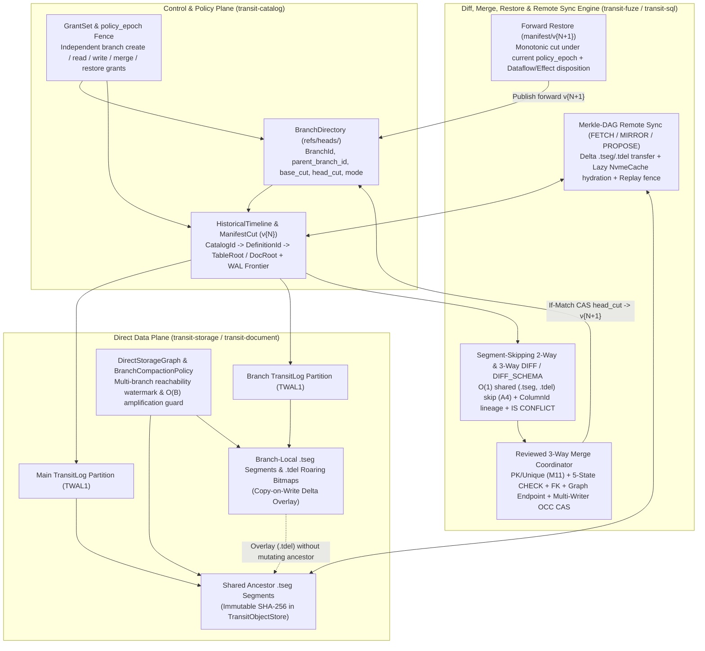

# 19. Branches, merges and restore

[Roadmap](README.md) · [Issue #31](https://github.com/spoke-sh/transit/issues/31) · **Status:** Planned ([implementation plan](#implementation-plan--2026-10-30))

Add isolated application-state branching, three-way merging and point-in-time
restore built directly on the [immutable `.tseg` segment and Manifest architecture](02-storage-and-query-performance.md)
and [historical catalog binding](10-standards-and-catalogs.md). The
[state model](../handbook/internals/state-model.md) owns the authority/lifetime
model. Branching is the underlying versioning primitive within a realm. Branches
never copy live process identities, grants or effect rights.

Restore here means publishing earlier application data as a new forward successor
under current authority. [Operations](24-operations-and-recovery.md) separately
owns backup capture, installation disaster recovery and runtime upgrades; a
branch snapshot alone is not sufficient recovery material for an installation.

Make branches understandable as separately advancing histories of declared
application data and its catalog interpretation under the realm's current policy.
Branch creation is not inherently export, new ownership or a new authority
boundary. Define branch visibility, permissions and any inheritance explicitly;
creation does not freeze source privileges. A higher-level project/application
fork relationship is outside this milestone. Because committed table state is
represented by immutable **Manifests (`manifest/v{N}`)** referencing immutable
**`.tseg` Data Segments** and **`.tdel` Deletion Vectors** in `TransitObjectStore`,
branch-head publication targets an $O(1)$ metadata operation over an already
durable, pinned snapshot without copying all data files. Snapshot preparation
and retained-tail ownership have separate costs and guarantees. Inspection must
show definition/data differences, dependency changes, merge conflicts and pending recomputation
through the shared lifecycle. Copying a definition must not activate its
computations or renew old policy.

Consume [transaction snapshots and publication](05-transactions-and-atomic-composition.md)
without equating a branch to an open transaction. A branch is a durable history
containing multiple commits, with separate merge validation, lifetime and policy.
Merge must preserve its selected atomic domain, constraints and original decision
recovery; segment reuse alone supplies no isolation guarantee. Staged or historical
outbox records cannot become executable merely through branch creation or merge.

## Delivery sequence

Use [#125](https://github.com/spoke-sh/transit/issues/125) for catalog/snapshot
identity and [#127](https://github.com/spoke-sh/transit/issues/127) for durable
WAL/object pins and retention. A new branch includes accepted unflushed rows; pointing
only at the latest flushed Table manifest is insufficient. Select a checkpoint
or pinned-tail representation before implementing branch publication. Keep
authority/process evidence separate from branchable application state.

1. **Publish full-data and schema-only branches from exact retained versions:**
   use bounded independent copies as the correctness oracle while implementing
   $O(1)$ branch-head publication (`refs/heads/<branch> -> manifest/v{N}`) and a
   dedicated branch `TransitLog` partition for subsequent branch deltas. Assign
   branch identity and branch-scoped catalog bindings within the realm; evaluate
   current branch-creation and data access rights. Define conditional head publication
   (`If-None-Match` CAS) and source retention/expiry protection so garbage
   collection preserves every `.tseg`/`.tdel` object reachable from any active
   branch or retained snapshot, including its required WAL/history references.
2. **Isolate branch writes over shared `.tseg` segments:** writes on a branch
   append to the branch's `TransitLog` partition and flush new `.tseg` segments
   and branch-local `.tdel` deletion vectors without mutating parent segments.
   Parent/child deletion and restart must preserve every reachable byte.
3. **Implement segment-aware two-way/three-way `DIFF` (`DIFF` and `DIFF_SCHEMA`) and reviewed KV/Table merges:**
   given a two-way pair (**`from` Manifest**, **`to` Manifest**) or a three-way
   common ancestor (**`base` Manifest**, **`source` Manifest** and **`target`
   Manifest**), skip all `.tseg` segments and `.tdel` bitmaps shared identically
   in $O(1)$ ([A4: `BranchMergeAlgebra.lean`](21-formal-semantics-and-correspondence.md#a4-logical-merge-and-safe-segment-skipping))
   and compute key-aligned diffs using logical change lineage, retained tail
   state, added segments and divergent deletion vectors:
   - **First-class relational and document `DIFF(object, ...)`:** align rows by
     primary key (or `_row_id` / Document tree path) under declared column
     collations ($\kappa$). Unlike ISO SQL `EXCEPT` (which is one-way,
     key-blind and schema-rigid) or table-doubling diff functions, emit compact
     key-aligned delta rows (`_diff_op IN ('added', 'modified', 'removed', 'conflict')`)
     that project across compatible `DefinitionId` evolutions using stable
     `ColumnId` lineage. In three-way branch diffs and merge previews, represent
     cells modified to incompatible values on both `source` and `target` natively
     using Transit's **five-state `conflict` cell tag (`IS CONFLICT`)** so callers
     can filter and inspect merge conflicts directly in standard SQL.
   - **First-class catalog and schema diff (`DIFF_SCHEMA(...)`):** compare
     `CatalogId`, `DefinitionId` and `ColumnId` graphs between two snapshots,
     branches or remotes—distinguishing true column/table renames (`ColumnId`
     preserved) and lazy default projections from drop-and-recreate mutations,
     and reporting affected `CHECK`/`FOREIGN KEY` constraints and downstream
     dataflows.
   - **Reviewed three-way merge publication:** physical compaction can replace
     segment IDs without changing data; use logical lineage/change evidence to
     avoid inventing merge changes or conflicts from that rewrite. Freeze
     `base`/`source`/`target`, align schemas, validate constraints, surface
     row/cell conflicts explicitly, and commit the merged Manifest via
     conditional CAS (`Multi-Writer OCC`), rejecting stale target heads.
     Schema-only promotion preserves target rows unless explicitly migrated.
4. **Extend diff and merge to compatible Documents ([Milestone 7](07-document-storage-and-station-decoupling.md) and [Milestone 16](16-document-profiles-and-gateway-exchange-lifecycle.md)), 2D/3D geospatial & volumetric models ([Milestone 17](17-geospatial-and-spatio-temporal-computing.md)) and qualified graph mappings:**
   support both `versioned` structural three-way diff/merge and `causal_crdt`
   replica state-vector convergence, use `.tseg` 2D/3D bounding-box (`BBOX2D`/`BBOX3D`) and `S2`/`OCT_CELL` Hilbert
   zone maps for $O(1)$ spatial and volumetric segment skipping during viewport-scoped diffs
   and surface conflicting edits to shared `.topo_arc` / `.topo_face` boundary chains/faces or 3D assembly clash collisions as
   five-state `IS CONFLICT` cells, preserving causal/tombstone semantics,
   fresh replica identities and valid graph endpoints; incompatible histories
   refuse and derived views rebuild or verify against the merged manifest.
5. **Restore as a new forward Manifest successor:** publish a restored snapshot
   as a new monotonic manifest version (`manifest/v{N+1}`) rather than truncating
   history. Define pending input, job and subscription disposition, explicit
   activation and external-outcome reconciliation.
6. **Support Git-like remote $\leftrightarrow$ local incremental mirroring, lazy `.tseg` fetch and local migration testing ("Git remotes for data"):**
   because committed state forms a content-addressed Merkle DAG (`manifest/v{N}`
   commits $\to$ `DefinitionId` catalog trees $\to$ immutable SHA-256 `.tseg`
   blobs and `.tdel`/`.tack` bitmaps plus `TWAL1` delta tails), allow a local or
   staging Transit instance to attach to an upstream remote Transit peer
   (`CREATE REMOTE`, `FETCH`, continuous `MIRROR`) under the caller's scoped
   `policy_epoch` grants (enforcing security-barrier RLS and dynamic masking at
   the remote egress boundary):
   - **Incremental delta fetch and lazy `.tseg` hydration:** `FETCH` and `MIRROR`
     transfer only the signed `manifest/v{N}` history and the `.tseg`/`.tdel`
     objects (or `TWAL1` tail frames) added since the last common ancestor
     `manifest/v{K}`, hydrating historical `.tseg` segments eagerly (for offline
     work) or lazily on demand into the local `NvmeCache`.
   - **Local branching, schema migrations and fenced dataflow execution:** a
     developer or agent branches locally (`CREATE BRANCH local_mig FROM
     REMOTE 'prod/main'`), applies candidate DDL migrations (`ALTER TABLE`), and
     runs local queries, dataflows and `Station` behaviors with external
     connector effects strictly fenced to network-free replay over captured
     `DocumentPartition` exchanges ([Milestone 16](16-document-profiles-and-gateway-exchange-lifecycle.md)).
   - **Upstream proposal push:** instead of executing imperative migration scripts
     blindly on production, push only the local branch's delta `.tseg`/`.tdel`
     segments, schema migration plan and candidate manifest to the remote as a
     [Milestone 28 versioned proposal](28-reviewed-data-collaboration.md) for
     three-way `DIFF` / `DIFF_SCHEMA` review, constraint validation and atomic
     `manifest/v{N+1}` publication.

## Policy and collaboration boundary

Extend the [index lifecycle](11-indexing-and-access-paths.md) and
[compaction/clustering policies](13-data-structures-and-performance.md) to
branch-local definitions, generations and coverage. Share compatible immutable
index and `.tseg` objects only with their exact source cuts, WAL overlays and
retention roots. Revalidate uniqueness, row-level `CHECK` expressions and
cross-table `FOREIGN KEY` referential integrity against the combined merge
candidate, including disjoint branch changes that collide on a secondary key or
delete a parent key on one branch while inserting a child reference on the other.
Define **branch-aware compaction and shared-segment garbage collection**: compact
branch-divergent `.tdel` bitmaps and small segments using reachability watermarks
and cost thresholds so compacting `main` neither breaks pinned ancestor/branch
manifests nor causes unmitigated $O(B)$ storage amplification across $B$ active
branches. Rebuild or use another qualified path where coverage is missing;
copying an index definition cannot publish readiness. Qualify parent/child
rebuild, drop, branch-aware compaction and GC with retained readers. Extend the
[performance scorecard](13-data-structures-and-performance.md) with snapshot
preparation/pinning, head publication, merge validation, cross-branch compaction
amplification and index maintenance separately; immutable sharing alone does not
make all branching work constant-time.

Branch creation, read, edit and merge have independent permissions under current
realm policy. Support installations with all merging disabled, and protect
destination heads against equivalent direct writes. This milestone establishes
the native data/policy primitives; [enterprise identity](26-control-and-policy-plane.md)
binds external subjects and delegated actors, and
[reviewed collaboration](28-reviewed-data-collaboration.md) adds published
proposals, intent-bound approval and shared human/agent review. Reading or
copying historical application data cannot restore historical grants.

## Completion evidence

Require copy/merge oracles, write/delete isolation across parent and child
branches, current source/branch authority, GC reachability across multi-branch
manifests, stale-head OCC rejection, collation-aware key conflict detection,
lost-reply recovery and bounded cleanup. Test data, branch and conflict counts
beyond resident RAM and NVMe caches. Include branch creation before flush, concurrent
compaction/GC, retained-tail trim and parent/child restart. Measure head-publication
latency separately from preparing/pinning the durable snapshot, merge work against
actual logical changes and physical rewrites, and shared versus branch-owned
`.tseg` bytes.

Never revive retired processes, restore revoked rights or redispatch historical
effects. Independent exports, higher-level forks, cross-realm collaboration and
live realm rollback require separate contracts.

## Implementation plan — 2026-10-30

### Plan basis and starting point

This plan is grounded in `origin/main` at `54e176fd0` and reconciles Milestone 19's
deliverables with the completed and in-progress roadmap milestones across the
repository:

- **Completed foundations (`origin/main` at `54e176fd0`):**
  - **[Milestone 1 — Data identities, declarations and commit contracts](01-declarative-data-lifecycle.md) & [Milestone 2 — Local durable storage, `.tseg` segments and bounded queries](02-storage-and-query-performance.md):**
    `TransitLog` (`TWAL1`), `TransitObjectStore` immutable `.tseg` data segments,
    `transit-bitmap` (`RBC1` Roaring containers backing `.tdel` deletion vectors and
    `.tack` queue state vectors), `NvmeCache`, and `policy_epoch` lease fencing are
    production-qualified.
  - **[Milestone 4 — SQL statement results and client consumption](04-statement-results-and-consumption.md) & [Milestone 5 — Transactions, consistent snapshots and atomic composition](05-transactions-and-atomic-composition.md):**
    `DirectCatalog` (`packages/zig/transit-catalog/src/DirectCatalog.zig`) owns
    catalog-acquired common cuts, immutable private Table roots (`W`), sequence-ordered
    statement outcomes (`R`), pending statement recovery (`P`), durable client-token
    deduplication (`DirectClientToken.zig`), and single-database multi-table
    `SERIALIZABLE` atomic commit/rollback without routing through `Station` actors.
  - **[Milestone 10 — Standards, collations and historical catalogs (core landed in PR #262)](10-standards-and-catalogs.md):**
    `HistoricalCatalog.zig` (`packages/zig/transit-catalog/src/HistoricalCatalog.zig`)
    implements `ManifestCut`, `BranchHead`, `HistoricalTimeline`, `AsOfSelector`
    (`snapshot_version`, `manifest_digest`, `branch_head`, `system_time_ns`),
    `GrantSet` (`policy_epoch` security-barrier enforcement), and `HistoricalCursor`
    with revocation rechecks between fetch batches. `TableConstraints.zig`
    (`packages/zig/transit-fuze/src/TableConstraints.zig`) implements five-state
    `CheckConstraint` evaluation (`evaluateCheckRow`), `ForeignKeyConstraint`
    validation, and `EvolutionPlan` (`RewriteKind` classification and
    `inspectSegmentProjectionCoverage`).
- **In-progress milestones and active branches to align with:**
  - **[Milestone 3 — Executable data lifecycles and live storage/SQL cutover](03-live-storage-and-sql-cutover.md):**
    `DirectCatalogRetention` (`packages/zig/transit-catalog/src/DirectCatalogRetention.zig`),
    `TableSnapshot.zig` (`TPINOBJ1` immutable `.tman` snapshots under `table-snapshots/`),
    `TableStorageWalk.zig`, and `DirectStorageGraph.zig` provide bounded paged
    reachability walks across accepted catalog roots, snapshots, WAL frontiers, and
    `.tseg` segments.
  - **[Milestone 6 — Declarative streams, queues and durable runtime architecture](06-streams-queues-and-durable-runtime.md):**
    `StreamPartition.zig`, `QueuePartition.zig`, and `Tack.zig` (`.tack` Roaring
    state vectors) are integrated into `DirectCatalog` and `DirectStorageGraph`
    with hierarchical timer wheels and fenced leases.
  - **[Milestone 7 — Logical document storage, `.tseg` trees and Station decoupling (PR #259 landed)](07-document-storage-and-station-decoupling.md):**
    `DocumentPartition.zig` (`TDOC1`) is integrated into `DirectCatalog` and
    `DirectStorageGraph.zig`. `VersionedMerge.zig`
    (`packages/zig/transit-document/src/VersionedMerge.zig`) already implements
    five-state (`value`, `null_value`, `missing`, `type_error`, `conflict`)
    three-way structural merges over `Node` and $2N$-bit balanced-parentheses (`BP`)
    `SuccinctTree` encodings with `RawProvenance` (`part_id`, `byte_start`,
    `byte_end`), while `Document.zig` implements the 24-permutation `causal_crdt`
    convergence profile.
  - **[Milestone 8 — Gateway architecture, sans-I/O wire protocols and direct-plane ingress](08-gateway-architecture-and-protocol-ingress.md) & [Milestone 9 — Shared client foundation and language-native APIs](09-client-foundation-and-language-apis.md):**
    `transit-sql-client` (`StatementResult`, `ResultSet`) and `DirectTableClient`
    preserve original operation identities across uncertain transport outcomes and
    check current authorization before disclosing every batch.
  - **[Milestone 12 — Managed computations and WAL-activated dataflows](12-sql-and-dataflows.md):**
    On `feat/managed-computations-and-dataflows`, analytical SQL, bitemporal
    `AS OF JOIN`, `CHANGES(...)` / `STREAM_SLICE(...)` table-valued functions, SQL
    `MERGE INTO`, and the incremental DBSP Z-set engine (`FuzeDelta.zig`) with the
    five-state computation lifecycle (`Validated` $\to$ `Published` $\to$ `Active`
    $\to$ `Suspended` $\to$ `Completed`) are implemented.
  - **[Milestone 13 — Data structures, query optimization and runtime performance](13-data-structures-and-performance.md) & [Milestone 14 — First-class strings, perfect hashing and vectorized search execution](14-vectorized-strings-and-search.md):**
    Zero steady-state heap allocation on hot storage/query paths (`scratch` vs.
    `output` arenas), 16-byte `GermanString`, `PerfectHash`, and Block-Max WAND
    BM25 inverted index segments.
  - **[Milestone 20 — Service and SDK coverage](20-service-and-sdk-coverage.md), [Milestone 21 — Formal semantics and implementation correspondence](21-formal-semantics-and-correspondence.md), [Milestone 29 — Board reimplementation and data-first workbench](29-board-reimplementation.md), & [Milestone 35 — Qualification and complete benchmarks](35-qualification-and-benchmarks.md):**
    Lean 4 proof obligations `T6` (`SnapshotRetentionSafety.lean`) and `A4`
    (`BranchMergeAlgebra.lean`), deterministic simulation fault injection, and
    conformance gates.

### Pre-implementation source audit (`54e176fd0` baseline)

| Milestone 19 capability | Current source owner(s) at `54e176fd0` | Delivered baseline | Remaining gap for Milestone 19 |
| --- | --- | --- | --- |
| **1. Realm-scoped branch identity & multi-branch admission** | `packages/zig/transit-protocol/src/DataLifecycle.zig`, `packages/zig/transit-catalog/src/DirectCatalogRecords.zig`, `packages/zig/transit-catalog/src/DirectTableProtocol.zig`, `contracts/DIRECT_TABLE_V1.md` | `DataLifecycle.Object` already carries `branch: u64` (`1` = default branch), and `DirectClientToken.Key` scopes deduplication across connections. | `DataLifecycle.ResourceInitialization.validate` (line 73) and `DirectCatalogRecords.Configuration.validate` (line 27) reject `branch != 1`. `DirectCatalogRoots.zig` stores a single trunk root (`DROOT2`) rather than a paged branch directory (`refs/heads/<branch>`). |
| **2. $O(1)$ branch-head publication & multi-commit branch timelines** | `packages/zig/transit-catalog/src/HistoricalCatalog.zig` | `ManifestCut`, `BranchHead`, and `HistoricalTimeline` track committed cuts (`v{N}`), schema bindings (`DefinitionId` $\to$ `TableSchema`), segment digests, and `AsOfSelector` resolution under current `GrantSet` (`policy_epoch`). | `HistoricalTimeline.publishHeadConditional` (lines 501–503) explicitly rejects non-trunk branch names/IDs with `error.MultiCommitBranchingDeferredToM19`. Lacks `CREATE BRANCH ... FROM ...` (full-data and `SCHEMA ONLY`), `DROP BRANCH`, and branch-scoped `TransitLog` partition allocation. |
| **3. Pinned-tail snapshot cut preparation (including unflushed `TWAL1` rows)** | `packages/zig/transit-storage/src/TableSnapshot.zig`, `packages/zig/transit-storage/src/TablePartitionRecord.zig`, `packages/zig/transit-catalog/src/DirectCatalogRetention.zig` | `TableSnapshot` (`TPINOBJ1`) stages immutable `.tman` snapshots of `TablePartitionRecord.Root` + `TableSchema`, and `TablePartitionRecord` (`TACCEPT1`) tracks both `.segment` and `.wal` row locators (`r.Locator`) plus `history_pins` and `history_floor`. | Needs a multi-resource catalog cut coordinator that freezes or checkpoints accepted unflushed `TWAL1` tail frontiers (`next_lsn`) alongside `.tseg` manifests in one durable `ManifestCut` so a new branch includes all accepted unflushed rows without copying `.tseg` files. |
| **4. Copy-on-write branch write/delete isolation & branch-aware GC/compaction** | `packages/zig/transit-storage/src/TableStorageWalk.zig`, `packages/zig/transit-catalog/src/DirectStorageGraph.zig`, `packages/zig/transit-catalog/src/DirectCatalog.zig` | `TableStorageWalk` and `DirectStorageGraph` walk one catalog root, its transaction workspaces (`W`), snapshots, `.tseg` segments, and WAL positions in $O(1)$ resident depth per step. | Needs branch-isolated `TransitLog` delta partitions, branch-local `.tdel` Roaring deletion vector overlays over shared ancestor `.tseg` segments, multi-branch reachability walking in `DirectStorageGraph`, and branch-aware compaction cost thresholds to prevent $O(B)$ storage amplification. |
| **5. Segment-skipping 2-way & 3-way `DIFF` and `DIFF_SCHEMA`** | `packages/zig/transit-storage/src/TableSchemaProjection.zig`, `packages/zig/transit-fuze/src/TableConstraints.zig`, `contracts/sql/TransitExtensions.g4` | `TableSchemaProjection` maps stable `ColumnId` lineage across schema revisions; `TableConstraints.EvolutionPlan` classifies Class A vs. Class B DDL changes; `TransitExtensions.g4` (line 101) already includes `CONFLICT` in `cellState`. | No relational/KV/Document `DIFF(object, ...)` or catalog `DIFF_SCHEMA(...)` operators yet; needs $O(1)$ identical `.tseg`/`.tdel` skipping (`A4`), compaction-invariant logical row digests, key-aligned `_diff_op` projection, and five-state `IS CONFLICT` cell construction. |
| **6. Reviewed 3-way KV/Table merge with constraint revalidation & OCC CAS** | `packages/zig/transit-fuze/src/TableConstraints.zig`, `packages/zig/transit-catalog/src/DirectCatalog.zig` | `TableConstraints` evaluates five-state `CHECK` rows and validates `FOREIGN KEY` schema pairs; `DirectCatalog` provides atomic multi-table staging and client-token deduplication. | Needs 3-way merge coordinator (`BASE`, `SOURCE`, `TARGET`) that aligns evolved schemas, revalidates primary/secondary uniqueness (M11), row-level `CHECK`, and cross-table `FOREIGN KEY` constraints across the combined merge candidate, and publishes via conditional CAS (`Multi-Writer OCC`). |
| **7. Multi-model diff & merge (Documents, 2D/3D Geospatial, Property Graphs)** | `packages/zig/transit-document/src/VersionedMerge.zig`, `packages/zig/transit-document/src/Document.zig`, `packages/zig/transit-document/src/DocumentPartition.zig` | `VersionedMerge.threeWayMerge` and `threeWayMergeSuccinct` already compute 5-state (`conflict`-tagged) 3-way merges over `Node` and $2N$-bit `BP` trees with `RawProvenance`; `Document.zig` implements 24-permutation `causal_crdt` merge. | Needs wiring of `VersionedMerge` and `causal_crdt` (with fresh branch replica IDs) into branch `DIFF`/`MERGE` over `DocumentPartition`, plus hooks for M17 `BBOX2D`/`BBOX3D` and `S2`/`OCT_CELL` zone-map skipping, `.topo_arc`/`.topo_face`/`SCENE3D` conflict tagging, and M18 property-graph endpoint checks. |
| **8. Forward Restore (`manifest/v{N+1}`) under current authority** | `packages/zig/transit-catalog/src/HistoricalCatalog.zig`, `packages/zig/transit-catalog/src/DirectCatalog.zig` | `HistoricalCatalog` resolves historical `ManifestCut`s and enforces current `GrantSet` (`policy_epoch`) on reads. | Needs forward restore command (`RESTORE BRANCH ... TO AS OF ...`) that publishes an earlier `ManifestCut`'s data/schema bindings as `manifest/v{N+1}` under current `policy_epoch` grants, explicitly disposes of pending jobs/subscriptions/M12 dataflows, and never redispatches historical connector effects. |
| **9. Git-like Remote $\leftrightarrow$ Local incremental mirroring & proposal push** | `packages/zig/transit-storage/src/TransitObjectStore.zig`, `packages/zig/transit-storage/src/NvmeCache.zig` | Content-addressed SHA-256 `.tseg`/`.tman` storage and local `NvmeCache` exist. | Needs `CREATE REMOTE`, incremental Merkle-DAG `FETCH` / `MIRROR` protocol (under remote `policy_epoch` RLS/masking), eager/lazy `.tseg` hydration into `NvmeCache`, network-free connector replay fencing on local branches, and upstream M28 proposal push (`PROPOSE`). |

### Coordination and handoffs across milestones

| Milestone | Relationship to Milestone 19 |
| --- | --- |
| **[M1](01-declarative-data-lifecycle.md) – [M3](03-live-storage-and-sql-cutover.md)** | M19 reuses `TransitLog` (`TWAL1`), `TransitObjectStore` (`.tseg`), `TableSnapshot` (`TPINOBJ1`), and `DirectStorageGraph` paged reachability. Every branch operation checks current native credentials and `policy_epoch`; branch creation never copies live process identities, grants, or effect rights. |
| **[M4](04-statement-results-and-consumption.md) & [M5](05-transactions-and-atomic-composition.md)** | A branch is a durable multi-commit history (`refs/heads/<branch>`), not an open interactive transaction (`W`). Interactive transactions in M5 open against a selected branch's current head cut and commit to that branch's `Harmony` / `DirectCatalog` timeline via conditional CAS. |
| **[M6 — Streams, queues and durable runtime](06-streams-queues-and-durable-runtime.md)** | Branches do not clone live consumer-group leases (`_lease_epoch`), in-flight queue `.tack` acquisitions, or active `Station` actor timers. Full-data branches capture immutable retained `StreamPartition` `.tseg` segments as read-only historical slices (`STREAM_SLICE(...)`), while branch-local stream/queue writes start from a fresh branch partition epoch; staged or historical outbox records are never executable on a branch or after merge/restore. |
| **[M7 — Document storage](07-document-storage-and-station-decoupling.md) & [M16 — Document profiles](16-document-profiles-and-gateway-exchange-lifecycle.md)** | M19 consumes M7's `VersionedMerge.zig` ($2N$-bit `BP` `SuccinctTree` 3-way merge with `IS CONFLICT` and `RawProvenance`) and `causal_crdt` convergence for `DocumentPartition`, and extends structural diff/merge to M16's typed profiles (`JSON`, `XML`, `EDI`, `PDF`, `DOCX`, `XLSX`, `ODF`). Local branches testing migrations fence external effects to network-free replay over M16 captured `DocumentPartition` exchanges. |
| **[M8 — Gateway/Ingress](08-gateway-architecture-and-protocol-ingress.md) & [M9 — Client/SDKs](09-client-foundation-and-language-apis.md)** | `DIFF`, `DIFF_SCHEMA`, `SHOW BRANCHES`, and `MERGE` previews stream through M9's `transit-sql-client` `ResultSet` cursor with per-batch `policy_epoch` revalidation. Reactive watches bind to an explicit `(branch_id, definition_id)` and receive a typed discontinuity frame on branch forward-restore. |
| **[M10 — Standards and catalogs](10-standards-and-catalogs.md)** | M19 directly extends M10's `HistoricalCatalog.zig` (lifting `error.MultiCommitBranchingDeferredToM19`) and `TableConstraints.zig` (reusing 5-state `evaluateCheckRow`, `ForeignKeyConstraint`, and `EvolutionPlan` during `DIFF_SCHEMA` and 3-way `MERGE`). |
| **[M11 — Indexing and access paths](11-indexing-and-access-paths.md)** | Secondary unique/non-unique B-tree, ART, Roaring bitmap, and GIN/HNSW index segments are shared across branches only for identical `.tseg` segments and matching $\kappa$ descriptors. Copying an index definition on a schema-only or migrated branch never publishes index readiness without verified segment coverage; 3-way merge revalidates secondary uniqueness across disjoint branch edits. |
| **[M12 — Managed computations and dataflows](12-sql-and-dataflows.md)** | Branching a catalog copies view/dataflow definitions in the `Published` (inactive) state—never `Active`. When a branch merges or restores forward (`manifest/v{N+1}`), dependent M12 incremental DBSP dataflows (`FuzeDelta.zig`) either advance via the merge delta Z-set or suspend/recompute from the new snapshot (`RESUME WITH (on_resume = 'recompute_snapshot')`). |
| **[M13 — Data structures and performance](13-data-structures-and-performance.md)** | M19 extends the M13 performance scorecard with five explicit metrics: (1) durable snapshot preparation/pinning latency, (2) $O(1)$ branch-head CAS publication latency, (3) segment-skipping `DIFF`/`MERGE` throughput vs. actual logical delta size, (4) cross-branch compaction write/storage amplification across $B$ active branches, and (5) branch-local index maintenance cost. |
| **[M14 — Vectorized strings and search](14-vectorized-strings-and-search.md) & [M15 — Data-centric compilation](15-data-centric-compilation-and-specialization.md)** | Key alignment and cell comparisons in `DIFF` and `MERGE` use M14's 16-byte `GermanString` prefix short-circuiting under declared collations ($\kappa$: `UTF8_BINARY`, `ASCII_CI`, `EBCDIC_CP037`, `ICU:<locale>`). Immutable BM25 (`.tidx`) index segments are skipped in $O(1)$ when underlying `.tseg`/`.tdel` digests match. |
| **[M17 — Geospatial and spatio-temporal computing](17-geospatial-and-spatio-temporal-computing.md)** | Spatial and 3D volumetric `DIFF`/`MERGE` use `.tseg` `BBOX2D`/`BBOX3D` and `S2`/`H3`/`OCT_CELL` Hilbert/Roaring zone maps for $O(1)$ viewport segment skipping, and surface conflicting edits to shared `.topo_arc`/`.topo_face` boundary chains/faces or 3D assembly (`SCENE3D`) clash collisions as five-state `IS CONFLICT` cells under declared $\kappa_{\text{spatial}}$. |
| **[M18 — Multi-model and foreign relations](18-multi-model-and-foreign-relations.md)** | `DIFF_SCHEMA` tracks `PropertyGraphDescriptor` (`CREATE PROPERTY GRAPH`) vertex/edge table bindings, and 3-way `MERGE` revalidates graph edge endpoint integrity when one branch deletes a vertex while another inserts an incident edge. |
| **[M21 — Formal semantics and correspondence](21-formal-semantics-and-correspondence.md)** | M19's snapshot pinning and segment-skipping 3-way merge implement the exact state machines mechanized in `T6` (`SnapshotRetentionSafety.lean`: zero dangling `.tseg`/`.tdel` reads under concurrent compaction/GC) and `A4` (`BranchMergeAlgebra.lean`: $O(1)$ skipping of identical `(tseg_id, tdel_id)` pairs is observationally equivalent to full key-by-key 3-way merge). |
| **[M24 — Operations and recovery](24-operations-and-recovery.md)** | Forward restore (`manifest/v{N+1}`) is a realm-scoped application-data operation under current authority; cluster-wide backup capture, disaster recovery, and node upgrades remain in M24. |
| **[M26 — Control and policy plane](26-control-and-policy-plane.md) & [M28 — Reviewed data collaboration](28-reviewed-data-collaboration.md)** | M19 provides the storage/catalog primitives (`CREATE BRANCH`, `DIFF`, `DIFF_SCHEMA`, `MERGE`, `RESTORE`, `REMOTE`/`FETCH`/`MIRROR`). M26 binds enterprise RBAC/ABAC and row/column security barriers at remote egress, and M28 builds human/agent reviewed proposals (`PROPOSE`), intent-bound approvals, and Board visual diff review on top of M19's `ManifestCut` and `IS CONFLICT` algebra. |

### Accepted architectural decisions (`D1`–`D7`)

#### `D1` — Realm-scoped branch registry (`refs/heads/<branch>`), pinned-tail snapshot preparation, and $O(1)$ conditional CAS head publication

1. **Multi-branch identity and paged directory (`BranchDirectory.zig`):**
   - Lift the single-branch (`branch == 1`) restriction in `DataLifecycle.ResourceInitialization.validate` (`packages/zig/transit-protocol/src/DataLifecycle.zig`) and `DirectCatalogRecords.Configuration.validate` (`packages/zig/transit-catalog/src/DirectCatalogRecords.zig`).
   - Replace the single-branch trunk assumption in `DirectCatalogRoots.zig` and `HistoricalCatalog.zig` (removing `error.MultiCommitBranchingDeferredToM19` at line 502) with a paged `TreeStore` directory mapping realm-scoped `branch_name` (`refs/heads/<branch>`) and monotonic `branch_id: u64` (`1` reserved for `main`) to `BranchHead`:
     - `branch_id: u64`, `parent_branch_id: ?u64`, `created_at_ns: i64`, `created_by_principal: u64`
     - `mode: enum(u8) { full_data = 1, schema_only = 2 }`
     - `base_manifest_version: u64`, `base_manifest_digest: [32]u8`
     - `head_manifest_version: u64`, `head_manifest_digest: [32]u8`, `head_commit_lsn: u64`
     - `delta_wal_partition: u64` (dedicated branch `TransitLog` partition ID)
     - `merge_policy: enum(u8) { allow_merge = 1, merge_disabled = 2, protected_head = 3 }`
2. **Pinned-tail snapshot preparation vs. $O(1)$ head publication:**
   - A new full-data branch must include all accepted rows at the selected source cut—including rows accepted into `TransitLog` (`TWAL1`) that have not yet been flushed to `.tseg` segments. Pointing only at the latest flushed Table manifest is forbidden.
   - `ManifestCut` preparation (`prepareBranchSourceCut`) pins every participating `TablePartitionRecord.Root` and `DocumentPartition` root via `TableSnapshot` (`TPINOBJ1`), recording both the immutable `.tseg`/`.tdel` root references **and** the exact exclusive `TWAL1` frontier (`wal_position: DataLifecycle.Position { partition, next_lsn }`) plus `TableArchive` coverage.
   - Once the source `ManifestCut` is durable and pinned in `DirectCatalogRetention`, publishing the new branch head (`refs/heads/<branch> -> manifest/v{N}`) is an $O(1)$ conditional CAS (`If-None-Match` for `CREATE BRANCH`, `If-Match` on `expected_head_manifest_version` for branch advances) in the catalog control log, plus allocation of a fresh branch `TransitLog` partition (`delta_wal_partition`) for subsequent branch writes.
3. **Schema-only branches (`CREATE BRANCH <name> FROM <source> WITH (mode = 'schema_only')`):**
   - Copies the source `ManifestCut`'s `CatalogId`, `DefinitionId`, `ColumnId`, `TableSchema`, `CheckConstraint`, `ForeignKeyConstraint`, and index definitions into the new branch with empty data roots (`rows = empty`, `scan_rows = empty`, `segment_digests = []`) and a fresh branch `TransitLog` partition.
4. **Strict authority and process/effect non-inheritance:**
   - Branch creation checks current `CREATE BRANCH` privilege on the realm/database and current `SELECT` privilege on every source object (enforcing `policy_epoch` via `GrantSet`).
   - Branches never copy live `Station` actor PIDs, consumer-group leases, grants, or connector effect rights. Any copied view or M12 dataflow definition is recorded in the `Published` (inactive) state, and any historical or staged outbox/effect records in the source cut are marked non-executable on the branch.

#### `D2` — Copy-on-write branch write/delete isolation and branch-aware compaction/GC

1. **Copy-on-write branch mutations over shared ancestor `.tseg` segments:**
   - Reads on a branch resolve rows across the branch's inherited ancestor `.tseg` segments (and pinned ancestor `TWAL1` prefix up to `base_cut.wal_position`), masked by the branch's local `.tdel` Roaring deletion vectors (`transit-bitmap` `RBC1`), unioned with the branch's own flushed `.tseg` segments and active branch `TransitLog` (`delta_wal_partition`) tail.
   - `INSERT`, `UPDATE`, and `DELETE` on a branch append exclusively to `delta_wal_partition`, flush new branch-owned `.tseg` files to `TransitObjectStore`, and write branch-local `.tdel` deletion bitmaps keyed by `(branch_id, segment_sha256, deletion_generation)`. Ancestor `.tseg` and `.tdel` objects are immutable and never modified in place.
2. **Multi-branch reachability walk (`DirectStorageGraph.zig` & `TableStorageWalk.zig`):**
   - Extend `DirectStorageGraph` so a maintenance pass walks the union of:
     1. Every active `BranchHead` in `BranchDirectory` (`refs/heads/*`),
     2. Every retained historical `ManifestCut` within the realm's retention policy or pinned by an active `HistoricalCursor` / `TableSnapshot` (`TPINOBJ1`), and
     3. Active M5 transaction workspaces (`W`, `P`, `R`) scoped to their target `branch_id`.
   - Deleting a parent branch or dropping a table on `main` never reclaims a `.tseg`, `.tdel`, `.tman`, or archived `TWAL1` frame while any child branch or retained snapshot still references it (`T6: SnapshotRetentionSafety.lean`).
3. **Branch-aware compaction (`BranchCompactionPolicy.zig`):**
   - Naive compaction on `main` that rewrites shared `.tseg` segments would force $B$ child branches to retain the old uncompacted `.tseg` segments while `main` writes duplicate compacted segments—causing up to $O(B)$ storage amplification.
   - Introduce a branch-aware compaction cost model in `DirectCatalog.maintenanceNext`:
     - **Shared-segment reference counting:** Track `branch_ref_count` (and pinned snapshot count) per `.tseg` digest in the catalog storage graph.
     - **Delta-first compaction:** Compact branch-local `.tseg` tail segments (`branch_ref_count == 1`) eagerly using standard M13 size-tiered/leveled thresholds.
     - **Shared-ancestor compaction guard:** For `.tseg` segments shared across $k > 1$ branches (`branch_ref_count == k`), rewrite the shared segment only when dead-row ratio $\tau_{\text{dead}}$ exceeds a branch-scaled threshold $\tau_{\text{dead}} \ge \min(0.80,\; 0.20 \times k)$ **or** when all $k$ branches share a common `.tdel` tombstone bitmask intersection $\bigcap_{b=1}^{k} \text{tdel}_b$ large enough to amortize the rewrite across all $k$ branch manifests simultaneously.

#### `D3` — Segment-skipping 2-way and 3-way `DIFF` and `DIFF_SCHEMA` with 5-state `IS CONFLICT` projection

1. **Formal segment-skipping algebra (`A4: BranchMergeAlgebra.lean`):**
   - For any two-way diff `(from_cut, to_cut)` or three-way diff/merge `(base_cut, source_cut, target_cut)` over a table or document partition:
     - First, compute the symmetric difference of `(segment_sha256, tdel_sha256)` pairs in $O(S)$ metadata time (where $S$ is the segment count). Any `.tseg` segment whose content digest and effective `.tdel` deletion bitmap digest are identical across `(from, to)` or across `(base, source, target)` contributes zero logical delta rows and is skipped in $O(1)$ without reading segment pages from `TransitObjectStore` or `NvmeCache`.
     - Second, to prevent **physical compaction rewrites** from inventing false merge changes or conflicts when one branch compacted segments `{s1, s2} -> s3` without logical row changes, each `TablePartitionRecord` compaction record (`TableCompactionResult.zig`) records a compaction lineage edge `(input_segment_digests, input_tdel_digests) -> (output_segment_digest, logical_row_multiset_hash)`. If `logical_row_multiset_hash` matches the uncompacted `(input_segment_digests, input_tdel_digests)` on the peer branch, the compacted segment group is recognized as logically identical and skipped in $O(1)$; otherwise, the diff engine streams keys in sort order from both segment sets and suppresses rows whose primary key and column cell values are bit-for-bit (or $\kappa$-collation) identical to `base`.
2. **First-class `DIFF(object, ...)` table-valued function (`BranchDiff.zig`):**
   - Support two-way `SELECT * FROM DIFF(table_name, FROM => selector_a, TO => selector_b)` and three-way `SELECT * FROM DIFF(table_name, BASE => selector_base, SOURCE => selector_src, TARGET => selector_tgt)`:
     - Aligns rows by declared primary key (or `_row_id` for keyless tables / tree path for Documents) using the declared column collation $\kappa$ (`UTF8_BINARY`, `ASCII_CI`, `EBCDIC_CP037`, `ICU:<locale>`).
     - Projects columns across compatible `DefinitionId` schema evolutions using stable `ColumnId` lineage (`TableSchemaProjection.zig`). Columns added on only one branch evaluate to their declared lazy `DEFAULT` (or `MISSING` if none) on the branch where they were absent.
     - Emits a leading `_diff_op` UTF8 column (`'added'`, `'modified'`, `'removed'`, `'conflict'`) followed by the aligned table columns:
       - If a cell was modified on `source` ($v_s \neq v_b$) and unchanged on `target` ($v_t = v_b$), the projected cell holds $v_s$ (and symmetrically $v_t$ if changed only on `target`).
       - If a cell was modified identically on both branches ($v_s = v_t \neq v_b$), the change converges cleanly (`_diff_op = 'modified'`) with cell value $v_s$.
       - If a row or cell was modified to incompatible values on both `source` and `target` ($v_s \neq v_b$, $v_t \neq v_b$, $v_s \neq v_t$), or modified on one branch and deleted on the other, `_diff_op` is `'conflict'` and each conflicting cell is tagged with Transit's native **five-state `conflict` cell tag** (`CellState.conflict`, queryable via `WHERE col IS CONFLICT` in `TransitExtensions.g4`), carrying a structured conflict payload `(base_value, source_value, target_value)`.
3. **First-class catalog and schema diff (`DIFF_SCHEMA(...)` in `SchemaDiff.zig`):**
   - `SELECT * FROM DIFF_SCHEMA(FROM => selector_a, TO => selector_b)` compares the `CatalogId`, `DefinitionId`, and `ColumnId` graphs between two snapshots, branches, or remotes:
     - Distinguishes true table/column renames (same `CatalogId`/`ColumnId`, new name) and Class A metadata-only evolutions (`ADD COLUMN ... DEFAULT`, `DROP COLUMN`) from drop-and-recreate mutations (new `CatalogId`/`ColumnId`) or Class B physical type/collation rewrites (`TableConstraints.RewriteKind`).
     - Reports added/modified/removed `CHECK` constraints, `FOREIGN KEY` edges, secondary indexes (M11), property-graph descriptors (M18), and downstream M12 views/dataflows whose `DefinitionId` dependency vectors are invalidated.

#### `D4` — Atomic 3-way merge validation and conditional CAS publication (`Multi-Writer OCC`)

1. **Three-way merge lifecycle (`BranchMerge.zig`):**
   - `MERGE BRANCH <source> INTO <target> [WITH (strategy = 'fail_on_conflict' | 'source_wins' | 'target_wins', expected_target_version = N)]`:
     - Resolves the lowest common ancestor `base_cut = LCA(source_head, target_head)` from the `ManifestCut` parent DAG in `HistoricalTimeline`.
     - Computes the schema merge (`SchemaDiff.mergeSchemas(base, source, target)`):
       - Disjoint column additions (`ColumnId`s) and compatible non-overlapping renames merge automatically into a new target `DefinitionId`.
       - Incompatible DDL changes to the same `ColumnId` (e.g., conflicting type changes, conflicting `COLLATE` descriptors $\kappa$, or conflicting `CHECK` expressions) abort the merge with a structured schema-conflict diagnostic before data merge begins.
       - For `schema_only` source branches (`mode == .schema_only`), promotes the validated `DefinitionId` evolution onto `<target>` while preserving `<target>`'s existing data rows (applying lazy Class A `TableSchemaProjection` or scheduling a verified Class B rewrite).
2. **Whole-candidate constraint revalidation (preventing write-skew anomalies across branches):**
   - Segment reuse alone supplies no constraint guarantee when disjoint branch commits touch related keys. Before publishing the merged `ManifestCut`, `BranchMerge` validates across the combined merge candidate:
     - **Primary-key and M11 secondary `UNIQUE` index constraints:** Detects when `source` inserts `(pk=10, email='a@x')` and `target` inserts `(pk=20, email='a@x')` on disjoint segments.
     - **Row-level five-state `CHECK` constraints (`TableConstraints.evaluateCheckRow`):** Evaluates any newly added or modified `CHECK` constraints (and merged rows where `source` updated column `a` while `target` updated column `b` of the same row) under the five-state truth rule (`value(true)` or `null_value` passes; `value(false)`, `missing`, `type_error`, or `conflict` rejects).
     - **Cross-table `FOREIGN KEY` referential integrity (`TableConstraints.ForeignKeyConstraint`):** Detects cross-branch referential write skew where `source` deletes a parent key in `accounts` while `target` inserts a child row referencing that parent key in `orders`.
3. **Conditional CAS publication and original operation-token recovery:**
   - Merge admission binds a `DirectClientToken` (`(AccountId, ClientToken) -> OperationId`) recording `(base_manifest_version, source_manifest_version, expected_target_manifest_version)`.
   - Publication performs an atomic `If-Match` compare-and-swap on `refs/heads/<target>` (`head_manifest_version == expected_target_manifest_version`), creating `manifest/v{N+1}` with two parent pointers (`parent_manifest_version = target.head`, `merge_parent_manifest_version = source.head`).
   - If `<target>` advanced concurrently, CAS rejects with `Conflict` (`StaleTargetBranchHead`) without mutating `<target>`. If a transport reply is lost after CAS acceptance, retrying with the same `DirectClientToken` recovers the original merge receipt and `manifest/v{N+1}` outcome under current `policy_epoch` rights.

#### `D5` — Multi-model diff and merge: Documents (M7/M16), 2D/3D Geospatial (M17), and Property Graphs (M18)

1. **`DocumentPartition` versioned 3-way merge and `causal_crdt` convergence:**
   - **Versioned profile (`versioned`):** Invokes `VersionedMerge.threeWayMergeSuccinct` (`packages/zig/transit-document/src/VersionedMerge.zig`) directly over the base, source, and target $2N$-bit balanced-parentheses (`BP`) `SuccinctTree` representations in `.tseg` segments. Subtrees with identical SHA-256 node digests across `(base, source, target)` are skipped in $O(1)$ without decoding children. Conflicting scalar or structural edits emit `CellState.conflict` nodes while preserving zero-copy `RawProvenance` (`part_id`, `byte_start`, `byte_end`) for M16 profile artifacts (`JSON`, `XML`, `EDI`, `PDF`, `DOCX`, `XLSX`, `ODF`).
   - **Causal CRDT profile (`causal_crdt`):** When branching a `causal_crdt` document (`Document.zig`), the new branch is assigned a fresh deterministic replica namespace `(branch_id, replica_epoch)` so concurrent operations on parent and child branches never collide in causal `(counter, replica_id)` space. Merging two `causal_crdt` branches joins their causal operation logs and state vectors under the 24-permutation commutative/associative/idempotent lattice, preserving tombstones (`CausalOp.Kind.delete`) and verifying that histories with incompatible schema profiles or corrupted causal predecessors are refused before publication.
2. **2D/3D Geospatial and Volumetric diff & merge (Milestone 17 integration):**
   - **Viewport-scoped $O(1)$ spatial segment skipping:** When `DIFF` or `MERGE` includes a spatial/volumetric predicate (`ST_Intersects(geom, viewport)` or `ST_3DIntersects(solid, bbox3d)`), the diff planner inspects each `.tseg` segment's `BBOX2D`/`BBOX3D` and `S2_CELL`/`H3_CELL`/`OCT_CELL` Roaring zone-map summary first: segments disjoint from the query viewport or identical across branches are skipped in $O(1)$.
   - **Topological and 3D assembly conflict promotion:** Under declared $\kappa_{\text{spatial}}$ (SRID, `PLANAR`/`GEODESIC`, snap-rounding grid $\delta_{\text{grid}}$, Shewchuk exact predicates), if `source` and `target` concurrently modify a shared `.topo_arc` boundary chain or `.topo_face` winged-edge surface in a way that violates planar/manifold closure (e.g., creating a self-intersection, gap, or sliver), or if concurrent `SCENE3D` sub-assembly transforms introduce a hard 3D volumetric clash (`ST_3DDistance < clearance`), the affected topological edge/face or assembly node is tagged as a five-state `IS CONFLICT` cell in the `DIFF` / `MERGE` preview rather than silently corrupting the mesh.
3. **Qualified Property Graph mappings (Milestone 18 integration):**
   - For every `PropertyGraphDescriptor` registered in the catalog, 3-way `MERGE` verifies that merged edge tables reference valid vertex keys in their bound endpoint tables (`SOURCE KEY`, `DESTINATION KEY`); dangling edges introduced by concurrent vertex deletion on one branch and edge insertion on the other fail merge validation with an attributed graph-endpoint conflict diagnostic.

#### `D6` — Forward Restore (`manifest/v{N+1}`) under current authority

1. **Monotonic forward publication (`BranchRestore.zig`):**
   - `RESTORE BRANCH <branch> TO AS OF (SNAPSHOT <v> | MANIFEST '<sha256>' | BRANCH '<other>' | TIMESTAMP '<iso>')` never truncates `HistoricalTimeline` or rewrites past `ManifestCut` numbers. Instead, it constructs a new successor `ManifestCut` (`manifest/v{N+1}`) whose catalog and data root bindings match the selected historical cut `v{K}`, appended via conditional CAS on `refs/heads/<branch>` with provenance metadata `restored_from_manifest_version = K`.
   - Every intermediate cut `v{K+1} .. v{N}` remains inspectable via `AS OF SNAPSHOT` and subject to normal retention/GC rules.
2. **Authority, computation, subscription, and effect disposition:**
   - **Current authority only:** Restore checks current `RESTORE` / `ALTER` and table DML privileges at the current `policy_epoch`. Historical `GrantSet` entries from `v{K}` are **never** restored; reading or restoring historical application data cannot revive revoked roles or grants.
   - **Managed computations and dataflows (M12):** Restoring a branch marks downstream `Active` M12 incremental dataflows (`FuzeDelta.zig`) bound to `<branch>` as `Suspended (reason = 'source_branch_restored')` unless the caller explicitly specifies `WITH (dataflows = 'recompute_snapshot')`, which triggers a clean snapshot reset without feeding a synthetic backward delta into stateful window operators.
   - **Pending jobs, reactive subscriptions (M8), and external connector effects:**
     - Open interactive M5 transactions (`W`) targeting `<branch>` at `v{N}` fail at commit CAS (`StaleTargetBranchHead`).
     - Active M8 SSE/WebSocket reactive subscriptions on `<branch>` receive a typed `branch_restored` control frame carrying `(old_manifest_version: N, new_manifest_version: N+1, restored_from_version: K)` and re-anchor their watch cursor.
     - Historical connector outbox intents present at `v{K}` are recorded with terminal replay-fenced status (`RestoredHistoricalIntent`) and are **never** redispatched to external HTTP/gRPC connectors.

#### `D7` — Git-like Remote $\leftrightarrow$ Local incremental mirroring, lazy `.tseg` hydration, and proposal push

1. **Content-addressed Merkle DAG remote sync (`RemoteSync.zig`):**
   - Because every `ManifestCut` (`manifest/v{N}`) forms a signed Merkle DAG over `DefinitionId` schemas, immutable SHA-256 `.tseg` segments, `.tdel`/`.tack` Roaring bitmaps, and `TPINOBJ1` snapshots, a local or staging Transit instance can attach to an upstream Transit peer:
     - `CREATE REMOTE <name> FROM '<https://...>' WITH (credential = SECRET('...'))`
     - `FETCH FROM REMOTE <name> [BRANCH '<remote_branch>']`
     - `CREATE MIRROR <local_ref> FROM REMOTE <name> BRANCH '<remote_branch>' WITH (hydration = 'lazy' | 'eager', poll_ms = 5000)`
   - **Incremental negotiation:** The client sends its last known remote `(branch_id, manifest_version, manifest_digest)` and receives only the signed `ManifestCut` chain `v{K+1} .. v{N}` plus the manifest diff of new `.tseg`/`.tdel` SHA-256 digests.
   - **Remote egress security barrier (M26):** The remote peer evaluates the caller's current `policy_epoch` `GrantSet` before disclosing any manifest or segment. If a table has security-barrier Row-Level Security (RLS) or dynamic column masking attached for that caller, the remote materializes a filtered/masked derivative `.tseg` cut for the caller rather than streaming raw unauthorized `.tseg` bytes.
2. **Eager vs. lazy `.tseg` hydration into `NvmeCache`:**
   - Under `hydration = 'eager'`, `FETCH` downloads all missing `.tseg` and `.tdel` blobs before completing, enabling full offline execution.
   - Under `hydration = 'lazy'`, `FETCH` downloads only the compact `ManifestCut` metadata, `TableSchema` definitions, and `.tseg` footer zone maps (`BBOX`, min/max, `S2`/Roaring summaries). When a local Fuze scan or `DIFF` passes zone-map pruning and touches an unhydrated `.tseg` page range, `TransitObjectStore` fetches the segment on demand, verifies its SHA-256 digest once on admission into `NvmeCache` (following M13's LeanStore/Umbra zero-copy cache policy), and serves subsequent reads locally.
3. **Local migration testing with network-free replay fencing and upstream M28 proposal push:**
   - A developer or agent creates a local branch from the remote tracking ref (`CREATE BRANCH local_mig FROM REMOTE 'prod/main'`), applies candidate DDL migrations (`ALTER TABLE`), and executes local queries, M12 dataflows, and `Station` behaviors.
   - Local branches created from a remote enforce `connector_effect_mode = 'replay_only'` by default: outbound connector calls never touch production networks and instead resolve deterministically against captured M16 `DocumentPartition` gateway exchange transcripts.
   - Once local validation succeeds, `PROPOSE BRANCH local_mig TO REMOTE 'prod/main' WITH (title = '...', expected_base_version = K)` uploads only the local branch's delta `.tseg`/`.tdel` objects, `EvolutionPlan` migration steps, and candidate `ManifestCut` to the remote as a [Milestone 28 reviewed collaboration proposal](28-reviewed-data-collaboration.md) for three-way `DIFF` / `DIFF_SCHEMA` inspection and atomic `If-Match` CAS merge publication.

### Work package sequence (`P0`–`P8`)

#### `P0` — Neutral contracts, grammar cutover, and multi-branch protocol identifiers

- **Goal:** Replace single-branch (`branch == 1`) protocol guards with realm-scoped multi-branch selectors and add neutral wire/SQL contracts for `BRANCH`, `DIFF`, `DIFF_SCHEMA`, `MERGE BRANCH`, `RESTORE BRANCH`, and `REMOTE` under the current-v1 hard-cutover policy.
- **Files to create or modify:**
  - `packages/zig/transit-protocol/src/DataLifecycle.zig`: Lift `self.interpretation.object.branch != 1` in `ResourceInitialization.validate` (require `branch >= 1`), and add `BranchId`, `BranchMode` (`full_data`, `schema_only`), and `BranchMergePolicy`.
  - `packages/zig/transit-catalog/src/DirectCatalogRecords.zig` & `packages/zig/transit-catalog/src/DirectTableProtocol.zig`: Allow `branch >= 1` in `Configuration.validate`; add typed direct actions `branch_create`, `branch_drop`, `branch_list`, `branch_diff`, `branch_diff_schema`, `branch_merge`, `branch_restore`, and `remote_sync`, bumping the shared contract definition identifier (`DIRECT_TABLE_V1`).
  - `contracts/sql/TransitExtensions.g4` & `packages/zig/transit-sql/src/Parser.zig`:
    - Replace the isolated `asOfFragment` integer stub with typed historical/branch selectors (`AS OF SNAPSHOT <int>`, `AS OF MANIFEST <string>`, `AS OF BRANCH <string>`, `FOR SYSTEM_TIME AS OF <timestamp>`).
    - Add DDL/command productions for `CREATE BRANCH`, `DROP BRANCH`, `SHOW BRANCHES`, `MERGE BRANCH ... INTO ...`, `RESTORE BRANCH ... TO AS OF ...`, `CREATE REMOTE`, `FETCH FROM REMOTE`, `CREATE MIRROR`, and `PROPOSE BRANCH`, plus table-valued function forms `DIFF(...)` and `DIFF_SCHEMA(...)`.
  - `contracts/DIRECT_TABLE_V1.md`, `contracts/READ_VERSIONS_V1.md`, `contracts/direct-table-v1.schema.json`: Regenerate schemas and signing fixtures via `zig build check-contracts` and `python3 -B tasks/version.py`.
- **Verification:** `zig build check-contracts`, `zig build test`, and `python3 -B tests/runner/checks.py fast`.

#### `P1` — `BranchDirectory`, pinned-tail `ManifestCut` preparation, and $O(1)$ branch head CAS

- **Goal:** Deliver Step 1 of the delivery sequence—full-data and schema-only branch creation from exact retained cuts (including accepted unflushed `TWAL1` rows) with $O(1)$ head publication and a dedicated branch `TransitLog` partition.
- **Files to create or modify:**
  - `packages/zig/transit-catalog/src/BranchDirectory.zig` *(new)*: Paged `TreeStore` directory for `refs/heads/<branch>` and `BranchId -> BranchHead`, supporting `If-None-Match` creation, `If-Match` head CAS (`expected_head_manifest_version`), `merge_policy` enforcement (`allow_merge`, `merge_disabled`, `protected_head`), and `SHOW BRANCHES` cursor iteration.
  - `packages/zig/transit-catalog/src/HistoricalCatalog.zig`: Remove `error.MultiCommitBranchingDeferredToM19` in `HistoricalTimeline.publishHeadConditional` (line 502); index `ManifestCut` history as a multi-branch DAG with `parent_manifest_version: ?u64` and `merge_parent_manifest_version: ?u64` plus `findLowestCommonAncestor(branch_a, branch_b)`.
  - `packages/zig/transit-catalog/src/DirectCatalog.zig` & `packages/zig/transit-catalog/src/DirectCatalogRoots.zig`:
    - Implement `prepareBranchSourceCut`: pins each participating `TablePartitionRecord.Root` and `DocumentPartition` root via `TableSnapshot` (`TPINOBJ1`), capturing both flushed `.tseg` digests and the exact accepted `TWAL1` frontier (`wal_position: { partition, next_lsn }`).
    - Implement `createBranch` (`full_data` and `schema_only`): verifies current `CREATE BRANCH` + source `SELECT` privileges under `policy_epoch`, allocates a fresh branch `TransitLog` partition (`delta_wal_partition`), marks any copied M12 dataflows as `Published` (never `Active`), fences any historical outbox records, and publishes `refs/heads/<branch>` in $O(1)$.
- **Verification:** Unit and disk-reopen tests in `packages/zig/transit-catalog/src/historical_catalog_test.zig` and `direct_catalog_test.zig` comparing $O(1)$ branch creation (including unflushed `TWAL1` rows before flush) against a full independent copy oracle.

#### `P2` — Copy-on-write branch write/delete isolation, multi-branch GC reachability, and branch-aware compaction

- **Goal:** Deliver Step 2 of the delivery sequence and the policy boundary's branch-aware compaction/GC requirements.
- **Files to create or modify:**
  - `packages/zig/transit-storage/src/TablePartitionRecord.zig` & `packages/zig/transit-storage/src/TableStorageWalk.zig`: Support composite branch-over-ancestor read resolution (inherited `.tseg` segments + pinned ancestor `TWAL1` prefix up to `base_cut.wal_position`, masked by branch-local `.tdel` Roaring bitmaps, unioned with branch-owned `.tseg` segments and `delta_wal_partition` tail).
  - `packages/zig/transit-catalog/src/DirectStorageGraph.zig`: Extend the bounded state-machine walk to iterate all active `BranchHead` roots in `BranchDirectory`, all retained `ManifestCut`s, and branch-scoped M5 transaction workspaces without growing resident stack depth with branch count $B$.
  - `packages/zig/transit-catalog/src/BranchCompactionPolicy.zig` *(new)* & `packages/zig/transit-storage/src/TableCompactionResult.zig`:
    - Record `(input_segment_digests, input_tdel_digests, logical_row_multiset_hash)` on every compaction pass.
    - Enforce `branch_ref_count`-aware compaction thresholds so compacting `main` neither invalidates ancestor pins nor causes unmitigated $O(B)$ storage amplification across $B$ active branches.
- **Verification:** Multi-branch isolation and GC torture tests (parent/child concurrent writes, deletes, restarts, parent branch drop, child branch drop, retained-tail WAL trim, and concurrent compaction with active historical readers).

#### `P3` — Segment-skipping 2-way and 3-way `DIFF` and `DIFF_SCHEMA` with 5-state `IS CONFLICT` cells

- **Goal:** Deliver Step 3a and Step 3b—$O(1)$ segment-skipping relational/KV `DIFF(...)` and catalog `DIFF_SCHEMA(...)` with native five-state `IS CONFLICT` cell projection.
- **Files to create or modify:**
  - `packages/zig/transit-fuze/src/BranchDiff.zig` *(new)*:
    - Implement `planSegmentDiff(from_cut, to_cut)` and `planThreeWaySegmentDiff(base_cut, source_cut, target_cut)`: skip identical `(segment_sha256, tdel_sha256)` pairs and compaction-equivalent segment groups (`logical_row_multiset_hash`) in $O(1)$ (`A4: BranchMergeAlgebra.lean`).
    - Implement vectorized sort-merge key alignment over remaining divergent `.tseg` segments and `TWAL1` tails under declared column collations ($\kappa$: `UTF8_BINARY`, `ASCII_CI`, `EBCDIC_CP037`, `ICU:<locale>`), using `TableSchemaProjection.zig` (`ColumnId` lineage) across compatible schema evolutions.
    - Emit `_diff_op IN ('added', 'modified', 'removed', 'conflict')` and populate five-state `CellState.conflict` cells (with `(base, source, target)` conflict metadata) so standard SQL predicates `WHERE col IS CONFLICT` or `WHERE _diff_op = 'conflict'` filter conflicts directly.
  - `packages/zig/transit-catalog/src/SchemaDiff.zig` *(new)*:
    - Compare `CatalogId`, `DefinitionId`, and `ColumnId` graphs between any two `ManifestCut`s, distinguishing `ColumnId`-preserving renames and Class A lazy projections from drop-and-recreate or Class B physical rewrites, and listing affected `CHECK` constraints, `FOREIGN KEY` edges, M11 indexes, M18 property graphs, and M12 dataflows.
- **Verification:** Property tests and copy-oracle equivalence tests in `packages/zig/transit-fuze/src/branch_diff_test.zig` proving that segment-skipping `DIFF` (including across compacted segments and `ColumnId` renames/additions) produces the exact same row/cell delta as a full key-by-key scan.

#### `P4` — Reviewed 3-way KV/Table merge coordinator, whole-candidate constraint revalidation, and OCC CAS

- **Goal:** Deliver Step 3c—atomic three-way merge validation and conditional CAS publication (`Multi-Writer OCC`) with full constraint revalidation and lost-reply recovery.
- **Files to create or modify:**
  - `packages/zig/transit-catalog/src/BranchMerge.zig` *(new)*:
    - Freeze `(base_cut, source_cut, target_cut)` via `HistoricalTimeline.findLowestCommonAncestor`.
    - Run `SchemaDiff.mergeSchemas` and `BranchDiff.planThreeWaySegmentDiff`. If unresolved row/cell conflicts exist and strategy is `fail_on_conflict`, return a structured conflict summary without mutating `<target>`.
    - Revalidate across the combined merge candidate:
      1. Primary-key and M11 secondary `UNIQUE` index constraints across disjoint branch segment additions,
      2. Five-state row-level `CHECK` constraints (`TableConstraints.evaluateCheckRow`), and
      3. Cross-table `FOREIGN KEY` referential integrity (`TableConstraints.ForeignKeyConstraint`), catching parent deletes on one branch racing with child inserts on the other.
    - Stage merged `.tseg`/`.tdel` root manifests, bind the caller's `DirectClientToken`, and publish `manifest/v{N+1}` onto `refs/heads/<target>` via `If-Match` CAS on `expected_target_manifest_version`.
- **Verification:** Conformance tests covering clean fast-forward and 3-way merges, stale-head OCC rejection (`Conflict`), secondary-key collision detection across disjoint branch writes, cross-branch FK delete/insert skew rejection, `schema_only` promotion, and disk-reopen recovery after a lost merge reply.

#### `P5` — Multi-model diff and merge: Documents (M7/M16), 2D/3D Geospatial (M17), and Property Graphs (M18)

- **Goal:** Deliver Step 4—extend branch `DIFF` and 3-way `MERGE` to `DocumentPartition` (`versioned` and `causal_crdt`), 2D/3D geospatial/volumetric models, and property graphs.
- **Files to create or modify:**
  - `packages/zig/transit-document/src/VersionedMerge.zig` & `packages/zig/transit-document/src/DocumentPartition.zig`:
    - Connect `VersionedMerge.threeWayMergeSuccinct` ($2N$-bit `BP` tree merge with $O(1)$ subtree digest skipping and `RawProvenance`) to `DIFF(doc_name, ...)` and `MERGE BRANCH` for `versioned` documents and M16 profiles (`JSON`, `XML`, `EDI`, `PDF`, `DOCX`, `XLSX`, `ODF`).
    - Assign fresh `(branch_id, replica_epoch)` causal namespaces when branching `causal_crdt` documents (`Document.zig`), join replica state vectors and tombstones on merge, and reject incompatible schema/causal histories.
  - `packages/zig/transit-fuze/src/SpatialBranchDiff.zig` *(new)*:
    - Use `.tseg` `BBOX2D`/`BBOX3D` and `S2`/`H3`/`OCT_CELL` Hilbert/Roaring zone maps to skip out-of-viewport or unchanged spatial segments in $O(1)$ during viewport-scoped `DIFF`.
    - Detect conflicting concurrent edits to shared `.topo_arc` / `.topo_face` topological chains/faces or `SCENE3D` 3D assembly clash collisions under $\kappa_{\text{spatial}}$ and emit five-state `IS CONFLICT` cells.
  - `packages/zig/transit-catalog/src/BranchMerge.zig`: Add `PropertyGraphDescriptor` endpoint key verification across merged vertex and edge tables.
- **Verification:** Multi-model branch/merge tests for `versioned` `BP` trees (`IS CONFLICT` + provenance), 24-permutation `causal_crdt` branch convergence, viewport-pruned spatial diffs, topological/3D clash conflict tagging, and property-graph dangling-edge rejection.

#### `P6` — Forward Restore (`manifest/v{N+1}`) and computation/subscription/effect disposition

- **Goal:** Deliver Step 5—forward restore as a monotonic successor `manifest/v{N+1}` under current `policy_epoch` authority with explicit disposition of M12 dataflows, M8 subscriptions, and external connector effects.
- **Files to create or modify:**
  - `packages/zig/transit-catalog/src/BranchRestore.zig` *(new)*:
    - Implement `restoreBranchForward(branch_id, target_as_of_selector, options)`: verifies current `RESTORE` and table privileges via `GrantSet` at current `policy_epoch` (never restoring historical grants from the target cut), constructs `manifest/v{N+1}` pointing to the target cut's data/schema roots with `restored_from_manifest_version = K`, and commits via `If-Match` CAS on `refs/heads/<branch>`.
    - Transition dependent M12 dataflows to `Suspended` (or trigger `recompute_snapshot` when requested), emit `branch_restored` control notifications to active M8 reactive sessions, fence historical outbox records as `RestoredHistoricalIntent` so replay never dispatches external connector effects, and preserve `DirectClientToken` idempotency across lost replies.
- **Verification:** Restore qualification tests verifying monotonic `manifest/v{N+1}` history preservation, post-revocation `policy_epoch` enforcement (revoked user cannot read/restore old cut; restore does not reinstate old grants), zero external connector effect re-dispatch, and M12 dataflow suspension/recompute.

#### `P7` — Git-like Remote $\leftrightarrow$ Local incremental mirroring, lazy `.tseg` hydration, and M28 proposal push

- **Goal:** Deliver Step 6—content-addressed Merkle DAG remote sync (`CREATE REMOTE`, `FETCH`, `MIRROR`), eager/lazy `.tseg` hydration into `NvmeCache`, replay-fenced local migration testing, and upstream M28 proposal push (`PROPOSE`).
- **Files to create or modify:**
  - `packages/zig/transit-catalog/src/RemoteSync.zig` *(new)* & `packages/zig/transit-storage/src/TransitObjectStore.zig`:
    - Implement `RemoteDescriptor` (`CREATE REMOTE`), incremental Merkle-DAG manifest negotiation (`findCommonAncestorCut` $\to$ stream signed `ManifestCut` deltas `v{K+1}..v{N}` and missing `.tseg`/`.tdel` SHA-256 digests), and remote egress security-barrier RLS / dynamic masking evaluation under the caller's `policy_epoch`.
    - Implement `hydration = 'eager' | 'lazy'` in `TransitObjectStore` + `NvmeCache`: lazy mode fetches `.tseg` footer zone maps immediately and hydrates data pages on demand with single-pass SHA-256 verification on cache admission.
    - Enforce `connector_effect_mode = 'replay_only'` on local branches forked from a remote (`CREATE BRANCH ... FROM REMOTE ...`) over captured M16 `DocumentPartition` exchanges, and implement `proposeBranchToRemote` (`PROPOSE BRANCH`) uploading delta `.tseg`/`.tdel` blobs, `EvolutionPlan`, and candidate `ManifestCut` for M28 review.
- **Verification:** End-to-end local $\leftrightarrow$ remote integration tests covering incremental `FETCH`/`MIRROR` after ancestor cuts, lazy `.tseg` `NvmeCache` hydration on zone-map hit, remote RLS/masking enforcement at egress, network-free replay fencing during local `ALTER TABLE` + dataflow testing, and upstream proposal push + 3-way merge CAS.

#### `P8` — End-to-end qualification, out-of-core scale benchmarks, Lean 4 correspondence, and handbook promotion

- **Goal:** Complete all Milestone 19 completion evidence, M13 scorecard benchmarks, M21 Lean 4 correspondence checks (`T6`, `A4`), and public documentation updates.
- **Files to create or modify:**
  - `packages/zig/transit-catalog/src/branch_merge_qualification_test.zig` *(new)*: Out-of-core qualification suite testing data, branch ($B \ge 64$), and conflict counts exceeding resident RAM and `NvmeCache` budgets, with deterministic fault injection across flush, compaction, GC, WAL tail trim, and parent/child restarts.
  - `specs/lean/Transit/Storage/SnapshotRetentionSafety.lean` (`T6`) & `specs/lean/Transit/Storage/BranchMergeAlgebra.lean` (`A4`): Connect mechanized theorems to differential Zig conformance runners.
  - `docs/handbook/reference/state.md`, `docs/handbook/reference/tables.md`, `docs/handbook/reference/sql.md`, `docs/handbook/reference/sql/as-of.md`, `docs/handbook/internals/state-model.md`, and `docs/history/qualification/README.md`: Promote established branch, diff, merge, restore, and remote-mirroring semantics and scorecard evidence into the public handbook.
- **Verification:** `just check::core` (`python3 -B tests/runner/checks.py fast`, `zig build check-contracts`, and `zig build test`).

### Acceptance matrix and verification schedule

| Requirement | Proof / test artifact | Gate criteria |
| --- | --- | --- |
| **Full-data & schema-only branch creation (`P1`)** | `packages/zig/transit-catalog/src/historical_catalog_test.zig`, `direct_catalog_test.zig` | $O(1)$ `refs/heads/<branch>` CAS publication matches independent full-copy oracle bit-for-bit, including accepted unflushed `TWAL1` rows before `.tseg` flush; copied M12 dataflows remain `Published` (inactive) and historical outbox records never execute. |
| **Write/delete isolation & multi-branch GC safety (`P2`, `T6`)** | `packages/zig/transit-catalog/src/branch_merge_qualification_test.zig`, `SnapshotRetentionSafety.lean` | Parent and child writes/deletes never mutate shared `.tseg` segments; parent/child deletion, WAL tail trim, and concurrent compaction/GC preserve 100% of reachable bytes across all active branches and pinned snapshots (`TPINOBJ1`). |
| **Segment-skipping 2-way & 3-way `DIFF` / `DIFF_SCHEMA` (`P3`, `A4`)** | `packages/zig/transit-fuze/src/branch_diff_test.zig`, `BranchMergeAlgebra.lean` | Identical `(tseg_sha256, tdel_sha256)` pairs and compaction-rewritten segment groups (`logical_row_multiset_hash`) are skipped in $O(1)$; `_diff_op` and five-state `IS CONFLICT` cells match full scan oracle under all collations ($\kappa$) and `ColumnId` schema evolutions. |
| **Reviewed 3-way KV/Table merge & OCC CAS (`P4`)** | `packages/zig/transit-catalog/src/branch_merge_qualification_test.zig` | Revalidates PK/secondary uniqueness (M11), 5-state `CHECK`, and cross-table `FOREIGN KEY` constraints across disjoint branch edits; stale target heads reject with `Conflict`; lost merge replies recover original `DirectClientToken` receipt on reopen. |
| **Multi-model Document, Spatial & Graph diff/merge (`P5`)** | `packages/zig/transit-document/src/VersionedMerge.zig`, `SpatialBranchDiff.zig` | `versioned` $2N$-bit `BP` tree merge and 24-permutation `causal_crdt` merge converge with fresh branch replica IDs; `BBOX2D`/`BBOX3D` and `S2`/`OCT_CELL` zone maps skip unchanged segments in $O(1)$; `.topo_arc`/`.topo_face`/`SCENE3D` conflicts emit `IS CONFLICT`; dangling graph edges reject. |
| **Forward Restore under current authority (`P6`)** | `packages/zig/transit-catalog/src/branch_merge_qualification_test.zig` | Publishes `manifest/v{N+1}` without truncating `v{1}..v{N}`; enforces current `policy_epoch` `GrantSet` (never restoring revoked grants); suspends or recomputes M12 dataflows; zero external connector effect re-dispatch. |
| **Remote $\leftrightarrow$ Local mirroring, lazy hydration & proposal push (`P7`)** | `packages/zig/transit-catalog/src/branch_merge_qualification_test.zig` | `FETCH`/`MIRROR` transfers only delta `ManifestCut`s and missing `.tseg`/`.tdel` blobs since LCA under remote RLS/masking; lazy `NvmeCache` hydration verifies SHA-256 on admission; local replay fence blocks live network calls; `PROPOSE` stages M28 proposal. |
| **Out-of-core scale & M13 performance scorecard (`P8`)** | `packages/zig/transit-catalog/src/branch_merge_qualification_test.zig` | Separately reports (1) snapshot preparation/pinning latency, (2) $O(1)$ head CAS latency, (3) merge validation time vs. logical delta size, (4) shared vs. branch-owned `.tseg` byte amplification across $B$ branches, and (5) index maintenance cost under bounded resident memory. |
