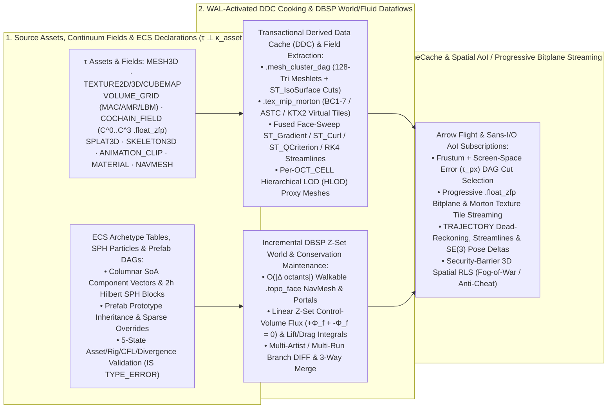

# 19. Interactive 3D worlds, game asset pipelines and simulation streaming

[Roadmap](README.md) · [Standards & Multi-Model #31](https://github.com/spoke-sh/transit/issues/31) · [Performance #76](https://github.com/spoke-sh/transit/issues/76) · **Status:** Planned

Deliver first-class **game-engine asset storage, transactional Derived Data Cache
(DDC) cooking dataflows, deformable skeletal animation, virtualized
meshlet/texture/voxel streaming, incremental Navigation Mesh (`NavMesh`) and
Hierarchical LOD (`HLOD`) maintenance, Eulerian/Lagrangian fluid dynamics and
continuum simulation streaming, and authoritative Entity-Component-System
(ECS) world streaming** across `TablePartition`, `DocumentPartition`,
`StreamPartition`, `NvmeCache` and `Fuze`. Extend
[Milestone 17's](17-geospatial-and-spatio-temporal-computing.md) orthogonal
$\tau \perp \kappa_{\text{spatial}} \perp \epsilon$ 3D spatial and
discrete-exterior-calculus cochain (`COCHAIN_FIELD` / `.float_zfp`) foundation and
[Milestone 18's](18-multi-model-and-foreign-relations.md) `glTF 2.0` / `OpenUSD` /
`CGNS` / `VTU` / `OpenFOAM` / `Zarr` and SQL-PGQ graph projections so interactive
3D engines (Unreal, Unity, Godot, Bevy, O3DE), Computational Fluid Dynamics
(CFD) / weather / CAE pipelines and real-time physical/robotics simulations use
Transit as their unified **versioned asset repository, content-addressed cooking
cache, lock-free collaborative world database, continuum telemetry store, and
spatial Area-of-Interest (AoI) streaming runtime**.

## Prerequisites and architectural rationale

Consume [data identities](01-declarative-data-lifecycle.md),
[`.tseg` storage and codecs](02-storage-and-query-performance.md),
[transactions](05-transactions-and-atomic-composition.md),
[declarative streams and queues](06-streams-queues-and-durable-runtime.md),
[logical Document storage](07-document-storage-and-station-decoupling.md),
[sans-I/O gateways and Arrow Flight ingress](08-gateway-architecture-and-protocol-ingress.md),
[standards and type formalizations](10-standards-and-catalogs.md),
[indexing and spatial SSI](11-indexing-and-access-paths.md),
[WAL-activated DBSP dataflows](12-sql-and-dataflows.md),
[zero-allocation slabs and swizzled `NvmeCache`](13-data-structures-and-performance.md),
[data-centric compilation and SIMD specialization](15-data-centric-compilation-and-specialization.md),
[compound Document container graphs](16-document-profiles-and-gateway-exchange-lifecycle.md),
[2D/3D geospatial and volumetric 3D computing](17-geospatial-and-spatio-temporal-computing.md)
and [multi-model `glTF`/`OpenUSD` foreign relations and SQL/PGQ routing](18-multi-model-and-foreign-relations.md).
Start from [Tables](../handbook/reference/tables.md),
[Documents](../handbook/reference/documents.md),
[streams](../handbook/reference/streams.md),
[storage runtime](../handbook/internals/storage-runtime.md) and
[query engine](../handbook/internals/query-engine.md).

This milestone resolves five foundational problems in game-engine asset
pipelines, interactive 3D worlds, computational fluid dynamics (CFD) and
real-time simulation systems:

1. **Closing the 80% Non-Geometric Asset Gap ($\tau \perp \kappa_{\text{asset}} \perp \epsilon$ for Virtualized Meshlets, Block-Compressed Texture Mip-Pyramids, Sparse Voxels, 3D Gaussian Splats, Skeletal Animation & PBR Material/Audio Graphs):**
   While [Milestone 17](17-geospatial-and-spatio-temporal-computing.md) models
   manifold 3D geometry (`MESH3D`, `SOLID3D`), rigid-body scene DAGs
   (`.scene_dag`) and kinematic trajectories (`TRAJECTORY`), 75–85% of a
   real-time 3D engine's storage footprint and runtime streaming bandwidth
   consists of surface attributes, textures, volumetric fields, skeletal
   deformations, shaders and audio:
   - **Virtualized Micropolygon Meshlet Cluster DAGs (`.mesh_cluster_dag`):**
     Whole-mesh connectivity codecs (`.mesh_edgebreaker`) are optimal for CAD/BIM
     solids and coarse-to-fine object streaming, but GPU-driven micropolygon
     pipelines (such as Unreal Nanite) require partitioning huge meshes into
     64–128-triangle **meshlets** arranged in a parent-child **cluster DAG**
     where group-boundary edges are locked during quadric simplification and
     parent error bounds increase monotonically
     ($\varepsilon_{\text{parent}} \ge \varepsilon_{\text{child}}$), paired with
     multi-channel UV coordinates (`TEXCOORD_0..k`), MikkTSpace tangent frames,
     vertex colors and PBR material-slot bindings.
   - **Block-Compressed Texture Mip-Pyramids & Virtual Texturing (`.tex_mip_morton`):**
     2D, 3D and cubemap textures (`TEXTURE2D`, `TEXTURE3D`, `CUBEMAP`) must
     separate logical texel semantics ($\tau$) and color-space/sampler/compression
     descriptors ($\kappa_{\text{asset}}$: `SRGB` vs. `LINEAR`, premultiplied
     alpha, tangent-space normal reconstruction, and target hardware block codecs
     `BC1`–`BC7`, `ASTC_4x4`–`8x8`, `ETC2` or universal `KTX2`/`UASTC`/`ETC1S`)
     from physical `.tseg` tile layouts ($\epsilon$: always-resident `Mip K..N`
     tail bytes inline in the column header/page + high-resolution `Mip 0..K-1`
     stored as 64 KiB **2D/3D Morton-ordered Virtual Texture tiles** for
     demand-paged NVMe/Flight streaming).
   - **Sparse Volumetric Voxel Grids (`.vdb_hierarchy`) & 3D Gaussian Splats (`.splat_hilbert`):**
     Dynamic fog, fire/smoke level-sets, baked global-illumination irradiance
     fields (`VOLUME_GRID` / `OpenVDB` / `NanoVDB` $B^+$-tree node hierarchies)
     and neural/radiance captures (`SPLAT3D` anisotropic 3D Gaussians clustered
     by `HILBERT_3D` with quantized position, covariance quaternion/log-scale,
     opacity and spherical harmonics `SH` coefficients) require block-prunable
     3D `.tseg` representations.
   - **Deformable Skeletal Rigs (`.skin_weights`) & Compressed Keyframe Animation Clips (`.anim_acl`):**
     Articulated characters and creatures require an explicit bone hierarchy
     (`SKELETON3D` rest pose + inverse-bind $SE(3)$ matrices), per-vertex
     skinning influences (`JOINTS_0: u16x4`, `WEIGHTS_0: unorm8x4` with
     $\sum w_i = 1$), sparse morph-target vertex deltas, and random-access
     block-compressed animation tracks (`ANIMATION_CLIP` using Animation
     Compression Library `ACL`-style uniform block quantization, root-motion
     `TRAJECTORY` extraction and frame-exact event markers).
2. **Replacing External Asset Build Servers & Derived Data Caches (DDC) with Deterministic WAL-Activated Cooking Dataflows:**
   Conventional game engines split asset management across three disconnected
   systems: a centralized binary file lock server (Perforce / Git LFS), an
   out-of-band asset cooking cluster / Derived Data Cache (such as Unreal Zen
   Storage Server and `.utoc`/`.ucas` containers), and a separate runtime world
   state. Because Transit already unifies sequenced write-ahead logs
   (`TransitLog` `TWAL1`), content-addressed `.tseg` segments in
   `TransitObjectStore`, swizzled zero-copy `NvmeCache` page slabs
   ([Milestone 13](13-data-structures-and-performance.md)), WAL-activated DBSP
   managed computations ([Milestone 12](12-sql-and-dataflows.md)) and $O(1)$
   branch manifest sharing with `REMOTE`/`FETCH` lazy `.tseg` hydration
   ([Milestone 20](20-branches-merges-and-restore.md)), **asset cooking becomes a
   first-class declarative dataflow inside Transit**:
   - Committing a source `MESH3D`, `TEXTURE2D`, `DOCUMENT` material/shader graph
     (`MaterialX` / `UsdShade`) or level edit to `TWAL1` automatically activates
     deterministic cooking computations keyed by
     `(DefinitionId, SnapshotId, TargetPlatformProfile)` that materialize cooked
     `.mesh_cluster_dag` pages, `.tex_mip_morton` `BCn`/`ASTC` mip tiles,
     platform shader bytecode variants (`SPIR-V`, `DXIL`, `MSL`, `WGSL`) and
     per-cell **Hierarchical LOD (`HLOD`)** merged proxy meshes into derived
     `.tseg` columns.
   - Branching a game world (`CREATE BRANCH feature/combat_arena`) or attaching a
     developer workstation to a studio remote (`FETCH` / `MIRROR`) reuses cooked
     `.tseg` DDC segments in $O(1)$ across branches and hydrates high-resolution
     mip/meshlet pages lazily into the local `NvmeCache` on demand.
3. **Incremental DBSP Navigation Mesh (`NavMesh`) & Volumetric Clearance Maintenance over `.topo_face` and `.octree_roaring`:**
   In traditional engines, rebaking a Navigation Mesh (`NavMesh`) after level
   geometry changes requires an expensive whole-tile voxelization and recast
   pass. Under [Milestone 17's](17-geospatial-and-spatio-temporal-computing.md)
   cellular chain complex and octree covering architecture, a walkable `NavMesh`
   is an algebraic DBSP view over `.topo_face` 2-chains and `.octree_roaring`
   3D octants parameterized by agent profile
   $\kappa_{\text{nav}} = (r_{\text{agent}}, h_{\text{agent}}, h_{\text{step}}, \theta_{\max})$:
   - Walkable surface candidates are oriented boundary faces $f \in C_2$ whose
     upward unit normal satisfies $\vec{n}_f \cdot \vec{u}_{\text{up}} \ge \cos \theta_{\max}$
     and whose extruded clearance volume $f \oplus \text{Cylinder}(r_{\text{agent}}, h_{\text{agent}})$
     has zero intersection with `INTERIOR`/`BOUNDARY` `.octree_roaring` obstacle
     octants.
   - When an artist, physics transaction or runtime event inserts (`+row`),
     moves (`TRANSFORM3D` delta) or retracts (`-row`) a static mesh or dynamic
     obstacle, the DBSP Z-set engine recomputes walkable polygons and their dual
     portal adjacency graph ($\delta_1 = \partial_2^\top$) **only for the touched
     `OCT_CELL` octants in $O(|\Delta \text{octants}|)$**, immediately updating
     downstream [Milestone 18](18-multi-model-and-foreign-relations.md) `A*` and
     funnel-algorithm pathfinding queries.
4. **Columnar ECS Archetypes, Prefab Prototype Overrides & Spatial Area-of-Interest (AoI) Streaming under Fog-of-War RLS:**
   Modern Entity-Component-System (ECS) engines (Unity DOTS, Bevy, Flecs, EnTT)
   represent world state as cache-line-aligned Structure-of-Arrays (SoA)
   archetype tables—the exact physical layout of Transit's 64-byte-aligned
   `TablePartition` (`.tseg`) and `Fuze` `Batch.zig` vectors:
   - **Declarative Prefab Prototype Inheritance (`LIVRPS`-Style Delta Overrides):**
     Entities reference a canonical prefab prototype (`prototype_id`) and store
     only sparse component/property override bitmasks and values in `.tseg`
     subcolumns, composing base prefab updates with instance overrides in SIMD
     registers and surfacing conflicting multi-branch edits to the same
     entity/component slot natively as five-state **`IS CONFLICT`** cells.
   - **Progressive Frustum / Screen-Space-Error ($\tau_{\text{px}}$) & AoI Streaming:**
     Game clients, rendering viewports, physics workers and autonomous agents
     subscribe to continuous spatial queries ([Milestone 8](08-gateway-architecture-and-protocol-ingress.md)
     Arrow Flight / sans-I/O streams and [Milestone 32](32-reactive-context-and-agent-activation.md)
     reactive interests) parameterized by a moving 3D view frustum / `OCT_CELL`
     interest radius and pixel-error budget $\tau_{\text{px}}$, streaming
     crack-free `.mesh_cluster_dag` cuts, `.tex_mip_morton` virtual texture tiles
     and dead-reckoned `TRAJECTORY` / `TRANSFORM3D` entity deltas directly from
     swizzled `NvmeCache` slabs.
   - **Fog-of-War & Anti-Cheat as Security-Barrier 3D Spatial RLS:**
     By binding a client session's `AccessContext` to its authorized perception
     volume or octree visibility bitmask ([Milestone 27](27-control-and-policy-plane.md)
     Spatial RLS), Transit enforces at the storage/query security barrier that a
     client never receives entity rows, inventory state or trajectory tubes
     outside its authorized line-of-sight or sensor range.
5. **Eulerian & Lagrangian Fluid Dynamics, Vectorized Continuum Feature Extraction & Incremental DBSP Conservation/Force Audits:**
   Both interactive 3D worlds (real-time smoke/fire/water VFX, aerodynamics,
   weather) and industrial Computational Fluid Dynamics (Navier–Stokes FVM,
   Lattice Boltzmann, SPH/FLIP/MPM) stream massive 3D/4D continuum states that
   choke traditional row stores and monolithic HDF5/VTU file dumps. Building on
   [Milestone 17's](17-geospatial-and-spatio-temporal-computing.md) `.topo_face`
   cellular complex, topology-decoupled `COCHAIN_FIELD` ($C^0..C^3$) columns and
   `.float_zfp` error-bounded bitplane codec, Transit unifies Eulerian,
   Lagrangian and hybrid fluid workloads:
   - **Staggered Marker-and-Cell (`MAC_GRID`), 2:1 AMR Octree Ghost Stencils & Lattice Boltzmann (`D3Q19`/`D3Q27`):**
     Extend `VOLUME_GRID` (`.vdb_hierarchy` + `.float_zfp`) and `OCT_CELL` with
     staggered MAC grids (storing scalar pressure/density in 3-cell interiors
     $C^3$ and normal velocity fluxes $u_{i+\frac{1}{2},j,k}, v_{i,j+\frac{1}{2},k}, w_{i,j,k+\frac{1}{2}}$
     on 2-faces $C^2$ so discrete incompressibility $\nabla \cdot \vec{u} = 0 \iff \partial_3 \Phi = 0$
     holds without checkerboard pressure decoupling), 2:1 octree Adaptive Mesh
     Refinement (AMR) prolongation/restriction ghost stencils across coarse-fine
     faces, and Structure-of-Arrays `D3Q19`/`D3Q27` Lattice Boltzmann distribution
     populations.
   - **Lagrangian SPH / FLIP / MPM Particle Fluids & Molecular Dynamics (`MD`) Cutoff Stencils over $2h$ `HILBERT_3D` Blocks:**
     Fluid particles and molecular dynamics atoms stored in `.pcloud_hilbert`
     (`CLUSTER BY HILBERT3D(pt)`) at smoothing-kernel / non-bonded cutoff spacing
     $2h$ carry density $\rho_i$, velocity $\vec{u}_i$, pressure $p_i$, vorticity
     $\vec{\omega}_i$, deformation gradient $\mathbf{F}_i$ or atomic partial-charge /
     Lennard-Jones parameters, turning fixed-radius neighbor searches
     (`ST_WithinSmoothingRadius(pt, 2h)`) and hybrid Particle-to-Grid /
     Grid-to-Particle (`P2G`/`G2P`) transfers into contiguous 27-cell branchless
     SIMD stencil sweeps.
   - **Audio, 3D Room/Wave Acoustics, `.wave_lpc_pyramid` Envelope Zone Maps & Vectorized Spectral DSP (`WAVEFORM`):**
     Multi-channel audio, spatial **Ambisonics (`FOA`/`HOA`)**, industrial
     vibration, hydrophone/seismic arrays and EEG/ECG biosignals (`WAVEFORM`)
     encode sample blocks via **`.wave_lpc_pyramid`** (lossless Linear Predictive
     Coding `LPC` + Rice residuals or error-bounded `.float_zfp`/MDCT) paired
     with an inline **multi-resolution `(min_peak, max_peak, rms_energy, zero_crossing_rate, clipping_bitmap)`
     mip-pyramid** in the `.tseg` zone map—enabling $O(1)$ zero-decode waveform
     timeline rendering at any zoom level and $>90\%$ silence/trigger pruning
     (`WHERE DSP_MaxRMS(wave) > -40.0`). 3D room acoustics combines
     `.topo_face` octave-band absorption/scattering ($\alpha_{125\text{Hz}..16\text{kHz}}$)
     and `.octree_roaring` ray/image-source tracing with low-frequency
     staggered-`MAC_GRID` Finite-Difference Time-Domain (`FDTD`) wave-equation
     propagation, while `Fuze` executes SIMD `DSP_FFT`, `DSP_STFT`,
     `DSP_MelSpectrogram`, `DSP_MFCC`, partitioned Overlap-Save fast convolution
     (`DSP_ConvolveIR(dry_wave, room_ir)`), and **incremental DBSP `ITU-R BS.1770`
     `LUFS` loudness / Parseval spectral-energy metering**.
   - **Fused Cache-Blocked Face-Sweep Differential & Feature Extraction Kernels (`ST_Gradient`, `ST_Divergence`, `ST_Curl`, `ST_QCriterion`, `ST_IsoSurface`, `ST_Streamlines`):**
     Because `.topo_face` cells are ordered by `HILBERT_3D` / Reverse Cuthill–McKee
     (`RCM`), `Fuze` computes Green–Gauss and Least-Squares cell gradients
     ($\nabla \phi_i = \frac{1}{V_i} \sum_{f \in \partial_3 V_i} \phi_f \vec{n}_f A_f$),
     divergence ($\nabla \cdot \vec{u}$), vorticity ($\vec{\omega} = \nabla \times \vec{u}$)
     and **$Q$-criterion / $\lambda_2$ vortex-core scalars**
     ($Q = \frac{1}{2}(\|\boldsymbol{\Omega}\|^2 - \|\mathbf{S}\|^2)$) in a single
     L1d/L2-resident pass over `C^2` faces (`owner[f]`, `neighbour[f]`).
     `ST_IsoSurface(field, iso_val)` prunes $>95\%$ of blocks via `.float_zfp`
     `(min, max)` zone maps and extracts Dual-Contouring / Marching-Tetrahedra
     free-surface or vortex-core meshes directly into cooked `MESH3D` /
     `.mesh_cluster_dag` pages, while `ST_Streamlines` / `ST_Pathlines` integrate
     4th-order Runge–Kutta (`RK4`) curves directly into `TRAJECTORY` tubes.
   - **Incremental DBSP Control-Volume Conservation Audits, Aerodynamic Lift/Drag Integrals & Five-State Solver Diagnostics:**
     By the Discrete Divergence Theorem, mass/momentum/energy conservation
     residuals ($\partial_t(\rho V_i) + \sum_{f \in \partial_3 V_i} \Phi_f$) and
     aerodynamic wall-boundary force/torque integrals
     ($\mathbf{F}_{\text{aero}} = \sum_{f \in \partial \text{Body}} (-p_f \vec{n}_f + \boldsymbol{\tau}_f \cdot \vec{n}_f) A_f$)
     maintain incrementally in DBSP as linear Abelian Z-set sums where shared
     interior face fluxes cancel ($(+\Phi_f) + (-\Phi_f) = 0$). Numerical
     instabilities—Courant–Friedrichs–Lewy violations ($\text{CFL} = \frac{|u|\Delta t}{\Delta x} > C_{\max}$),
     negative absolute pressure/density, `NaN`/`Inf` fluxes or conservation
     residual spikes—surface immediately as **`IS TYPE_ERROR`** cells with
     `(timestep, cell_id, face_id, cfl, residual)` provenance, while viewport
     clients stream progressive `.float_zfp` leading bitplanes over Arrow Flight.

## Orthogonal game asset, animation, cooking and simulation matrix ($\tau \perp \kappa_{\text{asset}} \perp \epsilon$)

| Logical Type ($\tau$) | Asset, Rig, Navigation & Target Profile Rules ($\kappa_{\text{asset}}$) | Physical `.tseg` & `Batch` Codecs ($\epsilon$) | Five-State & Incremental DBSP Semantics |
| --- | --- | --- | --- |
| **Virtualized Surface Mesh (`MESH3D` with `.mesh_cluster_dag`)** | Coordinate frame $\kappa_{\text{spatial}}$ + MikkTSpace tangent convention, UV channel count (`TEXCOORD_0..k`), material-slot schema, and monotonic cluster-simplification error metric $\varepsilon_{\text{metric}}$ | **`.mesh_cluster_dag`**: 4–16 KiB pages of 64–128-triangle meshlets (`BP`/`CLERS` or `meshopt` bitpacked indices), locked group-boundary edges, parent/child error bounds `[min_err, max_err]`, backface normal cones (`oct16` axis + sin/cos half-angle), quantized `UV`/`tangent` streams | Crack between parent/child simplification cut, non-monotonic error ($\varepsilon_{\text{parent}} < \varepsilon_{\text{child}}$), degenerate tangent frame or out-of-range material slot $\to$ `IS TYPE_ERROR`; $O(1)$ per-cluster frustum + normal-cone + screen-space-error pruning |
| **`TEXTURE2D` / `TEXTURE3D` / `CUBEMAP`** (Mip-mapped GPU textures & Virtual Texture atlases) | Color transfer function (`SRGB` vs. `LINEAR`), alpha mode (`OPAQUE`, `PREMULTIPLIED`, `MASK`), channel reconstruction (`NORMAL_RG_Z`), wrap/filter sampler, and target block codec (`BC1`–`BC7`, `ASTC_4x4`–`8x8`, `ETC2`, `KTX2_UASTC`) | **`.tex_mip_morton`**: inline texture header (`width`, `height`, `depth`, `mip_count`, `format`, average color + always-resident `Mip K..N` tail bytes) + 64 KiB 2D/3D **Morton/Z-order tiles** across `Mip 0..K-1` for zero-copy `NvmeCache` page streaming | Corrupt `KTX2`/`BCn`/`ASTC` block headers, dimension mismatch with mip chain or NaN/Inf HDR texels $\to$ `IS TYPE_ERROR` with `(mip_level, tile_x, tile_y)` provenance; content-addressed DDC tile sharing across branches |
| **`VOLUME_GRID` & `SPLAT3D`** (Sparse 3D voxel/SDF/MAC fluid grids, 2:1 AMR octrees, LBM lattices & 3D Gaussian Splatting radiance fields) | Coupled $\kappa_{\text{spatial}}$ + voxel resolution $\delta_{\text{voxel}}$, background value / narrow-band width (`OpenVDB`/`NanoVDB` semantics), staggered MAC face-velocity convention or `D3Q19`/`D3Q27` LBM velocity set + $\kappa_{\text{numeric}}$ float bound, or spherical-harmonics degree (`SH_0..3`) | **`.vdb_hierarchy`**: hierarchical $B^+$-tree root $\to$ internal ($32^3$/$16^3$) $\to$ $8^3$ leaf bitmask + `FP16`/bitpacked/$\text{.float\_zfp}$ voxel, SDF or staggered MAC slabs with 2:1 AMR ghost/halo prolongation rules; **`.splat_hilbert`**: 4,096-splat `HILBERT_3D` blocks with `FOR` bitpacked $(x, y, z)$, `quat4` rotation, log-scale, opacity and quantized `SH` subcolumns | Unnormalized splat quaternions, negative covariance scale, corrupt VDB tree node offsets or AMR 2:1 balance violations $\to$ `IS TYPE_ERROR`; `BBOX3D` + `OCT_CELL` zone maps prune $>98\%$ of empty space and occluded splat blocks |
| **Continuum & Fluid Field Streams (`COCHAIN_FIELD` / `SPH_PARTICLES`)** | Coupled $(\kappa_{\text{spatial}}, \kappa_{\text{numeric}})$ over `.topo_face` (`C^2` face fluxes $\Phi_f$, `C^3` cell states $\rho, \rho\vec{u}, E, p$) or `.pcloud_hilbert` clustered at SPH smoothing radius $2h$; CFL stability threshold $C_{\max}$ and conservation residual tolerance $\varepsilon_{\text{cons}}$ | **`.float_zfp`** progressive bitplane blocks with conservation-preserving headers (`min`, `max`, exact 0th-coefficient block integral, `max_gradient_norm`, `max_divergence`) + `HILBERT_3D` / `RCM` cache-local face/particle ordering | CFL violation ($\text{CFL} > C_{\max}$), negative absolute pressure/density, `NaN`/`Inf` fluxes or conservation residual blowups $\to$ `IS TYPE_ERROR` with `(timestep, cell_id, face_id, cfl, residual)` witness; linear DBSP Z-set face-flux cancellation ($(+\Phi_f) + (-\Phi_f) = 0$) and wall Lift/Drag integrals |
| **`SKELETON3D` & `ANIMATION_CLIP`** (Articulated bone hierarchies, vertex skinning & keyframe tracks) | Max bone count, root-motion coordinate convention, Influences-per-vertex limit ($k \in \{4, 8\}$), partition normalization tolerance ($\sum_{i=1}^k w_i = 1 \pm \epsilon$), and clip sample rate / ACL error threshold | **`.skin_weights`**: topological bone tree + inverse-bind 48B `TRANSFORM3D` array + per-vertex `u16x4` joint indices and `unorm8x4`/`unorm16x4` weights + sparse morph deltas; **`.anim_acl`**: uniform block-quantized rotation (`quat3` smallest-three), translation and scale tracks + root-motion `TRAJECTORY` + frame notify bitmaps | Cyclic bone parent links, joint index $\ge \text{num\_bones}$, unnormalized skin weights ($\sum w_i = 0$) or non-monotonic track timestamps $\to$ `IS TYPE_ERROR`; deterministic in-engine pose evaluation `ST_EvaluatePose(skeleton, clip, t)` |
| **`MATERIAL` & `SHADER_VARIANT`** (PBR material graphs & target RHI shader permutations) | Material schema (`MaterialX` / `UsdShade` / `glTF` PBR metallic-roughness + clearcoat/transmission) and RHI target profile (`SPIRV_1_6`, `DXIL_6_6`, `MSL_3_1`, `WGSL`) | Composed over [`DocumentPartition`](07-document-storage-and-station-decoupling.md) $2N$-bit `BP` succinct trees + typed `CatalogId`/`DefinitionId` texture-slot dependency bindings + `.tseg` shader bytecode blobs keyed by `(graph_hash, permutation_mask, rhi_target)` | Dangling texture `DefinitionId`, type-mismatched shader node ports or failed deterministic shader compilation $\to$ `IS TYPE_ERROR` with node/line witness; WAL-activated DDC compilation on source graph edits |
| **`WAVEFORM` & `AUDIO_CUE`** (Multi-channel audio, Ambisonics `FOA`/`HOA`, room impulse responses & high-rate seismic/sensor waveforms) | Coupled $(\kappa_{\text{asset}}, \kappa_{\text{numeric}})$ with sample rate, channel layout (`STEREO`, `5.1`/`7.1.4`, `AMBISONICS_ACN_SN3D`, `SENSOR_ARRAY`), octave-band acoustic surface impedance ($\alpha_{125\text{Hz}..16\text{kHz}}$), and `ITU-R BS.1770` `LUFS` gating rules | **`.wave_lpc_pyramid`**: frame-indexed lossless Linear Predictive Coding (`LPC` + Rice residuals), Opus or error-bounded `.float_zfp` sample blocks + inline multi-resolution `(min_peak, max_peak, rms_energy, zero_crossing_rate, clipping_bitmap)` mip-pyramid zone maps + [Milestone 14](14-vectorized-strings-and-search.md) `.audio_fingerprint` constellation hashes | ADC clipping, `NaN`/denormal dropouts, clock-rate discontinuity or corrupt frame headers $\to$ `IS TYPE_ERROR` with `(channel, sample_offset)` witness; $O(1)$ zero-decode envelope rendering, silence pruning, SIMD `DSP_STFT`/`DSP_ConvolveIR` and linear DBSP `LUFS`/energy sums |
| **`NAVMESH` (`NavMesh` walkable cellular complex & portal graph)** | Agent locomotion profile $\kappa_{\text{nav}} = (r_{\text{agent}}, h_{\text{agent}}, h_{\text{step}}, \theta_{\max})$ over $\kappa_{\text{spatial}}$ plus dynamic obstacle clearance classes | **`.nav_topo`**: walkable 2.5D/3D `.topo_face` convex polygons + `.topo_arc` shared portal edges (`[left_poly, right_poly, portal_width, traversal_cost]`) partitioned by `OCT_CELL` tiles | Incremental DBSP Z-set maintenance: inserting/moving/deleting geometry in `OCT_CELL` $c$ updates only tile $c$'s walkable polygons and boundary portals in $O(|\Delta \text{octants}|)$, feeding SQL/PGQ `A*` and funnel string-pulling |
| **ECS Archetype & Prefab Instance (`PREFAB_OVERRIDE`)** | Archetype component signature `(CompId_1..CompId_m)`, deterministic system tick order, and `LIVRPS`-ordered prototype-to-instance override resolution rule | 64-byte-aligned columnar `TablePartition` (`.tseg`) component vectors + 16-byte inline spatial headers + per-row `prototype_id` and sparse override bitmask (`override_mask: u64`) | Component schema mismatch or broken `prototype_id` $\to$ `IS TYPE_ERROR`; concurrent branch edits to the same `(entity_id, component_id)` slot surface as `IS CONFLICT` during 3-way world merge |

## Delivery sequence

1. **Formalize the game/simulation asset catalog, $\tau \perp \kappa_{\text{asset}} \perp \epsilon$ descriptors and five-state asset validation.**
   Extend [`FUZE_TYPES_V1.md`](../../contracts/FUZE_TYPES_V1.md),
   [`TABLE_SCHEMA_V1.md`](../../contracts/TABLE_SCHEMA_V1.md) and `DirectCatalog`
   on top of [Milestone 17's](17-geospatial-and-spatio-temporal-computing.md)
   `MESH3D`, `SOLID3D`, `SCENE3D`, `TRANSFORM3D`, `POINTCLOUD`, `RASTER2D`/`GRID3D`
   and `TRAJECTORY` types:
   - Register logical types and profile contracts for **`TEXTURE2D`**,
     **`TEXTURE3D`**, **`CUBEMAP`**, **`VOLUME_GRID`**, **`SPLAT3D`**,
     **`SKELETON3D`**, **`ANIMATION_CLIP`**, **`MATERIAL`**, **`SHADER_VARIANT`**,
     **`AUDIO_CUE`** and **`NAVMESH`**, binding each column or asset table to an
     immutable $\kappa_{\text{asset}}$ descriptor in `manifest/v{N}`.
   - Track first-class **Catalog Asset Dependency Edges** (`Prefab -> Scene3D -> Mesh3D -> Material -> Texture2D / ShaderGraph`)
     in `DirectCatalog` so deleting or incompatibly altering a referenced texture,
     skeleton or material is governed by declarative `FOREIGN KEY` / dependency
     checks ([Milestone 10](10-standards-and-catalogs.md) and
     [Milestone 11](11-indexing-and-access-paths.md)) and automatically schedules
     downstream DDC cooking dataflows.
   - Enforce non-aborting **five-state (`value`, `null`, `missing`, `type_error`, `conflict`) asset validation**
     on ingest and cooking: classify meshlet DAG boundary cracks, non-monotonic
     LOD error bounds, unnormalized skeletal skinning weights ($\sum w_i \neq 1$),
     out-of-range bone indices, corrupt `KTX2`/`BCn`/`ASTC` blocks, invalid
     `OpenVDB` tree offsets or failed shader graph ports as `IS TYPE_ERROR` cells
     with exact `(asset_id, submesh_or_mip, element_id)` provenance inspectable via
     `ST_AssetDiagnostic(col)` without aborting bulk asset imports or world scans.
2. **Deliver virtualized `.mesh_cluster_dag` meshlets, `.tex_mip_morton` virtual texture pyramids, `.vdb_hierarchy` sparse grids and `.splat_hilbert` codecs in `.tseg`.**
   - **`.mesh_cluster_dag` (Virtualized Micropolygon Cluster DAGs):** partition
     high-poly `MESH3D` surfaces into 64–128-triangle meshlets grouped into a
     hierarchical DAG of simplification clusters with locked boundary edges (via
     quadric error metrics with boundary constraints), storing each cluster in
     4–16 KiB cache-line-aligned `.tseg` pages alongside a compact cluster
     directory (`BBOX3D`, backface culling normal cone, `[parent_error, cluster_error]`,
     and byte offset) so viewport and raycast operators select a seamless,
     crack-free cut across the DAG (`parent_error > tau_px AND cluster_error <= tau_px`)
     without loading finer child pages.
   - **`.tex_mip_morton` (Block-Compressed Mip Chains & Morton Virtual Texture Tiles):**
     store `TEXTURE2D`/`3D`/`CUBEMAP` assets with their small `Mip K..N` tail
     inline in the `.tseg` descriptor vector (guaranteeing zero-stall fallback
     rendering) and partition high-resolution `Mip 0..K-1` levels into 64 KiB
     2D/3D Morton-ordered (Z-curve) block-compressed tiles (`BC1`–`BC7`,
     `ASTC`, `ETC2`, `KTX2`/`UASTC`). Expose SQL and Flight tile-Addressing
     operators (`TEX_MipTail(tex)`, `TEX_FetchTiles(tex, mip, morton_range)`,
     `TEX_Sample(tex, uv, lod)`) backed by zero-copy swizzled `NvmeCache` slabs.
   - **`.vdb_hierarchy` & `.splat_hilbert` (Volumetric Fields, Staggered MAC / AMR / LBM Grids & 3D Gaussian Splats):**
     encode sparse 3D level-sets, fog/smoke/fire grids, staggered Marker-and-Cell
     (`MAC`) face-centered velocity/pressure fields, 2:1 octree Adaptive Mesh
     Refinement (`AMR`) blocks with ghost/halo prolongation/restriction stencils,
     `D3Q19`/`D3Q27` Lattice Boltzmann (`LBM`) SoA distribution populations and
     baked light probes in a flattened `NanoVDB`-compatible `.vdb_hierarchy`
     (paired with `.float_zfp` bitplane blocks) supporting $O(1)$ hierarchical
     empty-space skipping and zero-allocation ray-marching (`VDB_Sample`,
     `VDB_RayMarch`), and encode 3D Gaussian Splatting radiance fields in
     `HILBERT_3D`-clustered `.splat_hilbert` blocks with `BBOX3D` and opacity
     zone maps.
3. **Deliver `SKELETON3D`, `.skin_weights` and `.anim_acl` keyframe animation codecs and vectorized pose evaluation in `Fuze`.**
   - Represent skeletal hierarchies (`SKELETON3D`) as topologically sorted bone
     arrays (parent index $< \text{bone index}$ for single-pass forward kinematics)
     with 48-byte rest and inverse-bind `TRANSFORM3D` ($SE(3)/\text{Sim}(3)$)
     poses, per-vertex `.skin_weights` subcolumns (`u16x4` bone IDs + `unorm8x4`
     or `unorm16x4` weights) and sparse morph-target delta arrays.
   - Implement **`.anim_acl` block-compressed animation clips** (`ANIMATION_CLIP`)
     using uniform time-block quantization of bone local $SE(3)$ tracks
     (smallest-three 48-bit/32-bit quaternions + Frame-of-Reference translation/scale
     deltas), constant/default sub-track bitmasks (skipping static bones in $O(1)$),
     extracted root-motion `TRAJECTORY` tubes, and Roaring bitmaps of frame-exact
     animation notify/event triggers.
   - Add vectorized `Fuze` kernels for **random-access pose evaluation and
     skinned bounding-box maintenance** (`ST_EvaluatePose(skeleton, clip, t)`,
     `ST_BlendPoses(pose_a, pose_b, alpha)`, `ST_SkinnedBBox3D(mesh, skeleton, pose)`
     computing tight world-space `BBOX3D` bounds from bone palettes and precomputed
     per-bone vertex bounds in $O(\text{bones})$ without transforming every vertex).
4. **Deliver the transactional Derived Data Cache (DDC) and incremental DBSP `NavMesh` & `HLOD` cooking dataflows.**
   Build on [Milestone 12's](12-sql-and-dataflows.md) five-state managed
   computation lifecycle (`Published`, `Authorized`, `Active`, `Suspended`,
   `Retired`) and DBSP Z-set engine:
   - **Declarative Asset Cooking & Content-Addressed DDC Views:** let applications
     declare target-platform cooking dataflows (`CREATE MATERIALIZED VIEW ...` /
     `CREATE DATAFLOW ...`) that transform source `MESH3D`, `TEXTURE2D`,
     `MATERIAL`/`SHADER_GRAPH` (`DocumentPartition`) and `AUDIO_CUE` rows into
     target-profile cooked `.tseg` columns (`.mesh_cluster_dag`, `BC7`/`ASTC`
     `.tex_mip_morton` tiles, `SPIR-V`/`DXIL`/`MSL`/`WGSL` `SHADER_VARIANT`
     blobs, and per-`OCT_CELL` merged `HLOD` proxy meshes) keyed by
     `(source_definition_id, source_hash, target_profile_digest)`. Cooked `.tseg`
     segments are content-addressed in `TransitObjectStore`, shared in $O(1)$
     across branches, and fetched lazily via [Milestone 20's](20-branches-merges-and-restore.md)
     `REMOTE` / `FETCH` protocol.
   - **Incremental DBSP Z-Set Navigation Mesh (`NavMesh`) & Clearance Graph:**
     implement the incremental `ST_BuildNavMesh(geom3d, nav_profile)` operator
     over `.topo_face` and `.octree_roaring`:
     - Partition level geometry and obstacle volumes by `OCT_CELL` tiles.
     - Extract walkable upward-facing surface patches ($\vec{n} \cdot \vec{u}_{\text{up}} \ge \cos \theta_{\max}$),
       subtract obstacle clearance footprints using 2D/3D boolean half-edge/octant
       cancellation, decompose walkable regions into convex polygons (`.nav_topo`),
       and emit shared portal edges (`[poly_a, poly_b, portal_segment, clearance, cost]`).
     - Under `TransitLog` (`+row`/`-row`) updates or dynamic `TRANSFORM3D`
       obstacle mutations, recompute only the affected `OCT_CELL` tiles and stitch
       cross-tile portals in $O(|\Delta \text{octants}|)$, exposing `ST_FindPath3D(navmesh, start_pt, goal_pt, agent_radius)`
       (combining SQL/PGQ `A*` graph search with funnel string-pulling) for both
       AI agents and level validation queries.
5. **Deliver vectorized fluid-dynamics / continuum differential operators, `ST_IsoSurface` / `ST_Streamlines` feature extraction, $2h$ SPH particle neighbor sweeps and incremental DBSP conservation / Lift-Drag force audits.**
   - **Fused Cache-Blocked Face-Sweep Differential & Vortex Operators in `Fuze`:**
     exploit [Milestone 17's](17-geospatial-and-spatio-temporal-computing.md)
     `HILBERT_3D` / Reverse Cuthill–McKee (`RCM`) `.topo_face` ordering and
     `VOLUME_GRID` staggered MAC stencils to evaluate discrete exterior calculus
     and finite-volume operators in a single L1d/L2-resident pass over `C^2` faces
     (`owner[f]`, `neighbour[f]`) with zero steady-state heap allocations:
     - `ST_Gradient(cochain_c3, mesh)`: Green–Gauss and weighted Least-Squares cell
       gradients ($\nabla \phi_i = \frac{1}{V_i} \sum_{f \in \partial_3 V_i} \phi_f \vec{n}_f A_f$).
     - `ST_Divergence(flux_c2_or_u, mesh)` & `ST_Curl(u_c3, mesh)`: discrete
       coboundary divergence ($\frac{1}{V_i} \sum_{f \in \partial_3 V_i} \pm \Phi_f$)
       and vorticity vector ($\vec{\omega} = \nabla \times \vec{u}$).
     - `ST_QCriterion(u_c3, mesh)` & `ST_Lambda2(u_c3, mesh)`: split the velocity
       gradient tensor $\nabla \vec{u} = \mathbf{S} + \boldsymbol{\Omega}$ into
       strain-rate $\mathbf{S}$ and rotation $\boldsymbol{\Omega}$ to extract
       turbulent vortex cores ($Q = \frac{1}{2}(\|\boldsymbol{\Omega}\|^2 - \|\mathbf{S}\|^2) > 0$).
   - **Zone-Map-Pruned `ST_IsoSurface` & `RK4` `ST_Streamlines` / `ST_Pathlines`:**
     - `ST_IsoSurface(field, iso_value)`: prune $>95\%$ of `COCHAIN_FIELD` or
       `VOLUME_GRID` blocks in $O(1)$ using `.float_zfp` / `.vdb_hierarchy`
       `(min, max)` zone maps (`iso_value NOT BETWEEN block.min AND block.max`),
       and run SIMD Dual Contouring / Marching Tetrahedra on active boundary
       blocks to emit native `MESH3D` / `.mesh_cluster_dag` surfaces (enabling
       free-surface liquid meshes, shockwaves and $Q$-criterion vortex tubes to be
       cooked and streamed directly to game/Board viewports).
     - `ST_Streamlines(u_field, seed_pts, dt, steps)` & `ST_Pathlines(...)`:
       integrate 4th-order Runge–Kutta (`RK4`) curves across `.topo_face`
       coboundary links or `.vdb_hierarchy` octants and emit native
       [Milestone 17](17-geospatial-and-spatio-temporal-computing.md) `TRAJECTORY`
       tubes.
   - **Lagrangian SPH / FLIP / MPM & Molecular Dynamics (`MD`) $2h$ Hilbert Stencil Scans:** implement
     `ST_WithinSmoothingRadius(pt, 2h)` and Cubic-Spline / Wendland / Lennard-Jones
     kernel aggregations (`SPH_Density`, `SPH_PressureForce`, `MPM_ParticleToGrid`,
     `MPM_GridToParticle`, `MD_NonBondedForce`, `ST_RMSD` Kabsch 3D superposition,
     `ST_RamachandranAngles`, `ST_SolventAccessibleSurface`) over `.pcloud_hilbert`
     blocks clustered at grid spacing $2h$ via branchless 27-cell SIMD neighbor
     sweeps.
   - **Vectorized Audio/Signal Spectral Kernels (`WAVEFORM` / `.wave_lpc_pyramid`), 3D Room Acoustics & Incremental DBSP Loudness Audits:**
     implement `.wave_lpc_pyramid` encoding/decoding with multi-resolution
     `(min_peak, max_peak, rms_energy, zero_crossing_rate, clipping_bitmap)`
     zone maps (`DSP_EnvelopePyramid(wave, zoom_level)` reading `.tseg` headers in
     $O(1)$ without sample decoding); add zero-allocation SIMD spectral and
     convolution operators in `Fuze` (`DSP_FFT`, `DSP_STFT`, `DSP_MelSpectrogram`,
     `DSP_MFCC`, `DSP_Bandpass`, `DSP_Resample`, and partitioned Overlap-Save
     `DSP_ConvolveIR(wave, room_ir)`); bake 3D Room Impulse Responses (`RIR`) via
     `.topo_face` / `.octree_roaring` geometric ray/image-source tracing and
     staggered-`MAC_GRID` `FDTD` wave simulation; and maintain incremental DBSP
     Z-set sliding-window `ITU-R BS.1770` `LUFS` loudness and spectral-band power
     summaries, surfacing ADC clipping or sample dropouts as `IS TYPE_ERROR` cells.
   - **Incremental DBSP Control-Volume Conservation Audits, Aerodynamic Lift/Drag Integrals & Five-State Solver Diagnostics:**
     maintain continuous DBSP Z-set views over streaming `COCHAIN_FIELD` timesteps
     for control-volume conservation residuals
     (`ST_ConservationResidual(rho_c3, phi_c2, dt)` where shared interior face
     fluxes cancel $(+\Phi_f) + (-\Phi_f) = 0$) and boundary-patch surface
     integrals (`ST_BoundaryForceIntegral(p_c3, tau_c3, mesh, patch_id)` computing
     exact aerodynamic Lift, Drag and Moment vectors). Classify CFL stability
     violations ($\text{CFL} > C_{\max}$), negative absolute pressure/density,
     `NaN`/`Inf` fluxes or conservation residual blowups as **`IS TYPE_ERROR`**
     cells with `(timestep, cell_id, face_id, cfl, residual)` provenance.
6. **Deliver columnar ECS archetype tables, Prefab prototype inheritance and Spatial Area-of-Interest (AoI) / Frustum & Progressive Bitplane streaming under Fog-of-War RLS.**
   - **Columnar ECS Archetypes & Prefab Overrides:** map ECS entity tables onto
     `TablePartition` with 16-byte inline spatial headers in `Batch.zig` and
     declarative `PREFAB_OVERRIDE` resolution (`SELECT ... FROM ECS_RESOLVE(entity_table, prefab_table)`),
     evaluating inherited prototype components and sparse per-entity overrides in
     branchless SIMD passes while preserving 2D/3D spatial SSI conflict tracking
     ([Milestone 11](11-indexing-and-access-paths.md) and
     [Milestone 17](17-geospatial-and-spatio-temporal-computing.md)) so concurrent
     simulation ticks or level editors mutating disjoint `OCT_CELL` regions commit
     without false aborts.
   - **Progressive Frustum / Screen-Space-Error, AoI & `.float_zfp` Bitplane Streaming:** expose
     bounded streaming cursors over [Milestone 8's](08-gateway-architecture-and-protocol-ingress.md)
     Arrow Flight and sans-I/O gateways and [Milestone 32's](32-reactive-context-and-agent-activation.md)
     reactive subscriptions for moving view frustums (`ST_FrustumIntersects(bbox3d, frustum_planes)`
     and `ST_ScreenSpaceError(cluster_err, bbox3d, camera_pose, fov, viewport_height) <= tau_px`):
     stream resident texture mip tails, coarse `HLOD` / root meshlet clusters and
     leading `.float_zfp` exponent + top-8/12 mantissa bitplanes first, followed
     by prioritized delta pages of `.mesh_cluster_dag` clusters,
     `.tex_mip_morton` Morton tiles, full-precision `.float_zfp` trailing
     bitplanes for inspected sub-volumes, and `TRAJECTORY` / `TRANSFORM3D` entity
     updates directly from swizzled `NvmeCache` slabs within per-frame byte
     budgets.
   - **Fog-of-War & Anti-Cheat Security-Barrier Spatial RLS:** integrate with
     [Milestone 27's](27-control-and-policy-plane.md) security-barrier Row-Level
     Security so multiplayer/simulation sessions bound to a principal's
     perception volume (`USING (ST_3DIntersects(world_bbox3d, session_perception_octree))`
     with `.octree_roaring` line-of-sight bitmask filtering) never disclose
     hidden entities, occluded rooms or unauthorized asset layers across SQL,
     Arrow Flight or reactive subscriptions, and recheck `policy_epoch` before
     emitting each buffered frame batch.
7. **Qualify correctness, deterministic cooking, continuum conservation, frame-budget streaming and multi-branch level/simulation merging against independent engine and CFD oracles.**
   Verify `.mesh_cluster_dag` simplification cuts (zero boundary cracks across
   all $\tau_{\text{px}}$ thresholds), `.tex_mip_morton` Morton tile addressing,
   `.anim_acl` pose evaluation (against reference linear/dual-quaternion skinning
   and ACL fixtures), incremental DBSP `NavMesh` equivalence (confirming
   incremental `+row`/`-row` obstacle updates match full-level `NavMesh`
   recomputation and `A*` + funnel shortest paths), fused `ST_Gradient` /
   `ST_Divergence` / `ST_Curl` / `ST_QCriterion` / `ST_IsoSurface` /
   `ST_Streamlines` and DBSP control-volume conservation / Lift-Drag integrals
   (against independent OpenFOAM / ParaView VTK / analytical Taylor–Green vortex
   and lid-driven cavity solutions), zero steady-state heap allocations on
   ECS/frustum/face-sweep scan hot paths, and benchmark asset streaming and DDC
   throughput in the [proof ledger](../history/qualification/README.md).

## Completion evidence

| Journey | Required evidence |
| --- | --- |
| Declare, validate and cook $\tau \perp \kappa_{\text{asset}} \perp \epsilon$ game & simulation assets | SQL and SDK callers declare `MESH3D` (`.mesh_cluster_dag`), `TEXTURE2D`/`3D`/`CUBEMAP` (`.tex_mip_morton`), `VOLUME_GRID` (`.vdb_hierarchy`), `SPLAT3D` (`.splat_hilbert`), `SKELETON3D` (`.skin_weights`), `ANIMATION_CLIP` (`.anim_acl`), `MATERIAL`/`SHADER_VARIANT` and `NAVMESH` objects; unnormalized skinning weights ($\sum w_i \neq 1$), meshlet boundary cracks or corrupt texture blocks surface as `IS TYPE_ERROR` with exact provenance; WAL-activated DDC dataflows deterministically produce target-profile cooked `.tseg` segments shared in $O(1)$ across branches |
| Crack-free Meshlet Cluster DAG & Morton Virtual Texture streaming | Viewport/frustum queries across varying camera poses and screen-space error thresholds ($\tau_{\text{px}}$) return crack-free meshlet cuts (verified by boundary half-edge cancellation $\partial_1 \text{cut} = \text{mesh boundary}$) and exact Morton texture tiles directly from zero-copy `NvmeCache` slabs within configured per-batch memory/byte budgets |
| Skeletal pose evaluation & incremental DBSP `NavMesh` equivalence | `ST_EvaluatePose` and `ST_SkinnedBBox3D` match independent reference forward-kinematics/skinning oracles within declared quantization $\varepsilon$; incremental DBSP `NavMesh` maintenance under `+row`/`-row` geometry edits and dynamic `TRANSFORM3D` obstacle moves produces identical walkable `.nav_topo` polygons, portal graphs and `ST_FindPath3D` paths as finite full-scene recomputation at every completed `SnapshotId` |
| Authoritative ECS simulation turns, Prefab overrides & Fog-of-War Spatial RLS | Concurrent ECS transactions updating disjoint `OCT_CELL` regions commit under 3D spatial SSI; `ECS_RESOLVE` composes prefab prototypes with sparse entity overrides and surfaces conflicting branch edits as `IS CONFLICT`; security-barrier 3D Spatial RLS (fog-of-war) prevents unauthorized clients from observing hidden entities or side-channel statistics across SQL, Flight and reactive AoI streams, including mid-stream `policy_epoch` revocation |
| Continuum & fluid dynamics operators, DBSP conservation audits & progressive `.float_zfp` streaming | Fused face-sweep `ST_Gradient`, `ST_Divergence`, `ST_Curl`, `ST_QCriterion`, zone-map-pruned `ST_IsoSurface` (to `MESH3D` / `.mesh_cluster_dag`), `RK4` `ST_Streamlines` (to `TRAJECTORY`), and $2h$ Hilbert SPH neighbor sweeps match independent analytical (Taylor–Green vortex) and OpenFOAM / VTK reference solutions within declared `.float_zfp` $\varepsilon_{\text{abs}}$ bounds; incremental DBSP control-volume conservation residuals ($(+\Phi_f) + (-\Phi_f) = 0$) and wall Lift/Drag integrals match full-mesh recomputation; injected CFL violations ($\text{CFL} > C_{\max}$), negative pressure/density or `NaN` fluxes surface as `IS TYPE_ERROR` with exact `(timestep, cell_id, face_id)` provenance |

## Later owners

- [Branches, merges and restore](20-branches-merges-and-restore.md) extends
  $O(1)$ `.tseg` segment sharing, `REMOTE` / `FETCH` lazy `.tseg` hydration
  (replacing standalone Unreal Zen / Perforce DDC servers) and spatial/prefab
  three-way `DIFF` and `MERGE` across `.mesh_cluster_dag`, `.tex_mip_morton`,
  `SCENE3D` and ECS prefab override tables, surfacing conflicting entity/component
  edits and 3D level clashes as `IS CONFLICT` cells.
- [Service and SDK coverage](21-service-and-sdk-coverage.md) and
  [language-native programming model](34-programming-model.md) expose zero-copy
  C ABI / Zig / C++ / Rust / C# / TypeScript client readers for streaming
  `.mesh_cluster_dag` pages, `.tex_mip_morton` tiles and ECS archetype batches
  directly into host game engines and GPU upload rings.
- [Formal semantics and implementation correspondence](22-formal-semantics-and-correspondence.md)
  extends **A2 (`CollationOrder.lean`)** to prove meshlet cluster DAG error-cut
  monotonicity, backface normal-cone culling soundness, `.float_zfp` `(min, max)`
  isosurface zone-map pruning soundness and skinned `BBOX3D` bound inclusion,
  **A3 (`FuzeDelta.lean`)** to prove incremental DBSP `NavMesh` tile equivalence
  under `+row`/`-row` obstacle deltas and discrete Stokes / Gauss–Ostrogradsky
  cochain face-flux cancellation ($(+\Phi_f) + (-\Phi_f) = 0$) for control-volume
  conservation views, and **A5 (`CodecProofs.lean`)** to prove 2D/3D Morton
  virtual-texture tile addressing, `.mesh_cluster_dag` crack-free boundary
  invariants and `.float_zfp` pointwise $L_\infty$ error bounds
  ($\|\hat{u} - u\|_\infty \le \varepsilon_{\text{abs}}$).
- [Enterprise identity and the Control & Policy Plane](27-control-and-policy-plane.md)
  enforces **3D Perception / Fog-of-War Spatial RLS** and WLM resource-group
  isolation between authoritative simulation ticks, interactive viewport
  streaming, background DDC asset cooking and autonomous agent queries.
- [Board reimplementation and data-first workbench](30-board-reimplementation.md)
  renders read-only interactive 3D world viewports with progressive
  `.mesh_cluster_dag` and `.tex_mip_morton` streaming, skeletal animation
  scrubbing, `NavMesh` / clearance overlays, DDC cooking lineage and visual
  three-way level `DIFF` / `IS CONFLICT` inspection over public APIs.
- [MCP service](31-mcp-service-and-apps.md),
  [reactive context and agent activation](32-reactive-context-and-agent-activation.md)
  and [recorded outbound MCP](33-recorded-mcp-integrations.md) allow governed AI
  agents and NPCs to observe authorized spatial AoI context, query `ST_FindPath3D`
  navigation paths, and propose level-design or prefab edits on isolated branches
  with deterministic replay.
