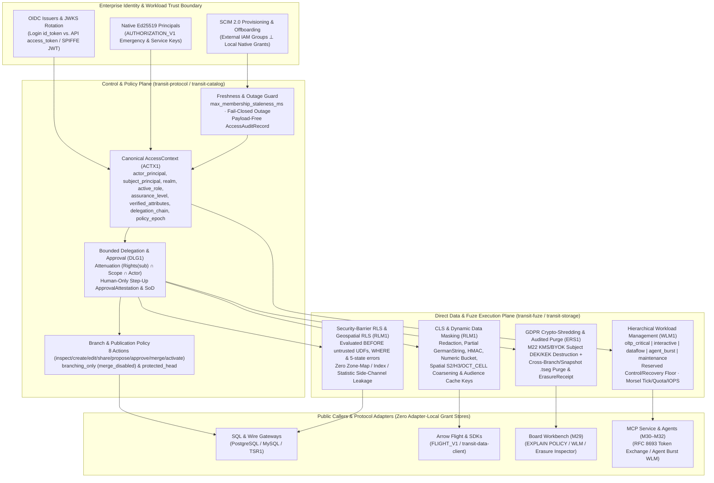

# 26. Enterprise identity and the Control & Policy Plane

[Roadmap](README.md) · **Status:** Planned ([implementation plan](#implementation-plan--2026-10-30))

Let an enterprise admit humans and agents through its identity infrastructure,
then explain which data, branches and operations each participant may use now.
Formalize authentication, identity bindings, delegation and policy evaluation
around the existing authorization graph. SQL `GRANT`/`REVOKE`, SDK operations,
MCP and application interfaces use the same owners; ingress adds no grant store.

## Prerequisites and scope

Build on the [data lifecycle](01-declarative-data-lifecycle.md),
[historical identities](10-standards-and-catalogs.md),
[branch scope](19-branches-merges-and-restore.md) and current
[authorization contract](../../contracts/AUTHORIZATION_V1.md).
Contract design can begin against current native principals and roles. Qualify
branch-dependent enforcement after the corresponding branch operations exist.
Current native authorization does not establish OIDC federation or enterprise IAM
integration; this milestone owns those additions.

The Control & Policy Plane owns catalog identities, trusted identity bindings,
policy and publication conditions. Data owners enforce access and conditional
acceptance; process/effect owners enforce execution and dispatch authority.
Application reasoning and task delegation remain application responsibilities;
the shared plane validates the resulting authorization delegation.

## Delivery sequence

1. **Define a shared access context.** Preserve authenticated actor, represented
   subject where applicable, enterprise/realm binding, client application,
   delegation identity and scope, authentication assurance and audience. Bind
   operations to their target object/branch and original identity. A claimed
   user name, forwarded header, PID or model instruction supplies no authority.
2. **Integrate enterprise authentication and membership.** Select trusted OIDC
   issuers and workload identity mechanisms; map validated issuer/subject pairs
   to stable Transit principals. Specify audience, key rotation, expiry and
   account lifecycle. Distinguish login ID tokens from API access tokens. Define
   ownership of IAM-managed memberships versus local grants, permitted claim
   mappings and provisioning/deprovisioning, including whether SCIM is supported.
   Synchronization must not silently override local restrictions or recreate
   access an operator believes revoked. Preserve independent valid grant paths.
3. **Specify freshness and failure behavior.** State which identity/membership
   decisions are live or cached, their maximum age, offboarding propagation and
   behavior during provider failure. Recheck current native rights at acceptance
   and each protected disclosure. Token validity alone cannot establish fresh
   external membership. Audit decisions without recording credentials or private
   payloads; an unavailable decision is not a grant.
4. **Implement bounded delegation, declarative secrets and OAuth2 challenge-response dataflows.** Represent actor and subject distinctly,
   restrict audience, actions, objects/branches, lifetime and further delegation.
   An agent acting for a reviewer does not inherit human-only approval authority.
   Define separate authenticated, intent-bound approval and any required step-up
   authentication or separation of duties. Provide a declarative SQL `SECRET`
   catalog surface (`CREATE SECRET`, `ALTER SECRET`, `DROP SECRET`, `SHOW SECRETS`,
   `GRANT USAGE ON SECRET` in `SECRET_MANAGER_V1` / `SEC1`) that binds KMS/Vault/workload-identity
   references or sealed OAuth2 token leases to destination `SCOPE` prefixes,
   `AUDIENCE` and `TLS_POLICY` under `policy_epoch` and `rotation_epoch` without
   recording plaintext credentials in `TransitLog` (`TWAL1`) or `.tseg` segments.
   Model stateful security challenge games (such as OAuth 2.1 Authorization Code +
   PKCE `S256`, RFC 8693 Token Exchange, DPoP and proactive lease-refresh timing
   wheels) as deterministic WAL-activated computations ([Milestone 12](12-sql-and-dataflows.md))
   that verify challenge state, anti-replay (`NOT EXISTS`) and PKCE commitments
   before emitting governed connector outbox intents that seal returned tokens
   into the secret vault and wake `Suspended (CredentialPending)` dataflows. Evaluate
   OAuth token exchange and enterprise-managed MCP authorization as adapters to
   this contract.
5. **Enforce branch and publication policy through all owners.** Separate inspect,
   branch creation, edit, share, propose, approve, merge and external activation.
   Support installations prohibiting every merge and protected destinations that
   reject direct-write bypasses. Source/data versions do not freeze permissions.
   Policy inheritance, explicit restrictions and their composition with grants
   must be defined before exposing them; introduce no assumed deny semantics.
6. **Enforce declarative Row-Level Security (RLS), Column-Level Security (CLS) and Dynamic Data Masking.**
   Allow operators to declare fine-grained row-access policies (`CREATE POLICY ...
   ON table USING (...) WITH CHECK (...)`, including
   [Milestone 17](17-geospatial-and-spatio-temporal-computing.md) **Geospatial
   RLS** predicates such as `ST_CoveredBy(location, authorized_region)`) and column-level privileges or dynamic
   masking transformations (redaction, partial masking, spatial cell coarsening, hash or `NULL` projection)
   bound to `policy_epoch` and the shared access context (principal, role,
   delegated actor/subject claims). Enforce RLS predicates as mandatory **security
   barriers** inside `Fuze` query planning and execution: untrusted user
   predicates, UDFs and eager 5-state `type_error` or checked-arithmetic failures
   must never evaluate on—or leak side-channel existence/statistics via 1D/2D zone maps
   or index probes for—rows excluded by an RLS policy. Apply RLS and column
   masking consistently across SQL, Arrow Flight, SDKs, Board previews, incremental
   dataflows and MCP adapters.
7. **Deliver Right-to-Erasure (GDPR/CCPA) governance, crypto-shredding and audited purge workflows.**
   Reconcile legal data erasure and tenant/subject offboarding with Transit's
   immutable `.tseg` storage and unlimited-by-default retention. Combine
   per-tenant/per-subject envelope encryption key destruction (crypto-shredding
   over KMS/BYOK keys from [storage providers](22-storage-providers-and-concurrency.md))
   with an explicitly authorized, auditable cross-branch and cross-snapshot purge
   compaction workflow that tombstones and rewrites affected segments while
   recording tamper-evident erasure receipts in the Control & Policy Plane without
   silently resetting unrelated history.
8. **Enforce Hierarchical Workload Management (WLM) and multi-tenant resource groups.**
   Let operators declare workload classes and resource groups binding principals,
   roles and work kinds (latency-sensitive OLTP transactions, interactive
   Board/SQL sessions, continuous dataflows, background compaction/index builds
   and autonomous MCP agent bursts) to explicit CPU shares, memory pool quotas,
   concurrency slots, admission priorities and `TransitObjectStore`/NVMe I/O
   bandwidth budgets. Drive enforcement from the fine-grained per-query and
   per-tenant metering substrate established in
   [Milestone 13](13-data-structures-and-performance.md)—hierarchical
   `MeteredAllocator` byte tracking, per-`Batch` morsel CPU cycle/tick charging
   and storage range-read/write IOPS counters—so operators can throttle, preempt
   at batch boundaries, spill to Tier 2 NVMe or deterministically refuse runaway
   queries before they starve OLTP writes, interactive governance or the reserved
   control/recovery capacity.
9. **Expose bounded administration and explanation.** Show identity-binding and
   policy provenance, effective permitted actions, active RLS/masking attribution,
   erasure receipts, WLM resource-group utilization and attributable denials under
   current inspection rights. Reuse existing policy publication/recovery and
   migrate all adapters together when a current-v1 contract changes.

## Formal model follow-through

Own the [A6 authorization/delegation candidate](21-formal-semantics-and-correspondence.md#a6-authorization-delegation-and-protected-publication)
after actor/subject, membership freshness and restriction composition settle.
Establish attenuation and human-only approval boundaries under the actual policy
rules; use temporal checks for revocation and stale membership. Connect selected
proofs or graph models to independent access-decision fixtures across adapters.
State permitted monotonicity assumptions and deferred claims explicitly; no
abstract lattice may introduce deny semantics or a second grant authority.

## Completion evidence

Use an independent identity-provider fixture and real SQL/SDK/HTTP callers.
Exercise issuer/subject collisions, wrong audience, rotation, expired credentials,
stale groups, offboarding, provider outage, conflicting management sources,
delegation attenuation, security-barrier RLS non-leakage (confirming that
division-by-zero, `type_error` cells and zone-map/index statistics on unauthorized
rows never leak through user predicates), dynamic column masking across SQL/Flight/MCP,
crypto-shredding and audited cross-branch purge receipts, WLM resource-group isolation
under concurrent agent/scan bursts and revocation between pages. An agent must fail to claim
another subject or borrow its represented user's approval power. Prove that
branch-only and protected-destination policies cannot be bypassed through a
different adapter, including native operations. Inspect an original accepted
operation after a lost reply without granting access to revoked data.

Record actual propagation bounds and failure profiles. These checks do not
establish cross-realm federation or a universal IAM-provider compatibility claim.

## Primary references

- [OIDC Core](https://openid.net/specs/openid-connect-core-1_0.html): authentication and identity claims.
- [OAuth token exchange](https://www.rfc-editor.org/rfc/rfc8693.html): actor/subject delegation mechanisms.
- [MCP authorization](https://modelcontextprotocol.io/specification/2026-07-28/basic/authorization) and [enterprise-managed authorization](https://modelcontextprotocol.io/extensions/auth/enterprise-managed-authorization): protocol integration candidates, subject to selected provider/host evidence.

## Implementation plan — 2026-10-30

### Plan basis and starting point

This plan starts from `origin/main` at commit `04f6c692b` (2026-10-30) and coordinates Milestone 26's nine delivery steps and formal verification obligations across the completed foundations on `origin/main` and the active/upcoming milestones in Phases I–VI. Planning does not change runtime status: Milestone 26 remains `Planned` until its implementation and qualification gates pass.

- **Completed and delivered foundations on `origin/main` (`04f6c692b`):**
  - **[Milestone 1](01-declarative-data-lifecycle.md) & [Milestone 2](02-storage-and-query-performance.md):** Neutral data/definition identities (`Scope`, `Object`, `DefinitionId`, `Operation`, `Position`, `Snapshot` in [`packages/zig/transit-protocol/src/DataLifecycle.zig`](../../packages/zig/transit-protocol/src/DataLifecycle.zig)), `TransitLog` (`TWAL1`), `TransitObjectStore` immutable `.tseg` segments and `.tdel` Roaring deletion vectors (`RBC1`), `NvmeCache`, `PartitionLease`, and native RBAC (`declarative_authorization` in [`contracts/AUTHORIZATION_V1.md`](../../contracts/AUTHORIZATION_V1.md) and [`packages/zig/transit-protocol/src/Authorization.zig`](../../packages/zig/transit-protocol/src/Authorization.zig)).
  - **[Milestone 3](03-live-storage-and-sql-cutover.md), [Milestone 6](06-streams-queues-and-durable-runtime.md) & [Milestone 7](07-document-storage-and-station-decoupling.md):** Direct Data Plane and Control & Policy Plane (`DirectCatalog`, `TablePartition`, `StreamPartition`, `QueuePartition`, `DocumentPartition`, `KVPartition`) decoupled from `Station` actor turns (`AccountRuntime`/`Ledger` `STATE_V1`), with domain-specific authority bindings in [`TableAuthority.zig`](../../packages/zig/transit-catalog/src/TableAuthority.zig), [`LogAuthority.zig`](../../packages/zig/transit-catalog/src/LogAuthority.zig), [`KVAuthority.zig`](../../packages/zig/transit-catalog/src/KVAuthority.zig), [`DocumentAuthority.zig`](../../packages/zig/transit-catalog/src/DocumentAuthority.zig), and [`DirectReadDelegation.zig`](../../packages/zig/transit-catalog/src/DirectReadDelegation.zig).
  - **[Milestone 4](04-statement-results-and-consumption.md) & [Milestone 5](05-transactions-and-atomic-composition.md):** Transport-independent `SQL_RESULTS_V1` (`ResultSet`, `Batch`, `Window`, `Progress`, and `Observation.validateDisclosure` / `holdDisclosure` in [`packages/zig/transit-sql-results/src/Observation.zig`](../../packages/zig/transit-sql-results/src/Observation.zig)), multi-Table serializable transactions (`DirectTransaction`, `TableTransaction`, common cuts `0x54584331`), durable client-token deduplication (`DirectClientToken.zig`), and warm snapshot leases (`ReadCache.zig`).
  - **[Milestone 8](08-gateway-architecture-and-protocol-ingress.md) & [Milestone 9](09-client-foundation-and-language-apis.md):** Co-hosted `DatabaseRuntime`, event-driven recovery, pure sans-I/O wire protocol codecs (`transit-postgres`, `transit-mysql`, `TSR1`, `transit-flight`, `transit-serving-http`), and the shared `transit-data-client` / `transit-sql-client` foundation.
  - **[Milestone 10](10-standards-and-catalogs.md):** Manifest-backed historical catalog cuts (`HistoricalCatalog.zig` with `ManifestCut`, `GrantSet` checked at `current_policy_epoch`, `ViewDescriptor` with `security_invoker`, `PropertyGraphDescriptor`, `ForeignTableDescriptor`), 5-state `TableConstraints.zig` (`evaluateCheckRow`, `ForeignKeyConstraint`), zero-work `EXPLAIN` trait summaries (`OperatorTraits.zig`), companion types (`Range.zig`, `VectorMetric.zig`, `DecimalArithmetic.zig` with pinned `TzdbVersion` $\kappa_{\text{tz}}$), and `StandardsLedger.zig`.
  - **[Milestone 12](12-sql-and-dataflows.md):** Analytical SQL (`AnalyticalSql.zig`), bitemporal `AS OF JOIN` and `CHANGES(...)` / `STREAM_SLICE(...)` TVFs (`BitemporalAndTvf.zig`), incremental DBSP Z-set evaluation (`FuzeDelta.zig`), and the 5-state computation lifecycle (`ManagedDataflow.zig`: `Published`, `Authorized`, `Active`, `Suspended`, `Retired`).
  - **[Milestone 13](13-data-structures-and-performance.md) & [Milestone 14](14-vectorized-strings-and-search.md):** Hierarchical memory accounting (`transit-memory`: [`Budget.zig`](../../packages/zig/transit-memory/src/Budget.zig), [`Quota.zig`](../../packages/zig/transit-memory/src/Quota.zig), [`Workspace.zig`](../../packages/zig/transit-memory/src/Workspace.zig) with `release(erase: true)` `std.crypto.secureZero`, [`Pool.zig`](../../packages/zig/transit-memory/src/Pool.zig), [`Slab.zig`](../../packages/zig/transit-memory/src/Slab.zig), [`AllocationProbe.zig`](../../packages/zig/transit-memory/src/AllocationProbe.zig)), 16-byte collation-prefixed `GermanString.zig`, `PerfectHash.zig`, and vectorized 256-doc Block-Max WAND BM25 & hybrid search (`TSearchSegment.zig`, `VectorizedSearch.zig`, `HybridSearch.zig`).
  - **[Milestone 19](19-branches-merges-and-restore.md):** Multi-branch lifecycle (`BranchLifecycle.zig` with `BranchRegistry`, `BranchMergePolicy`, `BranchPrivilege`, `BranchGrantSet`), segment-skipping 2-way/3-way `DIFF` and `DIFF_SCHEMA` with 5-state `IS CONFLICT` cells (`BranchDiff.zig`), and reviewed 3-way merge, forward restore, and incremental remote sync (`BranchMergeRestore.zig`).
  - **[Milestone 27](27-published-resources-and-investigations.md):** Transport-independent `PublishedResource.zig` (`PBR1`), `DisclosurePolicy.zig` (`CallerAccessContext`, `DelegationGrant`, `PublicationAttestation`, `DisclosureBoundary` with $k$-anonymity `min_group_cardinality` and 5-state `type_error` scrubbing, `effectiveAudienceHash`), `InvestigationBasis.zig` (`INV1`), and `Attribution.zig` (`ATB1`).
- **In-progress and planned upstream, sibling, and downstream milestones:**
  - **[Milestone 11](11-indexing-and-access-paths.md), [Milestone 15](15-data-centric-compilation-and-specialization.md), [Milestone 16](16-document-profiles-and-gateway-exchange-lifecycle.md), [Milestone 17](17-geospatial-and-spatio-temporal-computing.md) & [Milestone 18](18-multi-model-and-foreign-relations.md):** Secondary indexes and key-range SSI (`M11`), data-centric pipeline fusion and AOT Zig query compilation (`M15`), multi-format Document Profiles and gateway exchange capture (`M16`), 2D/3D geospatial/volumetric types ($\kappa_{\text{spatial}}$) and `RTREE`/`S2`/`OCTREE` indexes (`M17`), and property-graph / foreign-table / hybrid-search composition (`M18`).
  - **[Milestone 20](20-service-and-sdk-coverage.md), [Milestone 21](21-formal-semantics-and-correspondence.md) & [Milestone 33](33-programming-model.md):** Language SDK coverage (`M20`), formal Lean 4 and TLA+ verification (`M21` candidate `A6: PolicyLattice.lean` and temporal revocation/freshness models), and complete direct/Station/mixed application composition (`M33`).
  - **[Milestone 22](22-storage-providers-and-concurrency.md), [Milestone 23](23-replication-and-failover.md), [Milestone 24](24-operations-and-recovery.md) & [Milestone 25](25-clustered-execution.md):** Distributed storage providers and KMS/BYOK envelope encryption (`M22`), replication and failover (`M23`), transaction-consistent backup/PITR/restore (`M24`), and clustered execution (`M25`).
  - **[Milestone 28](28-reviewed-data-collaboration.md), [Milestone 29](29-board-reimplementation.md), [Milestone 30](30-mcp-service-and-apps.md), [Milestone 31](31-reactive-context-and-agent-activation.md), [Milestone 32](32-recorded-mcp-integrations.md) & [Milestone 34](34-sql-grammar-and-dialect-ergonomics.md):** Versioned branch proposals and intent-bound human approval (`M28`), Board workbench (`M29`), MCP service and interactive Apps (`M30`), reactive agent activation (`M31`), recorded outbound MCP (`M32`), and cross-dialect SQL grammar harmonization (`M34`).

### Pre-implementation source audit (`04f6c692b` baseline)

| Delivery step | Current source owners on `origin/main` | Delivered baseline at `04f6c692b` | Remaining gap for Milestone 26 |
| --- | --- | --- | --- |
| **1. Shared access context** | [`contracts/AUTHORIZATION_V1.md`](../../contracts/AUTHORIZATION_V1.md), [`packages/zig/transit-protocol/src/Authorization.zig`](../../packages/zig/transit-protocol/src/Authorization.zig), [`packages/zig/transit-catalog/src/TableAuthority.zig`](../../packages/zig/transit-catalog/src/TableAuthority.zig), [`packages/zig/transit-catalog/src/DisclosurePolicy.zig`](../../packages/zig/transit-catalog/src/DisclosurePolicy.zig), [`packages/zig/transit-query/src/QueryAuthorization.zig`](../../packages/zig/transit-query/src/QueryAuthorization.zig) | `Authorization.Claim` / `Verified` binds `realm`, `principal`, `login_role`, `role`, `credential_epoch`, `audience`, and 32-byte `context` signed with Ed25519. `DisclosurePolicy.CallerAccessContext` (M27) prototypes `caller_principal`, `delegation`, and `service_transport_principal`. | Unify a canonical, wire-validated `AccessContext` (`ACCESS_CONTEXT_V1`, magic `ACTX1` / `0x41435458`) in `transit-protocol` and `transit-catalog` preserving `authenticated_actor`, `represented_subject`, `realm_id`, `enterprise_binding` (`issuer_id`, `external_subject`), `client_app_id`, `delegation_chain`, `assurance_level` (`aal1`, `aal2`, `aal3`), `authenticated_at_ns`, `verified_attributes` (for ABAC/RLS), `target_object`/`branch_id`, `audience`, and `policy_epoch`. |
| **2. Enterprise authentication & membership (OIDC, Workload Identity, SCIM 2.0)** | [`contracts/AUTHORIZATION_V1.md`](../../contracts/AUTHORIZATION_V1.md), [`contracts/SQL_SESSION_V1.md`](../../contracts/SQL_SESSION_V1.md), [`apps/transit-sql-gateway/`](../../apps/transit-sql-gateway), [`docs/handbook/reference/security.md`](../handbook/reference/security.md) | Native authentication uses Ed25519 credentials (`Authorization.Credential`); SQL gateway supports SCRAM-SHA-256 (PostgreSQL), `caching_sha2_password` (MySQL), and local peer credentials. `AUTHORIZATION_V1.md` line 354 explicitly rejects identity federation. | Define `IDENTITY_FEDERATION_V1` (`IDF1` / `0x49444631`): trusted `OidcIssuerProfile` registry, JWKS key rotation (`kid` pinning + grace window), `aud`/`iss`/`exp`/`nbf` validation, login `id_token` vs. API/workload `access_token` separation, stable `(issuer_id, sub) -> PrincipalId` bindings, and SCIM 2.0 provisioning/deprovisioning (`scim_v2`) with strict ownership isolation so external IAM sync can **never** override local revocations/restrictions or recreate revoked access. |
| **3. Freshness, offboarding & provider outage behavior** | [`packages/zig/transit-catalog/src/TableAuthority.zig`](../../packages/zig/transit-catalog/src/TableAuthority.zig), [`packages/zig/transit-catalog/src/HistoricalCatalog.zig`](../../packages/zig/transit-catalog/src/HistoricalCatalog.zig), [`packages/zig/transit-sql-results/src/Observation.zig`](../../packages/zig/transit-sql-results/src/Observation.zig) | Native `TableAuthority.Source.finish` and `Observation.validateDisclosure` recheck `policy_epoch` and native guards before disclosing each batch; missing policy fails closed. | Formalize `MembershipFreshnessPolicy`: distinguish JWT expiry (`exp`) from external group/membership freshness (`max_membership_staleness_ms`), enforce bounded offboarding propagation into `policy_epoch`, fail closed (`error.IdentityVerificationUnavailable`) when an IdP is unreachable past the staleness bound, and emit credential- and payload-free `AccessAuditRecord`s. |
| **4. Bounded delegation, attenuation, declarative secrets & human-only approval** | [`packages/zig/transit-catalog/src/DirectReadDelegation.zig`](../../packages/zig/transit-catalog/src/DirectReadDelegation.zig) (`TRG1`), [`packages/zig/transit-catalog/src/DirectReadBorrow.zig`](../../packages/zig/transit-catalog/src/DirectReadBorrow.zig), [`packages/zig/transit-catalog/src/DisclosurePolicy.zig`](../../packages/zig/transit-catalog/src/DisclosurePolicy.zig) (`DelegationGrant`) | `DirectReadDelegation` (`TRG1`) delegates single-table pin/read authority to a query executor; `DisclosurePolicy.DelegationGrant` scopes agent access to `PublishedResource` IDs. | Generalize into `DELEGATION_V1` (`DLG1` / `0x444C4731`) and `SECRET_MANAGER_V1` (`SEC1` / `0x53454331`): distinct `actor_principal` and `subject_principal`, scoped `audience`, `allowed_actions`, `allowed_objects`/`branches`, `rls_attribute_attenuation`, `max_delegation_depth`, and `expires_at_policy_epoch`; declarative SQL `SECRET` catalog (`CREATE SECRET`, `ALTER SECRET`, `DROP SECRET`, `SHOW SECRETS`, `GRANT USAGE ON SECRET`) with URI `SCOPE`/`AUDIENCE`/`TLS_POLICY` matching and `rotation_epoch` fencing; stateful OAuth 2.1 + PKCE `S256` challenge-response and lease-refresh dataflow state machine; `human_only` intent-bound step-up approval (`ApprovalAttestation` with separation of duties); and OAuth 2.0 Token Exchange (RFC 8693) and MCP enterprise authorization (`M30`). |
| **5. Branch & publication policy across all owners** | [`packages/zig/transit-catalog/src/BranchLifecycle.zig`](../../packages/zig/transit-catalog/src/BranchLifecycle.zig) (`BranchMergePolicy`, `BranchPrivilege`, `BranchGrantSet`), [`packages/zig/transit-catalog/src/BranchMergeRestore.zig`](../../packages/zig/transit-catalog/src/BranchMergeRestore.zig) | `BranchLifecycle` defines `allow_merge`, `merge_disabled`, `protected_head` and 5 privileges (`create`, `read`, `write`, `merge`, `restore`). | Expand to all 8 lifecycle actions (`inspect`, `create_branch`, `edit`, `share`, `propose`, `approve`, `merge`, `external_activation`) wired into native `Authorization.zig`, `DirectCatalog.zig`, `DirectTableDispatch.zig`, `DirectStream.zig`, `DirectQueue.zig`, and `DocumentPartition.zig` so `merge_disabled` and `protected_head` reject direct-write bypasses through **every** adapter (SQL, SDK, Flight, native, MCP) with zero assumed deny precedence. |
| **6. Security-barrier RLS (including 2D/3D Geospatial RLS), CLS & Dynamic Data Masking** | [`packages/zig/transit-catalog/src/HistoricalCatalog.zig`](../../packages/zig/transit-catalog/src/HistoricalCatalog.zig), [`packages/zig/transit-fuze/src/OperatorTraits.zig`](../../packages/zig/transit-fuze/src/OperatorTraits.zig), [`packages/zig/transit-fuze/src/LogicalQuery.zig`](../../packages/zig/transit-fuze/src/LogicalQuery.zig), [`packages/zig/transit-fuze/src/Relational.zig`](../../packages/zig/transit-fuze/src/Relational.zig), [`packages/zig/transit-fuze/src/AnalyticalSql.zig`](../../packages/zig/transit-fuze/src/AnalyticalSql.zig) | `GrantSet` enforces table-level `metadata_only` vs. `select_rows`; `DisclosurePolicy` scrubs restricted 5-state `type_error` cells on published summaries; `BranchMergeRestore` has a hook for remote egress filtering. `AUTHORIZATION_V1.md` line 354 rejects row/column policies. | Deliver `RLS_MASKING_V1` (`RLM1` / `0x524C4D31`): `CREATE/ALTER/DROP POLICY ... USING (...) WITH CHECK (...)` (including M17 2D/3D Geospatial RLS: `ST_CoveredBy`, `ST_3DIntersects`, `S2`/`H3`/`OCT_CELL` coverings), `CREATE/ALTER/DROP MASKING POLICY` (redaction, partial mask, HMAC hash, numeric bucket, spatial cell coarsening), mandatory `SecurityBarrierFilter` in `Fuze` preventing 5-state `type_error` / division-by-zero / zone-map / index side-channel leakage on unauthorized rows, and audience-keyed cache isolation across SQL, Flight, SDKs, Board, M12 dataflows, and MCP. |
| **7. Right-to-Erasure (GDPR/CCPA), crypto-shredding & audited cross-branch purge** | [`packages/zig/transit-memory/src/Workspace.zig`](../../packages/zig/transit-memory/src/Workspace.zig) (`release(erase: true)`), [`packages/zig/transit-catalog/src/DirectStorageGraph.zig`](../../packages/zig/transit-catalog/src/DirectStorageGraph.zig), [`packages/zig/transit-storage/src/TablePartition.zig`](../../packages/zig/transit-storage/src/TablePartition.zig), [`docs/roadmap/22-storage-providers-and-concurrency.md`](22-storage-providers-and-concurrency.md) | `Workspace.release(true)` zeroes secret/erased memory buffers (`std.crypto.secureZero`); `DirectStorageGraph` walks all catalog/branch/snapshot roots; M22 specifies KMS/BYOK envelope encryption (`DEK`/`KEK`). | Deliver `ERASURE_V1` (`ERS1` / `0x45525331`): combine per-tenant/per-subject envelope `DEK`/`KEK` destruction (crypto-shredding) with an explicitly authorized, auditable cross-branch and cross-snapshot `.tseg` purge compaction workflow that rewrites affected segments across `TablePartition`, `DocumentPartition`, and `StreamPartition`/`QueuePartition` and records tamper-evident, PII-free `ErasureReceipt`s (`ERS1`) without resetting unrelated history. |
| **8. Hierarchical Workload Management (WLM) & multi-tenant resource groups** | [`packages/zig/transit-memory/src/Quota.zig`](../../packages/zig/transit-memory/src/Quota.zig), [`packages/zig/transit-memory/src/Budget.zig`](../../packages/zig/transit-memory/src/Budget.zig), [`packages/zig/transit-memory/src/Workspace.zig`](../../packages/zig/transit-memory/src/Workspace.zig), [`packages/zig/transit-fuze/src/BudgetDiagnostic.zig`](../../packages/zig/transit-fuze/src/BudgetDiagnostic.zig), [`packages/zig/transit-fuze/src/OperatorTraits.zig`](../../packages/zig/transit-fuze/src/OperatorTraits.zig) | `Quota.zig` implements lock-free atomic hierarchical byte reservations (`parent: ?*Quota`); `Budget.zig` tracks per-workspace byte limits; `OperatorTraits.WorkBound` declares row/byte/spill/step bounds. | Deliver `WORKLOAD_MANAGEMENT_V1` (`WLM1` / `0x574C4D31`): declarative `WorkloadGroup` hierarchy and `WorkloadClassifier` rules binding principals, roles, and work kinds (`oltp_critical`, `interactive_governance`, `continuous_dataflow`, `agent_burst`, `background_maintenance`, plus a non-preemptible `control_and_recovery` reserve) to CPU shares, per-morsel tick budgets, `Quota` memory pools, concurrency slots, Tier 2 NVMe spill thresholds, and `TransitObjectStore`/`NvmeCache` IOPS/bandwidth token buckets. |
| **9. Bounded administration & policy explanation** | [`packages/zig/transit-catalog/src/DirectAuthorizationSql.zig`](../../packages/zig/transit-catalog/src/DirectAuthorizationSql.zig), [`packages/zig/transit-catalog/src/DirectCatalogInspection.zig`](../../packages/zig/transit-catalog/src/DirectCatalogInspection.zig), [`contracts/AUTHORIZATION_V1.md`](../../contracts/AUTHORIZATION_V1.md) (`query.authorization.preview`) | Native `query.authorization` supports 8-record paged role/grant inspection and 32-page scratch `preview`; `OperatorTraits.forExplain` guarantees zero-work SQL `EXPLAIN`. | Add `EXPLAIN POLICY FOR <statement>`, `SHOW IDENTITY BINDINGS`, `SHOW POLICIES`, `SHOW MASKING POLICIES`, `SHOW ERASURE RECEIPTS`, and `SHOW WORKLOAD GROUPS` returning bounded, cursor-paginated `SQL_RESULTS_V1` result sets showing identity-binding provenance, effective actions, active RLS/masking attribution, erasure receipts, WLM utilization, and attributable denial diagnostics under current inspection rights. |
| **10. Formal model follow-through (`A6` & temporal models)** | [`contracts/sql/FuzeRewrite.lean`](../../contracts/sql/FuzeRewrite.lean), [`tests/verification/models/Authority.tla`](../../tests/verification/models/Authority.tla), [`docs/roadmap/21-formal-semantics-and-correspondence.md`](21-formal-semantics-and-correspondence.md#a6-authorization-delegation-and-protected-publication) | `FuzeRewrite.lean` (`A1`) proves filter reordering, projection pruning, and `selectChecked` first-error preservation; `Authority.tla` checks process generation fencing and revocation. | Deliver `contracts/sql/PolicyLattice.lean` (`A6`: actor/subject delegation attenuation, human-only approval non-delegability, protected-destination direct-write non-bypass, and security-barrier RLS non-interference composed with `FuzeRewrite.selectChecked`) and `tests/verification/models/EnterpriseIdentityLifecycle.tla` (temporal checks for membership staleness, provider outage fail-closed behavior, offboarding propagation, and mid-stream revocation) with production Zig state-reducer correspondence. |

### Coordination and handoffs across milestones

| Milestone | Dependency direction | Concrete contract and handoff with Milestone 26 |
| --- | --- | --- |
| **[M1](01-declarative-data-lifecycle.md)–[M5](05-transactions-and-atomic-composition.md)** | Upstream (completed) | M26 extends `AUTHORIZATION_V1`, `DATA_LIFECYCLE_V1`, `DIRECT_TABLE_V1`, and `SQL_RESULTS_V1` (`Observation.validateDisclosure`) via a coordinated current-v1 cutover. Every M5 transaction and single-statement write records the caller's `AccessContext` digest and validates `WITH CHECK` RLS predicates and branch protection before `TWAL1` commit. |
| **[M6](06-streams-queues-and-durable-runtime.md), [M7](07-document-storage-and-station-decoupling.md), [M8](08-gateway-architecture-and-protocol-ingress.md), [M9](09-client-foundation-and-language-apis.md)** | Upstream (in progress) | All Control & Policy Plane catalogs (`IdentityBinding`, `RlsPolicy`, `MaskingPolicy`, `ErasureReceipt`, `WorkloadGroup`) live in `DirectCatalog` / `HistoricalCatalog` over `TransitLog` (`TWAL1`) and `.tseg` manifests—never in `Station` actor KV turns. Co-hosted gateways (`M8`) and `transit-data-client` / `transit-sql-client` (`M9`) construct and forward `AccessContext` (`ACTX1`) and `DelegationTicket` (`DLG1`) without maintaining gateway-local grant stores. |
| **[M10](10-standards-and-catalogs.md)** | Upstream (landed on `main`) | M26 extends M10's `HistoricalCatalog.GrantSet` and `ManifestCut` (`policy_epoch`) with security-barrier RLS, CLS masking, and branch-policy descriptors, and registers all new policy/WLM/erasure SQL forms in `StandardsLedger.zig` (`contracts/sql/standards-ledger.json`). |
| **[M11](11-indexing-and-access-paths.md)** | Upstream / sibling | M26 RLS security-barrier planning restricts M11 secondary index scans and key-range SSI conflict reporting so an unauthorized caller cannot probe unique-key existence or trigger key-range conflict errors on rows excluded by their RLS policy. |
| **[M12](12-sql-and-dataflows.md)** | Upstream (landed on `main`) | M12's 5-state `ManagedDataflow` (`Published -> Authorized -> Active <-> Suspended -> Retired`) checks M26's `AccessContext` and `policy_epoch` on transition to `Authorized`/`Active`; revoking an upstream grant or RLS policy immediately fences the worker's `_lease_epoch` and suspends or re-evaluates the dataflow. |
| **[M13](13-data-structures-and-performance.md), [M14](14-vectorized-strings-and-search.md), [M15](15-data-centric-compilation-and-specialization.md)** | Upstream / sibling | M26's WLM (`WLM1`) drives enforcement directly from M13's hierarchical `Quota.zig` / `Budget.zig` / `Workspace.zig`, per-morsel CPU tick counters, and `NvmeCache` / `TransitObjectStore` I/O token buckets. M14's 16-byte `GermanString` and Block-Max WAND BM25 (`TSearchSegment`) and M15's fused data-centric pipelines evaluate M26's `SecurityBarrierFilter` bitmask *before* untrusted user predicates or AOT stencils. |
| **[M16](16-document-profiles-and-gateway-exchange-lifecycle.md), [M17](17-geospatial-and-spatio-temporal-computing.md), [M18](18-multi-model-and-foreign-relations.md)** | Upstream / sibling | M26 enforces sub-document path masking and crypto-shredding on M16 `DocumentPartition` profiles; **Geospatial RLS** (`ST_CoveredBy`, `ST_3DIntersects`, `S2`/`H3`/`OCT_CELL` Roaring coverings) and **Spatial Dynamic Masking** (cell coarsening, grid snapping) over M17 $\kappa_{\text{spatial}}$ types; and uniform RLS/masking across M18 property graphs (`CREATE PROPERTY GRAPH`), hybrid search, and foreign tables. |
| **[M19](19-branches-merges-and-restore.md)** | Upstream (landed on `main`) | M26 upgrades M19's `BranchGrantSet` and `BranchMergePolicy` into full enterprise branch/publication governance across all 8 branch actions, enforces remote egress RLS/masking on `FETCH`/`MIRROR`, and executes audited GDPR purge compaction (`ERS1`) across all M19 branches and pinned snapshots. |
| **[M20](20-service-and-sdk-coverage.md) & [M33](33-programming-model.md)** | Sibling / downstream | Language SDKs (`M20`) and mixed direct + `Station` applications (`M33`) pass OIDC access tokens, workload identities, and `DelegationTicket`s through the shared Zig client boundary, preserving original operation identity across token refresh and credential rotation. |
| **[M21](21-formal-semantics-and-correspondence.md)** | Sibling | M26 delivers `A6: PolicyLattice.lean` and `EnterpriseIdentityLifecycle.tla`, replaying finite state-graph edges and access-decision fixtures against the production Zig policy evaluator across SQL, SDK, Flight, Board, and MCP callers. |
| **[M22](22-storage-providers-and-concurrency.md), [M23](23-replication-and-failover.md), [M24](24-operations-and-recovery.md), [M25](25-clustered-execution.md)** | Upstream / sibling (Phase III) | M26's GDPR crypto-shredding (`ERS1`) destroys per-tenant/per-subject KMS/BYOK envelope DEKs/KEKs established in M22, propagates `policy_epoch` fences and `ErasureReceipt`s across M23 replicas and M25 distributed query workers, and ensures M24 PITR/backups cannot resurrect crypto-shredded subjects. |
| **[M27](27-published-resources-and-investigations.md)** | Downstream (landed on `main`) | M27's `DisclosurePolicy.CallerAccessContext`, `DelegationGrant`, `PublicationAttestation`, and `effectiveAudienceHash` directly consume M26's canonical `AccessContext`, `DelegationTicket`, RLS/masking profile digest, and `policy_epoch`. |
| **[M28](28-reviewed-data-collaboration.md)** | Downstream | M28 consumes M26's actor/subject separation, `ApprovalAttestation` (human-only step-up approval + separation of duties), and `branching_only` / `protected_destination` enforcement to govern versioned branch proposals and reviewed merges. |
| **[M29](29-board-reimplementation.md)** | Downstream | M29's Inspector and Operations surfaces render M26's `EXPLAIN POLICY`, identity-binding provenance, active RLS/masking badges, `ErasureReceipt` audit ledger, and WLM resource-group utilization over read-only public APIs. |
| **[M30](30-mcp-service-and-apps.md), [M31](31-reactive-context-and-agent-activation.md), [M32](32-recorded-mcp-integrations.md)** | Downstream | M30 maps OAuth 2.1 / RFC 8693 token exchange and MCP enterprise-managed authorization into M26's `AccessContext` and `DelegationTicket`, enforcing WLM `agent_burst` quotas; M31 revalidates `policy_epoch` and RLS on reactive agent triggers; M32 scopes outbound MCP connector calls to delegated authority. |
| **[M34](34-sql-grammar-and-dialect-ergonomics.md)** | Downstream | M34 audits M26's `CREATE POLICY`, `ALTER TABLE ... ENABLE/FORCE ROW LEVEL SECURITY`, `CREATE MASKING POLICY`, `CREATE WORKLOAD GROUP`, `EXECUTE ERASURE POLICY`, and `EXPLAIN POLICY` syntax against PostgreSQL 17, Snowflake, and ISO SQL:2023. |

### Architecture overview



### Accepted architectural decisions (`D1`–`D9`)

#### `D1` — Canonical `AccessContext` (`ACCESS_CONTEXT_V1` / `ACTX1`) and strict actor-versus-subject separation

1. **Single transport-neutral `AccessContext` across all planes:**
   - Create `contracts/ACCESS_CONTEXT_V1.md` (`magic = 0x41435458` / `"ACTX1"`, definition `"transit.authorization.access-context.v1"`) implemented in `packages/zig/transit-protocol/src/AccessContext.zig` and consumed by `transit-catalog`, `transit-fuze`, `transit-query`, `transit-sql`, `transit-flight`, `transit-serving-http`, and `transit-board`.
   - Every `AccessContext` carries:
     - `definition: p.Growth.Definition` (rejecting missing or foreign definitions on decode per the current-v1 cutover rule)
     - `realm_id: u64`
     - `actor_principal: u64` (the authenticated entity immediately executing the call—either a human login principal, a workload service principal, or an agent principal)
     - `subject_principal: u64` (the represented principal whose authority is being exercised; equal to `actor_principal` for direct calls, and distinct when operating under a `DelegationTicket`)
     - `login_role: u64` and `active_role: u64` (preserving `AUTHORIZATION_V1`'s distinction between `SESSION_USER` and `CURRENT_ROLE`)
     - `credential_epoch: u64` and `policy_epoch: u64`
     - `enterprise_binding: ?EnterpriseIdentityRef` (`issuer_id: u64`, `external_subject_hash: [32]u8`, `membership_verified_at_ns: i64`, `token_expires_at_ns: i64`)
     - `client_app_id: ?u64` and `audience: u64` (binding the exact target service/node PID or logical service domain)
     - `assurance_level: enum(u8) { aal1_single_factor = 1, aal2_multi_factor = 2, aal3_hardware_cryptographic = 3, workload_attested = 4 }` and `step_up_verified_at_ns: ?i64`
     - `verified_attributes: [max_attributes]?AttributeClaim` (up to 16 typed, cryptographically verified claims—such as `region`, `tenant_id`, `clearance_level`, `department`, or `authorized_s2_cell_prefix`—used by security-barrier RLS and dynamic masking; never populated from unverified client headers or session variables)
     - `delegation: ?DelegationChain` (up to 4 hops `max_delegation_depth = 4`, recording `delegation_id`, `allowed_actions`, `allowed_objects`, `allowed_branches`, and `expires_at_policy_epoch`)
     - `target_scope: TargetBinding` (`catalog_id: u64`, `branch_id: u64`, `object_ref: ?Authorization.ObjectRef`, `investigation_id: ?u64`, `operation_context_digest: [32]u8`)
2. **Zero authority from ambient claims:**
   - A claimed username string, HTTP `X-Forwarded-For` / `X-Forwarded-User` header, process PID, connection slot, `InvestigationId`, `ResultSet` cursor handle, or LLM system/tool instruction supplies **zero** authority. Every `AccessContext` must be backed either by a native Ed25519 `Authorization.Proof` or a verified enterprise token/delegation proof validated by the Control & Policy Plane at `current_policy_epoch`.

#### `D2` — Enterprise OIDC/Workload Identity federation, SCIM 2.0 provisioning, and non-overriding grant authority (`IDENTITY_FEDERATION_V1` / `IDF1`)

1. **Trusted issuer registry and token verification (`IdentityFederation.zig`):**
   - Operators register trusted identity providers in the Control & Policy Plane (`CREATE IDENTITY PROVIDER <name> TYPE (OIDC | WORKLOAD_JWT) WITH (...)`, stored in `DirectCatalog` / native authority with magic `IDF1`):
     - `issuer_id: u64`, `issuer_uri: []const u8` (exact HTTPS URL match on `iss` claim), `expected_audiences: []const []const u8` (mandatory `aud` validation; wrong or missing audience rejects with `error.InvalidTokenAudience`).
     - `jwks_keyring: JwksKeyring`: stores pinned Ed25519 / ECDSA P-256 / RSA-PSS public keys indexed by `kid`, with explicit `key_epoch`, `not_before_ns`, `not_after_ns`, and rotation grace windows. Retiring a compromised `kid` advances `policy_epoch` and immediately invalidates tokens signed by that key.
     - **Login ID tokens vs. API access tokens:** `TokenProfile` strictly distinguishes OIDC interactive login `id_token`s (permitted only at initial session/console authentication handshake to establish a short-lived session credential, never accepted as bearer API tokens) from OAuth 2.0 / OIDC API `access_token`s (RFC 9068) and SPIFFE / Kubernetes service-account workload JWTs.
2. **Collision-free `(issuer_id, sub) -> PrincipalId` mapping:**
   - An external `sub` claim is scoped strictly to its `issuer_id`. Identical `sub` strings from two different OIDC issuers (or a human username matching a service-account `sub`) resolve to distinct `(issuer_id, sub)` keys and can never collide or hijack an existing `PrincipalId` (`error.IdentitySubjectCollision` if a binding conflict is attempted).
   - Retiring a principal (`RETIRE PRINCIPAL` or SCIM `DELETE /Users/{id}`) permanently retires that `PrincipalId`; a later user provisioned with the same email or external username receives a fresh `PrincipalId` and inherits zero historical grants.
3. **Strict separation of IAM-managed memberships vs. local native grants (SCIM 2.0 & OIDC claim sync):**
   - Role and membership records in `Authorization.zig` and `DirectCatalog` carry an explicit `management_source: enum(u8) { native_local = 1, external_iam_scim = 2, external_oidc_claim = 3 }` and role policy flags `allow_external_membership_sync: bool = false` and `local_restriction_hold: bool = false`:
     - **Permitted claim mappings:** An `OidcIssuerProfile` or SCIM 2.0 connector may map validated external groups/claims **only** onto Transit roles explicitly configured with `allow_external_membership_sync = true` and bound to that `issuer_id`. External claims can never map to `root_role` (`0`), private `native/` roles, or locally restricted administrative roles (`error.ConflictingManagementSource`).
     - **No silent override of local restrictions:** If an operator locally disables a role (`ALTER ROLE ... DISABLE`), places a `local_restriction_hold`, or locally revokes a specific principal's access (`REVOKE ...` / `ALTER PRINCIPAL ... DISABLE`), a subsequent SCIM `PUT`/`PATCH` sync or fresh OIDC login token carrying the external group claim **cannot** clear the local restriction or re-enable access (`error.LocalRestrictionOverridesExternalSync`).
     - **Preservation of independent valid grant paths:** Following `AUTHORIZATION_V1`'s union-of-valid-paths rule, when SCIM or OIDC sync removes an `external_iam_scim` membership edge `(principal, role_A)`, dependent authority derived solely through `role_A` closes, while an independent `native_local` grant or membership `(principal, role_B)` granted by a local owner remains intact.

#### `D3` — Membership freshness, offboarding propagation bounds, and fail-closed provider outage behavior

1. **Live vs. cached membership freshness (`MembershipFreshnessPolicy`):**
   - Token cryptographic validity (`exp > now`) is necessary but **never sufficient** on its own to prove current enterprise group membership or active employment status.
   - Each `OidcIssuerProfile` configures:
     - `max_membership_staleness_ms: u64` (default `60_000 ms` for standard interactive/API reads; `0 ms` requiring a fresh sync watermark or short-lived token epoch for `human_only` approvals and administrative DDL).
     - `offboarding_propagation_sla_ms: u64`: When a SCIM 2.0 deprovision (`DELETE /Users/{id}` or `active: false`), OIDC back-channel logout token, or administrative `REVOKE` / `DISABLE PRINCIPAL` arrives, the Control & Policy Plane synchronously commits a new `policy_epoch` in `TransitLog` (`TWAL1`).
2. **Recheck at acceptance and every protected disclosure:**
   - Every write admission (`DirectCatalog`, `TablePartition`, `StreamPartition`, `QueuePartition`, `DocumentPartition`), every query/resource evaluation, and every subsequent `ResultSet` batch fetch (`Observation.validateDisclosure`), Arrow Flight `DoGet` chunk, or reactive SSE/WebSocket frame checks:
     1. `access_context.policy_epoch == current_policy_epoch` (or re-evaluates the caller's `AccessContext` against `current_policy_epoch`), and
     2. `now_ns - enterprise_binding.membership_verified_at_ns <= max_membership_staleness_ms`.
   - If a user is offboarded or a group is revoked while a multi-batch query is mid-stream, batch $k+1$ halts immediately with `error.AccessRevoked` / `error.StaleExternalMembership` before a single additional row is disclosed.
3. **Fail-closed provider outage behavior and credential-free auditing:**
   - If the external OIDC/JWKS/SCIM provider is unreachable when a caller's membership watermark exceeds `max_membership_staleness_ms` (or when an uncached `kid` / introspection check is required), the evaluator fails closed with `error.IdentityProviderUnavailable` (`an unavailable decision is not a grant`).
   - Native local Ed25519 principals (`management_source == .native_local`) have zero dependency on external IdP availability, guaranteeing that local operator recovery and cluster administration remain available during an external IAM outage.
   - Every authentication, delegation, grant check, RLS/masking attachment, and denial emits a bounded, structured `AccessAuditRecord` (`audit_lsn`, `timestamp_ns`, `realm_id`, `actor_principal`, `subject_principal`, `active_role`, `issuer_id`, `operation_kind`, `target_object`, `branch_id`, `policy_epoch`, `outcome`, `denial_reason_code`, `request_context_digest`). Raw tokens, passwords, cryptographic signatures, and private row/query payloads are **never** written to audit logs or telemetry sinks.

#### `D4` — Bounded delegation (`DELEGATION_V1` / `DLG1`), strict attenuation, human-only intent-bound approval, declarative `SECRET` catalog (`SEC1`), and OAuth2 challenge-response dataflows

1. **First-class `DelegationTicket` (`DLG1`) and attenuation algebra:**
   - Generalize `DirectReadDelegation.zig` (`TRG1`) and M27's `DisclosurePolicy.DelegationGrant` into `contracts/DELEGATION_V1.md` (`magic = 0x444C4731` / `"DLG1"`) in `packages/zig/transit-catalog/src/Delegation.zig`:
     - `delegation_id: u64`, `parent_delegation_id: ?u64`, `hop_index: u8` (`1..4`, bounded by `max_delegation_depth: u8`)
     - `subject_principal: u64` (the human or service principal delegating a subset of its current rights) and `subject_role: u64`
     - `actor_principal: u64` (the specific agent, worker, or tool service authorized to exercise the delegation)
     - `audience: u64` (target service/realm audience)
     - `allowed_actions: Privileges` (explicit bitmask of permitted data/branch/resource actions; e.g., `SELECT | CREATE_BRANCH | PROPOSE_BRANCH`, never `APPROVE_PROPOSAL` or `ALTER_POLICY`)
     - `allowed_objects: []const Authorization.ObjectRef` and `allowed_branches: []const u64`
     - `attribute_attenuation: []const AttributeConstraint` (optional further restriction on the subject's RLS attributes, e.g., restricting a global manager's agent to `region = 'EMEA'` only)
     - `issued_at_policy_epoch: u64`, `expires_at_policy_epoch: ?u64`, and `expires_at_ns: i64`
     - `purpose_digest: [32]u8` and `subject_signature: [64]u8`
   - **Attenuation law (`A6: PolicyLattice.lean`):** For any delegated request with chain $D = (d_1, \dots, d_k)$, an action $a$ on object $o$ in branch $b$ at row $r$ is permitted if and only if:
     1. $k \le d_1.\text{max\_delegation\_depth}$ and every $d_i$ is unexpired in both wall-clock time (`now_ns < d_i.expires_at_ns`) and policy epoch (`current_policy_epoch`),
     2. The represented `subject_principal` **currently** holds permission for $(a, o, b, r)$ at `current_policy_epoch`,
     3. Every hop $d_i$ explicitly includes $(a, o, b)$ in its `(allowed_actions, allowed_objects, allowed_branches)` and $r$ satisfies $d_i.\text{attribute\_attenuation}$ (monotone narrowing: $d_{i+1} \subseteq d_i$), and
     4. The immediate `actor_principal` ($d_k.\text{actor\_principal}$) is currently enabled and holds actor execution eligibility.
2. **Human-only approval boundary and Separation of Duties (SoD):**
   - Certain high-consequence operations—approving a reviewed branch merge proposal (`M28`), authorizing a cross-branch GDPR physical purge (`D7`), or publishing a `derived_publication` attestation (`M27`)—require **direct human authority**:
     - The evaluator enforces `access_context.delegation == null` and `access_context.actor_principal == access_context.subject_principal` and `access_context.assurance_level.isHumanMultiFactor()` (`aal2_multi_factor` or `aal3_hardware_cryptographic`).
     - An agent acting for a reviewer (`actor_principal != subject_principal` or `delegation != null`) **never** inherits human-only approval authority (`error.DelegatedAgentCannotApprove`), even if the human reviewer holds `APPROVE_PROPOSAL` and attempted to include that bit in a delegation request (minting a `DelegationTicket` with `human_only` action bits is rejected at creation time with `error.CannotDelegateHumanOnlyAction`).
   - **Intent-Bound `ApprovalAttestation` (`APV1`):** Approval is not a boolean UI click; it is a signed cryptographic commitment over `("transit.authorization.approval.v1\0", realm_id, approver_principal, approver_role, credential_epoch, policy_epoch, step_up_verified_at_ns, target_object, target_branch_id, expected_target_head_digest, candidate_manifest_digest, separation_of_duties_proposer_principal)`. If `approver_principal == proposer_principal` when separation of duties (`require_distinct_approver = true`) is active, validation rejects with `error.SeparationOfDutiesViolation`.
3. **OAuth 2.0 Token Exchange (RFC 8693) and MCP Enterprise Authorization adapters:**
   - Implement a pure sans-I/O RFC 8693 Token Exchange validator (`TokenExchangeAdapter`) that exchanges a subject token (`subject_token`) + actor token (`actor_token` with `act` claim chain) and requested `scope`/`resource`/`audience` into a bounded `DelegationTicket` (`DLG1`), and wire MCP Enterprise-Managed Authorization (`M30`) as a direct caller of this contract.
4. **Declarative `SECRET` catalog (`SECRET_MANAGER_V1` / `SEC1`) and OAuth 2.1 + PKCE challenge-response dataflow state machine:**
   - Support a DuckDB-inspired declarative SQL `SECRET` surface (`CREATE [PERSISTENT | TEMPORARY] SECRET`, `ALTER SECRET`, `DROP SECRET`, `SHOW SECRETS`, `GRANT USAGE ON SECRET`) in `packages/zig/transit-catalog/src/SecretManager.zig` (`magic = 0x53454331` / `"SEC1"`):
     - Binds `SecretKind` (`s3`, `gcs`, `r2`, `http_bearer`, `oauth2_bearer`, `postgres`, `kms_key_ref`, `webhook_hmac`) and `SecretProvider` (`kms_envelope`, `vault_kv`, `workload_identity`, `env_ref`, `oauth2_authorization_code_pkce`, `oauth2_client_credentials`, `rfc8693_token_exchange`) to explicit destination `scope_prefixes`, `audience`, `tls_policy`, and `rotation_epoch`—while **rejecting unsealed plaintext secret literals** in shared/durable SQL text (`error.PlaintextSecretLiteralForbidden`) so cleartext credentials never enter `TransitLog` (`TWAL1`) or `.tseg` segments.
     - Enforces **dual authorization (`USAGE ON SECRET` + `SCOPE` match)**: resolving a secret handle for `FOREIGN TABLE` (`M18`), `COPY`, `REMOTE` (`M19`), or outbound HTTP/gRPC/MCP connectors (`M32`) requires both `USAGE ON SECRET` in the caller's `AccessContext` at `current_policy_epoch` **and** an exact destination `scope_prefix`, `audience`, and `tls_policy` match (eliminating ambient-authority URI prefix confusion).
   - **Security challenge games as deterministic WAL-activated computations (`OauthChallengeGame`):**
     - Models stateful protocol challenge-response games (OAuth 2.1 Authorization Code + PKCE `S256`, RFC 8693 token exchange, DPoP proof verification, and proactive lease-refresh scheduling) as a deterministic relational/dataflow state machine over `oauth_challenges`, `oauth_callbacks`, and `oauth_consumed_challenges`:
       1. Verifies `state_digest` binding, temporal TTL window (`received_at` $\in$ `[issued_at, expires_at]`), single-use anti-replay (`NOT EXISTS` in `oauth_consumed_challenges`), and deterministic PKCE `S256` commitment (`base64url(sha256(code_verifier)) == code_challenge`).
       2. Emits verified `TokenExchangeOutboxIntent` records for the isolated HTTP connector worker (which resolves client secrets inside the executor, performs the single authorized network exchange, seals the raw token into the secret vault advancing `rotation_epoch`, and commits only public `SecretLeaseMetadata` back to the catalog).
       3. Schedules proactive refresh intents before `expires_at` and automatically wakes downstream [Milestone 12](12-sql-and-dataflows.md) `ManagedDataflow` computations from `Suspended (CredentialPending)` to `Active` at their checkpointed watermark when `rotation_epoch` advances.

#### `D5` — Unified branch and publication policy enforcement through all owners

1. **Eight orthogonal branch and collaboration action bits:**
   - Extend `TableAuthority.zig` and `BranchLifecycle.zig` so every branch and catalog domain enforces eight distinct actions:
     1. `inspect` (`0x01`): View branch metadata, `ManifestCut` lineage, and `DIFF` / `DIFF_SCHEMA` (when combined with object `SELECT` rights).
     2. `create_branch` (`0x02`): Create a child branch (`CREATE BRANCH ... FROM ...`).
     3. `edit` (`0x04`): Execute DML/DDL mutations on an unprotected branch.
     4. `share` (`0x08`): Publish or share an `InvestigationBasis` (`M27`) or branch preview with other principals in the realm.
     5. `propose` (`0x10`): Submit a versioned branch merge proposal (`PROPOSE BRANCH` in `M19`/`M28`).
     6. `approve` (`0x20`, `human_only`): Sign an intent-bound `ApprovalAttestation` for a proposal targeting the branch.
     7. `merge` (`0x40`): Execute conditional CAS merge publication (`MERGE BRANCH`) into the destination branch.
     8. `external_activation` (`0x80`): Enable live M12 dataflows or live outbound connector effect dispatch on the branch (defaulting to off/replay-only on non-trunk branches).
2. **Branch protection profiles and zero direct-write bypasses:**
   - Each branch in `BranchRegistry` (`BranchLifecycle.zig`) binds a `BranchPolicyProfile`:
     - **`branching_only` (`prohibit_all_merges`):** Allows `inspect`, `create_branch`, `edit` (on child scenario branches), `share`, and `propose` (for comparative impact reports), while unconditionally rejecting `merge` across the installation (`error.InstallationProhibitsMerge`) and rejecting direct mutations on protected baseline branches.
     - **`protected_destination` (`require_reviewed_proposal`):** Rejects **every** direct data or schema write (`INSERT`, `UPDATE`, `DELETE`, `MERGE INTO`, `COPY`, `ALTER TABLE`, `DROP TABLE`, `PRODUCE INTO`, `ENQUEUE INTO`, `DocumentPartition.apply`, `KVPartition.put`) targeting the protected branch—whether submitted via SQL, `DirectTableProtocol` (`/table/v1`), `DirectStreamProtocol`, `DirectQueueProtocol`, Arrow Flight `DoPut`, SDKs, or MCP tools—with `error.ProtectedBranchDirectWriteDenied`. The protected branch head (`refs/heads/<branch>`) can advance **only** through the reviewed proposal publication path (`BranchMergeRestore.zig` + `M28` `ApprovalAttestation`).
   - **Composition without assumed deny precedence:** In keeping with `AUTHORIZATION_V1`, Transit introduces **no overriding `DENY` grant edges** in the role/privilege graph. Effective role privileges remain the monotone union of valid positive grant paths, while structural target invariants (`BranchPolicyProfile`, `DelegationTicket` scope ceilings, `DisclosureBoundary`, and `SecurityBarrier` RLS) are explicit conjunctive guards on the target resource/operation.

#### `D6` — Security-barrier Row-Level Security (RLS, including 2D/3D Geospatial RLS), Column-Level Security (CLS), and Dynamic Data Masking (`RLS_MASKING_V1` / `RLM1`)

1. **Declarative Row-Level Security (`RlsPolicyDescriptor` in `RlsAndMasking.zig`):**
   - Operators declare row-access policies bound to a table's stable `Object` and `ColumnId`s at `policy_epoch`:
     ```sql
     ALTER TABLE orders ENABLE ROW LEVEL SECURITY;
     ALTER TABLE orders FORCE ROW LEVEL SECURITY;

     CREATE POLICY regional_orders ON orders
       AS PERMISSIVE
       FOR SELECT
       TO regional_analyst
       USING (region = CURRENT_ATTRIBUTE('region')
              AND ST_CoveredBy(delivery_location, CURRENT_AUTHORIZED_GEOM('service_area')));

     CREATE POLICY tenant_isolation ON orders
       AS RESTRICTIVE
       FOR ALL
       TO PUBLIC
       USING (tenant_id = CURRENT_ATTRIBUTE('tenant_id'))
       WITH CHECK (tenant_id = CURRENT_ATTRIBUTE('tenant_id'));
     ```
   - **Permissive and restrictive composition:** For a given command kind (`SELECT`, `INSERT`, `UPDATE`, `DELETE`) and caller `AccessContext`, let $\mathcal{P}_{\text{perm}}$ be the matching `PERMISSIVE` policies and $\mathcal{P}_{\text{rest}}$ be the matching `RESTRICTIVE` policies. When RLS is enabled on the table (and either `FORCE ROW LEVEL SECURITY` is set or the caller is not the table owner/bypass-privileged):
     - If $\mathcal{P}_{\text{perm}} = \emptyset$, no rows are visible or writable ($P_{\text{eff}}(r) = \text{false}$, default-closed).
     - Otherwise, the effective read predicate is:
       $$P_{\text{read}}(r) = \left(\bigvee_{p \in \mathcal{P}_{\text{perm}}} p.\text{using}(r)\right) \wedge \left(\bigwedge_{q \in \mathcal{P}_{\text{rest}}} q.\text{using}(r)\right)$$
       and for `INSERT`/`UPDATE`, every new/updated row image must additionally satisfy $P_{\text{check}}(r_{\text{new}}) = \text{value(true)}$ (`error.RlsWithCheckViolation` on `false`, `null`, `missing`, `type_error`, or `conflict`).
   - **Geospatial and 3D Volumetric RLS (Milestone 17 integration):**
     - Supports spatial RLS predicates under the column's declared $\kappa_{\text{spatial}}$ (`SRID`, `PLANAR`/`GEODESIC`, snap-rounding grid $\delta_{\text{grid}}$, Shewchuk exact `orient2d`/`orient3d` predicates):
       - 2D vector/cell predicates: `ST_CoveredBy(geom_col, authorized_polygon)`, `ST_Intersects(geom_col, authorized_region)`, and $O(1)$ hierarchical cell containment `S2_CellContains(authorized_s2_roaring, s2_col)` / `H3_CellContains(authorized_h3_set, h3_col)`.
       - 3D volumetric predicates: `ST_3DCoveredBy(solid_col, authorized_bbox3d_or_solid)` and `OCT_CellContains(authorized_octree_roaring, oct_col)`.
     - Evaluates the 16-byte Inline Spatial Header (`[subtype_and_flags: u16][srid_id: u16][hilbert_s2_or_oct_prefix: u32][quantized_mbr_or_inline_xy: 8B]`) in SIMD registers first, short-circuiting `INTERIOR` cell matches in $O(1)$ and rejecting disjoint MBRs before invoking narrow-phase geometry checks.
2. **Mandatory Security-Barrier Execution in `Fuze` (preventing side-channel leakage):**
   - In `Fuze` query compilation (`LogicalQuery.zig`, `Relational.zig`, `AnalyticalSql.zig`), every scan over an RLS-enabled table wraps the physical source in a mandatory **`SecurityBarrier` operator node**:
     - **Rule 1 — No untrusted predicate pushdown below the barrier:** User-supplied `WHERE` predicates, `JOIN` conditions, subqueries, and untrusted UDFs (`VectorUdf.zig`) are **never** pushed below or reordered ahead of `SecurityBarrier` (`A1` + `A6` formal composition). Only provably total, infallible, error-free index/zone-map predicates on columns that the caller is authorized to read unmasked may be used for physical segment pruning, and even then only *after* intersecting with the RLS policy's own zone-map bounds.
     - **Rule 2 — Zero 5-state `type_error` / arithmetic side-channel leakage:** When a `Batch` morsel is read from `.tseg` or `TWAL1`, `SecurityBarrier` evaluates $P_{\text{read}}(r)$ first to produce a 64-byte-aligned selection bitmask `sel_rls`. Any row $r$ where $P_{\text{read}}(r) \neq \text{value(true)}$ (including `value(false)`, `null`, `missing`, `type_error`, or `conflict`) has its bit cleared in `sel_rls` and its unreferenced slots masked before any user expression (such as `1 / (secret_col - 42)` or `CAST(secret_text AS INT64)`) executes. Thus, a crafted division-by-zero, integer overflow, or 5-state `type_error` cell on an unauthorized row can **never** trigger a query error or appear in output.
     - **Rule 3 — Zero zone-map, index, or `EXPLAIN` statistics leakage:** To an RLS-restricted caller, `EXPLAIN`, table metadata, 1D min/max zone maps, 2D/3D `BBOX2D`/`BBOX3D` spatial bounds, M11 unique-index conflict errors (`INSERT ... ON CONFLICT` or SSI key-range aborts on unauthorized rows), and M14 BM25 document-frequency (`df`) / max-impact statistics never disclose values or existence of rows outside $P_{\text{read}}$.
3. **Column-Level Security (CLS) and Dynamic Data Masking (`MaskingPolicyDescriptor`):**
   - Supports column-level privilege masks (`SELECT(col1, col2)`, `INSERT(col1)`, `UPDATE(col1)`) and declarative `MaskingPolicy` transformations bound to `(table_object, column_id)`:
     - `full_redact`: Projects `ValueCell.null_value` or `ValueCell.missing` (depending on column nullability and policy mode).
     - `partial_string_mask`: Vectorized prefix/suffix masking over 16-byte `GermanString` (e.g., preserving last 4 characters and zeroing the 4-byte `collation_sort_prefix` of masked characters so register-level prefix probes cannot leak the unmasked prefix!).
     - `keyed_hash_hmac`: Deterministic `HMAC-SHA256(cell_bytes, realm_epoch_salt)` enabling equality joins across masked foreign keys within the same session/audience without revealing raw identifiers.
     - `numeric_bucket`: Rounds or quantizes `INT64` / `FLOAT64` / `DECIMAL(p, s)` ($\kappa_{\text{numeric}}$) to a declared step size (e.g., nearest `10,000`).
     - `spatial_coarsen`: Truncates `S2_CELL` / `H3_CELL` / `OCT_CELL` IDs to a declared coarse resolution level $L_{\text{max}}$, snaps `GEOMETRY` / `GEOGRAPHY` / `POINTCLOUD` coordinates to a coarse privacy grid $\delta_{\text{privacy}} \gg \delta_{\text{grid}}$, or projects the coarse cell bounding box `BBOX2D`/`BBOX3D`.
   - **Pre-filter masking semantics:** For any caller who lacks `UNMASKED READ` on column $c$, the masking projection is applied inside the `SecurityBarrier` operator **before** user `WHERE`, `GROUP BY`, `HAVING`, `ORDER BY`, `JOIN`, or window expressions evaluate over $c$. Consequently, a masked caller cannot infer the unmasked value of $c$ via `WHERE ssn LIKE '123%'` or `ORDER BY salary DESC`.
   - **Cross-adapter consistency & cache isolation:** `ReadCache.zig`, M27 `DisclosurePolicy.effectiveAudienceHash`, Arrow Flight tickets, M12 dataflows, M19 remote egress (`FETCH`/`MIRROR`), M29 Board previews, and M30 MCP tools include the canonical `rls_and_masking_policy_digest` + `policy_epoch` in every cache and continuation key.

#### `D7` — Right-to-Erasure (GDPR/CCPA), KMS/BYOK Crypto-Shredding, and Audited Cross-Branch Purge Workflows (`ERASURE_V1` / `ERS1`)

1. **Two-tier erasure architecture over immutable `.tseg` storage:**
   - Transit defaults to unlimited retention (`AGENTS.md`: *Retention defaults to unlimited and requires application opt-in. Keep expiry, reconciliation closure, and physical cleanup distinct*). Legal Right-to-Erasure (`GDPR Art. 17` / `CCPA`) and enterprise tenant/subject offboarding require an explicit, audited governance lifecycle (`contracts/ERASURE_V1.md`, magic `ERS1` / `0x45525331`) in `packages/zig/transit-catalog/src/ErasureGovernance.zig`:
   - **Tier 1 — Immediate KMS/BYOK Envelope Crypto-Shredding:**
     - Coordinates with [Milestone 22's](22-storage-providers-and-concurrency.md) envelope encryption: tables/documents opting into subject-scoped crypto-shredding (`WITH (encryption_scope = 'per_subject' | 'per_tenant', subject_key_column = 'customer_id')`) encrypt subject data stripes/values under a derived Data Encryption Key ($\text{DEK}_{\text{subj}}$) wrapped by a subject/tenant Key Encryption Key ($\text{KEK}_{\text{subj}}$) in the realm's KMS/key registry.
     - When an authorized operator executes `EXECUTE ERASURE POLICY <policy_name> FOR SUBJECT <subject_id> WITH APPROVAL <attestation>`, the Control & Policy Plane immediately marks $\text{KEK}_{\text{subj}}$ / $\text{DEK}_{\text{subj}}$ `shredded` at a new `policy_epoch`, zeroes any cached key material and `NvmeCache` / `Workspace` buffers via `std.crypto.secureZero`, and causes any subsequent read of uncompacted `.tseg` segments, `TWAL1` frames, or M24 backups referencing that key to deterministically project `ValueCell.missing` (with `ErasureTombstone` provenance) rather than ciphertext errors or plaintext.
   - **Tier 2 — Audited Cross-Branch & Cross-Snapshot Physical Purge Compaction:**
     - Schedules an auditable background/phased compaction job (`ErasurePurgeJob`) that walks `DirectStorageGraph.zig` across:
       1. All active branches (`refs/heads/*` in `BranchLifecycle.zig`),
       2. All retained historical `ManifestCut`s (`HistoricalCatalog.zig`) and `TPINOBJ1` table snapshots (`TableSnapshot.zig`), and
       3. All affected `TablePartition`, `DocumentPartition` (`M7`/`M16`), and `StreamPartition`/`QueuePartition` (`M6`) `.tseg` segments and `TWAL1` archives.
     - Rewrites only the segments containing records for the erased subject, omitting the subject's rows/documents, updates the segment pointers in the affected `ManifestCut`s via an explicit `ErasureManifestAmendment` (recording the compaction lineage edge `(old_segment_digest, erasure_receipt_id) -> new_segment_digest` so M19 3-way `DIFF`/`MERGE` never invents false conflicts from the purge rewrite and unrelated rows/history remain bit-for-bit preserved), and physically deletes the superseded `.tseg` objects from `TransitObjectStore` and `NvmeCache`.
2. **Tamper-evident, PII-free `ErasureReceipt` (`ERS1`):**
   - Every completed erasure operation appends a hash-chained, Ed25519-signed `ErasureReceipt` to the Control & Policy Plane ledger:
     - `receipt_id: u64`, `previous_receipt_digest: [32]u8` (forming a tamper-evident Merkle/hash chain)
     - `realm_id: u64`, `erasure_policy_id: u64`, `initiated_by_principal: u64`, `approved_by_principal: u64`, `approval_attestation_digest: [32]u8`
     - `subject_blinded_commitment: [32]u8` (`HMAC-SHA256(erasure_audit_key, canonical_subject_id)` so auditors can prove a specific subject's erasure request was fulfilled without storing the erased subject's raw PII in the receipt!)
     - `shredded_key_ids: []const u64`, `purged_segment_digests: []const [32]u8`, `replacement_segment_digests: []const [32]u8`, `affected_branch_ids: []const u64`, `affected_manifest_versions: []const u64`
     - `shredded_at_policy_epoch: u64`, `purge_completed_at_lsn: u64`, `completed_at_utc_ns: i64`, `authority_signature: [64]u8`

#### `D8` — Hierarchical Workload Management (WLM) and Multi-Tenant Resource Groups (`WORKLOAD_MANAGEMENT_V1` / `WLM1`)

1. **Declarative workload group hierarchy and classification (`WorkloadManagement.zig`):**
   - Define `contracts/WORKLOAD_MANAGEMENT_V1.md` (`magic = 0x574C4D31` / `"WLM1"`) in `packages/zig/transit-catalog/src/WorkloadManagement.zig` and `packages/zig/transit-memory/`:
   - Operators declare a tree of `WorkloadGroup`s rooted at the node's hardware capacity:
     - **Mandatory `sys_control_and_recovery` reserve (non-preemptible floor):** Reserves a configurable minimum floor (e.g., $\ge 10\%$ CPU shares, dedicated `transit-memory.Quota` slab, and reserved `NativeServer` control slots + I/O bandwidth) exclusively for `policy_epoch` revocations, lease heartbeats, `DirectClientToken` uncertain-write recovery, and `EXPLAIN POLICY` / health probes. No user workload group can borrow or starve this reserve.
     - **Five standard workload classes (`WorkloadKind`):**
       1. `oltp_critical`: Short interactive M5 transactions, point lookups, and queue claim/ack turns (highest scheduling priority, low-latency admission).
       2. `interactive_governance`: Human SQL console sessions, Board dataset previews/workbooks (`M29`), and `PublishedResource` interactive evaluations (`M27`).
       3. `continuous_dataflow`: M12 WAL-activated incremental DBSP dataflows (`ManagedDataflow`) and M8/M31 reactive watches.
       4. `agent_burst`: Autonomous MCP agent queries/tools (`M30`), exploratory branch diffs (`M19`), and multi-agent proposal evaluations (`M28`).
       5. `background_maintenance`: Leveled/tiered `.tseg` compaction (`M13`), online index/table builds (`M11`), GDPR physical purge rewrites (`D7`), and lazy remote `.tseg` hydration (`M19`).
   - **Deterministic `WorkloadClassifier`:** Maps an incoming operation's `(AccessContext.actor_principal, active_role, client_app_id, delegation != null, Statement/Operation kind)` to a single target `WorkloadGroup`. A delegated agent (`delegation != null`) is classified into `agent_burst` (or a dedicated tenant agent group) by default and **cannot** self-promote into `oltp_critical` or `sys_control_and_recovery` via session hints (`error.WorkloadGroupEscalationDenied`).
2. **Fine-grained enforcement at `Batch` morsel and allocator boundaries (wired to Milestone 13):**
   - **Memory (`transit-memory.Quota` & `Budget` + Tier 2 NVMe spill):** Each `WorkloadGroup` instantiates a `transit-memory.Quota` node (`Quota.zig`) linked to its parent group's `Quota`; each admitted statement/operation instantiates a `transit-memory.Budget` (`Budget.zig`) and `Workspace` (`Workspace.zig`). Operators configure `soft_memory_spill_bytes` and `hard_memory_limit_bytes`:
     - Crossing `soft_memory_spill_bytes` at a `Batch` morsel boundary triggers deterministic external spill to Tier 2 NVMe scratch (for hash joins, aggregations, sorts, and window frames).
     - Crossing `hard_memory_limit_bytes` (or parent group `Quota` exhaustion) aborts only the offending query with a typed `BudgetDiagnostic` (`error.WorkloadMemoryQuotaExceeded`), releasing its `Workspace` cleanly in $O(1)$ without process-wide OOM or sibling tenant disruption.
   - **CPU shares & per-morsel tick preemption (`MorselMeter`):** Every `Fuze` pipeline (`BatchExecution.zig`, `RelationalExecution.zig`, `AnalyticalSql.zig`, `VectorizedSearch.zig`) charges `cpu_cycles_or_ns` and `processed_rows` to the query's `MorselMeter` at the end of each `Batch` morsel:
     - If the group's Deficit Round-Robin (DRR) quantum is exhausted while higher-priority `oltp_critical` or `interactive_governance` work is waiting, the worker yields the morsel slot at the batch boundary.
     - If a query exceeds its group's `max_cpu_micros_per_query` or `max_rows_scanned_per_query`, execution halts deterministically at the batch boundary with `error.WorkloadCpuBudgetExceeded`.
   - **Concurrency slots, admission queue & I/O token buckets:** Each `WorkloadGroup` enforces `max_concurrent_queries`, `max_queued_admissions`, `queue_timeout_ms`, and a token-bucket rate limiter on `TransitObjectStore` / `NvmeCache` (`max_read_iops`, `max_write_iops`, `max_io_bytes_per_sec`), tagging `agent_burst` and `background_maintenance` reads as `scan_transient` so M13's scan-resistant `NvmeCache` never evicts pinned `oltp_critical` pages.

#### `D9` — Bounded administration, provenance inspection, and zero-work `EXPLAIN POLICY`

1. **Zero-work `EXPLAIN POLICY FOR <statement>` (`PolicyExplanation.zig`):**
   - Extends `OperatorTraits.forExplain` (`OperatorTraits.WorkBound.zero_work_explain`: zero data pins acquired, zero `.tseg` segments read, zero state mutated) to produce a structured `PolicyExplanation` result set over `SQL_RESULTS_V1`:
     - **Identity & binding provenance:** `actor_principal`, `subject_principal`, `login_role`, `active_role`, `management_source` (`native_local`, `external_iam_scim`, `external_oidc_claim`), `issuer_uri`, `membership_verified_age_ms`, `max_membership_staleness_ms`, `assurance_level`.
     - **Delegation & approval evaluation:** `delegation_chain_summary`, `attenuation_applied`, `requires_human_only_approval`, `separation_of_duties_status`.
     - **Object & branch policy decisions:** Each referenced `(Object, BranchId, Action)` requirement, the granting role/path (or missing privilege), and the active `BranchPolicyProfile` (`branching_only`, `protected_destination`, `standard_writable`).
     - **Security-barrier RLS & CLS masking attribution:** Names and canonical expressions of all active `PERMISSIVE` and `RESTRICTIVE` RLS policies compiled into `SecurityBarrier`, plus the active `MaskingPolicy` transformation (`unmasked`, `full_redact`, `partial_string_mask`, `keyed_hash_hmac`, `numeric_bucket`, `spatial_coarsen`) for each projected column.
     - **WLM assignment:** Resolved `WorkloadGroup`, `WorkloadKind`, memory/CPU/IOPS budgets, and current group utilization.
     - **Attributable denial reason:** When access is denied, reports the exact structured `PolicyDenialCode` (e.g., `MissingObjectPrivilege`, `ProtectedBranchDirectWriteDenied`, `DelegatedAgentCannotApprove`, `StaleExternalMembership`, `IdentityProviderUnavailable`) under the caller's current inspection rights without disclosing unauthorized table metadata or row values.
2. **Bounded administrative catalog views:**
   - Expose 8-record / cursor-paginated inspection surfaces (`SHOW IDENTITY PROVIDERS`, `SHOW IDENTITY BINDINGS`, `SHOW SECRETS`, `SHOW POLICIES ON <table>`, `SHOW MASKING POLICIES`, `SHOW ERASURE RECEIPTS`, `SHOW WORKLOAD GROUPS`) backed by `DirectCatalog` and re-verified on every page at `current_policy_epoch`.

### Work package sequence (`P0`–`P9`)

| Package | Scope | Primary files & contracts | Exit gate |
| --- | --- | --- | --- |
| **`P0`** | Current-v1 contracts (`ACCESS_CONTEXT_V1`, `IDENTITY_FEDERATION_V1`, `DELEGATION_V1`, `SECRET_MANAGER_V1`, `RLS_MASKING_V1`, `ERASURE_V1`, `WORKLOAD_MANAGEMENT_V1`), SQL grammar & `StandardsLedger` | `contracts/ACCESS_CONTEXT_V1.md`, `contracts/IDENTITY_FEDERATION_V1.md`, `contracts/DELEGATION_V1.md`, `contracts/SECRET_MANAGER_V1.md`, `contracts/RLS_MASKING_V1.md`, `contracts/ERASURE_V1.md`, `contracts/WORKLOAD_MANAGEMENT_V1.md`, [`contracts/AUTHORIZATION_V1.md`](../../contracts/AUTHORIZATION_V1.md), [`contracts/sql/TransitExtensions.g4`](../../contracts/sql/TransitExtensions.g4), [`packages/zig/transit-fuze/src/StandardsLedger.zig`](../../packages/zig/transit-fuze/src/StandardsLedger.zig) | Wire tags (`ACTX1`, `IDF1`, `DLG1`, `APV1`, `SEC1`, `RLM1`, `ERS1`, `WLM1`), JSON schemas, signing fixtures, and `StandardsLedger` checks pass. |
| **`P1`** | Shared `AccessContext` (`ACTX1`), OIDC/Workload JWT verifier, and SCIM 2.0 membership sync with local-restriction isolation (`Steps 1 & 2`) | `packages/zig/transit-protocol/src/AccessContext.zig`, `packages/zig/transit-catalog/src/IdentityFederation.zig`, [`packages/zig/transit-protocol/src/Authorization.zig`](../../packages/zig/transit-protocol/src/Authorization.zig), [`packages/zig/transit-catalog/src/TableAuthority.zig`](../../packages/zig/transit-catalog/src/TableAuthority.zig) | OIDC `id_token` vs. `access_token` validation, JWKS rotation, `(issuer_id, sub)` collision resistance, and SCIM sync non-override of local revocations pass unit and fixture tests. |
| **`P2`** | Membership freshness watermarks, offboarding propagation into `policy_epoch`, fail-closed IdP outage handling, and payload-free `AccessAuditRecord` (`Step 3`) | `packages/zig/transit-catalog/src/MembershipFreshness.zig`, [`packages/zig/transit-catalog/src/HistoricalCatalog.zig`](../../packages/zig/transit-catalog/src/HistoricalCatalog.zig), [`packages/zig/transit-sql-results/src/Observation.zig`](../../packages/zig/transit-sql-results/src/Observation.zig) | Stale external groups, offboarding mid-stream between `ResultSet` pages, and IdP outage fail-closed behavior pass with zero credential/payload leakage in audit records. |
| **`P3`** | Bounded delegation (`DLG1`), multi-hop attenuation, `ApprovalAttestation` (`APV1` human-only step-up + SoD), RFC 8693 / MCP auth adapters, declarative `SECRET` catalog (`SEC1`), and OAuth 2.1 + PKCE challenge-response dataflow state machine (`Step 4`) | `packages/zig/transit-catalog/src/Delegation.zig`, `packages/zig/transit-catalog/src/SecretManager.zig`, [`packages/zig/transit-catalog/src/DirectReadDelegation.zig`](../../packages/zig/transit-catalog/src/DirectReadDelegation.zig), [`packages/zig/transit-catalog/src/DisclosurePolicy.zig`](../../packages/zig/transit-catalog/src/DisclosurePolicy.zig), [`packages/zig/transit-catalog/src/ManagedDataflow.zig`](../../packages/zig/transit-catalog/src/ManagedDataflow.zig) | Delegated agent attenuation, rejection of agent borrowing human approval power, separation of duties, RFC 8693 token exchange adapter, dual-guard `SECRET` resolution (`USAGE ON SECRET` + `SCOPE` match), and OAuth 2.1 + PKCE `S256` challenge-response / lease-refresh dataflow pass. |
| **`P4`** | Unified 8-action branch & publication policy (`branching_only`, `protected_destination`) across SQL, SDK, Flight, native, and MCP owners (`Step 5`) | [`packages/zig/transit-catalog/src/BranchLifecycle.zig`](../../packages/zig/transit-catalog/src/BranchLifecycle.zig), [`packages/zig/transit-catalog/src/BranchMergeRestore.zig`](../../packages/zig/transit-catalog/src/BranchMergeRestore.zig), [`packages/zig/transit-catalog/src/DirectCatalog.zig`](../../packages/zig/transit-catalog/src/DirectCatalog.zig), [`packages/zig/transit-catalog/src/DirectTableDispatch.zig`](../../packages/zig/transit-catalog/src/DirectTableDispatch.zig) | `branching_only` rejects all merges; `protected_destination` rejects direct writes across SQL, `/table/v1`, Stream/Queue, Document, Flight, and MCP; historical cuts never restore old grants. |
| **`P5`** | Security-barrier RLS (including 2D/3D Geospatial RLS), CLS, and Dynamic Data Masking in `Fuze` & `DirectCatalog` (`Step 6`) | `packages/zig/transit-fuze/src/RlsAndMasking.zig`, [`packages/zig/transit-fuze/src/LogicalQuery.zig`](../../packages/zig/transit-fuze/src/LogicalQuery.zig), [`packages/zig/transit-fuze/src/Relational.zig`](../../packages/zig/transit-fuze/src/Relational.zig), [`packages/zig/transit-fuze/src/AnalyticalSql.zig`](../../packages/zig/transit-fuze/src/AnalyticalSql.zig), [`packages/zig/transit-sql/src/ReadCache.zig`](../../packages/zig/transit-sql/src/ReadCache.zig) | Security-barrier RLS prevents division-by-zero, 5-state `type_error`, and zone-map/index side channels on unauthorized rows; Geospatial RLS (`ST_CoveredBy`, `S2`/`H3`/`OCT_CELL`) and dynamic masking pass across SQL, Flight, Board, dataflows, and MCP. |
| **`P6`** | Right-to-Erasure (GDPR/CCPA) governance, KMS/BYOK crypto-shredding, and audited cross-branch `.tseg` purge compaction (`Step 7`) | `packages/zig/transit-catalog/src/ErasureGovernance.zig`, [`packages/zig/transit-catalog/src/DirectStorageGraph.zig`](../../packages/zig/transit-catalog/src/DirectStorageGraph.zig), [`packages/zig/transit-storage/src/TablePartition.zig`](../../packages/zig/transit-storage/src/TablePartition.zig), [`packages/zig/transit-memory/src/Workspace.zig`](../../packages/zig/transit-memory/src/Workspace.zig) | Subject DEK/KEK destruction immediately shreds readability; cross-branch/snapshot `.tseg` purge rewrites segments without breaking M19 lineage or unrelated history; signed PII-free `ErasureReceipt` (`ERS1`) chain verifies. |
| **`P7`** | Hierarchical Workload Management (`WLM1`), multi-tenant resource groups, morsel preemption, Tier 2 NVMe spill, and I/O token buckets (`Step 8`) | `packages/zig/transit-catalog/src/WorkloadManagement.zig`, [`packages/zig/transit-memory/src/Quota.zig`](../../packages/zig/transit-memory/src/Quota.zig), [`packages/zig/transit-memory/src/Budget.zig`](../../packages/zig/transit-memory/src/Budget.zig), [`packages/zig/transit-fuze/src/BatchExecution.zig`](../../packages/zig/transit-fuze/src/BatchExecution.zig) | Concurrent `agent_burst` and analytical scan floods are throttled/spilled/refused at batch boundaries without starving `oltp_critical`, `interactive_governance`, or `sys_control_and_recovery`. |
| **`P8`** | Bounded administration, `EXPLAIN POLICY`, and inspection surfaces across SQL, shared clients, and Board (`Step 9`) | `packages/zig/transit-catalog/src/PolicyExplanation.zig`, [`packages/zig/transit-fuze/src/AuthorizationSql.zig`](../../packages/zig/transit-fuze/src/AuthorizationSql.zig), [`packages/zig/transit-catalog/src/DirectAuthorizationSql.zig`](../../packages/zig/transit-catalog/src/DirectAuthorizationSql.zig), [`packages/zig/transit-sql/src/DatabaseRuntime.zig`](../../packages/zig/transit-sql/src/DatabaseRuntime.zig) | Zero-work `EXPLAIN POLICY`, `SHOW IDENTITY BINDINGS`, `SHOW POLICIES`, `SHOW ERASURE RECEIPTS`, and `SHOW WORKLOAD GROUPS` return bounded, cursor-paginated `SQL_RESULTS_V1` sets; lost-reply operation inspection withholds revoked data. |
| **`P9`** | Formal correspondence (`A6: PolicyLattice.lean` & `EnterpriseIdentityLifecycle.tla`), independent IdP e2e qualification, and handbook promotion | `contracts/sql/PolicyLattice.lean`, `tests/verification/models/EnterpriseIdentityLifecycle.tla`, `tests/security/`, [`docs/handbook/reference/security.md`](../handbook/reference/security.md), [`docs/handbook/reference/collaborative-decisions.md`](../handbook/reference/collaborative-decisions.md) | Lean 4 `A6` proofs (no `sorry`), TLA+ TLC model + Zig reducer replay, and full independent IdP + SQL/SDK/HTTP/Flight/MCP completion evidence pass; public handbook updated. |

---

#### `P0` — Neutral current-v1 contracts, SQL grammar extensions, and `StandardsLedger` registration

- **Goal:** Define the versioned current-v1 wire/storage contracts and SQL grammar productions for enterprise identity, delegation, RLS/CLS masking, GDPR erasure, WLM resource groups, and policy explanation before changing runtime evaluators.
- **Concrete changes:**
  1. Create `contracts/ACCESS_CONTEXT_V1.md` (`ACTX1`), `contracts/IDENTITY_FEDERATION_V1.md` (`IDF1`), `contracts/DELEGATION_V1.md` (`DLG1` & `APV1`), `contracts/RLS_MASKING_V1.md` (`RLM1`), `contracts/ERASURE_V1.md` (`ERS1`), and `contracts/WORKLOAD_MANAGEMENT_V1.md` (`WLM1`), and update [`contracts/AUTHORIZATION_V1.md`](../../contracts/AUTHORIZATION_V1.md) to replace the pre-M26 rejection note on line 354 with exact references to these current-v1 contracts.
  2. Extend [`contracts/sql/TransitExtensions.g4`](../../contracts/sql/TransitExtensions.g4) and [`packages/zig/transit-fuze/src/AuthorizationSql.zig`](../../packages/zig/transit-fuze/src/AuthorizationSql.zig) with:
     - Identity & delegation administration: `CREATE/ALTER/DROP IDENTITY PROVIDER`, `CREATE/DROP DELEGATION`, `APPROVE PROPOSAL`.
     - Row-Level Security & Column Masking: `ALTER TABLE <tbl> (ENABLE | DISABLE | FORCE | NO FORCE) ROW LEVEL SECURITY`, `CREATE/ALTER/DROP POLICY <name> ON <tbl> [AS (PERMISSIVE | RESTRICTIVE)] [FOR (ALL | SELECT | INSERT | UPDATE | DELETE)] [TO <roles>] [USING (<expr>)] [WITH CHECK (<expr>)]`, `CREATE/ALTER/DROP MASKING POLICY <name> AS (<arg> <type>) RETURNS <type> -> <expr>`, and `ALTER TABLE <tbl> ALTER COLUMN <col> (SET MASKING POLICY <name> | DROP MASKING POLICY)`.
     - GDPR Erasure: `CREATE ERASURE POLICY <name> ON <tbl> ...`, `EXECUTE ERASURE POLICY <name> FOR SUBJECT <expr> WITH APPROVAL <token>`.
     - Workload Management: `CREATE/ALTER/DROP WORKLOAD GROUP <name> [UNDER <parent>] WITH (...)`, `CREATE/ALTER/DROP WORKLOAD CLASSIFIER <name> ...`.
     - Inspection & Explanation: `EXPLAIN POLICY FOR <statement>`, `SHOW IDENTITY PROVIDERS`, `SHOW IDENTITY BINDINGS`, `SHOW POLICIES`, `SHOW MASKING POLICIES`, `SHOW ERASURE RECEIPTS`, `SHOW WORKLOAD GROUPS`.
  3. Register all new SQL capabilities and their `parse`/`lower`/`execute`/`recover`/`transport` states in [`packages/zig/transit-fuze/src/StandardsLedger.zig`](../../packages/zig/transit-fuze/src/StandardsLedger.zig) and `contracts/sql/standards-ledger.json`.
- **Verification:** `zig build check-contracts` and `zig build test-fuze`.

#### `P1` — Shared `AccessContext` (`ACTX1`), enterprise OIDC/Workload authentication, and SCIM 2.0 membership sync (`Steps 1 & 2`)

- **Goal:** Deliver the canonical `AccessContext` and integrate trusted OIDC issuers, workload JWTs, and SCIM 2.0 provisioning while preserving native local grant independence.
- **Concrete changes:**
  1. Add `packages/zig/transit-protocol/src/AccessContext.zig` implementing `AccessContext` (`ACTX1`), `EnterpriseIdentityRef`, `AssuranceLevel`, `AttributeClaim` (typed `utf8`, `int64`, `s2_cell_prefix`, `bbox2d`, `bbox3d`), `TargetBinding`, and canonical Ed25519/SHA-256 context signing (`"transit.authorization.access-context.v1\0"`).
  2. Add `packages/zig/transit-catalog/src/IdentityFederation.zig` implementing:
     - `OidcIssuerProfile`: validates `iss`, `aud` (against configured `expected_audiences`), `exp`, `nbf`, `iat`, `jti`, and `TokenKind` (`login_id_token` vs. `api_access_token` vs. `workload_jwt`), rejecting `login_id_token` on API/query endpoints (`error.IdTokenNotPermittedForApiAccess`).
     - `JwksKeyring`: manages pinned public keys by `(issuer_id, kid)` with key rotation epochs, rejecting unknown, expired, or revoked `kid`s (`error.UnknownOrRevokedJwksKey`).
     - `PrincipalBindingDirectory`: maps `(issuer_id, external_subject)` to a unique realm-local `PrincipalId` in `DirectCatalog`. Prevents cross-issuer `sub` collisions (`error.IdentitySubjectCollision`) and forbids reusing retired `PrincipalId`s.
     - `ScimProvisioningEngine`: processes SCIM 2.0 user/group lifecycle operations (`provisionUser`, `deprovisionUser`, `syncGroupMemberships`) with strict `management_source` (`native_local` vs. `external_iam_scim` vs. `external_oidc_claim`) enforcement:
       - Rejects mapping external claims onto roles without `allow_external_membership_sync = true` (`error.ConflictingManagementSource`).
       - Preserves `local_restriction_hold` and locally disabled roles/principals so external sync can never re-enable access an operator locally revoked (`error.LocalRestrictionOverridesExternalSync`).
       - Preserves independent `native_local` grant paths when external memberships change.
- **Verification:** `zig build test-protocol test-catalog`.

#### `P2` — Membership freshness, offboarding propagation, fail-closed outage handling, and credential-free auditing (`Step 3`)

- **Goal:** Enforce explicit membership freshness bounds, synchronous `policy_epoch` advancement on offboarding, fail-closed behavior during IdP outages, and credential/payload-free audit logging.
- **Concrete changes:**
  1. Add `packages/zig/transit-catalog/src/MembershipFreshness.zig` implementing:
     - `MembershipFreshnessPolicy`: checks `now_ns - membership_verified_at_ns <= max_membership_staleness_ms` on every admission and every protected batch disclosure (`TableAuthority.zig`, `HistoricalCatalog.zig`, and `Observation.validateDisclosure`), independently of JWT `exp`.
     - `OffboardingCoordinator`: atomically revokes external sessions, increments `policy_epoch` in `DirectCatalog`, and invalidates `ReadCache` slots when SCIM deprovisioning, OIDC back-channel logout, or local `DISABLE/RETIRE PRINCIPAL` commits.
     - `OutageGuard`: when an external IdP refresh or live introspection is required (stale membership watermark or `max_membership_staleness_ms == 0` step-up check) and the provider returns an error or times out, deterministically returns `error.IdentityProviderUnavailable` (fail-closed) while allowing `native_local` principals to proceed.
  2. Implement `AccessAuditLog` in `MembershipFreshness.zig`: records bounded `AccessAuditRecord` entries (with `actor_principal`, `subject_principal`, `issuer_id`, `target_object`, `branch_id`, `policy_epoch`, `outcome`, `denial_reason_code`, and 32-byte `request_context_digest`), verified by unit gates to contain zero raw tokens, keys, or row payloads.
- **Verification:** `zig build test-catalog test-sql-results`.

#### `P3` — Bounded delegation (`DLG1`), attenuation, human-only step-up approval (`APV1`), RFC 8693 / MCP adapters, declarative `SECRET` catalog (`SEC1`), and OAuth2 challenge-response dataflows (`Step 4`)

- **Goal:** Implement multi-hop attenuated delegation, enforce human-only intent-bound approvals with separation of duties, adapt OAuth 2.0 Token Exchange (RFC 8693) and MCP enterprise authorization, and deliver declarative `SECRET` management and OAuth 2.1 + PKCE challenge-response dataflow execution.
- **Concrete changes:**
  1. Add `packages/zig/transit-catalog/src/Delegation.zig` implementing:
     - `DelegationTicket` (`DLG1`) and `DelegationChain` (`max_delegation_depth = 4`): validates distinct `actor_principal` and `subject_principal`, `audience`, `allowed_actions`, `allowed_objects`, `allowed_branches`, `attribute_attenuation`, `expires_at_policy_epoch`, and `expires_at_ns`.
     - `evaluateAttenuatedAccess`: intersects the represented `subject_principal`'s current `policy_epoch` grants and RLS attributes with every hop in `DelegationChain` and verifies `actor_principal` execution eligibility.
     - `ApprovalAttestation` (`APV1`): enforces `human_only` approval (`delegation == null`, `actor_principal == subject_principal`, `assurance_level` $\ge$ `aal2_multi_factor`, fresh `step_up_verified_at_ns`), binds the exact `(target_object, target_branch_id, expected_target_head_digest, candidate_manifest_digest, policy_epoch)`, and enforces separation of duties (`approver_principal != proposer_principal`).
  2. Integrate `Delegation.zig` with [`packages/zig/transit-catalog/src/DirectReadDelegation.zig`](../../packages/zig/transit-catalog/src/DirectReadDelegation.zig) and [`packages/zig/transit-catalog/src/DisclosurePolicy.zig`](../../packages/zig/transit-catalog/src/DisclosurePolicy.zig) so M27 `CallerAccessContext` uses the unified `DelegationChain`.
  3. Add pure sans-I/O `TokenExchangeAdapter` (RFC 8693 `urn:ietf:params:oauth:grant-type:token-exchange` and MCP Enterprise-Managed Authorization) mapping validated `subject_token` + `actor_token` claims into a `DelegationTicket` (`DLG1`).
  4. Add `packages/zig/transit-catalog/src/SecretManager.zig` (`SECRET_MANAGER_V1` / `SEC1`) implementing:
     - `SecretDeclaration` (`CREATE/ALTER/DROP SECRET`, `SHOW SECRETS`, `GRANT USAGE ON SECRET`): validates provider/key/OAuth2 references (`kms_envelope`, `vault_kv`, `workload_identity`, `env_ref`, `oauth2_authorization_code_pkce`, `oauth2_client_credentials`, `rfc8693_token_exchange`), rejects unsealed plaintext secret strings (`error.PlaintextSecretLiteralForbidden`), and enforces dual authorization (`USAGE ON SECRET` under `policy_epoch` + destination `scope_prefixes`, `audience`, and `tls_policy` match).
     - `OauthChallengeGame` (`PendingChallenge`, `ChallengeIssued`, `CallbackVerified`, `TokenExchangeIntent`, `ActiveLease`, `RefreshDue`, `Expired`, `Rejected`): deterministic WAL-activated challenge-response verifier checking `state_digest`, TTL window, single-use anti-replay (`NOT EXISTS`), and PKCE `S256` (`base64url(sha256(code_verifier)) == code_challenge`), emitting governed outbox intents, sealing returned token leases (`rotation_epoch++`), scheduling proactive refresh timing-wheel intents, and waking `Suspended (CredentialPending)` dataflows.
- **Verification:** `zig build test-catalog`.

#### `P4` — Branch and publication policy enforcement across all owners (`Step 5`)

- **Goal:** Enforce the 8 branch/collaboration actions and `branching_only` / `protected_destination` policies across every data and process owner without adapter bypasses or assumed deny semantics.
- **Concrete changes:**
  1. Update [`packages/zig/transit-catalog/src/BranchLifecycle.zig`](../../packages/zig/transit-catalog/src/BranchLifecycle.zig) and [`packages/zig/transit-catalog/src/BranchMergeRestore.zig`](../../packages/zig/transit-catalog/src/BranchMergeRestore.zig) to enforce all 8 actions (`inspect`, `create_branch`, `edit`, `share`, `propose`, `approve`, `merge`, `external_activation`) against `AccessContext` at `current_policy_epoch`.
  2. Wire `BranchPolicyProfile` (`branching_only`, `protected_destination`, `standard_writable`) into the write admission paths of [`DirectCatalog.zig`](../../packages/zig/transit-catalog/src/DirectCatalog.zig), [`DirectTableDispatch.zig`](../../packages/zig/transit-catalog/src/DirectTableDispatch.zig), [`DirectStream.zig`](../../packages/zig/transit-catalog/src/DirectStream.zig), [`DirectQueue.zig`](../../packages/zig/transit-catalog/src/DirectQueue.zig), [`DocumentPartition.zig`](../../packages/zig/transit-storage/src/DocumentPartition.zig), [`KVPartition.zig`](../../packages/zig/transit-storage/src/KVPartition.zig), and [`DatabaseRuntime.zig`](../../packages/zig/transit-sql/src/DatabaseRuntime.zig):
     - Any direct mutation targeting a `protected_destination` branch is rejected before `TWAL1` append with `error.ProtectedBranchDirectWriteDenied`, regardless of whether the caller arrived via SQL, `/table/v1` native protocol, Arrow Flight `DoPut`, SDK, or MCP.
     - Any merge attempt in a `branching_only` installation (or into a `merge_disabled` branch) is rejected with `error.InstallationProhibitsMerge`.
     - Advancing a `protected_destination` head via `validateAndPublishThreeWayMerge` requires a valid `ApprovalAttestation` (`APV1`) matching the exact `candidate_manifest_digest` and `expected_target_head_digest` at `current_policy_epoch`.
- **Verification:** `zig build test-catalog test-sql`.

#### `P5` — Security-barrier RLS (including 2D/3D Geospatial RLS), CLS, and Dynamic Data Masking (`Step 6`)

- **Goal:** Deliver declarative RLS (`PERMISSIVE` / `RESTRICTIVE` `USING` and `WITH CHECK`, including M17 2D/3D Geospatial RLS), CLS privileges, and vectorized Dynamic Data Masking as mandatory security barriers in `Fuze` across all query and dataflow surfaces.
- **Concrete changes:**
  1. Create `packages/zig/transit-fuze/src/RlsAndMasking.zig` implementing:
     - `RlsPolicyDescriptor` (`PERMISSIVE` vs. `RESTRICTIVE`, command mask, role bindings, compiled `using_predicate` and `with_check_predicate`, including 2D/3D spatial predicates `ST_CoveredBy`, `ST_Intersects`, `ST_3DCoveredBy`, `S2_CellContains`, `H3_CellContains`, `OCT_CellContains` over 16-byte inline spatial headers and `.s2_roaring` / `.octree_roaring` coverings).
     - `MaskingPolicyDescriptor` and vectorized column transformers (`full_redact`, `partial_string_mask` zeroing masked `GermanString` sort prefixes, `keyed_hash_hmac`, `numeric_bucket`, and `spatial_coarsen` truncating `S2`/`H3`/`OCT_CELL` resolution or snapping coordinates/bboxes).
     - `SecurityBarrierFilter`: evaluates $P_{\text{read}}(r)$ directly on source batches to produce `sel_rls` (`FiveStateRule.filters_to_true_only`), applies `MaskingPolicy` transformations to restricted columns on the surviving rows, and zeroes/scrubs excluded row slots **before** any user `WHERE`, `JOIN`, `GROUP BY`, `ORDER BY`, window, projection, UDF, or 5-state `type_error` / arithmetic check executes.
  2. Integrate `SecurityBarrierFilter` and `with_check_predicate` into [`LogicalQuery.zig`](../../packages/zig/transit-fuze/src/LogicalQuery.zig), [`Relational.zig`](../../packages/zig/transit-fuze/src/Relational.zig), [`AnalyticalSql.zig`](../../packages/zig/transit-fuze/src/AnalyticalSql.zig), [`FuzeDelta.zig`](../../packages/zig/transit-fuze/src/FuzeDelta.zig) (M12 incremental dataflows), [`VectorizedSearch.zig`](../../packages/zig/transit-fuze/src/VectorizedSearch.zig) (M14 BM25/hybrid search), [`BranchDiff.zig`](../../packages/zig/transit-fuze/src/BranchDiff.zig), and [`TablePartition.zig`](../../packages/zig/transit-storage/src/TablePartition.zig) / [`DirectCatalog.zig`](../../packages/zig/transit-catalog/src/DirectCatalog.zig):
     - Ensure zone-map pruning (`ZoneMapBound`, `BBOX2D`/`BBOX3D`, `.s2_roaring`) and M11 index probes never leak unauthorized row statistics or unique-key existence to RLS-restricted callers.
     - Include `rls_and_masking_policy_digest` + `policy_epoch` in [`ReadCache.zig`](../../packages/zig/transit-sql/src/ReadCache.zig), Arrow Flight tickets, M19 remote egress (`fetchIncrementalFromRemote`), and M27 `DisclosurePolicy.effectiveAudienceHash`.
- **Verification:** `zig build test-fuze test-catalog test-sql`.

#### `P6` — Right-to-Erasure (GDPR/CCPA), crypto-shredding, and audited cross-branch purge workflows (`Step 7`)

- **Goal:** Reconcile legal Right-to-Erasure with immutable `.tseg` storage and unlimited default retention through subject-scoped KMS/BYOK crypto-shredding and an audited cross-branch/cross-snapshot physical purge compaction workflow.
- **Concrete changes:**
  1. Create `packages/zig/transit-catalog/src/ErasureGovernance.zig` implementing:
     - `SubjectEnvelopeKeyRegistry`: binds tenant/subject encryption scopes (`(realm_id, table_object, subject_key_hmac) -> SubjectKeyRecord { dek_id, kek_id, state: .active | .shredded }`) aligned with [Milestone 22's](22-storage-providers-and-concurrency.md) KMS/BYOK envelope encryption contract.
     - `shredSubjectKeys`: requires an authorized `AccessContext` + `ApprovalAttestation` (`APV1`), transitions the subject's `DEK`/`KEK` to `.shredded` at a new `policy_epoch`, securely zeroes active memory/cache buffers (`Workspace.release(true)` `std.crypto.secureZero`), and causes any read of unrewritten `.tseg`/`TWAL1` data encrypted under that key to deterministically yield `ValueCell.missing` (erasure tombstone).
     - `executeCrossBranchPurgeCompaction`: walks `DirectStorageGraph.zig` across all active branches (`BranchRegistry`), historical `ManifestCut`s (`HistoricalCatalog`), and `TPINOBJ1` snapshots; rewrites affected `.tseg` segments omitting the erased subject's records; records `CompactionLineageEdge`s (`BranchDiff.zig`) so M19 3-way diffs/merges recognize the purged segments without inventing false conflicts on unrelated rows; and unlinks superseded `.tseg` files.
     - `ErasureReceiptLedger` (`ERS1`): appends hash-chained, Ed25519-signed `ErasureReceipt`s storing `subject_blinded_commitment` (HMAC-SHA256 with zero raw PII), `shredded_key_ids`, `purged_segment_digests`, `replacement_segment_digests`, `affected_branch_ids`, and `completed_at_lsn`.
- **Verification:** `zig build test-catalog test-storage test-fuze`.

#### `P7` — Hierarchical Workload Management (`WLM1`) and multi-tenant resource groups (`Step 8`)

- **Goal:** Enforce hierarchical workload classes and resource groups across OLTP writes, interactive SQL/Board queries, continuous dataflows, background maintenance, and autonomous MCP agent bursts using M13's `transit-memory` and `Fuze` morsel meters.
- **Concrete changes:**
  1. Create `packages/zig/transit-catalog/src/WorkloadManagement.zig` implementing:
     - `WorkloadGroup` hierarchy (`sys_control_and_recovery` non-preemptible reserve + configurable tenant/workload groups for `oltp_critical`, `interactive_governance`, `continuous_dataflow`, `agent_burst`, and `background_maintenance`).
     - `WorkloadClassifier`: deterministically maps `(AccessContext, OperationKind)` to a `WorkloadGroup`, preventing delegated agents from escalating out of `agent_burst` (`error.WorkloadGroupEscalationDenied`).
     - `GroupResourceController`: wraps `transit-memory.Quota` (`Quota.zig`) and `Budget` (`Budget.zig`) for hierarchical byte reservations, concurrency/queue admission slots, Deficit Round-Robin (DRR) CPU scheduling quanta, per-morsel `MorselMeter` (`cpu_ticks`, `rows_scanned`, `soft_spill_bytes`, `hard_memory_bytes`), and `TransitObjectStore`/`NvmeCache` IOPS & bandwidth token buckets with scan-resistant cache tagging (`scan_transient`).
  2. Wire `GroupResourceController` and `MorselMeter` into [`BatchExecution.zig`](../../packages/zig/transit-fuze/src/BatchExecution.zig), [`RelationalExecution.zig`](../../packages/zig/transit-fuze/src/RelationalExecution.zig), [`AnalyticalSql.zig`](../../packages/zig/transit-fuze/src/AnalyticalSql.zig), and [`DatabaseRuntime.zig`](../../packages/zig/transit-sql/src/DatabaseRuntime.zig) so runaway queries or concurrent `agent_burst` floods deterministically throttle, yield at `Batch` morsel boundaries, spill to Tier 2 NVMe, or refuse with `error.WorkloadCpuBudgetExceeded` / `error.WorkloadMemoryQuotaExceeded` / `error.WorkloadConcurrencyExceeded` while `oltp_critical` writes and `sys_control_and_recovery` operations complete within their latency SLOs.
- **Verification:** `zig build test-memory test-fuze test-catalog test-sql`.

#### `P8` — Bounded administration, policy provenance, and `EXPLAIN POLICY` (`Step 9`)

- **Goal:** Expose identity-binding provenance, effective permitted actions, active RLS/masking attribution, erasure receipts, WLM utilization, and attributable denials through bounded, read-only public inspection operations.
- **Concrete changes:**
  1. Create `packages/zig/transit-catalog/src/PolicyExplanation.zig` implementing:
     - Zero-work `explainPolicyForStatement` (`EXPLAIN POLICY FOR <statement>`, obeying `OperatorTraits.WorkBound.zero_work_explain`): resolves `AccessContext`, identity binding & freshness age, delegation attenuation, required object/branch grants, compiled security-barrier RLS expressions ($P_{\text{read}}$, $P_{\text{check}}$), per-column `MaskingPolicy` rules, WLM `WorkloadGroup` assignment, and structured `PolicyDenialCode` attribution.
     - Cursor-paginated (8-record page bound) administrative readers for `SHOW IDENTITY PROVIDERS`, `SHOW IDENTITY BINDINGS`, `SHOW POLICIES ON <table>`, `SHOW MASKING POLICIES`, `SHOW ERASURE RECEIPTS`, and `SHOW WORKLOAD GROUPS` returning `SQL_RESULTS_V1` result sets rechecked at `current_policy_epoch`.
  2. Verify lost-reply operation inspection (`DirectClientToken.inspect` and native `operation`/`receipt` recovery) under post-acceptance revocation: an operator or caller whose data-read grant was revoked after an operation was accepted can inspect the operation's acceptance receipt/status metadata (where permitted by receipt recovery rules) **without** disclosing any revoked table rows or masked payloads (`error.AccessRevokedOnResultDisclosure`).
- **Verification:** `zig build test-catalog test-sql test-sql-client`.

#### `P9` — Formal verification (`A6: PolicyLattice.lean` & `EnterpriseIdentityLifecycle.tla`), e2e qualification, and handbook promotion

- **Goal:** Deliver mechanized formal proofs (`A6`) and temporal model checking with Zig reducer correspondence, run end-to-end completion evidence with an independent IdP fixture across SQL/SDK/HTTP/Flight/MCP callers, and update the public handbook.
- **Concrete changes:**
  1. Create `contracts/sql/PolicyLattice.lean` (`A6` in [Milestone 21](21-formal-semantics-and-correspondence.md#a6-authorization-delegation-and-protected-publication)) proving with zero `sorry` placeholders:
     - `delegation_attenuation_sound`: Effective permissions of any $k$-hop `DelegationChain` are a subset of the represented subject's current permissions at `policy_epoch` intersected with every hop's action/object/branch/attribute scope.
     - `delegated_agent_cannot_approve`: No `AccessContext` with `delegation != none` or `actor != subject` can satisfy `requiresHumanApproval`.
     - `protected_destination_no_direct_write_bypass`: When `branch.policy == .protected_destination`, no direct-write adapter action can transition `branch.head_manifest_version`; only `publishReviewedProposal` with a valid `ApprovalAttestation` can advance the head.
     - `security_barrier_rls_non_interference` (composed with `FuzeRewrite.selectChecked`): Evaluating `selectChecked untrustedUserPred (rows.filter rlsBarrier)` never evaluates `untrustedUserPred` or leaks a `Failure` (`type_error` / division-by-zero) from any row $r$ where `rlsBarrier r = false`.
  2. Create `tests/verification/models/EnterpriseIdentityLifecycle.tla` (`.cfg`, `_model.py`, and `_state.zig` production reducer replay) modeling OIDC login, SCIM group sync, `local_restriction_hold`, membership staleness expiry, IdP outage, offboarding `policy_epoch` bump, and mid-stream `ResultSet` batch disclosure—verifying `NoStaleOrRevokedDisclosure`, `LocalRestrictionNeverOverridden`, `OutageFailsClosed`, and `NoAgentApprovalBorrow`.
  3. Add end-to-end integration tests in `tests/security/` using an independent OIDC/JWKS/SCIM identity-provider fixture and real SQL, SDK, HTTP Serving, Arrow Flight, and MCP callers exercising every completion-evidence scenario below.
  4. Promote the delivered capabilities and limits into [`docs/handbook/reference/security.md`](../handbook/reference/security.md), [`docs/handbook/reference/collaborative-decisions.md`](../handbook/reference/collaborative-decisions.md), [`docs/handbook/reference/sql.md`](../handbook/reference/sql.md), [`docs/handbook/internals/query-engine.md`](../handbook/internals/query-engine.md), and [`docs/history/qualification/README.md`](../history/qualification/README.md).
- **Verification:** `just check::core`, `python3 -B tests/verification/check.py`, and `just transit-docs::check`.

### Acceptance matrix and verification schedule

| # | Acceptance requirement | Verification scenario | Expected outcome |
| --- | --- | --- | --- |
| **1** | Issuer/subject collision, wrong audience, key rotation & expired credentials (`Steps 1 & 2`) | Against an independent OIDC/JWKS fixture: (a) two issuers submit tokens with identical `sub = "alice"`; (b) submit a valid token with wrong `aud`; (c) submit a login `id_token` to an API/SQL endpoint; (d) rotate JWKS `kid`, retire old `kid`, and submit a token signed with the retired `kid` or expired `exp`. | (a) Maps to distinct `PrincipalId`s or rejects conflicting bind (`error.IdentitySubjectCollision`); (b) rejects with `error.InvalidTokenAudience`; (c) rejects with `error.IdTokenNotPermittedForApiAccess`; (d) rejects with `error.UnknownOrRevokedJwksKey` / `error.ExpiredCredential`. |
| **2** | Conflicting management sources & SCIM sync non-override of local restrictions (`Step 2`) | Locally revoke a user's role or set `local_restriction_hold = true` (`ALTER PRINCIPAL ... DISABLE`); then trigger a SCIM 2.0 group sync and an OIDC login carrying the external group claim. Also attempt to map an external OIDC claim onto `root_role` or a local-only role (`allow_external_membership_sync = false`). | External sync is rejected from overriding the local restriction (`error.LocalRestrictionOverridesExternalSync`) and from mapping to local-only roles (`error.ConflictingManagementSource`); independent valid local grants remain intact when external groups are removed. |
| **3** | Stale groups, offboarding propagation & IdP outage fail-closed behavior (`Step 3`) | (a) Advance clock past `max_membership_staleness_ms` with a still-unexpired JWT while IdP is unreachable; (b) offboard a user via SCIM `active: false` between page 1 and page 2 of a multi-batch `ResultSet` across SQL, Flight, and MCP. | (a) Fails closed with `error.IdentityProviderUnavailable` (while `native_local` Ed25519 emergency admin still succeeds); (b) `policy_epoch` increments and page 2 halts immediately with `error.AccessRevoked`; `AccessAuditRecord` logs the denial with zero credentials or payload bytes. |
| **4** | Delegation attenuation & agent inability to claim another subject or borrow human approval (`Step 4`) | Delegate `agent_assistant` from `human_reviewer` (`allowed_actions = SELECT | PROPOSE_BRANCH`, `region = 'NA'`). Have `agent_assistant` attempt to (a) read `region = 'EU'`, (b) forge a claim for `other_human`, (c) sub-delegate beyond `max_delegation_depth`, or (d) sign/submit an `ApprovalAttestation` (`APPROVE PROPOSAL` or `EXECUTE ERASURE POLICY`) using `human_reviewer`'s approval rights. | All four attempts fail deterministically (`error.AccessDenied`, `error.InvalidDelegationPrincipal`, `error.DelegationDepthExceeded`, `error.DelegatedAgentCannotApprove`). Proposer attempting self-approval fails with `error.SeparationOfDutiesViolation`. |
| **5** | Branch-only & protected-destination non-bypass across all adapters (`Step 5`) | Configure branch `main` as `protected_destination` and branch `scenario_ro` under `branching_only`. Attempt direct writes (`INSERT`/`UPDATE`/`DELETE`/`ALTER`) to `main` via SQL, `/table/v1` native RPC, Arrow Flight `DoPut`, SDK, and MCP, and attempt `MERGE BRANCH` in `branching_only`. | Every direct write to `main` rejects with `error.ProtectedBranchDirectWriteDenied` across all adapters; `MERGE BRANCH` in `branching_only` rejects with `error.InstallationProhibitsMerge`; `AS OF` historical reads never restore historical grants. |
| **6** | Security-barrier RLS & Geospatial RLS non-leakage (`Step 6`) | Enable RLS on `shipments` (`USING (tenant_id = $ctx.tenant AND ST_CoveredBy(geom, $ctx.region_poly))`). Insert unauthorized rows containing `divisor = 0`, 5-state `type_error` cells, and extreme coordinate/salary values. Run user queries `SELECT 100 / divisor FROM shipments WHERE 100 / divisor > 0`, `EXPLAIN`, and index/zone-map scans as a restricted tenant. | `SecurityBarrierFilter` masks out unauthorized rows *before* `100 / divisor` or user predicates evaluate: zero division-by-zero errors, zero `type_error` leaks, and zero zone-map (`BBOX2D`/`BBOX3D`/min-max) or unique-index existence leaks from unauthorized rows. |
| **7** | Dynamic column masking & pre-filter enforcement across SQL, Flight, Board & MCP (`Step 6`) | Attach `partial_string_mask` on `ssn`, `keyed_hash_hmac` on `account_id`, `numeric_bucket` on `salary`, and `spatial_coarsen` (`S2` level 8) on `location`. Query via SQL, Arrow Flight `DoGet`, Board preview, M12 dataflow, and MCP tool, including `WHERE ssn LIKE '123%'` and `ORDER BY salary`. | All surfaces return identically masked values; `GermanString` sort prefixes on masked strings are scrubbed; `WHERE ssn LIKE '123%'` evaluates against the masked projection so binary-search probing of unmasked values is impossible; cross-audience `ReadCache` hits are isolated by `rls_and_masking_policy_digest`. |
| **8** | Right-to-Erasure (GDPR/CCPA) crypto-shredding & audited cross-branch purge receipts (`Step 7`) | Write subject `subj_42` data across `main`, child branch `feature_x`, and a pinned `TPINOBJ1` snapshot. Execute `EXECUTE ERASURE POLICY ... FOR SUBJECT 'subj_42'` with step-up human `ApprovalAttestation`. Inspect immediate reads, run cross-branch purge compaction, run M19 3-way `DIFF(main, feature_x)`, and inspect `SHOW ERASURE RECEIPTS`. | Immediate reads after crypto-shredding project erasure tombstones (`ValueCell.missing`) with `Workspace` memory zeroed; purge compaction removes `subj_42` from `.tseg` segments across `main`, `feature_x`, and snapshots without resetting unrelated history or inventing M19 merge conflicts; signed `ErasureReceipt` (`ERS1`) verifies with `subject_blinded_commitment` (zero raw PII). |
| **9** | Hierarchical WLM isolation under concurrent agent & scan bursts (`Step 8`) | Launch 32 concurrent `agent_burst` MCP scan/diff queries and a `background_maintenance` compaction job exceeding group memory/CPU quotas while running `oltp_critical` transactions, `interactive_governance` queries, and a `policy_epoch` revocation on `sys_control_and_recovery`. | `agent_burst` queries throttle at `Batch` morsel boundaries, spill to Tier 2 NVMe at soft memory limits, or fail with `error.WorkloadMemoryQuotaExceeded` / `error.WorkloadCpuBudgetExceeded`; `NvmeCache` preserves hot OLTP pages; `oltp_critical` and `sys_control_and_recovery` revocations complete without starvation; zero steady-state heap allocations after `Workspace` warmup. |
| **10** | Bounded policy explanation & lost-reply operation inspection after revocation (`Step 9`) | (a) Run `EXPLAIN POLICY FOR ...` on permitted and denied queries (`zero_work_explain`); (b) accept a write/query operation, lose the transport reply, revoke the caller's table `SELECT` grant (`policy_epoch` bump), and inspect the original operation token (`DirectClientToken`). | (a) `EXPLAIN POLICY` performs zero storage/pin work and reports identity provenance, delegation chain, RLS/masking rules, WLM group, and exact `PolicyDenialCode`; (b) original operation receipt/status is recovered by identity without disclosing any revoked data rows. |
| **11** | Formal model correspondence (`A6: PolicyLattice.lean` & `EnterpriseIdentityLifecycle.tla`) | Run Lean 4 checker on `contracts/sql/PolicyLattice.lean` and TLC + Zig state-reducer graph replay on `tests/verification/models/EnterpriseIdentityLifecycle.tla` (including negative mutation controls removing attenuation or security-barrier checks). | All Lean 4 theorems compile with zero `sorry` axioms; TLC exhausts the finite state graph with zero invariant violations and negative controls deterministically fail; Zig reducer matches every abstract state-graph transition. |
| **12** | Declarative `SECRET` catalog (`SEC1`) & OAuth 2.1 + PKCE challenge-response dataflow state machine (`Step 4`) | (a) Declare `CREATE SECRET` with `kms_envelope` and `oauth2_authorization_code_pkce`, attempt inline plaintext secret string, and attempt URI `SCOPE` resolution with and without `USAGE ON SECRET`; (b) run `OauthChallengeGame` over valid PKCE `S256` callback, replayed callback, wrong `code_verifier`, expired challenge, and seal token (`rotation_epoch++`) to wake a `Suspended (CredentialPending)` dataflow. | (a) Plaintext literal rejects (`error.PlaintextSecretLiteralForbidden`), missing `USAGE ON SECRET` or mismatched `SCOPE` rejects (`error.MissingSecretUsagePrivilege` / `error.SecretScopeMismatch`); (b) valid PKCE emits one outbox intent, seals lease at `rotation_epoch = 1`, schedules proactive refresh, and wakes the `Suspended` dataflow while replayed/invalid callbacks deterministically reject. |
