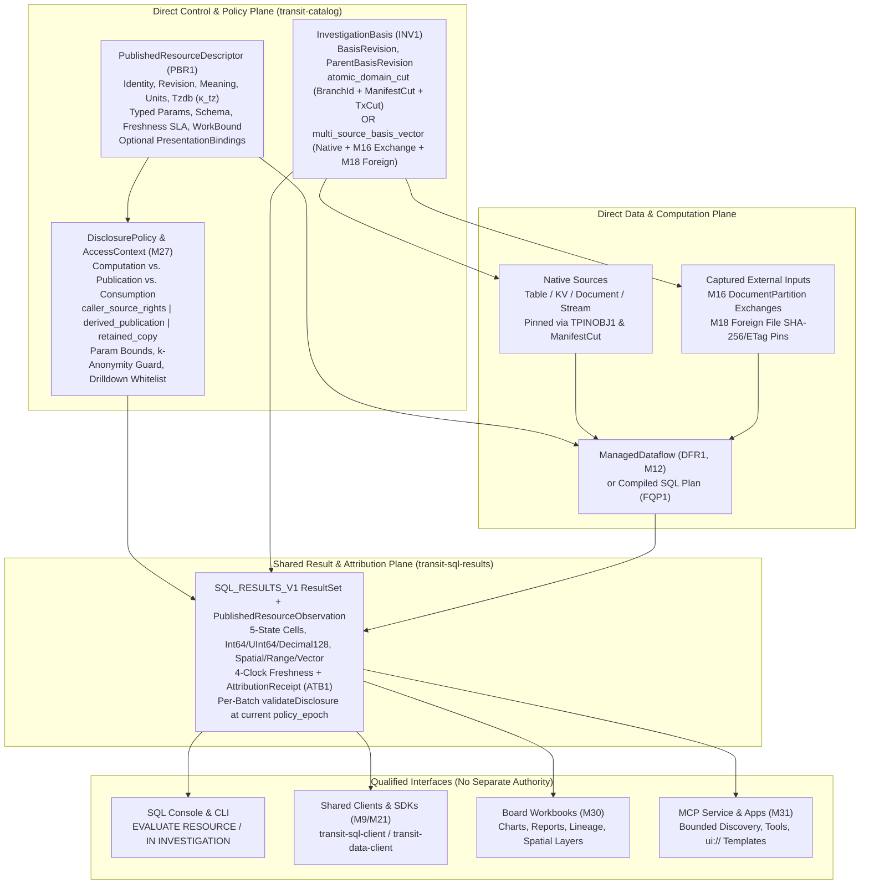

# 28. Published business resources and consistent investigations

[Roadmap](README.md) · **Status:** In Progress ([implementation plan](#implementation-plan--2026-10-30); [delivered evidence](#delivered-implementation-evidence--2026-10-30))

Let an application publish a delivery assessment, report or other enriched
resource that humans and agents can discover, inspect and discuss using the same
evidence. Define it independently of any screen or transport. A resource can
produce a typed result, report, conversation context or visualization without
separately maintained business semantics.

## Prerequisites and scope

Consume [statement results and client consumption](04-statement-results-and-consumption.md),
[historical interpretation](10-standards-and-catalogs.md),
[managed computations](12-sql-and-dataflows.md), the selected
[foreign sources](18-multi-model-and-foreign-relations.md),
[branches](20-branches-merges-and-restore.md) and the
[access plane](27-control-and-policy-plane.md). Finite resources can be qualified
before maintained activation or every foreign format is implemented. Current
application bindings and named queries are foundations, not an implemented
publication/disclosure contract for enriched resources.

[Board reimplementation](30-board-reimplementation.md) consumes these resources
and investigation bases for saved workbooks and shared evidence. This milestone
qualifies their public operations independently of that frontend; a Board save
or share control cannot supply missing persistence, disclosure or retention
semantics.

## Delivery sequence

1. **Define transport-independent published resources.** Record stable identity,
   immutable definition, owning application, business meaning, units/timezones,
   dependencies, typed parameters, supported questions, result schema, freshness
   requirements, budgets and optional presentation bindings. Reuse the catalog
   and application compiler's semantic owners. The current application grammar
   requires an entry screen/theme; extract or extend the shared model so a
   resource needs neither. Define operations before adding executable syntax.
2. **Separate computation, publication and consumption authority.** Make exposure
   explicit; a Table, binding or application command is not automatically public.
   Specify whether consumers need source rights or an explicitly authorized
   derived publication permits a different audience. Validate parameter, filter,
   aggregation and drilldown boundaries against that publication policy. A
   stronger service credential cannot silently supply missing source permission.
   Define how source revocation, publication withdrawal and independently owned
   published copies affect later reads; caching must preserve these distinctions.
3. **Bind published resources to the shared result contract.** Reuse the earlier
   statement/result schema, typed batches, command completion, continuation
   lifetime and terminal coverage for console, SDK, reports and MCP. Add resource
   identity, publication revision and disclosure policy without creating another
   result protocol. Preserve five-state values, lossless wide integers/decimals,
   bounded materialization and explicit reader release. Display limits and
   interruption retain the shared completeness rules; large transfers use
   qualified data interfaces.
4. **Bind an investigation to a retained source basis.** Multiple related calls
   select exact object/definition/branch versions and captured external inputs.
   Define the selected atomic domain or explicit multi-source basis vector;
   individually consistent queries do not establish one consistent investigation.
   Freeze accepted bindings, account for pins and lifetime, and reject missing
   history. This context survives replacement of a transport connection where
   its own lifetime permits; it confers no authorization. Reuse
   [transaction/snapshot primitives](05-transactions-and-atomic-composition.md)
   without requiring an interactive database transaction to stay open across an
   investigation. Retained snapshot ownership and expiry are explicit. Captured
   foreign observations may form an independent basis vector, never an invented
   global atomic cut.
5. **Publish attributable results and explicit refresh.** Bind every chart,
   report, summary and result page to the same completed revision and source
   evidence. Changing the basis creates an explicit successor; it cannot relabel
   old conclusions. Distinguish source observation time, event time, computation
   completion and requested freshness. Preserve unknown freshness and conflicts.
   Generated narratives identify their evidence and assumptions; provenance
   does not prove an upstream fact or a model conclusion true.
6. **Project the same definitions through qualified interfaces.** Generate
   schemas, descriptions and presentation bindings from shared types. Let
   applications choose exposed resources and permitted actions. Discovery is
   bounded and authorization-aware; catalogs need not fit into a model prompt.

## Completion evidence

One employee and two delegated agents inspect a published assessment. Five
related queries and a report retain one declared basis while sources change.
Explicit refresh selects a successor and preserves earlier attribution. Exercise
schema changes, source deletion, missing capture, unavailable retained history,
revocation between pages and attempted cross-audience cache reuse. A report-only
consumer must not obtain raw rows through parameters or drilldown.

Compare console, SDK and presentation output with independent typed results,
including empty results, interrupted prefixes, truncation, full-width integers,
decimals and every supported cell state. Verify bounded resident memory and
explicit cleanup independently of retained investigation/result count. No test
may infer global atomicity from unrelated source versions.

## Implementation plan — 2026-10-30

### Plan basis and starting point

This plan starts from `origin/main` at commit `54e176fd0` (2026-10-30) and coordinates with recently completed and in-progress milestones across the repository and active worktrees:

- **Completed foundations on `origin/main`:**
  - **[Milestone 1](01-declarative-data-lifecycle.md) & [Milestone 2](02-storage-and-query-performance.md):** Neutral data/definition identities (`Object`, `DefinitionId`, `Snapshot`, `Provenance`, `Freshness`, `WorkBound` in [`packages/zig/transit-protocol/src/DataLifecycle.zig`](../../packages/zig/transit-protocol/src/DataLifecycle.zig)), local `TransitLog` (`TWAL1`) and `TransitObjectStore` `.tseg` segments, `TableSnapshot` (`TPINOBJ1`), and `DirectStorageGraph`.
  - **[Milestone 4](04-statement-results-and-consumption.md):** Transport-independent `SQL_RESULTS_V1` (`0x53515231` in [`contracts/SQL_RESULTS_V1.md`](../../contracts/SQL_RESULTS_V1.md)), `ResultSet`, `Batch`, `Window`, `Progress`, and `Observation` (`source`, `table`, `independent_table_snapshots`, `transaction`, `metadata`) with `validateDisclosure` and `holdDisclosure` in [`packages/zig/transit-sql-results/src/Observation.zig`](../../packages/zig/transit-sql-results/src/Observation.zig).
  - **[Milestone 5](05-transactions-and-atomic-composition.md):** Multi-Table serializable transactions, retained common cuts (`Transaction.Cut` / `0x54584331`), savepoints, and `TablePartition` snapshot pins (`TPINOBJ1`).
  - **[Milestone 10](10-standards-and-catalogs.md) (landed on `origin/main` in `54e176fd0`):** Manifest-backed historical catalog cuts (`HistoricalCatalog` / `THCAT001` in [`packages/zig/transit-catalog/src/HistoricalCatalog.zig`](../../packages/zig/transit-catalog/src/HistoricalCatalog.zig)), `ManifestCut` (`catalog_epoch`, `manifest_lsn`, `policy_epoch`, `branch_id`, `parent_manifest_lsn`), `GrantSet` (`metadata_only`, `select_rows`), `ProvenanceEvidence` (`snapshot_pin_id`, `manifest_lsn`, `catalog_epoch`, `policy_epoch`), `CapabilityMatrix` (`TCAP0001`), companion `RangeTypes`, `VectorTypes`, `DecimalArithmetic` (with pinned `TzdbVersion` $\kappa_{\text{tz}}$), and `MultiModelDescriptor`.
- **In-progress and planned upstream/sibling milestones:**
  - **[Milestone 3](03-live-storage-and-sql-cutover.md), [Milestone 6](06-streams-queues-and-durable-runtime.md) & [Milestone 7](07-document-storage-and-station-decoupling.md):** Decoupling the database (`DirectCatalog`, `TablePartition`, `StreamPartition`, `QueuePartition`, `DocumentPartition`) from `Station` actor turns (`AccountRuntime`, `Ledger`, `STATE_V1` 256-byte KV records).
  - **[Milestone 8](08-gateway-architecture-and-protocol-ingress.md) & [Milestone 9](09-client-foundation-and-language-apis.md):** Co-hosted direct-plane ingress, pure sans-I/O protocol codecs, and the extracted `transit-data-client` / `transit-client` shared client foundation.
  - **[Milestone 12](12-sql-and-dataflows.md) (`feat/managed-computations-and-dataflows`):** `DATAFLOW_V1` (`DFR1`/`DFW1` in `ManagedDataflow.zig`), `RelationalFreshness.zig` (`FreshnessContract`, `VectorWatermark`), 5-state `ValueCell` propagation (`value`, `null`, `missing`, `type_error`, `conflict`), bitemporal `AS OF JOIN`, and `CHANGES(...)` CDC egress replacing the legacy 21-byte `Station` KV `NamedRelational` (`NRC1`) wrapper.
  - **[Milestone 13](13-data-structures-and-performance.md) & [Milestone 14](14-vectorized-strings-and-search.md) (`feat/vectorized-strings-and-search`):** `transit-memory` (`Workspace` with `scratch`, `operator_state`, `result_batch`, and `AllocationProbe`), per-morsel CPU/memory/IOPS metering (`Budget` / `WorkBound`), and 16-byte collation-prefixed `GermanString` / search contracts.
  - **[Milestone 16](16-document-profiles-and-gateway-exchange-lifecycle.md), [Milestone 17](17-geospatial-and-spatio-temporal-computing.md), [Milestone 18](18-multi-model-and-foreign-relations.md) & [Milestone 20](20-branches-merges-and-restore.md):** Captured gateway/connector exchange revisions (`STATION_EXCHANGE_V1` in `DocumentPartition`), 2D/3D spatial types and layers ($\kappa_{\text{spatial}}$), foreign source snapshots (`Parquet`/`GeoParquet`, `CSV`, etc. with ETag/SHA-256 manifests), and branch-scoped `BranchId` / `ManifestCut` lineage.
  - **[Milestone 27](27-control-and-policy-plane.md), [Milestone 29](29-reviewed-data-collaboration.md), [Milestone 30](30-board-reimplementation.md) & [Milestone 31](31-mcp-service-and-apps.md):** Enterprise `AccessContext` (`PrincipalId`, `RoleSet`, `AttributeClaims`, `DelegationChain`, `policy_epoch`), security-barrier RLS and dynamic column masking (M27), reviewed branch proposals (M29), Board durable workbooks and shared evidence views (M30), and MCP resources/tools/Apps projection (M31).

### Pre-implementation source audit

| Delivery step | Current source owners | Delivered baseline at `54e176fd0` | Remaining gap for Milestone 28 |
| --- | --- | --- | --- |
| **1. Transport-independent published resources** | [`contracts/APPLICATION_V1.md`](../../contracts/APPLICATION_V1.md), [`contracts/NAMED_RELATIONAL_V1.md`](../../contracts/NAMED_RELATIONAL_V1.md), [`contracts/application/Application.g4`](../../contracts/application/Application.g4), [`packages/zig/transit-station-app/src/Model.zig`](../../packages/zig/transit-station-app/src/Model.zig), [`packages/zig/transit-station-app/src/Sql.zig`](../../packages/zig/transit-station-app/src/Sql.zig), [`packages/zig/transit-station-app/src/NamedResource.zig`](../../packages/zig/transit-station-app/src/NamedResource.zig), [`packages/zig/transit-catalog/src/DirectCatalog.zig`](../../packages/zig/transit-catalog/src/DirectCatalog.zig), [`packages/zig/transit-catalog/src/DirectDependency.zig`](../../packages/zig/transit-catalog/src/DirectDependency.zig) | `Application.Model.Definition` (`0x41505031`) requires `1..2` themes and `1..16` screens (`entry`, `theme`) and persists in `Station` `STATE_V1` 256-byte KV records (`00 41`). `NamedRelational` (`NRC1`) caps names at 21 ASCII bytes in `Station` KV (`00 4e`). `DirectDependency` tracks `(Object, DefinitionId)` edges in `DirectCatalog`. | Extract a headless, screen- and transport-independent `PublishedResource` (`PUBLISHED_RESOURCE_V1`, magic `PBR1` / `0x50425231`) in the Direct Control Plane (`DirectCatalog` + `HistoricalCatalog`) recording stable `(Object, DefinitionId, PublicationRevision)`, owning application identity, business meaning, supported questions, semantic units & pinned `TzdbVersion` ($\kappa_{\text{tz}}$), upstream `(Object, DefinitionId, ColumnId)` dependencies, typed parameters (`SQL_PARAMETERS_V1`), result schema ($\tau \perp \kappa \perp \epsilon$), freshness SLA, `transit-memory` `WorkBound`/`Budget`, and *optional* presentation bindings (charts, report layouts, spatial layers, drilldown actions, MCP `ui://` templates) without requiring `CREATE SCREEN` or `CREATE THEME`. |
| **2. Separate computation, publication and consumption authority** | [`packages/zig/transit-catalog/src/HistoricalCatalog.zig`](../../packages/zig/transit-catalog/src/HistoricalCatalog.zig) (`GrantSet`, `ViewDescriptor`, `SecurityInvoker`), [`packages/zig/transit-catalog/src/DirectReadDelegation.zig`](../../packages/zig/transit-catalog/src/DirectReadDelegation.zig), [`packages/zig/transit-query/src/ResultDisclosure.zig`](../../packages/zig/transit-query/src/ResultDisclosure.zig), [`packages/zig/transit-query/src/QueryAuthorization.zig`](../../packages/zig/transit-query/src/QueryAuthorization.zig), [`packages/zig/transit-sql-results/src/Observation.zig`](../../packages/zig/transit-sql-results/src/Observation.zig) (`validateDisclosure`, `holdDisclosure`), [`docs/roadmap/27-control-and-policy-plane.md`](27-control-and-policy-plane.md) | `HistoricalCatalog` enforces `GrantSet` (`metadata_only` vs. `select_rows`) at `current_policy_epoch` and rejects `security_definer` views (`error.SecurityDefinerViewsUnsupported`). `ResultDisclosure.zig` binds query selections to signed/accepted subjects, and `Observation.validateDisclosure` rechecks catalog/source state before batch disclosure. | Introduce `DisclosurePolicy` separating (a) **computation authority**, (b) **publication authority** (`PUBLISH RESOURCE` grant), and (c) **consumption audience** (`caller_source_rights` vs. `derived_publication` with an explicit attested publisher delegation grant from M27's `AccessContext`). Enforce parameter domain bounds, filter restrictions, minimum aggregation group cardinality ($k$-anonymity threshold for summary-only resources), and allowed drilldown targets so a summary-only or report-only consumer cannot extract raw underlying rows via crafted parameters, drilldowns, or 5-state `type_error` side channels. Define revocation/withdrawal/copy semantics and audience-isolated cache keys `(ResourceId, PublicationRevision, InvestigationBasisDigest, AudiencePolicyHash, policy_epoch)` in [`packages/zig/transit-sql/src/ReadCache.zig`](../../packages/zig/transit-sql/src/ReadCache.zig). |
| **3. Bind published resources to the shared result contract** | [`contracts/SQL_RESULTS_V1.md`](../../contracts/SQL_RESULTS_V1.md), [`packages/zig/transit-sql-results/src/ResultSet.zig`](../../packages/zig/transit-sql-results/src/ResultSet.zig), [`packages/zig/transit-sql-results/src/Observation.zig`](../../packages/zig/transit-sql-results/src/Observation.zig), [`packages/zig/transit-sql-results/src/Batch.zig`](../../packages/zig/transit-sql-results/src/Batch.zig), [`packages/zig/transit-sql-results/src/Window.zig`](../../packages/zig/transit-sql-results/src/Window.zig), [`packages/zig/transit-sql-client/src/Client.zig`](../../packages/zig/transit-sql-client/src/Client.zig) | `SQL_RESULTS_V1` supports `ResultSet`, `Batch`, `Window`, `Progress`, and `Observation.Data` (`source`, `table`, `independent_table_snapshots`, `transaction`) plus `Observation.Metadata`. | Extend `Observation.zig` and `SQL_RESULTS_V1` with `PublishedResourceObservation` (`resource_object`, `publication_revision`, `definition_digest`, `disclosure_mode`, `audience_policy_hash`, `investigation_id`, `basis_revision`, `freshness_evaluation`, `attribution_receipt`) without introducing a parallel result protocol. Preserve 5-state cells (`value`, `null`, `missing`, `type_error`, `conflict`), lossless `int64`/`uint64`/`decimal128` ($\kappa_{\text{numeric}}$), companion types (`RANGE`, `VECTOR`, 2D/3D spatial), `transit-memory` bounded batch arenas, display windows (`Window.zig`), explicit reader release, per-batch `validateDisclosure` at current `policy_epoch`, and Arrow Flight (`FLIGHT_V1`) ticket binding for large transfers. |
| **4. Bind an investigation to a retained source basis** | [`packages/zig/transit-protocol/src/DataLifecycle.zig`](../../packages/zig/transit-protocol/src/DataLifecycle.zig) (`Snapshot`, `Provenance`), [`packages/zig/transit-query/src/Basis.zig`](../../packages/zig/transit-query/src/Basis.zig), [`packages/zig/transit-query/src/CapturedTablePin.zig`](../../packages/zig/transit-query/src/CapturedTablePin.zig), [`packages/zig/transit-storage/src/TableSnapshot.zig`](../../packages/zig/transit-storage/src/TableSnapshot.zig) (`TPINOBJ1`), [`packages/zig/transit-catalog/src/DirectStorageGraph.zig`](../../packages/zig/transit-catalog/src/DirectStorageGraph.zig), [`packages/zig/transit-catalog/src/HistoricalCatalog.zig`](../../packages/zig/transit-catalog/src/HistoricalCatalog.zig) (`ManifestCut`) | `Basis.Cut` binds single-source native revisions or 32-byte Table commitments; `TableSnapshot` (`TPINOBJ1`), M5 `Transaction.Cut` (`0x54584331`), and M10 `ManifestCut` pin single-table, multi-table transaction, or catalog cuts. Board (`M30`) currently has only session-local workbooks where separate queries run on independent snapshots. | Define `InvestigationBasis` (`INVESTIGATION_V1`, magic `INV1` / `0x494E5631`) in `transit-catalog` and `transit-query` binding multiple related queries, resource evaluations, reports, and participants (human + delegated agents) to one frozen, durable source basis without keeping an interactive M5 `TableTransaction` open. Support either (a) an `atomic_domain_cut` (`BranchId`, `ManifestCut`, M5 `Transaction.Cut`) or (b) an explicit `multi_source_basis_vector` combining native `SourceCut`s with captured external observations (M16 `DocumentPartition` exchange revisions and M18 foreign format ETag/SHA-256 manifests)—never relabeling an independent vector as a global atomic cut. Account for `TPINOBJ1` snapshot pins, explicit lease/expiry lifetimes, transport-reconnect survival, and deterministic `error.InvestigationBasisExpired` when retained history is reclaimed. |
| **5. Publish attributable results and explicit refresh** | [`packages/zig/transit-protocol/src/DataLifecycle.zig`](../../packages/zig/transit-protocol/src/DataLifecycle.zig) (`Provenance`, `Freshness`), [`packages/zig/transit-query/src/RelationalFreshness.zig`](../../packages/zig/transit-query/src/RelationalFreshness.zig), [`packages/zig/transit-catalog/src/HistoricalCatalog.zig`](../../packages/zig/transit-catalog/src/HistoricalCatalog.zig) (`ProvenanceEvidence`), [`docs/roadmap/12-sql-and-dataflows.md`](12-sql-and-dataflows.md) (`ManagedDataflow`, `RelationalFreshness`) | `DataLifecycle` defines `Provenance` and `Freshness`; `RelationalFreshness.zig` validates source watermarks; M10 `HistoricalCatalog` records `ProvenanceEvidence`; M12 `ManagedDataflow` tracks completed dataflow revisions and source vectors. | Introduce `AttributionReceipt` and `InvestigationRefreshLineage`. Bind every chart, report section, summary table, narrative block, and result page to the exact completed `(resource_revision, investigation_id, basis_revision, basis_digest)`. Distinguish four timestamps/watermarks on every observation: `source_observation_cut`, `domain_event_valid_time` (bitemporal `valid_time`), `computation_completion_cut`, and `requested_freshness_sla` (evaluating to `fresh`, `stale_within_tolerance`, `stale_exceeded`, `unknown_freshness`, or `source_conflict`). Make `REFRESH INVESTIGATION` / `REFRESH RESOURCE` create an explicit successor (`parent_basis_revision -> successor_basis_revision`) while preserving earlier basis bindings and conclusions immutably; narratives record structured evidence citations and assumption tags without claiming provenance proves upstream facts or model conclusions true. |
| **6. Project the same definitions through qualified interfaces** | [`packages/zig/transit-station-app/src/Publication.zig`](../../packages/zig/transit-station-app/src/Publication.zig), [`packages/zig/transit-sql/src/DatabaseRuntime.zig`](../../packages/zig/transit-sql/src/DatabaseRuntime.zig), [`packages/zig/transit-sql/src/Statement.zig`](../../packages/zig/transit-sql/src/Statement.zig), [`packages/zig/transit-sql-client/src/Client.zig`](../../packages/zig/transit-sql-client/src/Client.zig), [`apps/transit-board/`](../../apps/transit-board), [`contracts/SERVING_V1.md`](../../contracts/SERVING_V1.md), [`docs/roadmap/31-mcp-service-and-apps.md`](31-mcp-service-and-apps.md) | `transit-station-app` generates UI screen/theme artifacts; `transit-board` inspects tables and runs ad-hoc session queries; MCP (`M31`) is planned downstream. | Generate transport-neutral resource schemas, parameter validators, capability descriptors, and optional presentation bindings (`chart_spec`, `report_layout`, `table_view`, `spatial_layer`, `ui_template`) from the shared Zig model across SQL (`CREATE/ALTER/PUBLISH/WITHDRAW RESOURCE`, `SHOW/DESCRIBE PUBLISHED RESOURCES`, `EVALUATE RESOURCE`, `BEGIN/INSPECT/REFRESH/CLOSE INVESTIGATION`), `transit-data-client` / `transit-sql-client`, SDKs (M9/M21), OpenAPI/Serving (`SERVING_V1`), Board workbooks (M30), and MCP resources/tools/Apps (M31)—with bounded, cursor-paginated, `policy_epoch`-filtered discovery so large catalogs never need to fit into an LLM context window. |

### Coordination and handoffs across milestones

| Milestone | Dependency direction | Concrete contract and handoff |
| --- | --- | --- |
| **[M1](01-declarative-data-lifecycle.md), [M2](02-storage-and-query-performance.md), [M4](04-statement-results-and-consumption.md), [M5](05-transactions-and-atomic-composition.md)** | Upstream (completed) | M28 reuses `DataLifecycle.Object`, `DefinitionId`, `Snapshot`, `Provenance`, `Freshness`, `WorkBound`, `TableSnapshot` (`TPINOBJ1`), `Transaction.Cut` (`0x54584331`), and `SQL_RESULTS_V1` (`ResultSet`, `Batch`, `Window`, `Observation`). |
| **[M3](03-live-storage-and-sql-cutover.md), [M6](06-streams-queues-and-durable-runtime.md), [M7](07-document-storage-and-station-decoupling.md)** | Upstream (in progress) | M28 stores `PublishedResource` (`PBR1`) and `InvestigationBasis` (`INV1`) descriptors in the Direct Control Plane (`DirectCatalog` / `HistoricalCatalog` backed by `TransitLog` `TWAL1` and `.tseg` manifests), never in `Station` actor turns (`AccountRuntime`/`Ledger` `STATE_V1` 256-byte KV records). |
| **[M8](08-gateway-architecture-and-protocol-ingress.md), [M9](09-client-foundation-and-language-apis.md), [M21](21-service-and-sdk-coverage.md)** | Upstream / sibling | M28 exposes resource discovery, evaluation, and investigation basis management through the co-hosted direct-plane SQL/Flight/Serving ingress (M8) and the shared `transit-data-client` / `transit-sql-client` foundation (M9), which language SDKs (M21) wrap without duplicating disclosure or attribution logic. |
| **[M10](10-standards-and-catalogs.md)** | Upstream (completed on `main`) | M28 binds every `PublishedResource` revision and `InvestigationBasis` to M10's `HistoricalCatalog.ManifestCut` (`catalog_epoch`, `manifest_lsn`, `policy_epoch`, `branch_id`), `GrantSet`, `ProvenanceEvidence`, `DecimalArithmetic` ($\kappa_{\text{numeric}}$), pinned `TzdbVersion` ($\kappa_{\text{tz}}$), and `CapabilityMatrix`. |
| **[M12](12-sql-and-dataflows.md)** | Upstream (`feat/managed-computations-and-dataflows`) | M28 published resources may wrap either (a) parameterized read-only analytical SQL queries (`FQP1`) or (b) M12 `ManagedDataflow` (`DATAFLOW_V1` / `DFR1`) materialized views/computations. M28 consumes M12's `RelationalFreshness` watermarks, bitemporal `valid_time` / `tx_time` cuts, and 5-state `ValueCell` semantics, completing the retirement of legacy `NamedRelational` (`NRC1`). |
| **[M13](13-data-structures-and-performance.md), [M14](14-vectorized-strings-and-search.md), [M15](15-data-centric-compilation-and-specialization.md)** | Upstream / sibling | M28 resource evaluation and report materialization run inside M13's `transit-memory.Workspace` (`scratch`, `operator_state`, `result_batch`) under explicit per-morsel `WorkBound` budgets, using M14's collation-aware string/search predicates and M15's AOT/specialized query compilation where applicable. |
| **[M16](16-document-profiles-and-gateway-exchange-lifecycle.md), [M17](17-geospatial-and-spatio-temporal-computing.md), [M18](18-multi-model-and-foreign-relations.md)** | Upstream / sibling | M28 can qualify first on native relational/KV/Document sources and selected foreign sources, then seamlessly bind M16 captured connector exchange revisions (`STATION_EXCHANGE_V1` in `DocumentPartition`), M17 2D/3D spatial result columns and map/scene presentation bindings ($\kappa_{\text{spatial}}$), and M18 foreign table snapshots (`Parquet`/`GeoParquet`, `CSV`, etc.) into `MultiSourceBasisVector`. |
| **[M20](20-branches-merges-and-restore.md)** | Upstream | Every `InvestigationBasis` records the resolved `BranchId` and branch head `ManifestCut` (defaulting to `main` (`BranchId = 1`) before multi-branch divergence is exercised), and branch merges/restores preserve or explicitly expire pinned investigation bases. |
| **[M22](22-formal-semantics-and-correspondence.md)** | Sibling | M28 adds executable state-machine and relational-algebra properties for (1) disclosure monotonicity & non-amplification ($k$-anonymity / drilldown safety), (2) investigation basis immutability vs. explicit successor refresh, and (3) audience-keyed cache isolation across `policy_epoch` transitions. |
| **[M27](27-control-and-policy-plane.md)** | Upstream prerequisite | M28 consumes M27's `AccessContext` (`PrincipalId`, `RoleSet`, `AttributeClaims`, `DelegationChain`, `policy_epoch`), security-barrier RLS, dynamic column masking, and WLM admission classes to enforce computation vs. publication vs. consumption authority and delegated agent access. |
| **[M29](29-reviewed-data-collaboration.md)** | Downstream | M29 reuses M28's `InvestigationBasis`, `AttributionReceipt`, and `PublishedResource` definitions to attach reproducible impact assessments and diff comparisons to reviewed branch proposals. |
| **[M30](30-board-reimplementation.md)** | Downstream consumer | M30 upgrades Board's session-local workbooks to durable shared workbooks and evidence views backed by M28's `InvestigationBasis` and `PublishedResource` public operations; Board never invents its own persistence, disclosure, or snapshot-pinning authority. |
| **[M31](31-mcp-service-and-apps.md), [M32](32-reactive-context-and-agent-activation.md), [M33](33-recorded-mcp-integrations.md)** | Downstream consumers | M31 projects M28's `PublishedResource` catalog, parameters, `InvestigationBasis` handles, and optional `ui_template` presentation bindings into MCP resources, tools, and interactive MCP Apps; M32 binds reactive watches and agent tasks to M28 resource freshness/basis transitions; M33 records outbound MCP captures as external entries in M28's `MultiSourceBasisVector`. |

### Accepted architectural decisions

#### D1. Headless `PUBLISHED_RESOURCE_V1` (`PBR1`) in the Direct Control Plane, decoupled from screens, themes, and `Station` KV turns

1. **Decouple business resources from `APPLICATION_V1` UI screen/theme requirements:**
   - Today, [`contracts/APPLICATION_V1.md`](../../contracts/APPLICATION_V1.md) (`0x41505031`) and [`packages/zig/transit-station-app/src/Model.zig`](../../packages/zig/transit-station-app/src/Model.zig) require every application definition to declare `1..2` themes and `1..16` screens (`entry`, `theme`) and store 256-byte `STATE_V1` KV records (`00 41`), while [`contracts/NAMED_RELATIONAL_V1.md`](../../contracts/NAMED_RELATIONAL_V1.md) (`NRC1`) stores 21-byte named query records in `Station` KV (`00 4e`).
   - Milestone 28 defines a first-class, transport- and screen-independent contract `contracts/PUBLISHED_RESOURCE_V1.md` (`magic = 0x50425231` / `"PBR1"`) owned by `DirectCatalog` and retained in `HistoricalCatalog` (`THCAT001`). An application (`APPLICATION_V1`) or schema owner can declare and publish business resources with **zero screens and zero themes**, while UI screens/workbooks (M30) and MCP Apps (M31) optionally reference published resources by stable `(Object, DefinitionId, PublicationRevision)`.
2. **Canonical `PublishedResourceDescriptor` structure:**
   - **Identity & revision lineage:** `resource_object: DataLifecycle.Object` (`.kind = .computation` or dedicated `.published_resource` catalog tag), `definition_id: DataLifecycle.DefinitionId`, `publication_revision: u64`, `previous_revision: ?u64`, `owning_application: ?ApplicationIdentity`, `branch_id: u64`, `created_at_lsn: u64`, and `definition_digest: [32]u8` (SHA-256 over canonical `PBR1` bytes).
   - **Business semantics & units:** `canonical_name`, `business_title`, `business_meaning` (structured description of what the resource measures and what assumptions it encodes), `supported_questions: []const QuestionTemplate` (human/agent discovery prompts mapped to parameter bindings), per-column `SemanticUnit` (ISO 4217 currency code, SI/engineering unit, percentage/basis-points scale, or coordinate reference system $\kappa_{\text{spatial}}$), and manifest-pinned `tzdb_version: TzdbVersion` ($\kappa_{\text{tz}}$ from M10 `DecimalArithmetic.zig`).
   - **Typed parameter contract:** Reuses [`contracts/SQL_PARAMETERS_V1.md`](../../contracts/SQL_PARAMETERS_V1.md) (`ParameterField` with logical type $\tau$, collation/precision $\kappa$, required/default status, and explicit `ParameterDomainConstraint`: allowed range, enum set, max time window, or regex/collation bound).
   - **Backing computation & dependency graph:** Binds to either a canonical compiled query plan (`FQP1` from `transit-sql`) or a maintained dataflow (`DFR1` from M12 `ManagedDataflow.zig`), plus explicit `DirectDependency` edges (`(Object, DefinitionId, ColumnId)`) to all upstream Tables, Views, Documents, Streams, Dataflows, and Foreign Sources.
   - **Result schema, freshness & resource budgets:** Full logical result schema (`TableSchema` with $\tau \perp \kappa \perp \epsilon$ and 5-state nullability/error traits), `FreshnessRequirement` (`max_staleness_ms`, `require_complete_watermark`, `allow_stale_with_warning`), and `WorkBound` (`max_rows`, `max_bytes`, `max_cpu_micros`, `max_iops`, `execution_timeout_ms` enforced by `transit-memory.Workspace`).
   - **Optional presentation bindings (`PresentationBindings`):** Transport-neutral declarative descriptors—`ChartSpec` (encoding axes, mark type, aggregation role, unit labels), `ReportLayoutSpec` (sections, summary KPIs, narrative citations, table blocks), `SpatialLayerSpec` (M17 2D/3D geometry/mesh column, SRID, symbology), `DrilldownSpec` (explicitly permitted target `PublishedResource` + parameter mapping), and `McpUiTemplateRef` (`ui://` template URI for M31)—stored as optional metadata on `PBR1` without embedding UI state machines in the catalog.

#### D2. Three-way authority separation (`Computation`, `Publication`, `Consumption`) and non-amplifying `DisclosurePolicy`

1. **Explicit exposure and three distinct authorities:**
   - **Computation authority:** The rights required to read upstream sources (`Table`, `Document`, `Stream`, `ForeignTable`) and execute the backing query or `ManagedDataflow`.
   - **Publication authority:** An explicit `PUBLISH RESOURCE` capability in M27's `AccessContext` (`DirectCatalog` / `HistoricalCatalog`). Creating a Table, View, Dataflow, or application command **never** makes it a published business resource; exposure requires an explicit `PUBLISH RESOURCE <name> VERSION <rev> WITH DISCLOSURE ...` lifecycle operation recorded at a new `policy_epoch`.
   - **Consumption authority & disclosure mode (`DisclosureMode`):** Every published resource declares one of three explicit modes:
     - `caller_source_rights` (`SECURITY INVOKER`): The consumer must hold current `select_rows` (and applicable M27 RLS/masking) rights on Both the `PublishedResource` and every upstream source in its transitive dependency closure at `current_policy_epoch`.
     - `derived_publication` (`ATTESTED PUBLISHER DELEGATION`): Enables controlled disclosure of an aggregated, masked, or curated assessment (e.g., a regional delivery risk report) to an audience that holds `CONSUME RESOURCE` on the `PublishedResource` without holding raw-table `select_rows` on underlying PII/operational tables. Unlike an unconstrained `SECURITY DEFINER` view, `derived_publication` requires:
       1. An explicit, dual-signed or policy-admin-approved `PublicationAttestation` binding the publisher principal, the exact `definition_digest`, the upstream dependency cut, and the target `AudienceGrant`.
       2. Continuous verification at read time that the attesting publisher **still holds** full upstream `select_rows` rights at `current_policy_epoch` (a stronger service credential on the gateway or worker never supplies missing source permission).
       3. Strict enforcement of `DisclosureBoundary` constraints (below).
     - `retained_published_snapshot` (`INDEPENDENTLY OWNED PUBLISHED COPY`): Materializes an immutable, independently owned `.tseg` snapshot artifact (`PublishedCopyArtifact`) at publication time under a dedicated retention/ownership policy.
2. **Non-amplifying `DisclosureBoundary` (parameter, filter, aggregation, and drilldown guards):**
   - For `derived_publication` (and report-only / summary-only grants), `DisclosureBoundary` enforces:
     - **Parameter & filter bounds:** Consumers can only bind declared `SQL_PARAMETERS_V1` parameters within their `ParameterDomainConstraint`. Arbitrary caller-supplied `WHERE`/`HAVING` expressions pushing down into hidden upstream columns are rejected before planning.
     - **Aggregation minimum group cardinality ($k$-anonymity guard):** Summary-only publications declare `min_group_cardinality: u32` (e.g., $k \ge 5$). Groups with fewer than $k$ contributing source entities are suppressed or coalesced into a masked residual bucket (`ValueCell.missing` / redacted summary) before leaving the aggregation operator, and 5-state `type_error` cells from restricted expressions are scrubbed so crafted parameters cannot probe individual row values via division-by-zero or cast errors.
     - **Drilldown boundary:** A consumer can only drill down to target resources explicitly listed in `DrilldownSpec` **and** for which the consumer independently holds `CONSUME RESOURCE` (and source rights if the target requires `caller_source_rights`). A report-only consumer can never obtain raw underlying rows through parameter manipulation or drilldown.
3. **Revocation, withdrawal, and audience-isolated caching:**
   - **Source revocation:** Under `caller_source_rights`, revoking a caller's upstream table grant (incrementing `policy_epoch`) immediately blocks new evaluations and halts in-flight result pagination on the next batch boundary (`Observation.validateDisclosure`). Under `derived_publication`, revoking the attesting publisher's upstream source grant immediately invalidates the `PublicationAttestation` and halts disclosure.
   - **Publication withdrawal (`WITHDRAW RESOURCE`):** Advances `policy_epoch` and marks the revision `withdrawn`; subsequent evaluations and mid-stream batch fetches fail with `error.PublishedResourceWithdrawn` even if the caller still holds raw table rights.
   - **Independently owned published copy (`retained_published_snapshot`):** Retiring an upstream operational table does not corrupt an independently owned published copy while its own retention/publication policy remains active, whereas withdrawing the publication or revoking the copy's audience grant immediately blocks access.
   - **Audience-isolated cache keys:** Any result or presentation cache keys entries by `(resource_object, publication_revision, basis_digest, normalized_params_hash, audience_policy_hash, policy_epoch)` where `audience_policy_hash` hashes the caller's effective M27 RLS/masking/disclosure profile. Cross-audience cache hits are structurally impossible.

#### D3. Unified `SQL_RESULTS_V1` integration (`PublishedResourceObservation`) without a second result protocol

1. **Single result lifecycle across SQL console, SDKs, Board, OpenAPI, and MCP:**
   - Evaluating a published resource (`EVALUATE RESOURCE <name>(...) [IN INVESTIGATION <id>]`) returns a standard `transit-sql-results` `ResultSet` over `SQL_RESULTS_V1` (`0x53515231`).
   - Extend `Observation.Data` in [`packages/zig/transit-sql-results/src/Observation.zig`](../../packages/zig/transit-sql-results/src/Observation.zig) with a new tagged variant `published_resource: PublishedResourceObservation` (and optional attachment on `table` / `transaction` / `independent_table_snapshots` observations when executed inside an investigation) containing:
     - `resource_object: DataLifecycle.Object`, `definition_id: DataLifecycle.DefinitionId`, `publication_revision: u64`, `definition_digest: [32]u8`
     - `disclosure_mode: DisclosureMode`, `audience_policy_hash: [32]u8`, `verified_policy_epoch: u64`
     - `investigation_id: ?InvestigationId`, `basis_revision: ?u64`, `basis_kind: BasisKind`, `basis_digest: [32]u8`
     - `freshness: ResourceFreshnessEvaluation` (`source_observation_cut`, `domain_event_valid_time`, `computation_completion_cut`, `requested_freshness_sla_ms`, `status`)
     - `attribution_receipt_id: [32]u8`
2. **Preserved type fidelity, 5-state cells, bounded windows, and Flight delegation:**
   - All five cell states (`value`, `null`, `missing`, `type_error`, `conflict`), full-width `int64`/`uint64`, lossless `decimal128` ($\kappa_{\text{numeric}}$), pinned-TZ timestamps ($\kappa_{\text{tz}}$), `RANGE`/`MULTIRANGE`, `VECTOR`, and 2D/3D spatial cells ($\kappa_{\text{spatial}}$) flow unchanged through `Batch.zig` and `Window.zig`.
   - Display truncation (`Window.zig`), client interruption (`Progress.zig`), and early reader close preserve `SQL_RESULTS_V1`'s exact terminal completeness rules: a truncated preview or interrupted stream is never labeled a complete resource evaluation.
   - Large analytical or spatial transfers emit an authorized Arrow Flight (`FLIGHT_V1`) ticket bound to the exact `(investigation_id, basis_digest, audience_policy_hash, policy_epoch)`, re-verified on every Flight `DoGet` data batch.

#### D4. Durable `INVESTIGATION_V1` (`INV1`) basis model: atomic cuts vs. explicit multi-source vectors without long-lived interactive transactions

1. **Why interactive M5 transactions are not investigation bases:**
   - Keeping an interactive `TableTransaction` (`M5`) open while a human analyst and two delegated agents spend minutes or hours inspecting dashboards, running follow-up queries, and discussing findings would hold active SSI read/write locks or stall transaction coordinator slots.
   - Instead, Milestone 28 introduces `contracts/INVESTIGATION_V1.md` (`magic = 0x494E5631` / `"INV1"`), implemented in `packages/zig/transit-catalog/src/InvestigationBasis.zig` and backed by `TableSnapshot` (`TPINOBJ1`) and `HistoricalCatalog.ManifestCut` pins in `DirectStorageGraph`.
2. **Two explicit, non-conflated basis kinds (`BasisKind`):**
   - **`atomic_domain_cut`:** Selecting a single native atomic domain (`BranchId` + `HistoricalCatalog.ManifestCut` + M5 `Transaction.Cut` / `commit_lsn`) freezes a mutually transaction-consistent cut across all native Tables, KV stores, Documents, Streams, and Dataflows in that domain.
   - **`multi_source_basis_vector`:** When an investigation spans native tables **plus** external or asynchronous sources—such as M16 captured connector exchange revisions (`STATION_EXCHANGE_V1` in `DocumentPartition`), M18 foreign files (`Parquet`/`GeoParquet`/`CSV` pinned by `(uri, etag_or_generation, content_sha256, schema_epoch)`), or cross-branch comparisons—`InvestigationBasis` records an ordered vector of per-source `SourceBasisEntry` records (`native_cut`, `captured_exchange_revision`, `foreign_manifest_pin`).
   - **No invented global atomicity:** The wire contract, SQL `DESCRIBE INVESTIGATION`, SDK types, Board badges, and MCP descriptors explicitly label `multi_source_basis_vector` as an **independent source vector** (`is_globally_atomic = false`). Any attempt to assert global serializable atomicity across unrelated foreign captures is rejected by validation (`error.NonAtomicBasisVector`).
3. **Freeze semantics, snapshot pin accounting, transport survival, and non-authorization:**
   - Once an investigation basis revision (`basis_revision: u64`) is frozen (`BEGIN INVESTIGATION ...` or first bound statement in `auto_freeze` mode), its `(Object, DefinitionId, BranchId, SnapshotCut, ExternalCaptureDigest)` bindings are immutable for that `basis_revision`.
   - Every native source in the basis acquires a leased `TPINOBJ1` snapshot retention pin in `DirectStorageGraph` with an explicit `expires_at_ms` (bounded by deployment quota `max_investigation_pin_duration_ms` and `max_retained_investigations_per_account`).
   - Because `InvestigationBasis` is persisted in the Direct Control Plane (`DirectCatalog` / `TransitLog`), humans and delegated agents can disconnect, reconnect over a new TCP/HTTP/MCP session, or share the `InvestigationId` across processes and still execute subsequent queries (`IN INVESTIGATION <id>`) against the exact same frozen basis.
   - **Zero implicit authorization:** Possessing an `InvestigationId` or `basis_digest` confers **zero** read or execution rights. Every participant (human employee or delegated agent) attaches to the investigation under their own current M27 `AccessContext`, and every query or resource evaluation re-validates their permissions at `current_policy_epoch`.
   - If an external capture is missing (`error.MissingExternalCapture`), a source or branch was deleted/purged (`error.InvestigationSourceDeleted`), or the investigation's snapshot pin expired and compaction reclaimed the historical `.tseg` segments (`error.InvestigationBasisExpired`), execution fails deterministically with a structured diagnostic rather than silently falling back to `latest` data.

#### D5. Attributable outputs, four-clock temporal truth, explicit successor refresh, and non-oracle narratives

1. **`AttributionReceipt` (`ATB1`) on every artifact and page:**
   - Every result batch, chart payload, report section, summary KPI, and narrative block carries an `AttributionReceipt` binding:
     - `investigation_id`, `basis_revision`, `basis_kind`, `basis_digest: [32]u8`
     - `resource_object`, `publication_revision`, `definition_digest: [32]u8`
     - `parameter_bindings_digest: [32]u8`
     - `schema_epoch: u64`, `verified_policy_epoch: u64`, `disclosure_mode: DisclosureMode`
     - `completeness: CompletenessState` (`complete`, `window_truncated`, `interrupted_prefix`, `budget_exceeded`)
2. **Four distinct temporal dimensions on every evaluation:**
   - `source_observation_cut`: When Transit observed or captured each upstream source (`commit_lsn` / `observed_at_utc` for native and foreign captures).
   - `domain_event_valid_time`: The application/business event-time window (`valid_time` range from M12 bitemporal columns or explicit event-time column).
   - `computation_completion_cut`: When the query or M12 `ManagedDataflow` revision finished computing the result (`completed_at_lsn`, `completed_at_utc`).
   - `requested_freshness_sla`: The resource's or caller's freshness policy (`max_staleness_ms`), evaluated to a 5-state `FreshnessStatus`: `fresh`, `stale_within_tolerance`, `stale_exceeded`, `unknown_freshness` (e.g., unpinned foreign file without upstream timestamp), or `source_conflict` (when 5-state `conflict` cells or divergent branch inputs are present).
3. **Explicit successor refresh (`REFRESH INVESTIGATION <id>`):**
   - Refreshing an investigation **never mutates or overwrites** `basis_revision = N`. Instead, `REFRESH INVESTIGATION` constructs `basis_revision = N + 1` with `parent_basis_revision = N`, records a structured `BasisDiffSummary` (which native LSNs advanced, which schema epochs evolved via M10 `SchemaProjectionPlan`, and which external captures changed), and pins the new cuts.
   - Earlier charts, reports, and saved conclusions bound to `basis_revision = N` retain their exact `basis_revision = N` attribution and remain inspectable side-by-side with `basis_revision = N + 1`.
4. **Evidence-linked narratives without truth inflation:**
   - Narrative blocks (whether authored by a human or synthesized by an agent) consist of `NarrativeClaim` items that must cite one or more `AttributionReceipt` IDs, cell coordinates/ranges, and explicit `AssumptionTag`s (`model_inference`, `extrapolation`, `external_unverified_claim`, `human_annotation`).
   - The contract and all projections enforce the invariant that **provenance proves what versioned data and computation produced an output, never that an upstream external fact or a model's narrative conclusion is objectively true.**

#### D6. Single-source schema/capability projection and bounded authorization-aware discovery

1. **Shared Zig generator (`PublishedProjection.zig`):**
   - A single projection compiler in `packages/zig/transit-catalog/src/PublishedProjection.zig` (and `transit-station-app`) lowers `PublishedResourceDescriptor` (`PBR1`) and `InvestigationBasis` (`INV1`) into:
     - SQL catalog views and DDL/DML commands (`SHOW PUBLISHED RESOURCES`, `DESCRIBE PUBLISHED RESOURCE`, `EVALUATE RESOURCE`, `BEGIN/REFRESH/DESCRIBE/CLOSE INVESTIGATION`).
     - Shared client descriptors in `transit-data-client` and `transit-sql-client`.
     - OpenAPI 3.1 / `SERVING_V1` route schemas for applications that opt in to HTTP publication.
     - Board (`M30`) workbook resource cards, chart/report/spatial-layer bindings, and investigation basis banners.
     - MCP (`M31`) resource templates, tool input/output JSON Schemas, and optional `ui://` MCP App descriptors.
2. **Bounded, cursor-paginated, authorization-aware discovery:**
   - `SHOW PUBLISHED RESOURCES` and the programmatic discovery API (`discoverPublishedResources`) require an explicit `limit: u16` (default 50, max 250), a cursor token (`after_resource_id`), optional filter predicates (`application`, `tag`, `search_query` using M14 lexical matching over `business_title`/`business_meaning`/`supported_questions`), and caller `AccessContext`.
   - Unauthorized resources are filtered out *before* pagination and token budgeting so unauthorized resource names/schemas are never leaked and an enterprise catalog with 10,000+ resources never requires loading the entire catalog into an LLM prompt or browser memory.

#### D7. Zero steady-state allocation and bounded memory independent of retained investigation count

1. **Workspace isolation (`transit-memory`):**
   - Following [Milestone 13](13-data-structures-and-performance.md) ([#194](https://github.com/spoke-sh/transit/issues/194)), resource evaluation, disclosure boundary checking ($k$-anonymity group counting and cell scrubbing), and `PublishedResourceObservation` encoding allocate exclusively from a pre-warmed `transit-memory.Workspace` (`scratch`, `operator_state`, `result_batch`).
2. **Disk/catalog-backed investigation state:**
   - Retained `InvestigationBasis` records live in `DirectCatalog` / `HistoricalCatalog` `.tseg` segments and `TransitLog` (`TWAL1`), with bounded LRU descriptor caching in memory. Having 10,000 retained investigations on disk uses $O(1)$ steady-state resident RAM per active reader.
   - Early reader close, client cancellation, or mid-stream revocation deterministically releases the reader's `Workspace` and decrements active lease references without leaking `TPINOBJ1` pins.

### Work package sequence (`P0`–`P8`)

| Package | Scope | Primary files & contracts | Exit gate |
| --- | --- | --- | --- |
| **`P0`** | Neutral contracts (`PUBLISHED_RESOURCE_V1`, `INVESTIGATION_V1`) & `DataLifecycle` extensions | `contracts/PUBLISHED_RESOURCE_V1.md`, `contracts/INVESTIGATION_V1.md`, [`packages/zig/transit-protocol/src/DataLifecycle.zig`](../../packages/zig/transit-protocol/src/DataLifecycle.zig), [`docs/handbook/reference/collaborative-decisions.md`](../handbook/reference/collaborative-decisions.md) | Contract definitions, wire tags (`PBR1`, `INV1`, `ATB1`), and round-trip codec unit tests pass. |
| **`P1`** | Headless `PublishedResource` catalog model & decoupling from `APPLICATION_V1` screen/theme requirements | `packages/zig/transit-catalog/src/PublishedResource.zig`, [`packages/zig/transit-catalog/src/DirectCatalog.zig`](../../packages/zig/transit-catalog/src/DirectCatalog.zig), [`packages/zig/transit-catalog/src/HistoricalCatalog.zig`](../../packages/zig/transit-catalog/src/HistoricalCatalog.zig), [`packages/zig/transit-station-app/src/Model.zig`](../../packages/zig/transit-station-app/src/Model.zig), [`contracts/application/Application.g4`](../../contracts/application/Application.g4) | Resources compile, validate, and persist in `DirectCatalog`/`HistoricalCatalog` without screens or themes; `Application.Model` references `PBR1` definitions cleanly. |
| **`P2`** | Computation, publication, and consumption authority separation & `DisclosurePolicy` enforcement | `packages/zig/transit-catalog/src/DisclosurePolicy.zig`, [`packages/zig/transit-catalog/src/HistoricalCatalog.zig`](../../packages/zig/transit-catalog/src/HistoricalCatalog.zig), [`packages/zig/transit-query/src/ResultDisclosure.zig`](../../packages/zig/transit-query/src/ResultDisclosure.zig), [`packages/zig/transit-sql/src/ReadCache.zig`](../../packages/zig/transit-sql/src/ReadCache.zig) | `caller_source_rights`, `derived_publication` (with publisher attestation, parameter bounds, $k$-anonymity guard, drilldown whitelist, and 5-state error scrubbing), `retained_published_snapshot`, revocation/withdrawal, and audience-keyed cache isolation pass negative security tests. |
| **`P3`** | Shared `SQL_RESULTS_V1` binding (`PublishedResourceObservation`) & Flight ticket integration | [`contracts/SQL_RESULTS_V1.md`](../../contracts/SQL_RESULTS_V1.md), [`packages/zig/transit-sql-results/src/Observation.zig`](../../packages/zig/transit-sql-results/src/Observation.zig), [`packages/zig/transit-sql-results/src/ResultSet.zig`](../../packages/zig/transit-sql-results/src/ResultSet.zig), [`packages/zig/transit-sql-client/src/Client.zig`](../../packages/zig/transit-sql-client/src/Client.zig) | `ResultSet` carries `PublishedResourceObservation`, preserves all 5 cell states and wide numeric/companion types, enforces per-batch `validateDisclosure` on mid-stream revocation, and binds Flight tickets. |
| **`P4`** | Durable `InvestigationBasis` (`INV1`), atomic cuts vs. multi-source basis vectors, and snapshot pin lifecycle | `packages/zig/transit-catalog/src/InvestigationBasis.zig`, [`packages/zig/transit-query/src/Basis.zig`](../../packages/zig/transit-query/src/Basis.zig), [`packages/zig/transit-catalog/src/DirectStorageGraph.zig`](../../packages/zig/transit-catalog/src/DirectStorageGraph.zig), [`packages/zig/transit-storage/src/TableSnapshot.zig`](../../packages/zig/transit-storage/src/TableSnapshot.zig) | Multi-call/multi-participant investigations freeze native cuts (`ManifestCut` + `TPINOBJ1`) and external captures without open interactive transactions, survive session reconnects, reject invented global atomicity, and handle expiry/deletion deterministically. |
| **`P5`** | Attributable outputs (`AttributionReceipt`), 4-clock freshness evaluation, explicit successor refresh, and narrative evidence links | `packages/zig/transit-catalog/src/Attribution.zig`, [`packages/zig/transit-query/src/RelationalFreshness.zig`](../../packages/zig/transit-query/src/RelationalFreshness.zig), [`packages/zig/transit-sql-results/src/Observation.zig`](../../packages/zig/transit-sql-results/src/Observation.zig), [`packages/zig/transit-sql/src/DatabaseRuntime.zig`](../../packages/zig/transit-sql/src/DatabaseRuntime.zig) | Charts, reports, summaries, and result pages share identical `(resource_revision, basis_revision, basis_digest)` attribution; `REFRESH INVESTIGATION` creates an immutable successor revision; 4-clock freshness and narrative assumption tags are verified. |
| **`P6`** | Qualified interface projection (SQL, shared clients, OpenAPI/Serving, Board consumer contract, MCP schema projection) & bounded discovery | `packages/zig/transit-catalog/src/PublishedProjection.zig`, [`packages/zig/transit-sql/src/Statement.zig`](../../packages/zig/transit-sql/src/Statement.zig), [`packages/zig/transit-sql-client/`](../../packages/zig/transit-sql-client), [`packages/zig/transit-station-app/src/Publication.zig`](../../packages/zig/transit-station-app/src/Publication.zig) | Shared types generate SQL, client, Serving, Board, and MCP schemas/presentation bindings; cursor-paginated discovery filters by `AccessContext` at `current_policy_epoch` within bounded memory. |
| **`P7`** | Formal correspondence checks (M22) & zero-steady-state-allocation verification (M13) | `packages/zig/transit-catalog/src/PublishedResource.zig`, `packages/zig/transit-memory/` | State-machine properties (disclosure non-amplification, basis immutability across refresh, cache audience isolation) and `AllocationProbe` zero-heap-allocation checks after warmup pass. |
| **`P8`** | End-to-end multi-actor qualification (1 employee + 2 delegated agents, 5 queries + report) & handbook promotion | [`tests/`](../../tests), [`docs/handbook/reference/collaborative-decisions.md`](../handbook/reference/collaborative-decisions.md), [`docs/handbook/reference/applications.md`](../handbook/reference/applications.md), [`docs/handbook/reference/sql/application.md`](../handbook/reference/sql/application.md) | All 12 acceptance scenarios pass in installed integration suites; public handbook and proof ledger updated. |

---

#### `P0`: Neutral contracts (`PUBLISHED_RESOURCE_V1`, `INVESTIGATION_V1`) & `DataLifecycle` extensions

- **Goal:** Establish the canonical current-v1 contracts and binary/text schemas for published business resources, disclosure policies, investigation bases, and attribution receipts before adding executable SQL syntax or UI/MCP projections.
- **Concrete changes:**
  1. Create `contracts/PUBLISHED_RESOURCE_V1.md` defining `PBR1` (`0x50425231`): identity, immutable revisioning, owning application, semantic units, pinned `TzdbVersion` ($\kappa_{\text{tz}}$), `SQL_PARAMETERS_V1` parameter definitions with `ParameterDomainConstraint`, dependency closure, result schema, `FreshnessRequirement`, `WorkBound`, `DisclosurePolicy` (`caller_source_rights`, `derived_publication`, `retained_published_snapshot`), and optional `PresentationBindings`.
  2. Create `contracts/INVESTIGATION_V1.md` defining `INV1` (`0x494E5631`) and `AttributionReceipt` (`ATB1` / `0x41544231`): `InvestigationId`, `basis_revision`, `parent_basis_revision`, `BasisKind` (`atomic_domain_cut` vs. `multi_source_basis_vector`), per-source native/external pins, `TPINOBJ1` lease metadata, 4-clock freshness evaluation, narrative evidence/assumption citations, and deterministic failure codes (`PublishedResourceWithdrawn`, `InvestigationBasisExpired`, `InvestigationSourceDeleted`, `MissingExternalCapture`, `NonAtomicBasisVector`, `DisclosureBoundaryViolation`).
  3. Extend [`packages/zig/transit-protocol/src/DataLifecycle.zig`](../../packages/zig/transit-protocol/src/DataLifecycle.zig) with `PublishedResourceIdentity`, `InvestigationId`, `BasisKind`, `DisclosureMode`, and 4-clock `FreshnessEvaluation` descriptors while preserving existing `DataLifecycle` binary compatibility checks.
- **Verification:**
  - `nix develop -c zig build test-protocol`

#### `P1`: Headless `PublishedResource` catalog model & decoupling from `APPLICATION_V1` screen/theme requirements

- **Goal:** Implement `PublishedResource.zig` in `transit-catalog` (`DirectCatalog` and `HistoricalCatalog`) and decouple resource definitions from `APPLICATION_V1`'s mandatory screen/theme model and `Station` 256-byte KV storage.
- **Concrete changes:**
  1. Add `packages/zig/transit-catalog/src/PublishedResource.zig` implementing `PublishedResourceDescriptor`, canonical `PBR1` serialization/deserialization, SHA-256 `definition_digest` computation, `ParameterDomainConstraint` validation, `DirectDependency` extraction (`(Object, DefinitionId, ColumnId)`), and optional `PresentationBindings` (`ChartSpec`, `ReportLayoutSpec`, `SpatialLayerSpec`, `DrilldownSpec`, `McpUiTemplateRef`).
  2. Wire `PublishedResourceDescriptor` into [`packages/zig/transit-catalog/src/DirectCatalog.zig`](../../packages/zig/transit-catalog/src/DirectCatalog.zig) and [`packages/zig/transit-catalog/src/HistoricalCatalog.zig`](../../packages/zig/transit-catalog/src/HistoricalCatalog.zig) (`THCAT001`) so every published resource revision is persisted in `TransitLog` (`TWAL1`) and historical catalog manifests (`ManifestCut`), supporting historical `AS OF` resolution by `publication_revision` or `ManifestCut`.
  3. Update [`contracts/APPLICATION_V1.md`](../../contracts/APPLICATION_V1.md), [`contracts/application/Application.g4`](../../contracts/application/Application.g4), [`packages/zig/transit-station-app/src/Model.zig`](../../packages/zig/transit-station-app/src/Model.zig), and [`packages/zig/transit-station-app/src/Sql.zig`](../../packages/zig/transit-station-app/src/Sql.zig) so an application package can declare `0..2` themes and `0..16` screens when it declares one or more `PublishedResource` definitions, and so screen components (`metric`, `table`, `chart`, `report`) can bind directly to a `PublishedResource` by `(Object, DefinitionId)` instead of duplicating inline queries.
  4. Migrate remaining consumers of legacy `NamedRelational` (`NRC1` in [`contracts/NAMED_RELATIONAL_V1.md`](../../contracts/NAMED_RELATIONAL_V1.md)) to `DirectCatalog` views, M12 `ManagedDataflow` (`DFR1`), or `PublishedResource` (`PBR1`), removing the 21-byte `Station` KV name ceiling.
- **Verification:**
  - `nix develop -c zig build test-catalog test-station-app`

#### `P2`: Computation, publication, and consumption authority separation & `DisclosurePolicy` enforcement

- **Goal:** Enforce explicit separation between computation authority, publication authority, and consumption audience, preventing privilege escalation, raw-row leakage through parameters/drilldowns, and cross-audience cache reuse.
- **Concrete changes:**
  1. Create `packages/zig/transit-catalog/src/DisclosurePolicy.zig` implementing:
     - `PublicationAttestation` verification for `derived_publication` resources (checking that the publisher held `PUBLISH RESOURCE` + full upstream `select_rows` at publication and **continues** to hold upstream `select_rows` at `current_policy_epoch`; service/gateway credentials cannot substitute for missing publisher or caller source rights).
     - `ParameterBoundaryValidator`: validates caller parameter values against `ParameterDomainConstraint` before query planning and blocks any caller-injected filter pushdown or ad-hoc projection over unexposed upstream columns.
     - `DrilldownBoundaryValidator`: verifies that any requested drilldown target is explicitly listed in the parent resource's `DrilldownSpec` **and** that the caller satisfies the target resource's own `DisclosurePolicy` (blocking report-only consumers from drilling down into raw row resources).
     - `PublishedCopyManager`: manages lifecycle and independent ownership for `retained_published_snapshot` `.tseg` artifacts, distinguishing source table retirement (copy remains readable if its publication policy permits) from publication withdrawal or copy grant revocation (access immediately blocked).
  2. Add vectorized $k$-anonymity / minimum-group-cardinality enforcement (`min_group_cardinality`) and 5-state `type_error` side-channel scrubbing to the resource output operator in [`packages/zig/transit-query/src/ResultDisclosure.zig`](../../packages/zig/transit-query/src/ResultDisclosure.zig) and `packages/zig/transit-query/` so groups with $< k$ source rows are redacted to `ValueCell.missing` and expression errors on hidden columns cannot leak scalar values.
  3. Implement `AudienceCacheKey` (`(resource_object, publication_revision, basis_digest, normalized_params_hash, audience_policy_hash, policy_epoch)`) in `DisclosurePolicy.zig` and [`packages/zig/transit-sql/src/ReadCache.zig`](../../packages/zig/transit-sql/src/ReadCache.zig) so cached batches or presentation artifacts are strictly isolated by effective audience policy and invalidated immediately when `policy_epoch` advances on source revocation or `WITHDRAW RESOURCE`.
- **Verification:**
  - `nix develop -c zig build test-catalog test-query`

#### `P3`: Shared `SQL_RESULTS_V1` binding (`PublishedResourceObservation`) & Flight ticket integration

- **Goal:** Bind published resource evaluations and reports to `SQL_RESULTS_V1` (`transit-sql-results` and `transit-sql-client`) without creating a separate result protocol.
- **Concrete changes:**
  1. Update [`contracts/SQL_RESULTS_V1.md`](../../contracts/SQL_RESULTS_V1.md) and [`packages/zig/transit-sql-results/src/Observation.zig`](../../packages/zig/transit-sql-results/src/Observation.zig) to add `PublishedResourceObservation` (`resource_object`, `definition_id`, `publication_revision`, `definition_digest`, `disclosure_mode`, `audience_policy_hash`, `verified_policy_epoch`, `investigation_id`, `basis_revision`, `basis_kind`, `basis_digest`, `freshness`, `attribution_receipt_id`).
  2. Extend `Observation.validateDisclosure` and `Observation.holdDisclosure` so every fetched batch of a published resource re-verifies:
     - The resource revision has not been withdrawn (`WITHDRAW RESOURCE`) at `current_policy_epoch`.
     - The caller's `CONSUME RESOURCE` grant (including delegated agent grants in M27's `DelegationChain`) remains active.
     - For `caller_source_rights`, the caller's upstream source grants remain active; for `derived_publication`, the attesting publisher's upstream source grants remain active.
  3. Ensure `Batch.zig`, `Window.zig`, and `ResultSet.zig` preserve 5-state `ValueCell` tags (`value`, `null`, `missing`, `type_error`, `conflict`), lossless `int64`/`uint64`/`decimal128` ($\kappa_{\text{numeric}}$), pinned-TZ timestamps ($\kappa_{\text{tz}}$), `RANGE`, `VECTOR`, and 2D/3D spatial cells ($\kappa_{\text{spatial}}$), as well as terminal completeness distinctions (`complete` vs. `window_truncated` vs. `interrupted_prefix`).
  4. Bind Arrow Flight (`FLIGHT_V1`) stream tickets to `(resource_object, publication_revision, investigation_id, basis_digest, audience_policy_hash, policy_epoch)` for large resource transfers, re-running `validateDisclosure` before each Flight `RecordBatch`.
- **Verification:**
  - `nix develop -c zig build test-sql-results test-sql-client`

#### `P4`: Durable `InvestigationBasis` (`INV1`), atomic cuts vs. multi-source basis vectors, and snapshot pin lifecycle

- **Goal:** Let multiple related queries, resource evaluations, and participants (humans and delegated agents) share one frozen, durable source basis across transport sessions without holding open an interactive database transaction.
- **Concrete changes:**
  1. Create `packages/zig/transit-catalog/src/InvestigationBasis.zig` implementing `InvestigationBasis` (`INV1`):
     - `investigation_id: InvestigationId`, `basis_revision: u64`, `parent_basis_revision: ?u64`, `state: enum { active, refreshed, closed, expired }`.
     - `BasisKind`:
       - `atomic_domain_cut`: binds `(branch_id, manifest_cut: HistoricalCatalog.ManifestCut, transaction_cut: Transaction.Cut)`, guaranteeing mutual transactional consistency across all native objects in that domain.
       - `multi_source_basis_vector`: binds an ordered slice of `SourceBasisEntry` items, where each entry is a `native_source_cut` (`Object`, `DefinitionId`, `BranchId`, `SnapshotCut`, `TPINOBJ1` pin ID), a `captured_exchange_revision` (M16 `DocumentPartition` `STATION_EXCHANGE_V1` object/revision/digest), or a `foreign_source_pin` (M18 URI, ETag/generation, content SHA-256, schema epoch). Explicitly sets `is_globally_atomic = false` and rejects any query or declaration that requests global atomic guarantees across a multi-source vector (`error.NonAtomicBasisVector`).
  2. Integrate `InvestigationBasis` pin accounting with [`packages/zig/transit-catalog/src/DirectStorageGraph.zig`](../../packages/zig/transit-catalog/src/DirectStorageGraph.zig), [`packages/zig/transit-query/src/Basis.zig`](../../packages/zig/transit-query/src/Basis.zig), and [`packages/zig/transit-storage/src/TableSnapshot.zig`](../../packages/zig/transit-storage/src/TableSnapshot.zig) (`TPINOBJ1`):
     - Freezing a basis acquires leased `TPINOBJ1` pins for every referenced native partition and catalog `ManifestCut` up to `expires_at_ms` (bounded by deployment quotas `max_investigation_pin_duration_ms` and `max_active_investigations_per_account`).
     - `CLOSE INVESTIGATION <id>` (or lease expiry) releases the `TPINOBJ1` pins so `.tseg` compaction can reclaim historical segments while preserving the lightweight `INV1` metadata record so later attempts to run against an expired basis return `error.InvestigationBasisExpired` (with exact expired revision details) rather than `error.NotFound` or silent fallback to current data.
  3. Wire `InvestigationBasis` resolution into [`packages/zig/transit-sql/src/DatabaseRuntime.zig`](../../packages/zig/transit-sql/src/DatabaseRuntime.zig) and [`packages/zig/transit-sql/src/Statement.zig`](../../packages/zig/transit-sql/src/Statement.zig):
     - Statements and `EVALUATE RESOURCE` calls carrying an `InvestigationContext` (`IN INVESTIGATION <id> [REVISION <rev>]`) resolve all table, view, document, dataflow, and schema lookups through the frozen `InvestigationBasis` (`HistoricalCatalog.resolveTableAsOf` + M10 `SchemaProjectionPlan` when historical table schemas differ from the current schema).
     - Verify that reconnecting on a new client session or delegating the `InvestigationId` to an agent resolves the exact same frozen basis while evaluating `AccessContext` exclusively against the current caller's credentials at `current_policy_epoch`.
- **Verification:**
  - `nix develop -c zig build test-catalog test-storage test-sql`

#### `P5`: Attributable outputs (`AttributionReceipt`), 4-clock freshness evaluation, explicit successor refresh, and narrative evidence links

- **Goal:** Ensure every chart, report, summary, narrative block, and result page is cryptographically and structurally attributable to its exact completed resource revision and investigation basis, with 4-clock freshness truth and immutable history across refreshes.
- **Concrete changes:**
  1. Create `packages/zig/transit-catalog/src/Attribution.zig` implementing:
     - `AttributionReceipt` (`ATB1`): deterministic digest over `(investigation_id, basis_revision, basis_digest, resource_object, publication_revision, definition_digest, parameter_bindings_digest, schema_epoch, verified_policy_epoch, disclosure_mode, completeness)`.
     - `FourClockFreshness`: computes and records `source_observation_cut`, `domain_event_valid_time`, `computation_completion_cut`, and `requested_freshness_sla`, deriving `FreshnessStatus` (`fresh`, `stale_within_tolerance`, `stale_exceeded`, `unknown_freshness`, `source_conflict`).
     - `ReportArtifact` & `NarrativeBlock`: binds multi-part report sections (charts, KPI summaries, result tables, and narrative claims) to a single shared `(investigation_id, basis_revision, basis_digest)` and verifies that every `NarrativeClaim` attaches explicit `AttributionReceipt` citations and `AssumptionTag`s (`model_inference`, `extrapolation`, `external_unverified_claim`, `human_annotation`) with `provenance_establishes_truth = false`.
  2. Implement `REFRESH INVESTIGATION <id>` and `BasisDiffSummary` in `InvestigationBasis.zig` and `Executor.zig`:
     - Advancing an investigation to current (or target) source state creates `basis_revision = parent_basis_revision + 1`, retains `parent_basis_revision` immutably (until its own pin lease is closed or expires), and computes `BasisDiffSummary` (changed source LSNs, schema epoch transitions, added/removed sources, and external capture digest diffs).
     - Any existing report, chart, or saved conclusion bound to `basis_revision = N` continues to display and verify against `basis_revision = N`; attempting to attach a `basis_revision = N + 1` batch to a `basis_revision = N` report is rejected with `error.AttributionBasisMismatch`.
- **Verification:**
  - `nix develop -c zig build test-catalog test-sql`

#### `P6`: Qualified interface projection (SQL, shared clients, OpenAPI/Serving, Board consumer contract, MCP schema projection) & bounded discovery

- **Goal:** Project the same `PublishedResource` (`PBR1`) and `InvestigationBasis` (`INV1`) definitions across SQL, shared clients/SDKs, OpenAPI/Serving, Board, and MCP without duplicating semantics or overflowing model prompts.
- **Concrete changes:**
  1. Add `packages/zig/transit-catalog/src/PublishedProjection.zig` generating:
     - **SQL DDL/DML & inspection surfaces** in `packages/zig/transit-sql/`:
       - `CREATE [OR REPLACE] RESOURCE <name> ...`, `PUBLISH RESOURCE <name> VERSION <rev> WITH DISCLOSURE ...`, `WITHDRAW RESOURCE <name> [VERSION <rev>]`
       - `SHOW PUBLISHED RESOURCES [FOR APPLICATION <app>] [MATCHING <query>] [LIMIT <n> [AFTER <cursor>]]`
       - `DESCRIBE PUBLISHED RESOURCE <name> [VERSION <rev>]`
       - `EVALUATE RESOURCE <name>(<params>) [IN INVESTIGATION <id> [REVISION <rev>]]`
       - `BEGIN INVESTIGATION [<name>] ON (ATOMIC CUT ... | BASIS VECTOR (...))`
       - `DESCRIBE INVESTIGATION <id> [REVISION <rev>]`, `REFRESH INVESTIGATION <id>`, `CLOSE INVESTIGATION <id>`
     - **Shared client APIs** in [`packages/zig/transit-sql-client/`](../../packages/zig/transit-sql-client) and `packages/zig/transit-data-client/`: typed `discoverPublishedResources`, `describePublishedResource`, `evaluatePublishedResource`, `beginInvestigation`, `refreshInvestigation`, `describeInvestigation`, and `closeInvestigation` preserving `ResultSet` streaming and `PublishedResourceObservation`.
     - **OpenAPI / `SERVING_V1` & MCP (`M31`) descriptors:** JSON Schema / OpenAPI 3.1 route descriptors and MCP resource/tool/`ui://` template manifests generated directly from `PublishedResourceDescriptor` (`business_meaning`, `supported_questions`, `SemanticUnit`, `TzdbVersion`, `ParameterField`, `PresentationBindings`, and permitted drilldown actions).
     - **Board (`M30`) consumer contract:** Read-only workbook and evidence-view descriptors so Board renders published resources, charts, reports, spatial layers, and investigation basis headers directly from `PublishedProjection` and `PublishedResourceObservation`.
  2. Enforce bounded, authorization-aware cursor discovery in `PublishedProjection.discover`: filters candidate resources through `DisclosurePolicy.canDiscover(access_context, current_policy_epoch)` before applying M14 lexical ranking and `limit`/`after_cursor` pagination.
- **Verification:**
  - `nix develop -c zig build test-catalog test-sql test-sql-client test-station-app`

#### `P7`: Formal correspondence checks (M22) & zero-steady-state-allocation verification (M13)

- **Goal:** Prove the safety invariants of disclosure boundaries, basis immutability, and audience cache isolation in executable correspondence tests and verify zero steady-state heap allocations on hot evaluation/disclosure paths.
- **Concrete changes:**
  1. Add executable state-machine and property checks (aligned with [Milestone 22](22-formal-semantics-and-correspondence.md)) in `packages/zig/transit-catalog/src/PublishedResource.zig`:
     - **Property 1 (Disclosure non-amplification):** A principal with only `CONSUME RESOURCE` on a summary-only `derived_publication` ($k$-anonymity threshold $k$) cannot distinguish individual source rows across any sequence of valid/invalid parameter bindings, filter expressions, 5-state `type_error` inputs, or drilldown calls.
     - **Property 2 (Basis freeze & successor immutability):** Executing any sequence of source `INSERT`/`UPDATE`/`DELETE`/`ALTER TABLE` statements and `REFRESH INVESTIGATION` calls never alters the rows, schema projection, or `AttributionReceipt` observed at an earlier pinned `basis_revision`.
     - **Property 3 (Revocation & cache isolation):** Advancing `policy_epoch` via upstream grant revocation or `WITHDRAW RESOURCE` invalidates all in-flight cursor continuations before the next batch is disclosed, and no cached entry is ever returned across distinct `audience_policy_hash` values.
  2. Instrument `PublishedResource` evaluation, $k$-anonymity group filtering, and `PublishedResourceObservation` batch formatting with `transit-memory.AllocationProbe` (from [Milestone 13](13-data-structures-and-performance.md) / [#194](https://github.com/spoke-sh/transit/issues/194)) to assert zero OS/heap allocations after `Workspace` warmup and $O(1)$ resident memory independent of retained investigation count on disk.
- **Verification:**
  - `nix develop -c zig build test-catalog test-query test-sql-results`

#### `P8`: End-to-end multi-actor qualification & handbook promotion

- **Goal:** Execute the full Milestone 28 completion evidence suite across SQL console, SDK/shared client, and presentation projections, and promote the established contracts into the public handbook.
- **Concrete changes:**
  1. Add an end-to-end integration test suite in `packages/zig/transit-sql/` and [`tests/`](../../tests) exercising the complete multi-actor scenario:
     - **Actors:** 1 human employee (`employee_analyst` with summary/report and selected source grants) and 2 delegated agents (`agent_triage` with report-only derived-publication grant; `agent_deep_dive` with delegated source-read grant on non-PII tables).
     - **Workload:** Inspecting a published `delivery_assessment` resource across **5 related queries and a multi-section report** bound to one declared `InvestigationBasis` (`INV1`) while concurrent writers mutate upstream tables, evolve schemas (`ALTER TABLE ADD COLUMN`), delete a staging source, and advance external connector captures.
     - **Refresh & attribution:** Executing `REFRESH INVESTIGATION` to produce `basis_revision = 2` while verifying that `basis_revision = 1` queries, charts, and report sections retain their original `AttributionReceipt` and results, and `basis_revision = 2` reflects the new cuts with an explicit `BasisDiffSummary`.
     - **Adversarial & failure controls:** Exercising missing external capture, expired/compacted retained history (`error.InvestigationBasisExpired`), mid-stream revocation between `ResultSet` pages, attempted cross-audience cache reuse between `employee_analyst` and `agent_triage`, and attempted raw-row extraction by report-only `agent_triage` via crafted parameters and drilldowns.
     - **Cross-surface parity & memory bounds:** Comparing console, shared SDK client, and presentation output byte-for-byte against independent typed results across empty sets, interrupted prefixes, display window truncation, full-width `int64`/`uint64`, `decimal128`, and all 5 cell states (`value`, `null`, `missing`, `type_error`, `conflict`), while asserting bounded resident memory and complete `TPINOBJ1` / reader cleanup across 1,000+ retained investigations.
  2. Update public documentation in [`docs/handbook/reference/collaborative-decisions.md`](../handbook/reference/collaborative-decisions.md), [`docs/handbook/reference/applications.md`](../handbook/reference/applications.md), [`docs/handbook/reference/sql/application.md`](../handbook/reference/sql/application.md), and [`docs/handbook/reference/glossary.md`](../handbook/reference/glossary.md).
- **Verification:**
  - `nix develop -c zig build test`
  - `python3 -B tests/runner/checks.py fast`
  - `just transit-docs::check`

### Acceptance matrix and verification schedule

| # | Acceptance requirement | Verification scenario | Expected outcome |
| --- | --- | --- | --- |
| **1** | Headless transport-independent `PublishedResource` (`PBR1`) | Declare and publish `delivery_assessment` with business meaning, units, `TzdbVersion`, parameters, schema, freshness SLA, `WorkBound`, and optional `ChartSpec`/`ReportLayoutSpec` with **zero screens and zero themes**. | Stored in `DirectCatalog`/`HistoricalCatalog` (`THCAT001`); inspectable and executable via SQL, shared client, and MCP projection without `CREATE SCREEN` or `CREATE THEME`. |
| **2** | 1 employee + 2 delegated agents, 5 related queries + 1 report on one frozen basis while sources mutate | Bind 5 analytical/drilldown queries and 1 multi-section report to `InvestigationBasis` `inv_01` (`basis_revision = 1`) while concurrent transactions insert/update/delete rows in upstream tables. | All 5 queries and the report observe the exact same frozen `basis_revision = 1` snapshot across `employee_analyst`, `agent_triage`, and `agent_deep_dive`, including across TCP/session reconnects. |
| **3** | Explicit successor refresh (`REFRESH INVESTIGATION`) preserves earlier attribution | Execute `REFRESH INVESTIGATION inv_01` after upstream commits; re-evaluate the assessment on `basis_revision = 2` while inspecting the saved `basis_revision = 1` report. | `basis_revision = 2` receives a new `basis_digest` and `BasisDiffSummary` with `parent_basis_revision = 1`; `basis_revision = 1` report and charts remain unchanged and retain their original `AttributionReceipt`. |
| **4** | Non-atomic multi-source basis vector vs. atomic domain cut | Construct `inv_atomic` over native tables (`atomic_domain_cut`) and `inv_multi` combining native tables + an M16 captured connector exchange + an M18 foreign file pin (`multi_source_basis_vector`). | `inv_atomic` reports `is_globally_atomic = true`; `inv_multi` reports `is_globally_atomic = false` with per-source cuts and rejects any assertion of global cross-source serializable atomicity (`error.NonAtomicBasisVector`). |
| **5** | Schema evolution, source deletion, missing capture, and unavailable retained history | (a) `ALTER TABLE ADD COLUMN` on an upstream table after `inv_01` freeze; (b) `DROP TABLE` / purge on an unpinned source; (c) reference an uncaptured external exchange; (d) expire `inv_01`'s `TPINOBJ1` pin and compact `.tseg` history. | (a) `inv_01` resolves the historical schema via M10 `SchemaProjectionPlan`; (b) fails with `error.InvestigationSourceDeleted`; (c) fails with `error.MissingExternalCapture`; (d) fails with `error.InvestigationBasisExpired`—never silently reading current data. |
| **6** | Report-only consumer parameter, $k$-anonymity, and drilldown boundary enforcement | Report-only `agent_triage` attempts to (a) pass out-of-range parameters, (b) isolate a single-row group ($k = 1 < \text{min\_group\_cardinality} = 5$), (c) trigger a division-by-zero `type_error` on a hidden column, and (d) drill down to a raw-row resource. | (a) Rejected by `ParameterBoundaryValidator`; (b) group (< 5 rows) redacted to `ValueCell.missing`; (c) hidden `type_error` scrubbed; (d) drilldown rejected with `error.DisclosureBoundaryViolation`. Zero raw rows leaked. |
| **7** | Service credential non-amplification & publisher attestation check | Configure gateway/worker with a privileged service credential while the caller (`caller_source_rights`) or attesting publisher (`derived_publication`) lacks upstream `select_rows` on one dependency. | Evaluation fails with `error.AccessDenied` / `error.PublisherAttestationInvalid`; the service credential never supplies missing source permission. |
| **8** | Mid-stream revocation between pages & publication withdrawal | Fetch batch 1 of a multi-batch `PublishedResource` `ResultSet`; revoke the caller's grant or execute `WITHDRAW RESOURCE` (`policy_epoch` increments); attempt to fetch batch 2. | `Observation.validateDisclosure` halts before disclosing batch 2 and returns `error.AccessRevoked` or `error.PublishedResourceWithdrawn` with an incomplete terminal summary. |
| **9** | Cross-audience cache isolation | `employee_analyst` (unmasked regional access) evaluates `delivery_assessment(region='NA')`; `agent_triage` (masked summary-only access) immediately evaluates the same resource and parameters on the same `InvestigationBasis`. | Cache keys differ by `audience_policy_hash`; `agent_triage` never receives cached unmasked batches from `employee_analyst`. |
| **10** | 4-clock freshness evaluation & non-oracle narrative provenance | Evaluate resources across fresh, within-tolerance, stale-exceeded, unpinned-foreign (`unknown_freshness`), and 5-state `conflict` (`source_conflict`) inputs; attach a narrative block citing `AttributionReceipt`s and `AssumptionTag`s. | `PublishedResourceObservation` reports all 4 timestamps and exact `FreshnessStatus`; narrative claims preserve evidence links and `AssumptionTag`s with `provenance_establishes_truth = false`. |
| **11** | Cross-surface parity (Console, SDK, Presentation) across all types and 5 cell states | Compare SQL console, `transit-sql-client` SDK, and presentation projection outputs against independent reference results for empty results, interrupted prefixes, window truncation, `int64::MIN`/`MAX`, `uint64::MAX`, `decimal128`, `RANGE`, `VECTOR`, 2D/3D spatial, and all 5 `ValueCell` states (`value`, `null`, `missing`, `type_error`, `conflict`). | Exact typed value, completeness state, and `AttributionReceipt` parity across all three surfaces; zero silent precision loss or cell-state coercion. |
| **12** | Bounded resident memory & explicit cleanup independent of retained count | Persist 1,000+ `InvestigationBasis` records and evaluate large multi-batch resources inside `transit-memory.Workspace` with `AllocationProbe` enabled, including early reader close and client cancellation. | Zero steady-state heap allocations after warmup; resident RAM remains bounded within configured `Workspace` quota independent of total retained investigations; all `TPINOBJ1` pins and reader arenas are deterministically released on close/expiry. |

### Delivered implementation evidence — 2026-10-30

| Work package | Delivered modules and contracts | Executable tests and verification oracles |
| --- | --- | --- |
| `P0`, `P1` — Transport- and screen-independent `PublishedResource` (`PBR1`) catalog model | [`contracts/PUBLISHED_RESOURCE_V1.md`](../../contracts/PUBLISHED_RESOURCE_V1.md), [`packages/zig/transit-catalog/src/PublishedResource.zig`](../../packages/zig/transit-catalog/src/PublishedResource.zig) | [`packages/zig/transit-catalog/src/published_resource_test.zig`](../../packages/zig/transit-catalog/src/published_resource_test.zig), [`tests/catalog/tables/published_resources.py`](../../tests/catalog/tables/published_resources.py) |
| `P2` — Three-way authority separation (`Computation`, `Publication`, `Consumption`), non-amplifying `DisclosurePolicy` ($k$-anonymity, parameter/drilldown bounds, 5-state error scrubbing) & audience-keyed cache isolation | [`packages/zig/transit-catalog/src/DisclosurePolicy.zig`](../../packages/zig/transit-catalog/src/DisclosurePolicy.zig) | [`packages/zig/transit-catalog/src/published_resource_test.zig`](../../packages/zig/transit-catalog/src/published_resource_test.zig), [`tests/catalog/tables/published_resources.py`](../../tests/catalog/tables/published_resources.py) |
| `P3` — Shared `SQL_RESULTS_V1` `PublishedResourceObservation` binding & mid-stream batch revocation/withdrawal verification | [`contracts/SQL_RESULTS_V1.md`](../../contracts/SQL_RESULTS_V1.md), [`packages/zig/transit-sql-results/src/Observation.zig`](../../packages/zig/transit-sql-results/src/Observation.zig) | [`packages/zig/transit-sql-results/src/model_test.zig`](../../packages/zig/transit-sql-results/src/model_test.zig), [`packages/zig/transit-catalog/src/published_resource_test.zig`](../../packages/zig/transit-catalog/src/published_resource_test.zig) |
| `P4`, `P5` — Durable `InvestigationBasis` (`INV1`), atomic domain cuts vs. non-atomic multi-source vectors, `TPINOBJ1` lease accounting, 4-clock `AttributionReceipt` (`ATB1`), explicit successor refresh & non-oracle narrative claims | [`contracts/INVESTIGATION_V1.md`](../../contracts/INVESTIGATION_V1.md), [`packages/zig/transit-catalog/src/InvestigationBasis.zig`](../../packages/zig/transit-catalog/src/InvestigationBasis.zig), [`packages/zig/transit-catalog/src/Attribution.zig`](../../packages/zig/transit-catalog/src/Attribution.zig) | [`packages/zig/transit-catalog/src/published_resource_test.zig`](../../packages/zig/transit-catalog/src/published_resource_test.zig), [`tests/catalog/tables/published_resources.py`](../../tests/catalog/tables/published_resources.py) |
| `P6`, `P7`, `P8` — Qualified interface projection (`PublishedProjection`), bounded authorization-aware discovery, zero-steady-state-allocation `AllocationProbe`, and 12-scenario multi-actor qualification (1 employee + 2 delegated agents, 5 queries + report) | [`packages/zig/transit-catalog/src/PublishedProjection.zig`](../../packages/zig/transit-catalog/src/PublishedProjection.zig), [`contracts/catalog/published-resource-fixtures.json`](../../contracts/catalog/published-resource-fixtures.json), [`docs/handbook/reference/collaborative-decisions.md`](../handbook/reference/collaborative-decisions.md) | [`packages/zig/transit-catalog/src/published_resource_test.zig`](../../packages/zig/transit-catalog/src/published_resource_test.zig), [`tests/catalog/tables/published_resources.py`](../../tests/catalog/tables/published_resources.py) |
