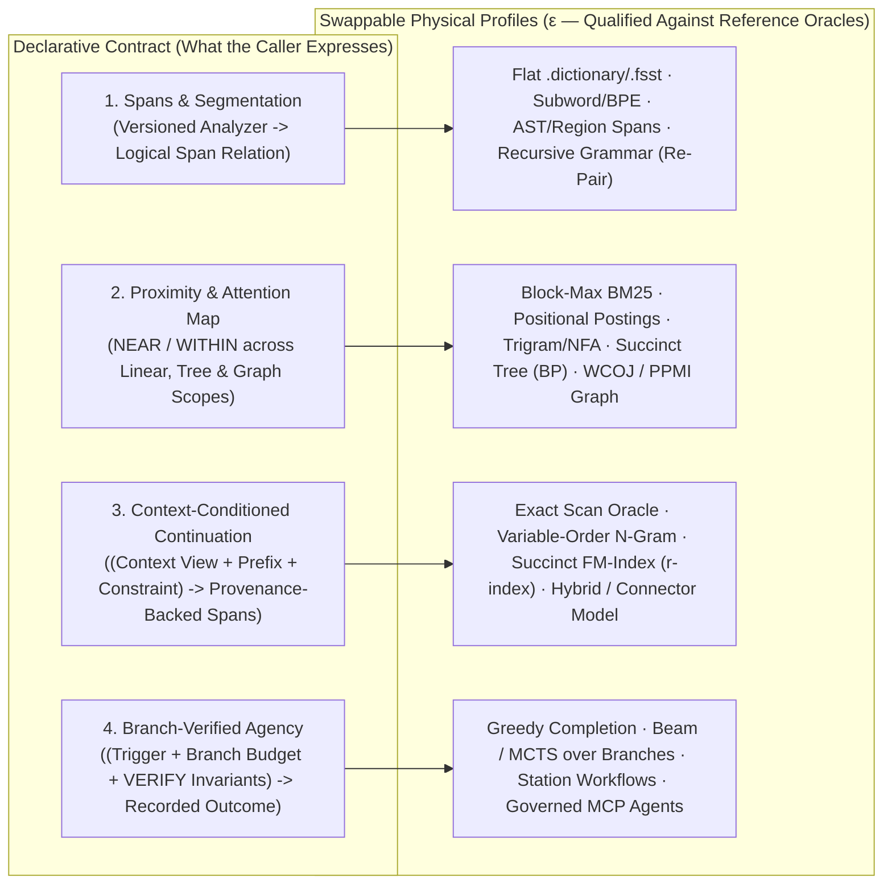

# 32. Declarative language, structural context and corpus-native synthesis research

[Roadmap](README.md) · [Performance #76](https://github.com/spoke-sh/transit/issues/76) · [Standards & Multi-Model #31](https://github.com/spoke-sh/transit/issues/31) · **Status:** Planned

Explore how far Transit's declarative data, query, branching and durable-runtime
primitives can go toward language understanding, structural context navigation,
autocompletion, domain-grounded synthesis and safe agency—while keeping the
underlying physical data structures, index layouts, ranking heuristics and
predictors completely swappable.

This is a **speculative research milestone**. Nothing here is required for the
[1.0 qualification and release gates](31-releases.md), and no candidate physical
algorithm named below (whether Block-Max BM25, trigram bitmaps, succinct
FM-indexes/Wavelet Trees, grammar compression, distributional sketches or branch
tree search) is assumed to be the winning implementation ahead of empirical
measurement. The architectural goal is to define **declarative contracts**
($\tau \perp \kappa \perp \epsilon$) so candidate mechanisms can be plugged in,
verified against deterministic scalar reference oracles, and evaluated on the
[qualification scorecard](30-qualification-and-benchmarks.md).

## Prerequisites and scope

Build on the delivered and planned foundations across
[statement results](04-statement-results-and-consumption.md),
[transactions](05-transactions-and-atomic-composition.md),
[streams, queues and durable runtime](06-streams-queues-and-durable-runtime.md),
[collations and historical catalogs](08-standards-and-catalogs.md),
[indexing](09-indexing-and-access-paths.md),
[analytical SQL and dataflows](10-sql-and-dataflows.md),
[data structures and per-morsel resource metering](11-data-structures-and-performance.md),
[first-class strings and vectorized search](12-vectorized-strings-and-search.md),
[data-centric compilation](13-data-centric-compilation-and-specialization.md),
[multi-model and graph projections](14-multi-model-and-foreign-relations.md),
[branches and merges](15-branches-merges-and-restore.md),
[reviewed collaboration](24-reviewed-data-collaboration.md) and
[reactive context and agent activation](27-reactive-context-and-agent-activation.md).

Start from the [data model](../handbook/reference/data-model.md) and the
[observation and feedback loop](../handbook/reference/collaborative-decisions.md#the-observation-and-feedback-loop).
Treat language and code not as opaque blobs requiring a single hardcoded search
formula, nor as exclusively the domain of external neural weights, but as
**recursive, structured sequences** whose segmentation, proximity map,
context-conditioned continuation and goal verification can be declared and
inspected inside Transit.

## Declarative research pillars and swappable implementations

### 1. Declarative segmentation, spans and recursive symbol projection

A bag-of-words tokenizer destroys the recursive structure of code and natural
language at index time. Instead of baking a single tokenization scheme into
storage or search:

- **Declarative contract:** An application declares a versioned, deterministic
  **Segmenter / Analyzer** (analogous to `COLLATE`) that projects a text/byte
  column or `Document` revision into a logical relation of addressable **Spans**:
  $$\text{Span} = (\text{object\_id}, \text{row\_id}, \text{byte\_start}, \text{byte\_end}, \text{kind}, \text{parent\_span}, \text{symbol})$$
  Spans may represent bytes, Unicode grapheme clusters (`UAX #29`), words,
  subwords, sentences, paragraphs or syntax/AST scopes while preserving
  five-state cell semantics (`value`, `null`, `missing`, `type_error`,
  `conflict`) and exact byte-offset provenance.
- **Reference oracle:** Finite streaming scalar segmentation over the pinned
  snapshot with zero index dependencies.
- **Swappable physical candidates ($\epsilon$):**
  - 1-level `.dictionary` and `.fsst` symbol tables from
    [Milestone 12](12-vectorized-strings-and-search.md).
  - Deterministic subword tokenizers (BPE / Unigram tables) stored as immutable
    catalog artifacts.
  - Structural/incremental syntax segmenters (`Tree-sitter` / PEG / region
    grammars) emitting hierarchical `parent_span` intervals for code and
    structured prose.
  - Recursive grammar-compressed symbol dictionaries (`Re-Pair` / Straight-Line
    Programs) where recurring multi-symbol phrases and code templates fold into
    non-terminal DAG rules while supporting direct compressed-domain pattern
    matching.

### 2. Declarative proximity and the structural map of text ("what to pay attention to")

Linear word distance is only a rough proxy for relevance: in both natural
language and code, two spans separated by dozens of tokens in a nested clause or
block may be direct siblings or direct dependencies in the underlying parse or
reference graph.

- **Declarative contract:** Express "what to pay attention to" as composable
  proximity, containment and relational/graph predicates over spans—such as
  `NEAR(a, b, max_distance, unit => BYTES | SPANS | TREE_DEPTH | GRAPH_HOPS)`
  and `WITHIN(inner_span, outer_span)`—paired with a declarative scoring and
  ranking specification (`SCORE(...)`, tie-breaking rules, and an explicit
  exact versus bounded-recall approximation contract).
- **Reference oracle:** Exact finite evaluation of linear offsets, nested span
  intervals and declared graph edges over decoded source batches.
- **Swappable physical candidates ($\epsilon$):**
  - **Bag-of-words and block-pruned lexical indexes:** 256-document Block-Max
    BM25 posting blocks (`MAXSCORE` / Block-Max WAND) qualified in
    [Milestone 12](12-vectorized-strings-and-search.md).
  - **Sub-linear substring, multi-pattern and fuzzy automata:** `.tseg`
    positional trigram bitmaps, minimal acyclic Finite-State Transducers
    (`FST`), SIMD multi-literal shuffle prefilters (`Teddy` / Glushkov NFA) and
    bit-parallel / universal Levenshtein automata (`Myers` bit-parallel edit
    distance) for code, identifiers, logs and typo-tolerant matching.
  - **Positional and hierarchical tree indexes:** Bitpacked positional posting
    streams, Region Algebra interval indexes, and succinct tree encodings (such
    as $2N$-bit Balanced Parentheses bitvectors supporting $O(1)$ Lowest Common
    Ancestor tree-distance checks across nested clauses and AST scopes).
  - **Non-local reference and distributional graph indexes:** Navigating explicit
    reference edges (call graphs, def-use chains, foreign keys, citations) and
    corpus-derived distributional co-occurrence graphs (Pointwise Mutual
    Information `PPMI`, `MinHash` / `SimHash` sketches, or ANN embeddings) via
    [Milestone 11's](11-data-structures-and-performance.md) Worst-Case Optimal
    Joins (WCOJ) and SIMD bitmask intersections.

### 3. Declarative context-conditioned continuation and synthesis

Viewed through information theory and database systems, sequence prediction and
draft synthesis are **context-conditioned retrieval, reranking and
constraint-checked continuation** over an indexed corpus. Formulating this
declaratively decouples the query contract from how predictions are physically
computed:

- **Declarative contract:** A continuation or synthesis operation binds three
  explicit inputs:
  1. **`CONTEXT` Basis:** Any valid Transit query, view or multi-model
     retrieval plan ([Milestone 14](14-multi-model-and-foreign-relations.md),
     [Milestone 27](27-reactive-context-and-agent-activation.md)) pinned to a
     `SnapshotId`, branch and security-barrier `policy_epoch` that defines the
     admissible universe of evidence.
  2. **`PREFIX` / Seed State:** The trailing span sequence, cursor neighbourhood
     or partial structured draft to continue.
  3. **`CONSTRAINT` Specification:** Optional target grammar, SQL/application
     schema binding (`DirectCatalog`), type expectation or vocabulary bitmask
     that candidate continuations must satisfy.
  - **Output contract:** A standard bounded `ResultSet`
    ([Milestone 4](04-statement-results-and-consumption.md)) of ranked candidate
    next spans or multi-span completions. Every candidate row reports its
    ranking score, exactness/speculative status (aligned with
    [Board live worksheet semantics](../design/board-console/D4.md#live-execution-snapshot-and-stream)),
    and an inspectable **source provenance vector** (`SnapshotId`, contributing
    `ObjectId`/`RowId`/`Span` ranges) proving that every emitted token obeys
    current `policy_epoch` disclosure and `.tdel` deletion rules.
- **Reference oracle:** Finite scan over the `CONTEXT`-filtered spans that
  counts exact suffix matches (with deterministic hierarchical backoff) and
  filters candidates through the declared `CONSTRAINT` validator.
- **Swappable physical candidates ($\epsilon$):**
  - **Statistical corpus backoff:** Variable-order $n$-gram / Kneser-Ney /
    Prediction-by-Partial-Matching (`PPM`) over `.tseg` symbol dictionaries and
    16-byte Umbra token-window prefixes, intersected in SIMD registers with the
    long-range `CONTEXT` bitmask.
  - **Succinct sequence self-indexes ($\infty$-gram / `REST` style):**
    Bidirectional Run-Length Burrows-Wheeler Transform (`r-index`) and Wavelet
    Tree segment indexes that narrow arbitrary-length context suffixes in
    $O(|\text{suffix}|)$ time and read out the next-symbol distribution directly
    from the Wavelet Tree while intersecting valid grammar/catalog bitmasks.
  - **Hybrid corpus + parametric predictors:** Combining non-parametric corpus
    continuation (for zero-hallucination domain facts, identifiers and SQL/code
    idioms) with local quantized models or governed external connectors
    ([Milestone 28](28-recorded-mcp-integrations.md)) behind the same declarative
    `CONTEXT`, `CONSTRAINT` and provenance boundary.

### 4. Declarative agency: branch-isolated exploration, verification gates and outcome ledgers

Crossing from autocompletion and synthesis (System 1) to agency (System 2) does
not require hardcoding a specific agent planning algorithm into the Transit
kernel. Instead, Transit can express the **safety, verification and learning
envelope of agency** declaratively using its native transaction, branch and
stream primitives:

- **Declarative contract:**
  1. **Activation (`WHEN`):** Declarative change, anomaly or queue conditions
     ([Milestone 6](06-streams-queues-and-durable-runtime.md),
     [Milestone 27](27-reactive-context-and-agent-activation.md)) that wake a
     computation with an exact recorded input basis.
  2. **Sandboxed Exploration (`ON BRANCH` + `WITH BUDGET`):** Candidate queries,
     schema/data edits or workflow steps execute inside lightweight zero-copy
     branches ([Milestone 15](15-branches-merges-and-restore.md)) under strict
     per-morsel CPU, memory and IOPS budgets
     ([Milestone 11](11-data-structures-and-performance.md)) so speculative
     search never mutates authoritative state or starves production tenants.
  3. **Deterministic Verification Gate (`VERIFY`):** Declarative invariants—SQL
     `CHECK` and `FOREIGN KEY` constraints
     ([Milestone 8](08-standards-and-catalogs.md)), `Plan.bind()` type/schema
     validation, test assertions and policy rules—that a candidate branch must
     satisfy before it can be surfaced as a reviewed proposal
     ([Milestone 24](24-reviewed-data-collaboration.md)) or committed.
  4. **Closed-Loop Outcome Attribution (`TWAL1` $\to$ `.tseg`):** Every
     explored trajectory—`(Context Basis, Proposed Continuation/Action,
     Verification Outcome, Subsequent Business Consequence)`—is recorded in
     `TransitLog` (`TWAL1`) and compacted into `.tseg`. Because future
     `CONTEXT` and continuation queries read those committed outcome records,
     verified successes automatically reinforce future rankings while refuted
     trajectories are down-weighted or masked out—achieving inspectable,
     reversible policy improvement through standard index maintenance.
- **Swappable physical candidates ($\epsilon$):**
  - Deterministic rule/constraint solvers, corpus-prior beam search or Monte
    Carlo Tree Search (`MCTS`) over speculative Transit branches, transactional
    `Station` workflows, or external MCP agents—all interchangeable beneath the
    same declarative `WHEN` / `ON BRANCH` / `VERIFY` / outcome contract.

## Evaluation and selection gates

| Research area | Required baseline & evaluation before promoting any candidate to the core roadmap |
| --- | --- |
| Declarative Spans & Segmenters | Deterministic scalar segmenter oracle, byte-offset and five-state fidelity across UTF-8/EBCDIC/binary inputs, and measured compression vs. random-access cost of flat `.fsst`/`.dictionary` vs. hierarchical/grammar encodings |
| Multi-Scale Proximity (`NEAR`) | Exact agreement with the finite linear/interval/graph reference oracle; measured latency, index size, build/compaction amplification and selective pruning across Block-Max BM25, trigram/automaton, succinct tree (`BP`) and WCOJ graph profiles |
| Context-Conditioned Continuation | Provenance completeness (zero leakage from unauthorized or `.tdel`-deleted rows), grammar/catalog constraint soundness, and comparative quality/latency/memory scorecards (exact scan vs. bounded $n$-gram vs. succinct `r-index`/Wavelet Tree vs. hybrid predictors) on SQL/code completion and enterprise synthesis workloads |
| Branch-Verified Agency | Strict branch isolation, budget enforcement and deterministic replay; measured observation-to-consequence uplift ([qualification plan](30-qualification-and-benchmarks.md#observation-and-consequence-evidence)) when prior verified branch outcomes are indexed back into the `CONTEXT` corpus |
