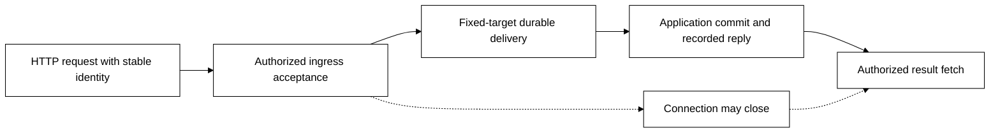

# M19 — Serving foundation and HTTP APIs

[Roadmap](README.md)

Status: Qualified initial HTTP profile following [M18 unified queries](M18.md).
Application serving passes native, Compose and Substrate recovery; Board passes
its native/private deployment regressions and two-instance Table query races.
The [proof ledger](../../tests/README.md#m19-qualification) records actual tasks,
limits, memory observations and costs. Expanded hosted CI cost remains deferred
under M10. Reactive transports remain M20 work.

Scope: formalize Transit's inbound serving layer and prove its first HTTP
profile. Shared Zig components own protocol request handling, published service
bindings, identity mapping, admission, response delivery and recovery over public
Transit/Station operations. [Serving](../history/SERVING.md) owns the design. HTTP serves
both consumers before [M20 reactive APIs](M20.md), [M21 reactive interfaces](M21.md)
and [Flight/Flight SQL/ADBC M22](M22.md).

## Why this precedes Flight

M15/M16 qualify outbound connector attempts. They do not qualify server identity,
routing, inbound admission or response recovery. Existing node and Board HTTP
listeners solve concrete bounded cases; they are not a general serving layer.
Board's formerly sequential request loop motivated the bounded shared listener;
long-lived watches need additional admission and lifecycle proofs. Qualify common serving behavior using two HTTP
consumers before adapting it to Flight's own RPCs and metadata.

The kernel remains generic. Serving adds no raw storage path, handler execution
inside the node, alternate command authority or independent retry database.
Application services continue to own their domain schemas and behaviors.

## M15–M18 implementation review

The [M18 proof ledger](../../tests/README.md#m18-qualification) now qualifies
finite KV/Table/Document queries through ten SDKs, SQL and Board, including
current denial, expiry and recovery. Its physical query-host proof covers Table
only. Use the [query compatibility matrix](../../packages/zig/transit-query/docs/compatibility.md)
as the starting capability inventory; these results establish neither concurrent
serving nor inbound application admission.

| Executed finding | M19 decision and required extension |
| --- | --- |
| Shell and Board share `Workspace`; SDKs share validated values and the Zig caller bridge | Keep query semantics with `transit-query`; extract HTTP mechanics and serving admission only. Application codecs and Board inspection retain their owners |
| The finite caller saves the original bundle and prepared command before dispatch, then observes its input commit | General HTTP admission must durably map caller request IDs to exact operations. The example's private file and single-caller discipline are not a concurrent gateway retry store |
| Query preparation uses a principal's signing sequence and the requester has one active upload | Coordinate sequence ownership and admission across concurrent handlers and gateway replacement; reserve capacity at the durable owner, not with a racy read of the active slot |
| A valid escaped v2 page exceeded the Board client's old 256 KiB decoded-response cap | Budget Arrow, encoded JSON, decoded values and simultaneous reader work separately; preserve the qualified client's 1 MiB v2 cap and other routes' 256 KiB cap until an explicit profile change is qualified |
| An idle authority read timeout stopped a query host; bounded read retry fixed it | Distinguish retryable observations from frozen uncertain mutations and terminal authorization/fencing errors in the shared request lifecycle |
| Finite requester lifetimes needed an authenticated Station timer and bounded cleanup | Specify operation/wait deadlines and observer rights separately from HTTP deadlines, drain and result retention; use the earliest applicable recorded process/resource deadline |

The [finite query example](../../examples/state-query/README.md) and
[upload lifecycle](../../packages/zig/transit-query/docs/unified-upload.md)
are concrete reuse points. Retain their failure traces as regressions, including
changed intent on recovery and denial after an actual returned prefix. Generalize
only after the application API and Board demonstrate the same need. M15/M16's
external-attempt reconciliation must not be folded into harmless HTTP read retry.

## Serving model and selected scope

Publish a versioned binding from an HTTP route to an explicit public service
operation. Establish caller scope, validate the request and admit it through the
owning Transit/Station operation. Serving delivers receipts and results; the
application service owns domain behavior. A listener or route grants no authority.

| Responsibility | Owner |
| --- | --- |
| Connections, framing, TLS boundary and bounded response delivery | HTTP adapter and shared serving components |
| Published bindings, caller context, operation mapping and admission budgets | Serving over public Transit/Station contracts |
| Domain commands, accepted work and recorded outcomes | Application service and its durable Transit/Station owner |
| Outbound requests caused by accepted work | Connectors through committed effect intents |

Ingress acceptance, destination admission, application completion and a socket
write are distinct facts. A lost response recovers the same operation; a retry
cannot dispatch a new command or select a different destination.

Application APIs **and Board** are the selected first consumers. Board retains
private shared access, its inspection grant and separate optional query identity;
individual operator sign-in and general administration remain separately scoped.
M20 adds reactive API hosting, M21 adds live interfaces with snapshot refresh,
and M22 qualifies Flight/ADBC. Detailed cross-component invariants remain in
[Serving](../history/SERVING.md); this milestone owns the implementation decisions and proof.

## Entry gates

| Gate | Required decision / evidence |
| --- | --- |
| Existing foundations | Review M13/M18's actual query and Board compatibility matrix plus M14 publication and M15/M16 transport evidence; retain their limits and deferred checks |
| Service contract | Define versioned service/operation/route bindings, exact targets and codec/policy revisions, conditional publication, retirement and bounded discovery through public operations |
| Identity | Pin the first service-caller credential profile, trusted ingress-to-principal mapping and provenance through Station forwarding; preserve Board's private viewer and separate inspection/query identities |
| HTTP profile | Pin server HTTP/framing/TLS termination, proxy trust, method/media/error behavior, connection lifecycle and independently testable peers; client TLS/gRPC qualification is not server evidence |
| Admission and recovery | Specify stable caller identity/request IDs, exact duplicate/conflict handling, accepted-stage receipts, destination dispatch/reply correlation and retry horizons without cross-PID atomicity |
| Capacity and scheduling | Inventory request/body/parse/result bounds, active and queued work, per-principal fairness, durable outstanding-work quotas, deadlines and control reserve; no long response may monopolize the listener |
| Shared mutable state | Audit Board's sequential handler assumptions, client signing/observation state, request arenas and query workspace ownership before adding tasks; declare which state is serialized and which is per request |
| Declaration versus SQL | Version typed public contracts first; audit grammar gaps for service/endpoint declarations without inventing executable SQL or a UI-only configuration authority |

The bounded auth baseline uses explicitly provisioned application service callers.
Federated user sessions and general operator controls remain separately scoped;
Board transport reuse alone must not widen its current shared viewer access.

## Implementation sequence

1. Publish the neutral serving/service-binding and HTTP profile contracts with
   shared fixtures for provenance, acceptance, outcomes and errors. Identify the
   durable owner of declarations and admitted operation records; reuse Station
   turns, outboxes, receipts and public query APIs.
2. Implement bounded HTTP serving in Zig. Establish per-request ownership and
   coordinated principal-sequence admission before enabling parallel handlers.
   Extract common parsing/listener/lifetime work from concrete consumers;
   qualify inbound security, concurrency and cleanup
   independently of the outbound connector. Create real packages/manifests only
   when those implementations and consumers exist.
3. Expose a small non-trading application with command admission, operation status,
   and exact result reads. Lose responses and restart the gateway/worker to prove
   the same operation survives without duplicated application changes.
4. Migrate Board's HTTP/static/API boundary to the shared machinery while keeping
   its API, exact-origin checks, inspection behavior and explicit query contracts.
   Do not migrate the authority listener merely to make every executable uniform.
5. Qualify both consumers across local, Compose and reference deployments, then
   publish the serving capability matrix and extension contract for M20–M22.
   Reuse owned fixture creation, fresh-key/exact-generation bootstrap and cleanup
   from the query/connector examples. Operator-placed growing query hosts do not
   prove automatic runtime-controller support; record that deployment boundary.

## Exit criteria

- [x] Shared typed service/route declarations and public inspection identify
  accepted revision, proposed changes, exact published operations and observed
  listener capability distinctly. Route publication grants no application access.
- [x] Application HTTP and Board use the same serving contracts and shared
  implementation, with separate listeners/identities/budgets where required.
  Tests run actual binaries and independently implemented clients.
- [x] The application example proves a durable command, bounded status/receipt
  recovery and exact result retrieval; finite queries reuse `transit-query`/Fuze.
  Pure inspection reads do not create unnecessary durable jobs.
- [x] Every application request establishes authenticated caller scope, current
  route/service/resource rights and trusted provenance. Reject forged principals,
  realms, forwarded headers and cross-principal cached results or receipts.
- [x] HTTP admission binds stable request ID, content digest, original service/
  route revision and resolved target. Concurrent duplicate requests admit once;
  conflicting content rejects. Route edits/unpublication cannot retarget old work
  or remove its authorized recovery path.
- [x] Race different and identical requests sharing one principal across handlers
  and gateway instances, including restart after prepare, accepted-but-lost
  receipt and input commit. A signed sequence cannot be reused for different
  work; query active-slot and outstanding-operation quotas remain authoritative.
- [x] Lost responses before/after ingress and destination acceptance, lost replies,
  worker/gateway/node/store restart and the declared retry horizon preserve uncertainty
  and exact identities. `202` names its accepted stage; response write completion
  never proves application completion or client consumption.
- [x] Socket abort, deadline, explicit cancel, service retirement and deployment
  drain retain distinct outcomes. Accepted work remains recoverable; callbacks
  to external destinations still require connector effects.
  Qualify finite process/resource deadlines, authenticated timer observations,
  duplicate/late timeout delivery and hard expiry without timer delivery. Closing
  a transport must neither renew a wait nor authorize retained-result deletion.
- [x] Qualify bounded concurrent handling, per-request allocation/lifetime and
  joined cleanup under slow uploads/readers, malformed/ambiguous framing, oversized
  input, disconnect races, scheduling failure and quota exhaustion. Control and
  unrelated authorized requests continue within declared scheduling bounds.
  Include maximum escaped JSON/Unicode pages, per-reader Arrow workspaces,
  delayed upstream reads and timeout after mutation acceptance. Measure aggregate
  RSS under concurrent readers; cold-store bytes are not a resident-memory bound.
- [x] Enforce server TLS or the selected authenticated termination boundary,
  exact host/origin policy, credential isolation and secret-free records/logs.
  Qualify the real proxy/listener configuration rather than only loopback parsing.
- [x] Preserve Board's private shared admission, read-only inspection identity,
  separate optional query identity, OpenAPI behavior and protected-state clearing.
  No operator mutation or arbitrary application decoder appears as a side effect.
- [x] Declarations, accepted operations and retained results can grow beyond
  resident memory through bounded public access. Admission quotas refuse new work
  before exhaustion without expiring retained evidence or forcing retention opt-in.
- [x] Ship local/Compose/reference examples and usage/recovery guides, bounded
  diagnostics, reproducible `just` proofs and measured CI costs under M10's policy.
  Extend conformance/model schedules where new admission/provenance races arise;
  existing connector/query/Board regression evidence remains separately recorded.
- [x] Hand M20 explicit async response/cancellation, identity, budget and extension
  contracts for reactive APIs; M21 consumes those APIs. Hand M22 protocol-neutral
  admission/result seams. Capability discovery must keep subscriptions, inbound
  gRPC and Flight unavailable until their own qualification.

## Qualified profile and handoff

The [compatibility matrix](../../packages/zig/transit-serving/docs/compatibility.md)
separates application HTTP/TLS, Board inspection and Table query proofs. It does
not infer every source/protocol/placement combination from one passing example.
The serving model and neutral HTTP package are shared; Board keeps its existing
public query/inspection owners and private viewer admission.

The growing profile retains native receipts and service outcomes without a finite
retry-horizon reclamation policy. Tests recover old signed bytes after newer
sequences; no finite receipt expiry is advertised. Process/resource expiry and
Station wait cancellation/timeout are separately qualified. The timer observer is
explicitly provisioned and exercised; the example does not ship an automatic
observer daemon or a growing runtime reconciliation controller.

The owned examples configure a 50,000-position native admission ceiling with a
2,000-position control reserve. Active operation limits, bounded point reads and
retained-operation growth are independently tested. This finite qualification is
not an Internet scale, throughput or latency guarantee. New proofs remain focused
or external tasks, preserving M10's measured hosted-lane policy.

M20 receives immutable service/operation identities, exact signed retry,
authenticated current reads, finite wait outcomes, shared bounded HTTP tasks and
owned deployment fixtures. It must add durable sessions, source/watch coverage
and protocol-specific bounds; M19 discovery keeps those capabilities unavailable.

## Outside this milestone

Live subscriptions, incremental continuous queries, predictive edit scheduling,
WebSockets, gRPC application hosting, Flight/ADBC, public Internet scale claims,
a general API gateway/plugin product, a full administration UI, managed secrets,
OIDC federation and arbitrary code loading. M19 needs a concrete credential and
TLS profile, not every authentication mechanism. General serving DDL is proposed
language work; this milestone's typed declarations cannot be offered as runnable
`CREATE SERVICE` SQL without a separately qualified grammar/lowering extension.
