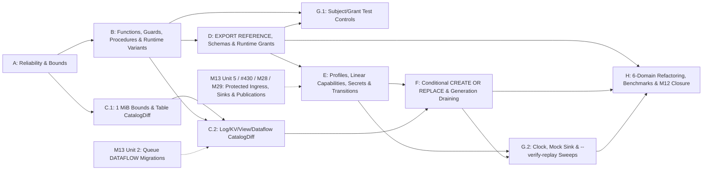

# Milestone 12 completion implementation plan

[Milestone 12](12-application-modules-compilation-and-testing.md) · **Status: In Progress** · 2026-11-13

Milestone 12 has its bounded recursive `.transit` compiler, lockfile and
subdirectory dependency resolver, ANTLR correspondence corpus, nominal scalar
domains, closed compile-time variants, exact public `TABLE`/`STREAM`/`QUEUE`
exports, actionable `application.source.*` diagnostics, public-data Queue
program compilation, pure `FUNCTION` / ordered `GUARD` / inline atomic
`PROCEDURE` lowering (Slices A and B.1; see
[November 15 qualification](../history/qualification/query.md#pure-functions-ordered-guards-and-inline-atomic-procedures--2026-11-15)),
and isolated local `transit test` runner. Completing it
still requires finishing value-returning `LET res = CALL` and runtime
variant/cardinality/refinement composition (Slice B.2), synthesizing explicit-basis migrations, enforcing
reference-only exports and runtime module encapsulation, checking option profiles, linear
`CAPABILITY`/`OPERATION` workflows and `SECRET` taint once their runtime owners
land, delivering safe `CREATE OR REPLACE` generation draining, adding
deterministic subject/clock/effect/replay test controls, and qualifying the
refactored multi-module application baseline at one committed revision.

Plan for **14–20 review units and 19–31 engineer-weeks of direct work**.
Allowing roughly 25% for cross-milestone integration, formal proof repair and
fault investigation gives **about 24–39 engineer-weeks**. These are planning
estimates, not measured delivery velocity. They include M12's compiler, CLI,
migration-diff, test-runner, formal-correspondence and integration work, while
excluding implementation of external runtime milestones ([M7](07-document-storage-and-station-decoupling.md)
`DOCUMENT` transactions, [M11](11-indexing-and-access-paths.md) online table/index
rewrites, and [M13](13-sql-and-dataflows.md)/[M28](28-control-and-policy-plane.md)/[M29](29-published-resources-and-investigations.md)
live HTTP ingress, sink execution, protected response handoff and publications).

**Source basis:** local `main` at `505d8ac3147dd9cdc0fa4a26c11bc8f334b2bae7`,
after public Queue builds and tests ([PR #450](https://github.com/spoke-sh/transit/pull/450)),
the shared transaction lifecycle and owned Table/KV reads
([PR #451](https://github.com/spoke-sh/transit/pull/451),
[PR #452](https://github.com/spoke-sh/transit/pull/452)), actionable diagnostics
and nominal Queue programs ([PR #453](https://github.com/spoke-sh/transit/pull/453)),
and catalog stack and static fixture fixes
([PR #455](https://github.com/spoke-sh/transit/pull/455),
[PR #456](https://github.com/spoke-sh/transit/pull/456)). The shared native
contract definition is
`cca0376c55733fd553a43a187fee9e8c379ab1b14007009a06bfcab3a517fec2`
(`transit.v1.native-transaction-execution.2026-11-11`), the migration ledger
definition is `transit.direct.migration.v1.2026-11-06` (`TMD1`/`TMV1`), and the
source compiler format is `transit_source_v1`. This plan updates the sequencing
and effort model from the earlier [remaining implementation plan](application-remaining-implementation.md)
(anchored at `bc849156a`) while preserving all `D1`–`D6` decisions, `P0`–`P6`
acceptance criteria and historical slice records.

## Delivered basis and remaining work

| Boundary | Present at `505d8ac31` | Remaining completion obligation |
| --- | --- | --- |
| Recursive builds and dependency locks | Pure bounded `Compiler` (`256` files, `16 MiB` source, depth `64`, `100,000` steps, `64 MiB` memory, `8 MiB` output); higher-order `MODULE`/`INTERFACE`; `.direnv`/`node_modules` pruning; `DEPENDENCY` Git commit/subdirectory `transit.lock`; `--fetch`, `--override`, `--check` and 15 `application.source.*` diagnostic families | Richer behavior/view/procedure interface members, multi-namespace bindings, explicit migration-basis targets and multi-package monorepo/relocation qualification on the 6-domain baseline |
| Grammar, stages and formatting | Dedicated [ANTLR grammar and corpus](../../contracts/application-source/README.md) with byte-offset AST parity, all-body template syntax validation across compile-time branches, zero-allocation `Format.zig`, and `DATAFLOW ... END DATAFLOW` statement framing | Extend grammar, stage separation, formatter and `SqlInput`/`SqlScript` framing to `PROFILE`, `FUNCTION`, `GUARD`, `PROCEDURE`, `EXPORT REFERENCE`, `CREATE OR REPLACE ... IF REVISION`, `FROM COMMAND`, `FOR ... END FOR` and runner-only test directives |
| Nominal types, variants and public data | `BIGINT`/`TEXT`/`BOOLEAN` nominal domains, closed compile-time `VARIANT` + exhaustive `MATCH` with symbolic all-arm checking, exact `TABLE`/`STREAM`/`QUEUE` signatures, nominal `DATAFLOW ... FROM QUEUE` propagation across `LET`/nullable `SELECT`/`REQUIRE`/`IF`/`CASE`/`BEGIN ATOMIC`/`INSERT`/`PRODUCE`/`ENQUEUE`/`ON FAILURE`, and 6 Lean laws | Runtime variant/tag dispatch, zero/one/many query cardinality, bounded scalar refinements with dynamic boundary validation, symbolic `DATAFLOW`/control specialization in parameterized modules, and remaining scalar/composite source types |
| Compile-time helpers and procedures | Parameterized `MODULE` and `INTERFACE` specialization over types, identifiers, scalars, variants and public resources | `CREATE PROFILE` + `USING PROFILE`; pure deterministic `CREATE FUNCTION` via Fuze `ScalarProgram`; ordered `CREATE GUARD` with refusal precedence and dual spans; hygienic inline `CREATE PROCEDURE ... AS BEGIN ATOMIC ... END` |
| Module encapsulation and schemas | `WorkingCatalog` binds explicit names in `public`; compile-time visibility hides unexported module locals from `.transit` callers | Multi-schema bindings (`CREATE SCHEMA`), `EXPORT REFERENCE` preserving `FOREIGN KEY` and `DROP` edges without row access, and runtime catalog/grant protection so direct SQL callers cannot bypass private module tables or forge procedure authority |
| Protected commands, effects and transitions | Runtime `ApplicationProgram` parses protected types and host steps, while `ProgramCheck` restricts source compilation to public-data `FROM QUEUE` programs | After M13/#430/M28/M29 land: `FROM COMMAND`, `SOURCE`/`SINK`/`CONNECTION`/`PUBLICATION` declarations, static CFG linear `CAPABILITY`/`OPERATION` settlement, `Secret<T>` taint rejection, `DEADLINE` budgets, and Case 2/Case 3 transition proofs |
| Explicit-basis migrations and replacement | Immutable `migrations/<version>-<name>.sql` ledger (`TMD1`/`TMV1`), deterministic step tokens, `IF NOT EXISTS` logical fingerprint drift checks, Table and finite Table-dataflow adapters (`64 KiB` file, `64` steps) | Offline explicit-basis `CatalogDiff` (Tables first, then logs/KV/Documents/definitions), `1 MiB` / `256`-step script cutover with $O(\text{statement})$ scratch, Queue-program migration receipts, and `CREATE OR REPLACE ... IF REVISION` with `require_idle`, `pin_generation` and `drain_active` |
| Deterministic testing, replay and baseline | Disposable local `TestHost` (`128` cases, `1,024` actions/case, `30 s`/case, `256 MiB`), `ASSERT ROWS`, `ASSERT COMMAND`, Table failure assertions and bounded `ASSERT WORKFLOW` polling | Close retained local Queue `TestDeadline`/`TestReadCleanupFailed`/`lease_expired` failures; add `SET TEST SUBJECT`, `SET TEST CLOCK`/`ADVANCE TEST CLOCK`, `MOCK SINK`/`MOCK OBSERVATION`, `--verify-replay` yield-point sweeps, and qualify the 6-domain Platform refactoring (`> 35%` deduplication, `< 500 ms` `--check`, `< 2 s` test/replay) |

Current implemented behavior is owned by
[Application source builds](../handbook/reference/applications.md#application-source-builds),
[Bounded application source compilation](../handbook/internals/query-engine.md#bounded-application-source-compilation),
[`APPLICATION_SOURCE_V1.md`](../../contracts/APPLICATION_SOURCE_V1.md),
[`APPLICATION_PROGRAM_V1.md`](../../contracts/APPLICATION_PROGRAM_V1.md#installed-sql-profile),
[`MIGRATION_V1.md`](../../contracts/MIGRATION_V1.md),
[`transit-compiler`](../../packages/zig/transit-compiler/README.md) and
[`transit-test`](../../packages/zig/transit-test/README.md). The separate
[declarative application interface compiler](../handbook/reference/applications.md#declarative-application-interfaces)
(`transit-app`) handles interface definitions within its documented profile;
Milestone 12 adds no `transit app` subcommand family.

The [November 13 query qualification](../history/qualification/query.md#actionable-source-diagnostics-and-nominal-queue-programs--2026-11-13)
records passing fast/handbook baselines, source grammar/type correspondence,
6 Lean theorems in [`TypedTarget.lean`](../../contracts/application-source/TypedTarget.lean),
installed CLI diagnostics and clean CI lanes on the split single-outcome fixture.
It also retains unresolved failures that must be addressed rather than treated as
closed by later retries: local multi-case Queue suites hitting `TestDeadline`
(`30 s`) and `TestReadCleanupFailed`, local clean `installation-ui` hitting Queue
ACK `lease_expired` and stalled workflow progress, first hosted `managed-verify`
hitting `ClockUnavailable` (`AuthorityUnavailable` HTTP 503), first hosted
`console-latency-gate` exceeding the `1.15` cycle PSS ratio (`1.1549`), and local
`storage-query` hitting a `2 s` `MaintenanceTimeout` under concurrent load.

## Required architecture and dependency boundaries

The target dependency direction is **`transit-fuze` (shared SQL parser, physical
binder, `ScalarProgram`, `ApplicationProgram` and statement framing) → neutral
catalog/fingerprint descriptors → `transit-compiler` (pure source evaluation,
nominal/effect/ownership checking, canonical SQL emission and offline
`CatalogDiff`) → `apps/transit-cli` (`transit build`, `transit test`,
`BuildSources` and `MigrationClient`) → database SQL, migration and dataflow
owners (`transit-sql`, `transit-catalog` and `transit-query-direct`)**.

| Layer | Owns | Hard boundary |
| --- | --- | --- |
| `transit-fuze` | SQL lexing/parsing, `SqlInput` block-aware framing, physical scalar/table/log/program binding, five-state `ScalarProgram` and `ApplicationProgram` plan validation | Pure and deterministic; no filesystem, network, clock, catalog storage or Station imports |
| Neutral catalog & migration descriptors | Logical column/constraint/resource fingerprints, definition revision hashes (`SHA-256`), step classifications and `DirectMigration` receipt payloads | Shared between offline `CatalogDiff` and live `MigrationRunner` without pulling runtime storage into the compiler |
| `transit-compiler` | `.transit` parsing, `Format`, module/interface recursion, nominal/variant/refinement/capability/secret checking, helper lowering, `WorkingCatalog`, `CatalogDiff` and independent emitted-SQL rebinding | Zero OS/filesystem/network I/O, zero Station dependency, bounded `64 MiB` arena, and zero runtime `.transit` sidecars or persistent binary IR |
| `apps/transit-cli` & `transit-test` | Confined `BuildSources` discovery, `transit.lock` verification/fetching, atomic output writing, `MigrationClient` submission, isolated `TestHost` simulation and `--verify-replay` | Never fetch or contact a server during `transit build` unless `--fetch` is requested; reject test-only directives in build/library sources |
| Database & dataflow runtime owners | Authoritative catalog namespaces/grants, `DirectMigration` ledger execution, M5/M6 atomic transactions, M13 `ManagedApplication`/effect/source/publication lifecycles and generation draining | Enforce security, quotas, deadlines and idempotence on raw SQL callers; never trust compiler provenance comments for runtime authority |

Emitted `.sql` remains the sole deployable artifact (`D1`, `D4`). Source-only
constructs (`TYPE`, `VARIANT`, `MATCH`, `MODULE`, `INTERFACE`, `PROFILE`, inline
`GUARD` and inline `PROCEDURE`) lower to readable, canonical SQL declarations,
scalar expressions, `CHECK`/`FOREIGN KEY` constraints and ordered `DATAFLOW`
blocks, optionally annotated with non-semantic `-- origin: <path>:<line>:<col>`
comments for diagnostics and Board lineage. Every `transit build` and
`transit test` invocation must continue to reparse and bind its emitted SQL
through the independent scalar SQL verifier before writing artifacts or
executing statements.

### External milestone dependency gates

Milestone 12 must not invent compiler-private runtime shims for unfinished
adjacent milestones. Compiler syntax/type models may be prototyped behind
explicit feature rejection, but emitted SQL and `transit build` / `transit test`
profiles admit a surface only when its runtime owner and recovery proofs exist:

| Adjacent owner | Gate on Milestone 12 | What M12 can deliver before the gate closes |
| --- | --- | --- |
| [M5](05-transactions-and-atomic-composition.md) & [M6](streams-queues-runtime-completion.md) | Shared atomic Table/KV/Stream/Queue decisions, Queue claim/ACK lease stability and `TestReadCleanupFailed` lifecycle | Unit A local `TestHost`/Queue fixes; Unit B inline atomic `PROCEDURE` composition over qualified Table/KV/Stream/Queue participants |
| [M7](07-document-storage-and-station-decoupling.md) | Direct `DOCUMENT` DDL, schema fingerprints and mixed-transaction participation | Keep `DOCUMENT` rejected in `.transit` programs and `CatalogDiff` until M7's direct lifecycle and participant contracts pass |
| [M8](08-gateway-architecture-and-protocol-ingress.md) & [M9](09-client-foundation-and-language-apis.md) | Inherited command deadlines, cancellation join and shared client recovery handles | Offline builds, isolated local `TestHost` deadlines and CLI `MigrationClient` file submission |
| [M10](10-standards-and-catalogs.md) & [M11](11-indexing-and-access-paths.md) | Lazy additive column projection, historical catalog cuts, `FOREIGN KEY` index backing and online table/index rewrites | Unit C additive `ALTER TABLE ADD COLUMN` and `CREATE TABLE` diffs; refuse destructive/rewrite diffs with `MigrationRequiresExplicitTransform` |
| [M13](dataflow-sql-implementation.md) & `#430` | Unit 2 Queue-program migration receipts; Unit 5 `FROM COMMAND`, `CREATE SOURCE`/`SINK`/`CONNECTION`, `ApplicationProtectedHost` and `DEADLINE` enforcement | Public-data Queue `DATAFLOW` builds/tests now; Queue-program `CatalogDiff` joins M13 Unit 2; Unit E live admission joins M13 Unit 5 |
| [M16](16-data-centric-compilation-and-specialization.md) | Optional `transit build` AOT query/view specialization | Keep M12 SQL output self-sufficient and canonical; expose clean typed plan hooks without coupling M12 completion to AOT codegen |
| [M21](21-branches-merges-and-restore.md) & [M30](30-reviewed-data-collaboration.md) | Branch `DIFF_SCHEMA` and governed change-request migration review | Keep `CatalogDiff` fingerprints and `MIGRATION_V1` deterministic so branch/governance workflows consume the exact same descriptors |
| [M23](23-formal-semantics-and-correspondence.md) | `T8` catalog/dataflow lifecycle TLA+ models and `A1`/`A6` Lean proofs | Co-own M12's Lean laws (`TypedTarget.lean`) and TLA+ capability/replacement models with native trace replay |
| [M28](28-control-and-policy-plane.md), [M29](29-published-resources-and-investigations.md) & [M31](31-board-reimplementation.md) | Installed `CREATE PUBLICATION` (HTTP/OpenAPI, SSE/AsyncAPI) and read-only Board lineage inspection | Defer live `PUBLICATION` emission to Unit E alongside M28/M29; preserve source-origin metadata for M31 read-only inspection |
| [M44](44-sql-grammar-and-dialect-ergonomics.md) | Harmonized SQL and application grammar audit | Maintain strict ANTLR/Zig correspondence in `contracts/application-source/` on every grammar addition |

## Review units and effort estimate

An engineer-week means one experienced engineer working full time with the
repository's Nix/Just verification harness. Estimates include contract updates,
implementation, negative controls, formal correspondence, documentation and PR
qualification for each unit.

| Unit | Review units | Engineer-weeks | Milestone scope |
| --- | ---: | ---: | --- |
| A. Reconcile retained failures and freeze compilation bounds | 1–2 | 1.5–2.5 | `P0`, `P5`, `P6` prerequisite reliability and ceiling audit |
| B. Deliver pure functions, ordered guards, inline procedures and runtime variants | 3–4 | 4–6 | `D3`, `D4`, `P0`–`P3`, `P5` public-data composition and Lean laws |
| C. Synthesize explicit-basis migrations and raise script bounds | 2–3 | 3–5 | `D1`, `D4`, `P0`, `P4` offline `CatalogDiff` and `MIGRATION_V1` bounds |
| D. Enforce reference-only exports, schemas and runtime module boundaries | 2 | 2.5–4 | `D2`, `P1`–`P3` `EXPORT REFERENCE`, multi-schema and catalog/grant isolation |
| E. Check profiles, linear capabilities, secrets and state transitions | 2–3 | 3–5 | `D3`, `D4`, `P2`, `P3`, `P5` protected workflows (live activation gated on M13/M28/M29) |
| F. Replace definitions safely and drain active generations | 2–3 | 2.5–4.5 | `D5`, `P4` `CREATE OR REPLACE ... IF REVISION` and `require_idle` / `pin_generation` / `drain_active` |
| G. Complete deterministic workflow testing and replay fault sweeps | 1–2 | 1.5–2.5 | `D6`, `P5` subject/clock/effect simulation and `--verify-replay` |
| H. Qualify the multi-module application baseline and close Milestone 12 | 1 | 1–1.5 | `P6` 6-domain Platform refactoring, performance budgets, handbook promotion and common-HEAD closure |
| **Total before contingency** | **14–20** | **19–31** | |

Units A, B and the Table slice of C have **no external milestone blockers** and
form the immediate execution wave. Units D and F require focused catalog and
dataflow-lifecycle contract reviews before coding. Unit E's static checker can be
built and model-checked ahead of time, while its end-to-end SQL execution waits
on M13 Unit 5 and M28/M29. Re-estimate after Units B and C land if multi-schema
encapsulation or M13 protected-host integration expands the cutover surface.

## A Reconcile retained failures and freeze compilation bounds

Close the local reliability and sizing gaps exposed during the PR #450 and
PR #453 slices before multiplying program size through inlined guards and
procedures:

1. **Eliminate local `TestHost` Queue cleanup and deadline races.** Diagnose
   `TestReadCleanupFailed`, multi-case `TestDeadline` (`30 s`) exhaustion and
   local `installation-ui` Queue ACK `lease_expired` stalls across
   [`TestHost.zig`](../../apps/transit-cli/TestHost.zig),
   [`Runner.zig`](../../packages/zig/transit-test/src/Runner.zig),
   [`DatabaseRuntime.zig`](../../packages/zig/transit-sql/src/DatabaseRuntime.zig)
   and Queue claim/settlement teardown. Ensure completed or refused workflow
   turns release read snapshots deterministically before case disposal, and bound
   idle polling/worker wakeups so five-to-ten sequential Queue cases run well
   inside the `30 s` per-case and `256 MiB` host budgets without raising timeouts
   or relaxing leak checks. Keep external hosted `ClockUnavailable` and
   `storage-query` `MaintenanceTimeout` tracked with their original evidence
   until their owning runtime/storage suites close them.
2. **Align statement, program and migration byte ceilings.** Today
   `Sql.max_statement_bytes` caps individual SQL statements at `4,096 B`,
   [`ApplicationProgram.zig`](../../packages/zig/transit-fuze/src/ApplicationProgram.zig)
   accepts `64 KiB` program sources, [`Migration.zig`](../../packages/zig/transit-sql-protocol/src/Migration.zig)
   caps migration files at `64 KiB` and `64` steps, and
   [`Compiler.zig`](../../packages/zig/transit-compiler/src/Compiler.zig) allows
   `8 MiB` total emitted SQL. Specify and execute one coordinated bound
   alignment so lowered `CREATE DATAFLOW` statements with expanded guards and
   inlined atomic procedures can reach the `64 KiB` program bound through
   `SqlInput`, `DatabaseRuntime` and `MigrationRunner` with bounded per-statement
   arenas and zero whole-script AST allocation.
3. **Freeze the M12 capability and cutover matrix.** Map every `D1`–`D6` and
   `P0`–`P6` requirement to its current Zig owner, contract section, external
   milestone gate and required positive/negative tests.

**Exit:** multi-case local Queue `transit test` suites (including combined
accepted, refused and rolled-back pipelines in one `.transit` test file) pass
repeatedly with zero `TestReadCleanupFailed` or `TestDeadline` failures under
unchanged `30 s` / `256 MiB` limits; statement/program byte bounds agree across
compiler, SQL service and test runner; and the capability matrix is committed.

## B Deliver pure functions ordered guards inline procedures and runtime variants

Finish the remaining public-data half of richer typed composition (`D3`, `D4`,
`P0`–`P3`, `P5`) without introducing a second runtime evaluator or stored
function catalog dependency:

1. **Pure deterministic `CREATE [PUBLIC] FUNCTION`.** Support typed scalar and
   predicate helpers (plus compile-time higher-order expression/predicate
   parameters on `MODULE`s) lowered through Fuze's pure [`ScalarProgram`](../../packages/zig/transit-fuze/src/ScalarProgram.zig)
   semantics, preserving five-state evaluation (`value`, `null`, `missing`,
   `type_error`, `conflict`), checked integer arithmetic and nominal/variant type
   identities. Reject table/log reads, `CURRENT_TIMESTAMP`, randomness, capabilities,
   secrets and recursive function cycles at definition time with dedicated
   `application.source.*` diagnostics.
2. **Ordered `CREATE [PUBLIC] GUARD`.** Support reusable boolean/lookup guards
   invoked inside ordered `DATAFLOW` programs and `PROCEDURE` bodies. Expand
   guards in exact lexical sequence (`REQUIRE <predicate> ELSE REFUSE ...`),
   record every referenced `TABLE` read in `ApplicationReadSet`, and carry both
   the guard definition span and the `CHECK`/`APPLY` call-site span into compiler
   diagnostics and emitted provenance comments.
3. **Hygienic inline `CREATE [PUBLIC] PROCEDURE ... AS BEGIN ATOMIC ... END`.**
   Allow `CALL` and `LET <binding> = CALL` inside `BEGIN ATOMIC` blocks over
   currently qualified participants (`TABLE`, `KV`, `STREAM`, `QUEUE`). Perform
   hygienic local renaming so caller and callee bindings never collide, enforce
   exact resource and nominal/variant argument types, and flatten nested atomic
   procedure calls into the enclosing single M5/M6 transaction decision. Reject
   nested explicit `BEGIN ATOMIC` sub-transactions, recursive call chains, and
   any `EXECUTE SINK` or `AWAIT OBSERVATION` step inside an atomic procedure
   (`EffectInsideAtomicProcedure`).
4. **Runtime variants, query cardinality and bounded refinements.** Extend closed
   `VARIANT` values and exhaustive `MATCH` from compile-time `MODULE` arguments
   to runtime `TABLE`/`STREAM`/`QUEUE` columns and `DATAFLOW` expressions via
   canonical SQL `CHECK` tags and `CASE` lowering, rejecting duplicate tags or
   missing arms (`NonExhaustiveVariantMatch`). Add explicit zero-or-one vs
   exact-one vs finite-many query cardinality typing and bounded scalar
   refinements (such as non-empty text and bounded integer ranges) with generated
   boundary validation so synthetic **Case 1** (nominal domain confusion,
   exhaustive variant matching and nullable lookup handling) is proved on dynamic
   runtime rows as well as compile-time values. Lift the restriction barring
   symbolic `DATAFLOW` operand/control specialization inside parameterized
   `MODULE`s.
5. **Grammar, formatter and block-aware framing.** Update
   [`TransitSource.g4`](../../contracts/application-source/TransitSource.g4),
   the negative/positive correspondence corpus, `Format.zig` and
   [`SqlInput.zig`](../../packages/zig/transit-fuze/src/SqlInput.zig) (`CREATE FUNCTION`,
   `CREATE PROCEDURE`, `FOR ... END FOR` and `FROM COMMAND` framing) with zero
   per-token heap allocation.
6. **Lean 4 laws and differential correspondence.** Extend
   [`TypedTarget.lean`](../../contracts/application-source/TypedTarget.lean),
   [`driver.zig`](../../tests/query/application_source/driver.zig) and
   [`verify.py`](../../tests/query/application_source/verify.py) with
   mechanized proofs for (a) pure function referential transparency under
   five-state evaluation, (b) ordered guard refusal equivalence plus a concrete
   counterexample proving guard reordering alters observable refusal codes, and
   (c) hygienic inline procedure expansion preserving single-decision rollback.

**Exit:** ANTLR/Zig corpus, `Format` idempotence, Lean 4 proofs, differential
projection checks and isolated `transit test` suites pass for modules composing
functions, multi-guard chains, nested inline atomic procedures and runtime
variants across `TABLE`, `STREAM` and `QUEUE`, with independent scalar SQL
rebinding and zero new runtime executors.

## C Synthesize explicit-basis migrations and raise script bounds

Deliver deterministic, offline desired-state-to-migration synthesis (`D1`, `D4`,
`P0`, `P4`) while preserving [`MIGRATION_V1.md`](../../contracts/MIGRATION_V1.md)'s
immutability, ledger-token and drift-detection guarantees:

1. **Coordinated `1 MiB` / `256`-step migration cutover.** Under Transit's
   single-current-v1 cutover rule, raise `Migration.max_file_bytes` and
   [`MigrationClient.zig`](../../packages/zig/transit-sql-client/src/MigrationClient.zig)
   from `64 KiB` to `1 MiB`, and raise `DirectMigration.max_steps` /
   `Migration.max_steps_per_version` from `64` to `256` across protocol schemas,
   catalog ledger validation, signing/wire fixtures and CLI callers. Keep
   statement framing scratch $O(\text{single statement})$ so `1 MiB` scripts do
   not spike service resident memory.
2. **Explicit offline migration basis.** Define a versioned, offline basis input
   for `transit build` migration targets containing the shared contract/compiler
   definition identity, explicit namespace and stateful-instance bindings, prior
   canonical object definitions/logical fingerprints, and ordered SHA-256 digests
   of existing `migrations/<version>-<name>.sql` files. Refuse foreign/missing
   definition identities or mutated historical migration digests before emitting
   output (`MutatedHistoricalMigration`); never contact a live server during
   `transit build`.
3. **Phased pure `CatalogDiff` synthesizer.** Share logical schema fingerprint
   rules with [`DirectMigration.zig`](../../packages/zig/transit-catalog/src/DirectMigration.zig):
   - **Phase C.1 — Tables (ready immediately after Unit A):** emit zero statements
     when logical fingerprints match; emit `CREATE TABLE` in foreign-key
     topological order for new tables; emit `ALTER TABLE ... ADD COLUMN` only
     when compatible with [M10](10-standards-and-catalogs.md)'s lazy projection
     rules; and fail compilation with `MigrationRequiresExplicitTransform`
     (naming the exact table/column and required handwritten migration or future
     [M11](11-indexing-and-access-paths.md) online rewrite) on column drops,
     renames, type/collation changes, `NOT NULL` tightening without a safe
     default, or primary/foreign-key rewrites.
   - **Phase C.2 — Logs, KV, Documents and definitions:** extend `CatalogDiff` to
     `STREAM`, `QUEUE`, `KV`, `VIEW` and Queue `DATAFLOW` definitions as
     [M13 Unit 2](dataflow-sql-implementation.md#2-review-and-apply-the-same-sql-through-migrations--r0r9)
     adds Queue-program `DirectMigration` receipts, emitting required planning
     controls (`VERIFY SHADOW`, `BACKFILL`) where applicable and keeping
     `DOCUMENT` gated on [M7](07-document-storage-and-station-decoupling.md).
4. **Desired-state vs migration-replay verification.** Add a deterministic check
   that replays `migrations/0001..N.sql` from an empty catalog in `TestHost` and
   verifies that every resulting catalog fingerprint matches a fresh
   desired-state `transit build` SQL build of revision `N`.

**Exit:** byte-identical repeated synthesis, zero-op emission on unchanged
inputs, additive Table evolution, explicit refusal on destructive/ambiguous
changes, mutated-history rejection, `1 MiB` / `256`-step migration execution and
crash-resumed ledger idempotence all pass in unit and installed CLI suites.

## D Enforce reference-only exports schemas and runtime module boundaries

Align `.transit` module encapsulation with real database catalog and permission
boundaries (`D2`, `P1`–`P3`) so source privacy is not merely a compiler convention
bypassed by ad-hoc SQL:

1. **Explicit multi-schema bindings and `EXPORT REFERENCE`.** Extend
   `WorkingCatalog` and `SourceTypes` beyond hardcoded `public` to explicit
   `CREATE SCHEMA` declarations and module-instance schema bindings, preserving
   readable, deterministic schema/object names chosen by the build program rather
   than compiler-invented path hashes. Add `EXPORT REFERENCE <Table>` on
   `INTERFACE` and `MODULE` exports so downstream modules can declare native
   `FOREIGN KEY ... REFERENCES` constraints and inherit
   `DirectCatalogDependencies` `DROP` protection while any `SELECT`, `INSERT`,
   `UPDATE` or `DELETE` against that handle in downstream `.transit` code fails
   with `ReferenceOnlyTableAccess`.
2. **Exported views, queries and procedures as module surfaces.** Allow modules
   to export typed read `VIEW`s, guards and atomic `PROCEDURE`s while keeping
   backing tables unexported or reference-only.
3. **Runtime catalog and grant enforcement.** Freeze and implement the owning
   contract extension across
   [`DECLARATIVE_CATALOG_V1.md`](../../contracts/DECLARATIVE_CATALOG_V1.md),
   [`CATALOG_DEFINITIONS_V1.md`](../../contracts/CATALOG_DEFINITIONS_V1.md),
   `DirectNamespace` and `DirectDefinition` for private module schemas/tables and
   definer-scoped procedure/view execution. Emitted SQL must materialize explicit
   `GRANT` / ownership boundaries so an authenticated SQL caller granted a
   module's public interface can invoke its exported views and procedures and
   satisfy native `FOREIGN KEY` checks, but receives an authoritative permission
   denial when attempting direct `SELECT` or DML on private or `EXPORT REFERENCE`
   tables.

**Exit:** compile-time encapsulation diagnostics, multi-schema `FOREIGN KEY` and
`DROP` dependency enforcement, and installed SQL permission-denial proofs pass
for direct SQL sessions alongside authorized procedure/view callers.

## E Check profiles linear capabilities secrets and state transitions

Extend `.transit` from public-data Queue pipelines to governed commands, external
effects, protected credentials and state-transition invariants (`D3`, `D4`, `P2`,
`P3`, `P5`), sequenced strictly with their runtime owners:

1. **Runtime prerequisite gate.** Keep live `transit build` SQL emission for
   `FROM COMMAND`, `CREATE SOURCE ... FROM HTTP REQUEST`, `CREATE SINK`,
   `CREATE CONNECTION`, `CREATE PUBLICATION` and whole-program `DEADLINE` gated
   until [M13 Unit 5](dataflow-sql-implementation.md#5-compose-effects-protected-responses-and-deadlines--r8r9),
   `#430`, [M28](28-control-and-policy-plane.md) and
   [M29](29-published-resources-and-investigations.md) qualify their installed database
   and gateway owners. Build and verify the pure compiler checkers and finite
   models first; enable executable SQL emission per declaration kind only as its
   runtime owner passes recovery qualification.
2. **Compile-time `CREATE PROFILE` and `USING PROFILE`.** Support typed option
   profiles for `SOURCE`, `SINK` and `PUBLICATION` (`RETRY`, `TIMEOUT`, `TLS`,
   `HEADERS`, `CORS`, `CACHE`), merging profile and site options deterministically,
   refusing conflicting keys with `DuplicateProfileOption`, and preserving
   `SETTING('...')` and `SECRET('...')` as symbolic runtime references in emitted
   SQL (zero environment-variable or secret reads during `transit build`).
3. **Whole-program CFG linearity, `Secret<T>` taint and lifecycle ordering.**
   Extend `ProgramCheck` over the full control-flow graph (`IF`/`ELSE`, `MATCH`,
   `REQUIRE ... ELSE`, early `REFUSE` and `ON FAILURE`) to enforce:
   - **Linear `CAPABILITY` and `OPERATION` settlement:** every acquired response
     capability or command operation is settled (`COMPLETE`, `RESPOND`,
     `REDIRECT` or `REFUSE`) on **every** reachable exit path (`UnsettledCapabilityOnPath`)
     and settled **at most once** on any path (`DoubleCapabilitySettlement`), and
     cannot be written to a `TABLE`, `KV`, `STREAM` or `QUEUE` column
     (`ProtectedHandlePersistence`).
   - **`Secret<T>` taint isolation:** values derived from `SECRET(...)`,
     `BEARER`, cookies or protected headers carry `Secret<T>` taint; any flow into
     ordinary SQL columns, `STREAM`/`QUEUE` payloads, unredacted diagnostics or
     unprotected expressions fails with `UnredactedSecretFlow` unless explicitly
     passed to an authorized `SINK` credential slot or redaction/hash primitive.
   - **Static `AUTHORIZE` / `ACTIVATE` ordering:** `ACTIVATE` on a `SOURCE`,
     `DATAFLOW` or `PUBLICATION` fails at compile time if required `CONNECTION`,
     `SINK`, target storage or `GRANT` statements are absent or ordered after
     activation in the emitted build product.
4. **Explicit state transitions and synthetic Cases 2 and 3.** Support explicit
   row-state transition contracts (`FROM <variant_arm> TO <variant_arm>` /
   monotonic version conditions) lowering to atomic guarded `UPDATE ... WHERE`
   checks, and prove:
   - **Synthetic Case 2 (one-use admission + continuation):** single-use token /
     OAuth-style state consumed in `BEGIN ATOMIC`, external `EXECUTE SINK`, and
     resumed `BEGIN ATOMIC` completion without duplicate redemption or unsettled
     response capabilities under crash/retry or `unknown` sink outcomes.
   - **Synthetic Case 3 (bounded-capacity reservation):** concurrent claims
     against a finite capacity invariant (`allocated <= capacity`) preserving
     exact bounds under contention, refusal and rollback.
   Pair both cases with finite TLA+ models (`tlc`), intentionally broken negative
   models that `tlc` refutes, and native Zig trace correspondence.

**Exit:** profile option merging, CFG capability linearity, secret-taint
rejection, activation ordering, TLA+ models (positive + failing negative controls)
and installed Case 2 / Case 3 executions pass once the M13/M28/M29 runtime gates
are met.

## F Replace definitions safely and drain active generations

Deliver conditional `CREATE OR REPLACE ... IF REVISION = '<sha256>'` and safe
in-flight generation draining (`D5`, `P4`) across catalog, migration and managed
runtime owners:

1. **Shared conditional replacement contract.** Extend
   [`MIGRATION_V1.md`](../../contracts/MIGRATION_V1.md),
   `DirectMigration` (`TMV1` step kinds for `replace_view`, `replace_dataflow`,
   `replace_publication`, `replace_sink` and `replace_source` binding both
   `expected_prior_definition_sha256` and `object_definition`),
   `DirectDefinition`, `ManagedTable`, `ManagedApplication` ([M13](13-sql-and-dataflows.md))
   and `CatalogDiff` together under one current-v1 cutover. Refusal on a stale or
   mismatched `IF REVISION` hash must fail closed before mutating catalog state,
   while retry of an already-applied step with the matching original migration
   token succeeds idempotently from the durable receipt.
2. **Three-stage generation lifecycle (all three required for M12 completion):**
   - **Stage F.1 — `require_idle`:** atomically fence new admissions and verify
     zero active invocations or unsettled continuations before replacing the
     definition; refuse cleanly if work is in flight, closing the TOCTOU window
     between inspection and replacement.
   - **Stage F.2 — `pin_generation`:** retain immutable revision records ($R_k$
     `ApplicationProgram` plan, dependency edges and response bindings) so
     already-admitted $R_k$ continuations (`EXECUTE SINK` / `AWAIT OBSERVATION`
     resumptions) finish against $R_k$'s exact semantics while newly admitted
     inputs execute under $R_{k+1}$, and reclaim $R_k$ only after its active
     count reaches zero.
   - **Stage F.3 — `drain_active`:** fence new $R_k$ admissions, wait within the
     caller's bounded deadline for active $R_k$ invocations/continuations to
     reach terminal settlement, and activate $R_{k+1}$ atomically—preserving the
     drain fence and original replacement receipt across crash/restart.
3. **Formal race models and replay correspondence.** Check concurrent
   `{admit_work, yield_continuation, resume_continuation, replace_definition, crash_recover}`
   schedules in TLA+ (coordinated with [M23 `T8`](23-formal-semantics-and-correspondence.md#t8-catalog-ddl-evolution-and-dataflow-lifecycle-state-machines)),
   verify a broken unpinned/unfenced model violates safety, and replay the same
   transitions through `MigrationRunner` and `TestHost`.

**Exit:** stale-revision refusal, idempotent ledger retry, and all three
in-flight policies (`require_idle`, `pin_generation`, `drain_active`) pass unit,
TLA+ and crash-recovery suites with zero mixed-generation execution or orphaned
pinned revisions.

## G Complete deterministic workflow testing and replay fault sweeps

Expand [`transit-test`](../../packages/zig/transit-test/README.md) (`D6`, `P5`)
incrementally alongside Units B, D, E and F while keeping test simulation
strictly confined to test targets (`TestOnlyDirectiveInBuildSource` on any use in
`build.transit` or imported `.transit` modules):

1. **Subject/grant controls and command refusal assertions (with Units B & D):**
   implement `SET TEST SUBJECT '<principal>' WITH GRANTS (...)` against real
   local catalog authorization owners, plus `ASSERT COMMAND ... REFUSED WITH CODE = '...'`
   to test unauthenticated, under-privileged and guard-refused callers without
   external network servers.
2. **Deterministic simulated clock and scripted effects (with Unit E):**
   implement `SET TEST CLOCK '<rfc3339>'` and `ADVANCE TEST CLOCK BY <interval>`
   driving lease expiry, retry backoffs, token TTLs and program `DEADLINE`s with
   zero `std.time` wall-clock leakage. Add `MOCK SINK <name> ON MATCH ... RESPOND ...`
   (covering `200`, `4xx`/`5xx`, timeout and `unknown` remote outcomes),
   `MOCK OBSERVATION`, `ASSERT SINK DISPATCHED` and `ASSERT NO SINK DISPATCHED`.
3. **Systematic `--verify-replay` yield-point sweeps (with Units E & F):** record
   yield boundaries across `BEGIN ATOMIC` commits, `EXECUTE SINK` intent/outcome
   transitions, `AWAIT OBSERVATION` wakes and final response handoff (`ON REPLAY OBSERVE ONLY`).
   In `--verify-replay` mode, reopen an isolated state/WAL snapshot at each yield
   boundary, drive recovery to completion, and assert bit-identical durable state,
   exact final outcome and zero duplicate sink dispatches within the `256 MiB` /
   `30 s` per-case budget. Pair fast in-process snapshot sweeps with separate
   installed disk-backed process-restart proofs so simulated snapshots never
   substitute for physical WAL recovery evidence.

**Exit:** deterministic zero-wall-clock expiry tests, `unknown`-outcome sink
recovery tests, negative leak controls (catching a deliberate duplicate dispatch
or unhandled replay branch) and `--verify-replay` sweeps pass within unchanged
memory and time budgets.

## H Qualify the multi-module application baseline and close Milestone 12

Validate the complete language, build, migration and testing workflow on the
multi-module application target (`P6`) and close the milestone at one committed
revision:

1. **Multi-module baseline refactoring.** Reconcile and express the 6-domain
   application architecture tracked in the
   [downstream application language plan](downstream-application-language.md)
   (`auth`, `catalog`, `tenancy`, `networking`, `deployments` and `publication` —
   26 commands, 14 workflows, 16 publications, 26 HTTP sources and 15 sinks,
   using clean representative `.transit` packages and zero private credentials or
   proprietary external assets) as reusable `.transit` modules with `INTERFACE`
   boundaries, `PROFILE`s, `FUNCTION`s, `GUARD`s, inline `PROCEDURE`s and
   `EXPORT REFERENCE` tables.
2. **Workspace, remote-dependency and relocation matrix.** Qualify root workspace
   builds, single-package child `build.transit` builds, pinned Git commit +
   subdirectory imports, `--override` local development, air-gapped `--offline`
   builds from a warm cache, directory relocation (`mv` without output drift),
   and migration replay (`0001..N`) equivalence against fresh desired-state SQL.
3. **Quantitative budgets on pinned reference hardware.** Measure and publish raw
   artifacts verifying:
   - **> 35% reduction** in repeated boilerplate lines/declarations across the
     6-domain baseline compared against flat unmodularized SQL;
   - **`< 500 ms`** warm `transit build --check` across the 6-domain workspace
     within the **`64 MiB`** compiler memory ceiling;
   - **`< 2 s`** offline `transit test` (including `--verify-replay`) across the
     26-command / 14-workflow suite within the **`256 MiB`** test-host ceiling.
4. **Common-HEAD qualification and handbook promotion.** Run all required fast,
   handbook, contract, `ci-experience` and clean CI lanes (`core`,
   `storage-query`, `formal`, `installation-ui`) at one committed `HEAD`,
   promote all supported `.transit`, `transit build`, migration synthesis and
   `transit test` semantics into
   [`applications.md`](../handbook/reference/applications.md),
   [`query-engine.md`](../handbook/internals/query-engine.md) and the owning
   `contracts/*_V1.md` files, record commands and raw results in
   [`query.md`](../history/qualification/query.md), and mark Milestone 12
   `Completed` in [`12-application-modules-compilation-and-testing.md`](12-application-modules-compilation-and-testing.md)
   and [`README.md`](README.md) together.

**Exit:** every `D1`–`D6` and `P0`–`P6` criterion has passing executable evidence
at one committed source revision with zero unclosed regressions or skipped gates.

## Immediate next implementation slices

Units A, B and C.1 require **no unfinished external runtime milestones** and
should be executed next as three focused, independently reviewable PRs from
`505d8ac31`:

### 1. Slice A — Queue test reliability and statement-bound alignment

1. Fix `TestReadCleanupFailed`, multi-case Queue `TestDeadline` exhaustion and
   local Queue ACK `lease_expired` teardown races in `TestHost.zig` and
   `DatabaseRuntime.zig`, restoring multi-pipeline single-file Queue tests under
   the `30 s` / `256 MiB` caps.
2. Align SQL statement framing bounds (`Sql.max_statement_bytes` vs `64 KiB`
   `ApplicationProgram` bodies) across `SqlInput`, `DatabaseRuntime`,
   `MigrationRunner` and `Compiler` using bounded per-statement scratch.
3. Add multi-case Queue regression tests and commit the capability/cutover
   inventory.

### 2. Slice B.1 — Pure `FUNCTION`, ordered `GUARD` and inline atomic `PROCEDURE`

Deliver reusable behavioral abstractions over already-qualified public-data
`TABLE`, `STREAM` and `QUEUE` programs in four logical commits:

1. **Grammar, stage separation, formatter and SQL framing:** add `CREATE [PUBLIC] FUNCTION`,
   `CREATE [PUBLIC] GUARD`, `CREATE [PUBLIC] PROCEDURE ... AS BEGIN ATOMIC ... END`
   and `CALL` to `TransitSource.g4`, the Zig parser, `Format.zig`, stage rules
   and `SqlInput.zig`, with ANTLR/Zig positive and negative corpus parity.
2. **Pure `FUNCTION` checking and `ScalarProgram` lowering:** bind typed scalar
   and predicate helpers (including nominal domains and compile-time variants)
   through Fuze's five-state `ScalarProgram`, rejecting impurity, clock/state
   access and recursion with actionable source spans.
3. **Ordered `GUARD` and hygienic inline `PROCEDURE` lowering:** expand guards in
   exact declaration/call order with `ApplicationReadSet` tracking and dual
   definition/call spans; inline `BEGIN ATOMIC` procedures with hygienic local
   renaming into a single M5/M6 transaction block while rejecting nested
   `BEGIN ATOMIC` and effects.
4. **Lean 4 laws and end-to-end `transit test` proof:** add function
   substitution, guard-order non-commutativity and atomic procedure inlining
   theorems to `TypedTarget.lean`, extend `driver.zig` / `verify.py`, and run an
   installed two-module Queue/Table/Stream fixture verifying accepted commits,
   ordered guard refusal precedence and post-insert atomic procedure rollback.

Follow Slice B.1 immediately with **Slice B.2** (runtime `VARIANT` columns/tags,
query cardinality, bounded scalar refinements and symbolic `DATAFLOW` module
specialization, closing dynamic synthetic Case 1).

### 3. Slice C.1 — Explicit-basis Table `CatalogDiff` and `1 MiB` / `256`-step scripts

Can proceed in parallel with Slice B.1 once Slice A merges:

1. Execute the coordinated current-v1 cutover raising migration file/step bounds
   to `1 MiB` and `256` steps across `Migration.zig`, `DirectMigration.zig`,
   `MigrationClient.zig`, schemas and fixtures with $O(\text{statement})$
   scanning scratch.
2. Add explicit offline migration-basis loading and digest/definition-identity
   verification (`MutatedHistoricalMigration`, foreign definition refusal).
3. Implement pure Table `CatalogDiff` (`0`-op unchanged, topological `CREATE TABLE`,
   M10-safe `ALTER TABLE ADD COLUMN`, and `MigrationRequiresExplicitTransform`
   refusals) plus `TestHost` migration-replay vs desired-state fingerprint
   equivalence tests.

## Dependencies and implementation order



The critical compiler and runtime spine is **A → B → D → E → F → H**. **C.1**
(Table migration synthesis and `1 MiB` / `256`-step bounds) runs in parallel with
**B** after **A**, then joins **B** and [M13 Unit 2](dataflow-sql-implementation.md#2-review-and-apply-the-same-sql-through-migrations--r0r9)
for **C.2** (Queue/Stream/View migration diffs). **G** lands incrementally with
each capability (**G.1** subject/grant controls with **B/D**, **G.2** simulated
clocks, mocked sinks and `--verify-replay` with **E/F**) rather than deferring
simulation and fault injection to the end.

### Key decisions for review

1. **Sequence immediate unblocked value first (Slices A, B.1/B.2 and C.1).**
   Finish Queue test reliability, statement bounds, `FUNCTION`/`GUARD`/`PROCEDURE`,
   runtime variants and Table migration synthesis now over existing database
   owners, rather than blocking M12 compiler progress on M13/M28/M29 HTTP and
   connector work.
2. **Keep `.sql` canonical and runtime-sidecar-free.** Lower all compile-time
   modules, profiles, functions, guards and inline procedures to standard
   verified Transit SQL plus optional provenance comments; never require a
   `.transit` bundle or secondary bytecode file on the server.
3. **Require runtime SQL permission proofs for module privacy (Unit D).** Do not
   claim module encapsulation from compiler symbol hiding alone; back private and
   `EXPORT REFERENCE` tables with catalog/grant enforcement verified against raw
   SQL callers.
4. **Deliver all three `D5` replacement policies in order (`require_idle` →
   `pin_generation` → `drain_active`).** Start with atomic `require_idle` fencing
   to establish revision-checked replacement safely, then add immutable
   generation pinning and bounded active draining before closing Milestone 12.

## Validation required for review and implementation

This plan changes repository documentation only. Run source link/fence and
whitespace checks, and pass all three required baseline gates from the
repository root before opening or updating a PR:

```sh
nix develop --command just check fast
nix develop .#docs --command just transit-docs::install
nix develop .#docs --command just transit-docs::check
```

Implementation slices must run the baseline gates above plus the owning checks
for every touched boundary:

- **Compiler, grammar, Lean laws and CLI (`transit-compiler`, `contracts/application-source/`, `apps/transit-cli`, `transit-test`):**
  focused Zig package tests, ANTLR/Zig correspondence corpus, Lean 4 proof build
  (`contracts/application-source/TypedTarget.lean`), and installed CLI journeys
  (`tests/interfaces/cli/application_build.py`, `tests/interfaces/cli/application_test.py`).
- **Public contracts, wire bounds or migration ledger (`contracts/*_V1.md`, `Growth.zig`, `DirectMigration.zig`, `Migration.zig`):**
  `nix develop --command just check contracts` and all dependent caller/migration
  suites (`sql-migrations`, `direct-migration`, negative foreign-definition and
  mutated-history controls).
- **SQL framing, catalog, program execution or startup paths (`transit-fuze`, `transit-sql`, `transit-catalog`, `transit-query-direct`):**
  `nix develop .#ci-experience --command just test console-latency-gate` and
  `nix develop --command just test server-sql-types`, plus the
  [SQL interface validation loop](../../tasks/README.md#sql-interface-validation)
  when scalar types or wire adapters change.
- **Pre-push clean-checkout qualification:** run affected `just ci clean --lane <lane>`
  lanes (`core`, `storage-query`, `formal`, `installation-ui`) against committed
  `HEAD`. Report commands, commit hashes, raw timings and any retained failures
  explicitly; documentation passes and skipped checks never count as runtime
  qualification.
