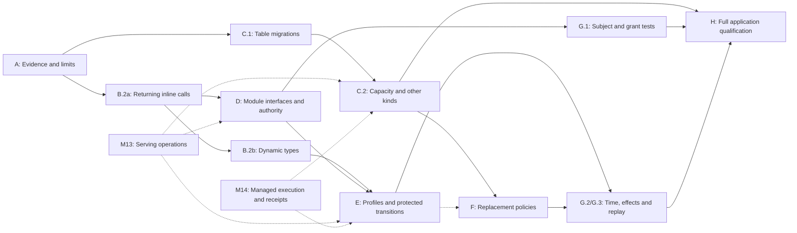

# Milestone 12 completion implementation plan

[Milestone 12](12-application-modules-compilation-and-testing.md) · **Status: In Progress** · Review draft updated 2026-11-15

Complete recursive `.transit` application authoring by letting an application
compose typed modules, review a deterministic SQL build or migration, execute it
through ordinary database owners, and test its behavior and recovery from the
same source graph. The first approved units deliver **explicit-basis Table
migration synthesis and value-returning inline calls**. The remaining sequence
adds dynamic typed composition, runtime module boundaries, protected workflows,
definition replacement and deterministic replay testing. Preserve the compiler,
helpers and isolated tests already delivered.

**Review basis:** `424cc32e8`, the local `main` revision used for this plan.
This revision includes streaming SQL framing, pure functions, ordered guards,
inline atomic procedures, local test-host recovery fixes and the new
[M13 serving milestone](13-declarative-serving-and-reactive-dataflows.md).
This update supersedes the execution sequence and estimates in the November 13
version of this supporting plan. It preserves M12's `D1`–`D6` decisions,
`P0`–`P6` acceptance criteria and the source-specific qualification records.
Milestone status remains In Progress. The user approved the three initial units
C.1a, C.1b and B.2a on this branch; the remaining slices retain their planning
status. The implementation adds offline Table migration targets and typed
value-returning inline calls. Its final qualification evidence is recorded
separately from the historical review basis below.

The review should settle five choices:

1. Start migration synthesis with explicit offline definitions, unchanged/new
   Tables and safe additive columns; add other kinds only with executable owners.
2. Separate value-returning procedure calls from runtime variant/cardinality and
   refinement work, with a reviewed SQL representation before dynamic lowering.
3. Keep inline procedures under caller authority. Runtime-private modules need a
   separately authorized public operation; compiler inlining cannot elevate rights.
4. Integrate publication and transport declarations with M13, managed execution
   with M14, and broader identity/disclosure with M29/M30 as each is qualified.
5. Preserve the current 1 MiB statement and 2 MiB migration-file bounds. The
   proposed 256-step migration limit is a separate measured current-v1 change,
   not a prerequisite for the first Table diff.

## Delivered basis and remaining work

The [source contract](../../contracts/APPLICATION_SOURCE_V1.md),
[compiler](../../packages/zig/transit-compiler/README.md),
[test runner](../../packages/zig/transit-test/README.md) and
[migration contract](../../contracts/MIGRATION_V1.md) define the current profiles.
The table distinguishes implementation at the review basis from evidence at an
earlier revision; neither parser support nor a merge establishes full qualification.

| Boundary | Implemented at the review basis | Remaining obligation |
| --- | --- | --- |
| Recursive composition and resolution | One source/build dialect; intra-package `./`/`../` workspace paths; `IMPORT [MODULE]`, `EXPORT MODULE`, `DECLARE FROM` fragments, `ROW(...)`/`SCHEMA_BINDING` metadata, named `=>` call arguments, first-class `LET ... = USE [MODULE]` / `MODULE OF` diamond module-instance DAGs (`module_instance_dag_sharing`), behavioral helper exports and delegated `EXPORT TARGET` / `EXPORT DEFAULT TARGET` builds and suites; exact Git revision/subdirectory dependencies; transitive locks, explicit fetch and local overrides; frozen ordinary builds | Multi-schema `CREATE SCHEMA` and `schema.object` catalog bindings, `CREATE VIEW`, `EXPORT REFERENCE TABLE`, runtime-private modules and remote/relocation qualification across multi-schema graphs |
| Syntax and emission | Independent ANTLR/Zig corpus, all-body template syntax checks, formatter round trips, bounded evaluation, canonical SQL and independent reparse/rebind | Extend all stages together for each admitted construct; preserve typed origins and deterministic budget refusal |
| Typed public data | Nominal BIGINT/TEXT/BOOLEAN domains; closed compile-time variants and exhaustive MATCH; exact public Table/Stream/Queue handles; nominal Queue-program annotations | Runtime variants, explicit query cardinality/refinements, symbolic program specialization and remaining admitted scalar/composite types |
| Behavioral helpers | Pure FUNCTION, ordered GUARD/CHECK GUARD and hygienic statement-form CALL to inline atomic PROCEDURE; ten scoped Lean laws | Value-returning CALL, richer callable interfaces and dynamic synthetic Case 1; no stored or privileged procedure implementation is implied |
| Runtime and test integration | Public-data Queue programs through ordinary owners; isolated Table/Queue tests; read-pin draining, publication wakeups and transaction-invalidation abort recovery | Subject/clock/effect controls, workflow replay and reconciliation of retained integration failures |
| Migration execution | Immutable SQL files, original step tokens/receipts, drift checks, ordinary statement dispatch and staged Table/finite Table-dataflow adapters | Explicit-basis CatalogDiff, Queue-program migration binding, broader staged dependencies and conditional replacement |
| Runtime encapsulation and protected workflows | Source visibility and public resource exports; native runtime capability restrictions | EXPORT REFERENCE, runtime-private module enforcement, profiles, protected command/effect lowering and transition checks |

The [November 15 evidence](../history/qualification/query.md#pure-functions-ordered-guards-and-inline-atomic-procedures--2026-11-15)
records clean core, storage/query and formal lanes at `8ee2ad304a57`, focused
build/test journeys, ten Lean laws and installed SQL type checks. It also retains
a local console-latency failure (`SqlOutcomeUnknown` on `document_delete`) and
requires isolated latency and full installation/UI qualification. The
[November 13 record](../history/qualification/query.md#actionable-source-diagnostics-and-nominal-queue-programs--2026-11-13)
retains Queue deadline/cleanup/lease failures and other runtime failures. The
subsequent fixes are implemented; this plan does not infer closure of every
retained failure or qualify the current HEAD from those earlier results.

### Bounds to preserve and measure

| Boundary | Current bound and source | Planning consequence |
| --- | --- | --- |
| Interactive editor draft | 4,096 bytes in [SqlInput](../../packages/zig/transit-fuze/src/SqlInput.zig) | This is an editor bound, not the executable statement limit |
| Executable SQL/program statement | 1 MiB in [Sql](../../packages/zig/transit-fuze/src/Sql.zig), shared by SqlInput and [ApplicationProgram](../../packages/zig/transit-fuze/src/ApplicationProgram.zig) | Test expanded helpers against this bound; do not plan another 4 KiB-to-64 KiB cutover |
| Migration source file | 2 MiB in [SqlScript](../../packages/zig/transit-fuze/src/SqlScript.zig), shared by [Migration](../../packages/zig/transit-sql-protocol/src/Migration.zig) and its client | Preserve original-byte checksums and incremental framing; do not reduce it to the former 1 MiB proposal |
| Migration steps | 64 per version in Migration and [DirectMigration](../../packages/zig/transit-catalog/src/DirectMigration.zig) | Measure and qualify the proposed 256-step extension separately |
| Compiler | 256 files, 16 MiB aggregate source, depth 64, 100,000 evaluation steps, 64 MiB allocation budget, 8 MiB SQL output | Whole-program state and output remain bounded separately from reusable statement scratch |
| Test runner | 128 cases, 1,024 actions/case, 30 seconds/case, 256 MiB host allocations and separately 256 MiB temporary storage | Preserve accounting and joined cleanup; these quotas are not total process RSS or benchmark targets |

## Required architecture and dependency boundaries

Compilation remains pure Zig and independent of Station. The compiler consumes
Fuze's typed SQL owners and neutral definition descriptors; it must not import a
live Catalog service, filesystem, network or secret resolver. The CLI resolves
files and dependencies and publishes artifacts. `transit-test` consumes the same
compiler product through ordinary SQL sessions and real local database owners.

| Owner | Planned work | Boundary to preserve |
| --- | --- | --- |
| [transit-compiler](../../packages/zig/transit-compiler/README.md) | Syntax, SourceTypes, ProgramAnnotations/ProgramLowering, WorkingCatalog, proposed CatalogDiff, source maps and diagnostics | Typed holes and hygienic lowering; no text substitution authority or runtime interpreter |
| [transit-fuze](../../packages/zig/transit-fuze/README.md) | Shared scalar, Table/log/program binding and incremental framing | Logical types, cell states, collations and physical codecs remain separate |
| [transit-catalog](../../packages/zig/transit-catalog/README.md) and SQL service | Definition dependencies, fingerprints, migration receipts, runtime permissions and conditional publication | Current rights, stable object identities and original accepted work remain authoritative |
| [transit-cli](../../apps/transit-cli/README.md) and transit-test | Confined source/basis loading, artifact writing, test controls and reports | Fetch, build, apply and activation stay separate; test controls cannot enter deployable SQL |
| Managed execution and serving owners | Program generations, protected effects, publication and transport lifecycles | M13/M14 supply executable operations; source provenance grants no permission |

Generated SQL must execute with source packages and sidecars absent. Sidecars may
record provenance, diagnostics and the explicit build basis, never required
runtime semantics. A build cannot discover a live migration basis implicitly,
apply grants, activate a computation or dispatch an effect.

Every extension updates syntax, stage checks, typed semantics, SQL emission,
independent rebinding, diagnostics, public documentation and its selected proofs
together. Missing runtime capabilities reject before a complete product is
published. Incompatible source/lock formats require their own explicit current-v1
cutover; incompatible wire, stored or framework semantics also replace the shared
contract definition and dependent fixtures. No fallback interpretation of accepted
work or automatic data reset is permitted.

### External milestone dependency gates

| Owner | Required handoff | Work that can proceed independently |
| --- | --- | --- |
| [M5](05-transactions-and-atomic-composition.md), [M6](06-streams-queues-and-durable-runtime.md) | Qualified transaction participants, original decision recovery and Queue settlement | Extend source helpers over currently admitted Table/Stream/Queue operations; KV source support needs an explicit source/binder slice despite runtime availability |
| [M7](07-document-storage-and-station-decoupling.md) | Executable Document lifecycle, fingerprints and mixed transaction support | Keep unsupported Document source/migration forms rejected |
| [M10](10-standards-and-catalogs.md), [M11](11-indexing-and-access-paths.md) | Definition comparison, safe additive projection, FK dependencies and qualified rewrite operations | Table creation and safe additive diffs; refuse ambiguous/destructive transforms |
| [M13](13-declarative-serving-and-reactive-dataflows.md) | Station-independent typed operations, publication/transport lifecycle, executable SQL and migration receipts | Agree source signatures/profiles now; enable each emitted declaration only after its ordinary owner is qualified |
| [M14](dataflow-sql-implementation.md) | Queue-program migration binding, managed execution, protected effects and continuation recovery | Public-data source composition and Table migrations; no general incremental-engine prerequisite for M13 finite serving |
| [M29](29-control-and-policy-plane.md), [M30](30-published-resources-and-investigations.md) | Broader identity, secret/policy and enriched disclosure semantics where required | Basic publication uses M13's current-authority contract; it must not wait for these whole milestones |
| [M17](17-data-centric-compilation-and-specialization.md), [M22](22-branches-merges-and-restore.md), [M31](31-reviewed-data-collaboration.md) | Later AOT outputs and branch/proposal consumers of common definition diffs | Canonical SQL and neutral diff descriptors; no separate build or migration authority |
| [M24](24-formal-semantics-and-correspondence.md), [M45](45-sql-grammar-and-dialect-ergonomics.md) | Shared proof/grammar infrastructure and later coverage | M12 delivers its own selected laws, finite models and implementation correspondence with each construct |

M13 also owns migration and retirement of the existing interface/UI compiler.
M12 adds no screen/theme language or `transit app` commands and does not retire
`transit-app` before that consumer cutover.

## Review units and effort estimate

Use the units below as review boundaries, splitting implementation when a contract
and its executable slice cannot be assessed together. Relative sizes include
negative controls, documentation and affected qualification; they are planning
judgments, not measured velocity. The earlier 19–31 engineer-week estimate mixed
already-delivered work with external runtime prerequisites and is not a remaining
schedule. Estimate calendar delivery after reviewing B's representation and D/E/F's
runtime contracts, with named staffing and external handoff dates.

| Unit | Remaining deliverable | Relative size | Entry gate |
| --- | --- | --- | --- |
| A | Reconcile qualification and freeze the support/bounds matrix | Small, unless a retained failure reproduces | Existing implementation |
| B.2a | Value-returning inline calls and behavioral signatures | Medium | A plus return/evaluation contract |
| B.2b | Runtime variants, cardinality, refinements and symbolic programs | Large | Reviewed SQL representation and B.2a interfaces |
| C.1 | Explicit-basis Table diff and migration build target | Large | A; existing Table/migration owners |
| C.2 | 256-step qualification and additional migration kinds | Large | Per-kind runtime and staged-plan receipts |
| D | Multi-schema/reference exports and runtime-private modules | Large | Catalog authorization design; public operation owner |
| E | Profiles, effect/ownership/secret checks and transitions | Large | B/D; M13/M14 and selected policy contracts |
| F | Conditional replacement and three generation policies | Large | C receipts and per-kind lifecycle contract |
| G | Subject, virtual-time, mock and replay controls | Large, delivered incrementally | Each corresponding real owner |
| H | Common-revision application and performance qualification | Medium | All required capabilities and evidence |

## A Reconcile retained failures and freeze compilation bounds

**Delivered:** Slice A's read-pin cleanup, publication wakeup and
transaction-invalidation recovery fixes accompany Slice B.1. Keep them and their
regression fixtures; do not restart their implementation from the old plan.

**Remaining:** reconcile the November 13/15 retained failures against exact source
and isolated results before claiming their closure. Run the affected public
Queue helper journeys and host fault controls at the implementation baseline.
Record whether a failure is reproduced, fixed with a regression, or still
unexplained; a later passing retry alone does not explain the original outcome.
Do not raise timeouts or weaken cleanup/lease guards to make the result pass.

Maintain a capability matrix mapping source syntax, ordinary SQL owner, native
execution, migration support and test/proof coverage. Include the bounds above,
unsupported symbolic/KV/Document/protected forms and current contract identities.
Grammar-only support must remain visibly distinct from emitted executable SQL.

**Exit:** the first implementation PR records its exact baseline and affected
results; required gates pass, retained failures have explicit dispositions, and
new lowering shares the existing statement/memory limits.

## B Deliver pure functions ordered guards inline procedures and runtime variants

**Delivered B.1:** pure FUNCTION, lexical GUARD/CHECK GUARD and statement-form
CALL with hygienic inline atomic PROCEDURE are implemented. Preserve single
argument evaluation, refusal order, definition/call spans, dependency tracking,
non-recursive helper call graphs and the ten scoped Lean laws.

**B.2a — value-returning composition.** Define typed procedure outputs and
`LET result = CALL` before admitting syntax. Specify return coverage on every
reachable successful path, refusal behavior, lexical scope and the result's
lifetime within the caller's atomic block. Lower returned expressions and local
bindings once, hygienically, through the existing binder; no hidden commit or
second evaluator. Imported callable signatures must preserve nominal types,
resource kinds, read/write effects and atomic requirements. Retain rejection of
external effects, nested explicit transactions and recursive helper calls.

**B.2b — dynamic typed values.** Review one canonical SQL representation for
runtime variants: explicit discriminants and payload constraints are a candidate,
not an already settled encoding. Specify valid tags, inactive payloads, NULL and
other cell states, encoding evolution and checks for raw SQL/external input.
Reject unsupported encodings instead of carrying executable meaning in a sidecar.
Distinguish absent records, nullable fields, exactly-one and finite-many results;
a guard must establish the refinement used by later code, and suspension or a
new state observation cannot preserve stale evidence implicitly. Admit bounded
refinement predicates with explicit dynamic boundary validation. Extend symbolic
program/module checking without allowing symbolic branches to invent schema
bindings or escape work/output budgets. Inventory remaining scalar/composite
forms and admit each through its shared SQL type owner.

**Owners:** `Syntax`, `SourceTypes`, `ProgramAnnotations`, `ProgramLowering`,
`WorkingCatalog`, Fuze scalar/program binders and
[TypedTarget.lean](../../contracts/application-source/TypedTarget.lean).

**Exit:** synthetic Case 1 runs over actual Queue/Table/Stream values; wrong
nominal IDs, malformed tags, missing arms, absent/multiple lookup rows, unsafe
refinements and invalid return paths reject at their proper stages. Compare
hand-expanded SQL with compiled output for five-state results, argument
multiplicity, guard order and whole-block rollback. Extend grammar/formatter,
Lean laws and independent finite comparisons with explicit premises. Runtime
constraint/authority checks remain necessary after source typechecking.

## C Synthesize explicit-basis migrations and raise script bounds

**C.1 — Table migration targets.** Introduce the basis and output contract in
APPLICATION_SOURCE_V1 and MIGRATION_V1 before the CLI adapter. Keep the existing
migration ledger as the only apply/resume authority.

1. A migration target explicitly names its desired composition, prior definition
   basis, instance/namespace bindings, existing migration digests, proposed new
   version/name and any declared transforms. Define a versioned offline basis
   containing canonical descriptors and compiler/contract identities. Loading
   belongs in the CLI; comparison belongs in a pure compiler component. Export
   from a live catalog, if later provided, is a separate explicit operation.
2. Validate missing/foreign definitions, duplicate bindings, unresolved
   dependencies and modified historical SQL before producing output. Include
   all basis/transform/lock inputs in provenance and cache invalidation. A basis
   describes the intended comparison; it does not reserve or authenticate the
   live destination. `transit migrate` still verifies its target and live drift.
3. Share neutral fingerprint/descriptor logic with DirectMigration through a
   proper package interface. Do not import storage into the compiler or copy
   fingerprint algorithms. Start with unchanged Tables (zero steps), new Tables
   and compatible additive columns using the existing projection contract.
   Compare logical types, constraints, defaults, codecs and semantic descriptors.
   Never infer a rename from similar names or source movement.
4. Fail with an actionable exact-object diagnostic for drops, ambiguous
   identity changes, type/collation rewrites, constraint tightening or required
   data transforms. An explicit transform is immutable SQL with reviewed
   pre/postconditions, not permission to silently choose destructive steps.
   Foreign-key ordering joins D's supported references; reject it until both
   source binding and staged migration planning can preserve exact dependencies.
5. Publish only a complete validated artifact set and never overwrite an
   existing migration version. Preserve original SQL bytes for apply/resume.
   Replaying an arbitrary existing migration may require data or unsupported
   owners; reject unsupported basis reconstruction rather than inventing rows.

**C.2 — extend kinds and step capacity.** Keep 2 MiB migration files and 1 MiB
statements. Qualify 256 steps as a separate change across wire validation,
DirectMigration storage, plan/result messages, client readers, schemas and
fixtures. Measure receipt size, bounded resident work and recovery before raising
the limit; 256 steps fitting the file does not prove that a receipt fits its
storage boundary. Apply the current-v1 definition cutover where required.

Add Stream/Queue, KV, views, programs and other definitions one kind at a time.
Require ordinary execution, same-file proposed dependency resolution, frozen
native bindings, receipts and original-operation recovery for each. Queue
programs specifically depend on M14's migration adapter; generic ordinary
statement dispatch does not supply that missing support. Documents depend on
M7; publication/transport declarations depend on M13. Activation and grants appear
only when explicitly requested and authorized by their ordinary owners.

**Owners:** proposed `transit-compiler/CatalogDiff`, WorkingCatalog,
[BuildSources](../../apps/transit-cli/BuildSources.zig),
[MigrationClient](../../packages/zig/transit-sql-client/src/MigrationClient.zig),
[MigrationRunner](../../packages/zig/transit-sql-service/src/MigrationRunner.zig)
and DirectMigration.

**Exit:** repeated frozen synthesis is byte-identical; unchanged desired state
emits no migration; relocated sources preserve explicit durable bindings. Fresh
creation and replay from the declared prior basis produce equal final logical
fingerprints/definition digests under the same bindings. Historical revisions
need not be identical. Prove drift refusal, changed historical-file refusal,
explicit transforms, bounded 64/256-step behavior at the relevant slice, and
lost-reply/restart recovery after source and dependency files change. Builds
never apply their output.

## D Enforce reference-only exports schemas and runtime module boundaries

**D.1 — source and catalog references.** Add explicit schema/instance bindings,
exact typed view/query/procedure interfaces and `EXPORT REFERENCE` handles.
Reference-only handles may bind native FK dependencies; they cannot authorize
row reads or mutation. Preserve stable identities across source relocation,
forwarded exports and explicit repeated instances. Imports cannot grant rights.

**D.2 — runtime enforcement.** Settle the authorization contract with the catalog
and public-operation owners before offering private modules. Inline procedures
execute under the caller's existing rights; hiding a Table name in source does
not protect it from raw SQL. To expose a privileged operation over private state,
use an explicitly published, revision-bound operation with narrowly granted
execution and runtime-checked dependency access. Review invoker versus definer
semantics, caller propagation, revocation, delegation limits and inspection in
that owner. Do not label an erased inline helper a definer-rights procedure.

M13 owns serving bindings for such operations; the database contract must also
work for native/local callers. Implement public query/view surfaces only where
the ordinary SQL owner can enforce the same rules. Keep unsupported private
forms rejected until the complete boundary exists.

**Owners:** SourceTypes/WorkingCatalog, DirectNamespace, DirectDefinition,
[declarative catalog](../../contracts/DECLARATIVE_CATALOG_V1.md),
[catalog definitions](../../contracts/CATALOG_DEFINITIONS_V1.md) and the selected
public-operation contract.

**Exit:** authorized callers can use the public operation/reference; direct SQL
SELECT/DML and forged invocation context cannot bypass private storage. Test
cross-schema FK binding and DROP protection, revoked execution/dependency access,
source relocation and lost operation replies through ordinary clients.

## E Check profiles linear capabilities secrets and state transitions

1. Add typed compile-time PROFILE/USING PROFILE composition with deterministic
   option resolution and conflict diagnostics. Keep settings and secrets as
   symbolic runtime references. First freeze each target declaration's option
   schema with M13/M14 and its current owner; profiles cannot enable absent SQL.
2. Track reads, writes, time/random inputs, external effects, protected disclosure
   and capability transfer through calls, higher-order parameters and every CFG
   branch, including refusal and ON FAILURE paths. Check single consumption or
   explicit preservation/handoff according to the owning lifecycle. Unknown
   external outcomes are not successful settlement or permission to retry.
3. Track Secret values and protected encodings through all expressions. Permit
   only owner-defined protected sinks and explicit reviewed disclosure transforms;
   hashing or wrapping a value is not general declassification. Prevent leaks
   into rows, logs, output SQL, diagnostics and ordinary responses.
4. Lower admitted state transitions and invariants into authoritative guarded
   transactions with exact evidence/operation/definition bindings. Distinguish
   syntactic dependency/control ordering from current authorization, which is
   rechecked at execution. Source proof cannot retain permission across a yield.

**Owners:** compiler type/effect checker, Fuze ApplicationProgram and capability
contracts, M13 operation/publication boundaries and M14 protected execution.
Broader M29/M30 policies are dependencies only for the features using them.

**Exit:** synthetic Case 2 proves one-use admission and continuation handling on
selected crash/unknown schedules; Case 3 checks finite-capacity reservations
under contention, refusal and rollback. Run finite TLA+ exploration with intended
negative invariant failures, selected Lean transition/lowering obligations and
native trace replay. Keep model assumptions, dynamic validation and provider
qualification distinct. Enable emitted SQL per qualified capability.

## F Replace definitions safely and drain active generations

Define conditional replacement in the existing Catalog and migration contracts,
then integrate each managed/serving definition kind. The receipt binds the exact
expected old definition, proposed successor, policy and original operation.
Stale revision checks must race atomically with admission/publication; a separate
inspection followed by replacement is insufficient.

Deliver the policies in this order:

1. **require_idle:** fence new admissions and reject if active work or unsettled
   continuations prevent safe replacement, with a defined fence-release outcome.
2. **pin_generation:** new admissions bind the successor while accepted work
   retains its immutable old plan, dependencies, capabilities and interpretation.
3. **drain_active:** durably fence old admissions, observe bounded drain progress
   and activate the successor according to the recorded decision. Specify timeout,
   cancellation, restart and explicit resume; timeout cannot imply rollback.

Retirement of an active generation, retention of recovery evidence and physical
collection are separate. An active-count value of zero alone is not permission
to discard records still needed by original-operation recovery or retained reads.
Source type/effect changes participate in dependency/diff analysis; never
recompile accepted continuations from new source.

**Owners:** DirectDefinition/DirectMigration, MigrationRunner, managed execution
and M13 publication/source lifecycles. Begin with a qualified public-data kind;
protected-effect generation cases join E when that runtime exists.

**Exit:** all three policies preserve original work under admit/replace/revoke/
yield/crash races, with exact saved-request retry, stale-definition refusal and
bounded generation cleanup. Execute finite race models, broken fencing/pinning
controls and matching native recovery schedules for every admitted definition kind.

## G Complete deterministic workflow testing and replay fault sweeps

Deliver test controls with their production capabilities, using the existing
compiler and SQL session runner rather than a second language interpreter.

- **G.1, with B/D:** subject and grant controls provision real isolated policy
  owners and test current denial, refusal and complete result assertions. Separate
  bootstrap authority from the application caller; cleanup must not need renewed
  data access. A transport error or missing terminal cannot satisfy a refusal.
- **G.2, with E:** inject virtual time into all participating lease, retry, expiry
  and deadline owners; retain a separate real watchdog for hung tests. Script sink
  and observation outcomes, including timeout/unknown, through the same recorded
  intent/outcome boundary. Record deterministic seeds and schedules. Test fixtures
  cannot select live credentials or a remote fallback.
- **G.3, with E/F:** add proposed `--verify-replay` controls at atomic decisions,
  effect intent/outcome, observation and response/handoff boundaries. Enumerate
  the covered yield points and schedules, reopen original state, and compare
  independent logical state/effect projections. Preserve original identities
  within recovery; fresh isolated executions need not have byte-identical WALs.
  Unknown outcomes remain unresolved where evidence cannot settle them; replay
  cannot redispatch to manufacture a terminal result.

All cases compile before runtime starts. Test-only controls reject in production
builds, including imported or unselected invalid bodies under the defined stage
rules. Budget cases, schedules, observations and reports explicitly; exhaustion
reports incomplete coverage and fails. Retain the existing allocation/storage
limits and joined cleanup unless a separately reviewed measurement justifies a
contract change.

**Exit:** deterministic schedules catch deliberate duplicate dispatch, skipped
settlement, leaked reads and stale-policy disclosure. Actual disk-backed
restart/lost-reply tests complement simulation; mocks prove neither provider
idempotency nor physical power-loss durability.

## H Qualify the multi-module application baseline and close Milestone 12

Use a safe representative version of the six-domain workload in the
[downstream application plan](downstream-application-language.md): `auth`,
`catalog`, `tenancy`, `networking`, `deployments`, `publication`. Freeze its
inventory and hand-expanded oracle before refactoring. The historical target is
26 commands, 14 workflows, 16 publications, 26 HTTP sources and 15 sinks; reconcile
any changed inventory explicitly instead of silently reducing coverage.

Qualify parent and independently buildable child modules, pinned external
repository/subdirectory packages and explicit overrides. With dependencies
already fetched, disable networking and use ordinary frozen build/test commands;
there is no implemented `--offline` flag to assume. Compare ordered SQL and logical
bindings across relocation. Compare provenance according to its inputs: changing
paths or override identity can legitimately change a source/build digest.

Run emitted SQL with sources absent through ordinary clients, including denied
access, revocation, migration drift, lost responses, restart and replacement with
work in flight. Compare independent rows, counts, definitions and effect
projections. Preserve the same emitter, accepted identities and terminal coverage
for build, test and migration paths.

Measure M12's existing evaluation targets: more than 35% less repeated
boilerplate, warm check-only compilation below 500 ms, and the complete offline
26-command/14-workflow test/replay suite below two seconds. Pin hardware, compiler,
source/SQL inventory, cache state, memory accounting, schedule count and repetition
method. Define the duplication metric before refactoring. These are unmeasured
targets; a budget miss requires explicit review, not fewer cases or hidden setup.

**Exit:** every completion journey in M12 has attributable evidence at one
committed revision, with exact capability/profile limits. Promote implemented
behavior to the public applications, SQL, compiler, test and contract owners;
record proofs and raw results in qualification history. Only then update M12 and
the roadmap index to Completed together. M13 serving qualification remains its
own milestone even when a shared application exercises both.

## Immediate next implementation slices

The three approved initial review units are implemented. Their
[qualification record](../history/qualification/query.md#explicit-basis-table-migrations-and-returning-inline-calls--2026-11-16)
records the executed checks, retained failures and profile limits:

1. **C.1a — basis and Table diff contract/core.** Migration-target inputs,
   neutral descriptors, unchanged/new/additive behavior, refusal diagnostics and
   independent equivalence fixtures are implemented within the current file and
   64-step limits.
2. **C.1b — CLI artifacts and real migration journey.** Confined basis loading,
   immutable output, native plan/apply/resume and fresh-vs-replay comparisons
   exercise modified history, live drift, source-absent execution and lost replies.
3. **B.2a — value-returning inline composition.** Imported return signatures,
   hygienic single evaluation, nominal typing, rollback and the scoped typed
   return-substitution law are implemented.

Next review B.2b's runtime representation and D's privilege boundary before
implementing those surfaces. Start G.1 with D and the C.2 step-capacity audit with
C.1's measurements. Record concrete M13/M14 handoff artifacts for E/F; do not
wait on a whole adjacent milestone when its required operation is qualified.

## Dependencies and implementation order



Dashed edges are per-capability handoffs. Public-data replacement can start before
protected effects; its protected-generation acceptance joins E later. C.1 and B
can proceed independently after A. H requires the full M12 completion matrix,
including recursive-package coverage, all three replacement policies and the
selected formal/native evidence.

### Key decisions for review

| Decision | Recommendation | Consequence or unresolved contract |
| --- | --- | --- |
| First deliverable | Table CatalogDiff plus real migration execution | Useful offline evolution without waiting for protected serving; no automatic destructive inference |
| Runtime variants | Review explicit SQL tags/payload constraints before coding | Must validate raw inputs, preserve cell states and support explicit representation migrations |
| Module privacy | Caller-scoped inline helpers; explicit authorized runtime operations for private state | D needs an execution-rights contract and direct-SQL denial proofs, not just new export syntax |
| Migration capacity | Preserve 2 MiB files; qualify 256 steps separately | Avoid shrinking a delivered bound; receipt/message/resident limits determine feasibility |
| Replacement | require_idle, then pin_generation, then drain_active | All three remain required; draining timeout and recovery retention need explicit semantics |
| Performance | Retain targets and pin a complete workload before measurement | No delivery date or performance guarantee follows from this plan |

## Validation required for review and implementation

Before opening or updating any PR, pass all baseline gates from the repository
root:

```sh
nix develop --command just check fast
nix develop .#docs --command just transit-docs::install
nix develop .#docs --command just transit-docs::check
```

Implementation PRs add the affected checks below. Run commands in the pinned Nix
shell, using `ci-experience` for experience gates. These are validation
requirements, not results established by listing them in this plan.

| Changed boundary | Required checks and evidence |
| --- | --- |
| Source/compiler/test product | `just test application-compiler`, `application-source-grammar`, `application-source-types`, `application-runner`; allocation failure/budget controls and independent SQL comparisons |
| CLI/build/test integration | `just test application-build`, `application-test`, `application-test-host`; source-absent installed execution and complete cleanup |
| Migration/contract change | `just check contracts`, affected migration and caller tests, foreign-definition and changed-history rejection, original-operation recovery |
| SQL, server, program execution or startup | `nix develop .#ci-experience --command just test console-latency-gate` and `nix develop --command just test server-sql-types`, plus affected catalog/managed execution suites |
| Scalar types or wire adapters | The [SQL interface validation loop](../../tasks/README.md#sql-interface-validation), including `just test sql-wire-contracts` and `just test sql-wire-types` |
| Temporal or lowering claims | Pinned Lean laws with audited axioms, finite TLA+ exploration, intended negative controls and native trace correspondence; report premises and bounds |
| Implementation pre-push | Affected `just ci clean --lane NAME` checks against committed HEAD; final M12 closure includes core, storage-query, formal and installation-ui plus experience gates |

Use final contents as the validation basis and rerun affected gates after edits.
Do not open/update a PR with an incomplete required gate. Record commands,
revision, inventory, artifacts and retained failures in each implementation PR
and the owning qualification record. Documentation checks, dependency installation,
parser acceptance and skipped suites never substitute for executable evidence.
