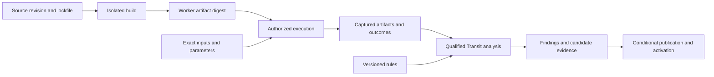

# On-demand specialization and optimization research workflow

[Roadmap](README.md) · **Status:** Planned · Research proposal, 2026-11-01

Investigate whether applications can declare a computation and its constraints,
then obtain specialized implementations with inspectable correctness, cost and
activation evidence. The research question is: **when does generating and
selecting an implementation improve the complete application outcome, after
paying for search, verification, compilation, transfer and activation?**

An example declaration in prose is: “Maintain this derived dataset with these
result semantics, freshness and memory limits; evaluate ways to reduce its
execution cost.” This is a proposed experience, not executable syntax or an
existing automatic optimizer service.

The workflow is **declare → derive candidates → verify → measure → publish →
activate → observe → revise**. Optimization is itself an attributable computation:
it has a definition, source basis, budget, candidates and an outcome. “On-demand
hardware” is an optional target requiring a qualified device execution profile.

This supporting research plan does not add a numbered milestone, change existing
statuses or add a 1.0 release gate. It connects the existing owners below. No
experiment, speedup, native Datalog service, hosted EDA service or FPGA deployment
is established by this document.

## Source basis and responsibilities

The starting repository review is Transit `5cdb41ff518308f3d2bf6685ee722257478417fb`,
including the merged Datalog and hardware milestones. Follow the current
[data model](../handbook/reference/data-model.md),
[query lifetimes and limits](../handbook/reference/queries.md),
[application installation](../handbook/reference/applications.md),
[Nix packaging](../../nix/README.md) and
[verification limits](../handbook/reference/verification.md). Their executable
profiles take precedence over proposed interfaces in this plan.

| Concern | Owner and boundary |
| --- | --- |
| Computation identity, inputs, progress and result publication | [M12](12-sql-and-dataflows.md), [data lifecycle](../../contracts/DATA_LIFECYCLE_V1.md) and [SQL results](../../contracts/SQL_RESULTS_V1.md). A captured source vector is atomic only when its owning contract establishes a common cut. |
| Native execution and specialization | [M13](13-data-structures-and-performance.md) and [M15](15-data-centric-compilation-and-specialization.md) own resource metering, planning and compiled Zig execution. |
| Deductive rules and equivalent expressions | [M41](41-deductive-rules-datalog-and-equivalence-graphs.md) owns native Datalog, admitted lattice/equivalence operators and witnesses; [M22](22-formal-semantics-and-correspondence.md) owns selected formal correspondence. |
| Hardware inputs and evidence | [M42](42-hardware-design-rtl-and-eda-verification.md), [M18](18-multi-model-and-foreign-relations.md) and [M17](17-geospatial-and-spatio-temporal-computing.md) own RTL/netlist projections and qualified graph/spatial checks. Applications select EDA tools and domain rules. |
| Candidate and experiment attribution | [M37](37-ml-ai-and-experiment-provenance.md), [M39](39-software-build-and-deployment-evidence.md) and [M40](40-constrained-planning-and-optimization.md) supply exact experiment/build/problem identities and scoped outcome evidence. |
| Proposed changes and activation | [M20](20-branches-merges-and-restore.md), [M27](27-control-and-policy-plane.md) and [M29](29-reviewed-data-collaboration.md) own branches, policy and reviewed publication. [M46](46-declarative-language-context-and-synthesis.md) may consume the workflow for speculative synthesis. |

Datalog is a proposed native computation surface over versioned relations.
Verilog is hardware-design source consumed by an elaborator, simulator,
synthesizer or formal toolchain. One application can use both: elaborate RTL,
capture netlist facts, derive findings, then request a stronger property check.
An external Soufflé run is a separately selected workload with a pinned dialect;
it is not an implicit implementation or fallback for Fuze Datalog.

Relational operators and recursive delta evaluation provide useful foundations,
but do not establish M41's full semantics. A DBSP circuit is a computation graph,
not a synthesized electronic circuit. AOT Zig compilation produces software;
generating Verilog from an admitted computation would require its own lowering,
semantic correspondence and target qualification. Hardware analysis can begin
with user-authored RTL independently of that compiler research.

## Freeze each experiment before searching

Use existing definition, snapshot, operation, artifact and publication identities;
settle any missing shared contract before adding an adapter or public syntax.
The following is an evidence checklist, not a new wire schema:

- **Meaning:** exact query/rules/source revision, bound definitions, input
  snapshots or explicitly non-atomic source vector, dependencies and retention
  references needed to reproduce the run.
- **Semantics:** types, collations, five-state behavior, multiplicity, ordering,
  overflow and failure behavior; numerical tolerance only where explicitly
  declared. For RTL, bind top module, parameters, defines, libraries, clocks,
  reset, timing and `0`/`1`/`X`/`Z` interpretation separately from SQL cell state.
- **Objective:** baseline, permitted changes, cost units, freshness/latency/memory
  constraints and decision threshold. Select these before observing winners;
  “fastest” without a workload and target is not an objective.
- **Execution:** source and `flake.lock` digests, selected output, build and host
  systems, executable/image digest, engine/dialect, parameters, seed and
  hardware/OS profile. A hardware synthesis target is separate from its build host.
- **Limits and authority:** search/build/verification/run budgets, bounded result
  and witness sizes, current grants, destination expectations and permitted
  effects. Record problem, candidate, run and attempt identities separately.
- **Evidence method:** independent oracle or property checker, premises and
  coverage, tuning versus held-out workloads, repetitions and raw measurement
  locations. Availability of a Nix package is not a successful build or run.

Start with synthetic public fixtures and finite computations. Branch isolation
protects proposed data changes; it does not sandbox executable code. Keep the
application's candidate generator and selection policy above the Transit kernel.

## Research execution loop

1. **Declare and admit.** Validate the requested profile and freeze its original
   identity and source basis. Record unsupported semantics or unavailable inputs
   explicitly; source changes create a successor experiment.
2. **Derive bounded candidates.** Enumerate a small set of plans, compiled CPU
   implementations or admitted rewrites before exploring larger searches.
   Datalog can derive dependencies and applicable conditions; equivalence graphs
   can retain alternatives under qualified rewrite rules. Neither supplies a
   universal optimizer or a correct arbitrary hardware compiler.
3. **Verify meaning.** Compare candidates with an independent finite oracle;
   use formal checks for the properties and domains they actually cover. Record
   disagreement, counterexamples, unsupported cases and unknown outcomes.
   A derivation witness proves a rule consequence under its inputs, not faithful
   extraction or complete hardware behavior. Structural taint/CDC findings are
   not automatically executable counterexample traces or silicon sign-off.
4. **Measure qualified candidates.** Run matched workloads and constraints on the
   recorded target. Separate search, verification, cold/warm build, startup,
   input/output transfer, steady-state execution and result-publication costs.
   Preserve failed runs and variation, and evaluate held-out distributions.
5. **Publish a candidate.** Retain the exact artifact, inputs, evidence and
   termination reason. “Best observed within this budget” is distinct from
   proven optimal. A build success, process exit or incomplete fixed point cannot
   establish a complete result, absence of a violation or an optimal implementation.
6. **Activate through the owning policy.** Artifact promotion, reviewed data
   publication and execution authorization are separate operations. Recheck the
   exact candidate and destination expectations. Replacing a maintained executor
   requires qualified checkpoint compatibility or an explicit fenced handoff and
   recomputation; never reinterpret old progress or reset accepted data.
7. **Observe and revise.** Attribute actual outcomes to the selected artifact and
   workload. Drift or a changed definition can motivate a new experiment, without
   rewriting old evidence or automatically granting a new deployment. Retiring
   an implementation preserves accepted data and independently retained results.

At every step distinguish pending, completed, failed, cancelled and unresolved
operations according to the owning contract. A worker restart does not make an
uncertain write or external action safe to repeat. Keep the last complete result
visible with its original basis while a successor is incomplete. Recheck current
authorization for results and supporting facts, including buffered witnesses.

## Nix packaging and Platform integration

Investigate three optional flake outputs: a development shell, an executable
worker closure and a deployable image. Illustrative names are
`devShells.<system>.eda`, `packages.<system>.transit-eda-worker` and
`packages.<system>.transit-eda-worker-image`; these outputs do not exist merely
because they are listed here. Native Fuze rules remain versioned computation
definitions and need not become an external worker package.

Pin the toolchain and runtime dependencies. A fixed design can build into a CPU
simulation executable; a fixed external Datalog program can build into a
specialized analyzer. Bind runtime stimulus and database inputs separately so
changing data does not necessarily rebuild the toolchain. Build a Transit adapter
in Zig against public package/client interfaces; keep upstream EDA tools in their
upstream languages and outside the kernel's dependency graph.

Nix supplies dependency selection and artifact construction. Record derivation
identity and actual output digests, and measure reproducibility with independent
builds. Build caches and runtime result caches have different keys and authority:
reusing an executable never authorizes reuse of results from another data basis.
Private RTL and artifacts require tenant-scoped storage/cache access; credentials
and live dataset access belong to authorized execution, not shared build outputs.

Spoke Platform at reviewed revision
`2eb7735039ea5fc239a7d6f3ec1a8aad9cef480b` assigns
[registries and isolated Nix builds](https://github.com/spoke-sh/platform/blob/2eb7735039ea5fc239a7d6f3ec1a8aad9cef480b/docs/roadmap/10-artifact-registries-and-isolated-builds.md),
[isolated execution and bindings](https://github.com/spoke-sh/platform/blob/2eb7735039ea5fc239a7d6f3ec1a8aad9cef480b/docs/roadmap/11-workload-isolation-bindings-and-endpoints.md)
and [attributable computation publication](https://github.com/spoke-sh/platform/blob/2eb7735039ea5fc239a7d6f3ec1a8aad9cef480b/docs/roadmap/12-dataset-access-and-published-computation.md)
to separate planned owners. This research does not change that roadmap or claim
hosted readiness. A qualified imported image can precede hosted Nix builds;
a finite execution does not supply a general customer job/schedule service.

Define a neutral handoff before integration: artifact identity, original platform
operation/execution identity, input bindings, resource profile, grants, output
manifest, observation basis and outcome. Platform retains builder/runtime
isolation, promotion, placement and product policy; Transit retains its data,
computation and publication authority. Use public interfaces, with no dependency
on Platform source. Nix sandboxing alone does not establish tenant isolation.

The diagram is the proposed handoff, not a deployed service. External solver or
device calls use recorded effect boundaries. Declare each executable's actual
recovery profile: restartable pure computation, supported checkpoint resume or
unresolved external outcome. Hosting does not manufacture checkpoint support.

## Experiments and decision gates

Run the smallest independent experiment whose prerequisites are executable.
Numbering below is research sequencing, not new roadmap milestones. An external
EDA capture experiment need not wait for native Datalog or a hosted build service.

| Experiment | Method and prerequisite | Evidence required to proceed |
| --- | --- | --- |
| R0 — Finite baseline and attribution | Select one supported finite computation, small enumerable fixtures and an independent oracle. Record the experiment fields above and actual reproduction commands before running. | Complete attributed results; malformed inputs, cancellation, budget exhaustion and interrupted publication remain explicit. No new language support is inferred. |
| R1 — CPU specialization | Compare the baseline with a bounded set of specialized implementations over the identical admitted semantics. Use M15 where executable, or label a separately compiled research worker as external. | Agreement on values, multiplicity, ordering and failure behavior; cold/warm and held-out measurements establish whether compilation and activation amortize over expected use. A faster inner loop alone fails the gate. |
| R2 — Hardware artifacts as data | Pin an elaborator and CPU simulator for a small RTL design and testbench. Capture netlist, source mappings, waveforms and tool outcomes; optionally run an explicit external Datalog profile over extracted facts. | Reproduce a known defect and corrected revision. Preserve black boxes, unsupported constructs, X/Z behavior and truncated traces. Scope structural findings separately from simulation and formal claims. |
| R3 — Maintained deductive analysis | Once the selected M41 profile is executable, compare native finite and incremental analysis after insertions, removals and rule changes. An external engine is an oracle only for the qualified shared subset. | Full recomputation agrees at each committed basis, including multiple derivations, recursive cycles and equivalence splits. Complete coverage, bounded witnesses, restart and revocation hold; unsupported updates refuse or use an explicitly admitted rebuild. |
| R4 — Hosted publication and replacement | Consume qualified Platform artifact/execution/data interfaces. Run the same identified worker locally and hosted, recording environment differences. | Installed cross-repository evidence covers exact input/artifact attribution, lost replies, worker replacement, stale review, denied access and retained results after retirement. A local container test does not qualify hosting. |
| R5 — Optional FPGA specialization | First select a device, toolchain/license profile and supported computation subset. Separately qualify any software-to-RTL lowering, bitstream production and physical device provider. | Correctness under declared arithmetic/clock/I/O assumptions, real device measurements including transfers and programming, isolation and fenced recovery. Simulation or synthesis reports alone do not establish deployed hardware performance. |

R1 should start with an exact integer/Boolean workload whose overflow and error
semantics can be checked. Extend to floating-point or approximate algorithms only
with explicit equivalence/tolerance rules. R2 should start with synthetic RTL and
a public toolchain; proprietary PDK access and commercial sign-off are separate
profiles. Neither a Datalog rule language nor unrestricted Verilog guarantees
finite, synthesizable or affordable execution.

For each measurement publish workload sizes, target, resource limits, repetitions,
raw samples and failures. Report time to first verified candidate, complete-result
latency/throughput, peak resident memory, scratch/storage usage, search/build cost
and recovery cost. Include energy or monetary cost only with an explicit metering
basis. For a stable repeated workload, estimate break-even only when per-run savings
are positive: additional setup cost divided by measured per-run savings, using
consistent units and uncertainty. Re-evaluate under workload drift and mixed load.

## Research record and promotion

Each experiment should retain a compact record with links to immutable artifacts:

1. Question, hypothesis, baseline, admitted semantics and predeclared decision gate.
2. Source/definition/input/artifact identities, target, grants and resource budgets.
3. Exact commands, lockfile, fixtures/seeds, environment and independent oracle.
4. Candidate generation and verification outcomes, counterexamples and coverage.
5. Raw repeated measurements, variation, incomplete runs and held-out outcomes.
6. Recovery/disclosure evidence and unresolved assumptions or unsupported cases.
7. Decision: reject, continue research or propose a scoped capability to its owner.

No experiment has been executed for this workflow yet. Put executed checks and
raw evidence under the existing [qualification ownership](../history/qualification/README.md)
when they exist; do not turn this plan into a passing proof ledger. Keep active
investigations in issues/PRs and consolidate newly established mechanisms with
their public owners following the [scientific standard](../handbook/internals/standard.md).

Prefer the existing engine when specialization does not amortize, bounded
recomputation when incremental state costs more, and ordinary CPU execution when
hardware setup/transfer dominates. Keep negative results. Promote an experiment
only after it shows a useful advantage at matched semantics and budgets, actual
caller/recovery/disclosure evidence and a maintainable contract owned by the
affected milestone. An application may select a different cost/freshness tradeoff;
there is no universal winning implementation or implicit autonomous deployment.

## Primary research references

- [DBSP](https://www.vldb.org/pvldb/vol16/p1601-budiu.pdf) supplies a theory of
  incremental computation, not an automatic hardware-synthesis backend.
- [Soufflé execution](https://souffle-lang.org/running) describes interpreted
  and compiled external Datalog workloads.
- [Verilator overview](https://verilator.org/guide/latest/overview.html) describes
  compiling RTL into a CPU simulation model; this differs from FPGA execution.
- [SymbiYosys](https://yosyshq.readthedocs.io/projects/sby/en/latest/) describes
  hardware formal-verification flows whose assumptions and outcomes must be captured.
- [Nix sandbox semantics](https://nix.dev/manual/nix/2.34/command-ref/conf-file.html#conf-sandbox)
  inform build execution; Platform's tenant and promotion boundaries remain
  independent qualification obligations.
