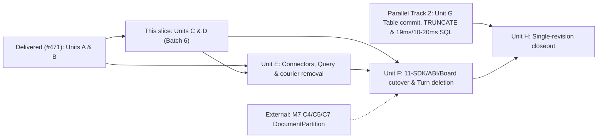

# Milestone 6 transactional calls, timers, names and supervision implementation plan

[Milestone 6](06-streams-queues-and-durable-runtime.md) · [Completion plan](streams-queues-runtime-completion.md) · **Status: Proposed** · 2026-11-19

Implement **Batch 6 (`Units C` and `D` in the [completion plan](streams-queues-runtime-completion.md)):
authenticated durable calls, replies, timers, `Registry` names and `Supervisor`
lifecycle over declared data and server-embedded Station services**. Callers and
callees exchange request-reply calls, cancellations and observer-verified
timeouts through `QUEUE`, `KV`, `TABLE` and `STREAM` transactions without
legacy `STATE_V1` mailbox turns or full-KV timer scans. `Registry` and
`Supervisor` run over declared data while preserving native PID ownership,
permanent retirement, Substrate stop-before-retry reconciliation and M3
control-plane isolation.

**Source basis:** `origin/main` at `f31673bbd` (`2026-11-19`), shared definition
[`f311e893f8d2f4c21f426790172fadfebe7eb2364615eb1566c09f11d39bb0bb`](../../packages/zig/transit-protocol/src/Growth.zig)
(`transit.v1.multi-schema-application-bindings.2026-11-18`). Since the
[completion plan](streams-queues-runtime-completion.md) was drafted at
`c1f2680d9`, `main` has merged:

- [PR #471](https://github.com/spoke-sh/transit/pull/471) (`70dc36d57`):
  Milestone 6 **Units A and B**—shared 1–16 statement transaction batching
  (`stage_batch`/`batch` and `Transaction.write_batch`), recoverable claim
  payload-read closure (`QueueRead.Release` and `Runner.releaseClaimRead`),
  direct `KV.singlePutRevision`, workspace `TableReader` reuse across read-only
  turns, 12-profile [`log-runtime-baseline`](../history/qualification/performance.md#batched-transactional-station-comparison-and-12-profile-streamqueue-baseline--2026-11-18),
  actor/DLQ/GC pressure checks, and a 49.9% median / 56.6% p95 private Station
  turn reduction (`6,018.2 ms` / `8,355.6 ms`).
- [PR #472](https://github.com/spoke-sh/transit/pull/472) (`e74343063`):
  multi-schema application bindings.
- [PR #473](https://github.com/spoke-sh/transit/pull/473) (`616c2d266`):
  nightly launcher build-budget adjustment.
- [PR #474](https://github.com/spoke-sh/transit/pull/474) (`f31673bbd`):
  standalone `transitc` repository extraction.

Milestone 6 remains **In Progress**. Keeping these transactional call and
service modules behind `transit-station`'s internal transactional boundary and
`transit server`'s explicit service manifest avoids churning the 11 language
SDKs before **Unit F**'s single public consumer cutover.

## Why Units C and D are the next slice

With **Units A and B** merged in `#471`, look at the remaining Milestone 6
dependency graph (`11–15` review units, `12–21.5` direct engineer-weeks):



Pairing **Unit C** (authenticated calls, replies and waits, `1–2` review units)
and **Unit D** (timers, `Registry`, `Supervisor` and `transit server` service
cutover, `2` review units) as the next Track 1 slice resolves four structural
couplings in one pass:

1. **Zero external milestone blockers and immediate critical-path retirement.**
   Unlike **Unit F** (whose final deletion of legacy `GenServer`/`Turn` awaits
   [Milestone 7](07-document-storage-and-station-decoupling.md) `C4`/`C5`/`C7`
   `DocumentPartition`), **Units C and D** depend only on `#471`'s merged
   `write_batch` and `#460`'s server-embedded Station services. Completing this
   slice retires **3–4 review units (`3.5–6.5` direct engineer-weeks)**,
   reducing remaining Milestone 6 work to **8–11 review units (`8.5–15` direct
   engineer-weeks)** across `Unit E`, `Unit F`, parallel `Unit G`, and `Unit H`.
2. **One neutral provenance cutover instead of two.** Both `Unit C`
   (`call`/`reply`/`cancel` sender PID verification) and `Unit D`
   (`Waiting` `TMO1` timeout and `Supervisor` `SUP1` observation verification)
   need unforgeable origin attribution on `QUEUE` rows. Adding optional neutral
   `Transaction.Origin` attribution to `Execution`-fenced log batches once in
   **Unit 1** requires **one** `Growth.current_definition` cutover rather than
   re-migrating schemas and fixtures between `C` and `D`.
3. **Shared wait, timer and conflict-retry schemas.** `Turn.callWithTimer`,
   `Waiting.cancel`, `Registry.route` and `Supervisor` `retry_wait` backoff all
   share the same transactional `Envelope`, `Wait` record layout, optimistic
   `TransactionConflict` retry rule and delayed Timer `Queue` (`visible_ms`)
   ticket contract. Designing them together prevents rewriting `Turn` and
   `Actor.Head` between `Batch 6a` and `Batch 6b`.
4. **Unblocks both `Unit E` and non-Document `Unit F` staging.** Actor-triggered
   HTTP/gRPC/Flight connector intents in `Unit E` rely on `Unit C`'s correlated
   call/wait state and `Unit D`'s `QueueWait` idle-worker wakeup model, while
   non-Document SDK bindings and examples (`ledger`, `work-items`) in `Unit F`
   require calls, timers, `Registry` and `Supervisor` to be complete first.
   Track 2 (**Unit G**: single-WAL Table commit, `TRUNCATE TABLE`, and `19 ms` /
   `10–20 ms` SQL latency) has zero Station dependency and can run concurrently
   on a separate worktree.

## Current owners and missing boundaries at `f31673bbd`

| Owner at `f31673bbd` | Current behavior | Gap closed in this slice |
| --- | --- | --- |
| [`Transaction.zig`](../../packages/zig/transit-protocol/src/Transaction.zig), [`LogPartition.zig`](../../packages/zig/transit-storage/src/LogPartition.zig), [`LogEvidence.zig`](../../packages/zig/transit-storage/src/LogEvidence.zig), [`DirectQueue.zig`](../../packages/zig/transit-catalog/src/DirectQueue.zig), [`DirectStream.zig`](../../packages/zig/transit-catalog/src/DirectStream.zig) | `Begin.execution` fences actor PID, principal, generation, code and workload through `TXDEC1`, and `DirectQueue.Row` exposes `row.operation` (`{ scope, principal, operation }`), but committed log batches do not record whether the append came from an `Execution`-fenced transaction or which PID produced it; `DirectTransactionRequest.inspect` is restricted to the caller's own principal | Record optional neutral `Transaction.Origin` (`{ realm, pid, principal, generation, code, workload, transaction }`) on `Execution`-fenced transactional log appends and surface `execution: ?Transaction.Origin` on `DirectQueue.Row` and `DirectStream.Row` with zero Station imports in protocol/storage/catalog and zero extra RPCs on receiver turns |
| [`Actor.zig`](../../packages/zig/transit-station/src/transactional/Actor.zig), [`Turn.zig`](../../packages/zig/transit-station/src/transactional/Turn.zig), [`Runner.zig`](../../packages/zig/transit-station/src/transactional/Runner.zig) | Handles single-actor cast-like `QUEUE` inputs, Table/KV read-your-writes, replay journal and untargeted `outbox` bytes in one `write_batch`; `Runner.finish` marks `head.blocked = !committed and (pending.failed or pending.source != null)`, which would permanently block an actor on a transient `LogGuard` `TransactionConflict` if a caller enqueues to its inbox mid-turn | Distinguish optimistic `TransactionConflict` (`pending.failed == false`, retryable while lease/attempts permit) from handler/poison failure (`pending.failed == true`, `.block_input` with monotonic `head.failure`); add explicit peer/service mailbox `QUEUE` targets, authenticated `Envelope` framing, monotonic correlations, `\x00w` `Wait` records and atomic `[state, wait, journal, replies/calls, inbox_ack]` |
| [`Frame.zig`](../../packages/zig/transit-station/src/Frame.zig), [`Waiting.zig`](../../packages/zig/transit-station/src/Waiting.zig), [`Controller.zig`](../../packages/zig/transit-station/src/Controller.zig) | Legacy `Waiting` stores 34-byte `Wait` values in `STATE_V1` (`<= 256 B`, 4-mutation limit) and `Controller` page-scans every watched `STATE_V1` resource every `100 ms` looking for `\x00w` deadlines | Add transactional `Envelope` (lifting the legacy 243-byte `STATE_V1` frame ceiling up to `Turn.Limits.bytes`), atomic Timer `Queue` tickets (`visible_ms = deadline_ms`), observer-authenticated `TMO1` delivery without KV page scans, and `QueueWait`-backed zero-worker idle actor parking |
| [`Registry.zig`](../../packages/zig/transit-station/src/Registry.zig), [`Supervisor.zig`](../../packages/zig/transit-station/src/Supervisor.zig) | Implement `RGS1`/`RGR1` scoped conditional names and `SUC1`/`SUP1` one-for-one child supervision over legacy native `Turn` (`STATE_V1`), relying on native `g.Process.failure` and `g.Command.retry` | Port `Registry` and `Supervisor` to `transit-station/src/transactional/`, preserving `expected_revision` CAS, durable unregister tombstones, `Registry.route` fixed-PID call recording, bounded `0..16` retries, `0..60_000 ms` Timer-Queue backoff, `replace` successor tracking, and native generation fencing |
| [`StationServices.zig`](../../apps/transit-cli/server/StationServices.zig), [`StationRole.zig`](../../apps/transit-cli/server/StationRole.zig), [`Applications.zig`](../../apps/transit-cli/server/Applications.zig) | Supervise `#460` server-owned `Controller` child processes (`observe` and `lifecycle` modes) over `STATE_V1` resource watches and local `stop.json`/`stopped.json` worker gates | Extend `StationServices` and `StationRole` with explicit transactional service targets (Timer `Queue` + `Actor.Head` `control` KV + `Supervisor` `state` KV + native `g.Process`), preserving Substrate `runtime_intent(.stopped)`, local `Gate.stopped`, readiness `check()`, clock-uncertainty refusals and M3 `control`-pool progress |

## Architectural design and exact contracts

### 1. Neutral `Transaction.Origin` provenance on `Execution`-fenced log appends (`Unit C.1`)

In legacy `GenServer`, `Session.Delivery.input.origin` came from the native
kernel mailbox (`origin.process.pid`). Over declarative `QUEUE` partitions, raw
payload bytes inside a Queue row can **never** establish which actor PID sent a
message: multiple principals may hold `APPEND` privileges on a shared inbox
Queue, and a single worker principal may execute turns for multiple actor PIDs
or hold non-actor `Queue.enqueue` rights. Meanwhile,
[`DirectTableProtocol.zig`](../../packages/zig/transit-catalog/src/DirectTableProtocol.zig)
restricts `DirectTransactionRequest.inspect` to the transaction's own principal,
and adding a cross-principal lookup RPC on every message would penalize turn
latency.

Solve this once at the neutral storage/protocol boundary without importing
Station into `transit-protocol`, `transit-storage` or `transit-catalog`:

- **Protocol type (`Transaction.Origin`):** Add a compact, self-validating
  `Origin` struct to [`Transaction.zig`](../../packages/zig/transit-protocol/src/Transaction.zig):
  `{ realm: u64, pid: u64, principal: u64, generation: u64, code: u32, workload: ?[32]u8, transaction: DataLifecycle.Operation }`.
  Derive it deterministically from `(Begin.execution.?, Begin.identity.begin)`
  while deliberately omitting `Execution.input` (so a sender's private inbound
  Queue claim/predicate metadata is never disclosed to downstream callees).
- **Commit-time recording (`LogPartition` and `LogEvidence`):** During
  `LogPartition.prepareTransaction` / `evaluateTransaction`, `binding.begin` is
  already verified under `LocalCatalogPolicy` and `PublicationGuard`. When
  `binding.begin.execution != null`, attach `Origin` to the batch descriptor and
  `LogEvidence.Record.outcome.append` for each `LogAction.append` and
  `LogAction.queue_transfer_append` committed by that `TXDEC1` decision. Direct
  non-transactional `Queue.enqueue` / `Stream.append` calls and ordinary
  transactions with `Begin.execution == null` always record `execution = null`.
  Store `Origin` once per batch in `LogPartitionRecord` metadata—never repeated
  per row in `.tseg` column blocks.
- **Read surface (`DirectQueue.Row` and `DirectStream.Row`):** Surface
  `execution: ?p.Transaction.Origin` alongside `operation: d.Operation` on
  [`DirectQueue.Row`](../../packages/zig/transit-catalog/src/DirectQueue.zig) and
  `DirectStream.Row`. Validate `origin.realm == row.operation.scope.realm` and
  `origin.principal == row.operation.principal`.
- **Station origin verification matrix:**
  - `call`, `reply`, `cancel`: **must** have `row.execution != null`. Sender PID
    is `row.execution.?.pid` (never payload bytes). Any `call`, `reply` or
    `cancel` with `row.execution == null` is rejected before handler execution.
  - `timeout` (`TMO1`) and `Supervisor.Observation` (`SUP1`): **must** have
    `row.execution == null` and `row.operation.principal == expected_observer`,
    proving an external observer service principal produced the observation
    rather than an actor turn.
  - `cast`: accepts either external principal origin (`row.execution == null`,
    authenticated `row.operation.principal`) or actor origin
    (`row.execution != null`, authenticated `row.execution.?.pid`).

### 2. Durable calls, wait records, atomic reply turns and conflict retry (`Unit C.2`–`C.3`)

Build transactional request-reply semantics inside
`packages/zig/transit-station/src/transactional/` (`Envelope.zig`, `Wait.zig`,
and updates to `Actor.zig`, `Turn.zig` and `Runner.zig`):

- **Multi-mailbox participant selection:** Extend `Actor.Declaration` with a
  bounded slice `mailboxes: []const p.StreamQueue.Partition` (`0..4` peer or
  service inbox partitions in addition to the actor's own `inbox`, `state`,
  `table`, `journal` and `outbox`, deduplicated and canonically sorted in
  `Actor.targets()`). Colocated actors sharing one `key_fifo` `inbox` partition
  need `mailboxes = &.{}` (5 participants total); actors calling across separate
  service or shard Queues declare those target partitions explicitly (`<= 9`
  participants total) and register `LogAuthority.append` dependencies during
  `Runner.bootstrap()`.
- **Transactional `Envelope` and correlation IDs:** Define `Envelope` (`STE1`
  binary header: magic `STE1`, 1-byte `Kind` `{ cast, call, reply, cancel,
  timeout }`, `correlation: u64`, `visible_ms: u64` metadata checked against
  row schedule where applicable, and bounded payload up to `Turn.Limits.bytes`,
  replacing `STATE_V1`'s 243-byte `STN1` limit while preserving all `Kind`
  distinctions). Allocate correlation IDs deterministically per caller turn and
  outbound call ordinal: `correlation = (turn << 16) | call_ordinal` (allowing
  up to `Turn.Limits.outputs` concurrent calls per turn without collisions across
  actor history).
- **Durable `Wait` records in `state` KV:** Reserve `\x00` key prefix in
  transactional `Turn.put`/`Turn.delete` (`error.ReservedFrameworkKey`, matching
  `STATION_V1`). Store `Wait` records under `\x00w<correlation:u64be>` encoding
  `{ version = 1, phase: enum { waiting, replied, timed_out, cancelled },
  target_pid: u64, target_inbox: StreamQueue.Partition, deadline_ms: ?u64,
  observer: ?u64, created_turn: u64, resolution_turn: u64 }`.
- **Atomic caller and callee turns via `write_batch`:**
  - **Caller `turn.call` / `turn.callWithTimer`:** Validates target mailbox
    membership in `Actor.Declaration`, checks lifetime bounds, stages the `\x00w`
    `Wait` KV write, stages the outbound `call` append (`key = target_pid`) to
    `target_inbox` (plus the Timer `Queue` ticket when `deadline_ms != null`),
    and commits everything with the caller's state, journal and inbound `ACK` in
    one `write_batch` + `TXDEC1` decision.
  - **Callee `turn.reply`:** Requires inbound `Envelope.kind == .call` and
    `row.execution != null`. Routes the `reply` (`correlation = inbound.correlation`)
    exclusively to `row.execution.?.pid` on the declared return mailbox,
    committing `[callee_state, callee_journal, reply_append, callee_inbox_ack]`
    in one `TXDEC1` decision.
  - **Caller reply / cancel / late-outcome handling:** Before invoking the
    behavior handler on `Envelope.kind == .reply`, `Runner` loads
    `\x00w<correlation>`:
    - Missing correlation -> `error.UnknownCorrelation` (follows failure policy).
    - `row.execution == null` or `row.execution.?.pid != wait.target_pid` ->
      `error.UnexpectedReplySource`.
    - `wait.phase != .waiting` -> transitions nothing in application state,
      writes `\x00disposition` (`station.closed-reply.v1`), appends a journal
      disposition record and `ACK`s the late/duplicate reply in one internal
      turn **without** invoking the application callback a second time.
    - `wait.phase == .waiting` -> updates `wait.phase = .replied` and
      `wait.resolution_turn = turn` in the private workspace, then invokes the
      handler with the verified reply; all handler mutations and the `Wait`
      closure commit together.
    - `Waiting.cancel(turn, correlation)` transitions an open `.waiting` record
      to `.cancelled` (`resolution_turn = turn`) and stages an advisory `cancel`
      envelope to `(wait.target_pid, wait.target_inbox)`. Local host cancellation
      (dropping or stopping `Runner.advance` before `TXDEC1`) never mutates
      durable `Wait` state; replacement recovery resolves any in-flight turn
      before processing successor messages.
- **Optimistic `TransactionConflict` retry vs `.block_input`:** Fix the
  multi-writer Queue contention hazard in `Runner`: when `tx.settle(.commit)`
  aborts with `pending.failed == false` due to a serializable participant
  conflict (`TransactionConflict`—for example, another caller enqueuing into a
  shared or active `inbox` partition between `acquire` and `commit`) rather than
  a handler failure, identity violation or revoked grant, clear `pending`
  **without** setting `head.blocked = true`. The un-ACKed inbox lease remains
  live (or re-acquirable) so the next `advance()` retries cleanly against the
  updated cut, bounded by an explicit per-input conflict-retry ceiling before
  falling back to `.block_input`. When `pending.failed == true` (handler error,
  caught poisoned read, or `TurnCapacity`), `.block_input` sets
  `head.blocked = true` and records `head.failure = turn` and
  `head.blocked_generation = activation.generation`.

### 3. Durable Timer Queue (`visible_ms`), Observer `TMO1` and idle-actor parking (`Unit D.1`)

Eliminate `Controller`'s `100 ms` O(keys) KV page-scan loop while preserving
trusted-observer time semantics and zero-worker idle actor storage:

- **Atomic delayed Timer `Queue` tickets:** Declare an optional `timers:
  ?p.StreamQueue.Partition` (`QUEUE` with `ordering = .fifo`) on actors and
  supervisors that schedule timed waits or retry backoffs. When `callWithTimer`
  (or `Waiting.schedule`) stages a finite `deadline_ms` with `observer`, the
  same `write_batch` appends a `TimerTicket` (`TMR1`: `{ target_pid,
  target_inbox, correlation, deadline_ms, observer, kind: enum { wait_timeout,
  supervisor_backoff } }`) to `timers` with **`visible_ms = deadline_ms`**.
  `QueuePartition`'s `QueueTimingWheel` holds the ticket unclaimable until the
  authoritative `LogClock` proves `earliest_ms >= deadline_ms`, with **zero**
  resident actor state and **zero** KV scans.
- **Observer `TMO1` verification and idempotent delivery:** In `observe` mode,
  the transactional Station service waits on `timers` via `DirectQueueClient`
  (`QueueWait` `1..1000 ms` on `NativeServer`'s dedicated `wait` lane pool). On
  claiming a due `TimerTicket`, it:
  1. Verifies `ticket.observer == self.principal` and queries authoritative Queue
     `current_time` (`earliest_ms >= ticket.deadline_ms`), refusing without
     settlement if clock bounds are unavailable or regressed
     (`QueueTimeUnavailable` / `LogTimeRegression`).
  2. Checks native `g.Process(ticket.target_pid)` is `.running` (if `.terminated`
     or `.expired`, `ACK`s the obsolete ticket cleanly without enqueueing).
  3. Enqueues `Envelope{ .kind = .timeout, .correlation = ticket.correlation,
     .payload = TMO1(observed_ms) }` to `ticket.target_inbox` under deterministic
     `d.Operation` derived from the ticket's `RecordIdentity`, then `ACK`s the
     ticket. Crash/restart between enqueue and `ACK` replays the identical
     `d.Operation`, which `QueuePartition` deduplicates via `LogEvidence`; even
     if two tickets existed, `Wait.phase` closes once in inbox order.
- **Zero-worker idle actor parking (`ActorPool` / `QueueWait`):** Add a bounded
  multiplexed `Pool` runner in `transit-station/src/transactional/` parameterized
  by `max_active_runners` (e.g., `1..16` reusable `Runner` slots) over an
  arbitrary population of durable actors (`1,000+` in paged `KV`/`Table`/`Queue`
  storage). Idle actors hold **zero** resident `Runner` allocations, **zero**
  open transactions, and **zero** OS timers: a shared `key_fifo` inbox partition
  parks on one bounded `DirectQueueClient` `wait` request (`<= 1000 ms`),
  instantiating or rebinding a `Runner` slot only when a claim returns a visible
  message or recovery cursor finds unresolved `pending` work, and joining
  cleanly on shutdown.

### 4. Transactional `Registry` and `Supervisor` over declared data (`Unit D.2`)

Port [`Registry.zig`](../../packages/zig/transit-station/src/Registry.zig) and
[`Supervisor.zig`](../../packages/zig/transit-station/src/Supervisor.zig) into
`packages/zig/transit-station/src/transactional/` with full semantic parity:

- **Transactional `Registry` (`Registry.zig`):**
  - Preserves scoped `(registry_pid, scope: u32)` naming, binary `RGS1` scope
    descriptors (`\x00s<scope:u32le>`), `RGR1` bindings
    (`\x00n<scope:u32le><name>`), and explicit `Subject` (`principal` / `process`)
    `lookup` and `mutate` grants (`\x00g...`) in the registry actor's declared
    `state` KV (with optional read-your-writes mirror in its declared `Table`
    when SQL inspection is configured).
  - Authenticates caller identity from `row.execution` (for `.process` callers)
    or `row.operation.principal` (for `.principal` callers).
  - Enforces `expected_revision` CAS on `register`, `rebind` and `unregister`,
    retaining durable tombstones (`pid = null`, `revision + 1`) so stale
    revisions never resurrect deleted names and unbounded name populations stay
    in paged KV storage.
  - **`Registry.route`:** Consumes a verified `reply` (`row.execution.?.pid ==
    registry_pid`), records `{ registry_pid, scope, revision, resolved_pid }` in
    the caller's journal/state, and stages the outbound `call` or `cast` to
    `resolved_pid` in that **same** caller transaction. Later `rebind` or
    `unregister` mutations never redirect accepted messages or retries.
- **Transactional `Supervisor` (`Supervisor.zig`):**
  - Preserves one-for-one child supervision (`<= 4` `SUC1` child records at
    `\x00c<pid:u64le>\x00` in supervisor `state` KV), `0..16` retry limit and
    `0..60_000 ms` fixed backoff. Registration is conditional on absence so
    supervisor restart never duplicates children.
  - Consumes observer-authenticated `SUP1` (`Supervisor.Observation`) casts
    (`row.execution == null` and `row.operation.principal == child.observer`).
    Records distinct phases (`watching`, `retry_wait`, `retry_requested`,
    `exhausted`, `retired`, `suspended`, `placement_unavailable`,
    `initializing`).
  - When `kind == .failed` (`failure != 0`, derived from native failure or
    transactional `Actor.Head.failure`) and `attempts < max_attempts`:
    - If `backoff_ms > 0` and `observed_ms < retry_at_ms`, writes `phase =
      .retry_wait`, `retry_at_ms = observed_ms + backoff_ms` and enqueues a
      delayed `TimerTicket` (`visible_ms = retry_at_ms`, `kind =
      .supervisor_backoff`) to `timers`.
    - Once `backoff_ms == 0` or `observed_ms >= retry_at_ms`, increments
      `attempts` once and writes `phase = .retry_requested`.
    - Stop-before-retry intermediate generation updates preserve `retry_requested`
      without double-charging `attempts`; `attempts == max_attempts` transitions
      to `.exhausted` and leaves the child visibly blocked.
  - Never automatically resurrects `.terminated` or `.expired` PIDs (`phase =
    .retired`); explicit `Supervisor.replace` conditionally binds a newly
    provisioned `successor` PID against the exact retirement observation.

### 5. Server-embedded observer and lifecycle cutover (`Unit D.3`)

Extend `#460`'s [`StationServices.zig`](../../apps/transit-cli/server/StationServices.zig),
[`StationRole.zig`](../../apps/transit-cli/server/StationRole.zig) and
[`Applications.zig`](../../apps/transit-cli/server/Applications.zig) rather than
introducing any external daemon:

- **Explicit watch contract:** Extend `Controller` / `StationServices.Service`
  watches so a watch entry declares either a legacy `state_v1` resource watch
  (kept working for existing consumers until `Unit F`) or a `transactional`
  target binding `{ supervisor_pid, supervisor_state, supervisor_inbox, timers,
  child: ?struct { pid, control, worker_principal } }`. Manifest validation
  preserves strict separation between `observe` principals (`inspect | send`
  plus `Queue` claim/settle/append on `timers`/inboxes and read on `control` /
  `supervisor_state`) and child-scoped `lifecycle` principals (`inspect | admin`
  scoped to `child.pid` plus conditional unblock rights on `child.control`).
- **Readiness `check()` without sequence consumption:** `check()` verifies native
  identity/permissions, process visibility and Catalog object read/queue access
  without advancing native `principal_sequence` or mutating data, preserving
  `StationServices.Group`'s `status.json` boot-nonce and freshness contract.
- **Stop-before-retry lifecycle actuation:** In `lifecycle` mode on a
  `transactional` watch, the actuator point-reads `\x00c<child.pid>\x00` from
  `supervisor_state` and `actor/<child.pid>` from `child.control`, and queries
  native `g.Process(child.pid)`:
  1. Verifies `child.phase == .retry_requested` and matching `(generation,
     failure)` against `Actor.Head` (`blocked == true`, `failure ==
     child.failure`, `blocked_generation == child.generation`).
  2. Enforces the **exact** Substrate and local-worker stop gates before
     touching generation or `blocked`: if `process.binding` is present, submits
     `runtime_intent(.desired = .stopped)` and waits for `binding.phase ==
     .stopped`; if `local_stop` is configured, writes `stop.json` and waits for
     `StationServices.joinStops` to publish matching `stopped.json`.
  3. Advances native ownership generation (`own` with `expected_generation =
     child.generation` to `child.worker_principal`, fencing any stale worker
     `Transaction.Execution` at the native authority!) and conditionally updates
     `Actor.Head` (`expected_revision`, clearing `blocked = false` only for that
     exact `failure` and `blocked_generation`, and releasing or allowing
     re-acquisition of the head Queue item) under deterministic control tokens.
     Crash recovery between step 3a (native `own`) and step 3b (`Actor.Head`
     clear) observes `process.generation > head.blocked_generation` with
     matching `head.failure == child.failure` and completes step 3b idempotently
     without issuing a second generation bump.
- **M3 `control`-pool isolation:** Route transactional `Controller` `Actor.Head`
  reads/unblocks and `Supervisor` state point-reads over `control`-lane
  requests where applicable so `data`-pool saturation on application Tables or
  Streams cannot starve child failure observation, stop-before-retry fencing or
  transaction recovery.

## Ordered implementation units and PR sequencing

Order is **1 → 2 → 3 → 4 → 5**. All five units share the single
`Growth.current_definition` cutover introduced in **Unit 1**; for review
ergonomics, they can land either as **two staged PRs** (**PR 1**: Units 1–2 =
`Unit C / Batch 6a`; **PR 2**: Units 3–5 = `Unit D / Batch 6b` with zero second
protocol cutover) or as **one 5-commit PR** along these exact boundaries:

| Unit | Scope and primary owners | Review exit criteria |
| --- | --- | --- |
| **1. Neutral `Transaction.Origin` log provenance & definition cutover (`C.1`)** | [`Transaction.zig`](../../packages/zig/transit-protocol/src/Transaction.zig), [`Growth.zig`](../../packages/zig/transit-protocol/src/Growth.zig), [`LogEvidence.zig`](../../packages/zig/transit-storage/src/LogEvidence.zig), [`LogPartitionRecord.zig`](../../packages/zig/transit-storage/src/LogPartitionRecord.zig), [`LogPartition.zig`](../../packages/zig/transit-storage/src/LogPartition.zig), [`DirectQueue.zig`](../../packages/zig/transit-catalog/src/DirectQueue.zig), [`DirectStream.zig`](../../packages/zig/transit-catalog/src/DirectStream.zig), [`TRANSIT_STORAGE_V1.md`](../../contracts/TRANSIT_STORAGE_V1.md), [`QUEUE_V1.md`](../../contracts/QUEUE_V1.md), generated schemas/ABI/signing fixtures | `Execution`-fenced transactional appends surface exact `Transaction.Origin` on `DirectQueue.Row` and `DirectStream.Row`; foreground `enqueue` and unguarded transactions surface `execution == null`; foreign/missing definitions reject; `just check contracts` passes with zero Station imports in protocol/storage/catalog |
| **2. Multi-mailbox routing, optimistic conflict retry & durable calls/replies (`C.2`–`C.3`)** | `packages/zig/transit-station/src/transactional/{Envelope,Wait,Actor,Turn,Runner}.zig`, `tests/runtime/station/transactional.zig` | Caller and callee execute correlated `call`/`reply`/`cancel` across both shared `key_fifo` and separate declared `QUEUE` partitions in single `write_batch` turns; forged sender PIDs, same-principal cross-PID spoofing and unexpected reply sources reject; late/duplicate replies record `.closed` without re-running handlers; concurrent inbox enqueue `TransactionConflict` retries cleanly without false `.block_input` |
| **3. Timer `Queue` (`visible_ms`), Observer `TMO1` & zero-worker idle parking (`D.1`)** | `packages/zig/transit-station/src/transactional/{Waiting,Pool,Observer}.zig`, `tests/runtime/station/` | `callWithTimer` atomically commits `\x00w` `Wait` + `visible_ms = deadline_ms` `TimerTicket`; Observer delivers authenticated `TMO1` only after authoritative `earliest_ms >= deadline_ms` without KV page scans; clock uncertainty refuses safely; `Pool` parks `1,000` idle actors in paged data with zero resident `Runner`s and bounded `QueueWait` wakeups |
| **4. Transactional `Registry` and `Supervisor` (`D.2`)** | `packages/zig/transit-station/src/transactional/{Registry,Supervisor}.zig`, `packages/zig/transit-station/docs/services.md` | Scoped `Registry` enforces `Subject` `lookup`/`mutate` grants, `expected_revision` CAS and durable unregister tombstones; `Registry.route` locks fixed destination PIDs across concurrent `rebind`; `Supervisor` enforces `0..16` retries, `TimerTicket` backoff, stop-before-retry generation idempotence, `.exhausted` retention and explicit `.retired` `replace` |
| **5. `transit server` Station service cutover, fault matrix & wakeup baselines (`D.3`)** | [`StationServices.zig`](../../apps/transit-cli/server/StationServices.zig), [`StationRole.zig`](../../apps/transit-cli/server/StationRole.zig), [`Applications.zig`](../../apps/transit-cli/server/Applications.zig), [`server.md`](../../apps/transit-cli/docs/server.md#station-services), [`station.md`](../handbook/reference/station.md), `tests/runtime/station/`, `tests/performance/load/` | Installed `transit server` fault schedule passes across server/worker `SIGKILL`, rotated keys, Substrate `runtime_intent(.stopped)` and local `stop.json`/`stopped.json` gates, `data`-quota saturation and clock uncertainty; matched call/reply turn and idle-wakeup measurements are recorded |

## Compatibility and adjacent-milestone boundaries

- **Single `Growth.current_definition` cutover (`Unit 1`):** Persisting
  `execution: ?Transaction.Origin` in `LogPartitionRecord` / `LogEvidence` and
  exposing it on `DirectQueue.Row` / `DirectStream.Row` changes current-v1
  storage and catalog schemas. Replace `Growth.current_definition` once in
  **Unit 1**, regenerate all schemas, ABI headers and signing fixtures via
  `just check contracts`, and preserve rejection tests for old or missing
  definitions. Never default a missing persisted field to `null` or to the
  current definition.
- **No premature 11-SDK churn before `Unit F`:** Legacy
  `GenServer`/`Turn`/`Waiting`/`Registry`/`Supervisor`/`Controller` remain
  intact for current language SDKs, `transit-station-host` and installed
  examples until **Unit E** (connectors/Query/courier) and
  [Milestone 7](07-document-storage-and-station-decoupling.md) `C4`/`C5`/`C7`
  (`DocumentPartition`) permit **Unit F**'s single coordinated public SDK/ABI
  cutover and legacy `Turn` deletion. Do not expose a public dual-engine
  selector in language SDKs.
- **M13 and M7 separation:** Generic `/serving/v1`, `/reactive/v1`, UI-compiler
  retirement and Board server consolidation remain in
  [Milestone 13](13-declarative-serving-and-reactive-dataflows.md). Partitioned
  `DOCUMENT` transaction participants remain gated (`UnsupportedTransactionParticipant`)
  until [Milestone 7](07-document-storage-and-station-decoupling.md) `C5`.

## Required acceptance matrix

| Scenario | Required oracle |
| --- | --- |
| Actor-origin and observer provenance (`C.1`) | Direct `Queue.enqueue` or unguarded SQL `ENQUEUE INTO` claiming an actor `call`/`reply`/`cancel` rejects (`row.execution == null`). A worker for `pid = 9` sharing principal `101` with `pid = 8` cannot forge `row.execution.pid == 8`. An actor turn (`row.execution != null`) cannot forge an observer `TMO1` or `SUP1` message. |
| Atomic request-reply and crash recovery (`C.2`) | Kill caller and callee workers at every `Runner.Point` (`begin`, `claim`, `input`, `acquire`, `dispatch`, `draft`, `staged`, `executed`, `decision`, `cleared`) and rotate worker keys. Replacement workers reconcile original `TXDEC1` decisions without re-running committed handlers, producing exact Table/KV state, one journal entry per turn, one reply and settled inbox `ACK`s. |
| Late/duplicate replies, cancellation and conflict retry (`C.3`) | Reply arriving after `TMO1` timeout or `Waiting.cancel` records `station.closed-reply.v1` and `ACK`s without invoking the handler callback; local host abort before `TXDEC1` leaves durable `Wait` open; concurrent caller enqueues during an active turn trigger clean optimistic `TransactionConflict` retry without setting `head.blocked`, while handler exceptions and poisoned reads enforce `.block_input` / `.stop`. |
| Scheduled timers, clock fences and idle parking (`D.1`) | `callWithTimer` fires `TMO1` only after authoritative `earliest_ms >= deadline_ms` with zero KV page scans; injected clock uncertainty/regression withholds `TMO1` without corrupting tickets; Observer crash between `TMO1` enqueue and ticket `ACK` deduplicates cleanly; `1,000` durable actors with `4` active pool slots hold `<= 4` resident `Runner`s (`<= 64 MiB` per active runner) and zero per-actor OS timers, waking within bounded `QueueWait` latency. |
| `Registry` rebinding and `Supervisor` stop-before-retry (`D.2`–`D.3`) | `Registry` enforces `Subject` `lookup`/`mutate` rights, `expected_revision` CAS and unregister tombstones; `Registry.route` delivers to the originally resolved PID even if `rebind`/`unregister` commits before callee consumption; `transit server` lifecycle service enforces Substrate `runtime_intent(.stopped)` and local `Gate.stopped` before bumping native `generation` and clearing `Actor.Head.blocked`, caps retries at `max_attempts` (`.exhausted`), refuses to resurrect `.retired` PIDs, and progresses on M3 `control` reserves while `data` is saturated. |

## Validation gates

For this planning change, pass all three baseline repository checks on the
worktree before review or PR creation:

```sh
nix develop --command just check fast
nix develop .#docs --command just transit-docs::install
nix develop .#docs --command just transit-docs::check
```

During implementation of **Units 1–5**, run the owning package and integration
gates inside `nix develop` (and `.#ci-experience` for the console latency gate):

- **Baseline and contract gates (every PR):** `just check fast`,
  `just transit-docs::check`, and `just check contracts` (plus dependent SDK/ABI
  checks triggered by **Unit 1**'s `Growth.current_definition` cutover).
- **Storage, transaction and Station suites:** `just test direct-state-transaction`,
  `just test direct-mixed-transaction`, `just test direct-queue-transfer`,
  `just test direct-automatic-queue-transfer`, `just test local-data-collection`,
  `just test station-transaction`, `just test station`, and the new installed
  transactional calls/timers/services fault suite registered in
  [`tasks/test.just`](../../tasks/test.just) and
  [`tests/runner/suite.json`](../../tests/runner/suite.json).
- **Server and startup gates (`Unit 5`):** `just test server`,
  `just test server-faults`, `just test server-applications`,
  `just test server-application-faults`, `just test server-sql-types`, and
  `nix develop .#ci-experience --command just test console-latency-gate`.
- **Clean CI lanes against committed `HEAD` before pushing implementation:**
  `core`, `storage-query`, `interfaces-sql`, `installation-ui`, and any `sdks-*`
  lanes touched by **Unit 1**'s generated contract refresh, plus isolated
  `test::station-transaction-baseline` and idle-wakeup/request-reply baseline
  runs in a quiet measurement window.
