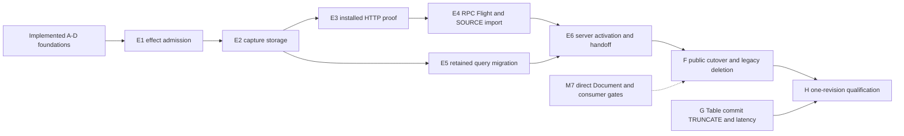

# Milestone 6 connector and captured query migration implementation plan

[Milestone 6](06-streams-queues-and-durable-runtime.md) · [Completion plan](streams-queues-runtime-completion.md) · **Status: In Progress** · Updated 2026-11-21

Implement **Unit E / Batch 7a** next: move connector intent, capture and retained
query progress onto declared data and shared transactions. Start with one real
HTTP consumer that survives replacement without repeating an uncertain external
attempt. Extend that owner to gRPC, outbound Flight and retained query consumers,
then prepare the public Station cutover. Run **Unit G**, the independent Table
commit and latency work, alongside this sequence when engineering capacity permits.

An application must be able to inspect its original input, committed state and
output intent, authorized attempt, capture coverage and terminal disposition.
Those are separate facts. Queue delivery, a completed database transaction and
a remote response must never be reported as interchangeable outcomes.

**Source basis:** fetched `origin/main` at
`aa52980ad93b5e32bee2c543c9f82bc3ab4f162a`, including merged PR #475
(`1fab91d7c`). The shared definition in
[`Growth.zig`](../../packages/zig/transit-protocol/src/Growth.zig) is
`7344b5ed271c41ea371aaa6e61867b1a4d1f670e9a9176f96793835d8ead20a5`
(`transit.v1.transactional-log-origin.2026-11-19`). This is a source assessment
and proposed execution sequence, not a new runtime qualification result.

## E1 implementation for review

The first implementation unit adds committed Queue effect admission to the
installed service, deterministic native authority, shared catalog client and
private transactional Station adapter. The service reads the retained original
Queue selection and verifies its stored transaction origin and row digest before
admission. A permanent source mapping resolves the original effect across lost
replies and owner replacement, including after terminal effect collection.
Current Queue and native rights still gate admission and disclosure. The
[native contract](../../contracts/TRANSIT_V1.md#committed-queue-effect-admission)
owns the exact proof, identity, recovery and retention rules.

This replaces the source definition above with
`ad3bc9aef1bc97a05c8a1ce5ea511a1d5185ebbb00f256eeec1ef287517e83ff`
(`transit.v1.committed-queue-effect-admission.2026-11-21`) through the current-v1
cutover. Schemas, bindings, signing fixtures and consumers change together;
existing installations require their matching build for recovery.

The new schedules cover core admission/recovery, installed disk source
verification and revocation after buffering, and the private Station `large`
case's saved original across node replacement. The PR records executed gates
and failures; this implementation entry is not a final common-revision or
milestone qualification claim.

E2 is the next implementation unit. Capture publication, durable pending
directories and source/capture holds remain consumer obligations; the adapter
does not save originals, ACK scheduling inputs or dispatch network effects.
E3's installed transactional HTTP journey, E4–E6, public activation (F), Table
work (G) and final qualification (H) remain pending. Existing native-turn
Exchange consumers remain supported. E1 does not complete connector migration.

## Delivered foundation and remaining gaps

The [calls and services slice](station-calls-services-implementation.md) has
implemented its five units: authenticated log origin, transactional calls and
replies, Timer Queue observation, Registry/Supervisor and server service hosting.
These remain behind the internal transactional boundary. The public Station
API, SDKs and several installed consumers still use native turns. Preserve the
slice's installed fault and performance acceptance obligations; its implementation
status does not establish the final common-revision pass.

| Boundary at the source revision | Evidence and implication |
| --- | --- |
| Shared transactions and private Station | [`transit-data-client`](../../packages/zig/transit-data-client/README.md) and [`transactional/Runner.zig`](../../packages/zig/transit-station/src/transactional/Runner.zig) already own batching, original recovery, inbox ACK and state/journal/output composition. Reuse them; do not implement another transaction runner. |
| Effect admission | [`Exchange.commitIntent`](../../packages/zig/transit-exchange/src/Exchange.zig) writes `turn.decision.effect` and freezes coverage in the native turn. [`Worker.effectForOnce`](../../packages/zig/transit-exchange/src/Worker.zig) finds the effect by that native publication revision. [`Transaction.Participant`](../../packages/zig/transit-protocol/src/Transaction.zig) has state, log and Document variants, with no effect-admission participant. A Queue row cannot simply replace this authority link. |
| Capture storage and consumers | [`transit-exchange`](../../packages/zig/transit-exchange/README.md) uses Station Publication and native resource revisions. HTTP, gRPC, outbound Flight, [`transit-source-import`](../../packages/zig/transit-source-import/README.md), SDK diagnostics and Board reads share that identity and coverage. Replace the owner and its consumers together when public activation occurs. |
| Captured queries | [`UnifiedBehavior`](../../packages/zig/transit-query/src/UnifiedBehavior.zig) uses `GenServer`/`Turn`; [`CapturedTablePin`](../../packages/zig/transit-query/src/CapturedTablePin.zig) journals original acquisition and closure through native state. Finite direct Table execution already belongs to `transit-query-direct`; execution extraction alone does not migrate retained jobs. |
| Delivery | [`transit-query-host`](../../apps/transit-query-host/main.zig) already consults the native pending-output index and uses bounded `waitForChange`, plus error backoff. The gap is migration off native outbox delivery and remaining worker polling, not absence of all notifications. Legacy SDK/Document consumers still need native delivery. |
| Document prerequisite | [M7 C4/C5/C7](07-document-storage-and-station-decoupling.md#remaining-work-packages-and-gates) still owns direct Document lifecycle, common-decision participation and consumer replacement. M6 must not delete their working native owner early. |

Current semantics remain with [Station](../handbook/reference/station.md),
[Streams](../handbook/reference/streams.md), [connectors](../handbook/reference/connectors.md),
[queries](../handbook/reference/queries.md) and their linked contracts. Their
supported profiles must change with executable implementations, not this plan.

## Scope and delivery boundary

This slice covers the shared Exchange lifecycle, HTTP/gRPC/Flight connector
workers, sealed SOURCE import, non-Document captured query progress and the
server's corresponding activation paths. It does not implement DocumentPartition,
generic serving, continuous SQL, automatic SOURCE polling, interactive outbound
RPC, distributed transaction authority or a new compiler. M7, M13, M14, M18 and
the separate `transitc` repository retain those owners.

Keep development behind the internal transactional composition until a complete
consumer family can cut over. Do not expose a second supported writable Station
engine or an engine selector. Final public ABI/SDK activation and legacy
`GenServer`/`Turn` deletion remain **Unit F**, jointly gated with M7's Document
consumer replacement. Unit E can remove native delivery from its test composition;
global native courier removal must wait for the last supported producer and
consumer. Existing accepted native outputs must remain recoverable until that
explicit incompatible cutover.

## Contract decisions before adapter changes

### Effect intent admission and recovery

The proposed replacement commits **application state, inbox ACK, immutable
request/capture commitment and an effect outbox intent in one ordinary database
transaction**. Actual native effect admission and attempt authorization follow
through the existing authority domain. This replaces the current same-native-turn
effect creation contract; it must be specified explicitly under current v1.

Prefer an idempotent admission operation for an already committed intent over
adding external dispatch to the database transaction or retaining a hidden
GenServer bridge. Unit E1 must define and implement the following boundary before
any transport migrates:

- Bind the original realm, declaring actor and execution origin, exact Queue
  definition/partition/offset, committed transaction, immutable request digest,
  endpoint/policy references, deadline and lineage to one effect identity.
  Define the canonical admission key and conflict behavior in the shared
  protocol. Repeated admission returns the original effect; changed content
  rejects, including after worker/key replacement.
- Verify committed evidence through its owning authority. A client-supplied
  origin tuple, Queue payload or successful claim is insufficient. Put I/O and
  committed-source verification in the service composition; keep deterministic
  authority validation and storage independent of Station and connector parsers.
  Specify the proof's trust assumptions and replay binding before coding it.
- Preserve independent current actor, Queue, effect-admission, dispatch,
  observation and read rights. `Transaction.Origin` authenticates provenance;
  it grants no permission to send. Preserve PID/generation/code fences and
  permanent retirement. Denial cannot erase a previously accepted intent.
- Persist admission identity before requesting it. After a lost reply,
  inspect/retry that identity; never infer absence from a timeout. A replacement
  must distinguish no accepted attempt from an authorized, possibly in-flight
  attempt. Only the latter's explicit connector reconciliation policy can
  permit new external work.
- Settle the scheduling Queue input only with the durable record needed to
  recover the admitted effect and eventual outcome. Retain a paged pending
  directory so a crash after scheduling ACK cannot strand work. Queue leases
  schedule work; they neither revoke a remote attempt nor make redelivery safe.

**Contract gate:** approve the precise admission/dispatch state machine, proof
format, retention edge and crash table in
[`TRANSIT_V1`](../../contracts/TRANSIT_V1.md),
[`STATION_EXCHANGE_V1`](../../contracts/STATION_EXCHANGE_V1.md) and the relevant
direct/Station contracts. If authenticated original admission cannot be provided
without a new participant, resolve that change in E1 and revise this sequence
before E2. Do not substitute two unlinked commits or a caller-asserted effect.

### Capture publication and lifetime

Use declared KV/Table metadata and Stream-backed bounded immutable chunks for
request and response capture. Reuse log/segment and current authorized reader
owners. Do not expose raw `TransitObjectStore` credentials to workers or retain
`Publication`/`SIX1` as a renamed capture backend.

E2 must specify original capture/member/chunk identities, exact definition and
retained cut, ordinal and digest coverage, explicit empty segments, quotas and
terminal protocol evidence. Staging may span transactions; only a complete seal
can publish a complete reference. The chunk append and its descriptor/progress
update share a decision, or have an explicit recoverable preparation before
publication. A prefix, socket EOF or HTTP status alone is never completion.

Caller, SOURCE-import and descendant holds are durable, separately authorized
dependencies. Define their acquisition/release originals, how they protect
Stream cuts and how they enter the storage graph before publication. Retiring
availability, releasing holds, policy-authorized expiry and physical collection
are separate transitions. Default retention remains unlimited; ACK and terminal
bits alone authorize no deletion. Bound reads and collection independently of
total capture size and recheck current rights after buffering.

Preserve the existing distinction between capture completion, native observation
and closure. A complete capture that loses to effect closure remains evidence,
not a successful reply. Late results cannot reopen `closed_unknown`. The
[SOURCE import owner](../../packages/zig/transit-source-import/README.md) is a
consumer and a useful bounded-storage precedent; its trusted capture seam does
not already provide general installed Exchange admission.

### Query retention and activation

Move job definitions, original uploads, source-acquisition records, cancellation,
result coverage and closure progress to declared data. Preserve the full
[`UNIFIED_QUERY_V1`](../../contracts/UNIFIED_QUERY_V1.md) lifecycle and
[`captured-retention`](../../packages/zig/transit-query/docs/captured-retention.md)
ordering: save the original pin intent before acquisition, record closing before
release, and retain uncertain acquisitions/releases for exact recovery.

Execute through `transit-query-direct`/Fuze with the original schema and source
vector. Never reacquire a newer cut to finish an interrupted result, label
independent cuts atomic, or treat a page limit as terminal coverage. Table and
direct KV adapters can move first; native Document adapters stay explicitly
gated on M7. Reuse neutral result/capture storage below Station; Station provides
optional behavior activation, not a required database execution owner.

Use Queue waits and bounded active-worker slots for migrated consumers. Preserve
the check/register/recheck wakeup sequence, delayed visibility, cancellation,
lease expiry, replacement and shutdown join. Queue WAIT currently has a bounded
timeout; renewing a wait is not evidence of zero idle requests. Measure request
counts and wakeup latency before claiming an improvement. `transit server`
remains the service host; add no controller or courier executable.

## Ordered implementation units

Each row is a review boundary with executable acceptance. E1–E3 form the first
useful checkpoint; E4 and E5 can develop independently after their shared owners
land. Incompatible changes require a fresh definition at each independently
landed cutover; never reuse a fingerprint after changing stored semantics.

| Unit | Deliverable and primary owners | Exit before dependent work |
| --- | --- | --- |
| **E1 Original effect admission** | Protocol/core effect authority, installed native dispatch, shared client and transactional Station outbox adapter; update effect/Exchange contracts and neutral fixtures first | Real disk-backed admission of a committed intent returns one original effect through lost replies, competing workers and restart. Aborted/uncommitted, forged and revoked submissions cannot dispatch. Admission and inspection perform zero network effects. |
| **E2 Transactional Exchange storage** | `transit-exchange`, catalog/data-client capture reads, Stream/KV metadata, storage graph/maintenance and retained consumer interfaces | Request seal, capture chunks, complete/unknown records and holds survive partial writes, restart and GC. Exact bytes, empty bodies, redaction and terminal coverage match an independent oracle; resident work stays within declared budgets. |
| **E3 One installed HTTP path** | `transit-station-http`, actual HTTP worker, internal transactional caller, server application/service composition; reuse `transit-http` transport | A real caller commits more than four state mutations with a value above 256 bytes plus input ACK/journal/intent; one HTTP attempt returns an authenticated outcome. Kill before/after authorization, peer receipt, capture seal and reply; recover the original outcome without blind resend. |
| **E4 Remaining effect consumers** | `transit-station-grpc`, actual RPC worker, `transit-station-flight`, `transit-source-import`; shared diagnostics/read adapters | All four finite RPC shapes retain frozen outgoing batches and exact status/capture semantics; Flight replay succeeds with peer and credentials unavailable; SOURCE import preserves original publication and hold release without network dispatch. |
| **E5 Captured query consumers** | `transit-query` retained jobs and source adapters, `transit-query-direct`, `transit-query-host`; shared result readers | Direct Table/KV capture, upload recovery, cancellation, result reopen and source closure pass independent-caller disk/fault tests with no native turn in the migrated path. Revocation after buffering withholds metadata, rows and completion. Document cases remain explicit M7 obligations. |
| **E6 Server activation and cutover handoff** | Server-owned roles, provisioning, waiter/pool ownership, installed test fixtures and removal inventory | Migrated HTTP/RPC/query compositions work with native courier disabled; idle/load/shutdown and control-reserve tests pass. Every surviving native delivery/Turn dependency has an owner and an F/M7 removal gate. Public consumers remain supported until their coordinated cutover. |

**First implementation PR or review series:** E1, then E2 and E3. Its reviewable
outcome is the installed HTTP journey above, including failure/unknown cases and
read-only inspection. A contract-only E1 change does not count as connector
migration. E4–E6 complete the internal migration basis for F; they do not by
themselves close M6.



M7 consumer migration and F are a **joint integration gate**, not a circular
requirement that either final deletion land first. Develop against the private
transactional foundation, then integrate and qualify their compatible consumers
before publishing the replacement.

## Failure and resource acceptance matrix

| Schedule | Required observation |
| --- | --- |
| Abort or lose the actor's common-decision reply | A proved abort publishes no state/journal/intent/ACK; uncertainty is resolved through the original transaction. A committed intent appears once, with its original provenance. |
| Lose effect-admission/authorization reply; restart with a new generation/key | One immutable admission mapping and attempt identity. No replacement host dispatches an already authorized attempt merely because its Queue lease was redelivered. |
| Peer acts, then connection or worker dies before durable completion | Preserve unknown or the actually accepted terminal evidence. Retry/status/cancel requires explicit policy and a separately recorded authorized attempt. Peer request counters expose duplicate sends. |
| Race lease expiry, revocation, timeout, cancellation and late response | Stale workers cannot settle Queues or advance state; previously accepted database decisions still finalize. Current rights gate fresh dispatch/disclosure; terminal closure cannot reopen. |
| Crash during capture seal, native observation, reply or consumer release | No missing chunk becomes an empty chunk, no prefix becomes complete, no capture-only success bypasses effect closure, and no unresolved hold is collected. |
| Alter/drop/reuse a query source name; interrupt upload, pin acquisition or result delivery | Frozen source identity/cut persists; original upload and pin operations recover; incomplete results remain incomplete and cleanup never creates a replacement query. |
| Deny reads after buffering; corrupt/miss a chunk or terminal record | Current-authorized reads fail explicitly without disclosing buffered rows, secrets or fabricated complete coverage. Include empty results and metadata reads. |
| Enqueue at waiter registration, exhaust active slots, drop transport and shut down | Eligible work remains discoverable; no lost wakeups or unjoined tasks. Control/recovery capacity progresses under data saturation. |
| Grow history and hold old captures while checkpoint/collection run | Durable cardinality grows without resident arrays; measure peak resident memory, request/page budgets and post-warmup allocations. Retained dependencies survive; explicitly eligible objects eventually collect. |

Keep byte/row/chunk, attempt, deadline, active worker and memory limits in the
owning contract and deployment configuration. Reuse bounded scratch and owned
outputs; do not buffer a whole transcript or retain pointers into reused pages.
Measure the cost of each commit, admission, authorization and read separately.
The earlier ~6-second private Station turn median remains a source-specific
baseline, not an acceptable connector latency target or a new result.

## Remaining milestone work after this slice

| Work | Entry and completion gate |
| --- | --- |
| **F Public replacement** | E's qualified consumers plus M7 direct Document/transaction/consumer gates. Cut over `transit-station-bindings`, port host, all 11 SDKs, actual examples, installation and launcher profiles, and Board's authorized read-only projections. Remove legacy `GenServer`/`Turn`, private Table/Publication helpers and remaining native courier dependencies together. Preserve the separate catalog `DirectTableBridge`. |
| **G Table write lifecycle** | Can start now without Station. First prove account-wide token routing/uniqueness across partitions and statement kinds; then one authoritative eligible partition WAL commit with reconstructible catalog bookkeeping. Add frozen empty-successor `TRUNCATE` with exact counts, retained history and original retry. Execute matched synchronous-durability campaigns for the inherited 19 ms INSERT and 10–20 ms warm SELECT targets; smoke ceilings do not replace them. |
| **H Completion qualification** | F and G complete. Freeze one commit/definition and run all required clean lanes, local/Compose/Substrate/MinIO profiles, the complete 12-profile log baseline and final Station/SQL campaigns. Map every M6 R0–R10 criterion to executed evidence before changing milestone status. |

The old 2–3 review-unit estimate for E does not account explicitly for the
effect-admission and capture-ownership contracts above. Use these **six review
units** to schedule it, and re-estimate effort after E1. With the completion
plan's provisional F (3–4), G (2–3) and H (1) decomposition, the remaining scope
is **12–14 review units**, excluding implementation of M7 itself. These are
review boundaries, not elapsed-time commitments. Do not carry forward the old
engineer-week total as a fresh estimate.

## Verification and documentation delivery

Every implementation unit updates its public reference/component owner and
exact contract with executable behavior and limits. Use the existing current-v1
hard-cutover policy, regenerate schemas/ABIs/signing fixtures, and reject missing
or foreign definitions before execution. No automatic reinterpretation, storage
reset, fallback decoder or public dual-engine option is part of this plan.

For this documentation change and every PR, run from the worktree root:

```sh
nix develop --command just check fast
nix develop .#docs --command just transit-docs::install
nix develop .#docs --command just transit-docs::check
```

During implementation, select owning tasks from
[`tasks/test.just`](../../tasks/test.just) and
[`suite.json`](../../tests/runner/suite.json); new schedules must be registered
and executed, not represented by proposed command names:

| Boundary | Existing regressions and additional proof |
| --- | --- |
| E1–E2 authority, transactions and storage | `just check contracts`; `just test authorization`, `direct-mixed-transaction`, `station-transaction`, `direct-workload-token`, `direct-workload-result`, `local-data-collection` and affected MinIO collection tests. Add original effect-admission and capture/hold fault schedules plus finite-model negative controls with concrete owner replay. |
| E3–E4 connectors | `just test http-transport`, `http-worker`, `grpc-worker`, `grpc-faults`, `grpc-control`, `flight-outbound`, plus owning Exchange/SOURCE-import component and process-fault checks. Extend actual binaries/independent peers to exercise the transactional composition. Legacy passing fixtures alone do not qualify it. |
| E5 captured queries | `just test public-query`, `unified-query` and affected Table/query/retention tests. Keep native Document regressions until their replacement qualifies; add direct Table/KV original-pin, cancellation, revocation and incomplete-result schedules. |
| E3/E6 server integration | `just test server`, `server-faults`, `server-applications`, `server-application-faults`, `server-sql-types`; run `nix develop .#ci-experience --command just test console-latency-gate`. Extend installed single-executable/worker-replacement and waiter shutdown tests. |
| F/G/H | Follow the [completion plan's validation matrix](streams-queues-runtime-completion.md#validation-required-for-review-and-implementation), including affected SDK/browser/SQL-wire gates and deployment profiles. |

The comma-separated entries above are separate `just test NAME` invocations.
Before pushing implementation, run affected committed-HEAD clean lanes:
`formal`, `core`, `storage-query`, `interfaces-connectors`, `installation-ui`
and any dependent SQL, SDK, browser or launcher lanes selected by the final diff.
H requires all 13 lanes and external profiles, not this subset.

Run performance campaigns in isolated measurement windows without concurrent
builds or fault suites. Preserve failures, original identities, exact counts,
coverage, hardware/configuration and raw records. Publish executed evidence to
the [qualification ledger](../history/qualification/README.md); a documentation
check, model result or successful dependency install establishes no installed
connector or milestone qualification.
