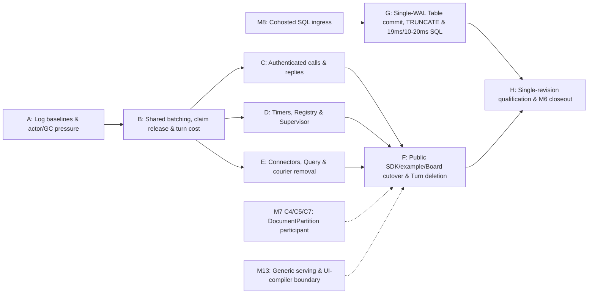

# Milestone 6 completion implementation plan

[Milestone 6](06-streams-queues-and-durable-runtime.md) · **Status: In Progress** · Review draft updated 2026-11-18

Milestone 6 combines three major architectural initiatives: decoupling the
database from `Station` actor turns, delivering first-class declarative
`STREAM` and `QUEUE` primitives with mixed database transactions, and replacing
`Station`'s legacy `GenServer`/`Turn` persistence with standard transactions over
those database primitives. The first two initiatives and the shared-transaction
and private-actor foundations of the third are implemented. Closing out the
milestone now requires **finishing shared-transaction batching and turn cost,
migrating public `Station` services, connectors and SDK consumers off legacy
turns, closing single-WAL Table commit composition, `TRUNCATE` and inherited SQL
latency targets, and qualifying one committed revision**.

**Review basis:** `main` at `c1f2680d9` (`2026-11-18`), shared definition
[`06091bff7096eeaceb3fc0d62bc0aa0d1bc184b20c3b275df74e8c93bf8b13e5`](../../packages/zig/transit-protocol/src/Growth.zig)
(`transit.v1.native-storage-retirement.2026-11-16`). Since the November 12
version of this plan (`6552747cf`), `main` has landed:

- [PR #451](https://github.com/spoke-sh/transit/pull/451) and
  [PR #452](https://github.com/spoke-sh/transit/pull/452)
  ([read ownership](transaction-read-ownership.md)): database-owned caller
  sequencing (`DirectTransactionSession`), `transit-data-client` transaction
  handles and local journal (`Transaction`, `TransactionRecovery`), owned
  private Table/KV transaction reads (`DirectTransactionReader`), standalone
  Station-free caller proofs, and migration of the private Station runner onto
  that shared API.
- [Server delivery ownership](transit-server-delivery-implementation.md) and
  [server Station service ownership](transit-server-station-implementation.md)
  ([PR #460](https://github.com/spoke-sh/transit/pull/460)): `transit-delivery`
  and `transit-station-controller` are removed from builds and releases, and
  `transit server` supervises courier and declared Station observer/lifecycle
  services.
- [Standalone `transit-node` retirement](transit-node-retirement-implementation.md)
  ([PR #463](https://github.com/spoke-sh/transit/pull/463)),
  [1 MiB streaming SQL framing](https://github.com/spoke-sh/transit/pull/461),
  and [Ursula removal with MinIO S3 tiering](transit-storage-ursula-removal.md)
  ([PR #467](https://github.com/spoke-sh/transit/pull/467)): production runtime
  hosting is consolidated in `transit server`, and Ursula is removed in favor of
  native local storage and optional S3 immutable staging.
- [Milestone 13 declarative serving](13-declarative-serving-and-reactive-dataflows.md)
  ([PR #464](https://github.com/spoke-sh/transit/pull/464),
  [cutover inventory](declarative-serving-cutover.md)) and `transit-http`
  transport extraction: generic HTTP/SSE/WebSocket serving, reactive
  subscriptions, `transit-station-app` screen/theme retirement and Board server
  consolidation belong to M13 rather than M6's actor-runtime replacement.

This update supersedes the November 12 schedule and estimates while preserving
Milestone 6's `R0`–`R10` acceptance criteria, Batch 5/8/9 obligations and
source-attributed evidence. Milestone 6 remains **In Progress**.

## How much work remains

With **Units A and B** merged in [PR #471](https://github.com/spoke-sh/transit/pull/471)
(`70dc36d57`, cutting private
transactional Station turn latency from `12,015.7 ms` median / `19,272.0 ms` p95
to `6,018.2 ms` / `8,355.6 ms` and completing all 12 `log-runtime-baseline`
profiles plus actor/DLQ/GC pressure checks), plan for **11–15 remaining review
units** and **12–21.5 engineer-weeks of direct work** (**roughly 15–27
engineer-weeks** allowing ~25% for integration, fault-schedule debugging and
performance tuning), down from the initial 13–18 review units / 14.5–25.5 direct
engineer-weeks at `c1f2680d9` (and 15–21 / 19–32 on November 12). The next
Track 1 implementation slice—[transactional calls, timers, names and supervision](station-calls-services-implementation.md)
(**Units C and D**, `3–4` review units)—is drafted at `f31673bbd`. These are engineering planning
ranges, not measured velocity, and they **exclude** implementing
[Milestone 7](07-document-storage-and-station-decoupling.md)'s
`DocumentPartition` (`C4`/`C5`/`C7`) itself.

Remaining work splits into **two local tracks that can run in parallel**, plus
one external prerequisite before legacy `Station` persistence can be deleted:

1. **Track 1 — Transactional `Station` completion and consumer cutover (Units C → D → E → F remaining after delivered A & B, 8–11 review units, 8–14.5 engineer-weeks):**
   With the 12-profile log/GC/actor-population baselines (`A`) and shared
   multi-statement batching, claim `release` closure and ~2× turn-cost reduction
   (`B`) in place, add durable calls/replies (`C`) and timers/names/supervision (`D`) over
   declared data, migrate HTTP/gRPC/Flight connectors and retire native outbox
   courier polling (`E`), and cut over public Station bindings, all 11 SDKs,
   examples and Board inspection while deleting legacy `GenServer`/`Turn`
   persistence (`F`).
2. **Track 2 — Table commit composition, `TRUNCATE` and SQL latency (Unit G, 2–3 review units, 2.5–4.5 engineer-weeks):**
   Collapse single-partition SQL DML autocommit from three WAL transitions
   (`DirectClientToken.bind` → `commit_saved` → `DirectClientToken.update`) to
   one authoritative partition commit with reconstructible secondary catalog
   bookkeeping, implement executable `TRUNCATE TABLE`, and meet the inherited
   `19 ms` `INSERT` and `10–20 ms` warm `SELECT` targets alongside
   [Milestone 8](08-gateway-architecture-and-protocol-ingress.md). Track 2 has
   zero Station dependency and can run immediately alongside Track 1.
3. **Final common-revision qualification (Unit H, 1 review unit, 1.5–2.5 engineer-weeks):**
   Freeze one `HEAD` revision and `Growth.current_definition`, pass all 13 clean
   lanes plus external Compose/Substrate/MinIO profiles and isolated baselines,
   promote public docs, and mark M6 `Completed`.

The review should settle five choices before implementation continues:

1. **Fix shared-path turn cost (`Unit B`) before adding Batch 6–7 services:**
   Coalesce multi-statement staging/execution and eliminate per-statement
   control-KV write-and-readback round-trips before building calls, timers and
   connectors on top of the runner.
2. **Keep `transit server` as the sole service host:** Reuse `#460`'s
   server-owned Station service registration (`station.file` and local
   application manifests) and `#465`'s Station-free `transit-http` transport
   while moving `Waiting`, `Registry`, `Supervisor`, connector state and
   `transit-query-host` courier delivery onto declared Queues/Tables/KV. Add no
   new standalone controller or courier executable.
3. **Keep generic API serving and UI-compiler retirement in Milestone 13:**
   M6 migrates `Station` calls/replies, behaviors, connectors and SDK worker
   bindings; M13 owns `/serving/v1`, `/reactive/v1`, `/published/*`,
   `transit-station-app` UI declarations and Board's shared-server hosting.
4. **Gate final `GenServer`/`Turn` deletion (`Unit F`) on M7 `C4`/`C5`/`C7`, without blocking `B`–`E`:**
   Deliver and qualify `B`–`E` and stage non-Document SDK/example migrations
   immediately, while holding public cutover and deletion of `GenServer`/`Turn`
   until `DocumentPartition` participates in common decisions so Transit never
   ships two parallel supported writable Station engines.
5. **Hold the inherited Table latency targets firm in Track 2 (`Unit G`):**
   Do not waive or dilute the matched `19 ms` `INSERT` and `10–20 ms` warm
   `SELECT` objectives or treat `console-latency-gate` smoke ceilings as closing
   them; coordinate single-WAL token commitment with M8's cohosted SQL path.

## Delivered basis and remaining closeout obligations

Current public behavior is owned by [Streams](../handbook/reference/streams.md),
[SQL streaming](../handbook/reference/sql/streaming.md),
[SQL transactions](../handbook/reference/sql/transactions.md),
[Station](../handbook/reference/station.md),
[connectors](../handbook/reference/connectors.md) and
[application builds](../handbook/reference/applications.md#application-source-builds).
Exact wire and caller boundaries live in
[`STREAM_V1`](../../contracts/STREAM_V1.md),
[`QUEUE_V1`](../../contracts/QUEUE_V1.md),
[`DIRECT_TABLE_V1`](../../contracts/DIRECT_TABLE_V1.md),
[`STATION_V1`](../../contracts/STATION_V1.md),
[`transit-data-client`](../../packages/zig/transit-data-client/README.md) and
[`transit-station`](../../packages/zig/transit-station/README.md).

| Area | Implemented at `c1f2680d9` | Remaining closeout obligation |
| --- | --- | --- |
| **Database independence** | `transit-catalog`, `transit-query-direct`, `transit-sql`, `transit-sql-service` and `transit-data-client` build and run with zero `Station` imports or actor turns; named direct `KVPartition` (`> 256 B` values, `> 4` keys, retained cuts) is live | Preserve acyclic package gates through consumer migration (`E`/`F`); complete single-WAL token/commit composition and matched SQL latency (`G`) |
| **Streams and Queues (`R0`–`R4`, `R6`)** | Catalog declarations/permissions, `StreamPartition`/`QueuePartition`, `.tack` Roaring bitmaps (`transit-bitmap`), `key_fifo`, predicate-aware `CLAIM`, bounded `WAIT`, `COMMIT OFFSET` (`SPH1`), `ACK`/`NACK`/`EXTEND LEASE`, explicit and automatic `LocalQueueTransfers` DLQ, native `.tseg` log columns and finite `STREAM_SLICE` | Complete all six `log-runtime-baseline` profiles at one current revision plus sealed/cold reads, group offsets, delayed visibility, wakeups, lease expiry and offered-load concurrency (`A`, `H`) |
| **Queue checkpoints & GC (`Storage Unit 3`, `Batch 2`)** | Foreground Queue transitions append `TWAL1` `LOGPART1` frames with zero foreground `TransitObjectStore` `PUT`s; incremental `QueueLeaseHeap`/`QueueTimingWheel`/`QueueAffinity` caches; standalone `LCHECK01` checkpoints; concrete `QueueLeaseTransaction.tla` Zig replay | Prove combined large actor-population, uncheckpointed backlog and `DirectStorageGraph` mark/grace/sweep GC pressure with M3 pool isolation (`A`, `H`) |
| **Mixed transactions (`R5`, `Batch 4d`)** | Native and interactive SQL `BEGIN ... COMMIT` transactions compose `TABLE`, `KV`, `STREAM` (`PRODUCE`, `COMMIT OFFSET`) and `QUEUE` (`ENQUEUE`, `ACK`, explicit DLQ transfer) with `SAVEPOINT` and `Transaction.Deadline`; `.document` fails closed | Integrate M7 `C5`'s `DocumentPartition` participant before cutting over Document-dependent Station consumers (`F`); retain full prepare/decision/finalize fault coverage (`H`) |
| **Shared transaction client (`Unit B.1–B.2`)** | `DirectTransactionSession`, `transit-data-client.Transaction`, `Context.callTransaction`, `TransactionRecovery`, and owned `DirectTransactionReader` (`Context.readTransaction` / `Transaction.read`) with standalone Station-free caller and runner adoption | Add bounded multi-statement staging/execution, coalesce redundant `inspect`/checkpoint round-trips, wire recoverable Queue claim `release` closure, and meet a reviewed turn-cost budget (`B.3–B.4`) |
| **Transactional `Station` (`Batch 5`)** | Native `Transaction.Execution` PID/generation/code fence at `TXDEC1`, `SOR1` actor declaration, private Table/KV/Queue/Stream runner (`station_transaction_internal`), and 18 installed worker-kill/restart/key-rotation schedules | Keep only actor semantics in Station; build authenticated calls/replies (`C`) and durable timers/names/supervision (`D`) over declared data before public exposure |
| **Runtime & storage consolidation** | `transit-delivery`, `transit-station-controller`, standalone `transit-node` and `transit-backend-ursula` are retired; `transit server` supervises courier and Station services; `transit-http` is Station-free; M13 owns generic serving | Re-execute replacement proofs against `transit server`, native local storage, MinIO S3 tiering and Kubernetes/Substrate without obsolete Ursula/daemon assumptions (`E`–`H`) |
| **Effects, Query & SDK consumers (`Batches 6–7`)** | Public `Station` apps, `transit-station-bindings`, 11 SDKs, `transit-station-{http,grpc,flight}`, `transit-exchange`, `transit-query` capture and `transit-query-host` courier still use legacy `GenServer`/`Turn` and native outboxes | Migrate connectors, retained query consumers and courier polling to declared data and Queue waits (`E`); cut over public bindings, SDKs, examples and Board reads, then delete legacy `GenServer`/`Turn` and private Table helpers (`F`) |
| **Table write lifecycle & `TRUNCATE` (`Batch 8 / R9`)** | `DatabaseRuntime` foreground Table DML still executes `DirectClientToken.bind` (Catalog WAL) → `commit_saved` (`TablePartition` WAL) → `DirectClientToken.update` (Catalog WAL); `TRUNCATE` has [no execution path](../handbook/reference/sql/grammar-surface.md) | Combine account-wide single-partition token identity, mutation and outcome in one WAL commit, implement empty-successor `TRUNCATE TABLE`, and satisfy `19 ms` `INSERT` / `10–20 ms` warm `SELECT` (`G`) |

## Architecture, ownership and current removal inventory

The dependency direction remains **application → Station behavior API → shared
database transaction API (`transit-data-client` / `DirectTransactionSession`) →
database transaction owners (`DirectCatalog` / `transit-storage`)**. Ordinary
data callers, SQL sessions and managed Queue programs use the neutral database
owners directly without importing `Station`. Accepted database transactions
recover and finalize without invoking application callbacks or a Station runner.

| Package / app at `c1f2680d9` | Current `Station` coupling | Closeout destination and owner |
| --- | --- | --- |
| [`transit-station`](../../packages/zig/transit-station/README.md) (`GenServer`, `Turn`, `Frame`, `Waiting`, `Registry`, `Supervisor`, `Controller`, `Publication*`, `ImmutableIndex`, `BlockRecord`, `Table*`, `Query*`) | Public `GenServer`/`Turn` over `STATE_V1` 256-byte/4-key turns and private `SIX1`/Table pages; internal `transactional/` module uses shared transactions | Promote transactional behavior, calls (`C`), timers/names/supervision (`D`) as the sole `Station` engine in `F`; delete legacy `GenServer`/`Turn`, `Publication*`, `ImmutableIndex`, `BlockRecord` and private `Table*`/`Query*` helpers |
| [`transit-station-bindings`](../../packages/zig/transit-station-bindings/README.md), [`transit-station-host`](../../apps/transit-station-host/README.md) and `sdks/{zig,beam,c,cpp,dotnet,go,java,python,ruby,rust,ts}` | Shared C ABI (`station_abi`), port protocol, `TableBridge` and foreign turn actions target legacy `GenServer`/`Turn` | Cut over C ABI, port messages, host runner and all 11 SDKs together under one `Growth.current_definition` in `F`; delete `station_bindings.TableBridge` while preserving `DirectTableBridge` in `transit-catalog` |
| [`transit-exchange`](../../packages/zig/transit-exchange/README.md), [`transit-station-http`](../../packages/zig/transit-station-http/README.md) (`http-worker`), [`transit-station-grpc`](../../packages/zig/transit-station-grpc/README.md) (`grpc-worker`, `grpc-bindings`), [`transit-station-flight`](../../packages/zig/transit-station-flight/README.md), [`transit-source-import`](../../packages/zig/transit-source-import/README.md) | Persist intents, `STATION_EXCHANGE_V1` captures and observations through legacy `Station` turns/blocks | Migrate to declared Queue/Stream/Table/KV intents, attempts, captures and unknown-outcome closure over the shared transaction API in `E` (reusing neutral `transit-http` / `transit-grpc`) |
| [`transit-query`](../../packages/zig/transit-query/README.md) and [`transit-query-host`](../../apps/transit-query-host/README.md) (embedded in `transit server`) | Retains Station-captured query adapters and runs the server-owned native outbox `courier` loop | Move remaining private Station Table/Query consumers to `transit-query-direct` and direct catalog owners, and replace native courier polling with transactional outboxes and Queue `WAIT`s in `E` |
| [`transit-board-api`](../../packages/zig/transit-board-api/README.md) and [`transit-board`](../../apps/transit-board/README.md) | Decode legacy `Station`, `Exchange`, HTTP/gRPC and Document resource metadata for read-only operator views | Update read-only inspection projections in `F` to show declared actor bindings, Queue leases/retries/DLQ, Stream lag and transactional turn/effect outcomes; Board hosting consolidation stays in [M13](13-declarative-serving-and-reactive-dataflows.md) |
| [`transit-serving`](../../packages/zig/transit-serving/README.md) and [`transit-station-app`](../../packages/zig/transit-station-app/README.md) (`transit-app`) | Legacy `SV1` command/reactive routes and UI/application declaration compiler | Owned by [M13](declarative-serving-cutover.md): generic serving drops `Station`, UI declarations retire in M13 P7, and optional Station call invocation uses `C`'s replacement adapter |
| [`transit-station-document`](../../packages/zig/transit-station-document/README.md) (`document-worker`) | `STATION_DOCUMENT_V1` / `SIX1` actor-turn Document service | External prerequisite owned by [M7 `C4`/`C5`/`C7`](07-document-storage-and-station-decoupling.md): `DocumentPartition` lifecycle and mixed transaction participant must land before `F` deletes `transit-station-document` and legacy `Turn` |
|Runnable examples in [`examples/`](../../examples/README.md) | `station-ledger`, `station-sdk`, `station-http`, `station-grpc`, `station-document`, `work-items`, `exchange`, `flight`, `state-query`, `counter` exercise legacy Station/connectors | Migrate real example binaries and launcher topologies (`local`, `compose`, `reference`) in `F` (with `station-document` gated on M7 `C7`) |

## Diagnosed turn cost and shared-path optimization target

The [November 12 comparison](../history/qualification/performance.md#private-transactional-station-comparison--2026-11-12)
at `b24c048d2` measured **12,015.7 ms median / 19,272.0 ms p95** (27,836 client
allocations, 18.39 MiB peak budget usage, growing from **5.84 s** median on the
first five turns to **18.48 s** on the last five) for the five-participant
transactional Station workload versus **67.0 ms / 80.5 ms** on the narrower
single-KV native control. Inspecting
[`Runner.zig`](../../packages/zig/transit-station/src/transactional/Runner.zig)
and [`DirectTransactionSession.zig`](../../packages/zig/transit-catalog/src/DirectTransactionSession.zig)
at `c1f2680d9` shows the concrete structural causes to measure and eliminate in
**Unit B**:

1. **Per-step `actor.control` KV write-and-readback amplification (~17 KV mutations + readbacks per turn):**
   `Runner.save` executes a synchronous `DirectKVClient` mutation (`KV.apply`)
   and immediately performs a signed `self.load()` KV readback and JSON re-hash.
   A single five-participant turn invokes `Runner.save` on `begin`, `claim`,
   `input`, `acquire`, `draft`, twice per staged statement inside `Journal.save`
   (`.statement` and `.statement_complete` × 5 statements = 10 saves),
   `.settlement`, and `finish`. Across 23 turns against the benchmark's
   1-resident-page native cache, ~391 growing `actor.control` revisions explain
   both the multi-second base cost and the `5.84 s → 18.48 s` per-turn drift.
2. **Unbatched per-statement `inspect` + stage + execute round-trips:**
   `DirectTransactionSession.apply(.write)` calls `tx.inspect(key)` before every
   single statement, stages one statement payload, checkpoints, executes that one
   statement, and checkpoints again—turning `Runner.publish`'s known completed
   draft (KV puts, Table DML, journal append, outbox appends and inbox `ACK`)
   into $O(N)$ serial signed HTTP round-trips.
3. **Uncached per-read Table schema/open sequence:**
   `Runner.Reader.row` opens a fresh `DirectTransactionReader`, calls
   `describe` to fetch the schema, and reads one key on every handler row lookup
   rather than reusing the validated workspace reader and frozen schema across
   consecutive reads at the same workspace revision.

Resolving these in **Unit B**—in the shared `DirectTransactionSession` /
`DirectTransactionCall` (`TXI1`) batching contract and the runner's pre-dispatch
checkpoint boundaries without weakening exact crash recovery—is a hard gate
before building `C`–`F`.

## Review units and effort estimate

Estimates assume one experienced engineer per active track using the existing
Nix/Just harness, synchronous local disk durability, no automatic binary
conversion of pre-cutover installations, and reuse of delivered storage and
catalog owners.

| Unit | Track | Deliverable | Review units | Engineer-weeks | Status / Entry gate |
| --- | --- | --- | ---: | ---: | --- |
| **A** | 1 | Complete 12-profile log baselines, actor/DLQ/GC pressure proof and frozen removal matrix | — | — | **Delivered (`8dc5df3e1`)** ([evidence](../history/qualification/performance.md#batched-transactional-station-comparison-and-12-profile-streamqueue-baseline--2026-11-18)) |
| **B** | 1 | Shared multi-statement batching (`stage_batch`/`batch`), claim `release` closure and ~2× turn-cost reduction (`B.3`–`B.4`) | — | — | **Delivered (`8dc5df3e1`)** ([transactions](../history/qualification/transactions.md#shared-multi-statement-batching-and-claim-read-closure--2026-11-18)) |
| **C** | 1 | Authenticated durable calls, actor-origin correlation and reply waits (`Batch 6a`) | — | — | **Delivered** ([plan](station-calls-services-implementation.md)) |
| **D** | 1 | Durable timers, conditional `Registry` names and `Supervisor` state over server-owned services (`Batch 6b`) | — | — | **Delivered** ([plan](station-calls-services-implementation.md)) |
| **E** | 1 | Connector (`HTTP`/`gRPC`/`Flight`/`Exchange`) migration, retained Query consumers and courier retirement (`Batch 7a`) | 2–3 | 2.5–4 | Unblocked (`C` and `D` delivered) |
| **F** | 1 | Public `Station`/ABI/11-SDK/example/Board cutover and legacy `GenServer`/`Turn` deletion (`Batch 7b`) | 3–4 | 3.5–5.5 | `E` + **M7 `C4`/`C5`/`C7`** |
| **G** | 2 (parallel) | Account-wide single-WAL Table token/commit composition, `TRUNCATE TABLE` and `19 ms` / `10–20 ms` latency (`Batch 8 / R9`) | 2–3 | 2.5–4.5 | Independent (coordinate with M8) |
| **H** | Closeout | Single-revision full-lane, deployment/MinIO and baseline qualification + handbook promotion (`Batch 9 / R10`) | 1 | 1.5–2.5 | `F` and `G` complete |
| **Total** | | **Remaining direct work (`E`–`H`) before ~25% contingency** | **8–11** | **8–16.5** | **~10–21 EW with contingency** |

---

## A Reconcile baselines, actor-population GC pressure and the removal inventory

Establish one clean baseline and gap ledger at the current definition before
changing transaction batching or service contracts:

1. **Complete the Stream and Queue runtime baselines (`log-runtime-baseline`):**
   Re-run all six profiles in [`log_runtime.md`](../../tests/performance/storage/log_runtime.md)
   at one committed revision (resolving the status left open by the
   [November 1 Profile 4 `ClockRollback` stop](../history/qualification/performance.md#installed-streamqueue-partial-baseline-and-clock-refusal--2026-11-01)
   now that `LocalLogClock` fixed kernel-error-shrinkage rollback and `#443`
   eliminated foreground Queue metadata object `PUT`s). Extend the harness with
   the six still-missing baseline cases required by `R9`: sealed/cold `.tseg`
   reads, consumer-group `COMMIT OFFSET` progress, `visible_at` delayed
   visibility, Stream/Queue `WAIT` wakeups, lease-expiry recovery and multi-worker
   offered-load concurrency. Retain all earlier failed campaigns separately with
   their original SHA-256 evidence.
2. **Run combined actor-population, DLQ and `DirectStorageGraph` pressure schedules:**
   Exercise mixed prepare/decision/finalize faults, competing
   `LocalQueueTransfers` DLQ workers, `LCHECK01` Queue checkpoint/trim and
   `DirectStorageGraph` mark/grace/sweep collection together with transactional
   actors. Grow idle actors, `key_fifo` inbox backlogs, pending turns and
   retained journals beyond resident page caches; race candidate staging after
   the collector cut, abort/closure, policy revocation and worker replacement;
   prove that a known unreferenced orphan is reclaimed while open claims,
   journals, `#419` `SOURCE` captures and pending decisions survive, and that M3
   `control` and `collection` pools remain unstarved under `data`/`maintenance`
   saturation.
3. **Freeze the post-`#467` removal checklist:**
   Lock the concrete file/symbol/route checklist from the table above so every
   legacy `transit-station*`, `transit-exchange`, `transit-query-host` courier,
   SDK and Board consumer has a named target unit (`C`–`F` or M7/M13) with zero
   surviving references to retired `transit-delivery`,
   `transit-station-controller`, standalone `transit-node` or Ursula artifacts.

**Exit:** all six core `log-runtime-baseline` profiles and their cold/group/delay/wait/expiry/offered-load extensions execute cleanly at one source with independent digest verification; combined actor/DLQ/collector pressure schedules pass within unchanged M3 memory budgets; and the removal inventory is frozen.

## B Extract the shared transaction API and migrate Station to it

**Delivered (`B.1`–`B.2`, PRs [#451](https://github.com/spoke-sh/transit/pull/451) and [#452](https://github.com/spoke-sh/transit/pull/452)):**
[`DirectTransactionSession`](../../packages/zig/transit-catalog/src/DirectTransactionSession.zig)
owns neutral statement sequencing, durable request checkpoints, savepoints and
bounded settlement; [`transit-data-client`](../../packages/zig/transit-data-client/README.md#shared-transactions)
exposes owned `Transaction` handles, `Context.callTransaction` admission,
`TransactionRecovery` local journals, and [`DirectTransactionReader`](../../packages/zig/transit-data-client/docs/transaction-reads.md)
(`Context.readTransaction` / `Transaction.read`) with [scoped installed evidence](../history/qualification/transactions.md#shared-owned-transaction-reads--2026-11-12).
Both the standalone Station-free caller and the private Station runner consume
this API. Do not re-plan or rewrite those delivered layers.

**Remaining (`B.3`–`B.4`):** finish bounded multi-statement batching, recoverable
claim payload-read closure and shared-path cost optimization:

1. **Add bounded multi-statement batching to `DirectTransactionCall` (`TXI1`) and `DirectTransactionSession` (`B.3a`):**
   Allow a caller with multiple ready mutations/appends/settlements (such as a
   completed detached handler draft or a batched data-client unit) to stage and
   execute a bounded ordered slice of statements (`state` and `log_statement`)
   in one `TXI1` batch request and one pre-dispatch journal checkpoint,
   preserving deterministic per-statement sequence numbers, provisional
   outcomes, savepoint boundaries and exact idempotent resume after a lost reply.
   Eliminate redundant pre-statement `inspect` round-trips when the session
   already holds the verified monotonic cursor.
2. **Coalesce actor progress persistence and reuse workspace readers (`B.3b`):**
   Remove the redundant post-mutation `self.load()` round-trip inside
   `Runner.save` by returning the authoritative committed KV revision/digest
   from the `DirectKV` mutation receipt, and collapse per-turn `actor.control`
   writes to the true recovery boundaries (pre-dispatch claim/begin binding and
   pre-commit frozen batch/settlement, plus terminal cleanup) so every crash
   boundary still recovers the exact original claim, transaction and decision
   without ~17 control-KV mutations per turn. Reuse an open
   `DirectTransactionReader` and cached `TableSchema` across consecutive handler
   reads while the workspace revision is unchanged.
3. **Wire recoverable Queue claim payload-read closure (`B.4a`):**
   Expose explicit, recoverable Queue `release` (`releaseRead`) operations
   through the shared data/transaction lifecycle so a consumer or Station runner
   releases retained claim payload pins only after the turn decision and any
   configured replay-retention dependencies settle—keeping `ACK`, local buffer
   `deinit` and durable payload-read release strictly separate.
4. **Qualify shared-path cost and post-warmup allocations (`B.4b`):**
   Instrument phase timings (pending discovery, claim, cut acquire, reads,
   batched staging/execute, `TXDEC1` commit, finalization and cleanup) and
   counting-allocator probes after warmup on both the standalone data-client
   fixture and the 20-turn Station runner (`128 B` baseline plus the `1 KiB` /
   6-key profile), verify elimination of per-turn latency drift as retained
   history grows, and freeze a reviewed Station turn regression budget before
   proceeding to `C`–`F`.

**Exit:** standalone data callers (with zero `Station` imports) and the Station
runner pass lost-reply, conflict, revocation, stale-generation, expired-lease,
savepoint, claim-payload `release` and restart-recovery schedules over the
batched shared API; phase-attributed timings and post-warmup allocation counts
satisfy the reviewed replacement budget without `5.84 s → 18.48 s` history
degradation.

## C Implement authenticated durable calls and replies

Freeze the replacement for [`STATION_V1`](../../contracts/STATION_V1.md)
request-reply correlation and waits before touching language bindings:

1. **Bind actor-origin provenance at the common decision:**
   Persist call correlation IDs, original authenticated sender/reply
   destinations, wait records and terminal dispositions in declared Table/KV/Queue
   data. Derive actor-origin evidence from the caller turn's verified
   `Transaction.Execution` condition and `TXDEC1` commit receipt; an application
   payload's claimed PID or an unguarded table row can never authenticate a
   `Station` call or reply.
2. **Compose receiver turn, `ACK` and reply in one transaction:**
   Use `B`'s batched shared transaction API so a callee atomically `ACK`s its
   inbox claim, mutates Table/KV state, appends its replay journal and enqueues
   its correlated reply/outbound intents in one `TXDEC1` decision. Resolve any
   uncertain prior turn before invoking a handler again.
3. **Preserve failure, cancellation and name-rebinding invariants:**
   Keep `block_input`, `stop`, poisoned reads and explicit `retryBlocked`
   semantics intact. Separate local host await cancellation from durable wait
   closure and from receiver execution; late or duplicate replies after timeout
   or closure record deterministically without invoking a callback twice. Keep
   accepted call destinations immutable across concurrent `Registry` rebinding.

**Exit:** installed caller/callee worker replacement, rotated credentials,
duplicate/late replies, timeout-versus-reply races, local await cancellation and
revoked disclosure preserve one original outcome with zero duplicate handler
callbacks, and all generated contract fixtures match.

## D Migrate timers, names and supervision over server-owned services

Build on [PR #460](transit-server-station-implementation.md)'s server-owned
Station service supervision (`transit server` + `station.file` / local
application declarations) rather than re-introducing external controller
daemons:

1. **Durable timers and idle-actor parking:**
   Replace `STATE_V1`-backed `Waiting` timer polling with declared timer records
   and scheduled Queue `visible_at` / `WAIT` wakeups composed through `B`'s
   shared transaction API, bounded register/recheck ordering, saturation
   recovery and joined shutdown. Idle actors must consume zero resident workers
   or per-actor OS timers while retaining paged durable state and inbox ordering.
2. **Conditional `Registry` names and `Supervisor` child intents:**
   Migrate `Registry` conditional name registration/rebinding/stale-cleanup and
   `Supervisor` child policy, attempt counters, backoff and retry intents off
   legacy KV turns onto declared data transactions. Native PID ownership,
   suspension, permanent retirement and `transit-runtime-controller` Substrate
   stop-before-retry reconciliation remain authoritative; provider observations
   and restored rows never grant execution authority or resurrect retired PIDs.
3. **Server embedded observer/lifecycle cutover:**
   Update `transit server`'s embedded Station service roles to advance the
   declared-data timer and lifecycle records under their scoped observer and
   child-admin credentials, preserving readiness checks, clock-uncertainty
   refusals and M3 control-pool progress under data pressure.

**Exit:** server/worker restart, downtime, clock uncertainty, enqueue/registration
races, duplicate wakes, saturated queues, lost spawn/stop replies and Substrate
runtime-controller replacement preserve exact identities and retry counts;
measured idle CPU/requests and first-work wakeup latency stay bounded.

## E Migrate connectors, retained Query consumers and courier polling

Replace legacy `Station` effect turns and native outbox courier polling while
preserving every [connector guarantee](../handbook/reference/connectors.md):

1. **Connector workers as transactional Queue consumers (`HTTP`, `gRPC`, `Flight`, `Exchange`):**
   Migrate [`transit-exchange`](../../packages/zig/transit-exchange/README.md),
   [`transit-station-http`](../../packages/zig/transit-station-http/README.md)
   (`transit-station-http-worker`, atop `#465`'s neutral `transit-http`),
   [`transit-station-grpc`](../../packages/zig/transit-station-grpc/README.md)
   (`transit-station-grpc-worker` and `transit-grpc-bindings`),
   [`transit-station-flight`](../../packages/zig/transit-station-flight/README.md)
   and [`transit-source-import`](../../packages/zig/transit-source-import/README.md)
   from legacy `Turn`/block persistence to declared Queue/Stream/Table/KV
   intents, authorized attempt records, immutable byte-exact captures (with
   secret references withheld) and explicit `unknown` / `closed_unknown`
   reconciliation through `B`'s shared API. Only a committed, currently
   authorized intent permits dispatch; replay and transaction finalization
   dispatch zero external I/O; Queue lease redelivery never authorizes repeating
   an attempt whose remote outcome is unknown. (Rich MIME/protocol Document
   exchange profiles remain [Milestone 18](18-document-profiles-and-gateway-exchange-lifecycle.md)
   scope.)
2. **Retained Query consumers and courier polling retirement:**
   Migrate remaining private `Station` Table/Query capture consumers in
   `transit-query` and `transit-query-host` to `transit-query-direct` and direct
   catalog/result owners, preserving exact source definitions, pins and
   post-buffer authorization. Replace `transit-query-host`'s server-embedded
   native outbox `courier` polling loop with transactional outbox Queues,
   bounded Queue `WAIT`s and event-driven activation/saturation discovery,
   joining all waiters cleanly on shutdown.

**Exit:** installed HTTP, gRPC, outbound Flight and query fault suites preserve
recorded destinations, byte-exact captures, admission rejection diagnostics,
`unknown`/`closed_unknown` outcomes, late cancellation and source attribution
across worker and server replacement with zero replay dispatch and zero polling
courier loops.

## F Cut over public consumers, SDKs and Board reads and remove legacy Station paths

Execute one coordinated pre-1.0 current-v1 hard cutover across the public
framework, language bindings, examples and read-only inspection:

1. **External Document prerequisite ([M7 `C4`/`C5`/`C7`](07-document-storage-and-station-decoupling.md)):**
   Before deleting `transit-station-document` (`transit-station-document-worker`)
   and legacy `GenServer`/`Turn`, require M7's `DocumentPartition` direct
   lifecycle, common-decision `DirectTransaction` participant (`C5`, including
   common cuts, prepare/finalize, savepoints and original recovery) and Document
   consumer replacement (`C7`). Non-Document SDK/host/example adapters can be
   built and tested in staging branches while M7 `C5` finishes, so `F`'s final
   activation lands as one clean replacement with no dual writable Station
   engines.
2. **Public `Station`, C ABI/port, host and 11-SDK migration:**
   Promote the transactional `Station` behavior/call/timer/supervision API as
   the public `transit-station` interface above `transit-data-client` (keeping
   the private fault-injection harness test-only). Update
   `transit-station-bindings` (`station_abi` and port protocol),
   `transit-station-host`, all 11 SDKs in
   `sdks/{zig,beam,c,cpp,dotnet,go,java,python,ruby,rust,ts}`, local application
   installation/bootstrap and runnable examples (`station-ledger`, `station-sdk`,
   `station-http`, `station-grpc`, `station-document`, `work-items`, `exchange`,
   `flight`, `state-query`, `counter`) across `local`, `compose` and
   Kubernetes/Substrate `reference` launchers.
3. **Read-only Board inspection and legacy code deletion:**
   Update `transit-board-api` and `transit-board` to project declared actor
   definitions, activation generations, Queue counts/leases/retries/DLQ, Stream
   consumer lag and transactional turn/effect outcomes through authorized public
   reads without claiming, `ACK`ing or decoding opaque application payloads.
   Delete superseded `GenServer`, `Turn`, `Publication*`, `ImmutableIndex`,
   `BlockRecord`, `TableCreation`/`TableWrite`/`TableStatement`/`TableReader`/`TableData`/`TablePages`
   and `station_bindings.TableBridge` (preserving `transit-catalog`'s
   `DirectTableBridge` and M13's separate serving/UI-compiler cutover). Advance
   `Growth.current_definition`, regenerate all schemas/ABIs/signing fixtures via
   `just check contracts`, and verify fail-closed rejection of pre-cutover
   artifacts.

**Exit:** every installed SDK family, runnable example, launcher profile
(`local`, `compose`, `reference` on Substrate) and read-only Board inspection
passes on the replacement runtime; `build/runtime.zig` and package manifests
contain zero unexplained legacy `Turn`/private-Table survivors; and incompatible
definitions reject before execution.

## G Finish single-WAL Table commit composition, TRUNCATE and latency

Run **Track 2** in parallel with `A`–`F` across `DirectCatalog`,
`DirectClientToken`, `TablePartition` and `DatabaseRuntime`, coordinated with
[Milestone 3](03-live-storage-and-sql-cutover.md),
[Milestone 8](08-gateway-architecture-and-protocol-ingress.md) and
[issue #211](https://github.com/spoke-sh/transit/issues/211):

1. **Account-wide single-WAL Table token and mutation commit (`G.1`):**
   Today `DatabaseRuntime` executes three separate WAL writes per foreground
   autocommit Table DML statement (`DirectClientToken.bind` in Catalog WAL →
   `commit_saved` in `TablePartition` WAL → `DirectClientToken.update` in
   Catalog WAL). Model and enforce account-wide `(AccountId, ClientToken)`
   uniqueness and routing across partitions, object kinds, reconnects and
   statement types first; then commit eligible single-partition token identity,
   row mutation and authoritative outcome together in **one `TablePartition`
   `TWAL1` decision**, reconstructing secondary Catalog pending/token indexes
   only from sufficient accepted evidence while keeping non-joining DDL and
   configuration on their explicit Catalog boundaries.
2. **Executable `TRUNCATE TABLE` (`G.2`):**
   Implement the [modeled `TRUNCATE` contract](06-streams-queues-and-durable-runtime.md#proposed-truncate-contract-for-implementation)
   across grammar, `transit-sql`, `DirectCatalog`, `TablePartition`,
   `SQL_RESULTS_V1` and all four SQL callers under a coordinated
   `Growth.current_definition` cutover: publish a frozen empty Table successor
   preserving object ID, schema, grants, retained historical cuts and original
   token receipts, returning authoritative removed-row matched/changed counts
   (`0` on an already empty Table while still advancing the logical frontier)
   without `DROP`/recreate or physical expiry authorization. Prove empty Tables,
   concurrent writers, historical `AS OF` snapshots and retry after a subsequent
   `INSERT`.
3. **Read-after-write refinement and matched `19 ms` / `10–20 ms` latency qualification (`G.3`):**
   Eliminate remaining redundant cohosted control/cut overhead while preserving
   `#356`/`#359` snapshot capture, policy-epoch fencing and first-publication
   barriers. Execute matched persistent-console fresh, warm and post-write
   campaigns on unloaded hardware (retaining the [November 4 `server-scenarios` observations](../history/qualification/performance.md#installed-scenario-qualification--2026-11-04)
   of `109.4 ms` `INSERT` and `41.2–56.6 ms` warm `SELECT` and earlier
   five-sample medians separately) until eligible single-row `INSERT` meets
   **`≤ 19 ms`** (retaining the **`190 ms`** intermediate checkpoint) and warm
   `SELECT` meets **`10–20 ms`** under unchanged synchronous durability.

**Exit:** finite token/write-lifecycle models and concrete Zig trace replays
pass; `TRUNCATE TABLE` passes four-caller SQL session, snapshot-retention and
crash-recovery suites; and matched persistent-console measurements satisfy the
`19 ms` `INSERT` and `10–20 ms` warm `SELECT` gates without weakened durability
or discarded failures.

## H Qualify one final revision and close Milestone 6

Freeze **one committed `HEAD` revision** with matching `Growth.current_definition`
and ReleaseSafe/Debug artifacts; unioning passes from earlier commits cannot
close the milestone:

1. **Execute the complete clean-lane and external deployment matrix:**
   Pass all 13 clean lanes in [`suite.json`](../../tests/runner/suite.json)
   (`formal`, `core`, `storage-query`, `installation-ui`, `launchers`,
   `sdks-conformance`, `sdks-scripting`, `sdks-systems`, `sdks-managed`,
   `browser`, `interfaces-sql`, `interfaces-relational`,
   `interfaces-connectors`), plus the external Compose, Kubernetes/Substrate
   reference placement and pinned MinIO object-tier collection/recovery suites
   and the complete [Batch 9 `R0`–`R10` checklist](06-streams-queues-and-durable-runtime.md#batch-9--qualify-one-revision-and-promote-supported-behavior).
2. **Run isolated final performance campaigns:**
   Execute `test::log-runtime-baseline` (all six core profiles + cold/group/delay/wait/expiry/offered-load extensions),
   the replacement `test::station-turn-baseline` comparison (both `128 B` and
   `> 256 B` / `> 4` keys), `console-latency-gate` and matched `G.3` Table
   latency campaigns in dedicated measurement windows with zero overlapping
   builds or fault suites.
3. **Promote documentation and close trackers:**
   Promote final supported behavior and exact limits to the handbook references,
   component READMEs and `contracts/`, record commands/hashes/raw reports in
   `docs/history/qualification/`, and update
   [Milestone 6](06-streams-queues-and-durable-runtime.md),
   [the roadmap index](README.md) and linked issues (`#125`, `#127`, `#76`,
   `#211`) to `Completed` together.

**Exit:** every `R0`–`R10` requirement maps to executed, source-attributed
evidence at that single revision with zero unexplained legacy Station survivors
or open required gates.

## Dependencies and implementation order



Solid arrows show M6's internal ordering; dashed arrows show external milestone
boundaries. **Recommended immediate execution order:** with **Units A and B**
merged in `#471`, execute **Units C and D**
([calls and services slice plan](station-calls-services-implementation.md)) on
Track 1 while running **Unit G (`G.1`–`G.2`)** in parallel on Track 2, then
follow with **Unit E** and **Unit F**.

### Key decisions for review

| Decision | Recommendation | Consequence if changed |
| --- | --- | --- |
| Immediate Track 1 priority | Complete `A` + `B.3`–`B.4` before starting `C`–`E` | Building calls, timers and connectors before fixing the 17-KV-write/turn amplification risks baking multi-second latency into new service schemas |
| Service hosting boundary | Reuse `transit server`'s `#460` Station service supervisor and `#465` `transit-http` | Avoids inventing new controller/courier daemons while keeping kernel/SQL packages free of `Station` |
| Serving & Board scope | Keep `/serving/v1`, `/reactive/v1`, `transit-station-app` UI retirement and Board hosting in M13 | M6 updates Board's read-only Station/Queue/effect metadata projections without blocking on M13's full frontend cutover |
| M7 Document dependency | Stage non-Document `F` migrations early; hold final `GenServer`/`Turn` deletion for M7 `C4`/`C5`/`C7` | Preserves the single-writable-engine rule; closing M6 earlier would require an explicit roadmap split moving `transit-station-document` consumer cutover solely to M7 |
| Track 2 Table latency | Run `G` in parallel and keep the `19 ms` `INSERT` / `10–20 ms` warm `SELECT` gates | Meeting `19 ms` under synchronous disk durability carries real engineering risk and must not wait until the end of Track 1 |

## Validation required for review and implementation

Before opening or updating any PR—including this plan—pass all three baseline
gates from the repository root:

```sh
nix develop --command just check fast
nix develop .#docs --command just transit-docs::install
nix develop .#docs --command just transit-docs::check
```

Implementation PRs add the owning checks below inside `nix develop` (using
`.#ci-experience` for the console latency gate):

| Changed boundary | Required checks and evidence |
| --- | --- |
| Shared transaction batching, claim `release` & private runner (`B`) | `just test direct-state-transaction`, `direct-mixed-transaction`, `station-transaction`, `local-data-collection`, standalone Zig SDK build gate, and `test::station-transaction-baseline` / `test::station-turn-baseline` |
| Stream/Queue baselines & collector pressure (`A`, `E`) | `just test direct-table-service`, `direct-workload-token`, `direct-workload-result`, `direct-queue-transfer`, `direct-automatic-queue-transfer`, `local-native-collection`, `local-data-collection`, `tier-data-collection`, `queue-lease-transaction-model` and `test::log-runtime-baseline` |
| Station calls, timers, names, supervision & connectors (`C`–`F`) | `just test station`, `server`, `server-faults`, `server-applications`, `server-application-faults`, HTTP/gRPC/Flight connector fault suites, affected `sdks-*` lanes and `launchers::{local,compose,reference}::test-station` |
| Public wire/ABI/stored definitions (`B`–`G`) | `just check contracts`, foreign/missing-definition rejection tests and all dependent SDK/browser/caller checks |
| Table token/commit composition, `TRUNCATE` & SQL (`G`) | `just test sql-transactions`, `transaction-decision-model`, `transaction-workspace-model`, `server-sql-types`, [SQL interface validation loop](../../tasks/README.md#sql-interface-validation) (`sql-wire-contracts`, `sql-wire-types`), `nix develop .#ci-experience --command just test console-latency-gate` and matched `console-latency` runs |
| Board read-only inspection (`F`) | `just transit-board::check` and affected browser inspection proofs |
| Pre-push & final closure (`A`–`H`) | Affected `just ci clean --lane NAME` gates against committed `HEAD` per PR; all 13 clean lanes plus external Compose, Substrate and MinIO profiles at one frozen revision in `H` |

Use final PR contents as the validation basis, keep performance runs isolated
from heavy builds and fault suites, and report incomplete or skipped checks
explicitly. Validating this documentation plan establishes no new runtime
evidence.
